# 【官授搬运】2026年全新优化版李宏毅机器学习系统课程，这才是真正的初学者体系课程！—人工智能／深度学习／神经网络 - P36：【第5讲】1-Transformer-1 - AI算法工程师Future - BV1ruqABeEFX

好那接下来呢我们要讲这个作业五呢，大家会用上的transformer，那我们其实在之前已经提了transformer，提了不下N次，那如果你不知道，还不知道transformer是什么的话。

transformer其实就是那个变形金刚，知道吗啊，变形金刚英文呢就是transformer，那transformer呢也跟我们之后会提到的BT，有非常强烈的关系。

然后在这边呢有一个bird探出头来代表说，transformer跟BIRT呢是很有关系的，那transformer是什么呢。

transformer呢就是一个sequence to sequence的model，那sequence to sequence the model呢它的缩写啊，我们会写作seek to seek。

那sequence to sequence model又是什么呢，我们之前呢在讲input is a sequence的case的时候，我们说input是一个sequence，那output呢有几种。

可能，一种是input和output的长度一样，那这个是在作业二的时候做的，那有一个case是这个output只output一个东西，那这个是在作业四的时候做的，那接下来作业五的case。

是我们不知道应该要output多长，由机器自己决定open的长度好，那有什么样的例子，有什么样的应用，是我们需要用到这一种sequence to sequence的model。

也就是是一个sequence，output是一个sequence，但是我们不知道output应该有的长度，应该要由机器来自己决定，output长度有什么样的应用呢。

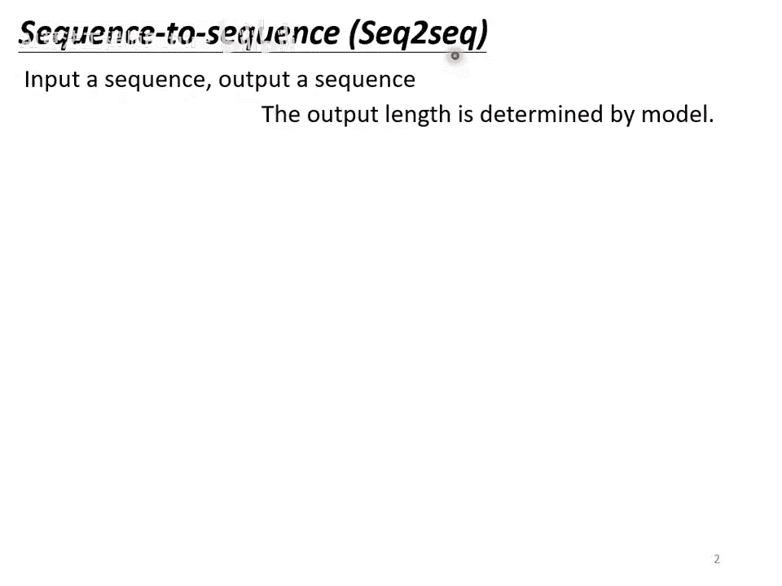

举例来说一个很好的应用就是语音辨识，在做语音辨识的时候，输入是声音讯号，那我们在这门课里面已经看过好多次，说输入的声音讯号其实就是一串的factor，输出是什么，输出是语音辨识的结果。

也就是输入的这段声音讯号所对应的文字，我们这边呢用圈圈呢来代表文字，每一个圈圈就代表啊，比如说中文里面的一个方块字，那今天输入跟输出的长度当然是有一些关系，但是却没有绝对的关系。

我们说输入的声音讯号它的长度是大T，我们并没有办法，一知道说根据大T输出的这个长度，N1定是多少，那怎么办呢，由机器自己决定，由机器自己去听这段声音讯号的内容，自己决定，他应该要输出几个文字。

它输出的语音辨识结果，输出的句子里面应该包含几个字，由机器自己来决定，这个是语音辨识。

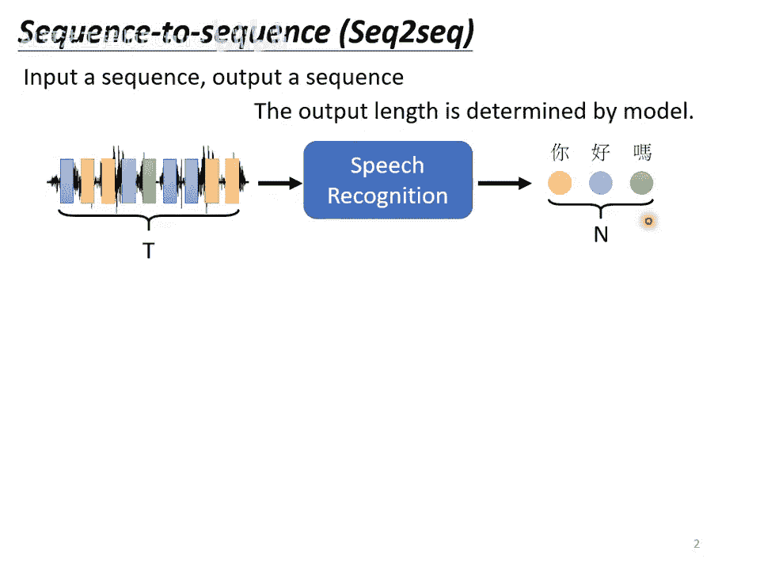

还有其很多其他的例子，比如说做业务，我们会做机器翻译，让机器读一个语言的句子，输出另外一个语言的句子，那在做机器翻译的时候，输入的文字的长度是N，输出的句子的长度是NP，那N跟n pl之间的关系。

也要由机器自己来决定，我们说输入机器学习这个句子，输出是machine learning，那这个输入是有四个字输出，有两个英文的词汇，但是并不是所有中文跟英文的关系都是输出，就是输入的1/2。

到底输入一段句子，输出英文的句子要多长，由机器自己决定。

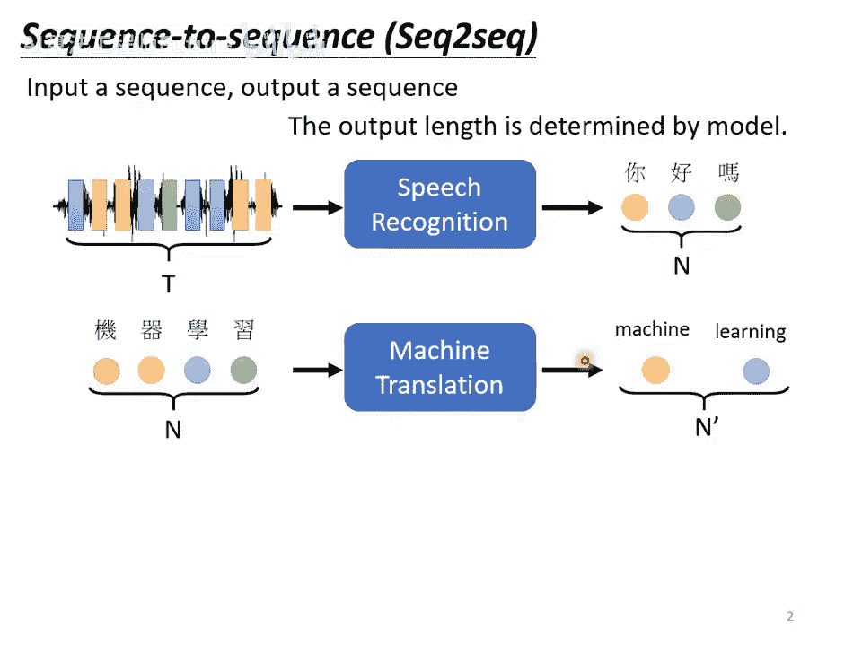

甚至你可以做更复杂的问题，比如说做语音翻译，什么叫做语音翻译，语音翻译就是你对机，你对机器说一句话，比如说machine learning，它输出的不是英文，他直接把他听到的英文的声音讯号翻译成中文。

你对他说machine learning它输出的是机器学习，那你可能会问说，为什么我们要做speech translation这样的任务呢，为什么我们不说我们直接做一个语音辨识，再做一个机器翻译。

把语音辨识系统跟机器变成机器翻译系统，接起来就直接是语音翻译呢，那是因为其实世界上有很多语言，它根本连文字都没有，世界上呢有超过7000种语言，那其实在这7000种语言，有超过半数其实是没有文字的。

对这些没有文字的语言而言，你要做语音辨识可能根本就没有办法，因为它没有文字啊，所以你根本就没有办法做语音辨识，但我们有没有可能对这些语言做语音翻译，直接把它翻译成我们有办法阅读的文字呢，一个很好的例子。

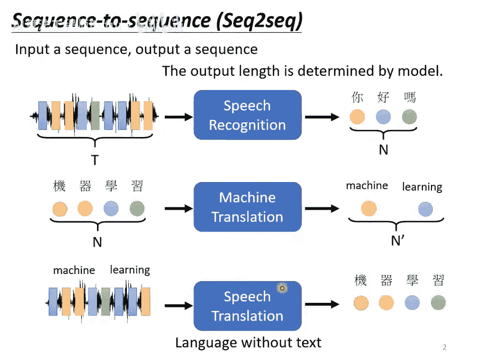

也许就是台语的语音辨识，但我不会说台语没有文字啦，很多人觉得台语是有文字的，但台语的文字并没有那么普及，如果所现在想听说小，其实听说小学都有教台语的文字了，但是台语的文字并不是一般人能够看得懂的哦。

所以如果你做语音辨识啊，你给机器一段台语。

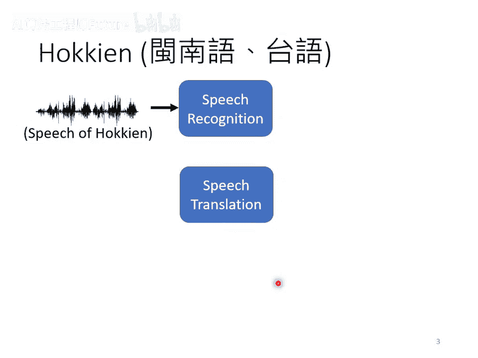

然后他可能输出是母糖，那你根本就不知道这段话在说什么，对不对，所以我们期待说机器也许可以做翻译，去做语音的翻译，跟他对他讲一句台语，它直接输出的是同样意思的中文的句子。

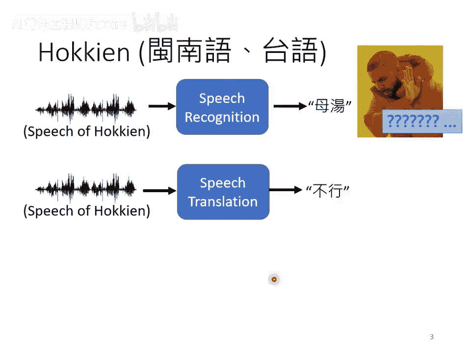

那这样一般人就可以看懂，那有没有可能做到这件事呢，有没有可能训练一个类神经网络，这个类神经网络听某一种语言的声音讯号。

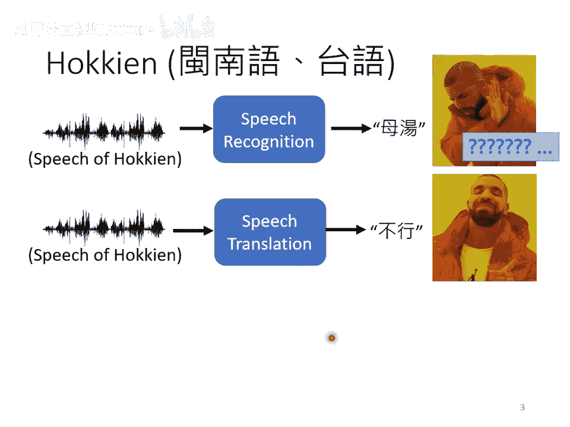

输出是另外一种语言的文字呢，其实是有可能的。

那对于台语这个例子而言，我们知道说今天你要训练一个neural network。

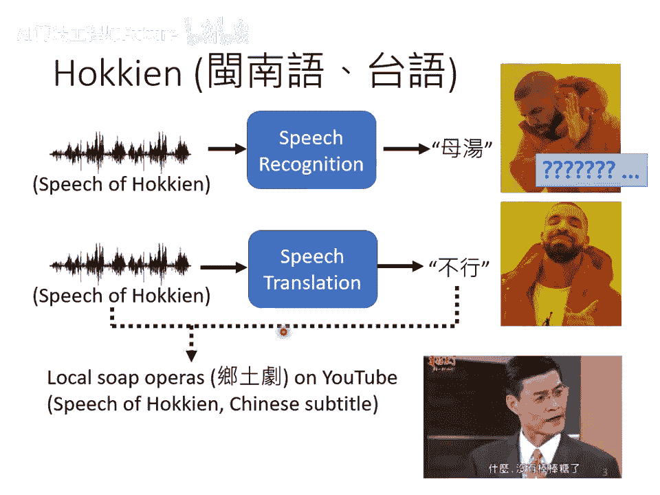

你就需要有input跟output pair，你需要有台语的声音讯号，跟中文文字的对应关系，那这样子的资料好不好收集呢，这样子的资料并不是没有可能收集的，比如说YOUTUBE上面有很多的乡土剧。

也叫乡土剧，就是台语语音中文字幕哦，所以你只要把他的台语语音载下来，中文字幕载下来，你就有台语声音讯号跟中文之间的对应关系，你就可以硬吹一个模型，你就可以劝我们刚才讲。

我们等一下要讲的transformer，然后叫机器直接做台语的语音辨识输入，台语输出中文好，那可能会觉得这个想法很狂，而且好像听起来有很多很多的问题，那我们实验室就载了1500个小时的呃。

乡土剧的资料啦，然后呢就真的拿来训练一个语音辨识系统啦，诶可会觉得说这听起来很多的问题，举例来说这个乡土剧有很多的杂讯啊。

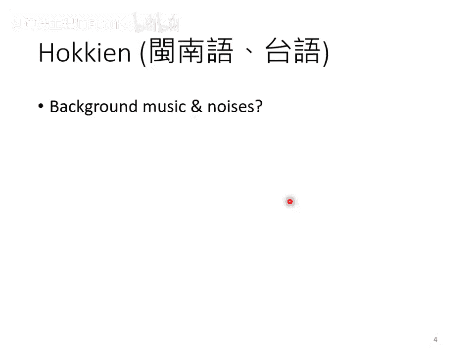

有很多的音乐啊，就不要管它这样子，然后这个乡土剧的字幕。

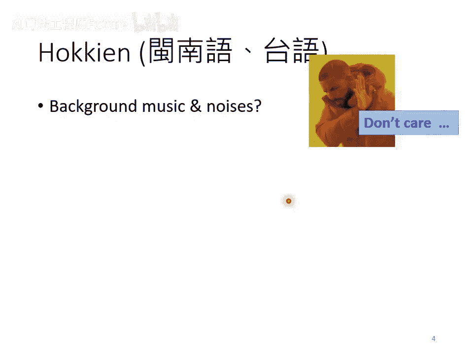

不一定跟声音有对起来呀，就不要管他这样子，嘿然后你可能想说哎台语不是还有一些，比如说台罗拼音啊，台语也是有类似音标这种东西，也许我们可以先辨识成音标当做一个中介。

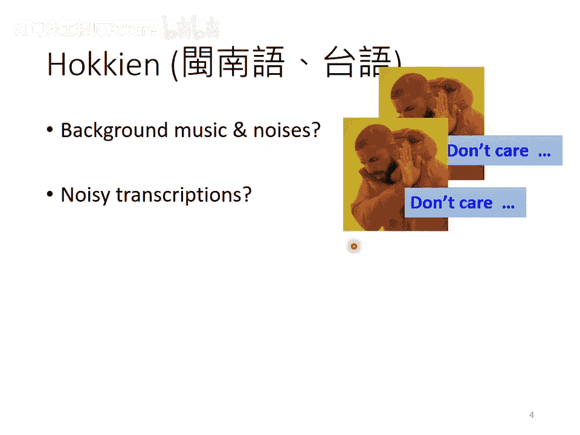

然后再从音标转成中文，也没有这样做，直接训练一个模型，输入是声音讯号输出，直接就是中文的文字，这种嗯没有想太多。

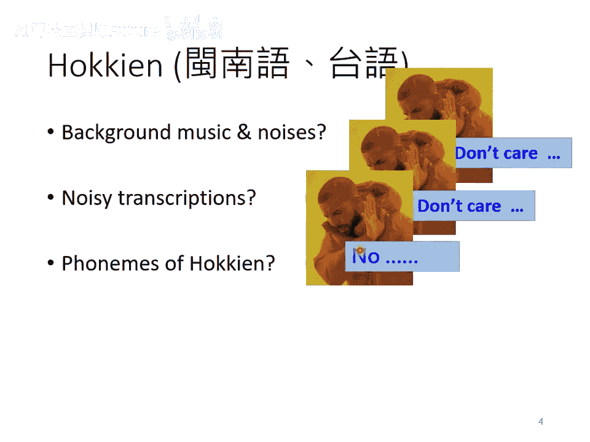

直接资料倒进去就训练个模型的行为呢，就叫做INTR1发，知道吗。

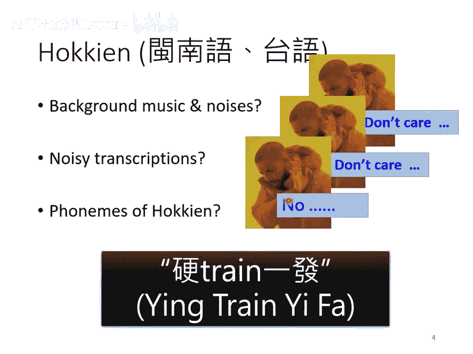

哈哈哈啊，那你可能会想说，这样子硬train1发。

到底能不能够做一个台语语音辨识系统呢，其实还真的是有可能的。

以下是一些真正的结果啦，那机器在听了1500个小时的，这个乡土剧以后啊，你可以对它输入一句台语，然后就输出一句中文的文字，以下是真正的例子啦，机器听到声音是这样子的，那你可以做一下台语的语音听力测验。

看看你辨识出来的跟机器是不是一样的，好机器听到这样的句子，例行台北看啊啊，机器输出是什么呢，它的输出是你的身体撑不住，你这个声音讯号是立形态美堪，但机器并不是输出无堪，而是它就输出撑不住。

或者是机器听到的是这样的声音讯号，阿古代不及你写哪部情感VERDIVERGE，你写安卓备情感机器听到BIRDIVERGE，它并不是输出，没带没制，它是输出没事，这样只听到四个音节，Veri veri。

但他知道说台语的bd diverge，翻译成中文也许应该输出没事，所以机器的输出是没事，你为什么要请假，但机器其实也是蛮容易犯错的啦，以下特别找几个犯错的例子给你听一下，比如说你听听这段声音讯号。

Meco，他说梅赛NO，我自己听到的时候，我觉得我跟机器的答案是一样，就说要生了吗哈哈，但其实这句话正确的答案就是VESNO，哎VESNO不会腻吗啊，但机器在倒装，你知道有时候你从台语转成中文句子。

需要倒装在倒装的部分，感觉就没有太学起来，举例来说，他听到这样的句子，哇哦嘎CHU，拜托他说哇呜嘎CHU拜托，那机器的输出是我有帮厂长拜托，但是你知道说这句话其实是倒装哇，物嘎CHU，拜托是我拜托厂长。

但机器对他来说，如果台语跟中文的关系却需要倒装的话，看起来学习起来还是有一点困难的，但这个例子想要告诉你说，直接台语声音讯号转繁体中文，不是没有可能是有可能可以做得到的。

那其实台湾有很多人都在做台语的语音辨识啦，如果想要知道更多关台语语音辨识的事情的话。

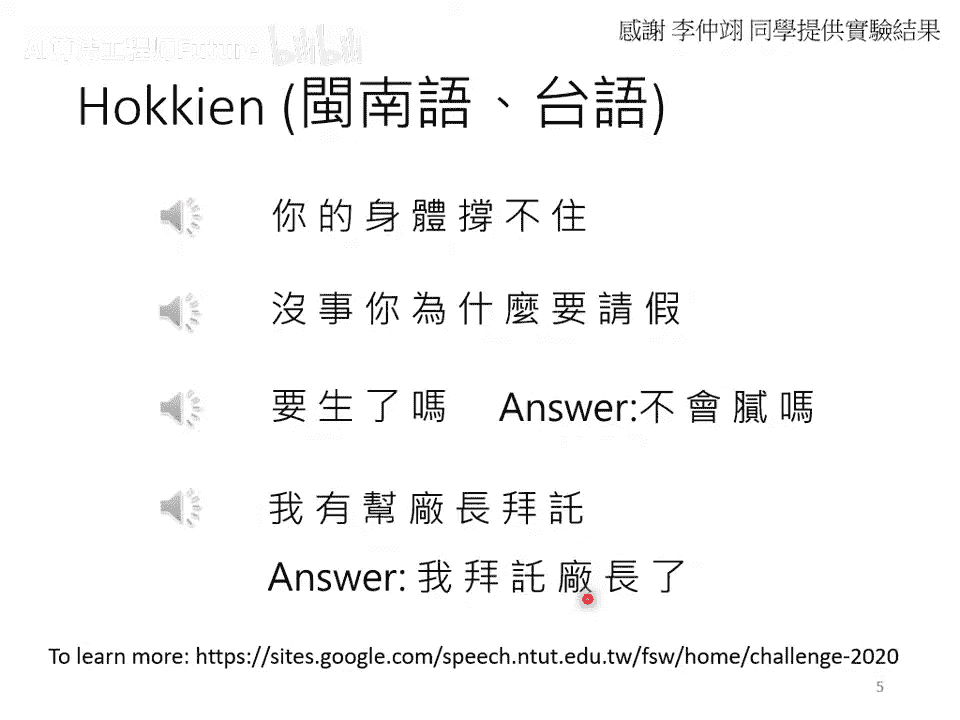

可以看一下下面这个网站好，那台语语音辨识反过来就是台语的语音合成，对不对，我们如果是一个模型输入台语声音，输出中文的文字，那就是语音辨识，反过来输入文字，输出声音讯号，就是语音合成啊。

这边呢就是demo一下台语的语音合成了，那这个资料用的是台湾虽虾的资料，那你知道google台湾随虾就可以找到这个资料集，里面就是台语的声音讯号啊，那听起来像是这个样子，比如说你刚刚说欢迎来到台湾。

台大语音处理实验室，不过这边是需要跟大家说明一下，现在还没有真的做n to n的模型呢，这边模型还是分成两节，他会先把这个中文的文字转成台语的台罗拼音，就像是台语的KK音标。

再把台语的KK音标转成声音讯号，不过从台语的KK音标转成声音讯号，这一段就是一个像是transformer的network，其实是一个叫做tackle创的model。

它本质上就是一个sequence to sequence model，大概长的是这个样子好，所以你输入文字，欢迎来到台大语音处理实验室，机器的输出是这个样子的，欢迎来到代代语音处理实验室啊。

或者是你对他说这一句中文，然后他输出的台语是这个样子的，最近益阳静音中二及滴滴翠安建社区，办的二款一声哦，所以你真的是可以就是合出台语的声音讯号的，就用我们在这门课里面学到的transformer。

或者是sequence to sequence的model好。

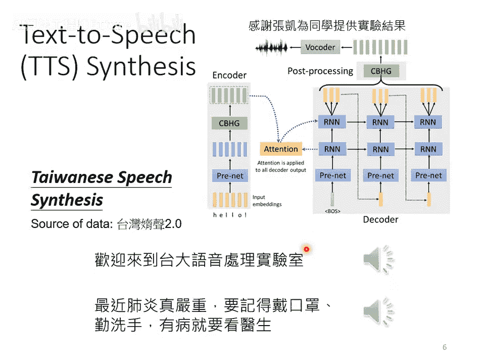

那刚才讲的是跟语音比较有关的，那在文字上也可以可以很广泛的使用了，sequence to sequence的model，举例来说，你可以用sequence to sequence model。

来训练一个聊天机器人，哪知道聊天机器人就是你对他说一句话，他要给你一个回应，输入输出都是文字，文字就是一个factor sequence。

所以你完全可以用sequence to sequence的model，来做一个聊天机器人哦。

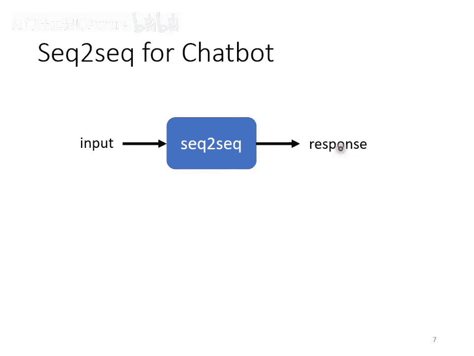

那怎么训练的一个聊天机器人呢，你就要收集大量人的对话了，那像这种对话，你可以收集那个电视剧啊，电影的台词啊等等，你可以搜集到一堆人跟人之间的对话，那假设在对话里面有出现某一个人说hi啊。

另外一个人说hello，How are you today，那你就可交机器说看到输入是H，那你的输出就要跟hello，How are you today，越接近越好。

那就可以训练一个sequence to sequence model。

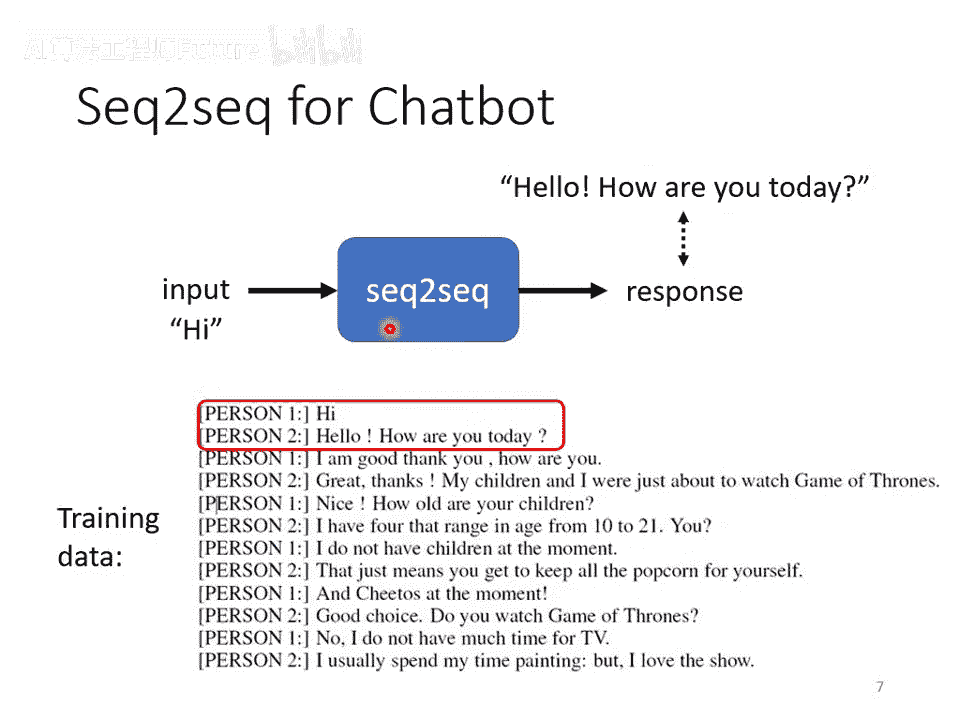

然后跟他说一句话，他就会给你一个回应，那事实上sequence to sequence model啊，在NLP的领域啊，在natural language processing的领域的这个使用啊。

是比你想象的更为广泛的，那其实呢很多natural language processing的任务，都可以想成是question answering，QA的任务怎么说呢。

所谓的question answering，就是给机器读一段文字，然后你问机器一个问题，希望他可以给你一个正确的答案，而很多你觉得跟question，answering没什么关系的任务。

都可能可以想象成是QA，怎么说呢，举例来说，假设你今天想做的是翻译，那机器读的文章就是一个英文的句子，问题是什么，问题就是这个句子的德文翻译是什么，然后输出的答案就是德文，或者是你想要叫机器自动做摘要。

摘要就是给机器读一篇长的文章，叫他把长的文章的重点揭露出来，那也就是给机器一段文字，然后问题是这段文字的摘要是什么，然后期待它就可以输出一个摘要。

或者是你想要叫机器做sentiment analysis，什么是sentiment analysis呢，就是机器要自动判断一个句子，是正面的还是负面的，那像这样子的应用，在假设你有做了一个产品。

然后上线以后，你想要知道网友的评价，但是你又不可能一直找人在PPT上，把每篇文章都读过，所以怎么办啊，你就做一个sentiment analysis model，看到有一篇文章里面有提到你的产品。

然后就把这篇文章丢到你的model里面去，判断说这篇文章是正面还是负面的，那怎么把sentiment analysis，这个问题看成是QA的问题呢，就给机器，你要判断正面还是负面的文章。

那你的问题就是这个句子是正面还是负面的，然后希望机器可以告诉你答案哦，所以各式各样的NLP的问题，往往都可以看作是QA的问题，而QA的问题又可以用sequence to。

sequence的model来解好，那QA的问题，怎么用sequence to sequence的model来解呢。

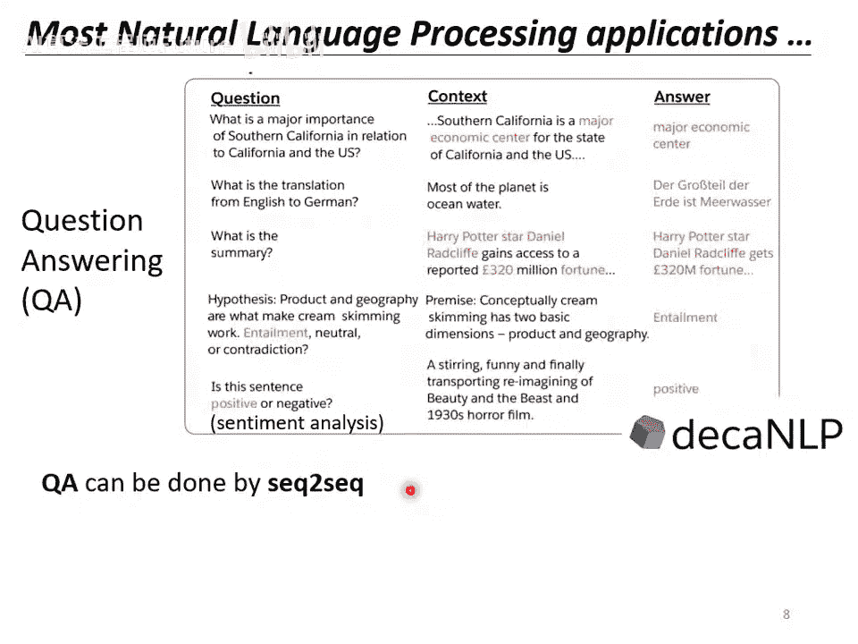

呃就是有一个sequence to sequence model输入，就是问题跟文章把它接在一起输出，就是问题的答案就结束了，有问题加文章合起来是一段很长的文字吗，答案是一段文字吗。

那sequence to sequence model，只要是输入一段文字，输出一段文字，只要是输入一个sequence，输出一个sequence就可以解哦，所以你可以把QA的问题。

硬是用sequence to sequence model解，叫他读一篇文章，读一个问题，然后就直接输出答案，所以这样子的，所以各式各样的NLP的任务。

其实都有机会使用sequence to sequence的model。

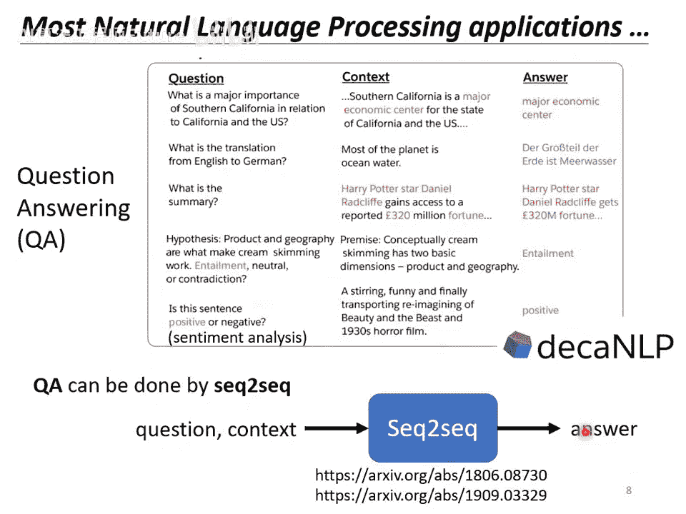

但是我这边必须要强调一下，对多数NLP的任务，或对多数的这个呃语音相关的任务而言，往往为这些任务特制化模型，你会得到更好的结果，就什么问题都用sequence to sequence model。

就好像说你不管是做什么事情，都用瑞士刀一样，对不对，瑞士刀可以做各式各样的问题，砍柴也可以做，用瑞士刀来切菜，也用瑞士刀，但是它不见得是一个最好用的，所以如果你为各式各样不同的任务客制化。

各式各样的模型，往往可以得到比单用sequence to sequence model，更好的结果，但是各个任务客制化的模型诶，就不是我们这门课的重点了啊，如果你对这个呃人类语言处理好，包括语音。

包括自然语言处理这些相关的任务，有兴趣的话呢，可以参考一下以下课程网页的链接啊，这就是去年上的这个深度学习与人类语言处理，这门课的内容里面就会教你各式各样的任务，最好的模型应该是什么，举例来说。

在做语音辨识，我们刚才讲的是一个sequence to sequence the model，输入一段声音讯号，直接输出文字，今天呢google的pixel four。

它这官方google官方也告诉你说，pixel four也是用一个n to and neural network，pixel for里面就是有个neural network。

输入声音讯号输出就直接是文字，但它其实用的不是sequence to sequence model，还用的是一个叫做RNN transducer的model，那像这些模型。

它就是为了语音的某些特性所设计的，这个其实可以表现的更好，那至于每一个任务有什么样克制化的模型，那这个就是另外一门课的主题，就不是我们今天想要探讨的重点好。

那我刚才讲了很多sequence to sequence model，在语音，还有自然语言处理上的应用。

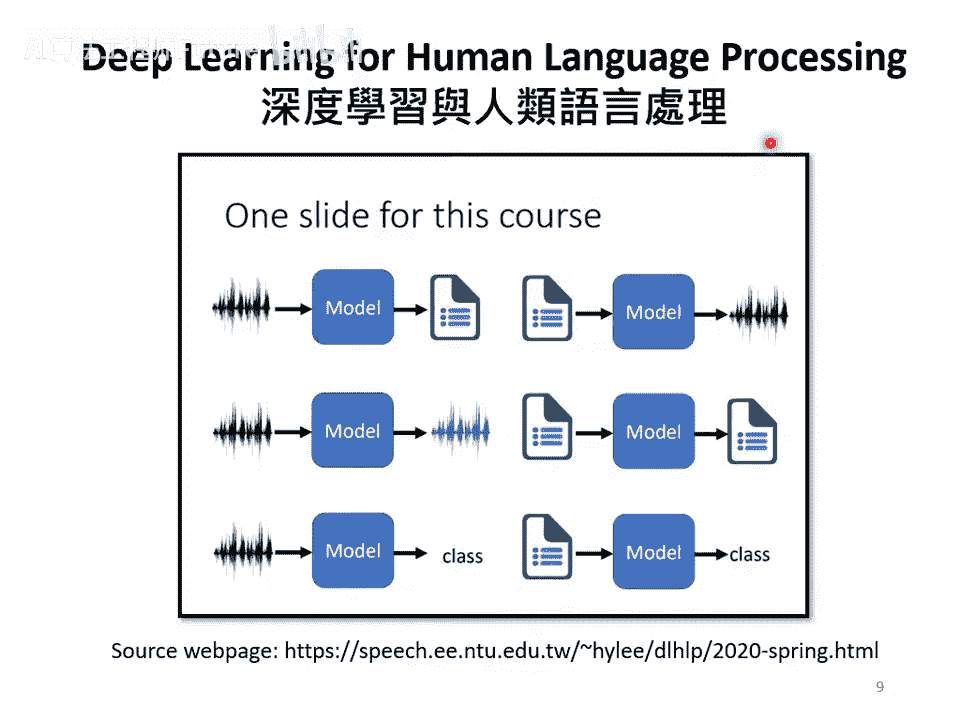

那其实有很多应用啊，你不觉得他是一个sequence to sequence model的问题，但你都可以应用sequence to sequence model的问题，硬解它，举例来说，文法剖析。

文法剖析要做的事情就是好给机器一段文字，比如说deep learning is very powerful。

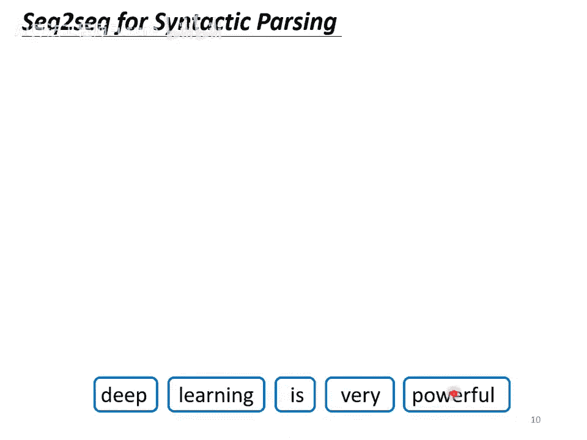

绩效要做的事情是产生一个文法的剖析数，告诉我们说div加learning合起来是一个这个名词片语，然后very加powerful合起来是一个形容词片语，这个形容词片语加is以后会变成一个动词片语。

动词片语加名词片语合起来呢是一个句子，那今天这个文法剖析要做的事情。

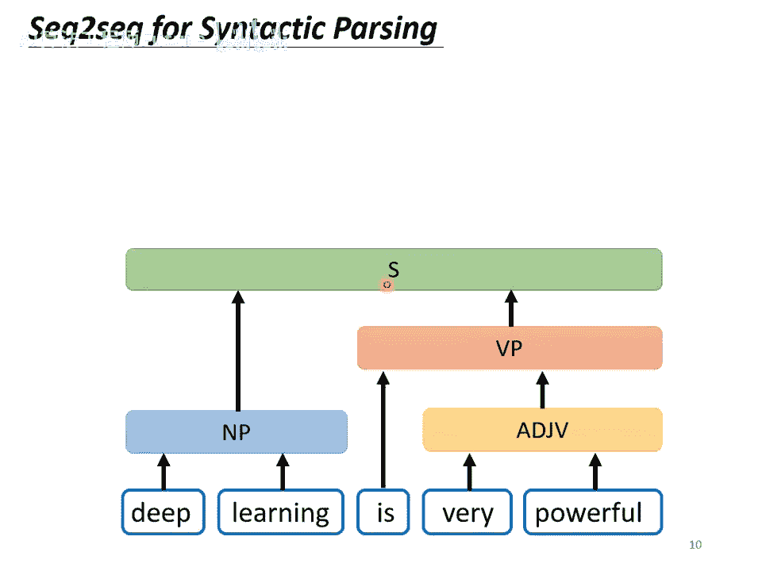

就是产生这样子的一个passing the tree，所以在文法剖析的任务里面，假设你想要deep learning解的话，输入是一段文字，它是一个sequence。

但输出看起来不像是一个sequence，输出是一个树状的结构，但事实上一个树状的结构，可以硬是把它看做是一个sequence。

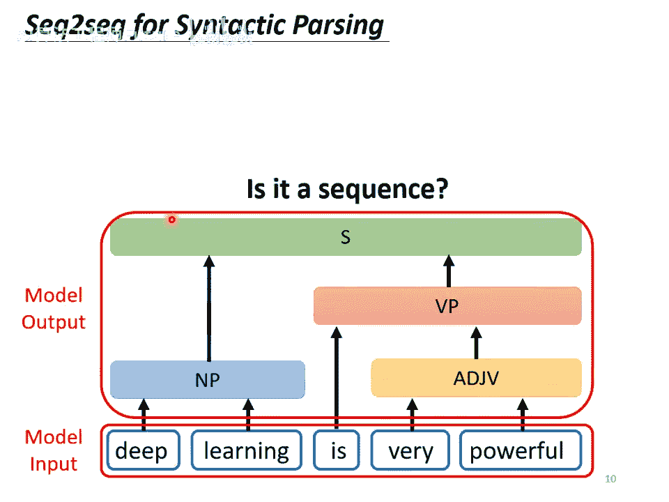

怎么说呢，这个树状结构可以对应到一个这样子的sequence，而从这个sequence里面啊，你也可以看出这个树状的结构啊，有一个S还有个左括号，有一个右括号，然后S里面有一个none phrase。

有一个左括号和右括号，NP里面有一个NP，也有个左括号，有个右括号，然后NP里面有is，然后有这个啊，呃形容词片语还有一个左括号，右括号这一个sequence。

它就代表了这一个tree的structure。

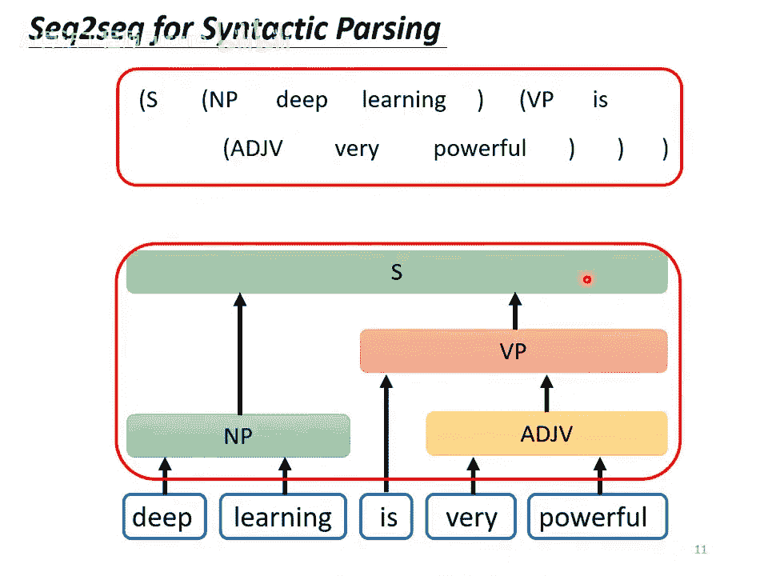

你先把tree的structure转成一个sequence以后，你就可以用sequence to sequence model硬解它。

你就TRA1train一个sequence to sequence model，读这个句子，然后直接输入这一串文字，再把这串文字转成一个树状的结构。

你就可以硬是用sequence to sequence model，来做文法剖析这件事，而这个概念呐听起来非常的狂。

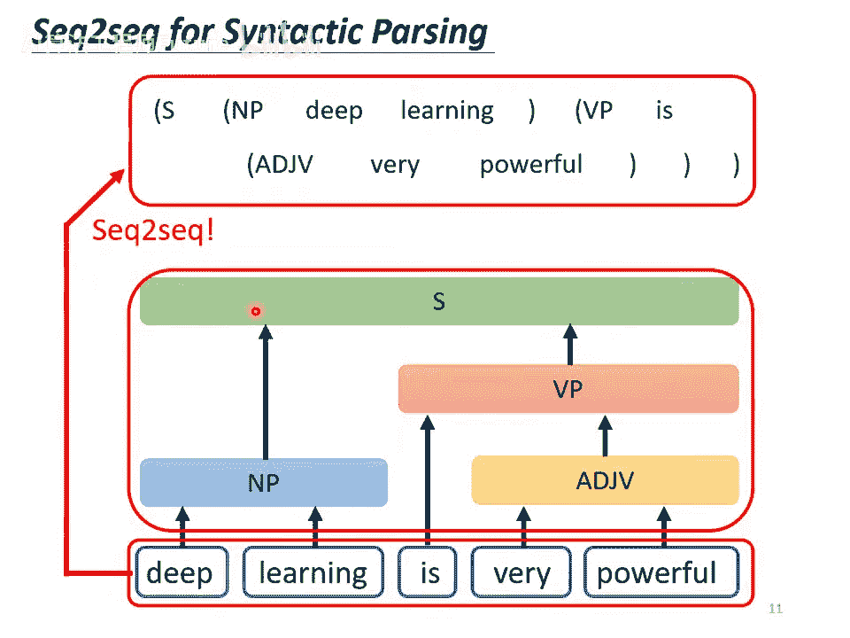

但这还是这是真的可以做得到，你可以读一篇文章，叫做grammar as a foreign language，那这篇文章其实不是太新的文章，你会发现它放到ARPVE上面的时间，是14年的年底。

所以其实也是一个上古神兽等级的文章，那在这篇文章问世的时候，那个时候sequence to sequence model还不流行，那时候sequence to sequence model。

主要只有被用在翻译上啊，所以这篇文章的title才会取说，Grammar as the foreign language，就是说他把这个文法剖析这件事情，当做是一个翻译的问题，把文法当做是另外一种语言。

直接套用一个，当时人们认为只能用在翻译上的模型硬做结果，他得到state of dr的结果，那我其实在国际会议的时候，其实有片有有遇过这个第一作者啦，有其实有遇过这个这个ORIALVR。

然后那个时候sequence to sequence model，还是一个非常潮的东西，然后那时候我在我认知里面，我觉得这个模型应该是挺难劝的，我问他说，哎。

这个train train这种sequence to sequence model，有没有什么tips啊，你看你没想到你这个这个这个做个文法剖析。

然后sequence to sequence mod居然可以硬做到style底啊，这应该用什么啊，很厉害的tips吧，他说没有什么tips，他说我连EDEN都没有用。

我直接gradient descent就train起来了啊，我第一次train就成功了，只是我要弄SEQU，我要冲到style dr，还是稍微调了一下参数而已，这样子，啊我也不知道是真的还假的啦。

不过今天sequence to sequence model，真的是已经被很广泛的在应用，在各式各样的应用上了。

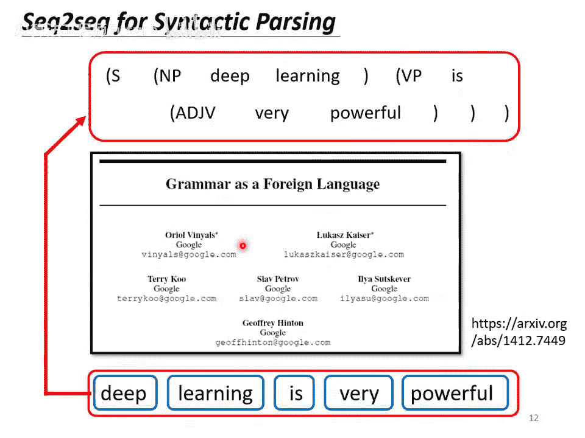

好那还有一些任务可以用sequence to sequence model，举例来说，more time label的classification。

什么是more tai label的classification呢，这边你要比较一下，more ti class classification跟MOTILABEL的classification。

more time class的classification跟more time label的classification，听起来名字很像，但他们其实是不一样的事情。

moti class的classification意思是说我们有不止一个class，机器要做的事情，是从数个class里面选择某一个class出来。

但是more time label的classification意思是说，同个东西它可以属于多个不止一个class啊。

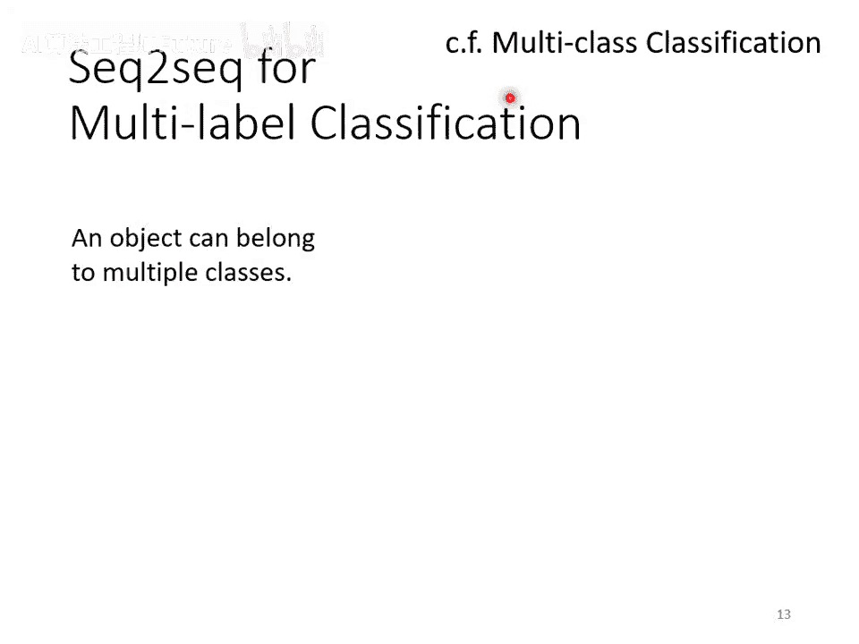

举例来说，你来做文章分类的时候，可能这篇文章属于class1跟三，这篇文章属于class三九十七等等，那你可能会说，这种mortilabel classification的问题要怎么解呢。

能不能直接把它当做一个MORTCLASS，classification的问题来解呢，举例来说呃，我把这些文章丢到一个classify里面，那本来classify只会输出一个答案嘛，输出分数最高那个答案。

我现在就输出且分数最高的前三名，看看能不能解multi label的classification的问题，但这种方法呢可能是行不通的，为什么，因为每一篇文章对应的class的数目根本不一样啊。

有些东西有些文章对应的数目，对应的class数目是两个，有的是一个，有的是三个，所以如果你说我直接取一个fresh home，我直接取分数最高的前三名。

classify output的分数最高前三名来当做我的输出，显然不一定能够得到好的结果。

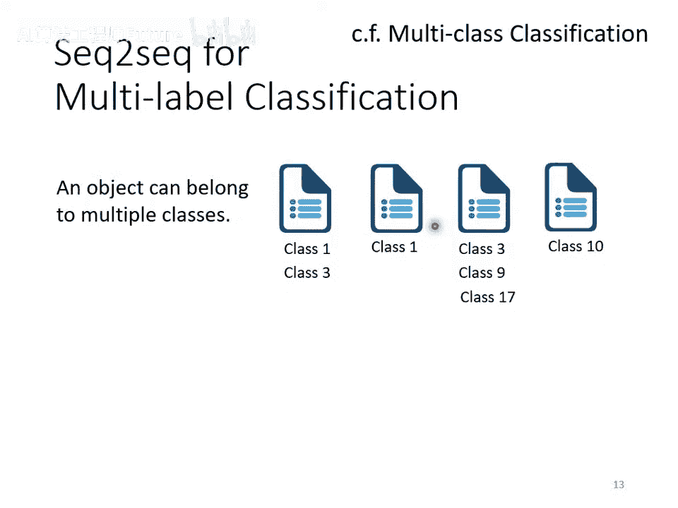

那怎么办呢，这边可以用sequence to sequence硬做，你知道吗，输入一篇文章，输出就是class就结束了，机器自己决定他要输出几个class。

我们说sequence to sequence model，就是由机器自己决定输出几个东西，输出的output sequ的长度是多少，那既然你没有办法决定class的速度怎么办，机器帮你决定。

他自己决定每一篇文章要属于多少个class。

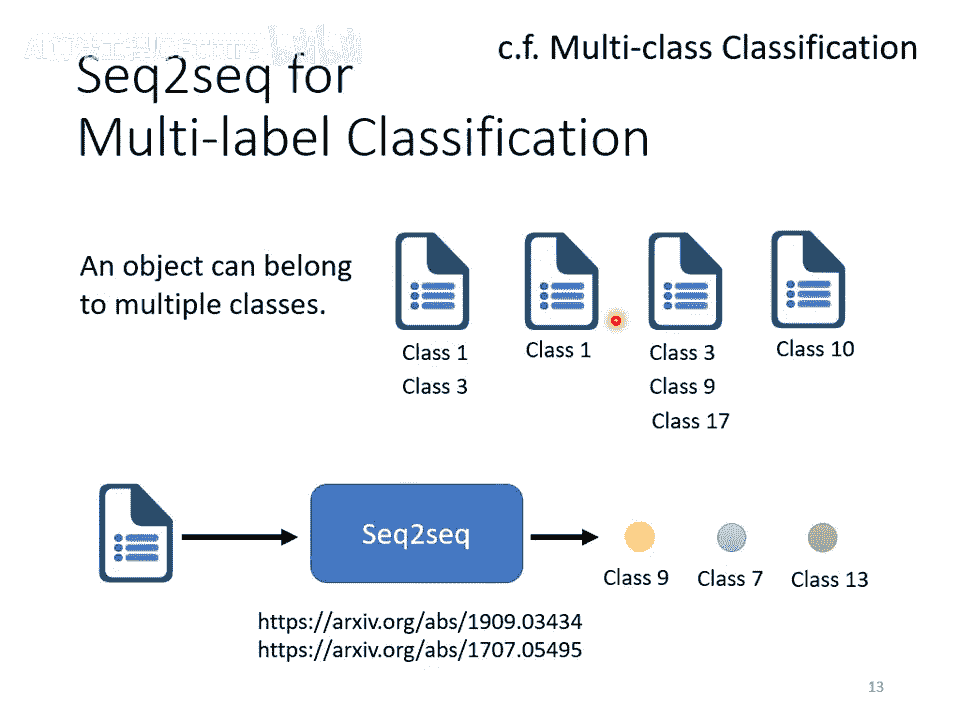

或者是object detection，这个看起来跟sequence to sequence model，应该八竿子打不着的问题，它也可以用sequence to sequence model硬解啊。

object detection都是给机器一张图片，然后他要把图片里面的物件框出来，把它框出，说这个是斑马，这个也是斑马，这个也是斑马，但这种问题可以用sequence to sequence硬做。

那至于怎么做，我们这边就我们这边就不细讲，那我这放了一篇文文献，放个链接给大家参考好，那讲这么多，就是要告诉你说sequence to sequence model。

它是一个很powerful的model，它是一个很有用的model，那我们现在就是要来学怎么做sequence to sequence，这件事好。

那一般的sequence to sequence model啊，它里面会分成两块，一块是encoder，另外一块是decoder，你in break the sequence。

由encoder负责处理这个sequence，再把处理好的结果丢给decoder，由decoder决定他要输出什么样的sequence，那等一下我们都还会再细讲。

encoder和decoder内部的架构。

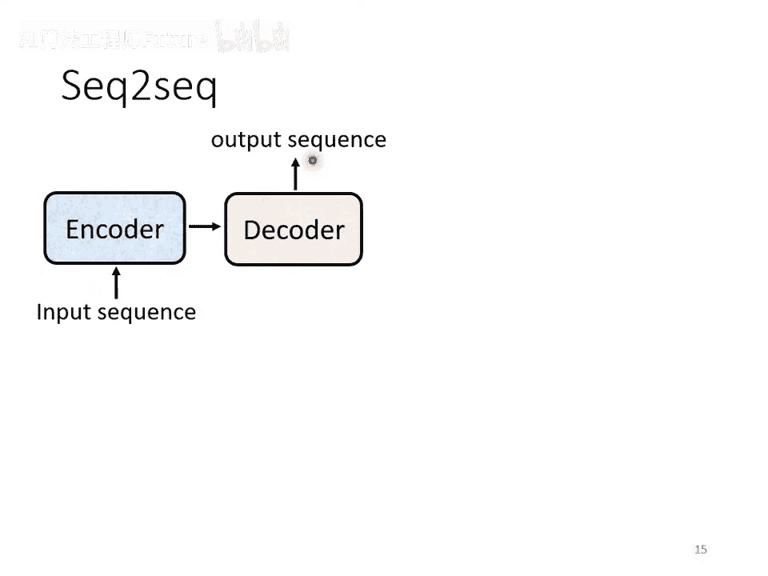

那sequential sequence model的起源呢，其实非常的早在14年，在14年的9月啊，就有一篇sequence to sequence model，用在翻译的文章被放到ARCAVE上。

那你可以想象呃，当时的sequence to sequence model，看起来还是比较阳春的，那今天讲到sequence to sequence model的时候。

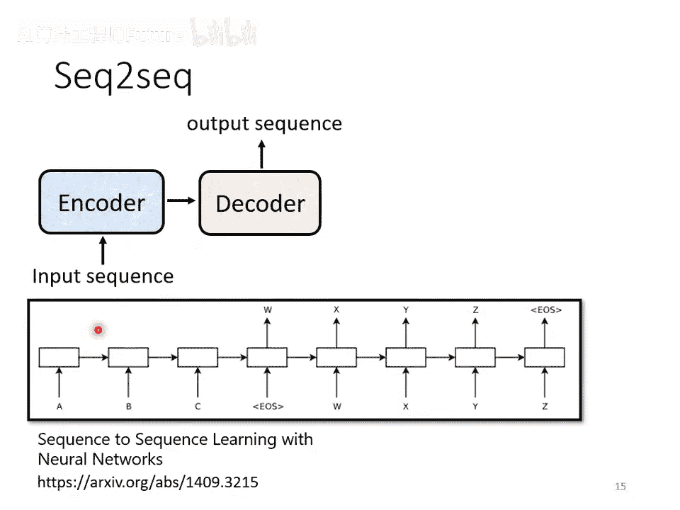

大家第一个会浮现在脑中的，可能都是我们今天的主角。

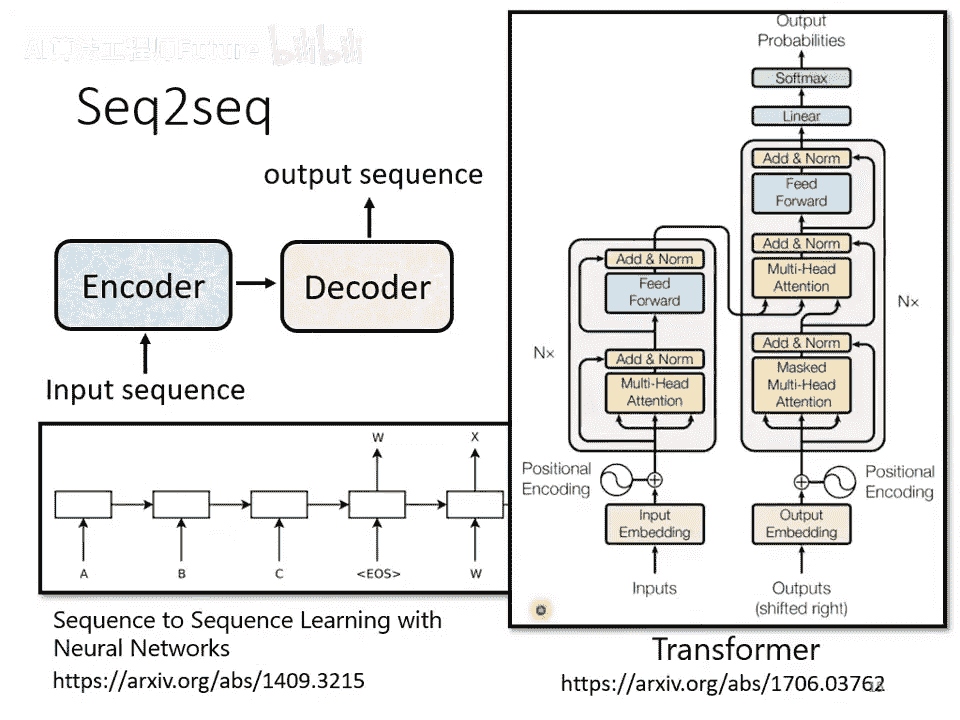

也就是transformer好，它有一个encoder架构，有一个decoder架构，那里面有很多花花绿绿的bug，那等一下呢就会讲一下，这里面每一个花花绿绿的bug。

分别在做的事情是什么，好，那接下来呢我们就来讲encoder的部分。

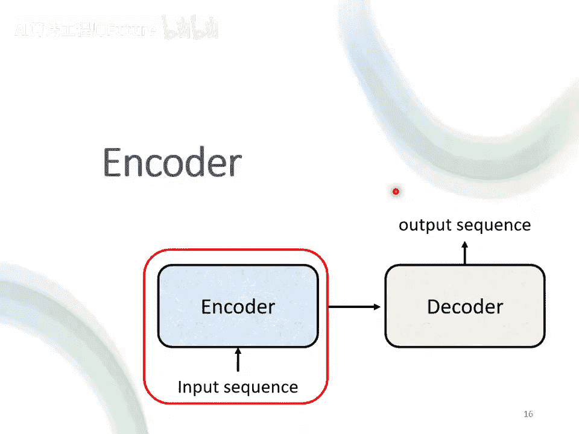

那sequence to sequence model，encoder要做的事情呢，就是给一排向量输出另外一排向量，那给一排向量输出一排向量，这件事情很多模型都可以做到。

那可能第一个想到的是我们刚讲完的self attention，那其实不只是self attention，R n n cnn，其实也都能够做到input牌向量，output另外一个同样长度的向量好。

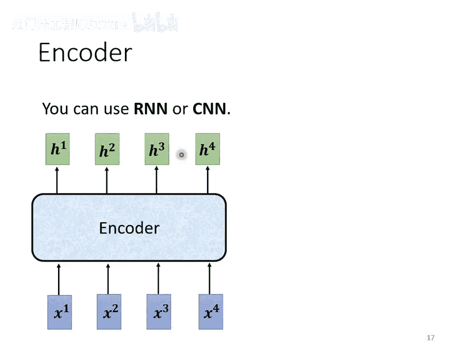

那在transformer里面呢，transformer的encoder用的就是self attention，那这边看起来有点复杂，我们用另外一张图呢，来仔细的解释一下这个encoder的架构。

等一下呢再来跟这个原始的transformer的论文，里面的图呢进行比对好。

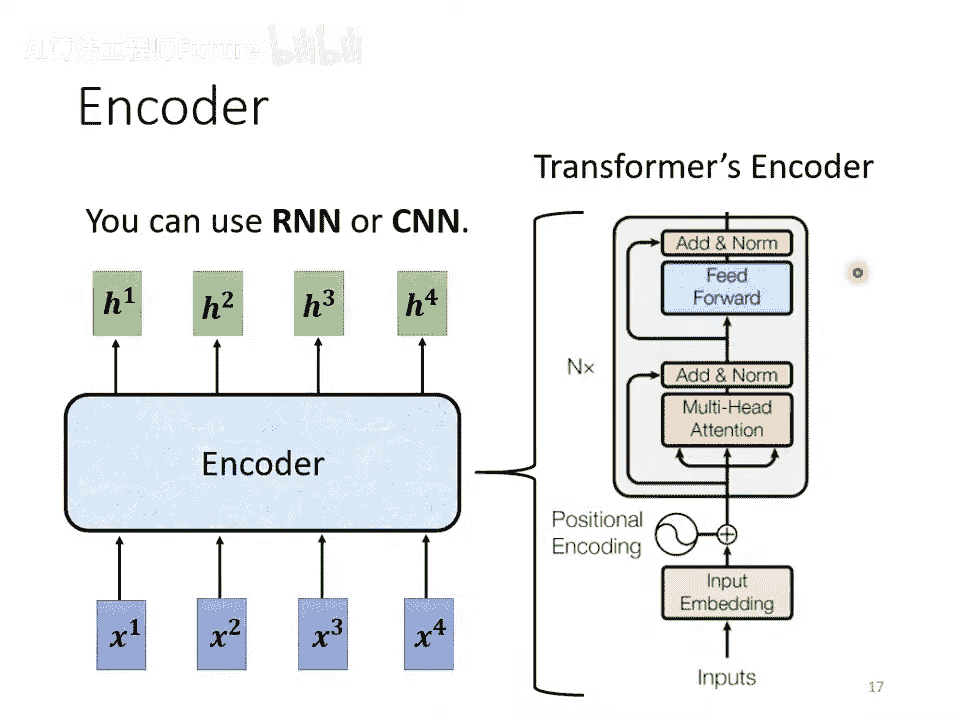

那现在的encoder里面那会分成很多很多的block，每一个block都是输入一排向量，输出一排向量哦，你输入一排向量到第一个blog，第一个blog输出另外一排向量，再输给另外一个blog。

到最后一个blog会输出最终的vector sequence，那每一个block其实并不是neural network的一层，这边之所以不称说每一个block是一个layer。

是因为每一个block里面做的事情，是好几个layer在做的事情，在transformer的encoder里面，每一个block做的事情大概是这样子的。

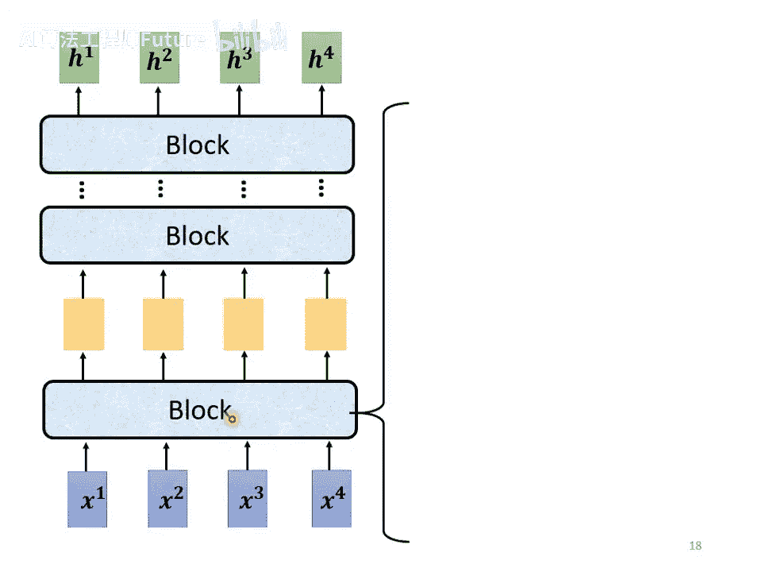

先做一个self attention，input1排vector以后呢做self attention，考虑整个sequence的资讯，output另外一排vector好。

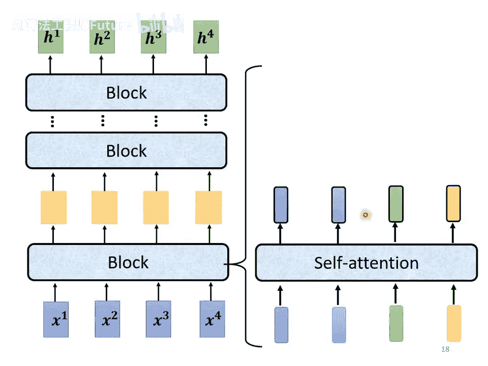

接下来这一排factor啦，会再丢到fully connected的feedforward network里面。

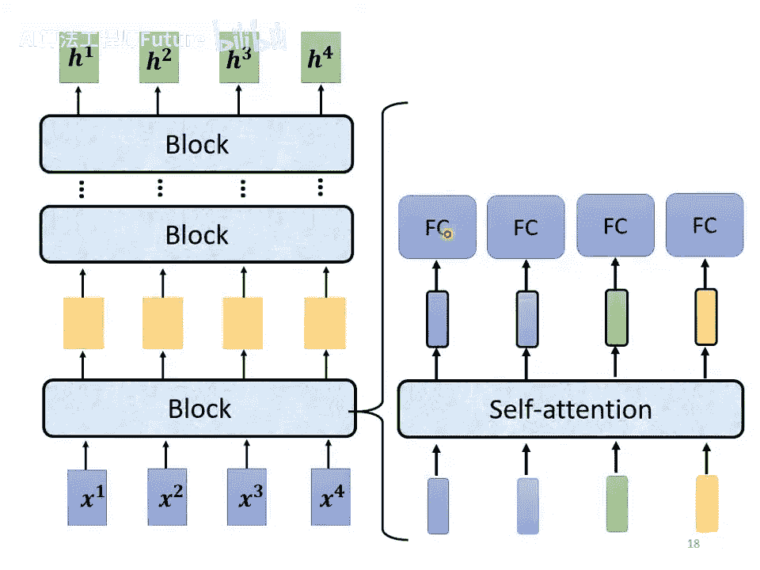

丢到fully connected的network里面，再output另外一排vector，那这一排vector就是block的输出，那事实上在原来的transformer里面呢，他做的事情是更复杂的。

实际上做的事情是这个样子的，这是self attention的layer，那在我们刚才讲self attention的时候，我们说输入一排vector，就输出一排vector，这边的每一个vector。

他是考虑了所有的input以后所得到的结果，在transformer里面呢还加入了一个设计，是说我们不是我们不只是输出这个vector，我们还要把这个vector呢加上它的input哦。

他要把input拉过来，直接加点输出，得到新的open哦，也就是说这边假设这个vector叫做A啊，这个vector叫做B你会把ab加起来，当做是新的输出，那这件事情呢这样子的network架构啊。

叫做RECEDU的connection，那其中RECEDU的connection，在deep learning的领域用的是非常的广泛的，之后如果我们有时间的话。

再来详细介绍为什么要用VC9的connection，等下就先知道说有一种connection，有一种network设计的架构叫做RECEDU的connection。

它会把input直接跟output加起来好，得到新的vector，而得到这个RECEDU的这个结果以后呢，再把它做一件事情叫做normalization。

那这边用的不是batch normalization。

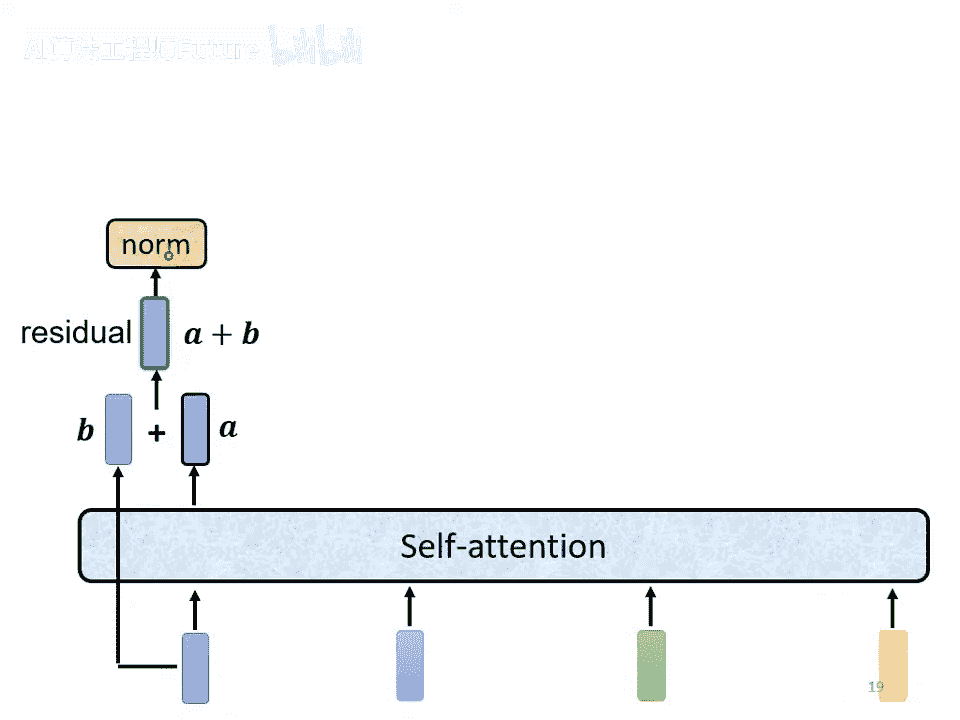

这边用的叫做layer normalization，那layer normalization做的事情呢，比batch normalization更简单一点。

layer normalization做的事情是这个样子的，好输入一个向量输出另外一个向量，这边不需要考虑batch，刚才讲batch norization的时候，需要考虑batch。

但这边这个layer normalization，不用考虑batch的资讯，好输入一个向量输出另外一个向量，那这个layer normalization做的事情是什么呢，它把输入的这个向量啊。

计算它的M跟standard deviation，但是要注意一下，刚才在讲bitch onalization的时候，我们是对同一个dimension，不同的feature，我们是对不同example。

不同的feature的同的dimension，去计算mean跟standard deviation，同一个example里面。

不同的dimension去计算mean跟standard deviation好，那计算出mean in跟standard deviation以后呢，啊你就可以做一个normalize output。

这边的每一个vector呢就是把啊原来input vector嗯，我发现这边有一个bug，这个bug是什么呢，这个bug就是这边不需要plan了，不好意思，记得把这个P拿掉啊，这边不需要plan好。

就把input vector呃，input这个vector里面每一个dimension减掉and减掉幂，再除以standard deviation以后。

得到x pine就是layer normalization的输出好，那得到layer normalization的输出以后呢，他的这个输出啊才是fully connected network的输入。

而fully connected network这边也有RECEDU的架构好，所以我们会把fully connected network的input，跟他的output加起来好。

做一下RECEDU得到新的输出，这个才是transformer，encoder里面一个block的输出哦，这边还有一件事情是漏讲了哦。

这个fully connected network做完RECEDU以后还不是结束，你要把这个RECEDURE的结果呢再做一次，layer normalization哦，这边已经做过一次了。

这边还要再做一次，得到的输出，才是RECEDUNETWORK里面一个block的输出好，所以这个是挺复杂的好。

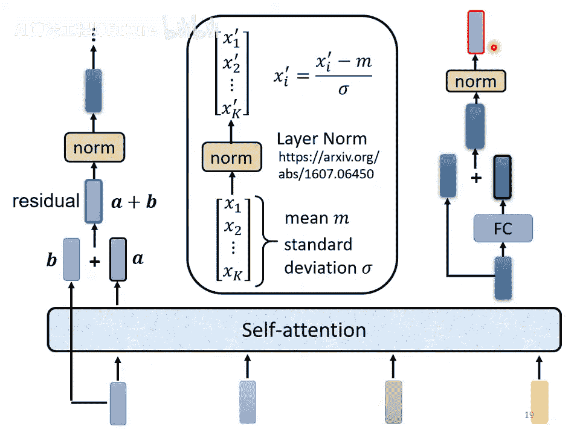

所以我们这边讲的这个图啊，其实就是我们刚才讲的那件事情了，呃，首先呢你有self attention，然后其实在input的地方还有加上positional encoder，Encoding。

我们之前已经有讲过，说，如果你只光用self attention，你没有位置的资讯，所以你需要加上positional的information。

然后在这个图上呢有特别画出positional information好，那这一块呢它这边写一个mothead attention，那这个就是self attention的block了。

那这边有特别强调说他是某台head self attention，那这边有一个and note and and none是什么意思呢，就是RECEDU加layer normalization的意思。

我们刚才有说啊，self attention有加上RECEDU的connection，接下来还要过layer normalization，这边这个图上的。

and and known就是residual加layer non的意思，然后接下来呢这边要过feforward network。

ply connected的feforward network以后再做一次at and NO，再做一次，RECEDU加layer on才是一个block的输出。

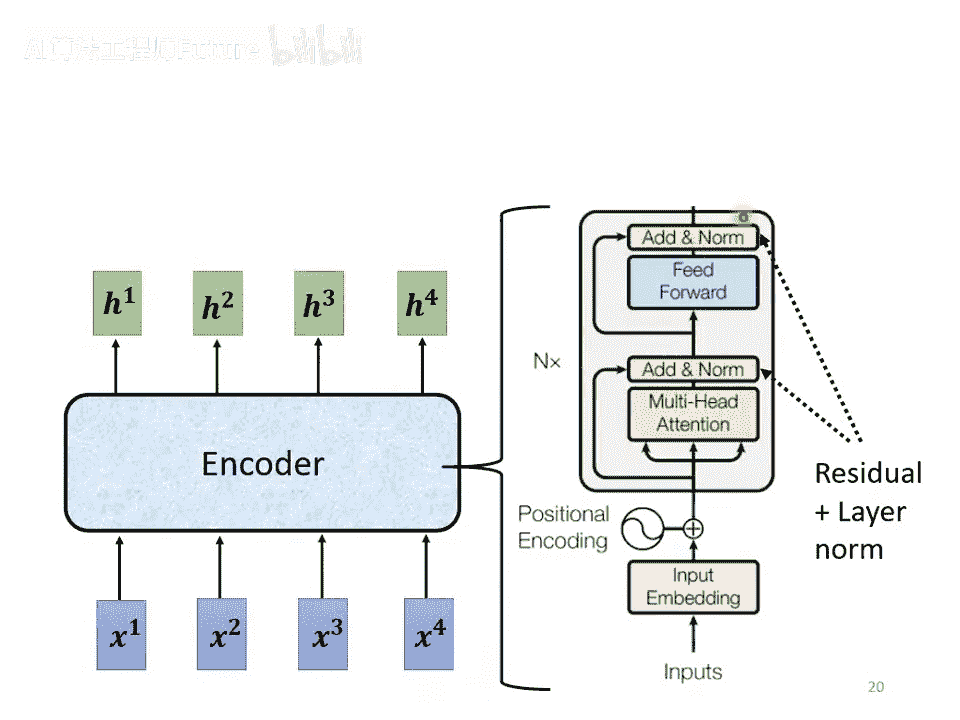

然后这个block会重复N次，那这个复杂的block啊，其实在之后会讲到的一个非常重要的模型，BT里面会再用到那BERT。

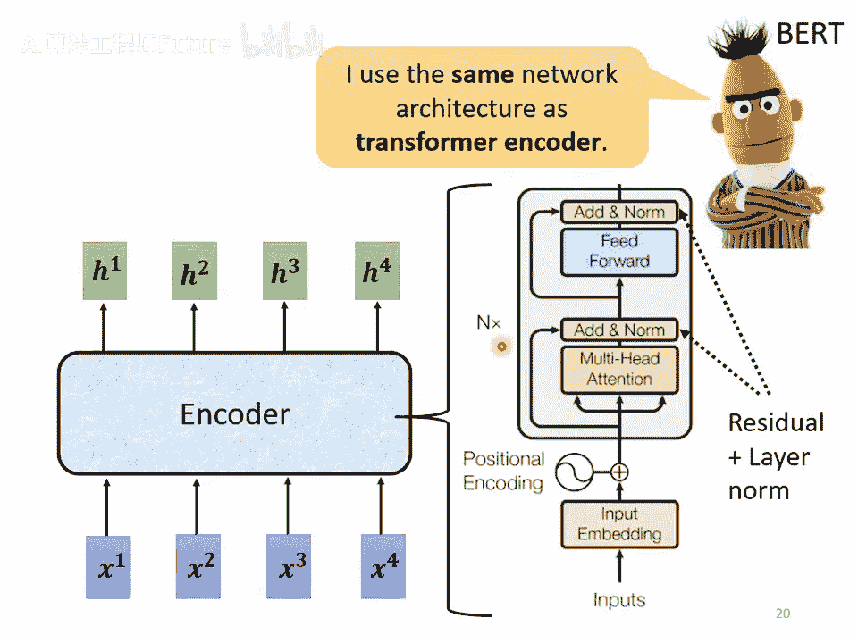

它其实就是transformer的encoder，那讲到这边呢，你心里一定充满了问号，就是哇，为什么这个transformer的encoder要这样设计呢，不这样设计行不行呢，行不一定要这样设计呃。

这个encoder的network架构，现在的这个设计的方式，我是按照原始的论文讲给你听的，但原始论文的设计并不代表它是最好的，最optimal的设计，举例来说。

有一篇文章叫on layer normalization，In the transformer architecture，他问的问题就是，为什么layer normalization是放在那个地方呢。

为什么我们是先做RECEDU，在做layer normalization呢，做能不能够把layer normalization，放到每一个block的input，有做RIS，也就你做RECEDU。

你做RECEDU以后再做layer normalization，再加进去，你可以看到说，左边这个图是原始的transformer啊，右边这个图是稍微把buck，更换一下顺序以后的transformer。

然后更换一下顺序以后，结果是会比较好啊，所以这就代表说原始的transformer的架构，并不是一个最optimal的设计，你永远可以思考看看有没有更好的设计方式。

那再来还有一个问题就是为什么是layer，No，为什么是别的，不是别的，为什么不做BATIONALIZATION，那也许这篇paper可以回答你的问题。

这篇paper是power NO rethinking，Bationalization and transformer，他首先告诉你说。

为什么bitch onalization不如their normalization，在transformer里面，为什么batch normalization不如layer normalization。

那接下来再说他提出来一个power normalization，一听就是很power的意思啊，就可以比这个layer normalization。

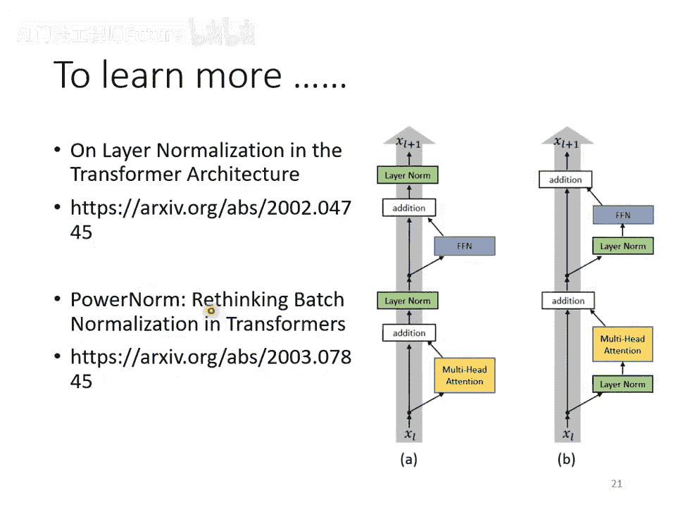

还要这个performance差不多或甚至好一点好额，因为已经快六点了，我想decoder的部分呢我们是不太可能讲完了，所以也许我们先停在这边好了。

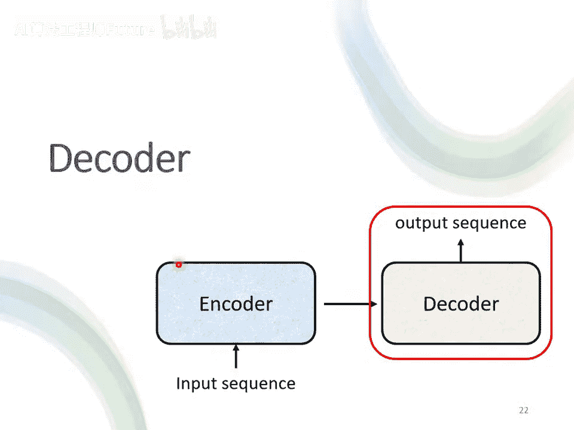