# 【官授搬运】2026年全新优化版李宏毅机器学习系统课程，这才是真正的初学者体系课程！—人工智能／深度学习／神经网络 - P38：3-自注意力机制类别总结 - AI算法工程师Future - BV1ruqABeEFX

好那个现场的同学，线上的同学大家好，那我们就开始上课吧，好那今天要讲的是各式各样的self attention的技术，那我这边呢是假设呢。

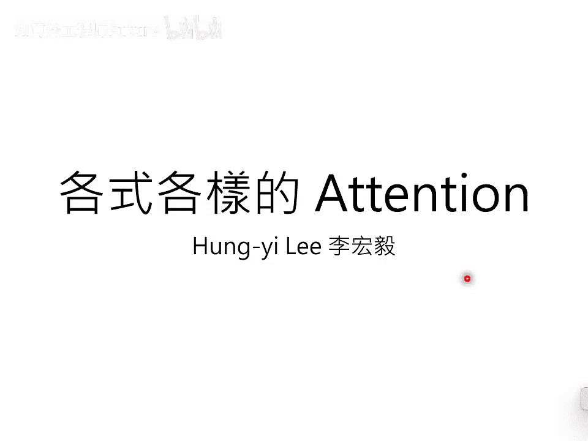

你已经看过跟self attention相关的上课录影。

已经知道self attention是什么。

然后我们来告诉你，其实self attention有各式各样的变形。

好那在这个上课录影的结尾呢，已经告诉你说，其实self attention呢，并不是只有我们上课说的那种样子，我们上课呢有说CATTENTION，就是产生QKV3种vector。

然后呢这个Q跟K之间呢会两两算这个搭花打，然后呢对value做WAITSUN，然后做self tention，然后假设你对这一整个系列的机制，已经非常的清楚，但是self attention不止这样子。

那在self attention之前的影片里面呢，我们就停在这个页面，告诉你说self attention其实有各式各样的变化，他们往往都用什么former，什么former，什么former作为结尾。

但那是另外一个很长的故事了。

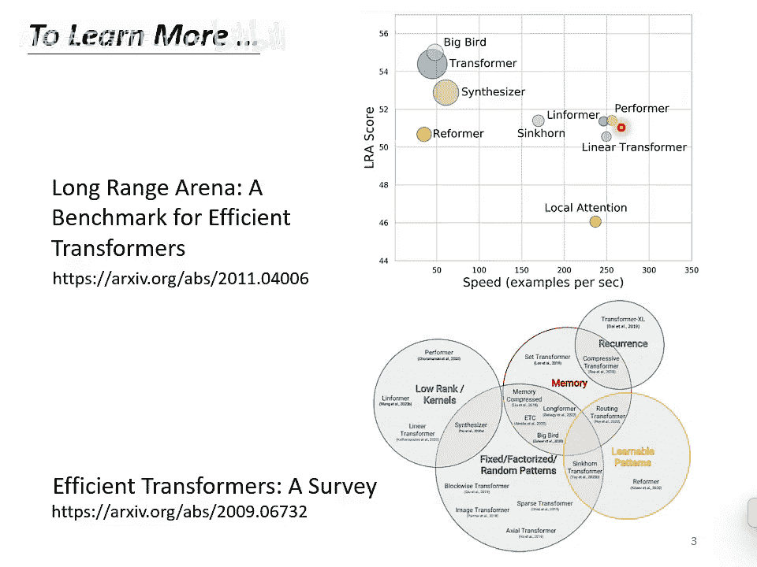

那今天我们就要来讲这个故事好，那先很简短的复习一下什么是self attention，还有它的难点，他的痛点在哪里呢，但我们知道说self attention它的存在是为了要处理。

如果你的input是一个sequence的状态，那现在假设呢你要处理的input是一个sequence，那这个sequence的长度呢，我们用大N来表示，那这个sequence可能是各种不同的资料形态。

它可能是一个句子，句子里面的每一个token，每一个或者每一个词汇当做是一个单位，或者是你的音不可能是一段语音讯号，语音讯号里面的一个friend当做一个单位。

甚至最近常常有人把self attention用在影像处理上，你的输入是一张图片，图片里面的每一个pixel当做一个单位好，那self attention。

他要做的事情就是处理一个input sequence，那现在假设sequence长度是N好，那input the sequence以后呢，我们会产生这个N个key的vector。

跟N个query的vector。

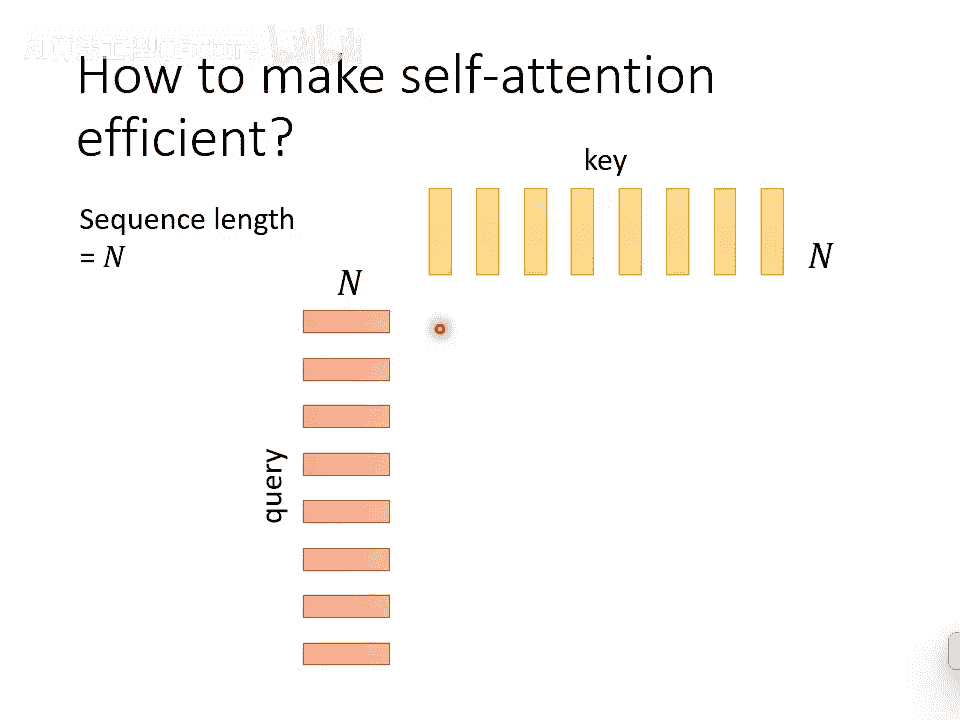

那这N个key的vector跟这个query，N个query的vector会两两之间做大夸大，那有N个key，有N个query，那叫做N平方次大夸大，把N平方式大包打的结果集合起来。

你就得到一个N乘以N的矩阵，那这个矩阵呢叫做attention的matrix，那我们根据这个attention的matrix对value vector。

那这个value vector就没有花在这个投影片上了，我们得到这个attention的matrix以后呢，对value vector做WEISSN，那这个都是过去已经跟大家讲过的内容，那我们在上课。

在之前的录音里面也已经跟大家讲过，说CATTENTION的痛点就是这个N乘以N的矩阵，它的计算量可能会非常的惊人，尤其是你的input sequence非常长的时候，这个N乘以N的attention。

The matrix，它的计算量会非常的大，可能会达到你没有办法承受啊，所以就有一系列的方法，想办法加速attention这个机制的计算好。

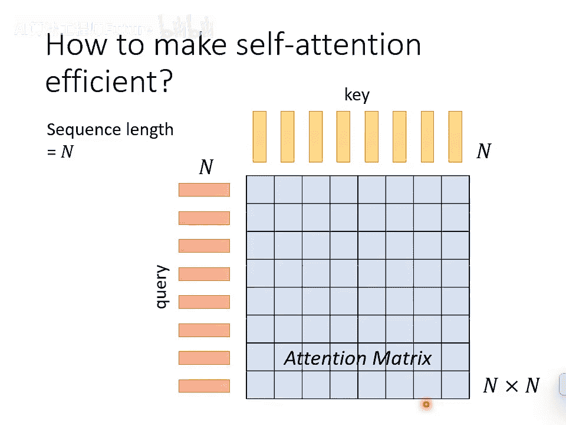

但是在开始之前呢，这边要提醒大家，其实self attention往往只是一个，你的巨大network的其中一个mo种，举例来说，假设你要用的是transformer啊。

上课录音照理说你已经听过transformer了，好假设我们要用的是transformer，transformer里面不是只有self attention，除了self attention以外。

还有其他的mo9，所以今天呢虽然我们说self attention，它的运算量是这个N跟N平方是成正比的，跟sequence的长度，input sequence的长度的平方是成正比的。

但是假设这个self attention呢，它的运算没有dominate整个network运算的话，那你加快self attention的运算，那可能帮助不一定会很大。

就很多同学会他用了这个新的self attention的技术，在transformer里面诶，发现这个计算的这个加速还蛮有限的，那因为很有可能这个整个network里面，FEEDFORWARD的部分。

它所需要耗费的这个运算量，也许根本比self attention大，那你加快SATTENTION也许帮助就非常有限，那什么时候self attention会多么累，这整个network呢，什么时候。

这整个network最主要的运算会来自于self attention呢，当input sequence也就这个N的长度非常长的时候，整个transformer里面最主要的运算就会来自于。

self attention哦，所以今天sequence很长的时候，加快self attention才有帮助，所以这就是为什么啊，等一下你会看到的这些self attention的变形，加快。

self attention的方式，往往最早都是用在影像处理上面哦，因为当很多人想要把self attention，用在影像处理上面的时候，他们就发现有非常大的障碍，怎么说呢。

哎假设要你要处理的是256×256，的一张image，那2563256image不是太大的image好，那假设你今天硬是要用self attention处理的话，会变成什么状况呢。

如果你要self attention处理一张图片，那你可能会把图片里面的每一个pixel，当做一个单位，这个时候你input sequence的长度，就把这个图片里面的pixel全部拉直。

变成256×256，那所以你的大N是256256，如果今天self attention，它的运算量是正比于256×256的平方，不是走256平方哦，是256×256再平方，所以其实是256的四次方。

那这个这个运算量就会非常惊人了，所以这就是为什么你会发现说诶，我们等一下看到的种种self attention的变形，往往最早都是用在影像处理上，所以总之这边要先跟大家强调的是。

当input的sequence非常长的时候，以下看到的那些招数，才有可能会发挥真正的效用好。

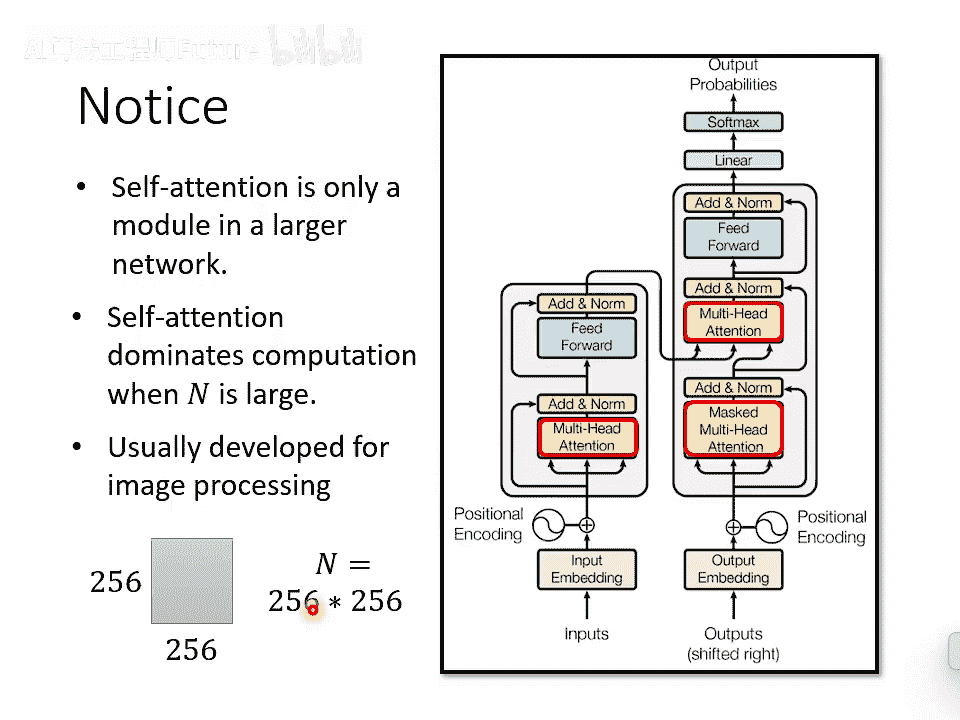

那有什么样self attention的变形呢，有什么样的方法可以加快self attention，这个机制的运算呢，那我刚才说self attention这个机制的运算呢，它最大的八托内来自于。

我们需要计算一个N乘以N的矩阵哦，所以人们就从这个地方下手，有没有办法加快这个N乘以N的矩阵的运算呢，那第一个想法是，也许我们并不需要把N乘以N的这个attention。

metric里面的每一个数值都计算出来，也许有一些位置，有一些位置的attention的value应该是多少，我们不需要算，我们根据人类对这个问题的理解。

可以直接知道attention的value应该是多少，这样讲也许很抽象。

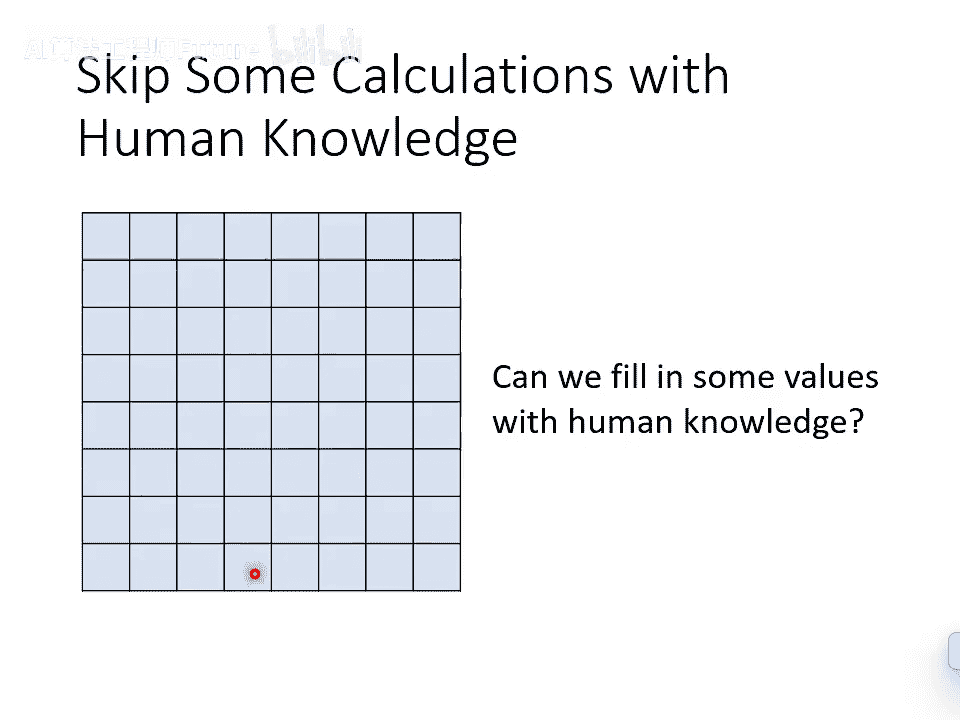

我们先举第一个例子，这个例子是这样子的呃，有时候我们在做attention的时候，有些问题不一定需要看整个sequence，也许有一些问题在做attention的时候，在每一个位置上。

你只需要看左右的邻居就可以得到正确的答案，就可以理解一个token，一个位置他存有什么样的资讯，所以今天假设我们在做self attention的时候，其实只有左右的邻居的资讯是需要知道的。

那也许你可以把更长的更长的距离的，self attention的attention的we就直接设为零。

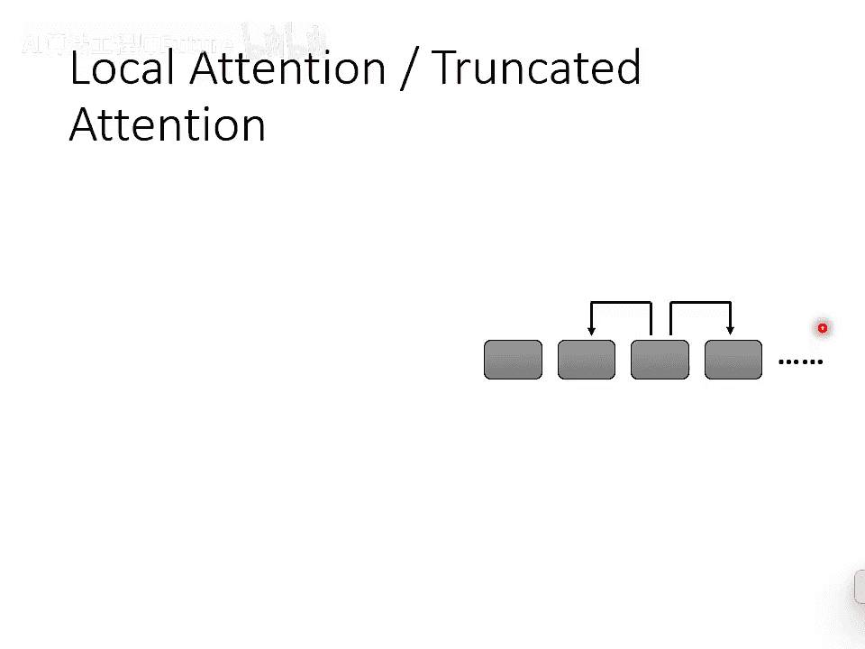

讲的更具体一点，你的attention matrix可以直接画成这个样子，那在这个图上呢，灰色的部分代表，我们直接把attention的WEI设为零就不算了。

不需要去计算灰色的位置的attention位，它直接设为零，然后你只需要去计算有涂颜色的，不是灰色的，蓝色这个部分的attention的数值，那这样就可以加速运算。

因为灰色的部分你都不算入attention了嘛，都不需要做任何计算，只算蓝色的部分，那就可以加快这个矩阵产生的速度，那像这样子的方法呢。

叫做local attention或者叫TRACTED的attention，但像这种local attention或truncated的attention，它显然有一个问题。

就是每次你在做attention的时候，你只看得到某一个小范围之内的资讯，那这样子做的话，那attention跟CON就没什么差别了，对不对，我们上课的时候其实已经跟大家讲过。

CNN跟attention的关系，我没有说，如果今天attention都是ATTEN在一个很小的范围内，那其实它就是CNN哦，所以如果我们今天用local attention，那就等于是做CNN。

那你就直接用CNN就好啦，所以local attention，它是一个可以加快self attention运算的方法，但它不一定可以给你非常好的结果，那有那除了local attention以外。

还有各式各样的变形。

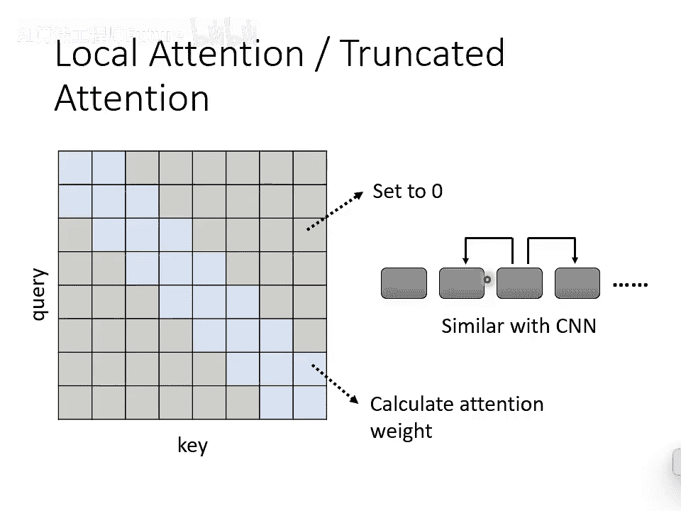

比如说有人说你既然觉得local attention不好，只看邻居不好，那我们就看比较远一点的邻居，比如说在每一个位置，我们不是看下一个位置的资讯，上一个位置的资讯，而是先跳两格。

看三个三个位置之后的资讯，三个未知职权的咨询，那这样就可以看到比较大的范围内的资讯好。

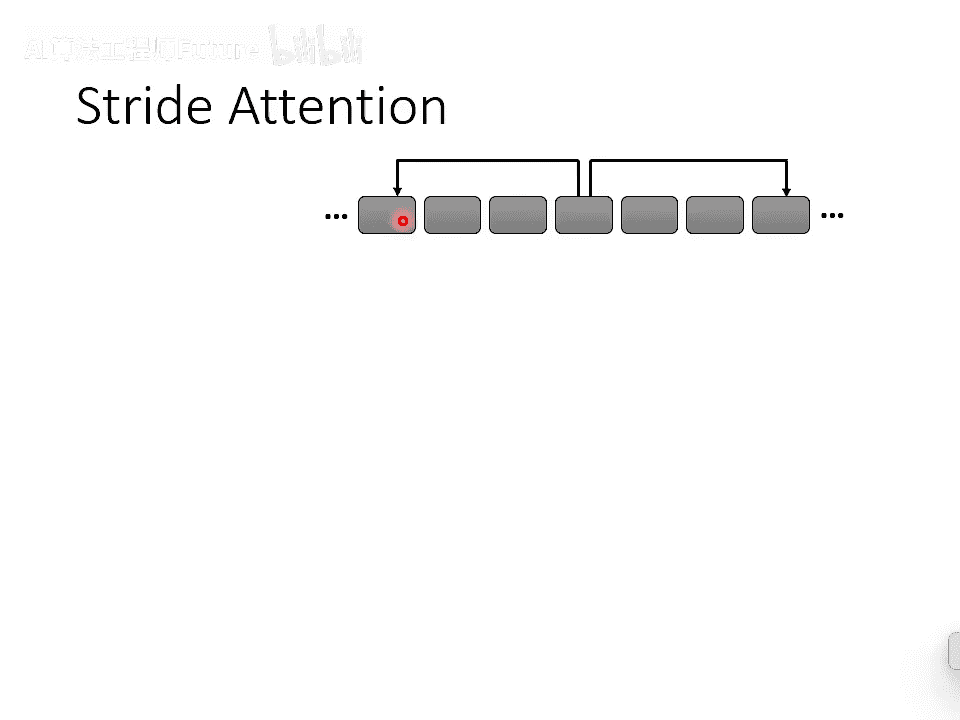

那如果把它化成attention matrix的话呢，你的attention matrix呢就长这个样子，那这种方法呢叫做strike attention。

好好当你用strike attention的时候啊，在这个图上灰色的部分呢就是直接填零，就不计算，我们只计算呢有图青色的部分，有颜色的部分，那有人可能会问说，那为什么是空两格，看三步之外发生什么事情。

空两格看三步之前发生什么事情呢，你可以不要这样做，你可以指控一个。

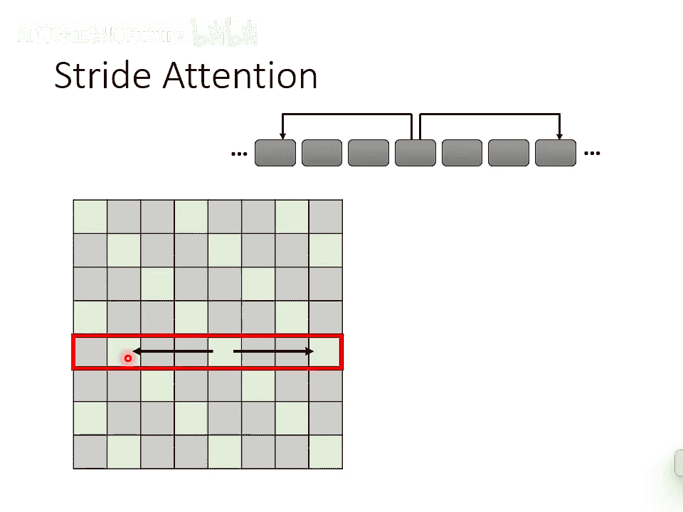

然后你也可以空三个，这个完全是你自己决定的，那可以根据你先要处理的问题，决定说你的strike attention应该要长什么样子好。

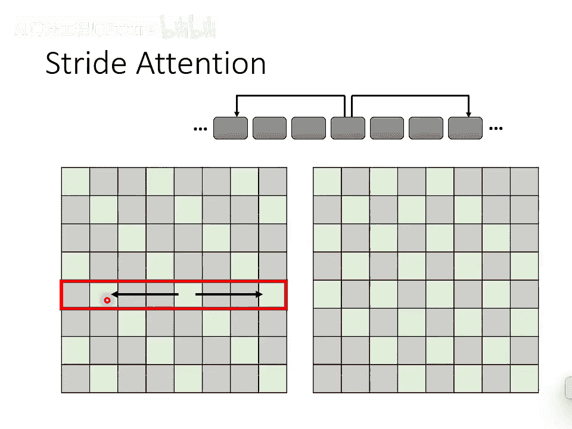

那还有其他的方法，有一个方法呢叫做global attention，那不管是刚才看过的local attention，还是strike attention，都是以某一个位置作为中心。

看这个位置左右两边发生什么样的子事情，那如果我们今天想要知道一整个sequence，发生什么事，那也许你可以用lobal attention，那global attention是什么意思呢。

哦在做global attention的时候，你会在你原来的sequence里面呢，加上一个特殊的token，那如果你今天是做这个NOP的问题，你的input是一串文字的话，那就是加入一个特殊的符号。

这个特殊的符号呢，代表这个位置要做global attention好，那global attention呢他会做两件事，第一个事情是global attention。

它会append到sequence里面的每一个token哦，他会从sequence里面的每一个token都去收集资讯，也就是说这种特别的attention，这种特别的cooper。

他做的事情就是先来收集一下整个句子的资讯，来了解一下这整个句子里面，整个input sequence里面发生了什么样的事情，所有人都会去看这个special token。

看看这个special token里面有发生什么样的事情，存有什么样的资讯哦，所以这些special token他们会attend到所有的token，另外他们会被所有的token attend。

然后具体的操作啊，其实有两种做法就怎么做这个呃，global attention呢有两种做法，第一种做法是你在你原来的sequence里面，就直接assign1些人。

直接assign1些token作为special token，举例来说，你可以说呃，如果是在处理文字的时候，大家都知道说BT的这个每一个句子的开头，不是有一个CLS的token吗。

很高这是什么也没有关系，其实在一般用transformer来处理，这个呃文字的时候啊，你会放一个代表开头的token，那也许我们就直接把那个开头的token，当做special token。

或者是每一个句子都有句号嘛，对不对，一个句子结束前都有句号，也许我们可以把句号当做special token，所以这种special token怎么来，第一个做法就是你从原来就有的input。

sequence里面，原来就有的token里面选一些当做global的，当做这种特别的token，那有另外一种做法是你就外加额外的token，今天不管input sequence是什么。

input的句子是什么，你都直接应试，差两个符号，这两个符号代表特别的token，这两个特别的token，他们会attend到所有其他的token。

做其他的token也都会attend到这两个token，那如果呢要把他的attention metric画出来的话。

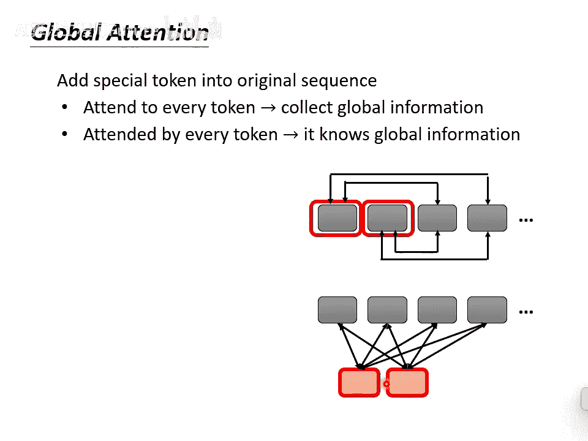

看起来就像是这一个样子好，那我们假设呢这一个句子里面，这一个input sequence里面头两个位置，头两个位置就是special的token。

叫做global attention的special的token好，那你发现说呢在这一个attention的matrix里面，那我们假设这个roll啊，每一个roll啊代表一个query哦。

每一个color呢代表一个T好，那我发现前两个roll啊，前两个弱啊全部都是有值的，全部都是要计算attention的，代表说前两个token他们是special token。

前两个位置他们代表special token，他们的query要去attend到所有其他人的key好。

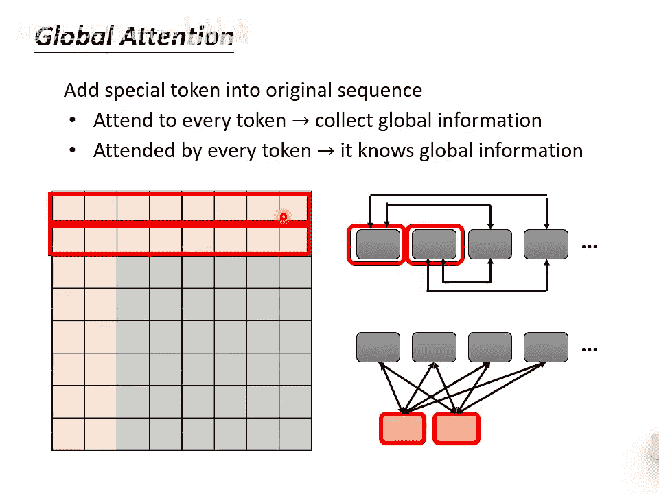

那今天你看这前两个colon呢，前两个COLOUR也是有颜色的，这是什么意思呢，代表说除了special token以外的那些token，他们在做attention的时候。

他们的query都会ATTEN到第一个位置，跟第二个位置哦，所以每一个这个roll啊，每一个不是special token的位置，他们都要attend到special的token，就是句子前。

现在这个例子里面是句子前面的前两个token，这个global token要attend到所有人。

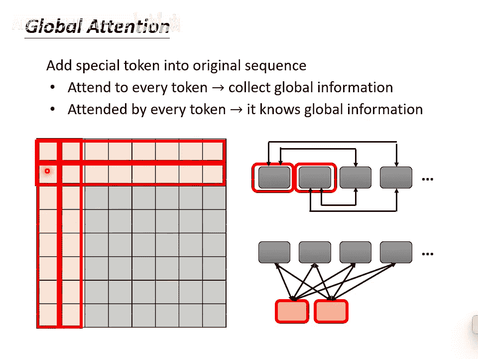

也被所有人attend以外，其他的token彼此之间就没有往来了，所以发现说在这个attention的mattress里面，只有头两个row跟头两个COLOUR是有颜色的，其他位置直接涂灰色。

其他位置attention直接涂零代表其他位置，其他的token不是special token，彼此之间互相就不做任何配件，互相就不管彼此发生了什么事，如果打一个比方的话。

special token就是token中的李长博，你知道在一个礼里面，你可能不知道你的邻居是谁，你的邻居也不知道你是谁，你们互相是没有往来的，但是每个人都认识李长博，李长博也认识每一个人。

所以今天要传递什么资讯，你可以透过李长波来传递，这个就是special token的作用好，那这个是多more attention，那讲到这边大家会问的一个问题是。

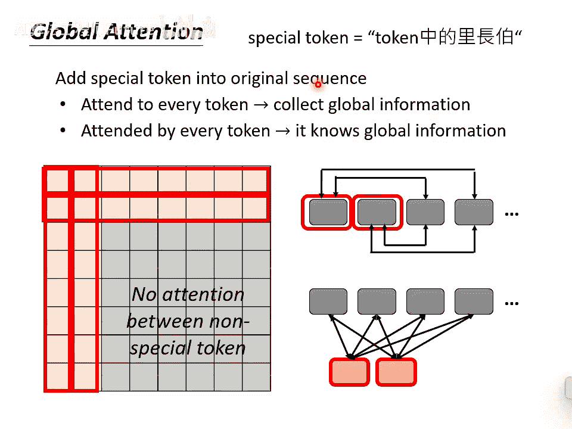

我们讲了各式各样凭借着人的knowledge，决定的这一种self attention的matrix，有local attention，有strike attention。

有global attention，那哪一种最好呢，应该要用哪一种才是对的呢，这边的答案就是小孩子才做选择，你知道吗，真正好的结果就是全部都用，你记得啊。

一个self attention里面它是有multiple head的，对不对，我们可以设定多个不同的head，你就让每一个head做不同的事，有了hand是local attention。

有的head是strike attention，有的head是ROBOATTENTION。

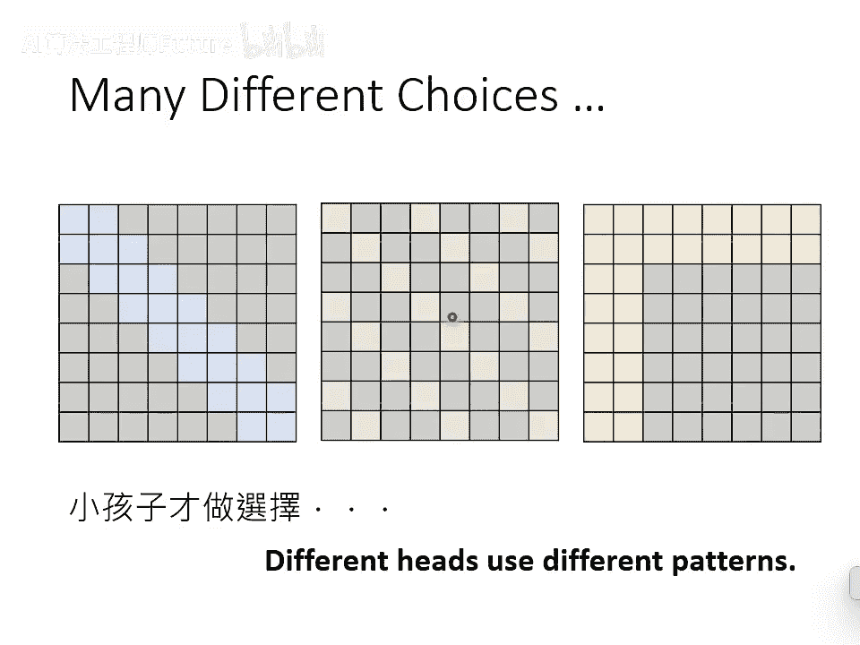

就这样你就不需要做选择了好，所以一些比较知名的这个self attention的变形呢，哎就是这么做的，比如说long former，Long former。

就是把local attention加strike attention加local attention，还有另外一个知名的这个self attention的变形呢，叫做big bird。

这边paper我看了很久，都不知道他跟big bird有什么样的关系，我觉得他就是纯粹臭梗，你知道吗，他直接把他的模型命名为big bird，他连小模型的名字都懒得想了，直接就把它叫做big b。

那big bird呢其实就是long former加random attention，就是原来long former里面的东西它都有，还有local attention。

有global attention，但是他自己新加了一个很特别的东西，叫做random attention，就是他会随机选一些位置，随机选一些token，让他们彼此之间也是有attention好。

那至于这个render attention有什么样的妙用，那这个就留给大家自己去研究啊，你可以看一下BIGBIRD这篇paper，它会有更详细的说明，甚至有理论的推导。

告诉你说为什么要有这个render的TENTION。

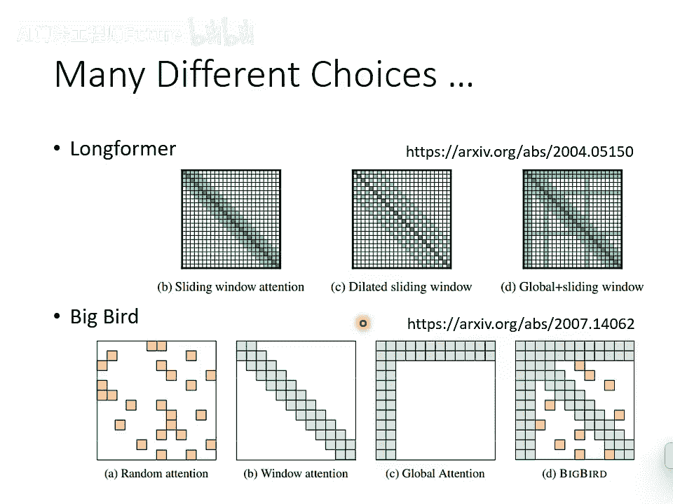

刚才啊我们是用人工的力量直接告诉你说，哪一些位置就不需要算self attention，哪些位置直接物理，但是这样真的是最好的方法吗，也许不见得，也许人类设计的这一些attention。

人类自己决定哪一些地方不需要算attention，并不能得到最好的结果好，那我们能不能够不要用人的力量，而是用贝塔基本的方法呢，举例来说，今天在一个self attention的mattress里面。

可能某些位置它的value，他的这个attention的weight就是特别大，某一些位置它的attention的value就是特别小，那这个时候其实你可以把attention的value。

特别小的位置直接五零，那把attention的value特别小的位置，本来它可能本来就很接近零，你直接把它当做零不去计算，那也许对额，你这样子有股有变成零跟没有变成零，也许结果是不会差距太大的。

那如果我们用这样子的方法来加快，attention的运算，那五一那也许我们就是就是简化以后的attention，跟原来完整的attention就不会有太大的差距，所以我们其实可以想看看。

有没有办法直接估计在一个attention的mattress里面，哪一些位置有可能会有比较大的值，我们只计算那些有可能会有比较大的值的位置，那如果有些位置。

我们猜它可能本来attention的weight就会很小，那我们直接就不进行任何的计算，我们就直接把它当做是零好，那再来的问题是，怎么快速的估算出哪些位置。

可能有大的attention value进行详细的计算，哪些位置可能有小的attention value，直接就可以无视呢。

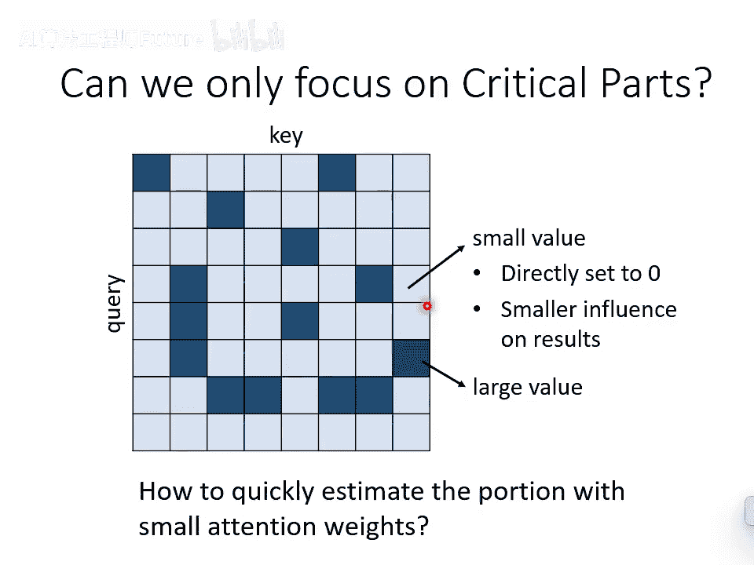

好，那这边的方法在reformer跟RIN，transformer这两篇paper里面，他们都用了非常类似的方法，他们用了plastering这个技术，就是你先把你的query跟key呢拿出来。

然后呢你就做clustering，你就根据这个query跟key它们相近的程度呢，做clustering，那比较近的就分类在一起，比较远的就属于不同的class，那在今天这个例子里面。

总共分成四个cluster，这边有红色的vector，有边框是红色的，vector代表它们属于cluster one，边框是黄色的，而边框是紫色的，代表属于class two，边框是绿色的。

边框是绿色的，代表属于class3边框是黄色的，代表属于class form，我们把query跟key做classing，那在这个例子里面分成四个cluster。

那这个cluster的目的是要让相近的SPECTOR，就属于同一个class，不相近的vector就属于不同的class，那讲到这边，有同学可能会问说。

clustering这件事情会不会也耗费很大的运算量呢，如果今天clustering这件事情，他的complexity也跟sequence的平方有关的话，那做clustering也许跟呃。

根本没有办法加速self attention的运算，但是实际上呢clustering有很多可以加速的方法，所以这边在做classing的时候，你会采取一个可能是估测不是非常准确，但非常快速的方法。

来把这一些query跟key的vector进行分区，那在reformer还有rin transformer里面，就采取了不同的classic的方法，来快速的把相近的query跟key归在同一群里面。

那把query跟key归在同一群里面以后。

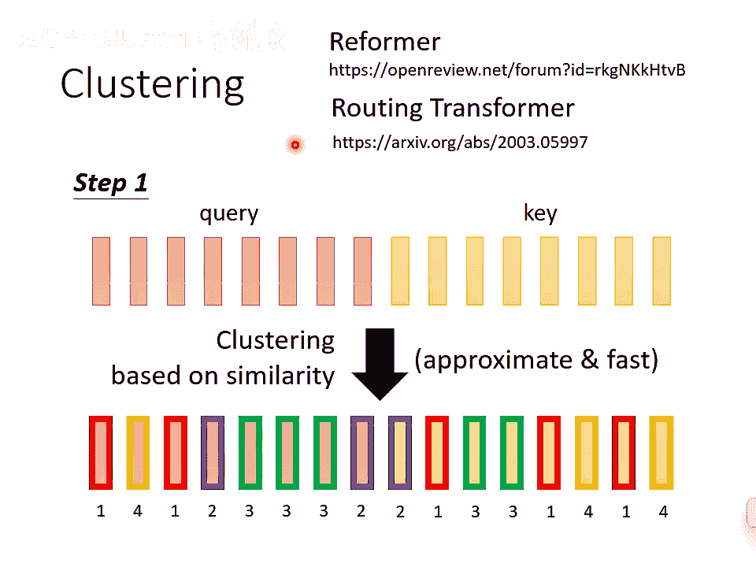

接下来呢哦接下来呢如果一个query跟一个key，它们落在同样的pasta里面，我们才去计算attention的weight，所以举例来说，这个红色的query跟这三个key。

他们是在同一个class里面哦，那我们就计算一下它的attention的位，那红色的这个query跟其他的这五个key，它们不在同一个classy rain里面，那就代表说他们其实很不像他们的距离。

其实是偏远的时间，把他们的attention设为零哦，所以同理，黄色的这个factor，把它跟另外这两个key在同一个class里面，所以做这两个位置需要计算attention，其他地方直接五零哦。

所以呢这整个tension的matrix里面会有很多位置，你就不需要去计算，直接算零，只有属于同一个pastor的query的key，我们才计算它的attention位。

那这样就可以加快这个attention matrix的计算好，那这个是classy的方法好，那到目前为止啊，我们怎么决定哪一些位置要计算passer，哪些位置不要计算passer。

都是凭着人类对这个问题的理解，不管是前面我们讲的the local attention，Global attention，还是到plastering passage，是假设说比较近的vector。

我们才去计算它的，这个我们才去计算它的attention，所以到目前为止要不要计算attention，往往还是基于人类对这个问题的理解，那有没有办法把要不要计算attention这件事情。

用learn的直接把它学出来呢。

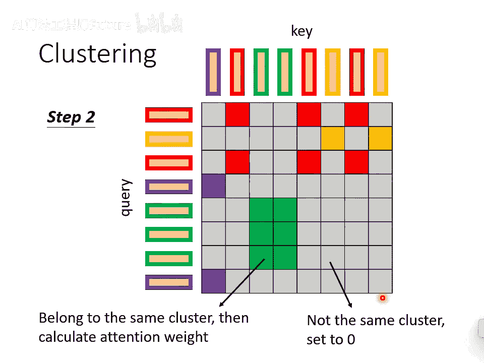

是有可能的，有一个方法叫做sing home sorting network，他要做的事情就是哪些地方要不要计算attention，我们直接用learn的来决定这件事情哦。

所以呢我们要计算attention的时候，你要先产生一个matrix，这个matrix里面呢有一些位置是一，有一些位置是零，那这边呢涂深色的代表一，涂浅色的代表零。

只有涂深色的地方需要去计算attention，浅色的地方就当做attention是零，我们就不计算attention，所以哪一个key要跟哪一个query计算attention。

我们用这一个mattress来决定，而这个matrix怎么来呢，在到目前为止，在这门课讲到目前为止，哪一些地方要计算attention都是人决定的，但是在新home sorting network里面。

他决定直接弄一个network，认另外一个network来决定哪些地方需要计算attention，怎么做呢，这个是你的input sequence。

然后呢你把input sequence的每一个position啊，通过一个network产生一个vector，而这个vector的长度要跟你的sequence一样好。

所以input sequence的每一个vector。

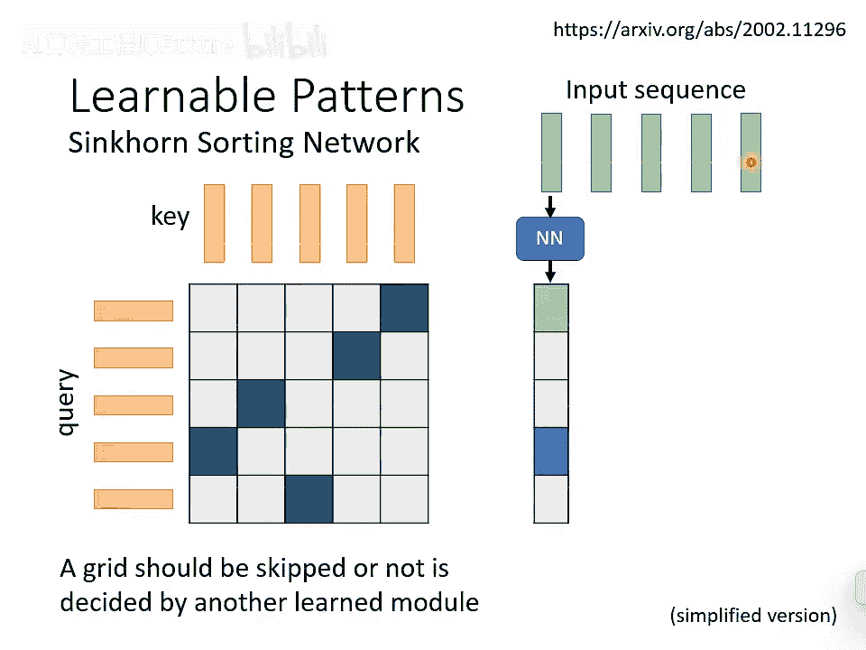

通过一个network来就产生另外一排vector，那这些vector全部拼起来以后，它的大小啊也要是N乘以N，跟你的attention的mattress一样，那我们现在的目标。

就是要把这个东西变成这个东西，那可不会想说哎，可是这个决定要不要计算attention的matrix里面，它的值是binary的，只有一跟零而已呀，那可是network output。

他是continuous的，不是只有一跟零而已啊，那这就是这篇network的一个重点，这就是simple si network的一个重点，还有一个很特别的技术来解决这个问题，你可以用某个方法。

把这一个本来不是binary的matches变成binary的METC，而且这一个过程是可以微分的，所以最后你在train这个NN的时候，它是跟你的整个network一起劝出来的。

你back propagation的时候，是可以走过这一个从continuous的matrix，变成binary mansion的，这个PC这块是可以微分的，所以这个NN会跟network的其他部分。

一起被学出来啊，当然以上是一个比较简化的讲法了，所以实际上simple sting network是怎么运作的，那就请大家自己参考文献，总之怎么产生这一个matrix。

怎么决定哪些位置要被计算attention，你可以认另外一个network，让培训自己去学，让network自己去学什么位置，要不要计算attention，这个是simple sin network。

好诶，讲到这边，大家有没有问题想要问的呢，哎你谁说认出来要怎么，他会不会和原本安全的很像，就是该大的地方大，该小的地方都很，这次就是要走地面，说他们两个呃朝同一个方向前进，如果在这个呃使用索林那位诶。

可是你们我我其实我知道你的问题，但是你想哦，我们现在是先产生这个东西，然后呢产生一个binary的mask，然后决定说只有这些位置要上attention。

但为什么我们不直接output attention的matrix的，就被破梗了，所以这个sing home si network，同批作者下一篇叫做synthesizer。

他们就决定说诶为什么要做两部呢，直接output attention的weight就好了，结束了，这样像我回答到你的问题，嗯好好好，这个是本来synthesizer，是在这个投影片的最后一页才会讲到啊。

我这就破梗，对你好，诶这样大家还有问题要问吗，哎你说这话就感觉有点丧失了，tension和那个计算很快速的性质，就是他变成每每一个音符，他就要去算一个分分，然后过一个分分，然后再产生一个向量。

它把这个拼写好啊，这是一个很好的问题，我猜你你的问题就是说，哎我们今天用NN来产生这个matches，他真的会比原来用key跟value算出这个attention mattress，还要快吗。

你仔细想想，假设我们每一个input我们都要产生一个vector，其实你的运算量跟原来的tension measure，其实差不多的，你根本没有真的假设好，这是个好问题，这边有一个没有提到的细节啦。

在今home soting network里面，他真正做的事情是什么呢，他真正做的事情是好，几个input的vector会共用同一个vector，也就是说假设你input一个很长的sequence。

比如说100个vector，我们把它切成十段，每段十个vector，十个vector一起通过network以后产生一个factor，那十个vector要共用同一个vector，也就那十个vector。

最后会共用同样的这个同一个color，他们会有同样被mask起来的地方，同样要算attention的地方，同样不要算attention的地方，好这样这样我会回答到你的问题。

所以说产生出来的这个NN的match，它其实很像是就它里面其实只有十种ma，你假设的input是100多，对对对对，就假设你这边本来要算100100的matrix。

就你attention其实是100100的attention，但是在single si network里面，你用NN产生的这个东西呀，它是解析度比较低的，它其实只有10×10。

那再把它放大成100×100，好诶这个大家都听得很仔细哦，有没有发现这个上课没有要讲的细节。

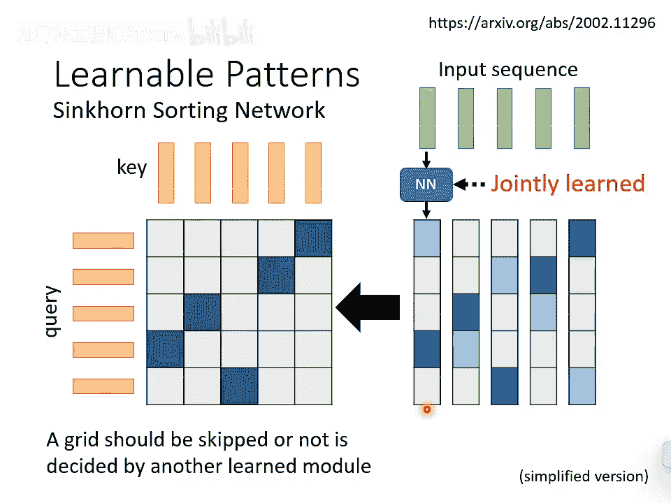

到目前为止都想要产生一个N乘以N的metric，只是我们说N乘以N的metric里面有一些位置，我们直接设立，但是我们真的需要是一个N乘以N的attention，matrix吗。

在informal这篇paper里面呢，他告诉我们说嗯看起来也许不需要哦，为什么，因为informer这篇paper里面呢，他有做了一个实验室，如果你真的把这一个attention的magic拿出来看。

你会发现里面有很多redundant的color，那在这个例子里面，我是特别画很多colon的，这个value都是一样的，告诉你说很多color其实都是重复的，那在informer那篇paper里面。

他做的事情是他去计算这个attention matrix的rap，然后他告诉你说，这些attention的mattress其实都是low rank的mattress。

也就是说这个attention的mattress，很多color都是dependent，很多colon他可能是其他COLIN做duplicate。

或是其他colon的linear combination，从这个角度说起来，也许我们根本不需要一个N乘以N的matrix，因为这个N乘以N的matrix里面。

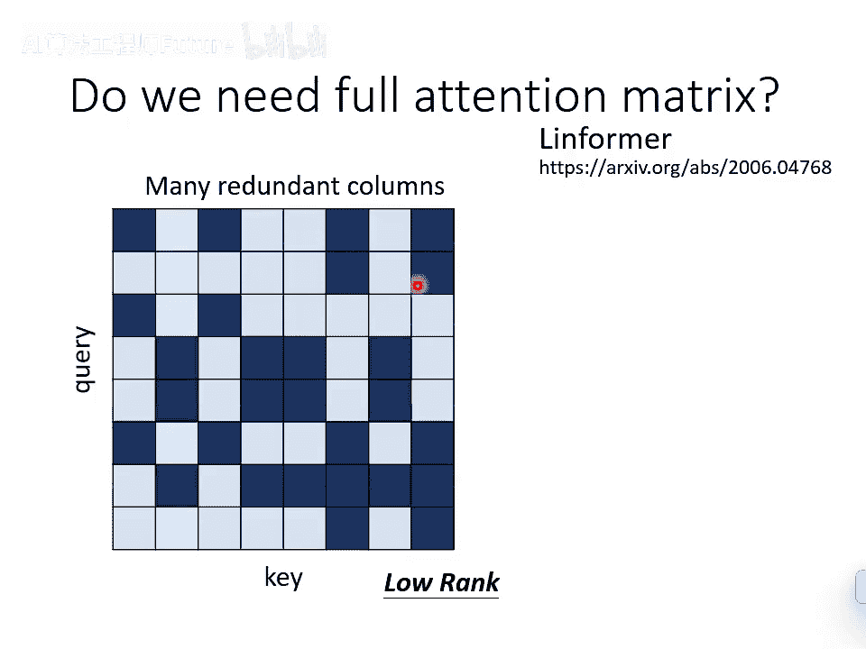

很多资讯都是重复的，那我们能不能够把某一些重复的color就把它拿掉，产生一个比较小的attention matrix，我们只计算这个比较小的attention metric。

那我们就可以加快tension，这件事情的运算速度好，那这个就是informer这篇paper要做的事情好。

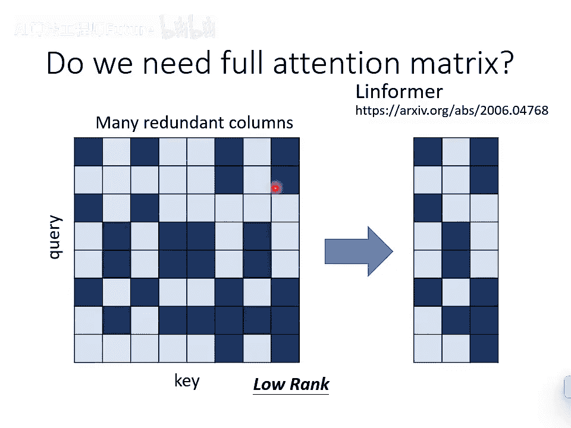

那实际上你要怎么做呢，实际上呢你的做法是这样的，本来有N个key啊，本来N个T，我们从这N个key里面只挑大K的出来，当做key的代表，原所有的key每一个都拿来跟query计算。

attention太多了，很多key他们都是很像的，都做重复重重复的事情，他们只是种圆，也许我们只需要选最具代表性的，K个key出来就好了，那至于怎么选，我们会在下一页头里面提到。

反正现在就知道说KKN个key不要全部都用，只挑有代表性的提出来就好了，那只敲了太表性的key出来以后，你就不需要算一个完整的。

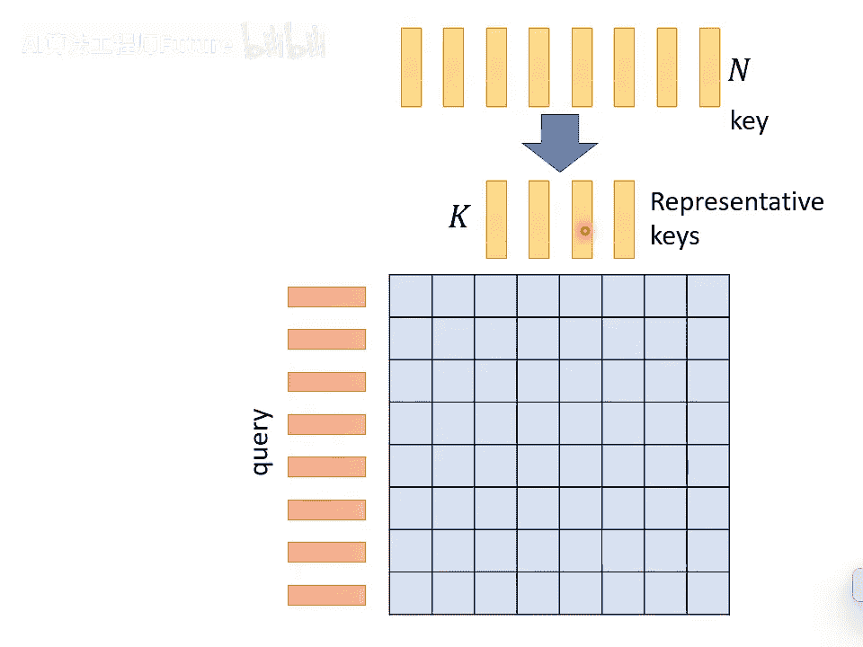

N乘以N的tension matrix了，你就可以把这个attention的mattress变瘦，我们只算一个N乘以K个K的attention matri好。

那产生这个attention mattress以后，接下来你要怎么用这个attention mattress，产生self attention layer的open呢，你的做法是这个样子的。

你有N个value，你一样呢要挑出K个具代表性的value，所以这边有K个key，每个key其实都有一个对应的value vector，所以你用K个key vector。

那你用K个value vector，然后接下来呢，你把K的KE对第一个query vector，算出来的tension位，对这K个vector做WAKEUP，得到第一个位置的open。

同理把这四个value再跟K个vector啊，这这个这边呢K等于四啦，K等于四，把这K个value跟这四个vector在坐位置上，得到第二个位置的open，以此类推。

你就可以得到整个self attention的module的open，那讲到这边了，大家可能会想到一个问题，为什么我们只选有代表性的key，为什么我们不选有代表性的query呢。

我们可以把key的数目从大N变到K，我们为什么不能把query的数目也变成呃，另外一个数值，比如说也是大K好了，那这样子我们的attention matrix不是变得更小，这样计算起来不是会更快吗。

好不知道大家有没有想过这样子的问题，好，你确实也可以把query的速度变少，你确实也可以只选有代表性的query，但是你想想看，假如你只选有代表性的query，你会遇到什么问题。

你会遇到你的output sequence length就缩短了，对不对，因为你output sequence，the length跟你的query length是一样的。

REQUERY变成原来的一半等于output sequence，就变成原来的一半，那变成原来的一半，它会不会有影响呢，那就是case by case，对，有些任务他是读一整个sequence。

然后呢只产生一个class啊，比如说大家在大家在作业里面做的speaker classification，那你就是input1整段句子，你只需要输出一个label，像这样子的任务就无法。

你真的可以把你的query变少，你真的可以选有代表性的query出来就好了，但是假设你今天的任务是input sequence，里面的每一个位置，你都需要output a label。

像我们在作业二里面做的风铃的classification，就是每一个friend，你都要给他一个风铃的label，那如果你今天你output的长度变短了，那你的label的数目不就有错了吗。

那这样会有问题，所以假设你今天你需要，每一个位置都下一个label，每一个位置都做一遍classification，给他一个label，那你其实没有办法把query变变少。

你没有办法只选有代表性的QU运出来好。

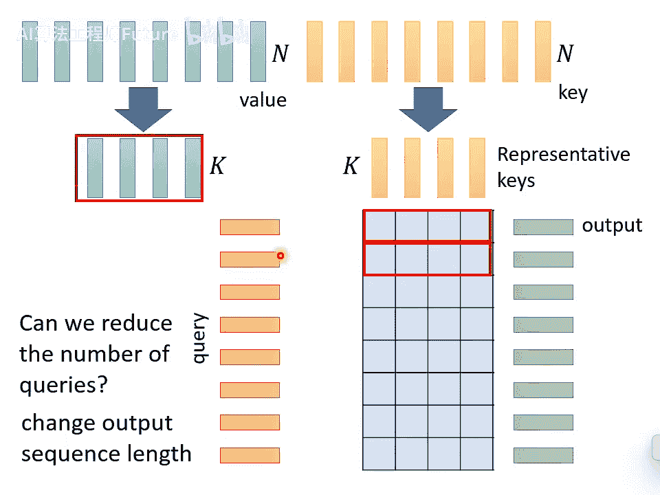

那接下来要讲的就是怎么选出有代表性的key呢，刚才我们说要选有代表性的key吗，怎么选呢，那就有不同的做法，而语篇paper叫做compress attention，他做的事情是说啊。

你input这个很多的很长的一个这个key的sequence。

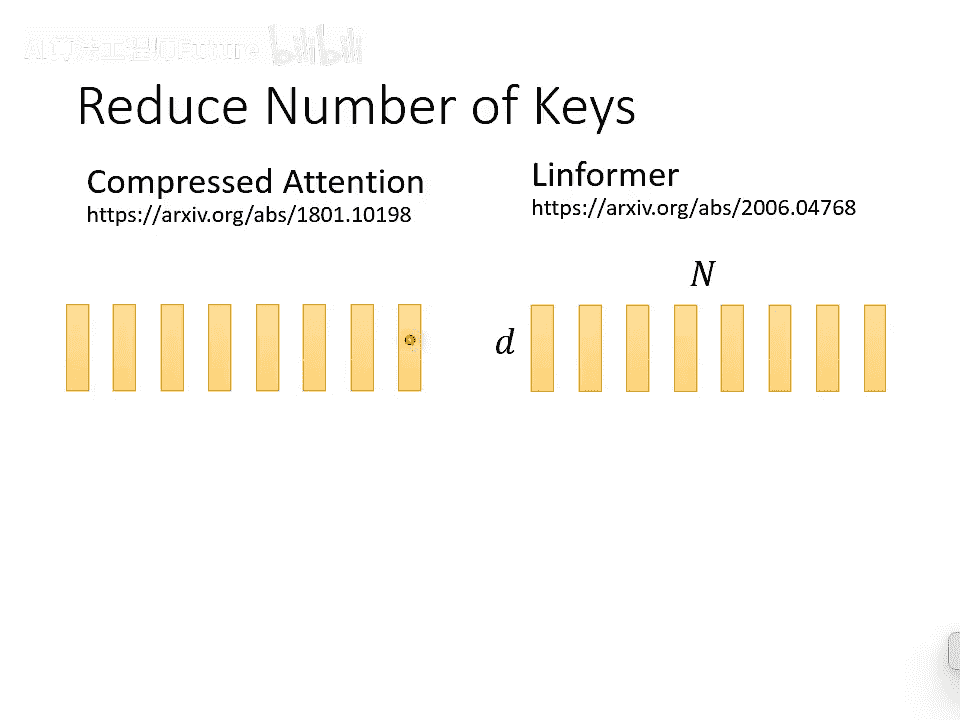

那我们用CNN呢来扫过它，那你用CNN来扫过一个sequence以后，这个sequence长度就变短了，那这个短的sequence就代表就当做是有代表性的，KE好。

所以我们可以用CNN来把一个长的sequence，变成短的sequence，那把短的sequence当做有代表性的题，那另外一个是LINFORMER这边paper里面的做法，他说input啊。

是input的，这些key集合起来，可以看作是一个D乘以N的矩阵，那我把这个D乘以N的矩阵，去乘一个N乘以K的矩阵好吧，D乘以N的矩阵，乘上N乘以K的矩阵，会得到一个D乘以K的矩阵。

那这个D乘以K的矩阵，它的每一个COLUM，它的K的color就是配一个有代表性的key，那如果你熟悉线性代数的话，你会知道说把这个D乘以N的矩阵，乘上这个N乘以K的矩阵，得到D乘以K的矩阵。

你实际上做的事情是什么，你实际上做的事情是，这边这K个vector都是这N个vector的0年combination，你把这N个vector做不同的linear combination。

做K种不同的linear combination，就得到这K个vector，所以可以说如果你从0former的时候，所谓K个有代表性的vector，就是把原来大N个vector里面。

把这些大N个vector做不同方式的linear combination，那就产生K个有代表性的T，然后你就可以减少你的运算量，那这个就是informer在做的事情。

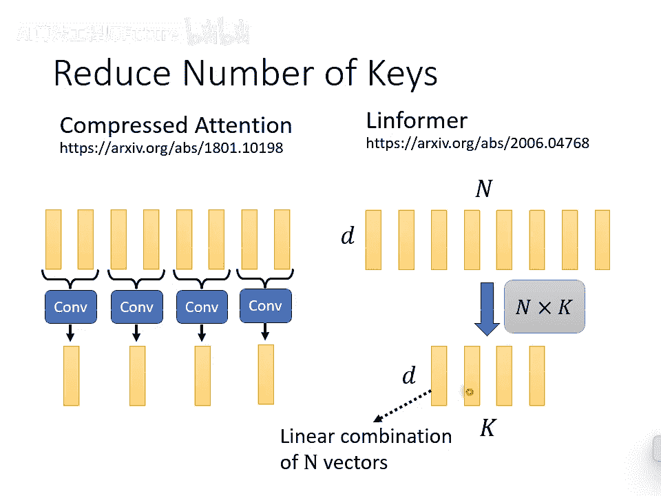

好那接下来啊我们再回头想一下，其实attention的整个process，他其实说穿了就是一连串矩阵的相乘，那这个矩阵相乘的过程中，有没有可以减少运算量的部分呢，那我们来复习一下attention。

这个mechanism跟矩阵相乘的关系，而假设input a我们当做一个mattress叫做I，我们会把I这个大，I这个matrix呢乘上一个linear transform，得到另外一个matrix。

叫做Q胸的大小呢是D乘以N，Q是一个D乘以N的matrix，N呢是sequence的长度，D呢是你的query vector的dimension，那同样的道理，I乘以另外一个transform叫WK。

会得到我们的key，所有的key集合起来一样是一个D乘以N的magic，把I乘上另外一乘缝，得到大V，那这个大V这个矩阵呢，它是一个D派成N的矩阵，那把所有的value vector集合起来。

它是一个D换乘以N的矩阵，那这个Q跟K啊，他们的dimension必须要一样啦，这样他们才能够做大花打嘛，dimension不一样，或者做大花打，但是V的dimension不一定要跟Q跟K1样。

所以你一般在实做的时候，你会直接就把他们胆面粉设成一样，但是不一样也没有关系，所以我这边呢特别说value的vector是define，QQ跟k query跟key的这个dimension都是D好。

但但value的vector是define。

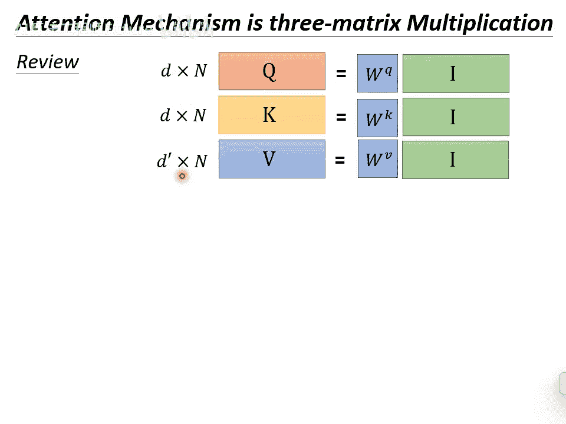

define可以等于D，但没有必要一定要等于D好，那接下来呢接下来呢你会把key乘一个transpose，跟Q相乘，得到一个attention的matrix。

叫做A然后接下来呢你会做soft max得到a pine。

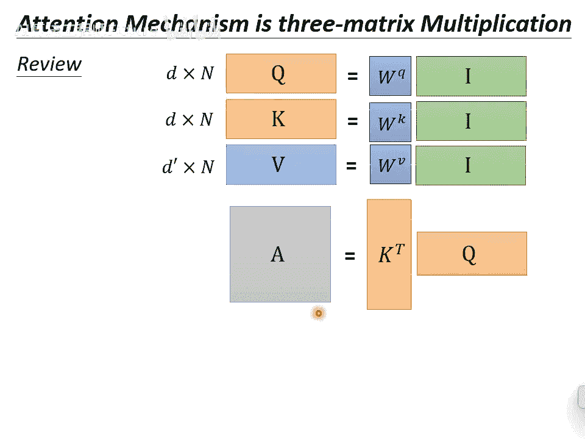

接下来你把a plan乘上V得到output o哦，所以整个attention mechanism就是input the sequence，表示成大I包括另外一个sequence。

表示成大O中间也会经过这一连串的运算，那有没有办法加速这个运算呢，其实是有办法的，我们先做一个简化啊，我们先假设我们没有做soft max这件事情，那如果拿掉soft max让你觉得不舒服的话。

不要担心，等一下会把它加回去，我们先假设没有soft max，那这个apply这边这个apply啊，它就是K的transpose乘上Q，所以其实做attention这件事情。

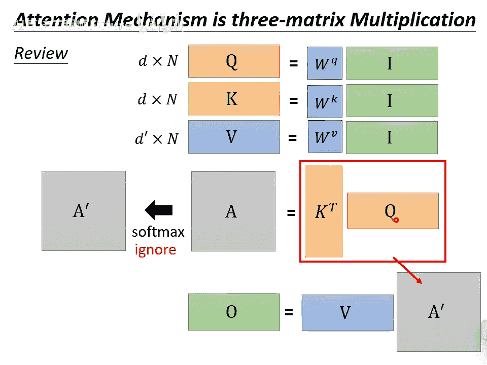

我们真正做的事情就是把V跟K的transpose，跟Q3个矩阵相乘，我们就得到self attention model的output，也就是这边的O好，那这个Q啊是一个D乘以N的矩阵。

这个K的transpose是一个N乘以D的矩阵，本来K是D乘以N嘛，transpose以后就变成N乘以D，然后呢，我们先把Q跟K的transpose进行相乘以后，再乘上V这个矩阵。

V这个矩阵大小是d point乘以N3个乘完以后，我们得到O它就是一个D换乘以N的矩阵，这是self attention做的事情，我们先把K的transpose跟Q乘起来，再乘V。

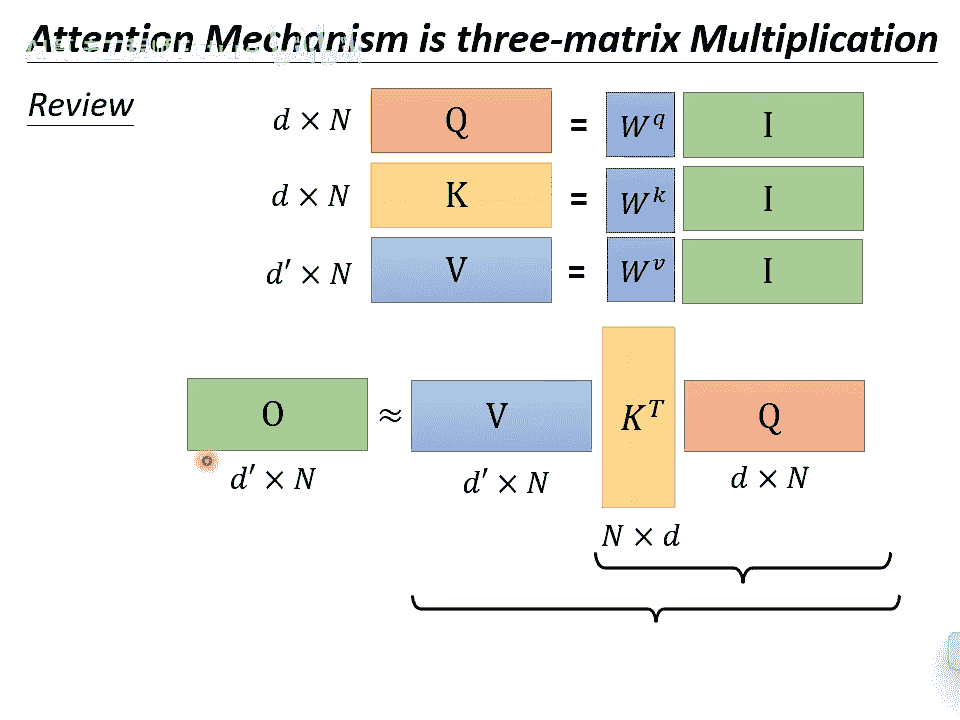

最后得到O那这整个过程其实是可以加速的，怎么加速呢，先把V跟K的transpose相乘，再乘上Q这两件事情你可能觉得他们是一样的，他们确实乘出来的结果O会是一样的，但是中间需要的运算量不是一样的。

同样是V乘以K的transpose乘以Q，先把K的transpose乘Q再乘V，跟先把V乘以K的transpose再乘Q，这样得到的结果是一样的，但是所需的运算量不是一样的。

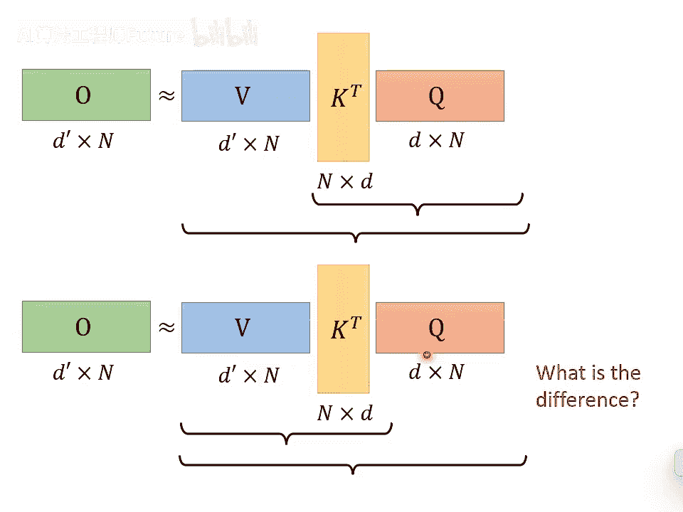

这件事情如果你有修过我的线性代数的话，我们在线性代数这门课有跟大家讲过，你把A跟C跟P3个矩阵相乘，你不管是先把C跟P相乘，变成CP就是一个couple啊，然后再乘A还是先把AC相乘，再乘P。

他们的结果是一样的，但是运算量是不一样的好。

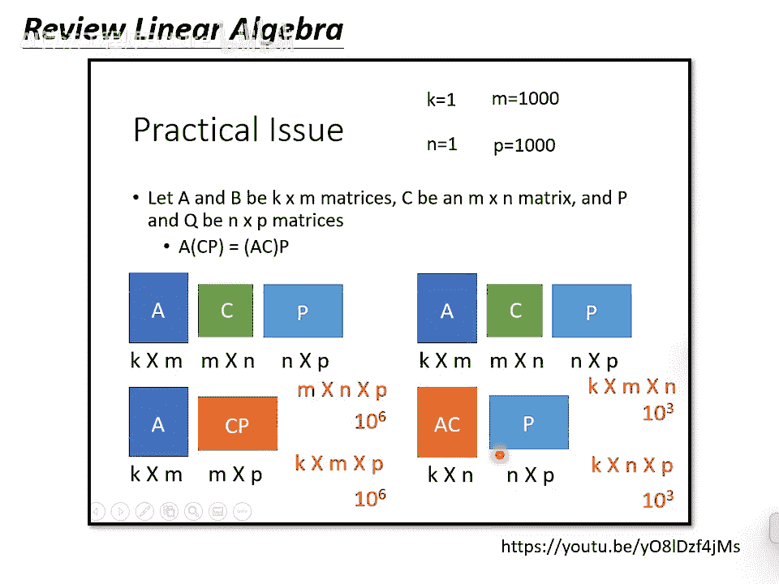

那如果你没有修过我的线性代数没有关系，我们直接跟大家说明，用这个V乘以K乘以Q的例子跟大家说明，如果我们先把K的乘凑成Q，我们需要做多少次的矩阵乘法呢，需要做N乘以D乘以N次。

那如果呃你是太久以前学线性代数，一下子想不起来矩阵乘法怎么做的话，你就记得这个原则是这样好，这边把N乘以D的矩阵乘上D乘以N的矩阵，需要做多少次乘法呢，就是N乘以D乘以N，就是第一个矩阵的卡额弱的数目。

乘上第一个矩阵的卡人的数目，乘上第二个矩阵的他人的数目，把这三个东西乘起来，就是把两个矩阵相乘的时候，需要做的乘法的次数，所以把K的乘构成Q需要做几次乘法，需要做N乘以D乘以N次的乘法。

好把这两个乘起来以后，你得到一个N乘以N的矩阵，就是我们的attention metric，把tension mattress再乘上V，V是一个d pi乘以N的矩阵，需要几次乘法呢，用刚才那个原则。

你两个矩阵相乘的时候，乘法的次数就是第一个矩阵的roll的数目，乘CARON的数目，再乘第二个矩阵的colon的数目，在即今天这个例子里面，V乘以A的时候，乘法的次数是D派乘以N乘以N。

那我们把所有的乘法的次数加起来，N乘以D乘以N，D派乘以N乘以N，全部加起来是D加D派乘以N平方哦，所以你要做你的这个举这个乘法的次数啊，跟N平方是成正比的。

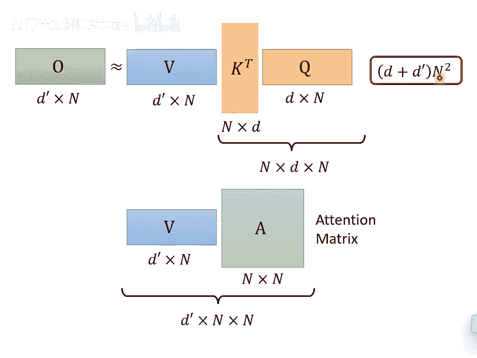

那如果我们今天交换一下，乘法的顺序会变成怎样呢，矩阵相乘的顺序会变成怎样呢，我们把V先乘上K的TRANSPO，把V乘上K的transpose，需要的，需要的乘法的次数是d pr乘以N乘以D啊。

那把这个V乘K的transpose以后，它会变成什么东西呢，它变成一个D派乘以D的矩阵，我们一时看不出来它代表什么东西，不像是Q跟K相乘，非常直觉，是一个attention的matrix。

V乘以K的transpose，一时之间我们看不出来是什么东西，不过没关系，反正他就是一个D派乘以D的矩阵，把D派乘以D的矩阵再乘上Q，Q是D乘以N的矩阵，需要多少的乘法呢，需要D派乘以D乘以N次的乘法。

所以合起来当你把V乘K的时候，你需要DY乘N乘D，那你再把B乘K的结果再乘Q，你需要D派成D乘以N次的乘法，合起来，这是两倍的D派乘以D乘以N次的乘法，所以你发现说，当我们改变成矩阵相乘的顺序的时候。

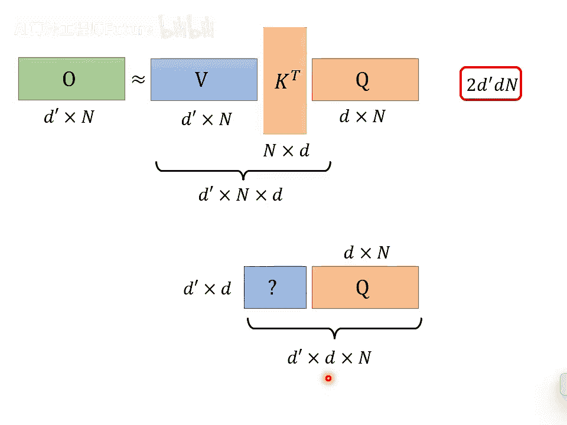

其实我们需要的乘法的次数是有很大的差距的，如果Q跟K先相乘，这个时候矩阵的这个时候，我们得到这个O的乘法次数是，D加D派减N平方，V跟K先相乘是两倍的D派乘以D乘以N，而如果把Q跟V先相乘。

你需要的乘法的次数是远大于B跟K线相乘的，因为N往往比D还要大很多，不要忘了这个N是sequence的长度，它可以是一个非常大的数字，所以D加D派的N平方，可能会远大于两倍的D派乘以D乘以N哦。

所以其实我们只要改变矩阵相乘的顺序，我们的结果可能就会有很大的不同，那讲到这边也许有，如果你诶，如果你没有那么喜欢看到数学的notation的话，讲到这边，你可以当做。

就是你已经知道我要讲的东西是什么了，我们是改变一下矩阵相乘的顺序，但是假设你对这一个结果还是有困惑，因为你觉得拿掉soft max。

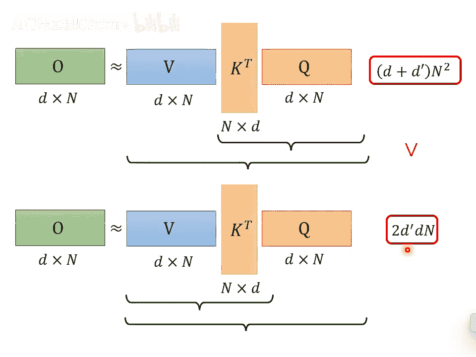

让你觉得有一点不爽的话，那接下来告诉你放回soft max是怎么样运作的，那以下数学符号比较多，如果不想听的话，我们也可以把你也可以把这一段跳过啊。

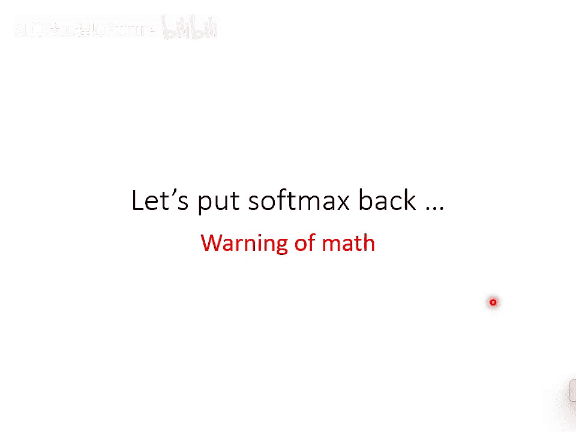

原来的self attention是怎么被计算，原来self attention是说诶我们先把呃，如果要计算你input的sequence是a one到a four。

如果你要计算第一个位置的输出b one的话啊，那你会呢把第一个位置的query，q one跟所有位置的key呢算个attention，得到这边的阿尔法pl。

再把阿尔法派跟每一个未知的value vector做位置上，就得到BY哦，所以b one呢它是some mention over，I等于一到N。

然后把阿尔法one i plan和阿尔法one i find，就是q one跟每一个key的attention的value，这是有经过soft max normalize以后的value。

然后呢把这些value对VI呢做微积算，得到BY，那这一项阿尔法，如果你想要把它的计算过程算出来的话，其实是这个样子的，看起来有点复杂，它是个分子的地方是Q2，跟KI做打夸大。

然后再去exponential，分母的地方呢，分母的地方是some mention over整个sequence，把q one在整个sequence里面搜的key都做大。

夸大乘以FORMANCIAL相加以后，放在分母分子的地方是Q2，跟某一项key做DPA去exponential，然后再对VI做wet su，这边是原来的self attention的计算过程。

接下来就是要告诉你，实际上这个计算过程是可以被简化的。

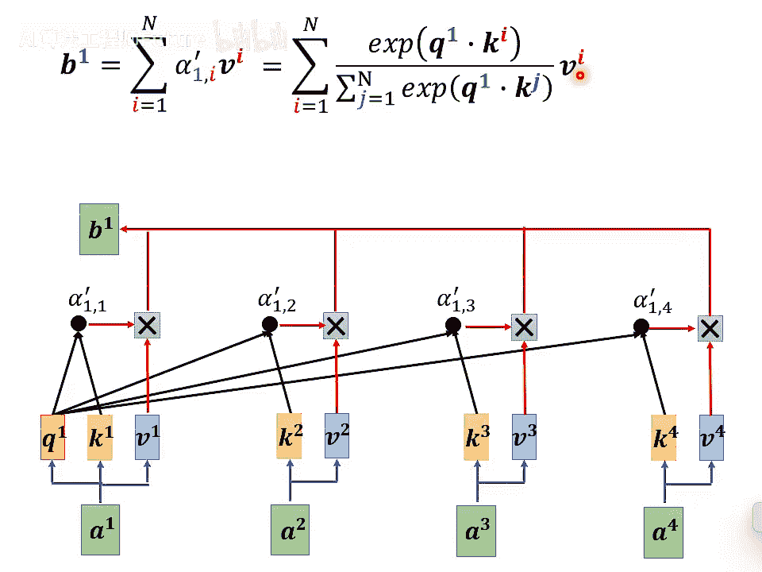

首先呢exponential q跟K的DPA，可以拆解成翻Q跟FK的大发达，什么是FQ，什么是FK呢，你就想成说你有一个transform叫做F，把Q这个vector输进去。

他会给你另外一个vector叫做FQ，那你把Q跟K都输入这个发音，得到FQ跟FK两个vector，把这两个vector做搭发达，会等于Q跟K先做DPA再做expansion。

那有人可能会问说这个F是什么呢，我们先不要在意这个细节，就是反正有这么一个神奇的发音，就是可以让INFANCIALQ跟K的大发达，等于FQ跟FK的大发达好了，有了这个知道这件事情以后呢。

你就可以把这边所有的exponential，你从nature q2KI的大发大换成fq one，大翻译KI，你从nature q i k z的大发大换成fq one，大FKJ好。

那接下来呢我们就来稍微做一下整理哦，我们先来看这边分母这一项，这边有一个some mention over i等于一到N，但是分母这一项其实是没有出现I的哦，分母这一项没有出现I。

所以可以把它拿到SAMSUI等于一到N的外面哦，所以呢我们这个式子变成这个样子，分母的地方是SUMMENSIONJ等于一到N，fq one到FKJ的总和，分子的地方是SUMMENTIONI等于一到N。

那SUBMENSIONI等于一到N的时候，我们会对VI做wait sun，那这个weight是什么，这个weight是fq one跟five ki的打滑档好，那我们先来看分母的地方。

分子的地方比较tricky啊，我们先来看分母的地方，分母的地方其实很单纯，我们这边some mention j等于一到N翻q one到FKJ，你会发现fq one其实跟Z没有关系。

所以fq one是可以提出来的，所以分母的地方实际上是你把fq one跟FKJ，some mention j等于一到N，把这N个FKJ加起来以后，一次去跟fq one做大化的。

或者是如果你要图像化的表示的话，就是把FKJE上，some mention j等于一到N等方1KZ啊，统统加起来变成一个vector，然后呢去跟这个fq one做搭花档，就等于这一项的分母的地方好。

这个是分母的地方是很简单的，再来是分子的地方好。

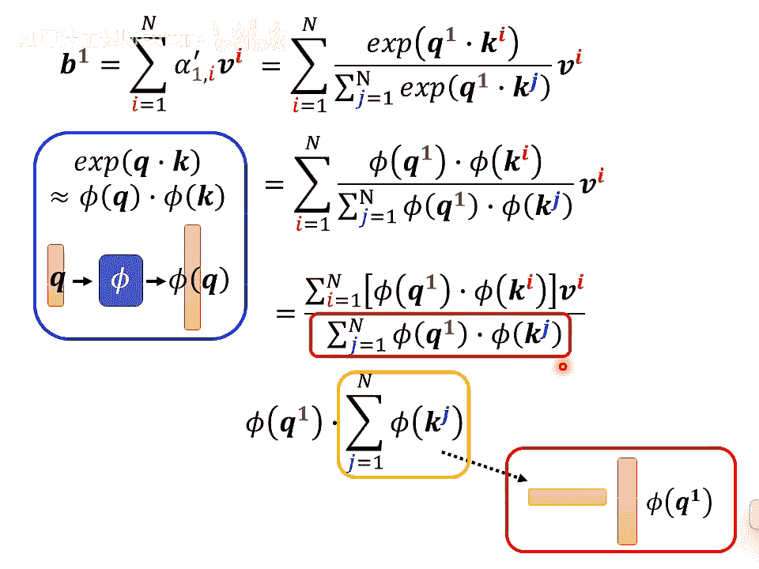

那分子的地方我们来计算一下哦，分子的地方我们特别把它拿出来啊，就是在这个蓝色的框框里面，他是VI的weighty sn，那weight就是FQI跟FKI的大pa，所以如果你把它展开的话。

希望展开让你比较好理解一点啊，展开的话就是fq one，dot fk one乘以v one，那翻one到的翻k one，这个是一个scale哦，中括号里面是一个数值，这个weight是一个数值。

乘上b one加上fq one，don't fk two乘上b two，以此类推，一直加到V大N，那接下来呢好这个fq one呐，这个向量啊，我们把它这个里面每一个component，把它展开的话。

把它呈现出来，用notation来表示的话，我们把fq one表示成Q上标一下标一，第二个component就是Q上标一下标二，同理翻k one呢是K上标一下标一，K上标一下标二好。

所以呢我们fq one乘以F呃，fq one大的five k one，你把它展开以后啊，fq one大于fk one，他是千万万乘k one one加上q one two乘以k one two哦。

Q万万乘以k one one加q one two乘以k one two，一路加起来把看这边有几个element，看这边有几个element把它加起来，再乘以BY第二项也是一样好，那接下来呢把它展开啊。

这边都不是什么复杂的数学，只是很繁琐而已，把v one乘上这里面每一项，把v two乘上这里面的每一项好，那接下来呢是关键的一步，我们把乘上Q万万的项集合起来，把乘上q one q的项集合起来。

所以我们就会得到这样的式子，我们把所以上面这件事情，上面这件事情，这一这个b one的分子的地方可以写成q one one，乘上，这边有个括号，里面是d one d q一直到VN的位置上。

他们的weight是多少，他们的weight是k one one，K two one，K two one，以此类推哦，所以呢这个分子的地方你可以写成q one one。

乘上d one到VN的linear combination，加上q one two，乘上V1到VN的另外一组里尼尔combination好。

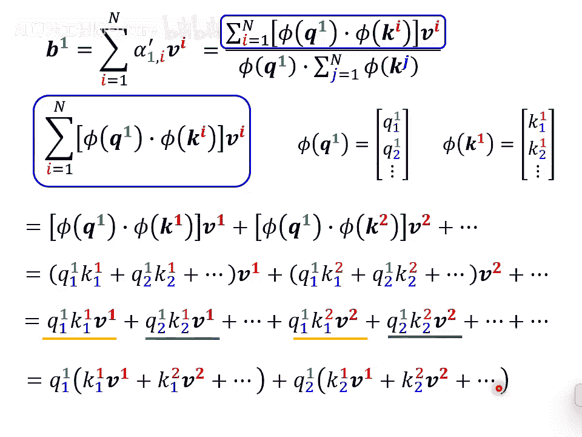

我们现在假设你可以接受这件事情以后，那这整件事情实际上可以看作是一个矩阵，跟一个向量的相乘，我们把括号里面的东西当做是一个向量，括号里面的东西就是v one到VN的wet s。

那你把v one到VN用另外一组位置作为T上，你得到另外一个向量，这边会有几个向量呢，有人可能会很直觉的说，是不是大N个向量N次困车的长度，但其实不是，他是看翻q one的dimension的。

括号前面不是成q one one q one two吗，那到底会有几个括号，其实就是看这个fq one它的dimension有多少啊，所以假设fq one的dimension是大N的话。

这边就是有大N个括号，所以这边就是有大N个VE好，那这每一个vector啊，他都乘上一个weight，这个weight是q one one，Q one two，一直到q one n哦。

如果这个这个方QY有N个dimension的话好，所以呢你可以把上面这个式子呢，看成是一个矩阵，这个矩阵的每一个vector，就是这里面括号里面的每一个vector。

它们是V的value vector的VR combination，然后乘上发音q one。

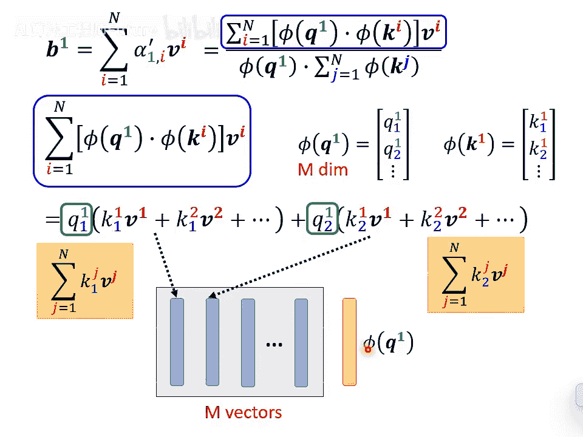

好那如果你觉得这个听起来就很复杂，不知道在讲些什么呢，那我们用图像化的方式来表示一下，我们刚才做的事情，所以实际上分子的地方做的事情是什么呢，实际上分子的地方做的事情是。

你先把你所有的value vector拿出来，你有大VN个value vector，value vector的数目跟input sequence的长度是一样的，然后呢你把你的K个。

你把你们大N个的这个key呀都拿出来，然后把它们通过翻译这个方式一样，得到大N个向量，接下来呢，我们把这些向量的第一个element都拿出来，把这些向量的第一个M都拿出来，对value factor。

对大N个value vector做微计算，就得到这一个矩阵里面的第一个B，然后呢把这些FK的第二个element拿出来，这边有N个factor，所以他们的第二个element总共有N个数值啊。

这第二个element拿出来对V1到VN做微提上，你就得到这边的第二个vector，以此类推，那如果five k的dimension是大N的话，这边就会有大N个vector来。

再把这大N个vector排起来，当做是一个matrix乘上fq one，你就得到b one的分子这一项，然后再把分母算出来相除，那你就得到b one的值是多少了，那讲到这边，你可能觉得。

这听起来就只是比较复杂的数学运算，跟notation而已，跟原来的计算好像没有什么不同，但它真正的关键点在于你，你看看哦，我们在计算第一个位置的output的时候。

跟第一个位置有关的只有query的vector而已，而这个蓝色的向量所组成的矩阵，还有放在分母的地方的这个黄色的向量，它们其实跟位置，其实跟b one的这个一是没有任何关系的。

所以假设你在计算b one的时候，你已经把这些蓝色的factor。

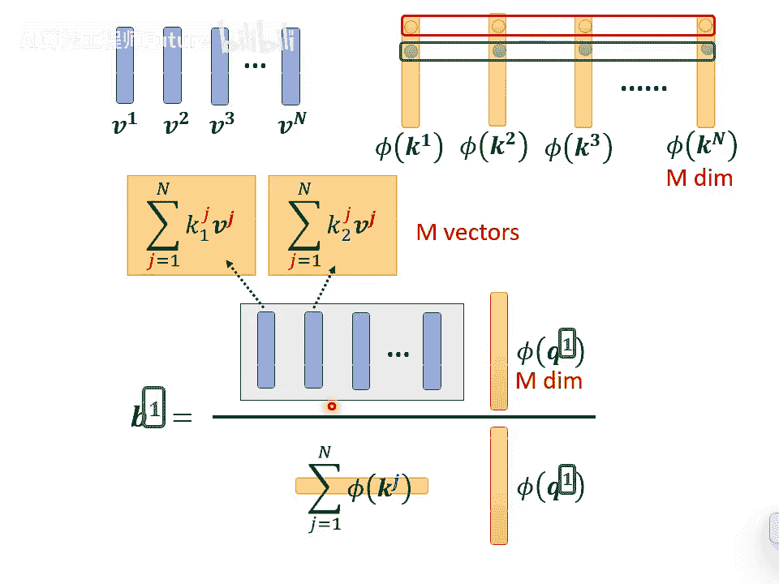

还要把这个黄色的factor求出来，接下来你就不需要再重算了。

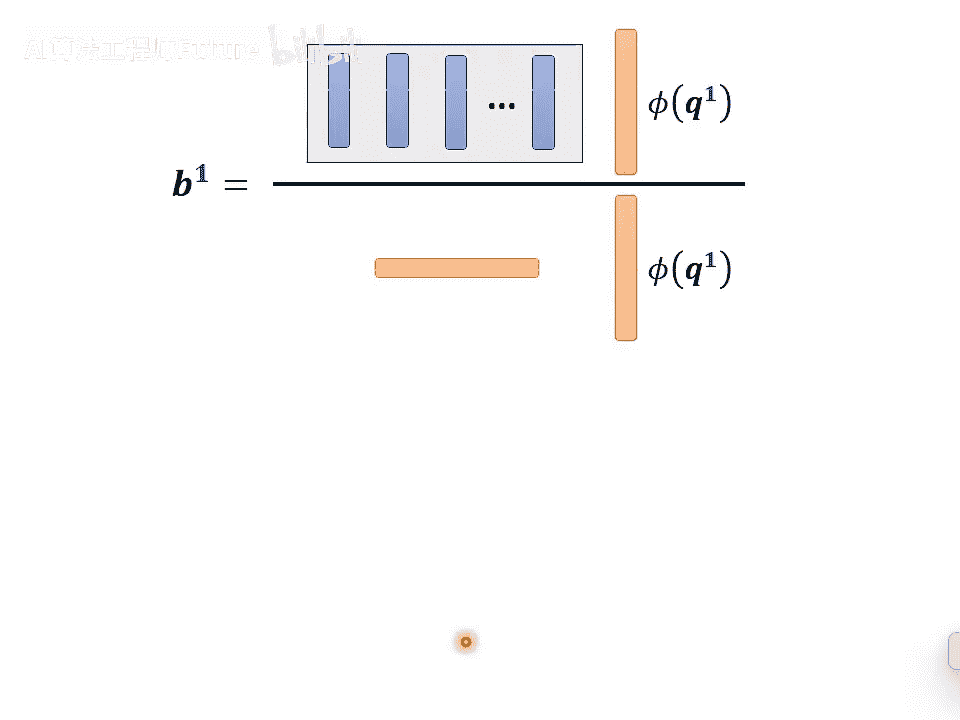

当你把b one算出来以后，接下来你要算b two，你只需要把这些蓝色的vector复制过来，把黄色的vector复制过来，再乘上fq two，你就计算出b two了。

所以这个蓝色的vector跟黄色的vector，只需要计算一次就好，接下来不同的位置就是乘上不同的翻Q，你就得到不同的B得到不同位置的输出。

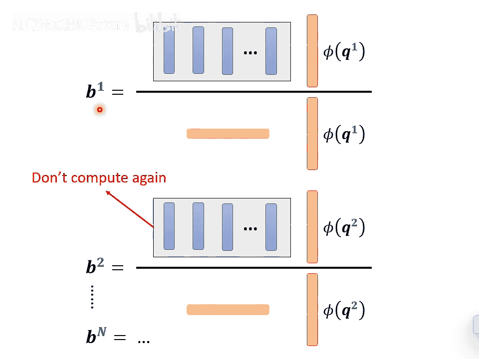

好，那假设你刚才讲的东西。

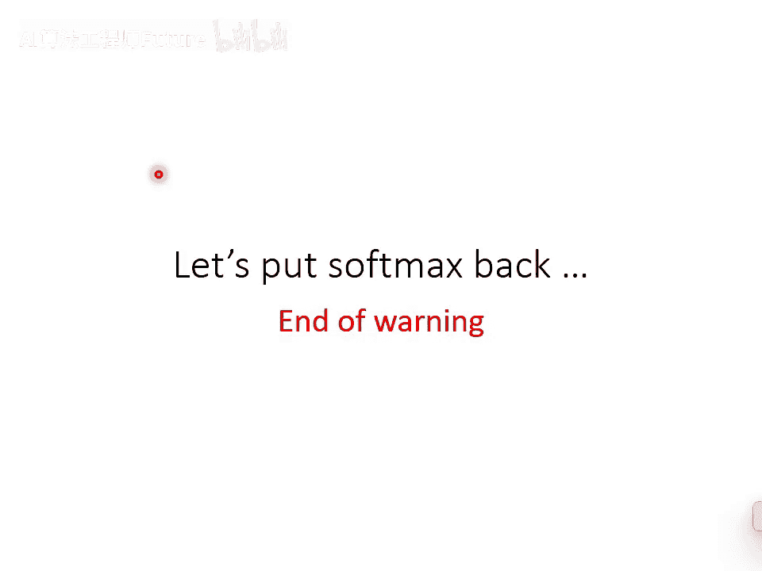

你没有听得很懂的话，接下来就是要告诉你说，其实self attention可以用另外一个方法来看待，而这个计算的方法跟原来的self attention，计算出来的结果是一模一样的。

只是它的运算量是比较少的，如果刚才讲的东西没有听懂的话，直接告诉你这件事怎么操作，他操作起来是这个样子的，我们有我们input是一个sequence，a one到a four。

每一个音符的位置都产生K跟V先产生K跟V，我们先让K跟V呢来做一些互动，做什么样的互动呢，你先把K呢都通过一个transform变成five k one，fk two一直到fk four。

然后呢你把这些翻开的第一个位置，第一个dimension的element拿出来，对V1到v four做VT上得到一个向量，你把fik one到翻天four的第二个位置的。

第二个dimension的element拿出来，然后把这边每一个绿色的位置，每一个绿色的这个位置的数值去跟v one v two，V3V4做VT上得到另外一个vector，反复这个动作。

你就看说你这个five k有多少个dimension，假设N个dimension，那你就产生and vector，那每一个dimension都会产生一个vector出来。

每一个dimension都会产生一个vector出来，有N个dimension就产生N个，反正好，那这件事情只需要做一次，在process整个sequence的时候只需要做一次，接下来就一劳永逸啊。

怎么一劳永逸呢，假设你要产生第一个位置的输出，怎么办，先把q one产生出来，q one要通过一个transform变成fq one，接下来把fq one的第一个dimension。

乘上第一个vector，第二个dimension乘上第二个vector，但你这边要要那个确保说，Q跟K他们通过这个全form翻译以后，都是N，那你才能把Q的每一个element乘上。

这边的每一个factor，所以Q有N个value在他的这个vector里面，把这N个value乘上这N个vector做维基上。

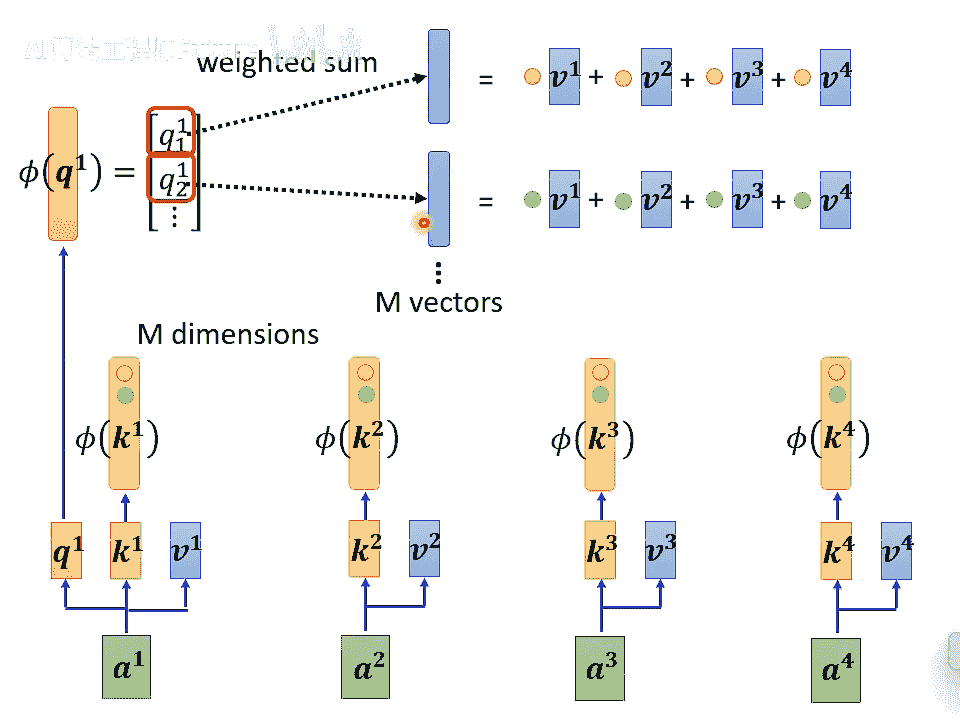

你就得到例外就结束了，其实是等精，精确的来说是得到b one的分子这一项了，那分母这一项其实也是非常类似的概念，我们就不帮大家剖析，总之你把final one跟这N个vector做微积上。

然后你就可以把b one的分子这一项算出来，那分母这一项算的方法也是类似，而且更简单。

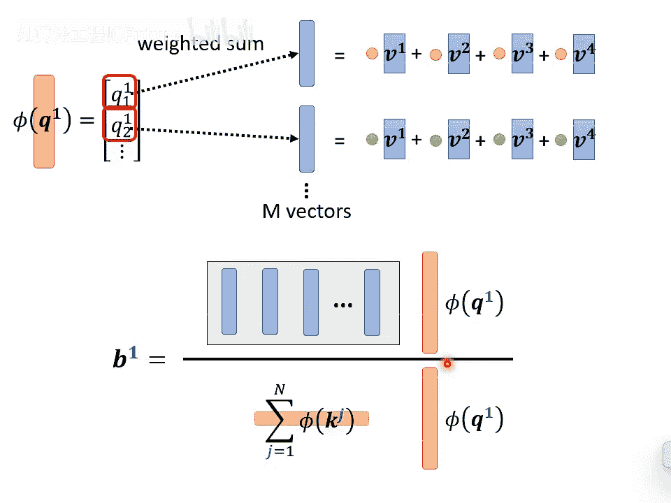

这样你就求出BY了，接下来要求b two的话怎么做呢，这N个vector你不要重算了，他们是全部的位置都共用的，他们就放在那边，你就不要再去动它了，当你要算第二个位置的时候，怎么做呢。

你把QQ成过一个成form得到翻译QQ，然后呢，把fq two的每一个dimension的value拿去，对这N个vector做微计。

算好这个final two的第一个dimension乘上第一个vector，第二个dimension乘上第二个vector，有N个dimension，正好乘N个vector加起来就得到b two了。

其实精确的说是b two的分子那一项，那分母那一项的计算是更简单的，使用这个方法，你就先把and vector算出来以后，接下来就是一劳永逸，每个位置都可以很快的被计算出来好，那如果你想要额理解一下。

这个东西有什么意思的话，也许可以这样理解，之前做self attention，他非常的直观，你可以说啊，我们就是要找说哪一个位置，跟哪一个位置有关联，算出一个attention。

然后从那个位置抽资讯出来，但如果你要理解这种新的做法，这边要强调一下，这个做法跟这个一般的self attention，其实一模一样的，算出来结果其实是一模一样的哦，你要选适当的发音。

你算出来结果会是一样的好，那怎么理解这个新的计算方法呢，也许你可以这样理解呃，每一个位置都产生V有v one到v four，然后我们把它做wait，sun是要找寻重要的TEMPL。

这整个sequence里面呢总共有N个重要的temper，然后接下来每个位置的输出，就是拿这些TEMPANT做linear combination，那产生这个翻Q是要去这N个temper里面。

选择适当的template，那这个template是整个sequence每个位置都共用的，这N个template产生出来以后，它就放在那边，就不需要动它了，让每一个位置选择不同的template。

组合起来作为输出，那如果你需要一个物理上的解释的话，也许这是一个可以理解这种新的这个self attention，运算方法的呃的的概念，这样子好。

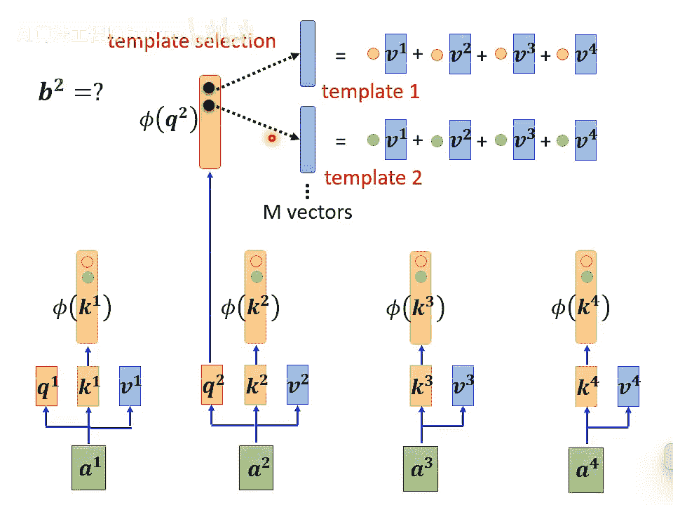

那接下来最后一个问题就是呃，那exponential q dot k，怎么拆解成fq dot fk呢，不同的paper就有不同的做法了，所以不管是efficial attention，Linear。

Transformer，Random，Feature，attention还是performer，他们做的都是我刚才前几页投影片跟你讲的，简化他们不一样的地方在哪里呢。

不一样的地方就是怎么把exponential q dot k，拆成fq dot fk，那至于这个F应该长什么样子。

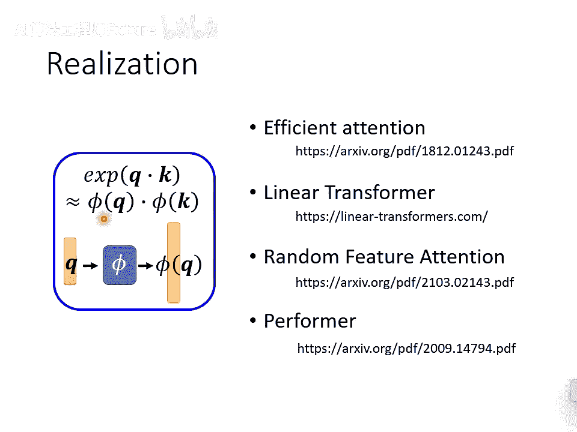

那就留给大家去细读这些文献好，那接下来啊我们要可以再进一步思考，如果要产生self attention，要做self attention。

一定要用Q跟K做inner parta来产生attention吗，不一定，你可以参考的做法叫做SYMPSIZER，Synthesize，做法是这个样子的哦，你要做self attention。

你的目标是input一个sequence，output另外一个sequence，那我们先把input sequence，每一个位置产生一个value vector。

接下来跟一般self attention一样，我们把这些value factor做wet su。

我们可以产生每一个位置的输出，而这些value一样是本来有一个attention的mattress，做完soft max以后可以得到normalize以后的value。

normalized的value做微积sun可以得到open，那跟一般的self attention不一样的地方，是在synthesize里面，这一个matrix不是Q跟K产生的。

在synthesizer里面，不需要Q跟K这个matrix怎么来呢，其实在synthesize里面有两个不同的版本，有一个版本跟那个simple sting network很像。

他就是拿a one到a four去产生这个matrix，但是在synthesized里面，还有另外一个更神奇的版本，就是把这个matrix当作network的一部分。

这个mattress里面有N乘以N个数值，对不对，这N乘以N的数值，就是network里面的N乘以N个参数，我们知道network里面如果new room有weight，有BIOS吗。

现在多加了attention，Weattention，weight是network的参数，这样你在做self attention的时候，你连计算attention way这个步骤都免了。

没有计算attention way这件事了，他本来就已经在network里面了，他就是network参数，那有人可能会问说哎，如果attention会是network参数。

那不是input不同的sequence，那个attention的weight都是一样的吗，呃对呀，那performance会变差吗，不会就这样子哎好，所以这个synthesizer让我们重新思考。

到底attention的价值是什么，过去我们会觉得input不同的sequence，attention match应该不一样，但是当我们把attention的MATRIC。

作为network参数一部分的时候，因为network的参数不会随着input不一样而不一样嘛，这代表attention the matches，不管input是什么，永远都是一样的。

但这样performance其实是不会掉太多了，所以这重新让我们思考，attention的价值到底是什么好。

那再来再更进一步思考，处理sequence一定要用attention嘛，所以人们开始思考能不能够把attention丢掉，有没有attention free的方法，过去人们已经丢掉了recurrent。

接下来人们要丢掉attention，老师有一系列的文章，这边我们就不细谈一系列的文章，他们直接用NLP，就是一般的fully connected的network来处理一个sequence。

然后这边就留给大家自己研究，这就又是另外一个故事了。

留给大家自己研究好这张图啊，这个就是今天的最后一页投影片了，这张图是long range arena，就是我们说这个self attention有一个benchmark的COPUS。

叫做long range arena，那在那个compass里面，你可以去计算一个self attention方法，它的好坏，那里面用l r s score系统，我们就不讲，反正这个分数越高。

代表这个self attention的方法表现越好，横轴代表的是速度，就是每一秒钟可以处理多少个sequence，所以越往右代表速度越快，那你可以看到这边有一系列的方法。

那每一个方法呢它都用个圈圈来表示啊，那圈圈的大小啊，代表这个方法需要用到的memory越大，代表用的memory越多，最原始的self attention就是这个蓝色的圈圈，就是transformer。

那其实今天这个图上的每一个圈圈，其实这一堂课里面我们通通都已经讲到了，我们就从左上角开始看起，big bird讲过了，对不对，big bird就是把就是小孩子才做选择。

把各种不同人设计的ANNA放在一起，就是冰本，那他的performance比RETRANSFORMER好一点，那速度其实有点没有快很多，快一点点而已，好有synthesizer。

synthesizer就是我刚才说的非常神奇，全新的想法，attention matrix不需要用Q黑产生，直接当network的参数好，他的performance其实掉了一点，速度快了一点好。

然后接下来呢还有很多，比如说reformer，reformer就是做CLASTER的方法，看起来其实他performance不一定很好哦，还有local attention。

local attention就是一个速度很快，但是performance有点惨的方法好，那心痛心痛有讲哦，心痛就是很神奇，他是直接用个network来决定说哪些位置要上attention。

哪些位置不用诶，它的performance有掉，但是速度相较于其他的方法快，相较于原的transformer又快上了一截，然后最速度最快的是linformer performer。

还有linear transformer，他们的performance，相较于原来的transformer也是有些掉，不过他们的这个速度，相较于原来的transformer是快上很多的好，那这个呃。

这个0former，performer跟linear transformer是在做什么呢，哎神奇的是linear transformer，不是LINFORMER，这样看他们两个是不一样的东西。

这样他们听起来名字有点像，它们是不一样的东西，并不是LINUTRANSFORMER的缩写，就是0former，它们是不同的东西，informer就是我们只选一些有代表性的key，叫做informer。

而linear transformer跟performer，他们就是我刚才说的，本来我们是先算query跟key，现在先算value跟key。

这就是linear reformer跟performance，好，到这边，我们就把long range，arena里面的每一种transformer都介绍过了啊。

