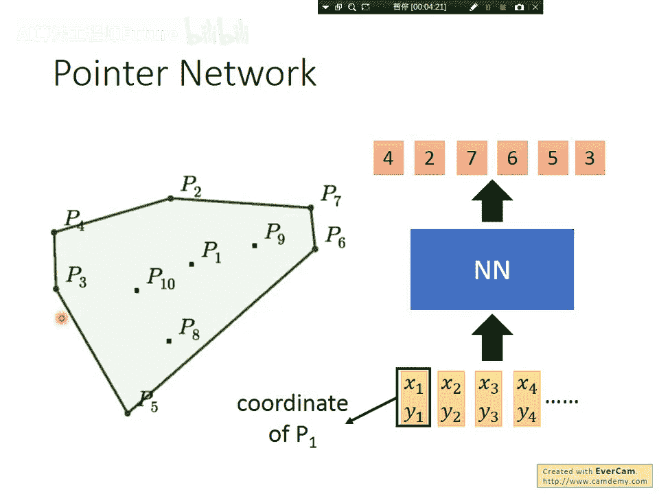
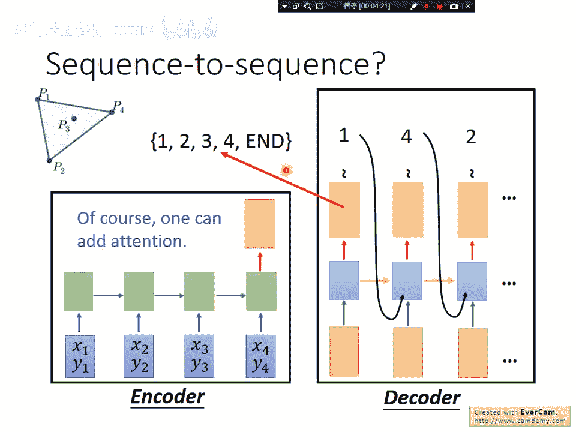
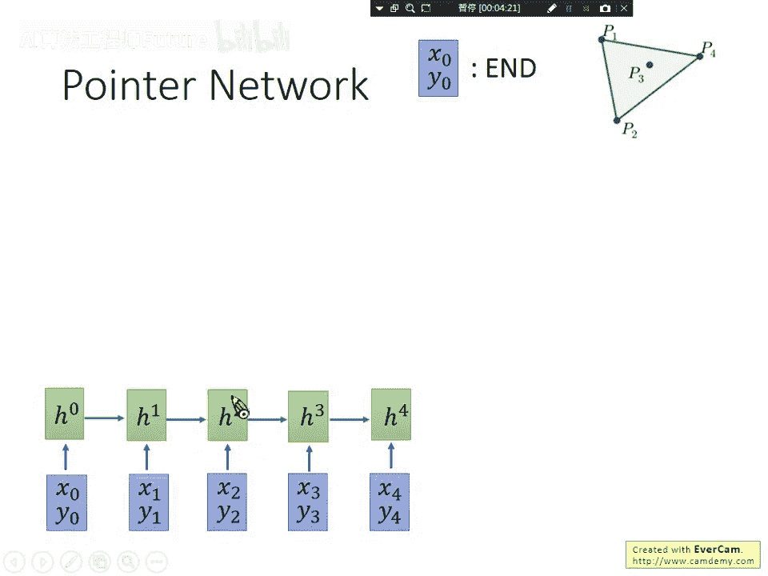
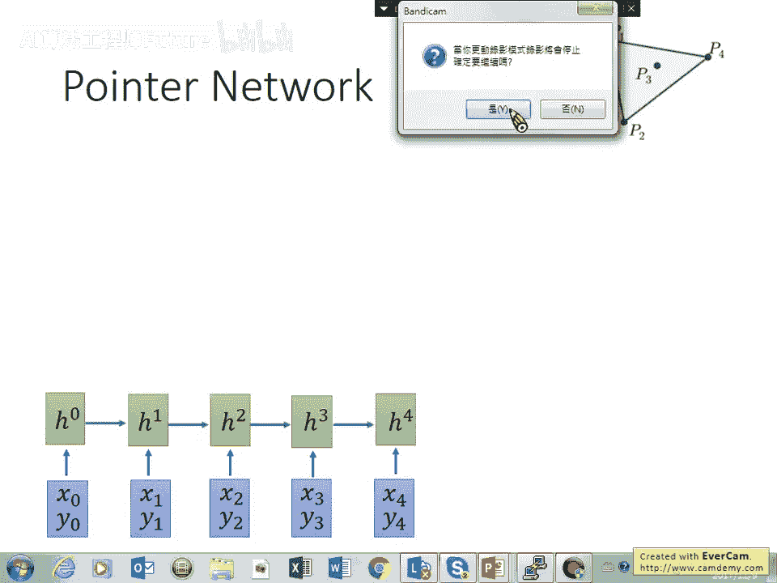
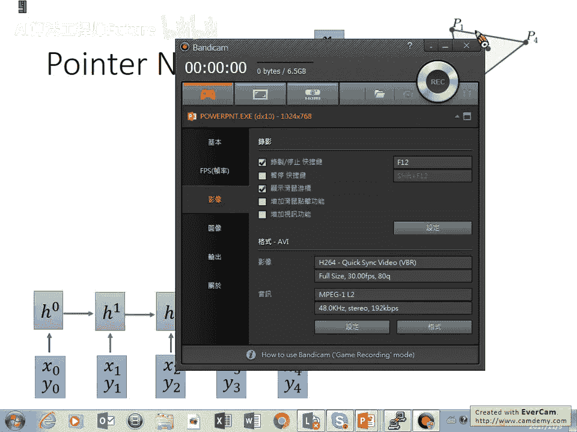
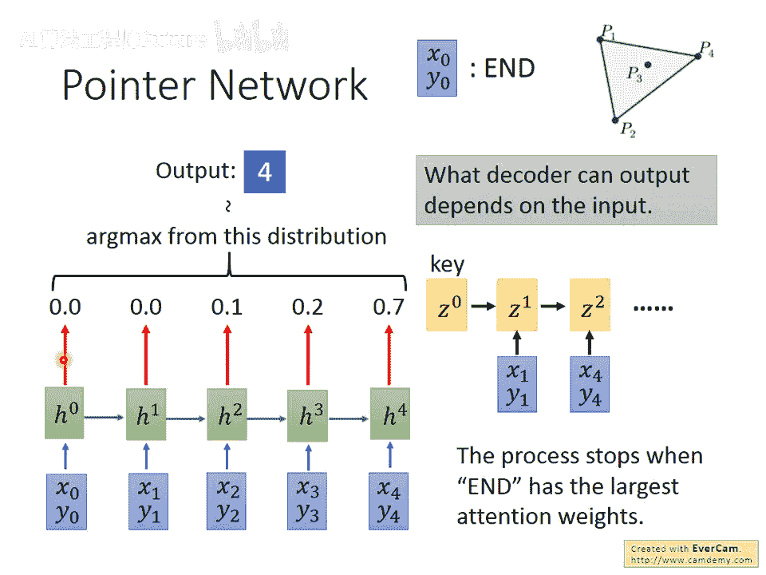
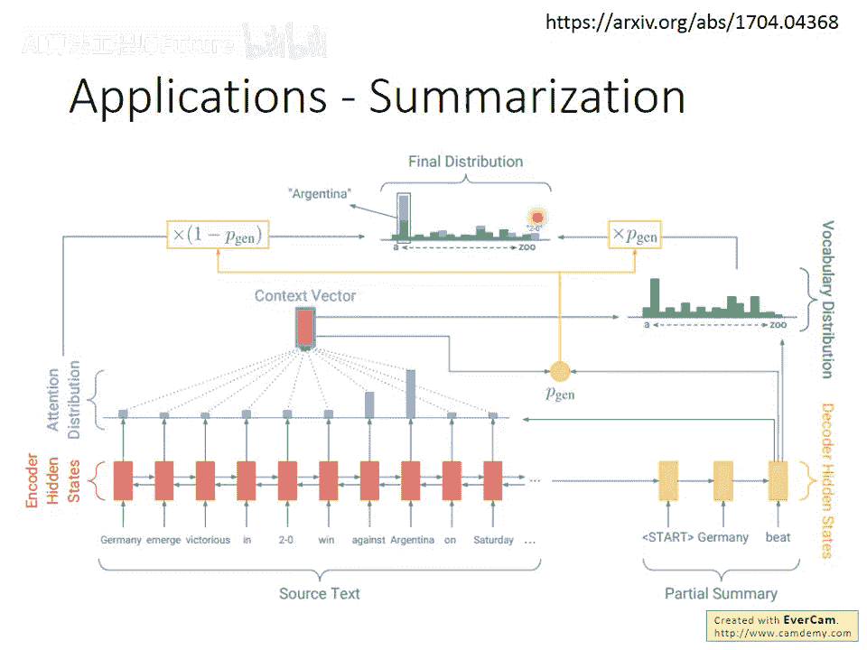
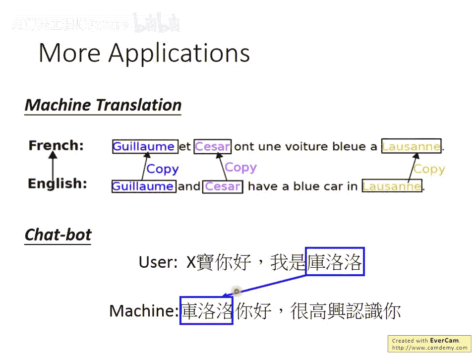

# 【官授搬运】2026年全新优化版李宏毅机器学习系统课程，这才是真正的初学者体系课程！—人工智能／深度学习／神经网络 - P40：5-选修-指针网络(Pointer Network) - AI算法工程师Future - BV1ruqABeEFX

那pointer network他想要解决的问题呀，其实一开始他也是apply，在一个硬寸一发的问题上，一开始pointer network最早的pk，最早的vacation呢是被用在。

想要解一系列演算法的问题，那其实在它的原始的paper里面，我记得是解了三个，我就举其中一个出来，这个问题是这个convex后的问题，这个问题是说哦给你一大堆的data point。

在这个图上呢给我们十个data point啊，接下来呢我们要用这个自动的方法找出，说在这个data point把哪些点找出来，通通连在一起以后，它可以把其余的点包进去，就这样啊，这个是个演算法的问题。

但是我们要用neural network呢，印券一发，拿一个neural network出来，他的input就是十个data point，那每一个data point我们就用它的XY坐标来表示。

所以input一个十个是这个这个呃，都是二维的vector，然后有十个vector丢到neural network里面去，然后我们期待它的output，就是一串是427653，就是427653。

正好就可以把这十个data point呢把它框起来，那你只要准备一大堆的training data，哎不要，那当然training data就是一大堆的data point。

然后你要知道说他的CONFEX后是哪些data，那就不要问说那个正确答案是怎么找出来的，这样子找就是假设找TURKER标的，然后你只要准备数万笔data ta，然后让NN劝下去。

希望在新的task上他也work克就死了。

好那这个pointer network要怎么解呢，我们现在是input1排sequence，output另外一个sequence，所以理论上好像可以直接用sequence to sequence。

learning解，我们之前讲sequence to sequence learning的时候，我们说哦，你input一个sequence，比如说character sequence。

而不另外一个sequence，比如说英文的or sequence就可以做翻译，那现在如果apply在这combat后的问题上，我们其实只是改变了一下input output，我们说input变成假设。

我们的问题是总共有四个data point，input就是四个data point的坐标，那output是什么，每一个test set呢，我们的output的选择是这四个point1到四。

还有and这个token，所以我们需要做的事情就是哦，现在呢encoder把这四个data point读进来，变成一个红色的vector，然后把红色的vector丢到decoder里面去。

然后呢这个decoder呢就得到一个distribution，然后根据这个distribution做sample啊，比如说你做arg max，他就说哦我决定要输出token1，然后呢。

接下来他会决定要在下输入下，下输出下一个token，那个我输出token4，好，在下一个时间点，他说我再输出一个token，我输出token2，直到输出end的时候就结束了，然后看看硬劝下去。

work不work，那结果是不work，这样子啊，为什么，因为你想想看说encoder是个RNN，所以你今天input sequence的长短不一样的时候，encoder可以处理我，我们当然不不希望说。

我们确认这个sequence to sequence model，劝完以后，他只能说哦，我每次输入的点都是死的，但希望说哦，我劝的时候可能呃，训练训练的时候都只给他50个点，但在testing的时候。

有人输入100个点，他也要work，这样呃，当然encoder输入的长度长短对它不会造成影响，它都能够处理，但是decoder的话呢就有点痛苦，因为假设你原来设定好的输出就是50个点。

那意味着说你output这个vector，他的set就是1~50加，and如果你今天testing的时候变成input100个点，那它output就只有1~50到end。

那它永远选不了其他51到编号100的点了，对不对，所以这个方法是行不通的，那怎么办怎么办。

这边呢对attention这个mechanism做了一下，改造以后，让network可以动态的决定他输出的set有多大，是长什么样子，怎么做呢，现在呢用这个attention的model。

把sequence4个这个这个sequence，这个第一个点到第四个点读进来，那我们这边呢要再加一个特别的符号，X0和Y0，所以X0和Y0呢代表N的这件事，等下你会比较清楚，说呢讲哎，请说录影好。

暂停哦，录影暂停了，你怎么你怎么知道录影暂停了，因为他一直在闪哦，不不不，这个问题问的很好，但是因为其实现在录呢是用power can在录这样。

所以这个其实没有登录，把它关起。

对谢谢谢谢谢谢谢谢谢谢谢谢谢，哎你看左上角出现一个数字，哎我不知道这个是我电脑的数字还是好，为了确保他的录音是真的有开的，我们重新把它关起来啊。

然后再录一套，这样好，谢谢谢谢好，这个是怎样呢，好我们就采用我们之前讲的那个attention base的model，然后那个attention base的model啊，我们不是说要先产生一个key吗。

然后用那个key去做attention吗，好现在产生一个key，这个key呢是Z0，跟之前attention base一样，model一样，我们用这个Z0呢对input呢去做attention。

那对每一个input你就会产生一个attention的weight，举例来说呢，在x1 y one这边attention的weight呢是0。5好。

每一个input都会得到一个attention的weight，然后接下来呢根据这个attention的WEI，在原来的attention model里面，我们会根据这个attention的weight。

对input vector做微ISSUN，那这边不是，这边是说我得到这个attention的weight以后。

这个attention的weight就是我们output the distribution呀，这个attention的weight就是我们output distribution。

我们根据这个attention的weight去取a r g max，我们把这个attention的weight视为一个distribution，取a r g max，那假设说现在这个地方的值最大。

那就是output1结束，那在你想说在training的时候，怎么train呢，在training的时候，你当然是有label data，先不要管label data怎么来，就是有label data。

label data告诉我们说啊，label data告诉我们说，在第一个time set output1才是对的，那你就会希望在training的时候。

你得到的这个由这个attention所构成的distribution，它在这个地方的值最大，其他的值呢都趋近于零，然后你算你去minimize那个cos entropy就行了，好，所以现在的好处是什么。

现在好处是说随着input sequence的变化，你现在output的那个set，你可以output set也会跟着改变，你input的长度是100，那你output set就有100个可能的选择。

input长度是十，output的token就有100个可能的选择好，那现在假设这边OO1，那你就把x1 y one丢进去，然后再产生新的key z y好，再用ZY去做attention。

然后根据这个attention得到个distribution，再从这个distribution做L去max，可能你这次是这边几率最大，那我们就把四呢取出来。

然后呢再把x y four y four丢进去，然后再产生新的p z two，然后这个process呢就一直持续下去，直到end的出现，end的出现是什么意思。

当今天代表and的这个input就是X0Y0，它的attention的weight最大的时候，这整个PONS就结束，这样好，那你可以看一下这篇呃，Pointer network。

最早期对第一篇paper的文献，他就做了这种很多硬称一发的task，然后至少在这个CONFEST后的task上面，他可以做到将近100percent的正确率。

而且他training的sequence跟testing的sequence，长度可以是不一样的啊，你可能会觉得说呃，解这种已经有现成的algorithm的问题。

好像没有什么特别的用，对确实没有什么特别的用这样子，然后但它有一些其他的应用，举例来说，Point ter network，它蛮适合被用在SUMMARIZATION上面的。

为什么pointer network适合被用在SUMMARIZATION上面呢，你想想看，你当然可以扔一个sequence to sequence model，来做SURIZATION这件事。

Input a document，output那篇document的summary，但是我们今天在做summary的时候，很多词汇很多，你summary里面放的词汇其实都是人名地名。

那你的LEC跟size是有限的，所以你通常你的LEICON，size里面可能没有包含那些人名地名，那你只能在那些人名地名的地方output啊，NO这样就不会得到非常好的summary。

但事实上另外一方面在做summary的时候，你可以想象summary跟他input document的关系，其实就是把input document取一些重要的词汇出来，接起来其实就是summary啦。

所以如果我们用这种pointer network在做summary的时候，产生summary的时候，让mach直接从input document里面挑字出来，组成summary。

那其实就会得到不错的summary了啊，所以今天如果把point eter network，apply在SUMMARIZATION上面的时候，怎么样呢，我们先来看传统的做法。

传统做法就是input一个document，当然你用一个encoder，它是by directional的LSTN去把它读过好，接下来呢你把这个encoder的output呢，丢给一个decoder。

那decoder每次呢就会吐出一个word，每次会吐出一个word，那把所有的word收集起来就变成summary，那他怎么决定要怎么吐出一个word呢。

你当然也可以用attention base model，你用你的这个decoder的RN去输出一个key啊，这个key呢会去算这个attention的WEI啊，这边呢对每一个input。

这个sequence的每一个word呢都算一个tension的we，然后根据这个weight呢就跟我们之前讲的一样啊，去做WAITSUN啊，根据这个wait sun的结果。

还有这个RNN你会去产生一个distribution，这个distribution是over你的LEICA里面所有的词汇，举例来说，假设你LESSC里面就是A到Z。

那它就是over这个假设next面就10万个词汇，它就是over这10万个词汇的distribution，某个词汇如果不在你的LEICA里面，比如TRP不在你的LEICA里面。

那那个不存在那不存在的词汇，它的几率就永远都是零，好在从这个distribution里面做arg max，你就可以产生一个word，但是我们现在可以加上pointer network的概念。

怎么加上point eter network的概念呢，如果加上point eter network概念的时候，我们就是从这个distribution里面直接去做sample。

我们就直接输出这一个distribution，用这个distribution来决定，summary里面应该产生什么样的问，然后你可以再认另外一个way，而这个way呢是p generation。

那这个p generation决定的说，我们今天要走右边这条路，还是走左边这条路，我们要用多少的传统的方法，加上多少的pointer network output啊。

这个p generation呢会决定这个和这个的位置，那如果是pointer network这个部分，我们就把对应到的这个同样的word呢，把它集合起来，举例来说呃。

HTINA这个word它的几率是很大的，然后呢我们就把它放在这边，那假设你的DATASET里面呢，你的LEICC里面也有AJINA这个word，那你会把它的几率呢也加起来。

那你要把这个distribution的几率加上这个distribution的几率，把这两个distribution几率加起来，从这个distribution再去决定说这个SUMMARIZATION。

ZATION的这个decoder要产生什么样的word，好那这个是用把pointer network用在summer以上。

那他还有很多其他应用，举例来说，它可以用在翻译上，你知道在翻译的时候，有一些词汇是没办法翻，比如说人名地名它没有办法翻，或者是不需要翻，这个时候你就可以在你的呃。

translator里面加上pointer network机制，让你的network可以直接从input的句子里面选择词汇，直接贴到output里面去，或者是呢你可以把同样的概念呢用在缺乏里面。

如果今天把pointer network用在缺霸里面，是有什么样的好处呢，假设现在你希望说哦有一个人对你说呃，有一个人对你的bug说，叉宝你好，我是库洛洛，我是团长，这样。

那个现在的那个机器人都一定要叫什么宝，这样子，因为他是什么，but这样他就有什么宝，然后你会希望你的机器回答的是库洛洛你好，很高兴认识你，就你说我是谁，我是库洛洛，他就说库洛洛你好，你说我是团长。

他就说团长你好，所以你希望他是直接从input去卡比，关键的词汇出来，放在output里面，这件事情如果你用sequence to sequence model直接愣，你可能认不起来。

因为你的词典里面可能根本就没有，库洛洛这个人名，但是如果你用point network，你就可以让马逊在产生它的response的时候，从input里面去选择一些词汇，贴到response里面哦。

所以pointer network也可以被用在CHA上。

