# 【官授搬运】2026年全新优化版李宏毅机器学习系统课程，这才是真正的初学者体系课程！—人工智能／深度学习／神经网络 - P42：【第6讲】1-生成式对抗网络 (GAN)-1 - AI算法工程师Future - BV1ruqABeEFX

好各位同学大家好，那我们来继续上课吧，好那接下来啊我们要进入一个新的主题，我们要讲生成这件事情啊，那是生成有什么样特别的地方呢，到目前为止啊，大家学到的network都是一个function。

你给他一个X就可以输出一个Y，我们已经学到各式各样的network的架构，可以处理不同的X，不同的Y，我们已经学到输入的X，如果是一张图片的时候怎么办，我们也学到输入的X。

如果是一个sequence的时候怎么办，我们也学到输出的Y可以是一个数值，可以是一个呃类别，也可以是一个sequence，那我们目前有讲过的network架构，其实应该可以含瓜多数你日后会遇到的问题了。

那接下来呢我们要进入一个新的主题，这个新的主题是要把network当做一个generator来用，我们要把network拿来做生成使用，那把network拿来当做generator来使用。

有什么样特别的地方呢，它特别的地方是，现在network的输入会加上一个random variable，会加上一个Z，那这个Z呢是从某一个distribution sample出来的。

所以现在network它不是只看一个固定的X得到输出，它是同时看X跟Z得到输出，那你可能会问说network怎么同时看X跟Z呢，那这里有很多不同的做法啦，就看你怎么样设计你的network架构。

举例来说，你可以说X是个向量，Z4个向量，两个向量直接接起来，变成一个比较长的向量，就当做network input，这样可以吗，这样可以，或者是啊，假设你的X跟Z正好长度一模一样。

把它们相加以后当做network input，这样可以吗，这样可以啊，那最特别的地方是它是不固定的，每一次我们用这个network的时候，都会随机生成一个Z，所以Z每次都不一样。

它是从一个distribution里面sample出来的，那这个distribution这边有个限制是它必须够简单，什么叫够简单呢，所以这边够简单的意思是，我们知道它的式子长什么样子。

我们可以从这个distribution去做simple，举例来说，这个distribution可以是一个高选distribution，你知道高选distribution的式子，你知道高点高。

怎么从高电高纤distribution做sample，它也可以是uniform distribution，那uniform distribution是指你一定知道。

你也知道怎么从uniform distribution做sample，所以这个distribution的形状你自己决定，但你只要记得说它是简单的，你能够sample它的就结束了好。

所以每次今天有一个S进来的时候，你都从这个distribution里面做一个sample，然后得到一个open，随着你sample到的Z不同，Y的输出也就不一样。

所以这个时候我们的network的输出不再是单一，一个固定的东西，而变成了一个复杂的distribution，同样的X作为输入，我们这边每次simple到不一样的东西。

通过一个复杂的network转换以后，它就会变成一个复杂的分布，我们的network的输出就变成了一个distribution，那这种可以输出一个distribution的内work。

我们就叫它generator，接下来我们就是要讲怎么训练出这种generator，那在讲怎么训练generator之前呢，呃我们第一个想要回答的问题是，为什么我们需要训练generator。

为什么我们需要generator，输入X，输出Y这样固定的输入和输出关系不好吗，为什么需要输出是一个分布呢，所以以下就举一个例子来跟你说明，为什么输出有时候需要是一个分布。

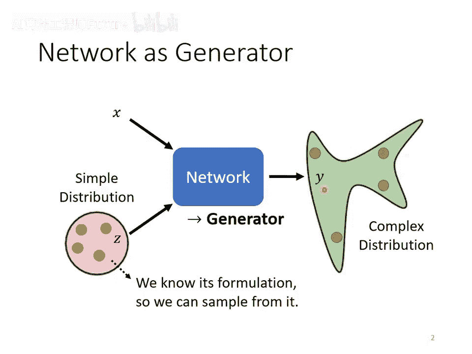

好，那这边举的例子啊是video prediction，就是给机器一段的影片，然后他要预测接下来会发生什么事情，那这个例子呢是我从上面这个GITHUB的链接找到的，那在这个链接里面。

他要做的事情呢是去预测小精灵这个游戏，接下来的游戏画面会长什么样子啊，不知道小精灵是什么的人呢，啊这个就是小精灵一个真实的游戏画面啦，好那要怎么做到video prediction呢。

那你就给你的network过去的游戏画面，然后他的输出就是新的游戏画面，下一秒的下一个时间点的游戏画面就结束了，要得到这样的训练资料一点都不困难，你只要不断的去录制有人在玩小精灵的画面。

然后你就可以知道说给定这三个friend，接下来会发生什么事，你的训练资料里面有吗，你有一堆录制的影片，你就知道说给定过去的资讯，接下来会发生什么事，你就可以训练你的network。

让它输出的Y跟我们的目标越接近越好，就结束了，有人可能会问说怎么输出一张图片，这个一张图片就是一个很长的向量啊，所以你只要让你的network可以输出一个很长的向量，然后这张向量这个向量整理成图片以后。

跟你的目标越接近越好，就结束了好，那其实在这个GITHUB里面呢，它不是直接把整个画面当做输入了，他是从画面里面只切一小块当做输入，就他把这整个画面切成很多块，然后分开来处理，不过我们这边为了简化说明。

就当做network一次输一整个屏幕上的画面好，但是这样会有什么问题呢，如果你用刚才的方法，用我们学过的network training的方法，supervised learning train下去。

你得到的结果可能会是这个样子啊，这个是机器预测出来的结果，所以你看有点模模糊糊的，而且哎中间还会变换角色，更神奇的是那个小精灵啊，走着走着居然就分裂了，它走到转角的时候。

看他走到转角的时候就分裂成两只了，走到这边又再分裂成两只了啊，有时候有时候走着走着还会消失，为什么小精灵走着走着就分裂了呢，那因为今天呢对这个network而言，在训练资料里面，同样的输入。

有时候同样的转角，有时候小精灵是往左转，有时候小精灵是往右转的，这样这两种可能性同时存在你的训练资料里面，你在训练的时候，今天你的network得到的训练的指示，是给定这一段输入。

那今天得到这一笔训练资料，那他就要学到给定这段输入输出应该往右转，给定这给定这些训练资料，有时候你会看到的是向左转，那机器就会学到给定这段输入，它要向左转，但是这两种训练资料。

很有可能同时都存在你的训练集里面，所以你的network学到的就是两面讨好哦，因为他需要得到一个输出，这个输出同时距离向左转最近，同时远距离向右转最近，那怎么样，同时距离向左转最近，向右转最近呢。

也许就是同时向左也向右转哦，所以你的network他就会得到一个错误的结果，向左转是对的，向右转也是对的，但是同时向左向右转反而是不对的，那有什么样的可能性可以处理这个问题呢。

一个可能性就是让机器的输出是有几率的，让它不再是输出单一的输出，让它输出一个几率的分布，当我们给这个network一个distribution的时候。

当我们给这个network input加上一个Z的时候，它的输出就变成了一个distribution，它的输出就不再是固定的，我们希望训练个network，他可以知道说它的输出的这个分布。

包含了向左转的可能也包含向右转的可能，举例来说，假设你选择你的Z啊，是一个比如说binary的random variable，它就只有零跟一，那可能各占50percent。

那也许你的network就可以学到，说z sample到一的时候就向左转，z sample到零的时候就向右转啊，这样子你就可以解决，这个世界有很多不可预测的东西，这样子的状况。

那什么时候我们会特别需要处理这种问题呢，什么时候我们会特别需要这种generative的model呢。

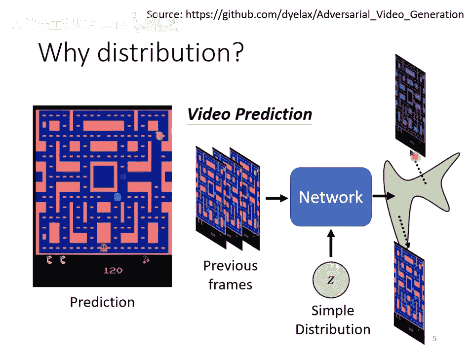

当我们的任务需要一点创造力的时候，当然任务需要一点创造力，这件事情是比较拟人化的，讲法更具体点，讲法就是我们想要找一个function，但是同样的输入有多种可能的输出，而这些不同的输出都是对的。

那同样的输入有多种不同可能的输出，你就需要就每个人都可以各自发挥嘛，就算是人来处理这个问题，可能每个人的打野都不一样，这个时候我们就说让机器具有创造的能力，那我举一个例子举例来说。

画图这件事情可能就需要一些创造力，举例来说，假设教一个人画一个红眼睛的角色，那每个人可能画出来，或你心里想的动画人物可能都不一样，有哪些角色是红眼睛的呢，举例来说，库拉皮卡是红眼睛的，他是骷髅塔族的。

骷髅塔族的愤怒以后呢就会有火红眼，那辉夜呢也是红眼睛的，那是因为呢这个库拉皮卡从黑暗大陆回来以后，就用他在黑暗大陆得到的资源成立的四宫集团，辉夜其实是库拉皮卡的子孙，到他那一代呢，火红眼变成是显性的。

不用生气，火红眼也会显现出来，所以库拉皮卡跟辉夜呢他们都有火红眼，所以同样要画一个红眼睛的角色，每个人心里想象的红眼睛的角色都是不一样的，那这个时候我们就需要让机器。

能够让我们的model能够output一个distribution，那还有什么样的例子会需要用到创造力呢，举例来说对话这件事情，假设你要训练一个聊天机器人，可能就需要一些创造力，举例来说。

假设你是跟另外一个人说，你知道辉夜是谁吗，其实有很多不同的答案，对不对哦，辉夜他是秀知院的学生会副会长，最近跟会长做了一些不可描述的事情，我没有说是什么事情，所以也不算是暴雷。

但是我们知道说辉夜其实还有另外一个成就，其实虽然说辉夜姬这个动画还没有完结，但是他的后传其实已经演完了，后来白银呢英年早逝，所以辉夜就把自己的头发染白，他为了想要离开伤心的地球。

就坐着太空船到另外一个星球，另外一个星球呢也有一些原始的生命，那些生命跟人类长得也是挺像的，他们还过着农耕的生活，然后辉夜看到其中一个小国的国王呢，长得跟白银有点像，所以他就跟那个小国国王在一起。

他们生下来一个小孩，就是六道仙人，于是就开创了忍者时代，真是可喜可贺，可喜可贺这样子，所以我们今天学到什么事呢，我们今天就是学到说这个这个辉夜辉夜大小姐，这个动画她真是一个了不起的动画。

他其实是在两部大长篇中间的小品，它既是猎人的后传，也是火影忍者的前传，这三个故事是可以串在一起的，就是这么回事哦，所以我们对机器说一句话，问他说辉夜是谁，其实每个人也可能都有不同的答案。

这个时候我们就需要generated的model。

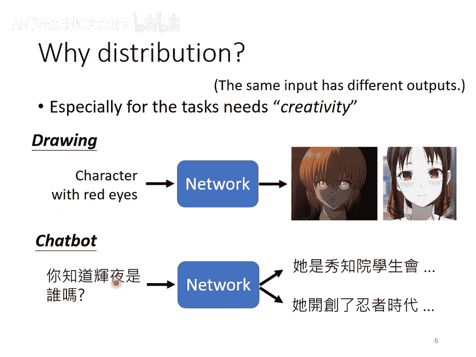

而在generative model其中一个非常知名的呢，就是generative adversarial network啊，它的缩写呢是GAN，那我们这堂课呢主要就是介绍generative。

Adversal network，好，那在介绍generative adversal network之前呢，我们就遇到个问题啊，就是GAN要怎么念呢，google小姐念起来是这个样子的啦。

Gone gone，Gone，好，就割案四声了，嘿就是这么回事好，那这个歌案四神呢，这个GAN呢它其实有很多各式各样的变形啊，你可以在网络上呢找到一个GN的动物园，然后找到一个game的zoo。

那GNN的动物园里面呢，收集了超过500种以上的GN，那你知道每次有人发明了一个新的game的时候呢，他就会在前面加一个英文的字母，那但是你知道英文的字母是有限的啊，很快的英文的字母就被用尽了。

举例来说，在game的动物园里面，至少就有六种的s game，它们都是不同的东西，但它们统统被叫做s game，甚至还发生了这样子的状况。

有一篇paper他提出来的叫做variational auto encoder game，照理说应该缩写成a e game或者是a game，但是作者呢加了一个注解，说哎呀a game被别人用了啦。

所有的英文字母看起来都被别人用了啦，我只好叫做阿尔法game，这样因为说gain的实在太多了，所以就会发生这种状况，而且你还可以跟你的同学比说，谁可以记得最多game的名字，然后从A念到Z哎。

好那我们现在等一下要举的例子啊，就是要让机器生成这个动画人物的，二次元人物的脸啊，那等一下我们举的例子呢，是unconditional的generation。

什么叫unconditional generation呢，就是我们这边先把X拿掉，那之后我们再讲到conditional generation的时候，我们会再把X加回来，我们这边呢先把X拿掉。

所以我们的generator它输入就是Z，它的输出就是Y，那输入的这个Z是什么呢，我们等一下都假设Z呢是一个normal distribution。

Z是从一个normal distribution sample出来的向量，那这个向量呢通常会是一个low dimensional的向量，它的维度其实是你自定的啦，你自己决定的啦，那通常也就定个啊。

50啊，100啊这样子的大小，但是它是你自己决定的，而你从这边Z呢，你从这个normal distribution里面呢，sample一个向量以后丢到generator里面。

generator就给你一个对应的输出，那我希望对应的输出，就是一个二次元人物的人脸了，那到底卷的RATOR要输出什么样的东西，才会变成一个二次元人物的人脸呢，其实这个问题没有你想象的那么困难。

一张图片就是一个非常高维的向量，所以generator实际上做的事情，就是产生一个非常高维的向量，举例来说，假设这是一个64×64，然后彩色的图片，net generator输出就是6464乘三。

那么长的向量，把那个向量整理一下，就变成一张二次元人物的脸，这个就是generator要做的事情，当你输入的向量不同的时候，你的输出就会更正改变哦。

所以你从这个normal distribution里面sample z出来，sample到不同的Z，那你输出来的Y都不一样，但我们希望说不管这边sample到什么Z，输出来的都是动画人物的人脸。

那讲到这边，可能有同学会问说，这边为什么是normal distribution呢，不能是别的吗，可以是别的，这边选别的，你其实也会问同样的问题就是了，那呃我的经验是。

不同的distribution之间的差异可能并没有真的非常大，不过你还是可以找到一些文献，试着去探讨不同的distribution之间有没有差异。

但是这边其实你只要选一个够简单的distribution就行，因为你的generator会想办法把这个简单的distribution，对应到一个复杂的distribution。

所以你可以把额选择distribution这件事情，交给你的generator来处理，那这边我们在等下的讨论里面，都假设是一个normal distribution就好了好。

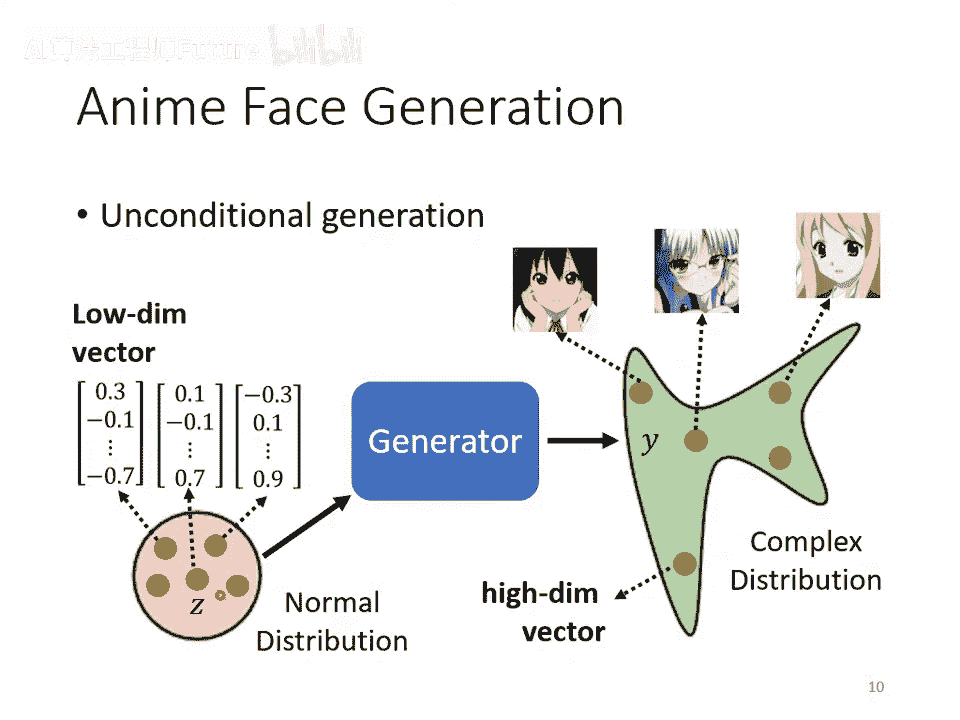

那在game里面一个特别的地方，就是除了generator以外，我们要多训练一个东西，这个东西呢叫做好，那这个discriminator是做什么的呢，这个discriminator它的作用是。

他会拿一张图片作为输入，那它的输出是什么呢，它的输出是一个数值，这个discriminator本身呢也是一个neural network啊，它就是一个function，它输输入一个东西，会输出一个东西。

它输入一张图片，它的输出是什么，它的输出就是一个数字，它输出就是一个SCALER，这个scale越大，就代表说现在输入的这张图片越像是真实的，二次元人物的头像好，举例来说啊，这个是二次元人物的头像。

那就输出一假设一是最大的值了啊，这个也是画的很好的，就输出一这个不知道在画什么，就输出0。1，这个不知道在画什么，就输出0。1，这是discriminator的工作。

那至于discriminator的neural network的架构啊，这也完全是你自己设计的，所以generator他是个neural network。

discriminator也是个neural network，他们的架构长什么样子，你完全可以自己设计，你可以用CNN，你可以用transformer都可以，只要你能够产生出你要的输入输出就可以了。

那在这个例子里面，像discriminator，因为输入是一张图片，你很显然会选择CNN，对不对，CNN在处理影像上有非常大的优势，这样输入这张图片，那点discriminator。

很有可能里面会有大量的CNN的架构，那至于实际上要用什么样的架构，这完全是问你自己，你完全可以自己决定好，那game的基础的概念是什么呢，为什么要多一个discriminator呢。

那这边呢就讲一个故事，而这个故事呢跟演化是有关的，这是这是什么呢，这不是一片枯叶，它其实是枯叶蝶的拟态，那枯叶蝶呢长得跟枯叶非常像啊，它可以躲避天敌，那枯叶蝶的祖先呢其实也不是长得像枯叶一样。

也许他们原来也是五彩斑斓的，但为什么它们变得长得像枯叶一样呢，是因为有天泽的压力啊，这个不是普通的麻雀啊，这个是波波哎，它不是普通的麻雀，那这个波波呢会吃枯叶蝶的祖先，在天泽的压力之下呢。

枯叶蝶就变成棕色的，因为波波呢它只会吃彩色的东西，他看到彩色的东西知道是蝴蝶就把它吃掉啊，看到棕色的东西呢，那个波波就觉得是枯叶就可以骗过他，而在枯叶蝶的祖先在天泽的压力之下呢，颜色就变成是棕色的哦。

但是波波呢也是会演化的哦，所以波波的波波为了要吃到这些枯叶蝶呢，你有伪装成枯叶的枯叶蝶呢，所以他也进化了波波，进化以后就是比比鸟是吧，这个是比比鸟好，那比比鸟呢它在判断一个蝴蝶能不能吃的时候。

是用比较高明的手段，它不会只看颜色，它会看它的纹路，他知道说没有叶脉的是蝴蝶，有叶脉的才是真正的枯叶，在天泽的压力之下，枯叶蝶就产生了拟态，产生了叶脉，想要骗过比比鸟，但是比比鸟它也有可能会在进化。

比比鸟进化是什么呢，比比鸟进化就是大比鸟啊。

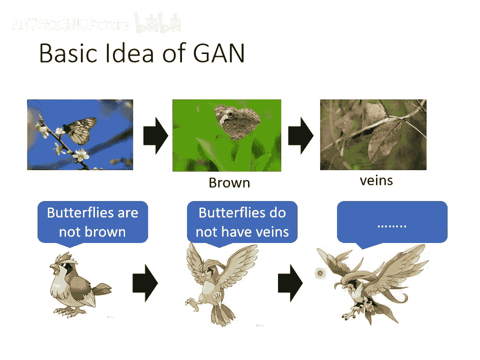

知道吗，这个是大比鸟，而大比鸟可能可以分辨这个枯叶蝶，跟枯叶的不同好，那这个是演化的故事，对应到gain呢，枯叶蝶就是generator，那它的天敌呢就是discriminator。

那现在我们GENER的RA，要做的事情是画出二次元的人物，那generator怎么学习画出二次元的人物呢，他学习的过程是这样子的，第一代的generator，它的参数几乎是随它是它的参数完全是随机的。

所以他根本就不知道要怎么画二次元的人物，只要画出来的东西就是一些莫名其妙的杂讯，那discriminator，接下来呢，他学习的目标是要分辨generator的输出，跟真正的图片的不同。

那在这个例子里面可能非常的容易，对discriminator来说，他只要看说图片里面有没有两个黑黑的圆球，就是眼睛哦，有眼睛就是真正的二次元人物，没有眼睛就是generator产生出来的东西。

然后接下来generator就调整它的里面的参数，generator就进化了，它，调整它里面的参数，它调整的目标是为了要骗过discriminator，假设discriminator。

判断一张图片是不是真实的依据，看的是有没有眼睛，那generator就产生眼睛出来给discriminator看哦，所以generator产生眼睛出来，然后他可以骗过第一代的discriminator。

但是discriminator也是会进化的哦，所以第一代discriminator，就变成第二代的discriminator，第二代discriminator，会试图分辨。

这一组图片跟真实图片之间的差异哦，他会试图去找出这两者之间的差异，举例来说，还发现说哦这边产生的图片都是比较简单的，比喻来说，都没有头发，也没有嘴巴，那这些图片是有头发也有嘴巴的。

接下来第三代的generator，就会想办法去骗过第二代的discriminator，既然第二代this discriminator是看有没有嘴巴，来判断是不是啊，真正的二次元人物。

那第三代的generator就会把嘴巴加上去，按discriminator也会逐渐的进步，他会越来越严苛，然后期待discriminator越来越严苛，generator产生出来的图片。

就可以越来越像二次元的人物好，那因为这边有一个generator，有一个discriminator，他们彼此之间是会互动，那在最早啊，这个game是英格fellow propose的14年啊。

这个game paper呢是发表在14年的NX啊，那最早在这个game的原始paper里面呢，把generator跟discriminator当做是敌人，如果你有看很多网络文章的话，他都会举例说啊。

generator是做假钞的啊，然后discriminator是警察，警察要抓做假钞的人来讲话就会越来越像，然后警察就会越来越厉害等等啊，因为觉得觉得RATOR和discriminator。

中间有一个对抗的关系，所以就用了adversarial这个字眼，adversarial就是对抗的意思，但是至于generator和discriminator，他们是不是真的在对抗呢。

这只是一个拟人化的说法而已，甚至之前愚人节他的网络文章就是写说，我们不可以虐待人工智慧，我们不可以让人工智慧在斗技场里面，彼此互相残杀，这个是不道德的。

我们应该要释放这些generator跟discriminator好，那这样是不是在对抗，其实就只是人类的比喻啦，那呃你也可以说，他们其实是亦敌亦友的合作关系哦。

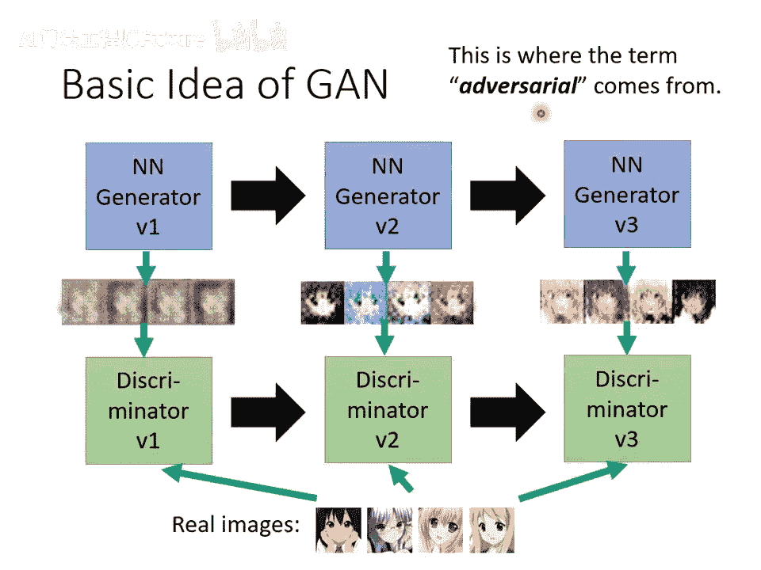

所以generator和discriminator的关系，用动画来说就是写作敌人念做朋友了，就跟近藤光还有塔矢亮一样，或者是跟NARUTO跟SASK一样，好那接下来就实际上从演算法来讲一下。

generator和discriminator是如何运作的，好，那以下呢就是正式来讲一下，这个演算法实际上是长什么样子，而generator跟discriminator他们就是两个network。

那network在训练前你要先初始化它的参数，所以我们这边就假设说generator和discriminator，他们的参数都已经被初始化了，好初始化完以后。

接下来你训练的第一步是定住你的generator，只train你的discriminator，那因为一开始，你的generator的参数是随机初始化的，那如果你要固定住你的generator。

那他根本就什么事都没有做啊，他是他的参数都是随机的啊，所以你丢一堆向量给它，它的输出都是乱七八糟的图片，那其实如果generator参数是初始化的话，你连这样子的结果都产生不出来。

而产生出来的就很像是电视机坏掉的那一种，杂讯，好，那你从这个高深distribution里面呢去random sample，一堆vector，把这些factor呢丢到GENERERRATOR里面。

它就吐出一些图片，那一开始这些图片会跟正常正常的二次元人物，非常的不像好，那你会一个database，这个database里面有很多二次元人物的头像，那这个去网络上查个图库就有了啊，这个不难收集。

那你从这个图库里面呢，去simple1些二次元人物的头像出来，接下来你就拿真正的二次元人物头像，跟generator产生出来的结果，去训练你的discriminator。

那discriminator他训练的目标是什么呢，他训练的目标是要分辨真正的二次元人物，跟generator产生出来的二次元人物，他们之间的差异会讲的更具体一点呢，你实际上的操作是这个样子。

你可能会啊把这些真正的人物都标一，generator产生出来的图片都标零，接下来对于discriminator来说，这就是一个分类的问题，或者是regression的问题，如果是分类的问题。

你就把真正的人脸当作类别一，generator产生出来的这些图片当做类别二，然后训练一个classify就结束了，或者是有人会把它当做regression的问题。

那你就教你的discriminator说，看到这些图片你就输出一啊，看到这些图片你就输出零都可以，总之discriminator就学着去分辨这个real的image，跟产生出来的image之间的差异。

那但是实际上怎么做，你可以当做分类的问题来做，也可以当做regression的问题来做好，那第二步我们训练完discriminator以后，接下来定住discriminator。

改成训练generator，怎么训练generator呢，比较拟人化的讲法是，我们就让generator想办法去骗过discriminator，因为刚才discriminator已经学会分辨。

真图跟假图的差异，真图跟生成的图片的差异，generator如果可以骗过discriminator，它可以产生一些图片，discriminator觉得是真正的图片的话。

那generator产生出来的图片可能就可以以假乱真，但实际上这个欺骗这件事情是怎么操作的呢，那它实际上的操作方法是这个样子好，你有个generator，generator是一个向量作为输入。

从高ction distribution sample出来的向量作为输入，然后产生一个图片，接下来我们把这个图片丢到discriminator里面，discriminator会给这个图片一个分数。

那generator他训练的目标啊，就discriminator参数是固定的，我们只会调整generator的参数，generator训练的目标是要，discriminator的输出值越大越好。

那因为discriminator他本来训练的时候，他的训练的目标，他可以做的事情就是看到好的图片，就给他大的分数，如果generator可以调整参数之后输出来的图片。

discriminator会给予高分，那意味着generator产生出来的图片是比较真实的，或者是啊讲的更具体一点，实际上你的操作是这个样子，generator是一堆network。

而不是一堆network，是一个network里面有好几层，然后呢discriminator也是一个network，里面有好几层，我们把选的ATOR和discriminator直接接起来。

当做一个比较大的network来看待，举例来说，generator如果是五层的network，Discriminator，如果是五层的network，把他们接起来。

我们就把它当做是一个十层的network来看待，而这个十层的network里面其中某一层啊，某一个hidden layer啊，它的输出很宽哦，他的输出的这个dimension呢。

就跟图片里面pixel的数目乘三是一样的，你把这个hidden layer的输出呢做一下整理以后，就会变成一张图片，所以这整个大的network里面，其中某一层的输出就是代表一张图片。

那我们要做的事情是什么呢，我们要做的是这整个巨大的network，它会吃一个向量作为输入，然后他会输出一个分数，那我们希望调整这个network，让输出的分数越大越好，但是要注意一下。

我们不会去调对应到discriminator的部分，我们不会去调这个巨大network的最后几层，为什么不调最后几层呢，你可以想想看，假设调最后几层的话，这整个游戏就被hack了。

因为假设你要输出的分数越大越好，我直接调呃，最后output layer那个neuron的bias，把它设成1000万，那不是输出就很大了吗，所以discriminator这边的参数是不能动的。

我们只调generator的参数好，那这边呢这个但至于怎么调generator的参数呢，这个训练的方法跟我们之前训练一般的network，是没有什么不同的。

我们之前说训练network的时候就是定一个loss啊，然后你用gradient descend啊，让loss越小越好，那这边呢你也有一个目标，只是这个目标呢不是越小越好，而是越大越好。

那当然你也可以把这个目标，就discriminator output成一个负号，就当做loss嘛，对不对，你可以把discriminator output成一个负号当做loss。

然后generator训练目标就这样，loss越小越好，或者你也可以说，我们就是要让discriminator output的值越大越好，然后我们用gradient ascent。

不是gradient descent，gradient descent是让loss越小越好，规定ascent会让你的目标函数越大越好，我们规定ass去调generator。

让discriminator的输出越大越好啊，这是同一件事，这边调训练generator的方法，也是用gradient descent base的方法，跟我们之前在训练一个一般network的时候。

是没有什么差异的好，所以现在讲了两个步骤，第一个步骤固定generator训练discriminator，第二个步骤固定discriminator，训练generator，接下来呢接下来就是反复的训练。

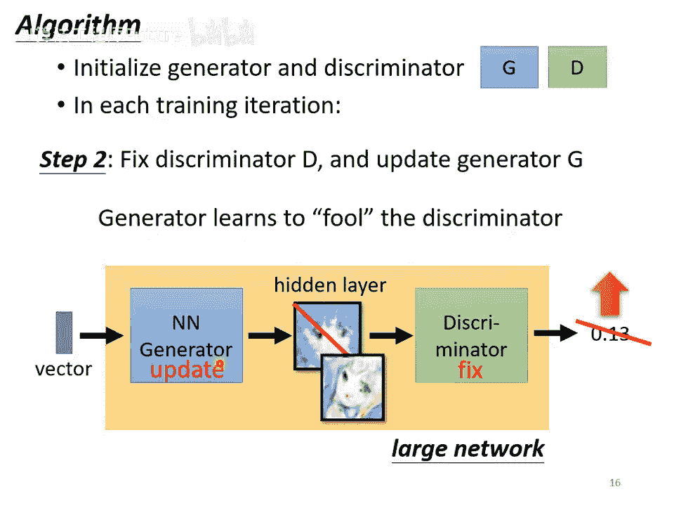

discriminator跟generator，训练完discriminator以后，固定住discriminator训练generator，训练完generator以后。

再用generator去产生更多的新的产生出来的图片，再给discriminator做训练，训练完discriminator以后再去训练generator，反复的去执行哦，所以你是训练一阵子。

discriminator训练一阵子，generator训练一阵子，discriminator再训练一阵子，Generator，generator跟discriminator，他们是啊反复的去进行训练。

当其中一者进行训练的时候，另外一个就固定住，让你期待discriminator跟generator都可以做的。

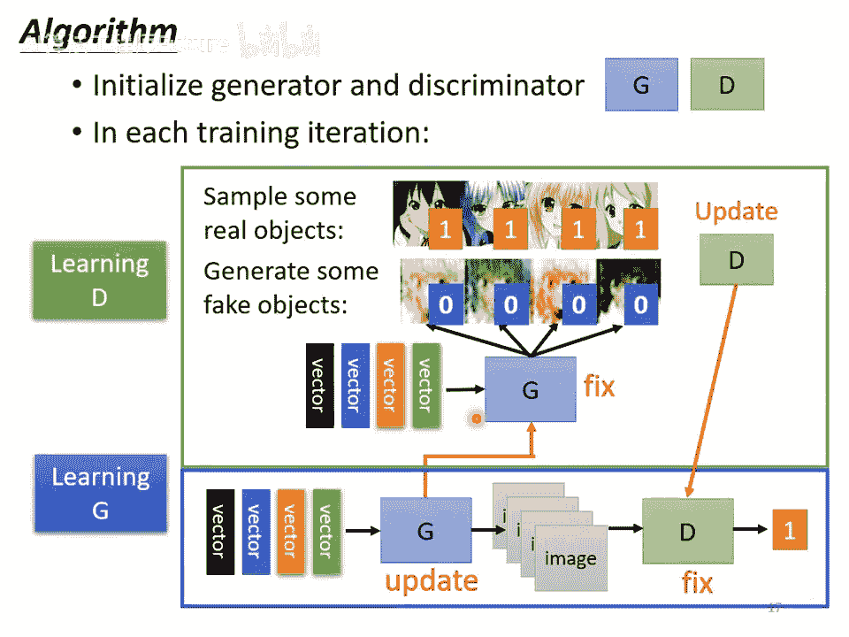

越来越好好，那我们作业呢，其实下一个作业就是要做动画人物的人脸，生成啦，那你可能会问说到底可以做到什么样的程度呢，以下的结果是我在17年的时候做的，我自己试着劝了一下game。

看看game是不是真的可以产生二次元的人物好，那我训练了，我把那个generator呢update了100次以后，所以generator update100次的意思是说呃。

呃就是discriminator tra一下，generator train一下，discriminator train一下，generator train一下。

这样往返100次以后得到的结果是这样子的，嗯不知道在做些什么，但我接下来呢就再等了一下train1000次，就discriminator跟generator各自训练，这样反复1000次以后。

机器就产生了眼镜啊，机器知道说人脸就是要有两个眼睛，所以他就把眼睛标上去，训练到2000次的时候，你发现嘴巴就出来了，训练到5000次的时候，已经开始有一点人脸的样子了。

而且你发现说机器学到说动画人物啊，就是要有那个水汪汪的大眼睛，所以他每个人的眼睛呢都涂的非常的大，都有反白，代表说反光是水汪汪的大眼睛啊，这个是训练1万次以后的结果，你会发现形状已经有出来了。

只是有一点模糊，很多地方有点晕开的感觉，好像是水彩画的样子，而接下来这个是update20000次的结果，这个是update50000次的结果，我后来就停在5万次的地方，那其实你在作业里面。

是有机会做得比这个结果更好的，这个是助教，是学生的时候做的结果了，那如果是最好，可能可以做到这个样子，那你会发现说这些人物呢都还不错，那只是有一些比较还是会有，偶尔会有一些崩坏啦，那乍看之下呢。

可能比一些作画画风会崩坏的动动画公司，比如说妹非妹做的还要好一些了，那其实啊呃如果你有好的资料库的话，那当我们提供给大家，资料是做不到这个地步的啦，如果你有真的非常好的资料的话。

也许你可以做出真的很好的结果，我在呃网络上呢找到了一个这样子的结果，在这个是用style game做的。

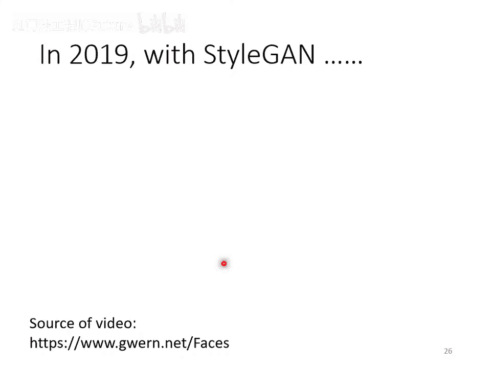

那用style game做起来可以做到这个样子。

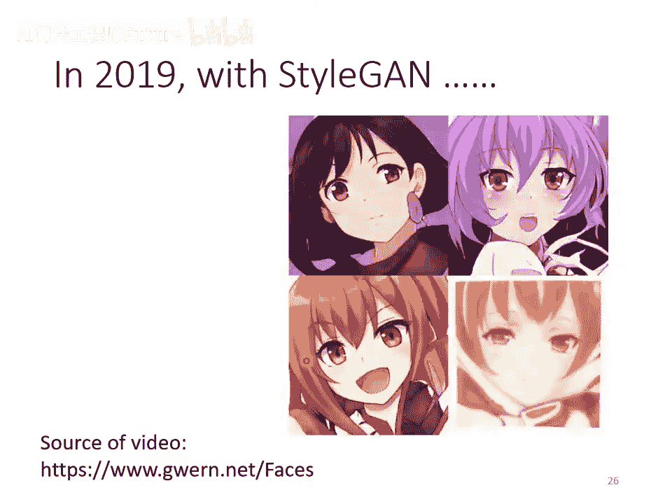

我觉得非常惊人哈，我觉得很惊人哈。

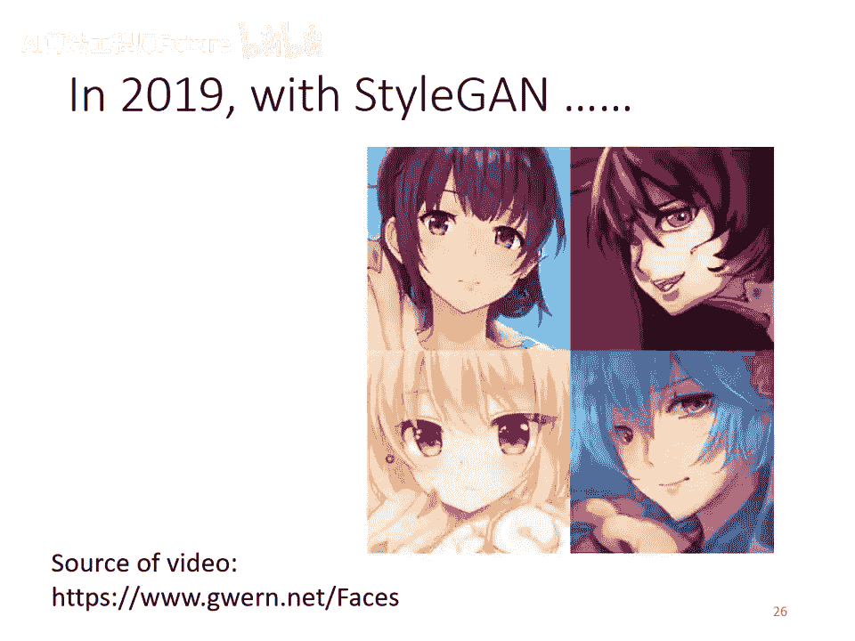

这些都是呃用game产生出来的人物呢，那这边它还产生了异色瞳，我不知道算是画错呢，还是他刻意呢要产生异色瞳，对异色瞳就一眼白眼，一眼写轮眼这样子的概念。

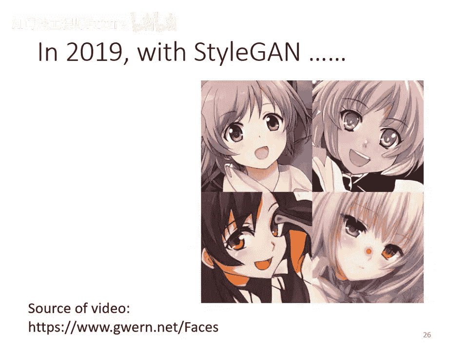

好那除了产生动画人物以外，当然也可以产生真实的人脸，有一个技术叫做progressive game。

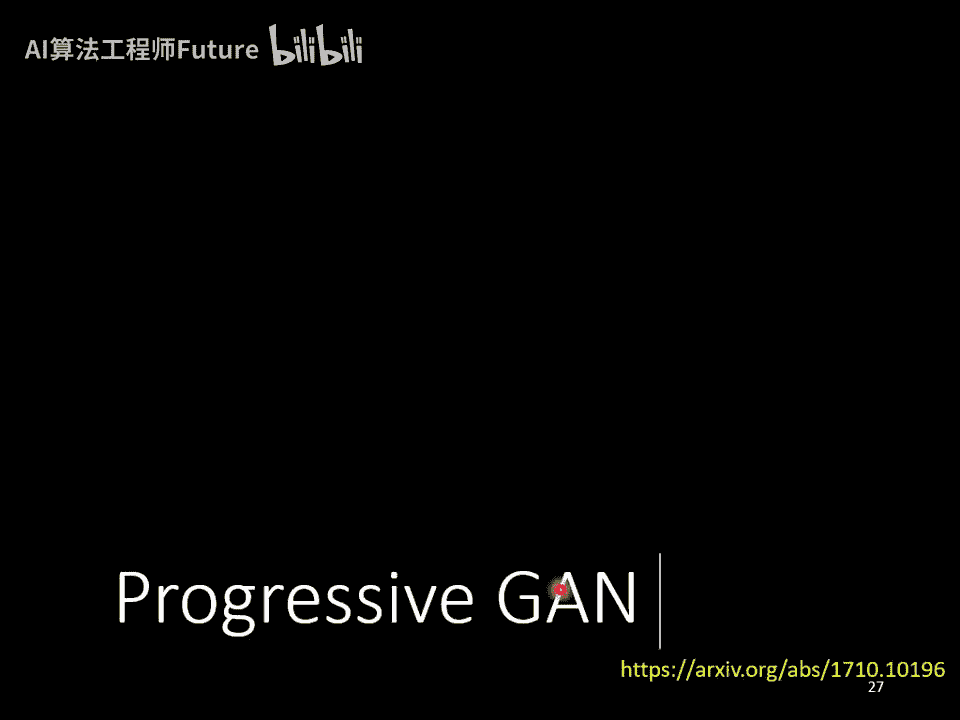

它可以产生非常高清的人脸，好这边考一下大家了，这边有两排人脸，你觉得上面这一排是机器产生的，请举手好，有一些同学好手放下，你觉得下面这一排是机器产生的，请举手好，比较多，手放下。

其实上下两排都是机器产生的，这样好，所以这个显然progressive game，还有办法产生以假乱真的人脸，甚至之前呐你不知道我也听，有一个新闻，我不知道是不是真的啦，有一个新创公司啊。

它里面有很多人，但大家发现里面那些人的头像有点怪怪的，而有人说那些头像其实是用game生成的，那并不是真正的人物，就那个公司没有那么多人，就用game生成一些假人的照片，当做是假的。

员工本来可能会问说要产生人脸，有什么有有什么用呢，我去路边拍一个人产生出来的照片，不是更像真的吗，但是用GA你可以产生你没有看过的人脸，举例来说，用game你可以做到这样子的事情。

我们刚才说game这种简的RATOR就是输入一个向量，输出一张图片，那你不止可以输入一个向量，输出一张图片，你还可以把输入的向量做内插，做interpolation。

把输入的向量做内差以后会发生什么事呢，你就会看到两张图片之间连续的变化，举例来说，你输入一个向量，这边产生一个看起来非常严肃的男人，你输入一个向量，这边产生一个笑口常开的女人。

那你输入这两个向量中间的interpolation，它的内差，你就看到这个男人就逐渐的笑了起来。

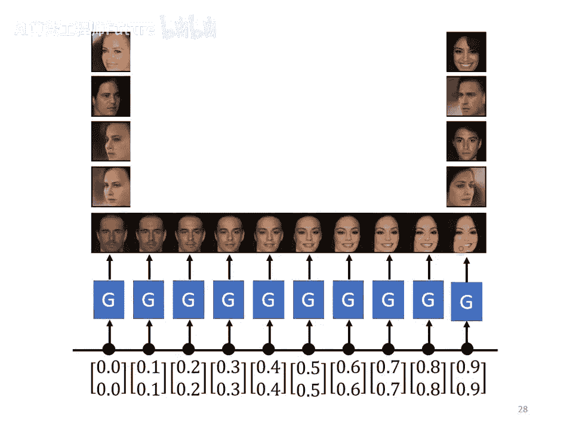

或者是呢这边有更多的例子哦，你输入一个向量哦，这个输入的向量这边是假的啦，但这边产生出来的图片是真的啊，你输入一个向量，这边产生一个往左看的人，你输入一个向量，这边产生一个往右看的人。

你把往左看的人跟往右看的人做interpolation，会发生什么事呢，机器并不是傻傻的把两张图片叠在一起，变成一个双面人，而是机器知道说往左看的人脸跟往右看的脸，人脸介于他们中间的，就是往正面看。

你在训练的时候，其实并没有真的告诉机器这件事，但机器可以自己学到说把这两张脸做内插，应该会得到一个往正面看的人脸好，那说到gain呐，刚才已经讲过。

说啊gain是yang fellow在14年的时候提出来的，那你可能听过那个故事，是啊啊YANGO，这这不知道是不是真的啊，这个传说了，我说英格fellow去酒吧，然后看到两个人吵架。

于是就有了gain的灵感，然后呢我回家第一次试做就成功了，这样然后就结束了，然后就投了一个paper，那呃那但是他所谓的成功啊。

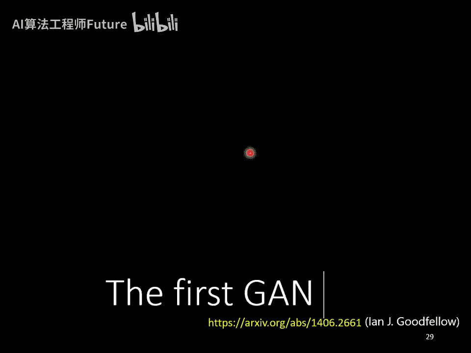

其实是长这个样子的啦，呃在14年的时候，我第一次看到这个结果时，我觉得哇靠还真的可以产生图片，太厉害了，当然如果从今天的角度来看，你会觉得说哎这样你也算是有成功吗。

今天比如说你用big game产生出来的图片。

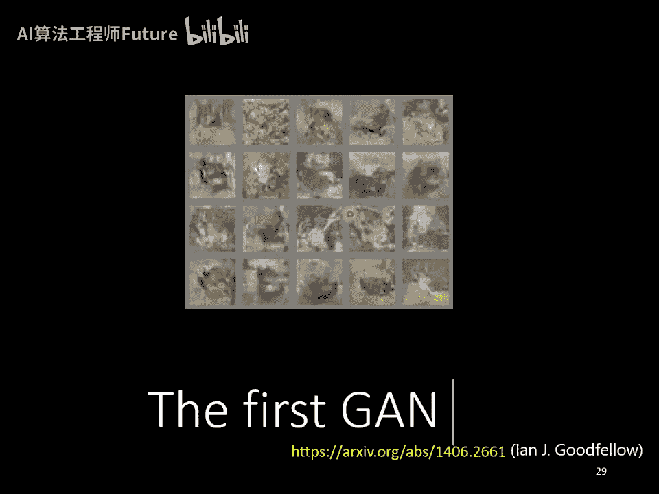

可以做到像这个样子的结果啊，这这些图片都是机器生成的，但仔细看一下，还是可以发现一些破绽，举例来说这只狗它多了一个角啊，或者是这个杯子，它左右没有很对称啊，它有点歪歪的，但这些图片都是极其生成。

但有时候机器也会产生一些幻想中的角色，举例来说，机器就产生了一个网球狗啊，还是产生一个网球狗，把狗跟网球融合在一起，还会产生幻想中的角色啊，这个就是影片，那讲到这边正好告一个段落。

那有关game的理论的部分，我们会下一堂课再讲，我们这边先在休息10分钟。