# 【官授搬运】2026年全新优化版李宏毅机器学习系统课程，这才是真正的初学者体系课程！—人工智能／深度学习／神经网络 - P44：3-生成式对抗网络(GAN)-3 - AI算法工程师Future - BV1ruqABeEFX

好我们就开始来上课吧，那上周讲到哪里呢，上周讲到w game，那我还我们还说，实际上呢如果你要实做w game的话，其实有很多不同的做法。

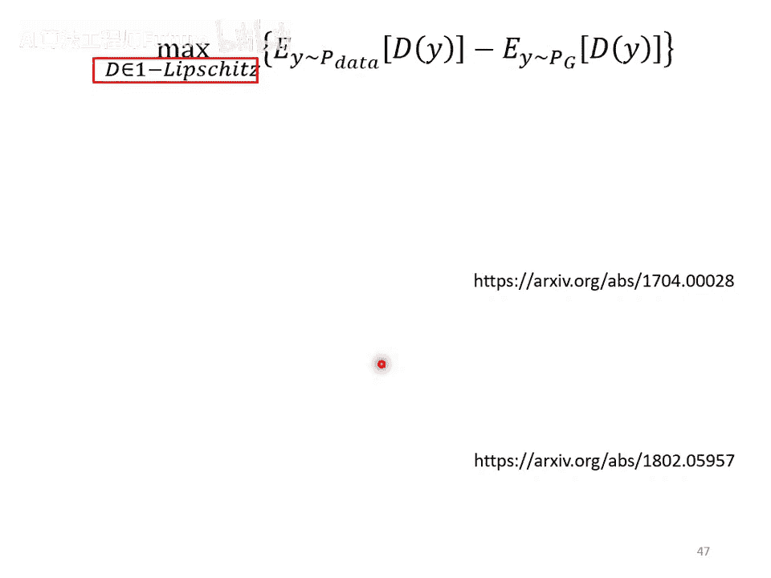

那今天看起来呢效果最好的，其实是spectral normalization，很多人会缩写成这个sn game，SN就是spectral normalization的意思好。

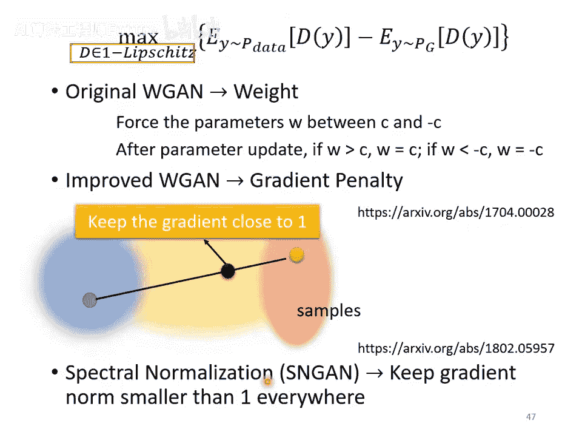

但是虽然说已经有w game，但其实并不代表说game就一定特别好，train gain仍然是以呃很难把它圈起来而闻名的，那为什么game很难被圈起来呢，它有一个本质上困难的地方，我们来想想看。

discriminator跟generator，他们各自在做的事情是什么，discriminator做的事情，是要分辨真的图片跟产生出来的，也就是假的图片的差异。

这是discriminator在做的事情，而generator在做的事情，他是要去产生假的图片，骗过discriminator，而事实上这两个呃network。

这个generator跟discriminator他们是互相砥砺，才能互相成长的，只要其中一整发生什么问题，停止训练，另外一个人就会跟着停下训练就会跟着变差。

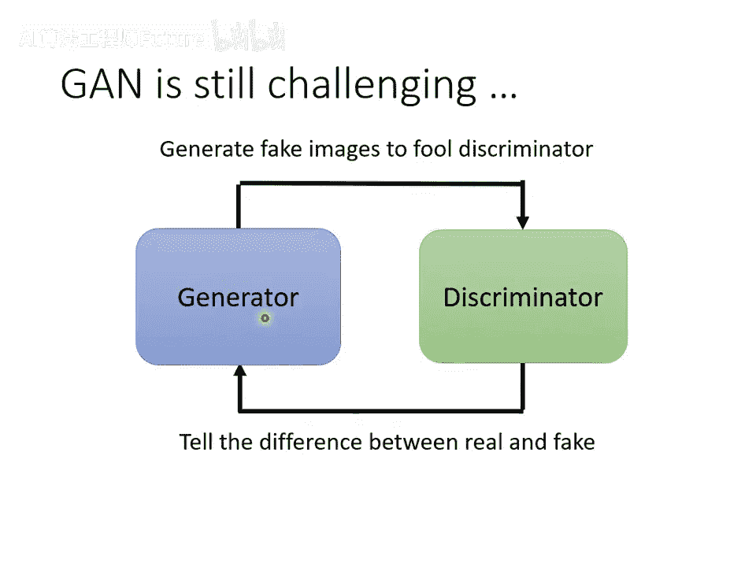

跟着惨掉，所以今天假设你在TRADISCRIMINATOR的时候，一下子没有train好，你的discriminator，没有办法分辨真的跟产生出来的图片的差异。

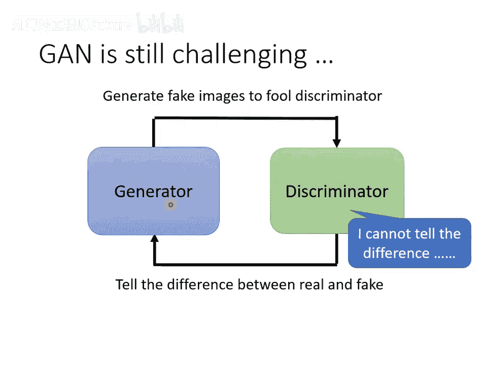

那generator他就失去了可以进步的目标，generator就没有办法再进步了。

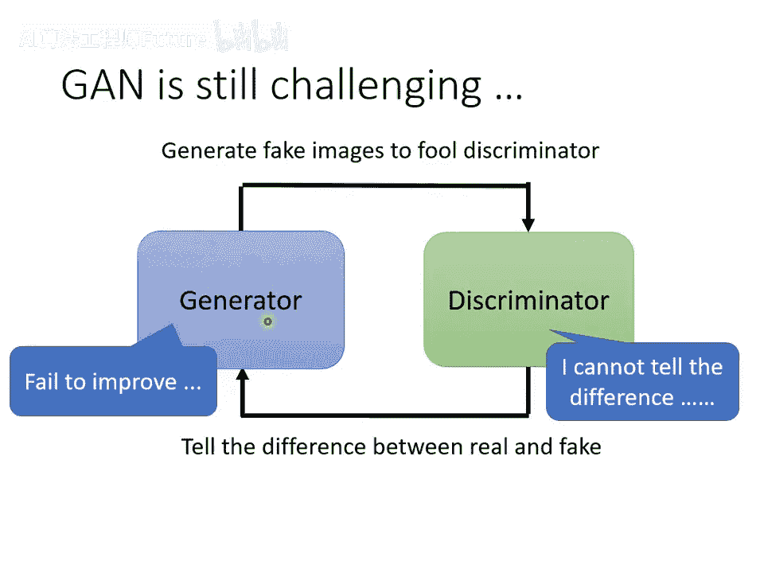

generator没有办法再进步了，discriminator也会跟着停下来的，如果卷的ATOR没有办法再进步，他没有办法再产生更真实的图片。

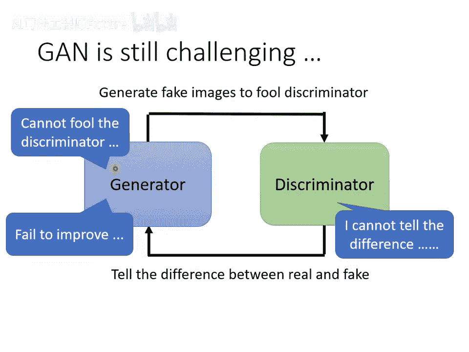

那discriminator就没有办法再跟着进步了，所以discriminator跟generator他们在训练的时候，只要其中一整不再进步，另外一个人就会跟着停下来，但是到目前为止。

大家已经劝过了很多次的network，你有办法保证说你劝下去，它的loss就一定会下降吗，不一定对不对，你要让network train起来，往往你需要调一下hyper parameter。

才有可能把它圈起来，那今天这个discriminator跟generator，他们互动的过程是自动的，一旦在某一个步骤，你DISCRIMIN，因为我们不会在中间。

每一次train discriminator的时候，你都换hyper parameter，所以整祈祷说每次TRDISCRIMINATOR的时候，它的loss都是有下降的，那如果有一次没有下降。

那整个training很有可能就会变，就会铲掉整个discriminator跟generator，彼此砥砺的这个过程就可能会停下来哦。

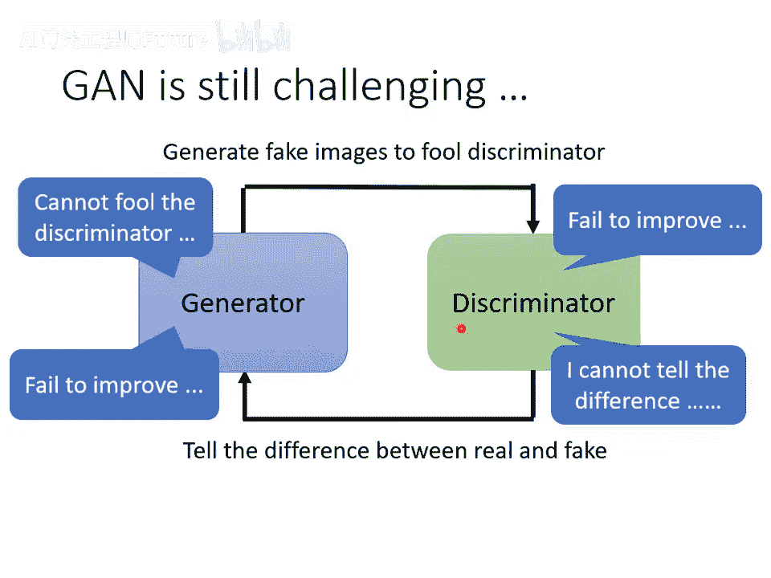

所以今天generator和discriminator在train的时候，他们必须要棋逢敌手，就任何一个人放弃了这场比赛。

另外一个人也就玩不下去了，所以game本质上，他的training仍然不是一件容易的事情。

当然它是一个非常重要的技术，所以虽然它是一个前瞻的技术，呃有人可能会觉得说啊，你不要把这种你自己都不见得称得起来的network，放到那个作业里面了，但是我觉得说这是一个重要而前瞻的技术。

所以我们还是应该要让大家有机会，接触这种最前瞻的技术，你至少可以知道说，train game不是一件那么容易的事情，当然其实从另外一个角度而言，因为很多人都在做类似的研究。

所以在网络上你可以找到满坑满谷相关的城市，所以呃其实从这个角度而言，它其实也没有你想象的那么困难，不过train ga仍然不是一件容易的事。

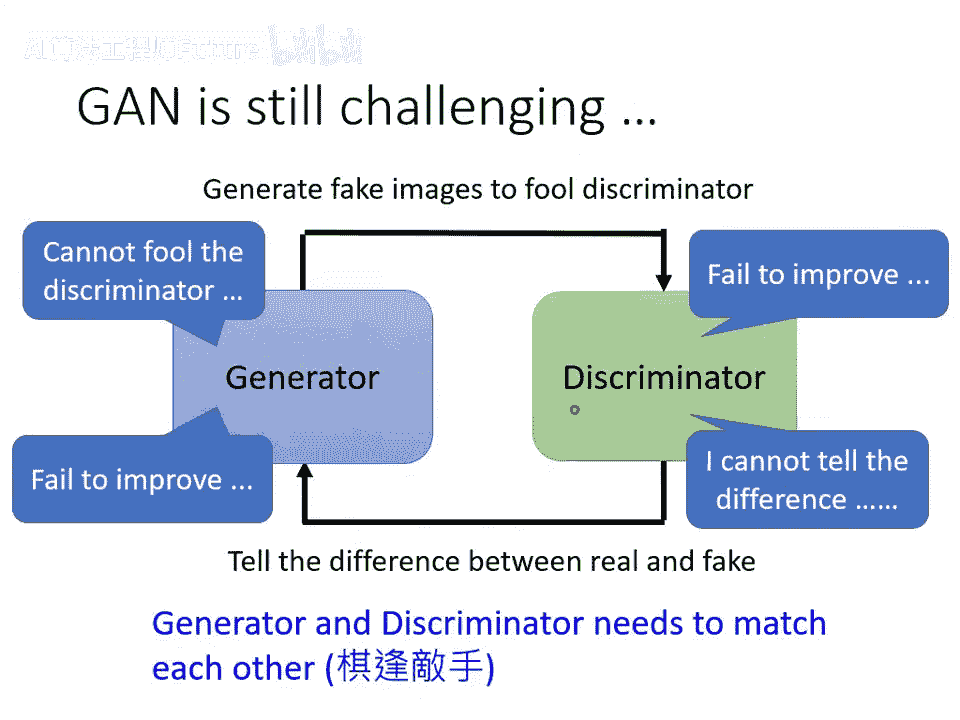

就是了好，你可以在网络上找到满坑满谷的game的tips，那这些有没有用呢，呃不好说不好说，就是把一些相关的呃，跟train game的诀窍有关的文献，还有连接列在这边。

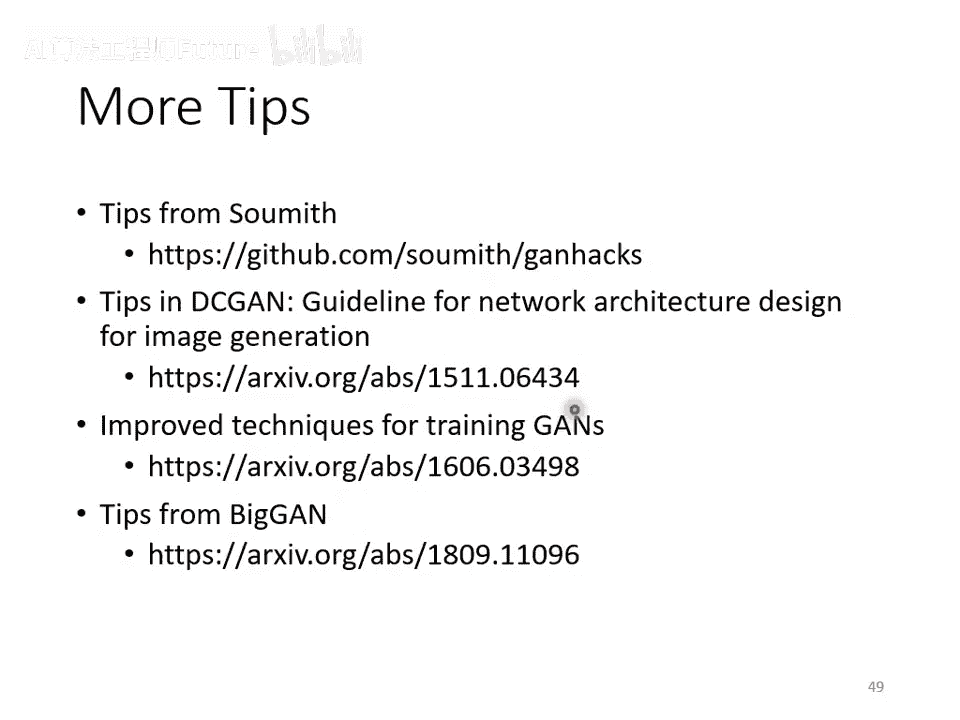

其实就给大家自己参考好，那train game最难的其实是要拿game来生成文字，就如果你要拿game生成一段文字，这个会是最困难的，为什么用game生成一段文字会是最困难的呢。

好我们知道说如果你要生成一段文字，那你可能会有一个sequence to sequence的model啊，你有一个decoder，那这个decoder会产生一段文字。

那我们现在这个sequence to sequence，the model就是我们的generator，好则在过去在讲transformer的时候，这是一个decoder，那它现在在game里面。

他就扮演了generator的角色，负责产生，我们要它产生的东西，比如说一段文字，那你说这个会跟原来的game，在影像上的game有什么不同呢，嗯就最high level来看。

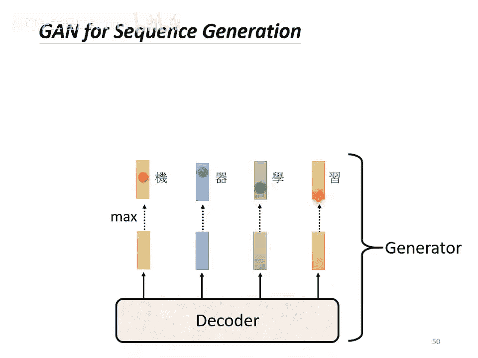

就演算法来看可能没有太大不同，因为接下来就是训练一个discriminator，discriminator把这段文字读进去，去，判断说这段文字是啊真正的文字，还是机器产生出来的文字。

而decoder就是想办法去骗过discriminator，Generator，就是想办法去骗过discriminator，你去调整你的这个generator的参数。

想办法让discriminator觉得，generator产生出来的东西是真正的，但是真正的，但是这边的难点在哪里呢，这边的难点在于呃。

你如果要用gradient descent去train你的decoder，去让discriminator output的分数越大越好，你会发现你做不到，为什么你做不到呢。

嗯大家知道说在计算这个微分的时候啊，所谓的gradient，所谓的微分其实就是某一个参数，它有变化的时候，对你的目标造成了多大的影响，我们现在来想想看，假设我们改变了this decoder的参数。

我们底这个generator，也就是decoder的参数有一点小小的变化的时候，到底对discriminator的输出有什么样的影响，好decoder参数如果有一点小小的变化。

那它现在输出的这个distribution也会有小小的变化，那因为这个变化很小，所以它不会影响最大的那一个token是什么东西，哎我知道做token可能对各位同学来说，你可能会觉得有点抽象。

那如果你要想的更具体一点，token就是你现在在处理这个问题，处理产生这个sequence的单位，那token呢是人定的啦，所以假设我们今天在产生一个中文的句子，的时候。

我们是每次产生一个character，一个方块字，那方块字就是我们的token，那假设你在处理英文的时候，你每次产生一个英文的字母，那字母就是你的token，假设你一次产生一个英文的词啊。

英文的词按词之间是以空白分开的，那就是词就是你的token好，所以token的定义是你自己决定的，看你要拿什么样的东西，当做你产生一个句子的单位好，那今天呢这个distribution只有小小的变化。

在取max的时候，再找分数最大那个token的时候，你会发现分数最大的那个token是没有改变的，因为distribution这种小小的变化，所以最分数最大的那个token是同一个。

那对discriminator来说，它输出的分数，它输出是一模一样的，这样输出的分数就没有改变，所以你会发现说，当decoder的参数有一点变化的时候，DISCRIMINOR输出是没有改变的。

所以你根本就没有办法算微分，你根本就没有办法做gradient descent，那有同学可能会说哎这个这个这边不是max，是因为max造成不能做gradient design吗。

啊那他那个CNN里面不是有那个呃max pooling吗，那怎么还可以做gradient descent，这个问题就留给你哎自己深思一下，为什么在这个地方有max不能做gradient descent。

而在CNN有mix fo里，却可以做gradient descent好，但是就算是不能做gradient descent，你也不用害怕，记不记得我们上周有讲说。

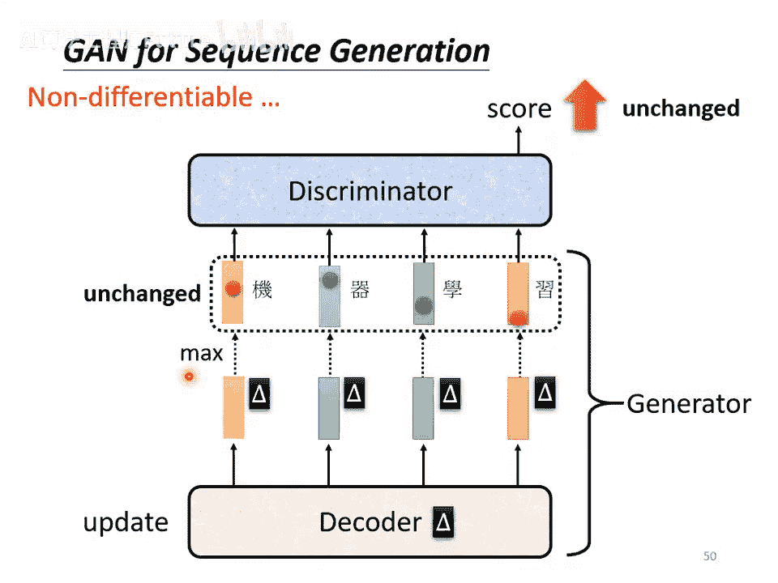

遇到不能用gradient descent train的问题，就当做reinforcement learning的问题，硬做一下就结束了好。

所以你确实可以用reinforcement learning来劝你的generator，在你要产生一个sequence的时候。

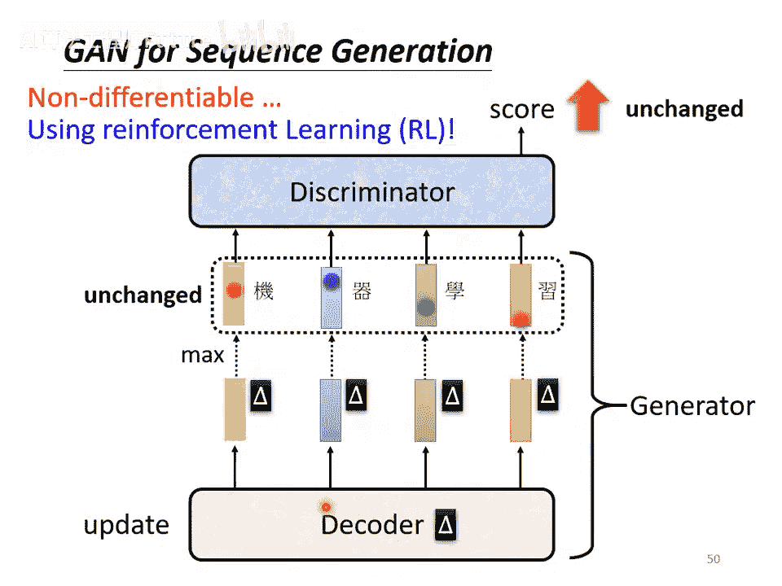

你可以用reinforcement learning来劝你的generator，但这会发生什么问题呢，reinforcement learning是以男劝而闻名，gain也是以难称而闻名。

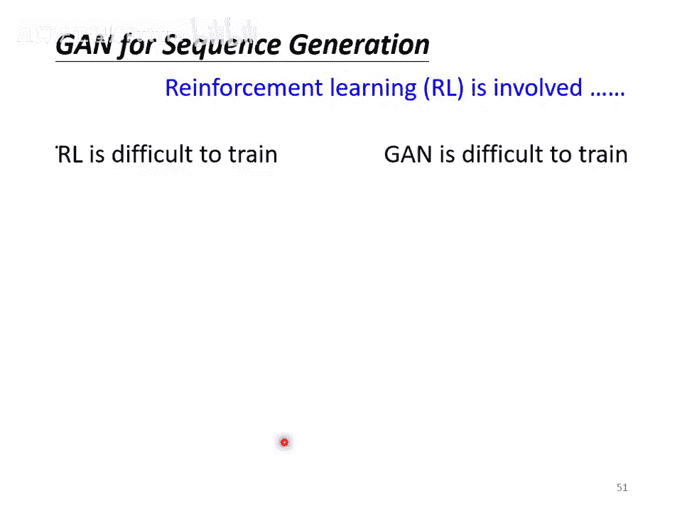

这样的东西加在一起就大炸裂，这样的串不起来，非常非常的难训练。

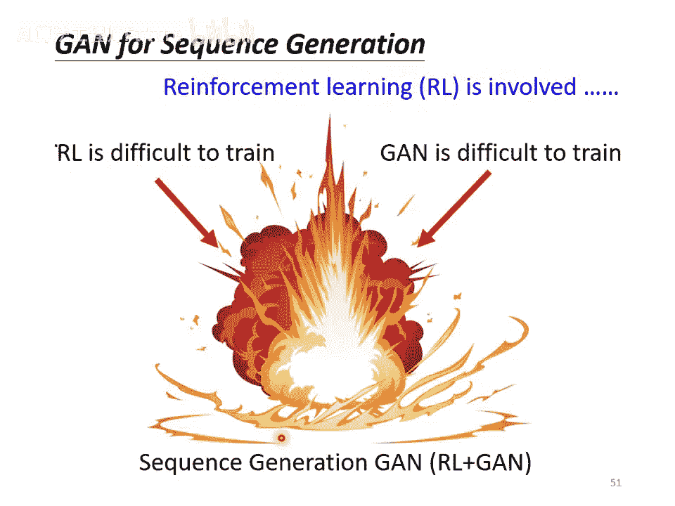

所以要用gain产生一段文字，过去一直被认为是一个非常大的难题，这有很长一段时间，没有人可以成功的把训练起来，就没有人成功的可以训练一个generator。

用GA的方式训练一个generator产生文字，通常你需要先做PRETRAIN，那PRETRAIN这件事情呢，其实我们等一下马上就会提到，如果你现在还不知道PRETRAIN是什么的话，也没有关系。

总之过去你没有办法用正常的方法，让game产生一段文字，直到有一篇paper叫做squatch game啊，他的title就开宗明义跟你炫耀说。

他可以train language game from scratch from scratch，就是不用PRETRAIN的意思好，所以它可以用，它可以直接从随机的初始化参数开始。

train它的generator，然后让generator可以产生文字啊，那他是怎么做到的呢，最关键的就是暴调hyper parameter跟一大堆的tips，那可以想象这就是google的paper。

他报收了参数以后，然后再加上了这边就讲了很多的tip，比如说呢这个横轴是他们的major啊，这个叫做FED，那这个是用在文字上的，我们今天就不讲，这不重要，总之这个值越低越好。

一开始要有一个叫做sequence against step的技术，没这个完全串不起来，然后接下来要一个很大的batch，size多大呢，通常就是上千，没有那个你自己在家没办法这么做的啊。

discriminator加REGALIZATION，Embedding，要PRETRA改一下reinforcement learning alism啊，最后就有quatch game。

那就可以从真的把game串起来拿，让它来产生sequence好。

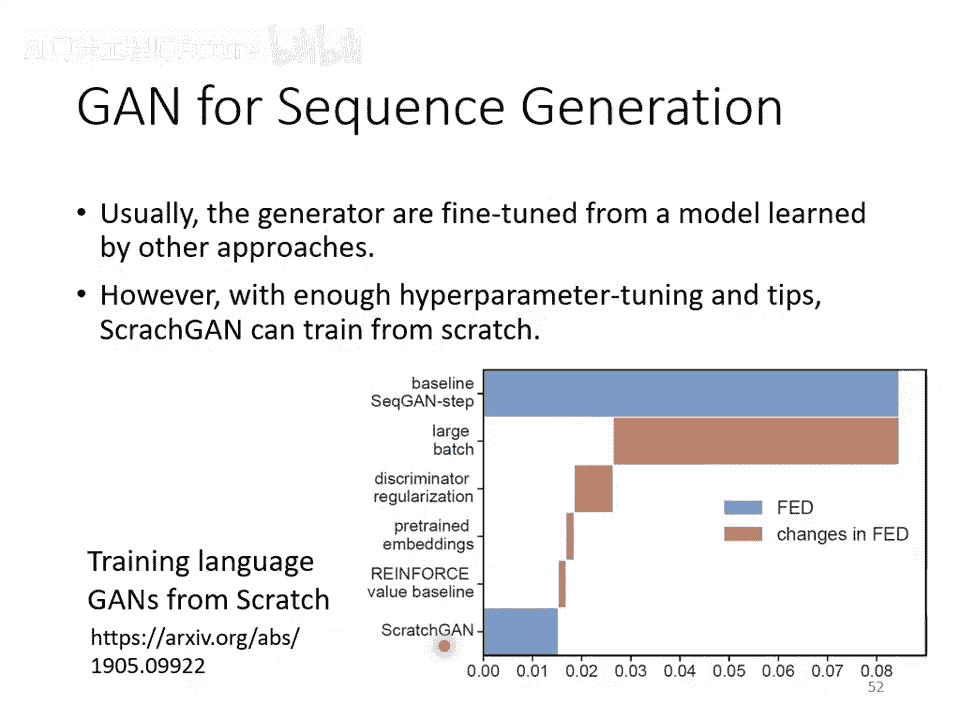

那今天有关game的部分呢。

我们只是讲了一个大概，那如果你想要学最完整的内容。

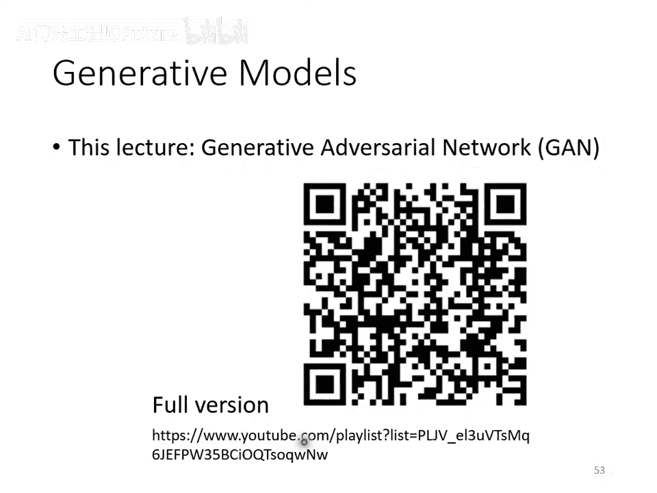

我在这边留下一个链接给大家参考，那其实有关generative的model不是只有电而已。

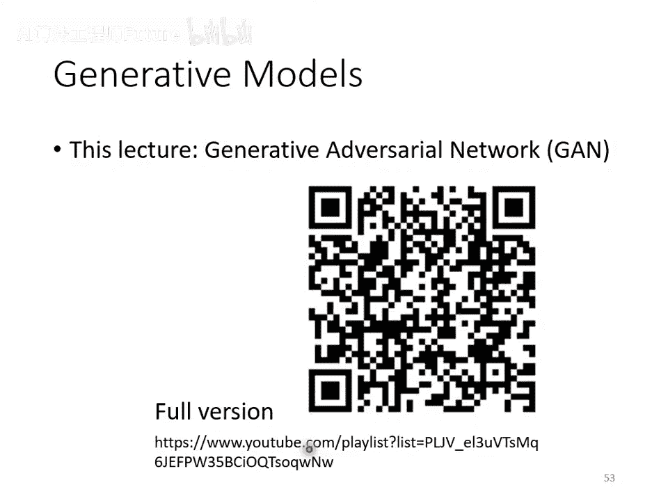

还有其他的，比如说VA1。

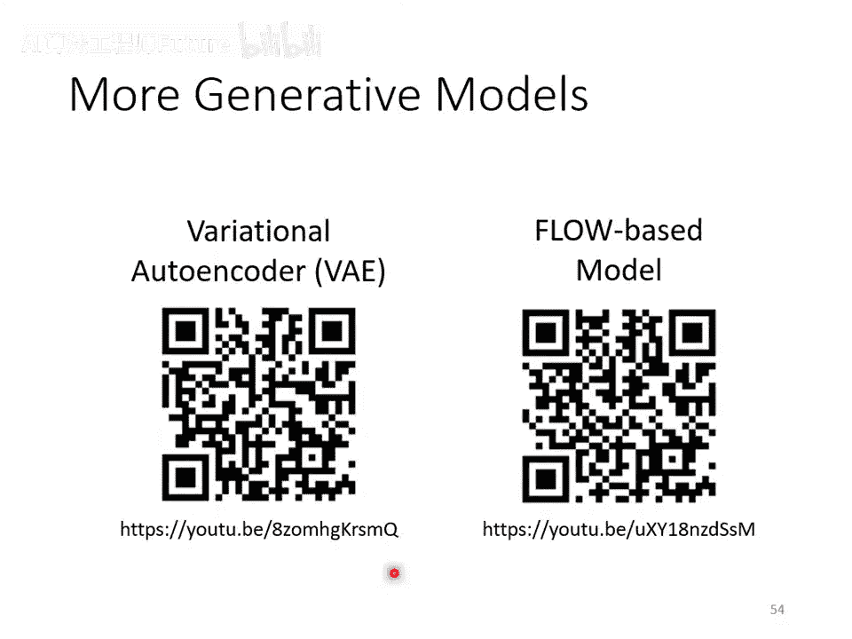

比如说flow base model，那我在这边也列了两个影片的连接给大家参考。

但我想要强调一下，就是这边的影片连接并不是说啊我要赶快去把。

我一定要看过这些影片连接，才能够学习接下来的内容。

因为机器学习可以讲的东西实在太多了。

所以如果假设你没有太多的时间，那你唯一真正需要听的只有我上课讲的内容。

上课讲的内容是self content。

就它本身是consistent的，你只要每一堂课都有听。

你接下来的内容，你应该都可以依序听下去，应该都可以听懂。

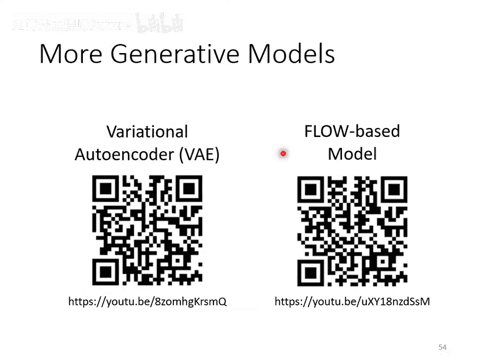

然后在上课中会放一些影片的连接，这个就等于是额额外分出去的分支。

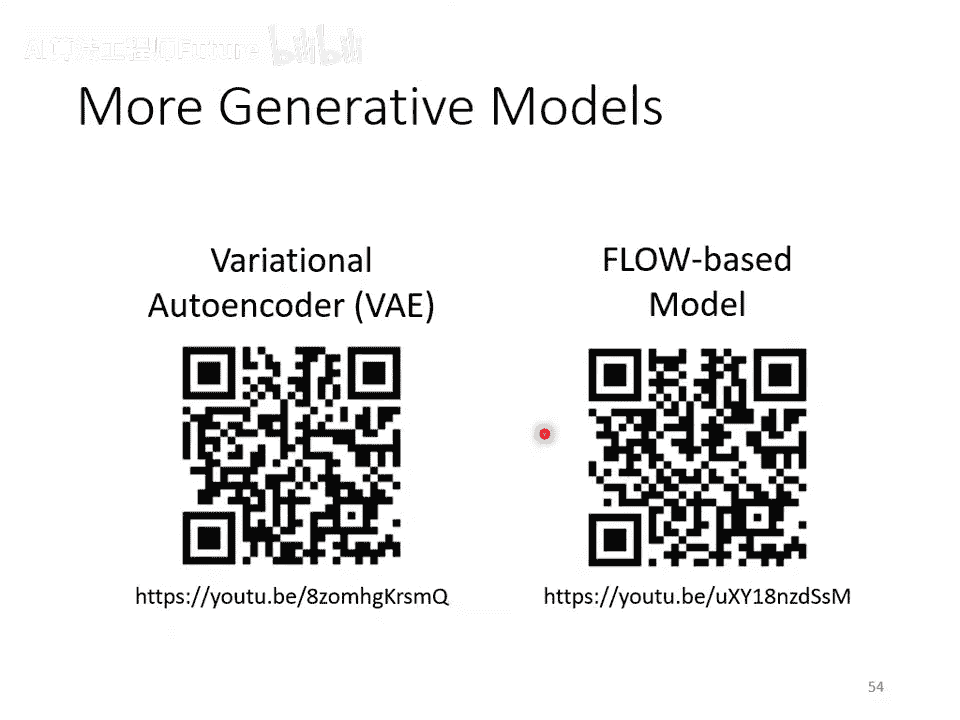

如果你真的很有兴趣的话，可以进行深入的研究。

那为什么我们不再讲更多东西呢，因为在上课的设计呢。

这课程的内容呃是以呃真正能够对你有帮助，以实物为导向的。

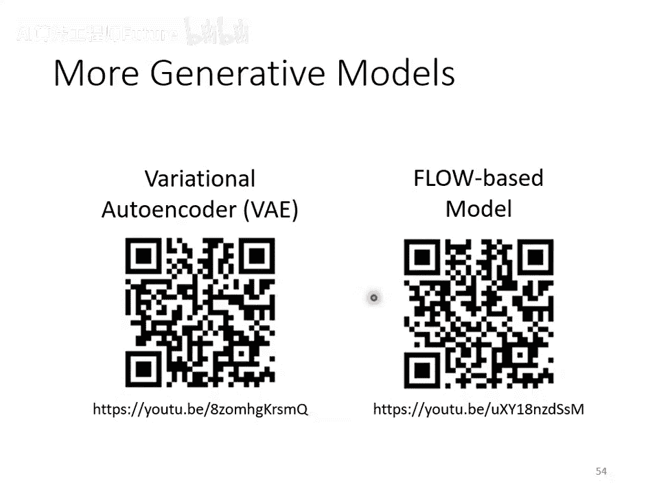

就假设你想要劝一个generator，你想让机器可以产生东西。

你有很多方法，你可以用game，你用VA1，可以用flow base model，我们这边就选择告诉你game。

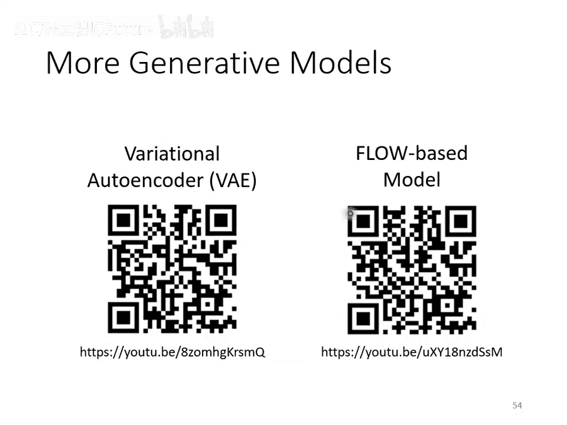

所以以后你如果有人叫你圈一个generative model，你有办法去劝他。

那如果想要深入研究，你可以再研究VAE跟flow base model，那有人可能会问说哎。

为什么选择gap，为什么不是选择其他的model呢。

呃一个最直觉，一个是一个最直接的理由是，game的performance是比较好的。

如果你要产生非常好的图片的话，你还是今天要用game，通常VA1或flow base model。

它们产生的结果，都是跟GA有非常大的一段差距啦。

他们通常都是骗人说嗯，我经过了一番努力，暴调了一堆参。

暴弄了一堆tips，最后可以跟get差不多，所以GA通常它产生出来的结果还是比较好的。

那你可能会说呃game比较难。

train呐，这个比较难TRA吧，VA1或flow会不会比较好，Train，这个是如果你真的有十座VAE或flow的话。

他们没有比较好劝，老实说，你可能会觉得说从他的视觉上看起来game很神秘。

有一个discriminator generator。

他们要互动，然后像flow base model v a1，他们都比较像是直接train一个一般的模型。

他们有个很明确的object，但实际上圈起来发现说呃。

他们也没有那么容易成功的被训练起来，他们的objective里面有很多项。

他们的loss里面有很多项，也要把每一项都平衡，才能够有好的结果，要达成平衡也非常的困难。

跟gain，我觉得train的难度是不遑多让，所以我们这边就选择gain呢作为呃。

我们课堂上介绍的深层式的generative的model。

那至于其他model，你可以在呃多多只问你有兴趣。

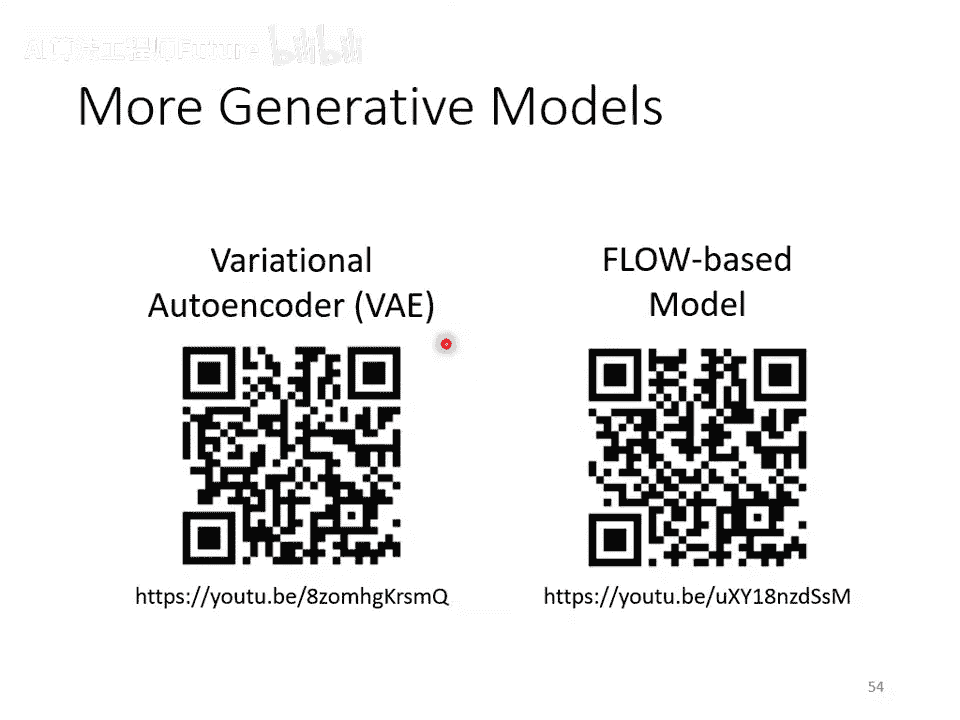

你可以在自己涉猎好，那有讲到这边，也许有同学会想说，诶，为什么我们要特别用一些呃呃，提出一些新的做法来做generative这件事，如果我们今天的目标就是，输入一个高深的random variable。

输入一个高选，从高选的这个random variable sample出来的vector，把它变成一张图片。

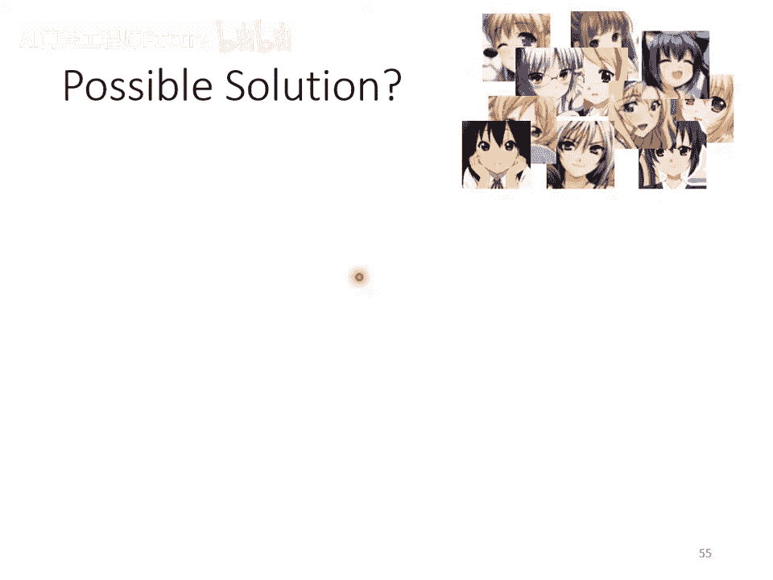

那我们能不能够用supervised learning的方法来做呢，怎么做。

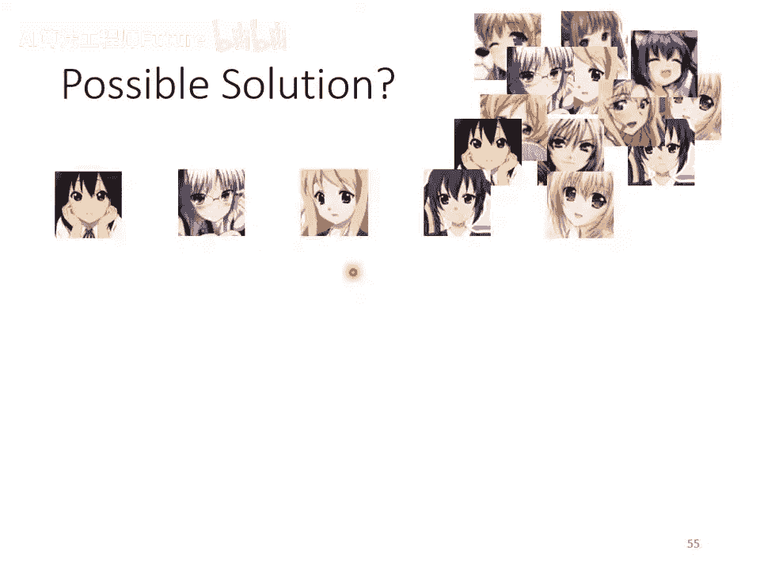

你就说我有一堆图片，我把这些图片拿出来，每一个图片都去配一个vector，都去配一个从高深distribution sample出来的vector。

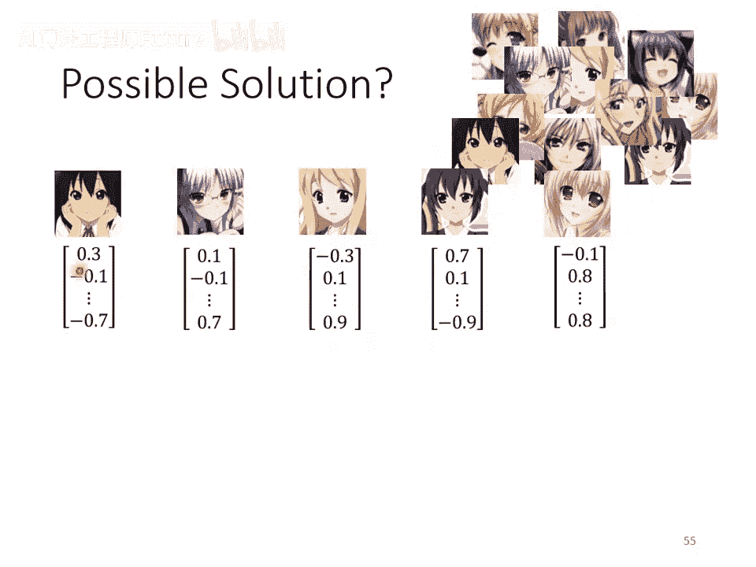

那接下来呢接下来就当做supervised learning的方法。

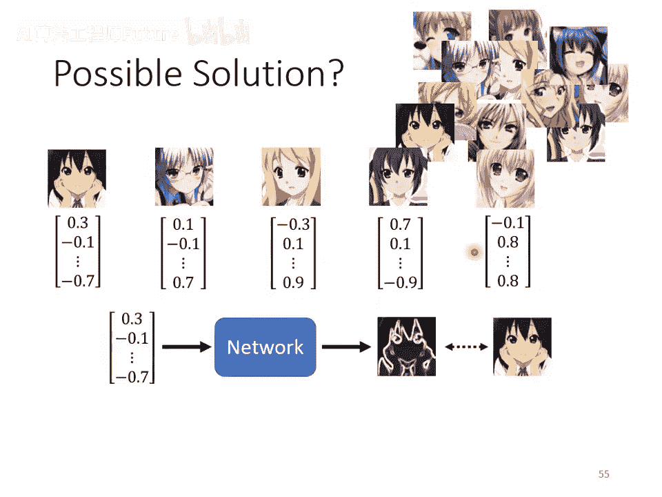

硬做就结束了，这样子大家懂吗，就是TRA一个network，这个network你已经说这张图片就是对到这个vector，这张图片就是对到这个vector train个network。

输入一个vector输出，就是它对应的图片，把对应的图片当做你训练的目标。

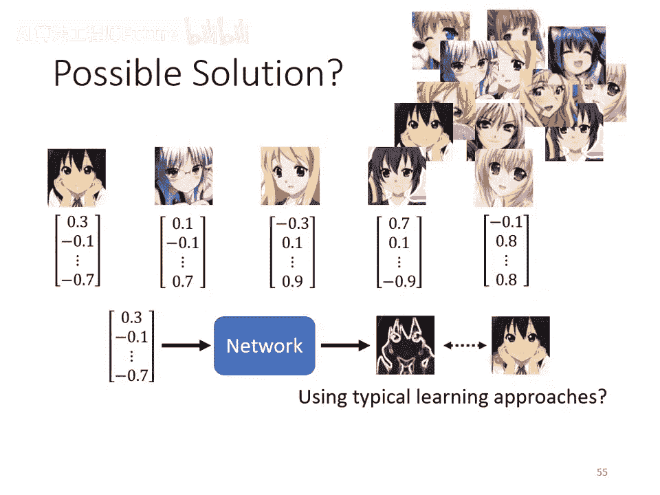

训练下去就结束了，能不能这么做呢。

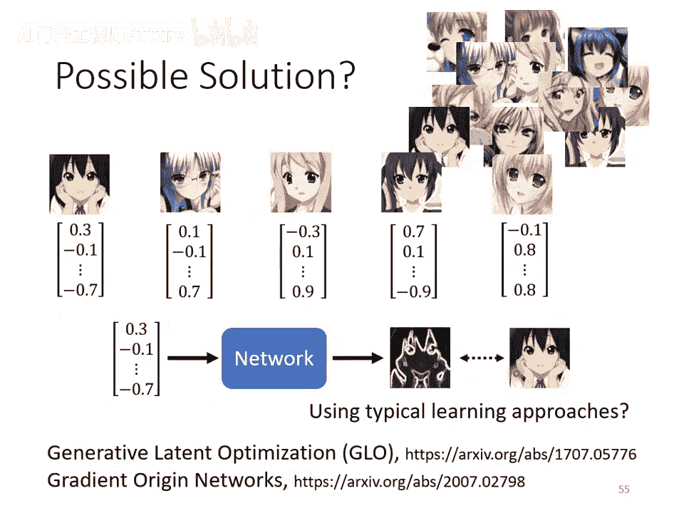

能这么做，你真的有这样子的啊，深层式的模型，那难的点是说呃，如果这边纯粹放随机的向量串起来，结果会很差，你可能根本点券都串不起来，所以怎么办呃，你需要有一些特殊的方法，至于什么样特殊的方法。

你要一些特殊的方法去安排这些vector。

那这有什么特殊的方法，我在这边一样放两篇论文的链接，但发现说这都不是很旧的论文。

像这个什么gradient original network啊。

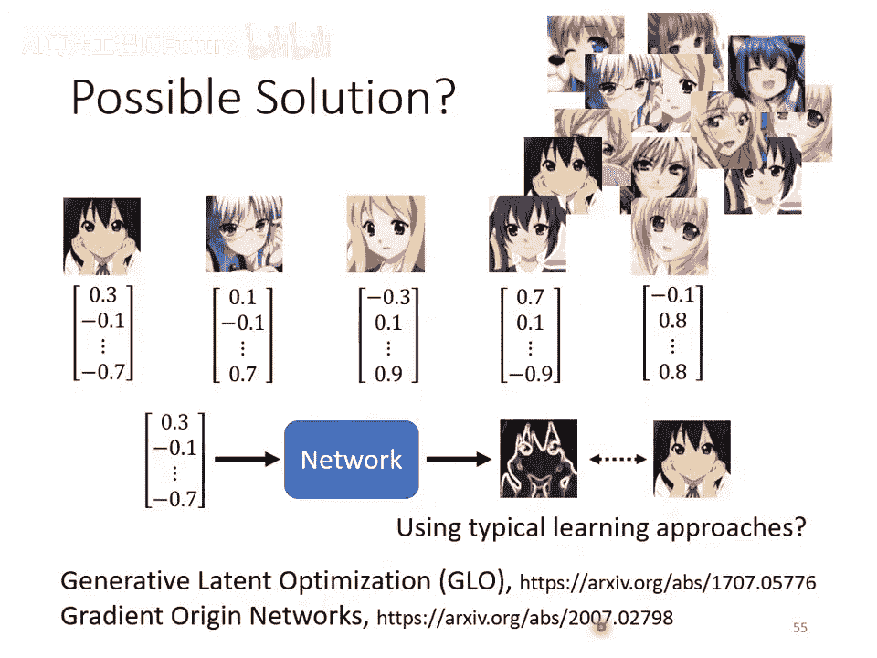

这个是去年去年20年7月的文章，这都是比较新的论文和比较新的方法。

那我把链接放在这边给大家参考好。

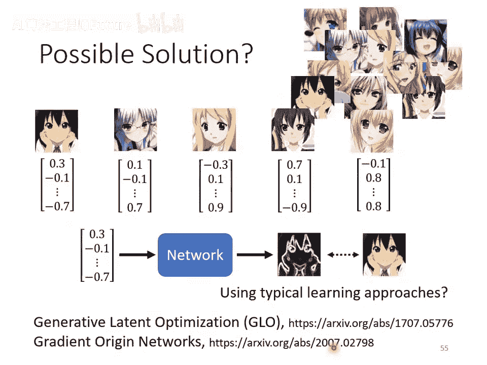

那接下来我们要讲的就是gain的平凉，怎么说，怎么看，说我们现在产生出来的generator，它好或者是不好呢，而那要评估一个generator的好坏并没有那么容易，那最直觉的做法也许是找人来看。

你要知道今天这个generator产生出来的图片，到底像不像动画的人物，那就找人直接来看，也许就结束了，所以其实很长一段时间，尤其是人们刚开始研究generative，这样的技术的时候。

很长一段时间没有好的major，那时候要评估generator的好坏，都是人眼看，然后直接用吹的，这样就说在paper最后就放几张图，说你看这个，我觉得应该是比文献上目前的结果都还要好，太棒了。

这应该是stay of dr，然后就结束了，所以发现比较早年的game paper，他没有数字，整篇paper里面没有这个IMAJOR，没有accuracy，他就是放几张图片。

告诉你说这个应该是比过去的文章都好，然后就结束了，但是你知道这样显然是不行的嘛，就是完全用人来看，显然有很多的问题，比如说不客观，不稳定等等诸多的问题，所以有没有比较客观而且自动的方法来想办法。

量一个generator的好坏呢，如果针对特定的一些任务。

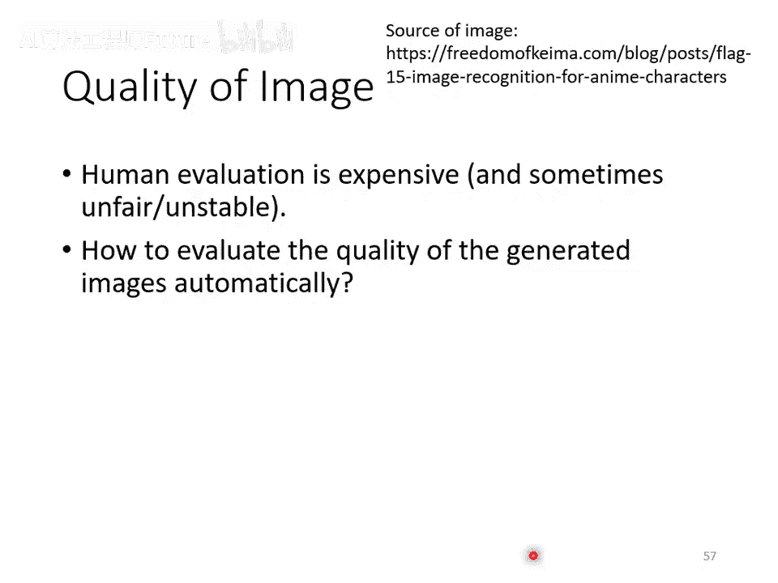

是有办法设计一些方法的，举例来说呃，在作业六里面。

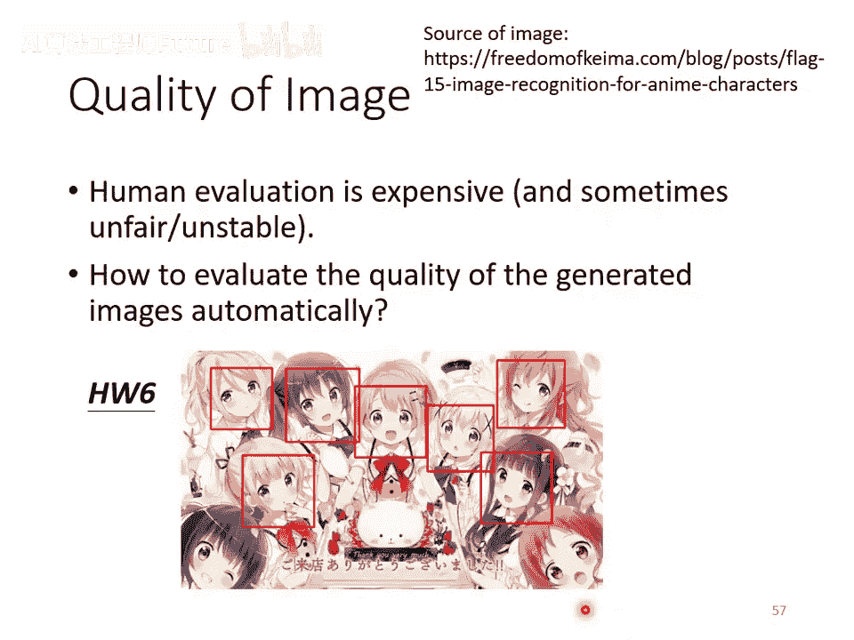

我们就是要教大家生成二次元人物的头像，那在作业里面一个评估的标准。

就是我们跑一个动画人物人脸侦测的系统，然后看说你提供的那些图片里面，抓到几个动画人物的人脸，那如果你提供1000张图片里面抓到900个人脸，跟提供1000张图片。

抓到300个人脸，那显然900个人脸的那个generator，他做出来的结果是比较好的哦，但是这是针对作业六的设计，那如果是跟一般的case呢。

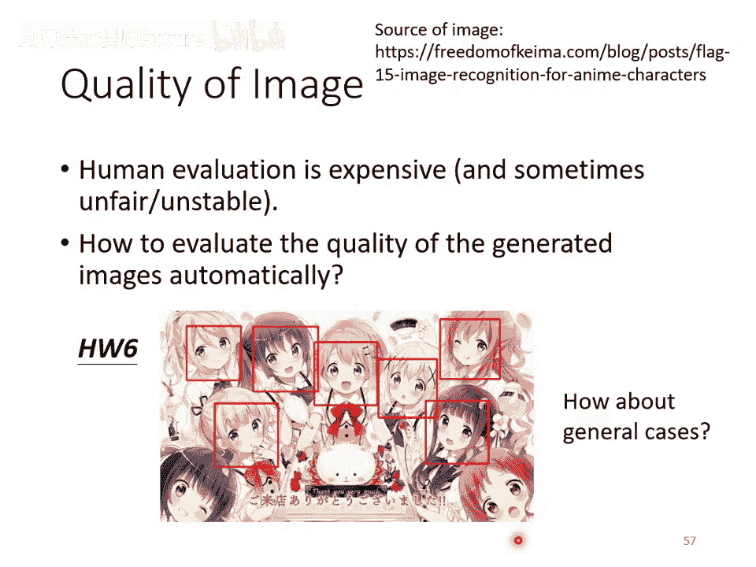

如果我们不局限在我们的作业，跟一般的case，我随便训练了一个卷的RATOR，它不一定是产生动画人物的，因为他产生别的，他专门产生猫，专门产生狗，专门产生斑马等等，那那我们怎么知道他做的好不好呢。

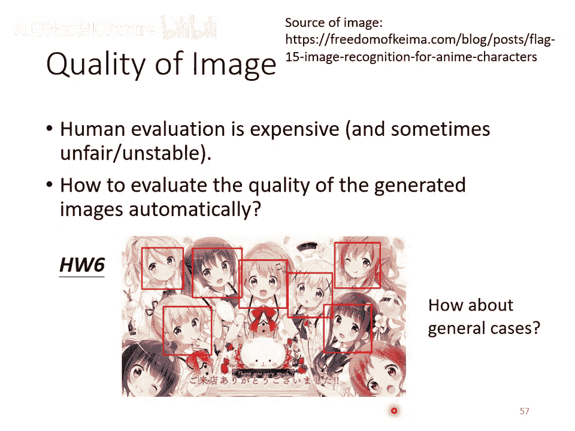

好像有一个方法呢是一样，跑一个影像的分类系统，把你的game产生出来的图片，丢到一个影像的分类系统里面，看它产生什么样的结果啊，影像分类系统输入是一张图片，我们这边叫做Y输出呢是一个几率分布。

我们这边叫它p of c given y和p o c given y，是一个几率的分布，然后接下来我们就看说这个几率的分布，如果越集中，就代表说现在产生的图片可能越好，虽然我们不知道这边产生的图片。

里面有什么东西，不知道它是猫还是狗还是斑马，我们不知道它是什么，但是如果丢到一个影像分类系统以后，它输出来的结果，它输出来的这个分布非常集中，代表影像分类系统，它非常肯定他现在看到什么样的东西。

他非常肯定他看到了狗，他非常肯定他看到了斑马，然后代表说你产生出来的图片，也许是比较接近真实的图片，所以影像辨识系统才辨识的出来，如果你产生出来的图片是一个四不像，根本看不出是什么动物。

那影像辨识系统就会非常的困惑，它产生出来的这个几率分布就会非常的平坦，非常的平均分布，那如果是平均分布的话，那就代表说你的game产生出来的图片，可能是比较奇怪的，所以影像辨识系统才会辨识不出来好。

所以这个是靠影像辨识系统来判断，你产生出来的图片好坏，这是一个可能的做法，但是光用这个做法是不够的。

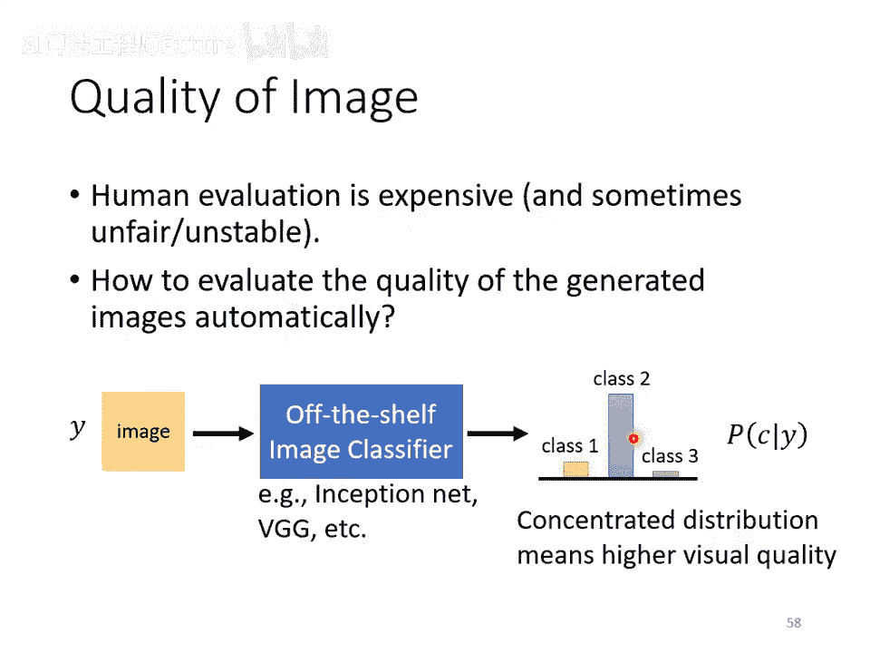

光用这个做法会有什么问题呢，光用这个做法，你会被一个叫做这个这个evaluation的方法，评估的方法，会被一个叫做more collapse的问题骗过去，什么叫more collapse呢。

more collapse是说你在train game的时候啊，你有时候TRA着TRA着就会遇到一个状况，是假设这些蓝色的星星是真正的资料的分布，红色的星星是你的gain。

你的generative的model，它的分布，你会发现说generative model它输出来的图片，来来去去就是那几张哦，来来去去就是那几张，可能单一张拿出来，你觉得嗯好像还做得不错。

但让他多产生几张就露出马脚，发现说原来他就是程咬金，只有三斧头，原来产生出来就只有那几张图片而已。

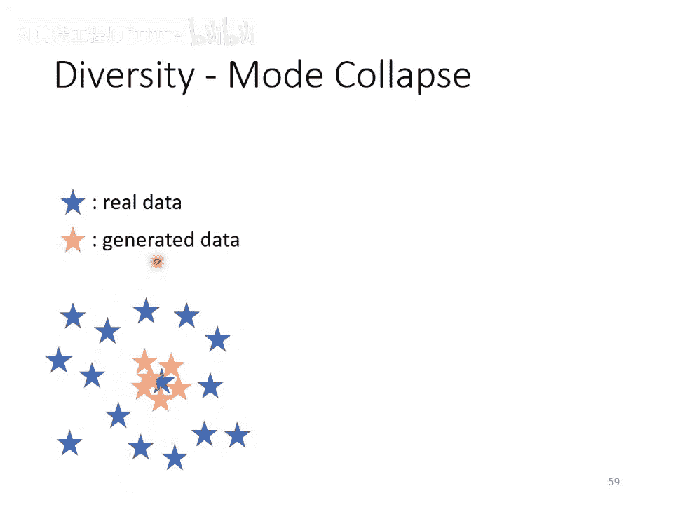

好那以下是一个more collapse的例子吧，就是我们在这个上周有看到说，我就劝了一个generator，让他产生二次元的人物，那劝着劝着劝，到最后我就发现变成这样的一个状况。

这一张脸越来越多越来越多，而且还好不同的发色，这个颜发色比较偏红，这个发色比较偏黄，越来越多，最后就通通都是这张脸，那这就是一种more collapse的现象。

那为什么会有more colate这种现象发生呢，就直觉上你还是比较容易理解，你可以想成说啊，这个地方就是discriminator的一个盲点，当generator学会产生这种图片以后。

看disc他他就永远都可以骗过discriminator，discriminator没办法看出说这样子的图片是假的，那这是一个DISCRIMINOR的盲点，generator抓到这个盲点就硬打一发。

就发生more collapse的状况，那可是到底要怎么避免more collapse的状况呢，我认为今天其实还没有一个非常好的解答，举例来说，我们在上周给大家看到了big bang的结果。

就是产生网球狗那个结果，那是google做的，他也报收了参数，但就算是他报收了参数，他发现最终他仍然没有办法真的避免，more collapse的状况。

就begin圈到最后还是more collapse，那要那那那那那begin and paper怎么解决这个问题呢，其实很简单呃，model在generator在训练的时候。

一路上都会把那个checkpoint存下来呃，在more collapse之前把training停下来，就train到more collapse，然后就把之前的model拿出来用就结束了。

这样所以就算是呃强如google报收参数，现在还是没有办法彻底解决more collapse的问题，好不过more connect这种问题，你至少你知道有这个问题，你可以看得出有这个问题。

你的generator总是产生这张脸的时候，你不会说你的generator是个好的generator，你知道说发生了一些状况，你的generator不是特别的好，但是有另外一种跟more还有点像。

但是更难被侦测到的问题，叫做more dropping，more dropping的意思是说，你的真实的资料的分布可能是这个样子，但是你的产生出来的资料，只有真实资料的一部分，单纯看产生出来的资料。

你可能会觉得还不错，而且分布他的这个多样性也够，但你不知道说真实的资料，它的多样性的分布其实是更大的。

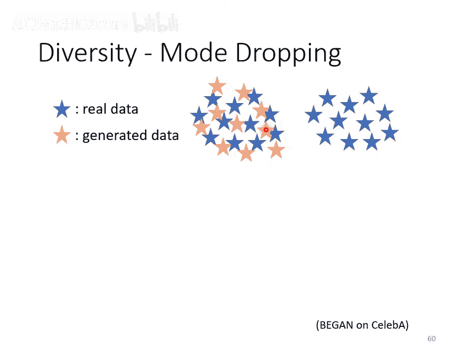

我这边举一个例子好，那这边呢是一个真实的例子啊。

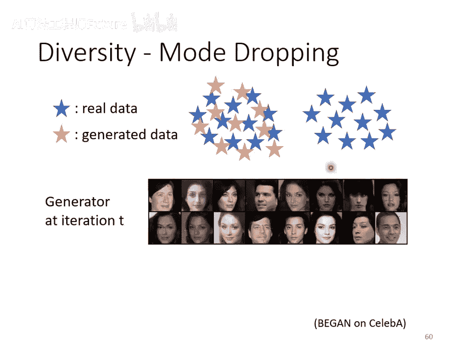

就有个同学他劝了这个人脸生成的game好，当然在某一个iteration的时候。

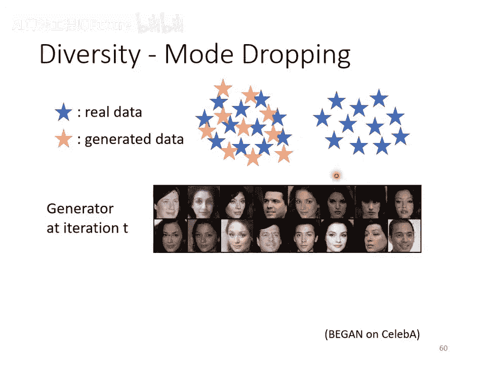

他的generator产生出这些人脸，那你会觉得说嗯没有问题。

而且人脸的多样性也够，有男有女。

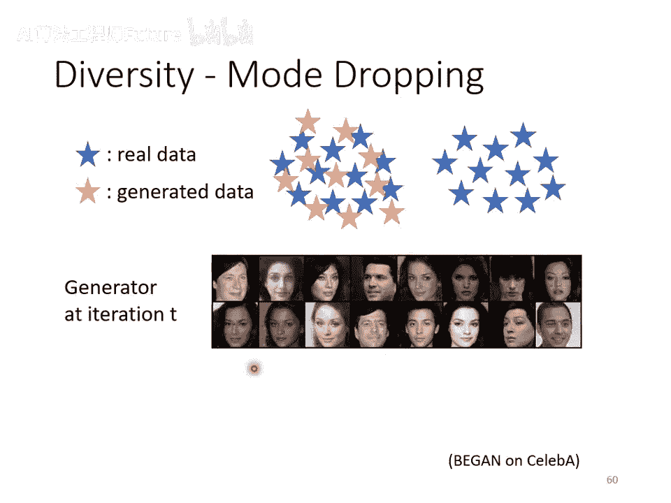

有向左看，有向右看，各式各样的人脸都有，这个是第七个iteration的时候。

generator你也不觉得它的多样性有问题，但如果你在看下一个GENER的。

下一个iteration generator产生出来的图片。

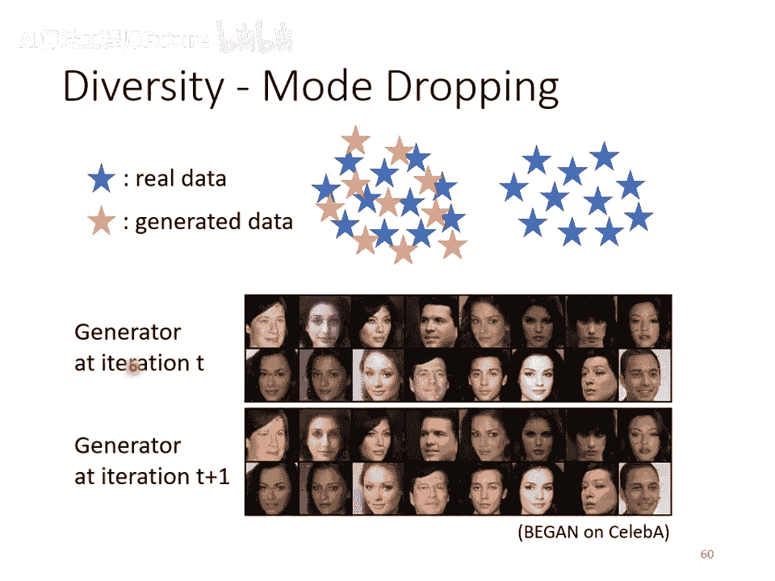

是这样子的，有没有发生发现问题，她的肤色有问题呀，所以他之前你看有男有女没有问题，但他肤色偏白啊，这边肤色偏黄啊，你没弄好，人家都觉得你的generator有种族歧视啊，所以这种猫抓屏的问题是呃。

不太容易被侦测出来的，事实上今天到底呃今天这些非常好的game begin呐，progressive game啊，但可以产生非常真实人脸，这些game到底有没有more dropping的问题。

可能还是有的，如果你看多了game产生出来的人脸，你会发现说虽然非常真实，但好像来来去去就是那么几张脸而已，还有一个非常独特的特征，是你看多了以后，就觉得这个脸好像是被生成出来的。

所以今天也许more dropping的问题，都还没有获得本质上的解决好，但是我们会需要去量说，现在我们的generator，它产生出来的图片到底多样性够不够。

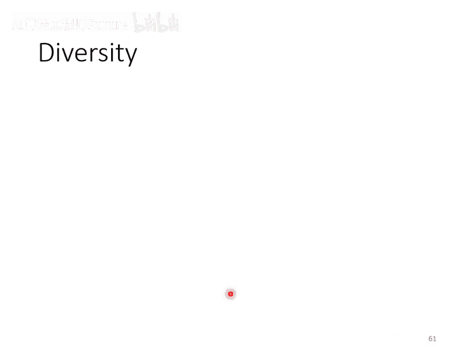

所以怎么做呢，过去有一个做法呢，一样是借助我们的image classify，你就把一堆图片，就让你的generator产生1000张图片，把这1000张图片里都丢到image classify里面。

看他被判断成哪一个class，每一张图片都会给我们一个distribution，给我们一个distribution，你把所有的distribution平均起来。

接下来看看平均的distribution长什么样子，如果平均的distribution非常集中，就代表现在多样性不够，如果什么图片丢进去，你的影像分类系统都说是看到plus two。

看到里面有plus two这样的东西，那代表说每一张图片也许都蛮像的。

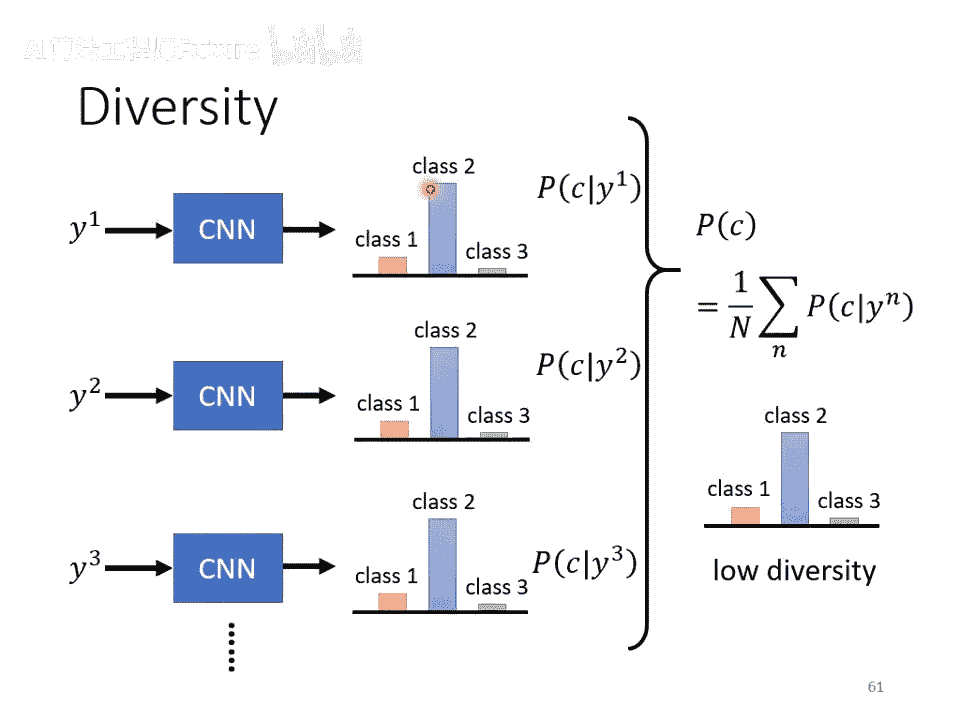

你的多样性是不够的，那如果另外一个case不同，当张图片丢进去不同，张你的generator产生出来的图片，丢到image classify的时候，它产生出来的输出的分布都非常的不同，你平均完以后。

发现平均完后的结果是非常平坦的，那这个时候代表什么，这个时候代表说也许你的多样性是足够的，那你会发现说在评估的标准上，当我们用这个image的classify来做评估的时候。

diversity跟quality好像是有点呃互斥的，因为我们刚才在讲quality的时候，我们说越集中代表quality越高，但是diversity是越平坦，越分布越平均，代表diversity越大。

不过我要强调一下，这个quality跟diversity他们评估的范围不一样，quality是只看一张图片，一张图片丢到classified的时候，分布有没有非常的集中。

而diversity看的是一堆图片，它分布的平均一堆图片，你的image classify输出的平均，如果输出越平均，那就代表如果输出的这个平均月平均的话，他们有两个平均。

那当我想大家应该知道我的意思啊，如果输出的平均越平均的话，就代表说现在diversity越大，那过去有一个非常常被使用的分数，叫做inception score，那他缩写的是i is。

所以inception score顾名思义，就是这边用的这个CNN呐，是用一个叫做in来做的好，所以叫inception score，那这个inception score呢呃是怎么定出来的呢。

你就量一下，用is inception network量一下quality，如果quality高，那个diversity又大，那exception sport就会比较大。

不过在作业里面我们并不会用inception score，为什么我们不用inception score呢，你想想看，假设把你产生出来的二次元人物，丢到inception net里面。

他输出可能就是都看到人脸嘛，你可能diversity很大，产生不同的发色，产生不同的眼睛的颜色的人物，但是对inception network来说，它都是人脸啊。

所以你可能算出来diversity其实是小的，所以inception inception score，在我们这个作业中可能是不适用的。

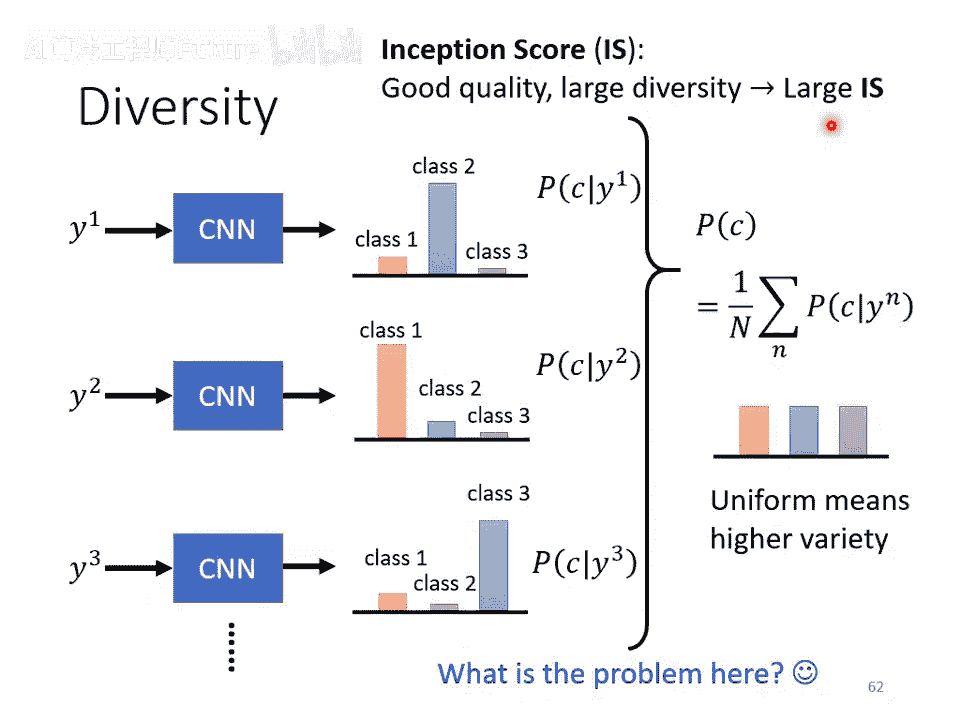

那在我们的作业中会采取另外一个evaluation的，major叫fetch inception distance。

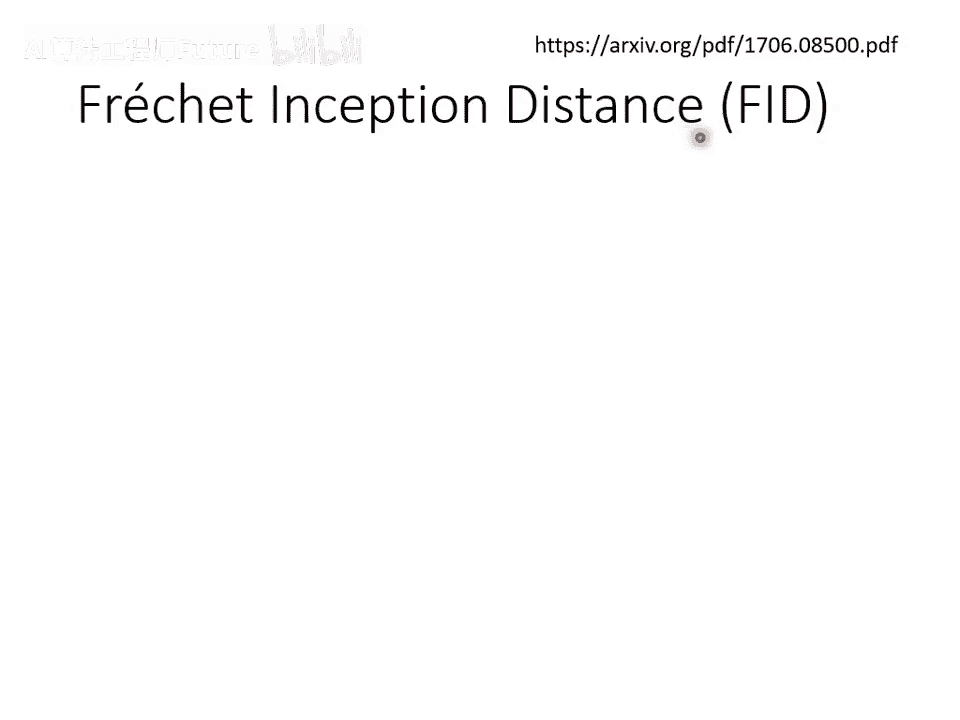

这个东西是什么呢，它的缩写叫做FID啊，这个东西是什么呢，你先把你产生出来的二次元的人物啊，丢到insession name里面，那如果你把这个二次元人物一路丢丢丢，丢到最后。

让那个inception network输出它的类别，那你得到的可能就是人脸，那每一张二次元人物看起来都是人脸，但我们不要拿那个类别，我们拿进入soft max之前的hidden layer的输出。

进入soft Mac之前，你的network不是会产生一个向量吗，那可能是上千维，长度是上千维的一个向量，把那个向量拿出来代表这张图片好，那如果我们拿出来的是一个向量，而不是最后的类别。

那虽然最后分类的类别可能是一样的，但是在决定最后的类别之前，这个向量就算都是人脸，可能还是不一样的，可能会随着肤色发型，这个向量还是会有所改变的，所以我就不取最后的类别。

只取这个inception network中间的，其实最后一层的这个呃，hen layer的输出来来进来代表一张图片好。

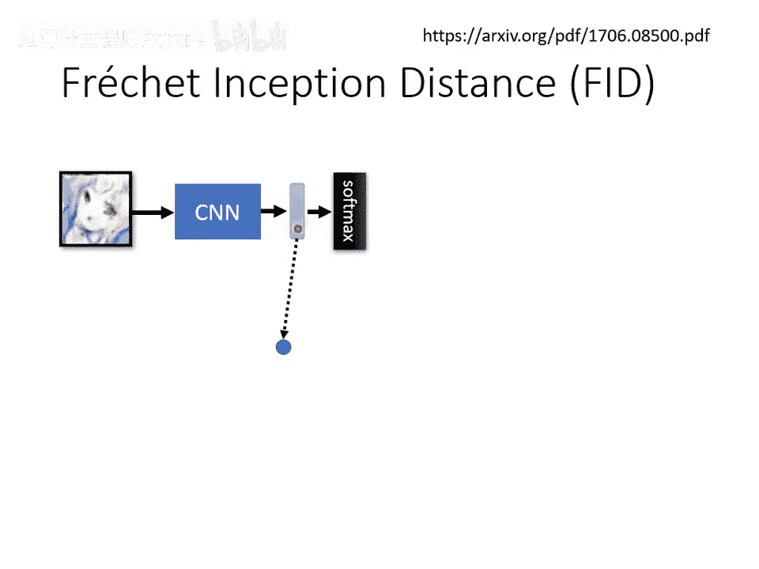

那在这个投影片上啊，所有红色的点，代表你把真正的图片丢到inception network以后，拿出来的向量，那这个向量其实非常高维度哦，是上千维的，那我们就啊把它假设，我们可以把它画在二维的平面上好。

那这个蓝色的点呢，蓝色的点是你自己的game，你自己的generator产生出来的图片，它丢到insertion network以后，进入soft max之前的向量把它画出来，假设是长这个样子。

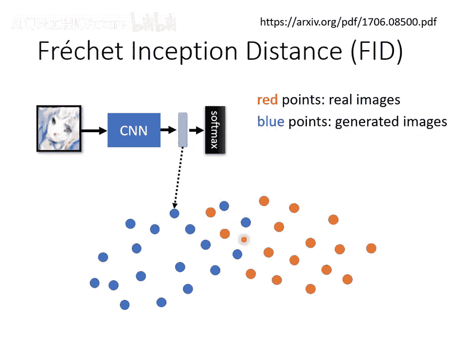

接下来呢你就假设这两组资料，假设真实的图片跟产生出来的图片，他们都是高深的distribution，然后去计算这两个高选distribution之间的，fresh的distance就结束了。

那至于fresh distance是什么，你有兴趣再自己看一下文献，反正在作业里面呃，我们的judge system会帮大家算好好，但是这边呃因为它是一个distance，所以这个值就是越小越好嘛。

啊距离就是越小越好，距离越小代表这两组图片越接近，那当然就是产生出来的品质越高，但这边你一定心里还是有很多问号，第一个问号就是当做高选distribution没问题吗。

这个应该不是高深distribution吧，嗯会有问题就这样，然后另外一个问题就是嗯，如果你要准确的得到你的network它的分布，那你可能需要产生大量的sample才能做到，那这需要一点运算量。

那这个也是要做FID不可避免的问题哦，所以其实我们在作业里面我们不会只看，我们也不会只看FID，只看FID其实结果会怪怪的啊，怪怪的，因为你你只你你你假设你是的，这个输输出的分布一定是高选吗。

实际上不是高选一讲硬讲，但他是高选，没有怪怪的吗，会怪怪的，所以我们是同时看FID跟动画人物，人脸的这个侦测出来的人脸的数目，这两个指标我们会同时看这两个指标，那这样可以得到比较合理而精确的结果哦。

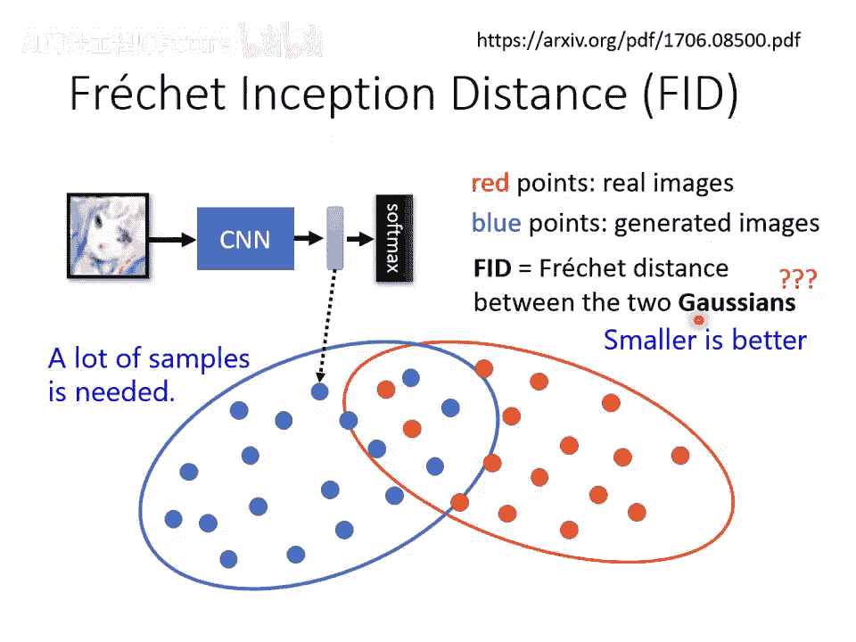

那FID算是今天比较常用的一种major，那有一篇paper叫做are against s created，Equally a large scale study。

你可以想先说这个也是google做的了，那就是报做了各式各样不同的game哦，那个时候他就列举了好多不同的各式各样的game，那每个game当然他的这个训练的这个objective。

训练的那个loss有点不太一样啊，我这边就不细讲各式各样的gap，每一种game，他都用不同的RANDOZ去跑过很多次以后，看看结果怎么样好，那以下呢下面这个图呢，就是在四个不同的资料库上面得到的结果。

那横轴这边代表的是不同的get，那这边的值啊是越小越好，它是F它是FI哎，我这怎么写的FIT呢，不好意思，这这我写错了，不好意思，不好意思，我记得改一下啊，这个不是FIT，这个是FID。

这个是FID的分数啊，这FID的分数就是越小越好啦，那你会发现说这边每一个方法呢，它都不是只得到一个数值，它都得到一个分布，为什么它得到的是一个分布呢，因为你要用那个不同的RANDOC去跑啊啊。

用不同的random c去跑，每次跑出来的结果都不太一样，然后这边混了一个不是game的做法，还混了一个VA1，在这里混了一个VA1，在这里，那你会发现说，如果比较这些game的方法跟VA1的方法呃。

VA1的方法显然是比较稳定的，不同的RANDOC看起来差距还是比较小的，那gain的方法不同，RENDENCY差距是很大的，但你又可以很明显的看出VAE跟game，他的这个好的程度啊，不在同一个量级上。

game呢可以产生远比VA1更好的结果，如果你会发现说不同的game好像结果差不多哦，所以这边就文章开头就是again qua good equally，然后看起来说的GA都差不多。

然后农场文最喜欢这种文章，他就是说啊所有的game都差不多了，所以那些跟个game有关的研究都是白忙一场的，但是其实事实上也未必是如此，如果你仔细看那篇文章的话，呃，在做实验的时候。

所有这些不同的game用的network架构都是同一个，他只是报收了那个RANDOC跟learning ray而已，所以呃network架构还是同一个，那所以我们不知道说是不是由某些network架构。

特别favor某些呃某些种类的game，或者是某些种类的game，会不会在不同的network架构上表现的比较稳定，比如说如果你看w game的话，w game最原始的paper。

它标榜的其实是它network架构胡乱设计，他胡乱兜个什么100层的generator，就很难，没有必要弄一个100层的generator，它也串的起来，所以也许W更是在不同的卷了ray。

不同的network架构的时候比较稳定，但是不同RANDOC可能没有特别稳定等等之类的，不知道这篇paper并没有给我们这方面的答案好，那其实刚才那些major，也完全也并没有完全解决game的问题。

evaluation的问题，因为还有什么样evaluation的问题呢。

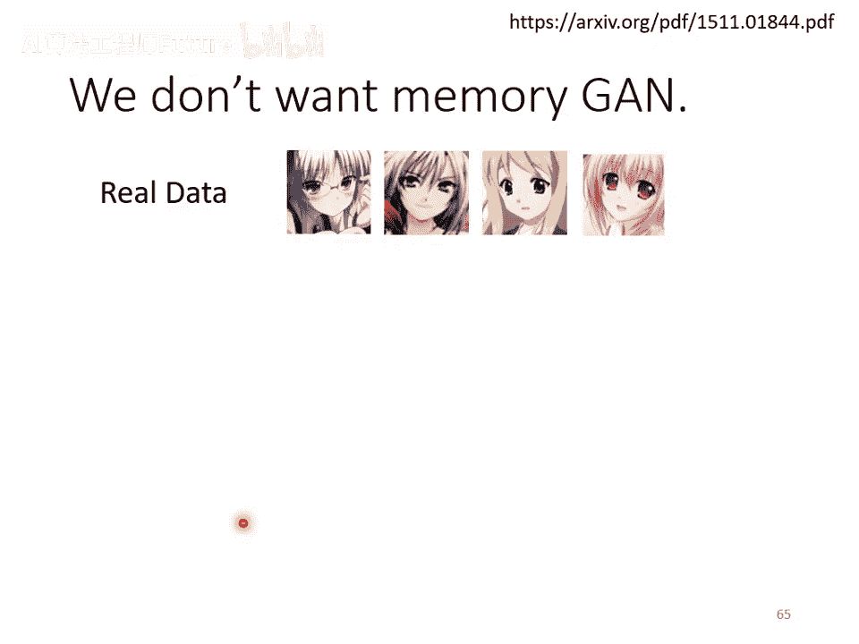

你想想看以下的状况，假设这是你的真实资料，你不知道怎么回事，训练了一个generator，它产生出来的data跟你的真实资料一模一样，所以如果你不知道真实资料长什么样子。

你光看这个generator的输出，你会觉得太棒了，他做的很棒啊，FID算出来应一定是非常小的，但问题是这个是你要的吗，如果它产生出来的图片都跟资料库里面的，训练资料的一模一样，那训练资料就在你手上。

直接从训练资料里面sample1些image出来，不是更好，干嘛要train generator，我们TRAGENERATOR其实是希望它产生新的图片呢，资料集里面训练资料里面没人脸呐。

如果训练资料里面有一模一样的人脸，直接用训练资料里面人脸就好了，何必用game呢，所以有时候你的gain产生出来的结果很好，也许你在作业里面FID算出来也很低，然后人脸辨识系统也给你很高的分数。

但是它不一定是一个好的game，那像这种问题，就不是我们作业的major可以侦测的，但是它是一个问题，那怎么解呢，你可能会说，那我们就把额我们卷的RATOR产生出来的图片，跟真实资料比个相似度嘛。

看看是不是一样嘛，啊如果很多章都一样，就代表说generator，只是把那个训练资料背起来而已，他他没有很厉害。

但是那如果我问另外一个问题，假设你的generator学到的是，把所有训练资料里面的图片都左右翻转了，那他他也是什么事都没有做啊，假设他学到就是把训练资料里面，所有图片都左右翻转。

那你会觉得嗯他看起来很棒，它实际上也是什么事都没有做，但问题是你比相似度的时候又比不出来，所以get的evaluation是非常的困难的，还这甚光要如何评估一个generator做得好不好。

这件事情都是一个可以研究的题目啊，如果真的很有兴趣的话，这边放了一篇相关的文章了，里面就列举了20几种额，game generator的评估的方式给大家参考好。

那接下来呢我们要讲conditional的generation，那也许我们讲完conditional的generation以后再下课，然后接下来就是让助教来讲一下电的作业好。

那什么是conditional的generation呢，刚才我们讲的那个generator，到目前为止我们讲的generator，它输入都是一个随机的分布而已，那这个不见得非常有用。

我们现在想要更进一步的是，我们可以操控generator的输出，我们给它一个condition x，让他根据S跟Z来产生Y，那这样的conditional generation有什么样的应用呢。

比如说你可以做文字对图片的生成，但如果你要做文字对图片的生成，它其实是一个supervised learning的问题。

你需要一些label的data，你需要去收集一些图片，收集一些人脸，然后这些人脸都要有文字的描述告诉我们说啊，这个是红眼睛，这个是黑头发啊，这个是黄头发，这个是有黑眼圈等等。

告诉我们这样子有没有这样的label的资料，才能够训练这种conditional的generator好，所以在con在texto image这样的任务里面，我们的X就是一段文字。

那肯问说一段文字怎么输入给generator呢，那就要问你自己了，你要怎么做都可以啊，以前会用RNN把它读过去，然后得到一个向量再丢到generator。

今天也许你可以把它丢到一个这个transformer，的encoder里面去，把encoder output这些向量通通平均起来，丢到generator里面去，怎么样都可以，反正嗯你用什么方法都可以。

只要能够让卷的RATOR读一段文字就行啊，那你期待说你输入red eyes。

然后呢机器就可以画一个红眼睛的角色，但每次画出来的角色都不一样，那这个画出来什么样的角色取决于什么呢，取决于你simple到什么样的，自simple到不一样的Z画出来的角色就不同，但是通通都是红眼睛的。

这个就是text to image，想要做的事情真的可以做到这样子的事情吗，可以啊，这个呃过去有这个作业了，这学期虽然没有，但过去有这个作业，就是输入红头发啊，这个是之前助教做的结果啊，输输入红头发。

输入绿眼睛。

那产生的结果就是这个样子，产生各式各样红头发绿眼睛的角色。

输入蓝头发红眼睛，我就产生各式各样蓝头发红眼睛的角色，那你发现那个有时候机器也是会犯错的啦，比如这边有一个异色瞳，虽然说要画红眼睛，但他觉得画一只红色的眼睛就可以蒙混过去，而另外一只眼睛仍然是蓝色的哦。

那要怎么做conditional的again呢，我们现在的generator有两个输入，一个是从normal distribution semble出来的Z，另外一个是X也就是一段文字。

那我们的generator会产生一张图片Y，那我们需要一个discriminator，那如果按照我们过去所学过的东西，Discriminator，它就是C1张图片，Y当做输入输出一个数值。

这个数值代表输入的图片，多项真实的图片是真实的还是深层的，那怎么训练这个discriminator呢，你就说如果看到真实的图片，你就输出一，如果看到生成的图片就输出零。

你就可以训练discriminator，然后discriminator跟generator反复训练，也许你就可以去把generator训练出来。

但这样的方法没办法真的解conditional game的问题，为什么呢，因为如果我们只有train这个discriminator，这个discriminator只会看Y当做输入的话。

那generator会学到的是，它会产生可以骗过discriminator的，非常清晰的图片，它会产生清晰的图片，但是跟输入完全没有任何关系，因为对generator来说，他只要产生清晰的图片。

就可以骗过discriminator了，他何必要去管input的文字叙述是什么呢，你的discriminator又不看文字的叙述，所以他根本就不需要管文字的叙述，你不管输入什么文字，就无视这个X。

反正就是产生一个图片，可以骗过discriminator就结束了，但这显然不是我们要的。

所以在conditional game里面，你要做有点不一样的设计，你的discriminator不是只吃图片Y，他还要吃condition x，所以你的discriminator它有Y作为输入。

X作为输入，然后产生一个数值，那这个数值不只是看Y好不好，光图片好没有用，光图片好，discriminator还是不会给高分，什么样的情况下discriminator才会给高分呢，一方面图片要好。

另外一方面图片跟X这是文字的叙述，它们必须要配得上哦，这个图片跟文字的叙述必须要是相配的，discriminator才会给高分，那怎么样训练这样的discriminator呢。

那你需要文字跟影像成对的资料哦，所以conditional game一般的训练是需要这个pair的，data的，是需要有标注的资料，是需要承对资料的，有这些成对资料。

那你就告诉你的discriminator说，看到这些真正的成对的资料就给他一分，看到red eyes，但是搭配诶，这边我也不知道为什么会是这个样子，不过没有关系。

反正我这边本来就是没有要放什么特别的东西，就放个乱七八糟的图而已，好改了，realize跟机器产生出来的图片，那就是给零分，然后训练下去就可以产生抗，就可以做到conditional game。

那其实在实作上啊，光是这样子，拿这样子的呃，Positive example，还有negative example来训练，这样discriminator，其实你得到的结果往往不够好。

光是告诉discriminator说这样子的状况是好的，这样子的状况是不好的，这样是不够的，你还需要加上一种不好的状况，是已经产生好的图片，但是文字叙述配不上的状况哦，所以你通常会把你的训练资料拿出来。

然后故意把文字跟图片乱配，故意配一些错的，然后告诉你的discriminator说看到这种状况，你也要说是不好的，而用这样子的资料，你才有办法把discriminator训练好。

然后generator和discriminator反复的训练啊，你最后才会得到好的结果啊，这个就是conditional ca，好在目前的例子里面都是看一段文字产生图片。

那conditional gan的应用不止看一段文字，产生图片了，也可以看一张图片产生图片，那看一张图片产生图片也有很多的应用，比如说给他房屋的设计图，然后让你的generator直接把房屋产生出来。

给它黑白的图片，然后让它把颜色着上，给他这个呃素描的图，让它把它变成实景实物啊，然后给他这个白天的图片，让它变成晚上的图片，我有时候你会给他，比如说起雾的图片，让它变成没有雾的图片，把雾去掉好。

所以conditional game除了输入文字产生影像以外，也可以输入影像产生影响，那像这样子的应用啊，叫做image translation，那有人又叫做pigs to pix。

这个pix就是pixel，就是像素的缩写啦，好所以叫做pigs to pix好，那怎么做呢，跟刚才讲的从文字产生影像没有什么不同，现在只是从影像产生影像，把文字的部分用影像取代掉而已。

那当然同样的做法同样要产生这样的generator。

产生一张图片，输入一张图片，产生一张图片，你当然可以用supervised learning的方法，但在文献上你会发现说，如果你用supervised learning的方法，你得不到非常好的结果。

通常你用supervised learning的方法训练一个图片，生图片的generator，你产生出来的结果可能是这个样子，就是这是你的generator的输入，那这个是你generator的输出。

那你会发现说它非常的模糊，为什么它非常的模糊呢，你可以直觉想成说，因为同样的输入可能对应到不一样的输出，就好像我们在讲game，刚开始的开场的时候讲的那个例子，今天在同一个转角。

那个小精灵可能左转也可能右转，最后学到的就是同时左转和右转，那对于image to image的case也是一样的，输入一张图片输出有不同的可能，机器学到的generator。

学到的就是把不同的可能平均起来，结果变成一个模糊的结果。

所以这个时候我们需要用game来train，你需要加一个discriminator，discriminator它是输入一张图片，还有输入condition，那它会同时看这个图片跟这个condition。

有没有匹配，来决定它的输出啊。

这个是文献上用gain的输出，从右上角这边paper呃截取出来的诶。

你会发现说呃如果单纯用game的话，它有一个小问题，所以它产生出来的图片呢比较真实，但是他的问题是他他的创造力呢。

想象力过度丰富，它会产生一些输入，没有的东西。

没有叫他输入的东西，举例来说，这是一个房子，左上角明明没有其他东西。

这边他却在屋顶上加了一个，不知道是烟囱还是窗户的东西啊。

那文献上如果你要做到最好啊，往往就是game跟supervised learning同时使用了。

那同时使用往往可以给你最好的结果。

那所以同时使用的意思就是，generator在训练的时候。

一方面他要去骗过discriminator，这是他的一个目标，但同时他又想要产生一张图片。

跟标准答案越像越好，他同时去做这两件事，那往往产生出来的结果是最好的好。

那conditional game还有很多应用啦，这边给大家开一个莫名其妙的应用啊，就是给game呢听一段声音啦，然后呢它产生一个对应的图片了，什么意思呢，比如说给他听一段狗叫声。

看它能不能够画出一只狗啊，好那我刚才想说，conditional game需要这个需LALABEL的资料，需要成对的资料。

那这个声音跟影像成对的资料，其实并没有那么难收集。

因为你可以爬到大量的影片，那影片里面有影像。

有画面，也有声音讯号，那你就知道说这个画面这一帧啊。

这一帧的图片，这一帧的画面对应到这一小段声音，这一帧的画面对应到这一小段声音。

把这些资料收集起来，你就可以吹一个conditional game。

听一段声音，让他想象他听到的场景是什么样子的。

好，那我这个是一个那个真正的demo了。

那机器听这样的声音，好这听起来有点像是这个电视机坏掉的声音，那机器觉得他听到什么呢，刚才那段声音，机器觉得他听到一个小溪，听到一个小瀑布，或者是我们在听另外一段声音嗯。

好机器觉得他听到底艘快艇在海上奔驰，当然我有点担心，说这个会不会机器并没有真的学到，声音跟图片之间的关系，会不会他只是把他在训练资料里面，有看过的图片存起来而已，所以我决定把声音调大。

你听看看结果会怎样。

所以我们把声音调大，真接下来真的是大神了。

好，然后等声音越来越大，你就发现说这个溪流里面的水花就越来越多，从一条小溪变成尼加拉瓜瀑布，然后刚才的这个快艇的例子也是一样哦，就把快艇的声音变大，你听下会怎样。

好当声音越来越大的时候，你发现快艇旁边的水花就越来越多，好像快艇开的越来越快，不过我要说我要承认，这个其实是稍微cherry pick的，结果就稍微挑过的。

结果，很多时候GENERDERATOR产生出来的东西，就是这个样子了，不知所云，这还就给他一个钢琴声，然后他好像想画一个钢琴，但又没有很清楚，这个是给他听狗叫声啦，好像想画一个动物。

但又不知道要画些什么，这个是声音到影响的产生好，那我看到最近最惊人的conditional game的应用啊，是有人用conditional game产生会动的图片，我们知道在哈利波特里面。

那些人物的画像是会动的，是会说话的，那神兽呢就做了一个类似的应用。

用game做的，给他一张图片，比如说蒙娜丽莎的画像，然后就可以让蒙娜丽莎开始讲话，那这个是conditional can的其中的应用，我把论文放在这边给大家参考好，那讲到这边呢，正好告一个段落。

也许我们先休息一下，我们10分钟再后再回来。