# 【官授搬运】2026年全新优化版李宏毅机器学习系统课程，这才是真正的初学者体系课程！—人工智能／深度学习／神经网络 - P45：4-生成式对抗网络 (GAN)-4 - AI算法工程师Future - BV1ruqABeEFX

好那额，有关gain的最后一段呢，我们要讲一个game的神奇应用啊，这个是什么样神奇的应用呢，这个是把game用在这个呃，on supervised learning上，你常常听到说。

有人说game呢可以用在unsupervised learning上，现在就要告诉你说这个game怎么用，在unsupervised learning，好额，到目前为止呢。

我们讲的几乎都是supervised learning，我们要训练一个network，network的输入叫做X输出，叫做Y我们需要成对的资料，才有办法训练这样子的network。

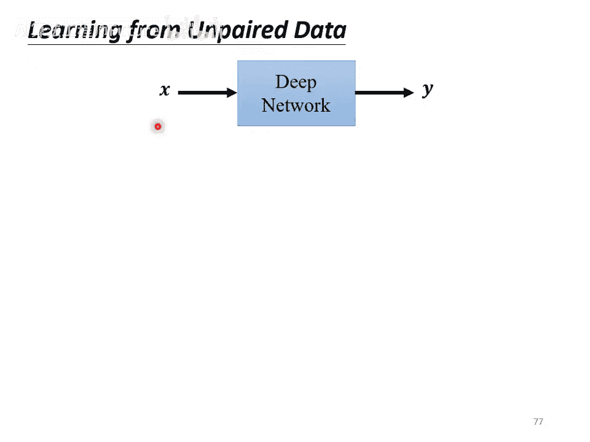

但是你可能会遇到一个状况是我们有一堆X，我们有一堆Y，但X跟Y是不成对的，在这种状况下，我们有没有办法能拿这样的资料来训练network呢，那像这种没有成对的资料，我们就叫做UNLABEL的资料。

没有标注的资料，那至于怎么使用这些没有标注的资料呢，其实在作业三跟作业五里面，都提供给你两个例子，那我们就把呃这个怎么用，没有标注的资料怎么做。

semi supervised learning这件事情放在作业里面，那如果你有兴致的话，就可以来体验一下semi supervised learning，到底可以带来多大的帮助。

但是不管是作业三的sudo labeling，还是作业五的back translation，这些方法或多或少都还是需要一些成对的资料，在作业三里面，你得先训练出一个模型。

这个模型可以帮你提供sudo label，如果你一开始根本就没有太多有标注的资料，你的模型很差，你根本就没有办法产生比较好的sudo label，或做back translation。

你也得有一个back translation的model，你才有办法做back translation，所以不管是作业三还是作业五的方法，都需还是都需要一些成对的资料，但是假设我们遇到一个更艰巨的状况。

是我们一点成对的资料都没有，那要怎么办呢，那你可能会问说，什么时候会一点成对的资料都没有呢，我永远可以找个工读生，还是或多或少帮我标一点资料吧，只是可能不一定可以标很多而已。

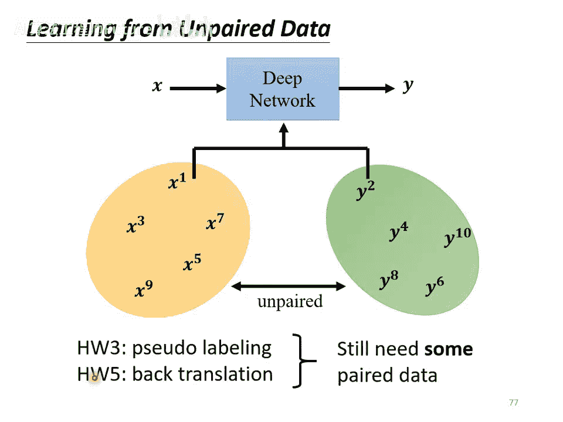

什么时候会完全没有成对的资料呢，我们这边举一个例子，举例来说，影像风格转换，假设我们今天要训练一个deep network。

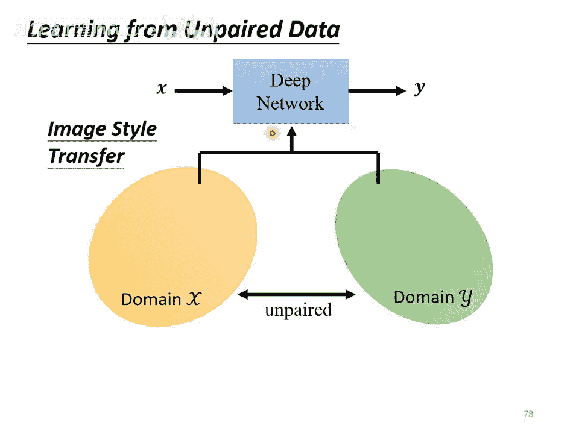

他要做的事情是把x din的图，XDOM的图，我们假设是真真人的照片。

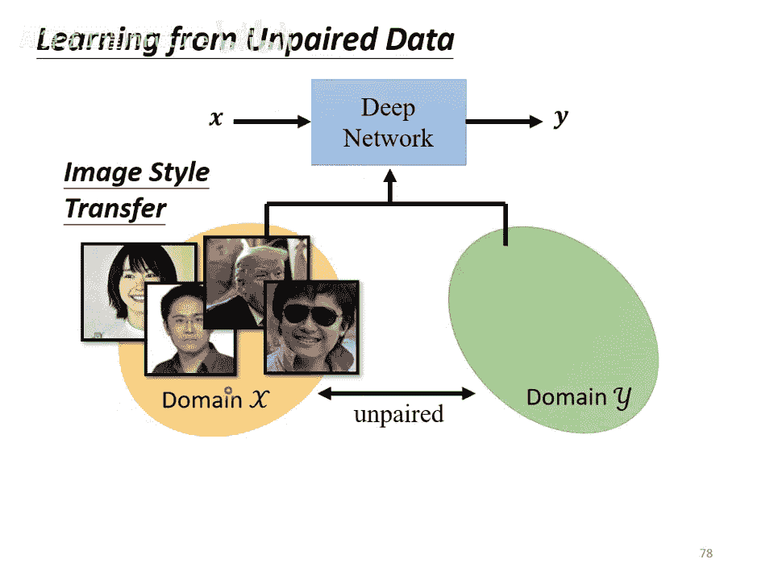

WIDEMAN的图呢是二次元人物的头像，真人的头像转成二次元人物的头像，那这个叫做影像风格转换哦，真人的头像是XDOM，二次元头像是Y斗man。

把X轴man的东西转成Y斗man的东西，这个是影像风格转换，在这个例子里面。

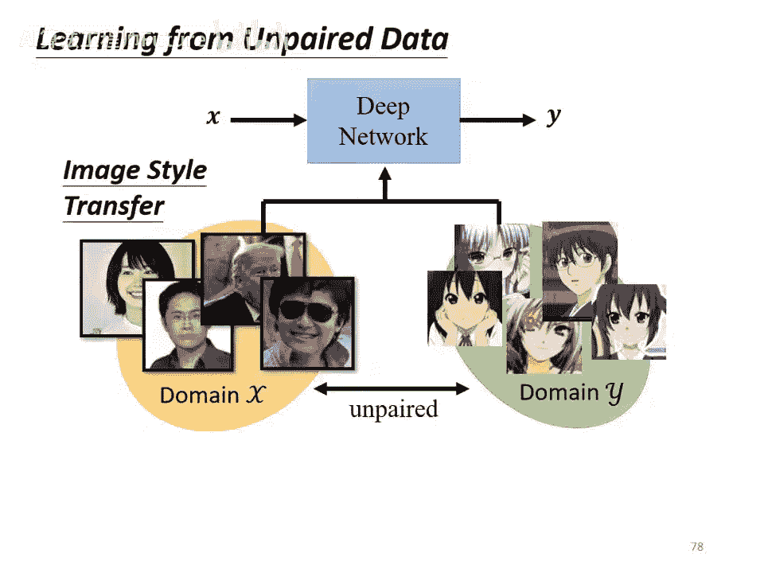

我们可能就没有任何的成对的资料，对不对，如果你要产生成对的资料，那你得先呃，比如说这新垣结衣帮新垣结衣拍个照片，然后呢再把新垣结衣二次元的版本画出来，你才有办法训练内work，那这个显然实在是太昂贵了。

工读生也没办法做这件事情，所以影像风格转换，你可能一点成对的资料都没有，在这种状况下，还有没有办法训练一个network，输入一个X产生一个Y呢。

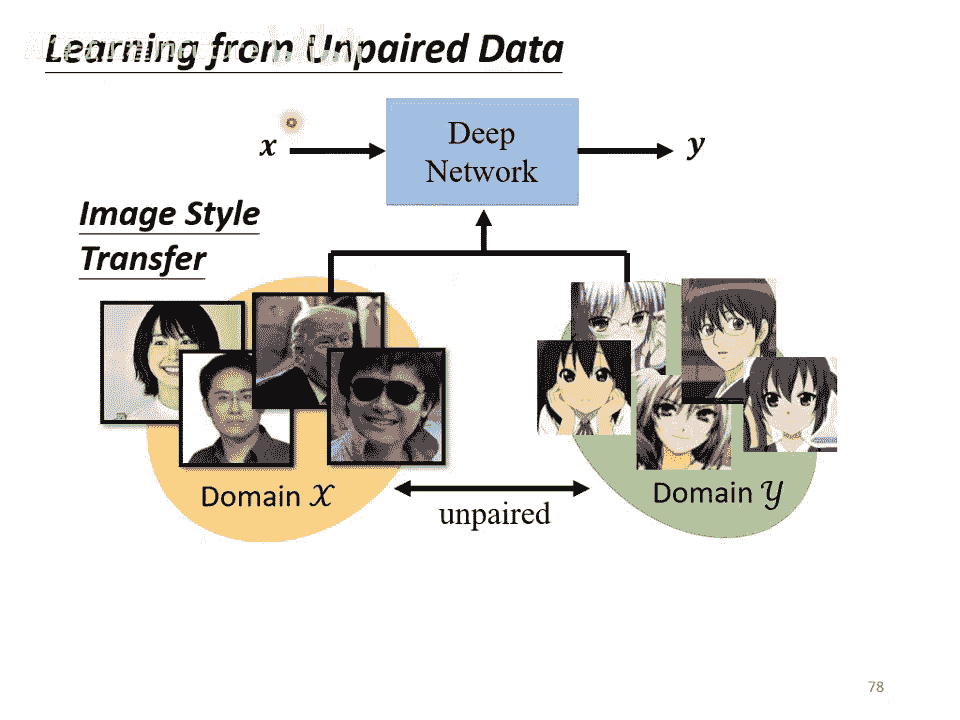

这个就是game可以帮我们做的事情。

那接下来我们就是要看看怎么用game。

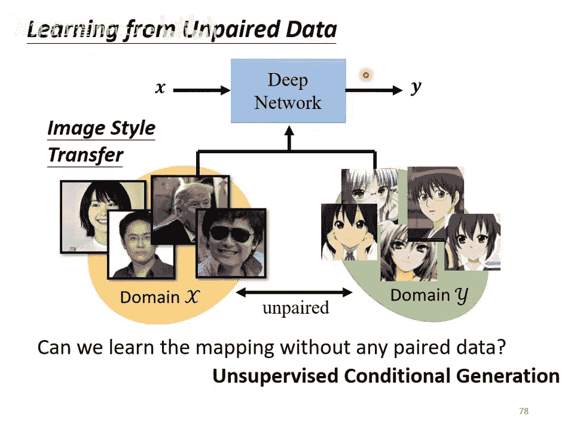

在这种完全没有成对资料的情况下进行学习。

好，这个是我们之前在讲unconditional的generation，的时候，你看到的generator的架构输入是一个高选的分布，输出可能是一个复杂的分布，现在我们在稍微转换一下我们的想法。

输入我们不说它是高选的分布。

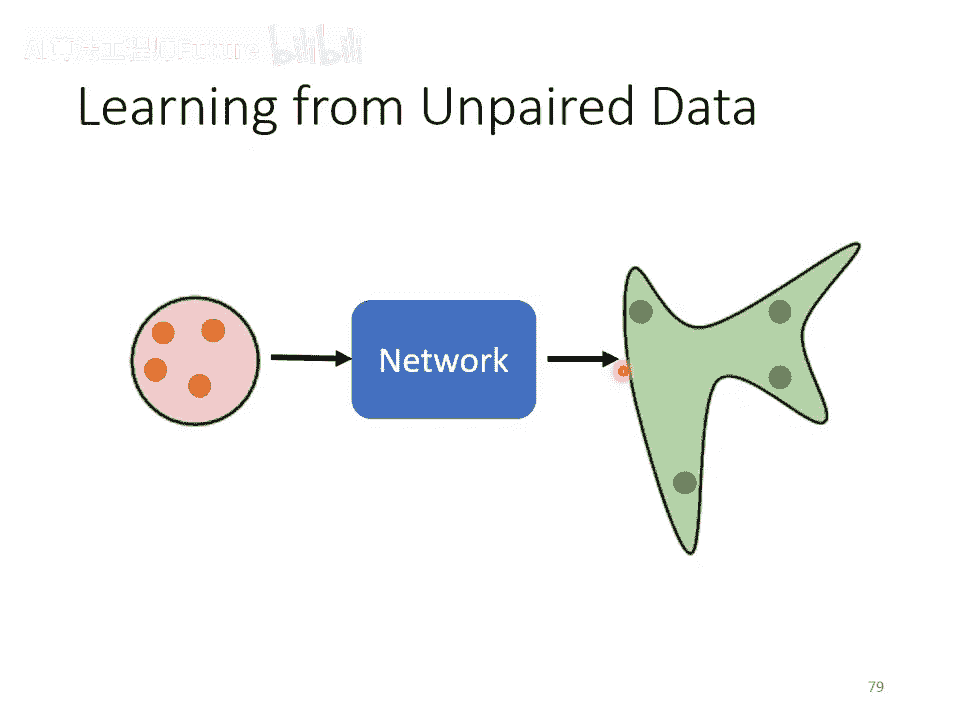

我们说它是X轴man的图片的分布。

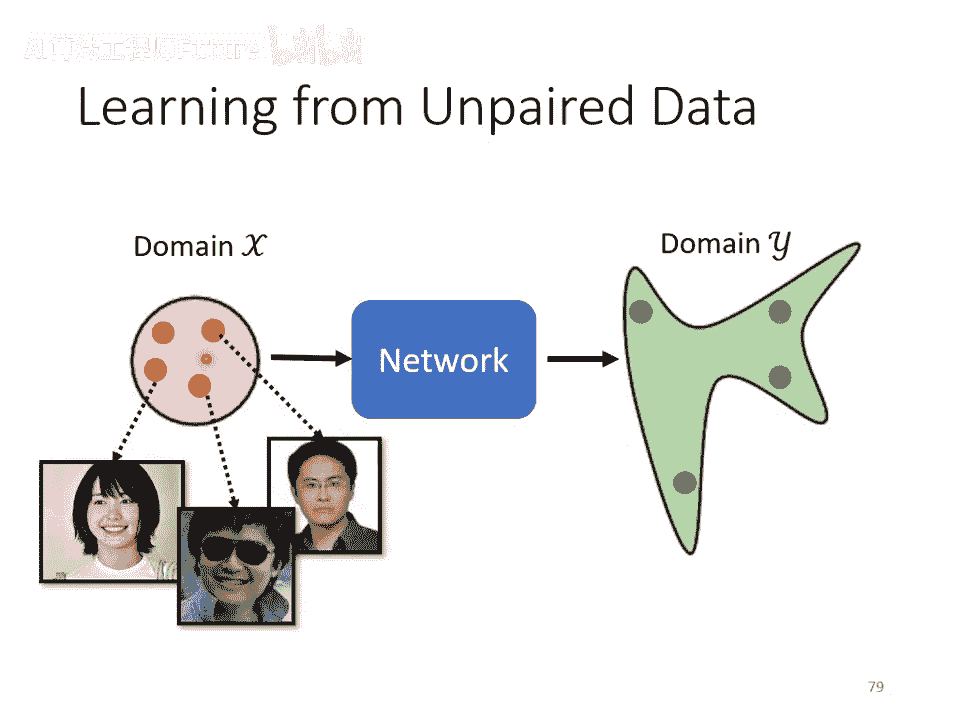

那输出我们说是WIDEMAN图片的分布，我们有没有可能训练这样一个generator，输入是x domain图片的分布，输出是YDMAN图片的分布呢，如果可以做到的话，其实就结束了啊，这个问题就结束了。

就做出来了，你就训练出一个network，你可以给他一个X同man的东西，让它把它转成Y同man的东西。

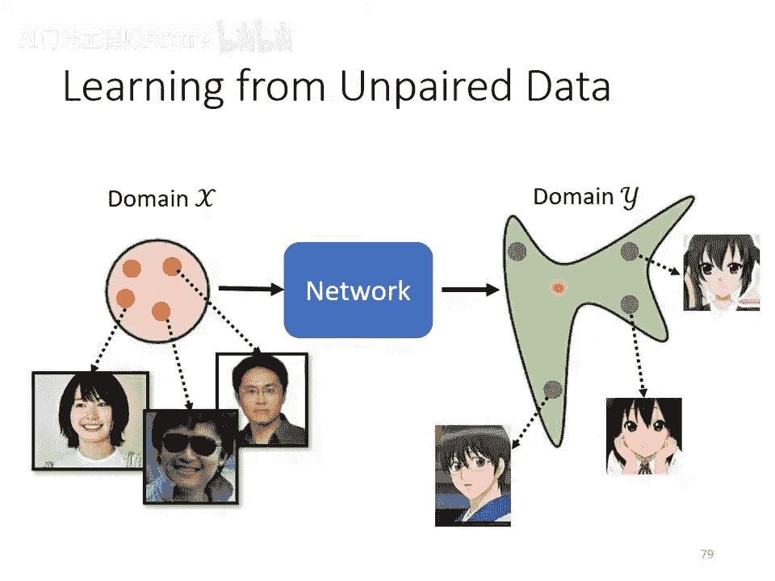

那有没有办法做这件事情呢，乍听之下好像没有很难，你完全可以套用原来的gain的想法，在原来的game里面，我们说我们从高选sample的向量丢到generator里面。

那我们一开始也说其实不一定要从高选sample，只要那一个distribution是有办法被sample的就行了，我们选高选只是因为高选的formulation，我们知道我们可以从高选sample。

那我们现在如果输入是XDMAN的distribution，我们只要改成可以从x din sample就结束了，那你有没有办法从X轴面sample呢，可以你就从人脸的照片里面。

真实的人脸里面随便挑一张出来，这是一个死臭酸宅，然后呢就就结束了，那你就可以从X轴man sample照片出来，好，你把这个照片呢丢到generator里面，让它产生另外一张图片。

产生另外一个distribution里面的图片，那怎么让它变成是WIDMAN的distribution呢。

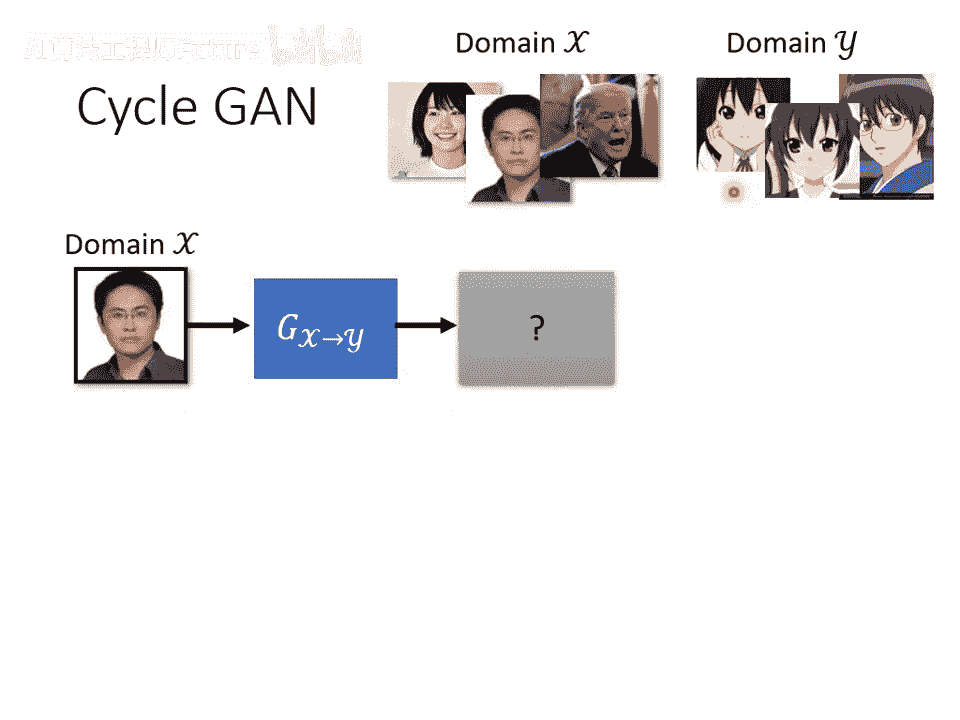

那就需要仰仗一个discriminator，那这个discriminator给他看过很多Y轴抖main的图，所以他能够分辨Y轴man的图，跟不是YDMIN的图的差异，看到YDMAN的图就给他高分。

看到不是Y斗man，不是呃，二次元人物就给他低分，那嗯那就就这样结束了诶结束了，那你说这个跟原来的gain的训练有什么不同，没什么不同，哎没什么不同，如果你想要自己在那个作业里面做一下的话。

就记得说本来在作业里面呢，这个高选这个generator的input那个sample啊，是从那个高选distribution sample出来，现在记得换一个sample的方法。

从真人的人脸里面simple一张图片出来，好像就结束了就结束了，但是你再仔细想想看，光是套用原来的game训练，generator跟discriminator好像是不够的，怎么说呢。

因为我们现在的discriminator，他要做的事情，是要让这个generator输出一张wil man的图。

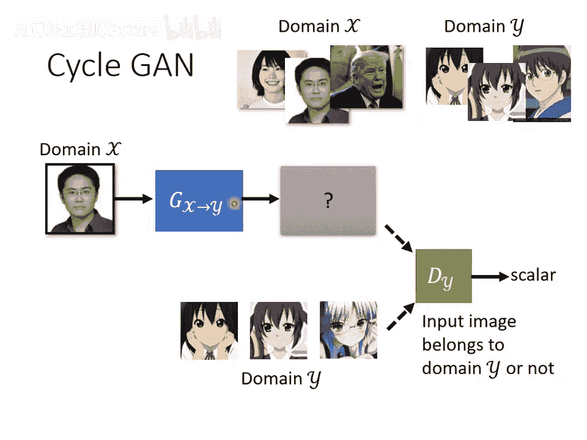

那generator他可能真的可以学到输出y din的图，但是它输出的YDMIN的图，一定要跟输入有关系吗，你没有任何的限制，要求你的generator做这件事啊。

你的generator也许就把这张图片，当做一个高悬的noise，然后反正他就是看到。

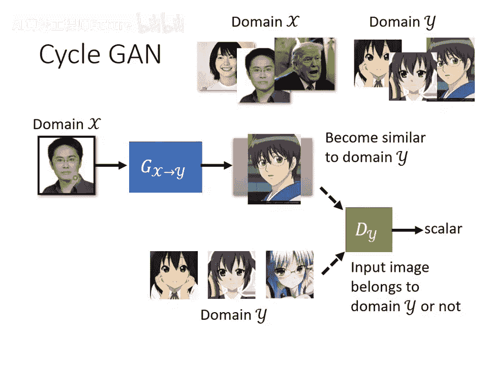

不管你输入什么，他都无视他，反正他就输出一个像是二次元人物的图片，discriminator觉得他做的很好，其实就结束了，对不对，所以如果我们完全只套用这个一般的game的做法。

只训练一个generator，这个generator input的distribution从高选变成x o man的image，然后训练一个discriminator显然是不够的。

因为你训练出来的generator，它可以产生二次元人物的头像，但是跟输入的真实的照片没有什么特别的关系，那这个不是我们要的啊，那怎么办呢。

怎么解决这个问题，怎么强化输入与输出的关系呢，那这个generator完全无视输入这件事啊，你会发现说我们在conditional game的时候，是不是也看过一模一样的问题呢。

在讲conditional game的时候，我们有特别提到说，假设你的discriminator只看Y，那他可能会无视generator的输入，那产生出来的结果不是我们要的。

但是这边呢如果我们要从unpaired的data学习，我们也没有办法直接套用conditional game的想法，因为在刚才讲的conditional game里面，我们是有成对的资料。

我们可以用这些成对的资料来训练discriminator，但今天现在我们没有成对的资料了，我们根本没有办法拿出成对的资料，来告诉discriminator，说怎么样的X跟Y的组合才是对的。

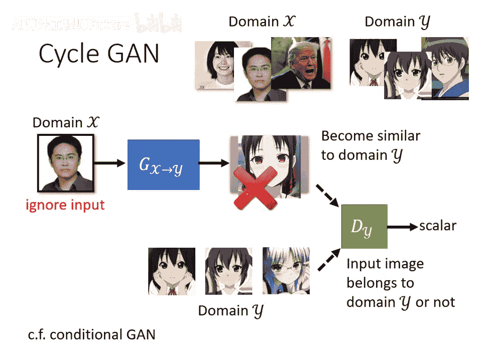

我们没有这种资料怎么办呢，那这边就用了一个，这边这个想法呢叫做cycle game，那在cycle game里面我们会train两个generator。

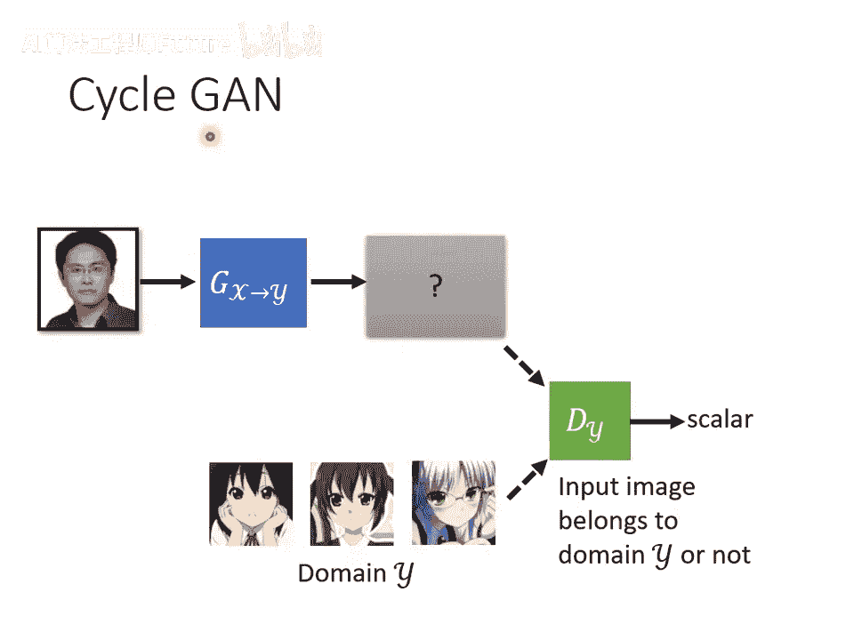

第一个generator，他的工作是把X等位的图，变成Y等Y1种main的图，这个generator他的工作是看到一张YDMAN的图，把它还原回X轴man的图，在训练的时候。

我们今天增加了一个额外的目标，就是我们希望输入一张图片，从X轴man转成YDMAN以后，要从Y斗man转回原来一模一样的XDMAN的图，不经过两次转换以后，输入跟输出要越接近越好。

你说怎么让两张图片越接近越好呢，这个很简单了，这是一个图片，其实就是一个向量，对不对，两张图片就是两个向量，这两个向量之间的距离，就你就是他，你就是让这两个呃向量，它们之间的距离越接近越好。

就是要两张图片越像越好好，因为这边呢有一个循环，从X到Y再从Y回到X，它是一个cycle哦，所以叫做cycle game，那这个要让输入经过两次转换以后变成输出，输入跟输出越接近越好。

就叫做cycle的consistency哦，所以现在这边我们有三个network，第一个generator，他的工作是把X转成Y，第二个generator，他的工作是要把Y还原回原来的X。

那这个discriminator他的工作仍然是要看蓝色的，这个generator，它的输出像不像是YDMAN的图，那加入了这个橙色的从Y到X的generator以后，会有什么样不一样的地方呢。

对于前面这个蓝色的generator来说，他就再也不能够随便乱做了，他就不能够随便产生乱七八糟，跟输入没有关系的人脸了，这边假设输入一个死臭酸宅，然后这边假设输出的是辉夜啊，对另外一个。

而且不知道这是谁的，他是辉夜，这样子好吗，知道吧，她是辉夜大小姐，然后对第二个generator来说，对他就是吃这张辉夜作为输入，他根本无法想象，说要把辉夜还原回死臭酸宅。

他根本不知道说原来输入的图片长什么样子，所以怎么办呢，对第一个generator来说，为了要让第二个generator能够成功的还原。

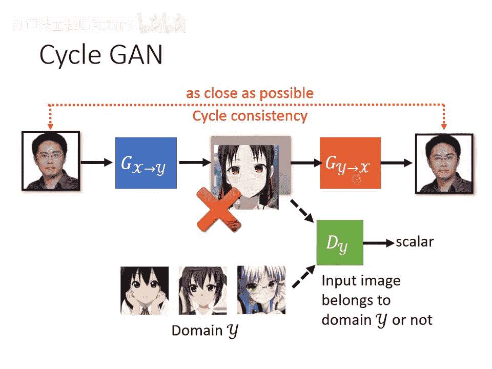

原来的图片，它产生出来的图片就不能跟输入差太多哦，所以这边是一个死臭酸宅，这边输出，至少也得是一个戴眼镜的男生的角色才行吧，所以这边是一个戴眼镜男生的角色啊，这个是辛巴，然后呢。

这个第二个generator，才能够把这个角色还原回原来的输入，所以如果你加cycle game，你至少可以强迫你的generator，他输出的YDMAN的图片。

至少跟输入的XDOMIN的图片有一些关系，但讲到这边呢，我信你可能会有的一个问题，就是你这边只保证有一些关系呀，你怎么知道这个关系是我们要的呢，机器有没有可能学到很奇怪的转换，输入一个戴眼镜的人。

然后这个generator学到的是，看到眼镜就把眼镜抹掉，然后把它变成一颗痣，然后这个generator第二个generator纯色的学到，就是看到字就还原回眼镜。

这样还是可以满足cycle consistency呀，还是可以把输入的图片变成输出的图片，那我举一个更极端的例子，假设第一个generator学到的就是把图片反转，左右翻转。

第二个generator他只也只要学到把图片左右翻转，你就可以还原了，所以今天如果我们做cycle game，用cycle consistency，似乎没有办法保证，我们输入跟输出的人脸看起来真的很像。

因为也许机器会学到很奇怪的转换，反正只要第二个generator可以转的回来就好了，那会不会有这样的问题发生呢，确实有可能有这样的问题发生，那有什么样特别好的解法呢，目前没有什么特别好的解法。

但我可以告诉你说，实际上你在使用cycle game的时候，呃，这样子的状况没有那么容易出现，如果你实际上使用cycle game，你会发现，输入跟输出往往真的就会看起来非常像，而且甚至在实作上。

在实作的经验上，你就算没有第二个generator，你不用cycle game，当一般的game来做这种图片风格转换的任务，你往往也做得起来，因为呃在实作上你会发现network其实非常懒惰。

他输入一个图片，它往往就想输出它摆default，就是想输出很像的东西，他不太想把输入的图片做太复杂了转换，所以什么眼镜变成一颗痣，这种状况他不爱这么麻烦的东西，有眼镜就就输出。

眼镜可能对他来说是比较容易的抉择，所以在真的实做上，这个问题没有很大，输入跟输出会是像，但是在理论上好像没有什么保证，说输入跟输出的图片一定要很像，就算你加了cycle consistency。

所以这个是实作与理论上你可能会遇到的差异，总之虽然cycle game，没有保证说输入跟输出一定很像，但实际上你会发现输入跟输出往往非常像，你只是改变了风格而已。

好那这个cycle gank可以是双向的啦。

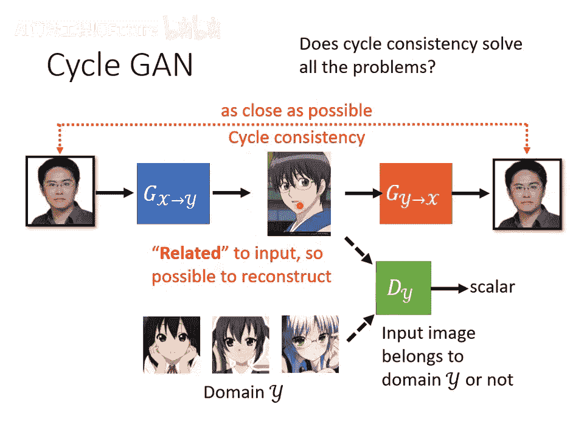

什么意思呢，我们刚才有一个generator输入Y等man的图片，输出X轴man的图片，那我们是先把X轴man的图片转成Y，再把Y转为X，在训练cycle game的时候。

你可以同时做另外一个方向的训练。

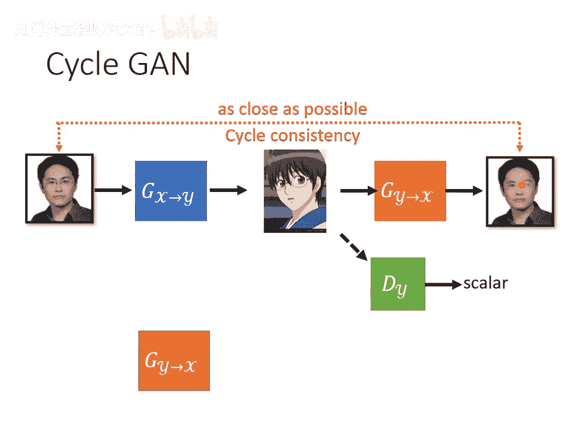

也就是你把蓝这个橙色的generator拿来给它。

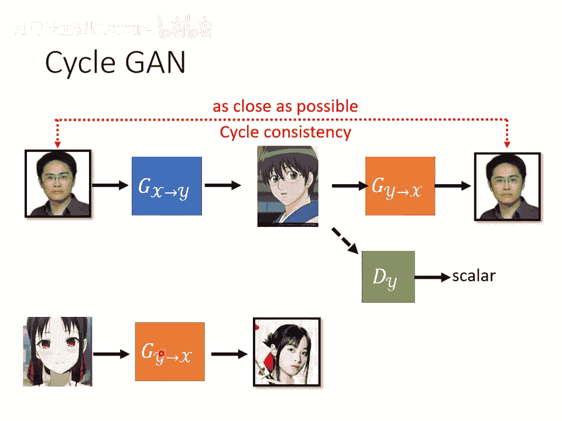

YDMAN的图片，让它产生XDOMIN的图片，然后呢再把蓝色的卷的RATOR拿来。

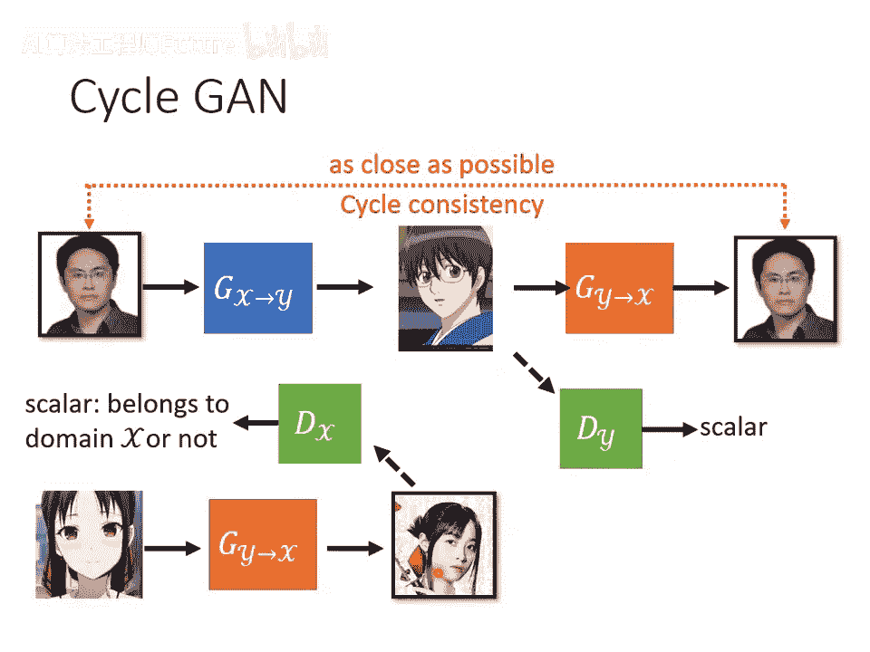

把XDOM的图片还原回原来YDOMIN的图片，那你依然要让输入跟输出越接近越好，那你一样要训练个discriminator，这个discriminator是x x date discriminator。

他是要看一张图片，像不像是真实人脸的discriminator，这个discriminator要去看，说这个橙色的generator的输出，像不像是真实的人脸。

那这个橙色的generator他要去骗过这个DX，这个绿色的左边这个discriminator啊，这个合起来就是cycle game好。

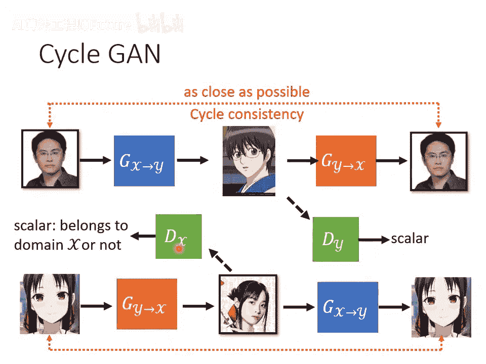

那除了cycle game以外，你可能也提供过很多其他的，可以做风格转换的game，比如说disco game，比如说dual game，他们跟cycle game有什么不同呢，就是没有半毛钱的不同。

这样子你可以发现disco game，deo game跟cycle game其实是一样的东西，他们是一样的想法，神奇的事情是完全不同的，团队，在几乎一样的时间提出了几乎一模一样的想法。

你发现这三篇文章放到阿凯上的时间，都是17年的3月，17年的4月跟17年的3月，不同的团队几乎在一样的时间有了一样的想法。

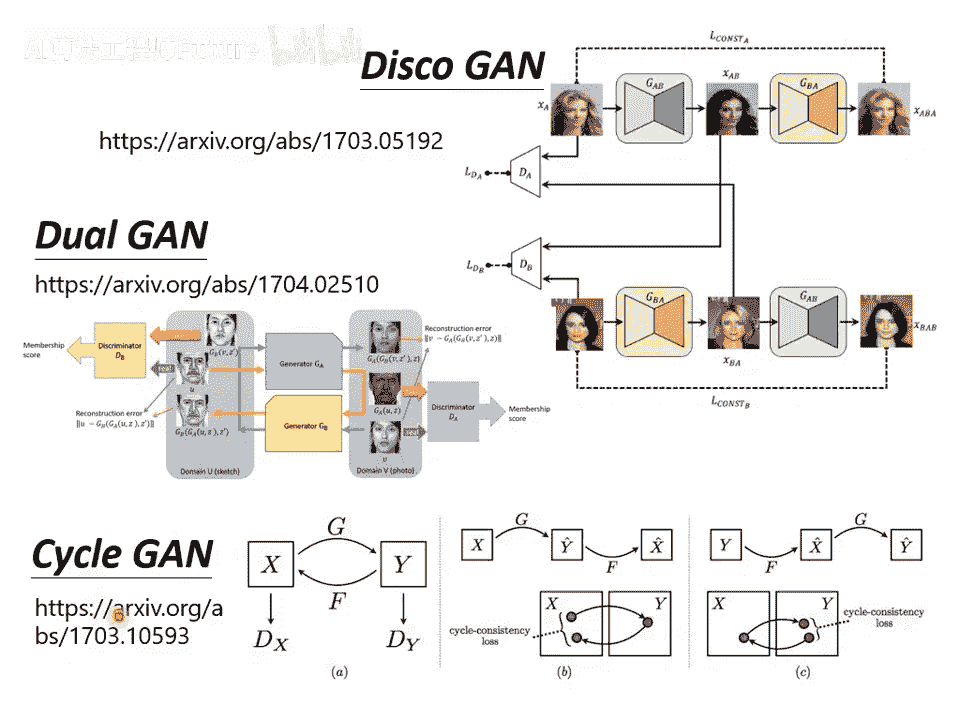

好，那除了cycle game以外啊。

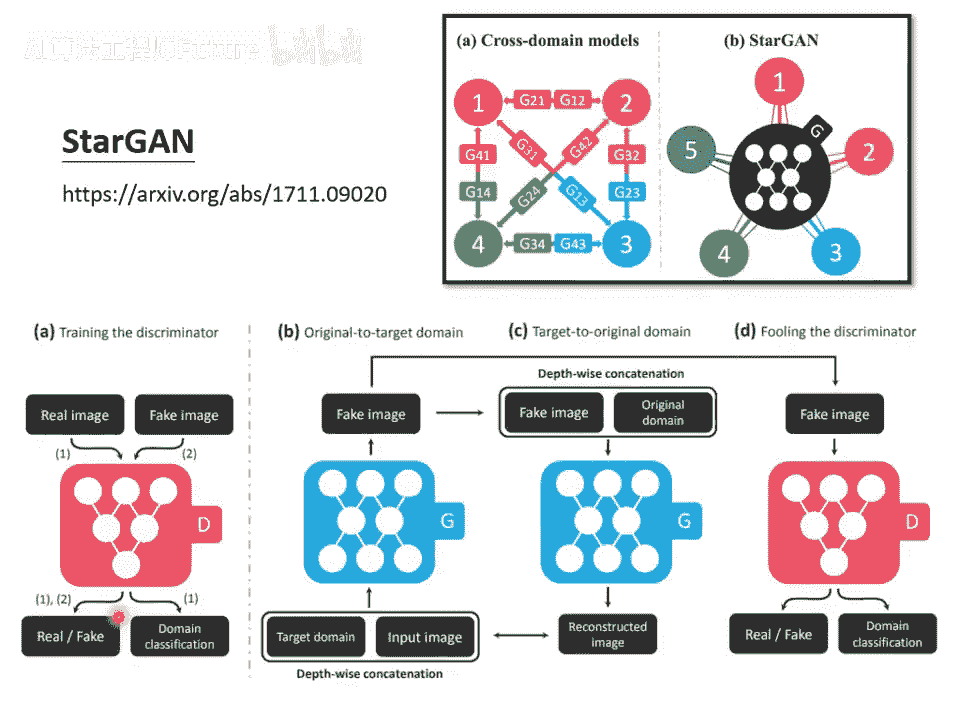

还有另外一个更进阶的，可以做影像风格转换的版本叫做star game，叫cycle game，只能在两种风格间做转换，那star game它厉害的地方是，它可以在多种风格间做转换，不过这个就不是。

只有我们接下来想要细讲的重点，我们就呃就停在这个地方好，那这个the呃这个真实的人脸转二次元的人物，实际上能不能做呢，实际上可以做右上角这边放了一个连接啊，这个应该是个韩国的团队，他们做了一个网站。

你可以上传一张图片，他可以帮你变成二次元的人物，那他们实际上呢用的不是cycle game啊，他们用的是也是gain，也是gain的技术，但是是一个进阶版的东西，那我们这边就不细讲。

我就把论文的链接放在这边给大家参考。

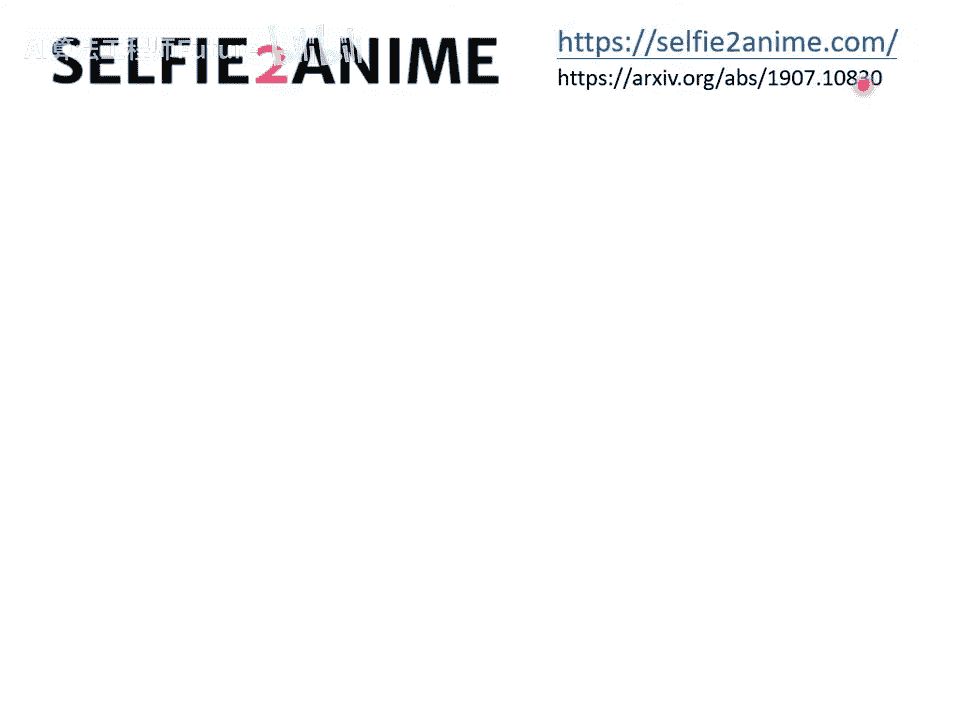

那这个网页做得怎么样呢，我就实际测试了一下，这个不知道大家认不认得，这是新垣结衣啦，就这个是你老婆这样哎你总该认得吧，好那把这个图片转成，把你老婆转成二次元的人物。

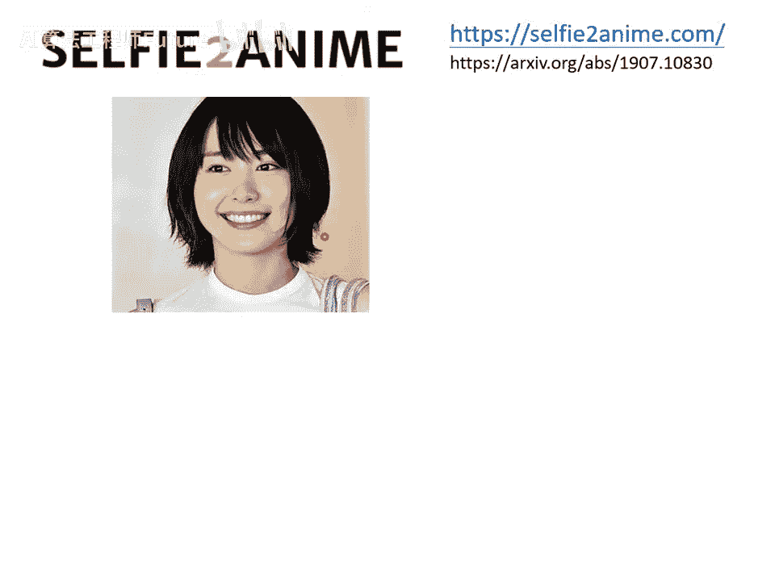

长成是这个样子啊，嘿你老婆二次元长这个样子，知道吗，呃你会发现说呢，机器确实有学到一些二次元人物的特征啊，比如说把把眼睛变大哦，本来眼睛其实没有很大啊，哇变成二次元人物以后眼睛变这么大。

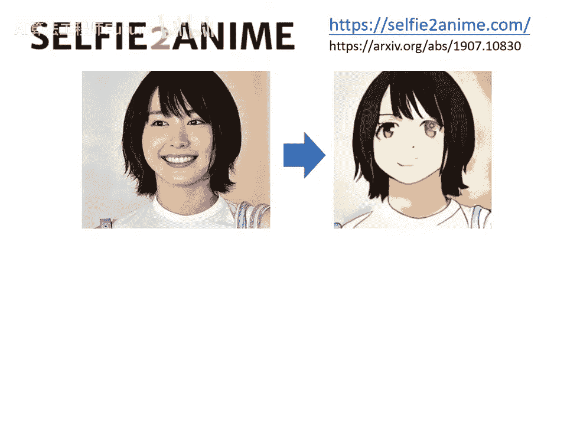

但有时候也是会失败啊，比如这个是美国前总统，转完以后变成这个样子啊，两只两只眼睛一眼大一眼小，就是啊不是总是会成功的啊，那同样的技术啊，不是只能用在影像上，也可以用在文字上，也你也可以做文字风格的转换。

比如说百句负面的句子转成正面的句子啊，当然如果你要做一个模型，输入一个句子，输出一个句子，那这个模型就是要能够吃一个sequence，输出一个sequence。

所以它得是一个sequence to sequence model，你可能就会用到我们在作业五里面的，transformer的架构来做这个呃，文字风格转换的问题，我们在做业务做的是翻译吗。

我输入一个语言，输出另外一个语言嘛，那现在如果要做文字风格转换，就是输出一个句子，但输出另外一个风格的句子好，那怎么做文字风格转换呢，跟cycle game是一模一样的。

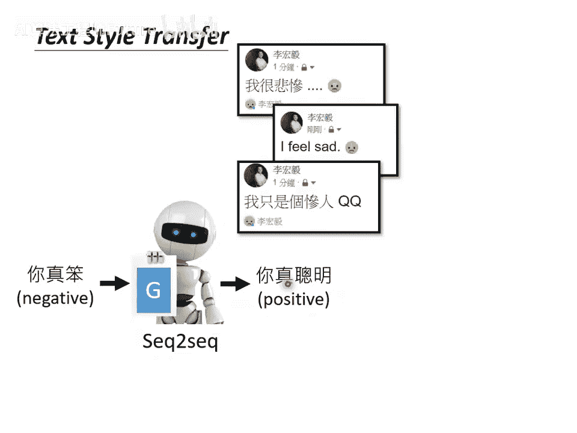

首先你要有训练资料，收集一大堆负面的句子，收集一大堆正面的句子，假设你要把负面的句子转成正面的句子，假设风格转换问题就是负面的句子，转正面的句子，也就收集一堆负面的句子，收集一堆正面的句子。

那这个其实没有那么难收集，你可以就是啊网络上爬一爬，像我们就是去PPT上爬，然后只要是推文就当做是正面的虚文，就当做是负面的，那就一大堆正面的句子，跟负面的句子只是成对的资料，没有而已。

你不知道这句推文要怎么转成这句虚文，这句虚文要怎么转成这句推文，你没有这种资料，但是一堆推文。

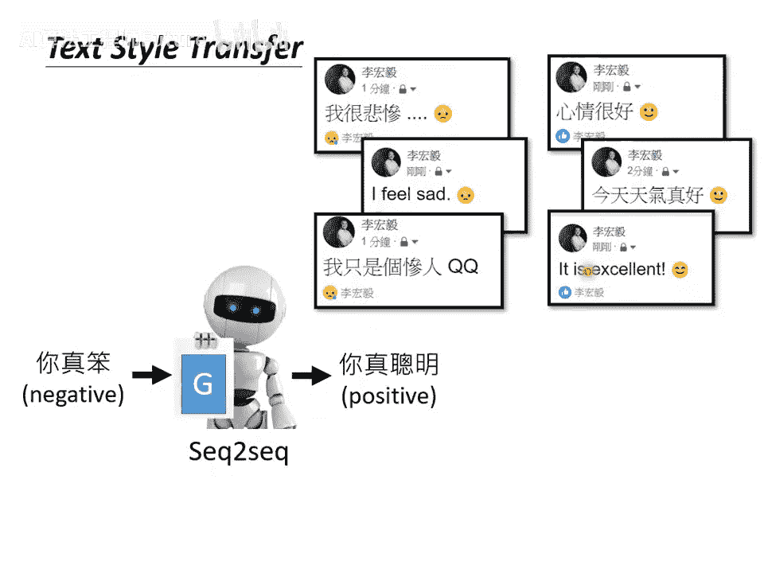

一堆虚文的资料，你总是可以找得到的好，那接下来呢完全套用cycle game的方法，那完全没有任何不同，所以这边就不需要再细讲，很快讲过，有一个discriminator。

discriminator要看说假设我们是要负面的句子，转正面的句子，那discriminator ator，要看说现在generator的输出。

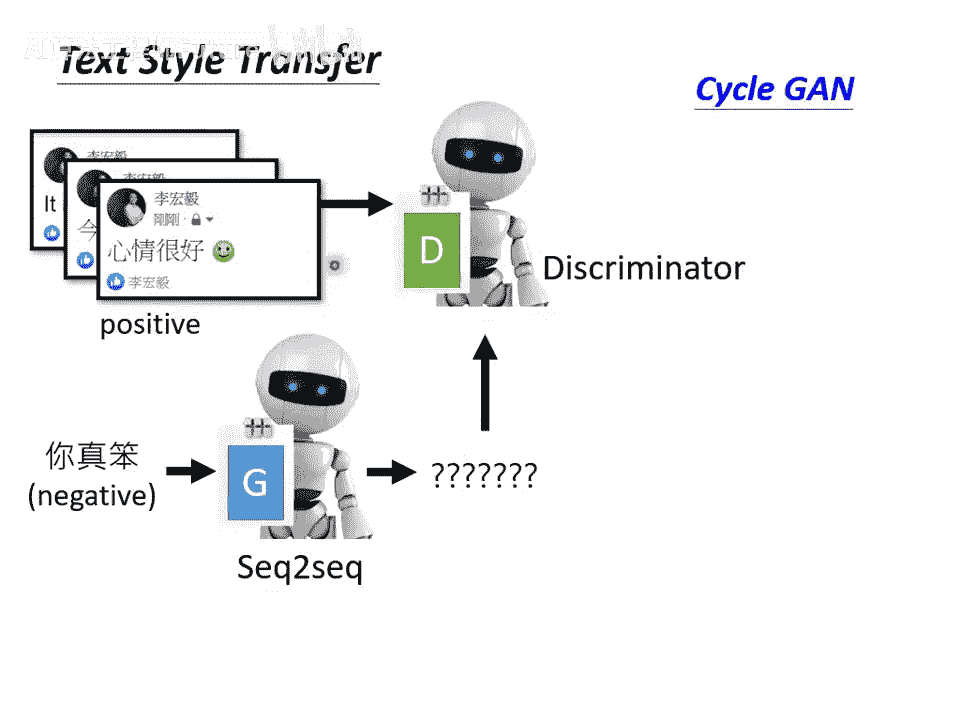

是像不像是真正的正面的句子，然后呢我们还要有另外一个generator，要有两个generator，这个generator要学会把正面的句子，转回原来负面的句子。

那你要用cycle consistency，负面的句子转成正面的句子以后，还可以转回原来负面的句子，那你可能会问说这两个句子，它们两个是句子啊，怎么算它们的相似度啊，图片还比较好理解，图片就是个向量啊。

两个向量的距离就是它们的相似度啊，那两个句子要怎么做呢，呃这个呃如果你有兴趣再留给你慢慢研究啊，那这边还有另外一个问题，就是这个sequence to sequence model，输出是文字。

那可是刚才不是有讲说，如果输出是文字，接到discriminator会有问题吗，对会有问题，这边你需要用RL硬做下好。

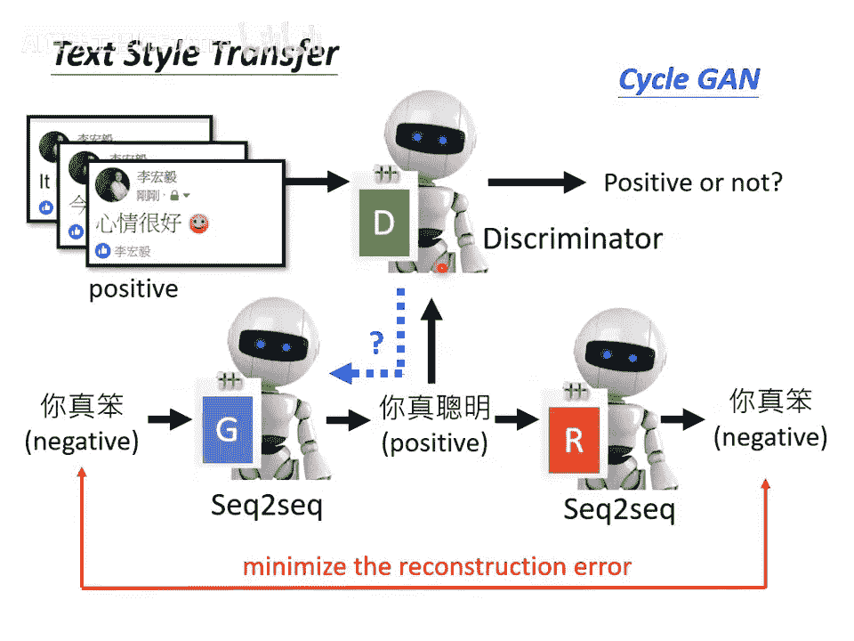

那做出来的结果怎么样呢，这个是真正的demo啦，就是啊真的拿PTT的推文当正面的句子，虚文当负面的句子，那你就可以给他一个负面的句子，他就帮你转成正面的句子啊，做起来像是这个样子，刚刚说胃疼，没睡醒。

各种不舒服，他就说生日快乐，睡醒超级舒服，或者你跟他说我都想去上班了，真够贱的，他就说我都想去睡了，真帅的这样，所以他很厉害啊，他知道上班的相反就是去睡啊，还挺聪明的，那刚刚说晕死了。

吃烧烤竟然遇到个变态狂，他就说哈哈好，吃烧烤居然遇到帅狂样，他就把变态狂变成帅狂，他自己发明了一个词汇，也不知道在说些什么，那是因为这个训练是完全unsupervised的。

就只给他正面的句子跟负面的句子，虽然有时候会犯非常奇怪的错误，比如说我跟他说我肚子痛的厉害，他就说我生日快乐，厉害的，那你会发现说机器算犯错，但错了是有固定的规则的，你发现胃疼跟肚子痛。

只要是腹部有毛病，他转过来都是生日快乐啊，不知道为什么机器觉得说腹部有毛病的，相反就是生日快乐，艾肯问说这个系统有什么用，就是没有任何用处啦，没半点用处，这样但是如果你觉得你的老板说话特别坏的话。

就可以把这个系统装在你的耳机里面，把所有的负面句子转成正面的句子，那你的人生可能就会过得特别快乐一点。

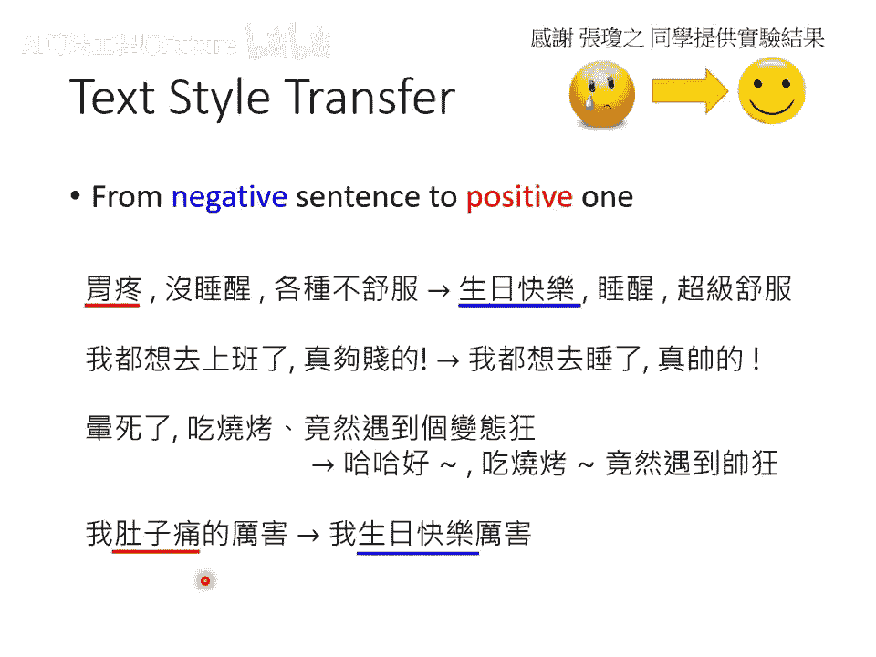

那其实啊像这种文字风格转换，还有很多其他的应用，不是只有正面句子转负面句子而已，举例来说，假设我有很多长的文章，我有另外一堆摘要，那这些摘要不是这些长的文章的摘要，是不同的来源，一堆长的文章，一堆摘要。

让机器学习文字风格的转换，你可以让机器学会把长的文章变成简短的采样，让他学会怎么精简的写作，让他学会把长的文章变成短的句子，甚至还有更狂的同样的想法，可以做unsupervised的翻译。

什么叫UNSUPERVISOR的翻译呢，收集一堆英文的句子，收集一堆中文的句子，没有任何成对的资料，这就跟你作业五不一样，作业五你有成对的资料吗，你有知道说这句英文对照这句中文吗。

但是unsupervised的翻译，就是完全不用任何成对的资料，网络上爬一堆中文，网络上爬一堆英文，用刚才那个CCLEGA的做法，硬做机器就可以学会把中文翻成英文了，你可以自己看一下文献。

看看说机器做的怎么样，那到目前为止，我们说的两种风格都还是文字，可不可以两种风格甚至是不同类型的资料呢，有可能做，这是我们实验室最早做的，我们试图去做非督导式的语音辨识。

也就是让机器听一堆语音辨识是什么，语音辨识就是呃你需要收集成对的资料啊，你需要收集一大堆声音讯号，然后找工读生帮你把这些声音讯号标注，机器才能够学会某个语言的语音辨识，但是要标注资料所费不资。

所以我们想要挑战非督导式的语音辨识，也就是机器只听了一堆声音，这些声音没有对应的文字，及其上网查一堆文字，这些文字没有对应的声音，然后用cycle game硬座，看看机器有没有办法把声音转成文字。

看看它的正确率可以做到什么样的地步，那至于正确率可以做到什么样的地步呢，那我把文献留在这边给大家参考好。

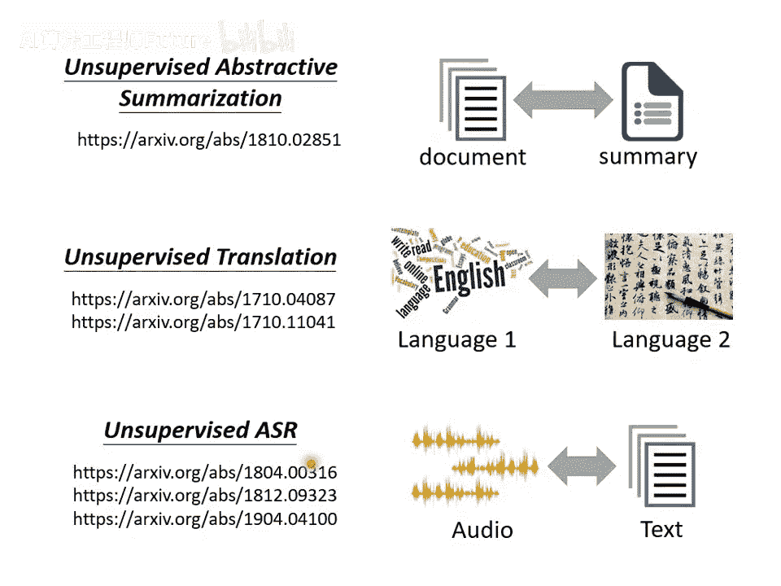

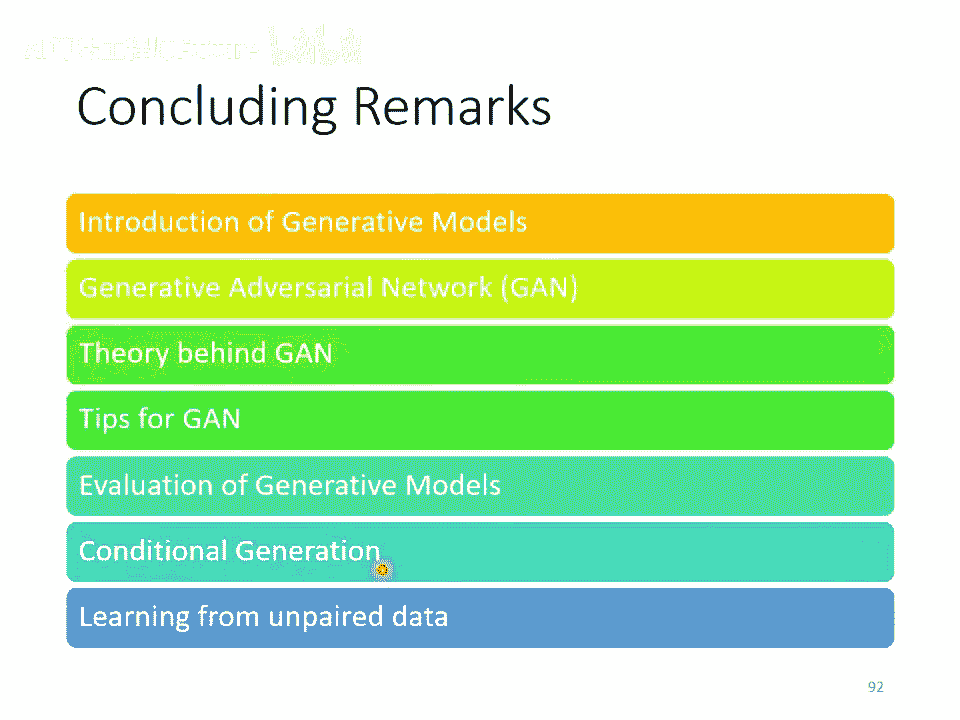