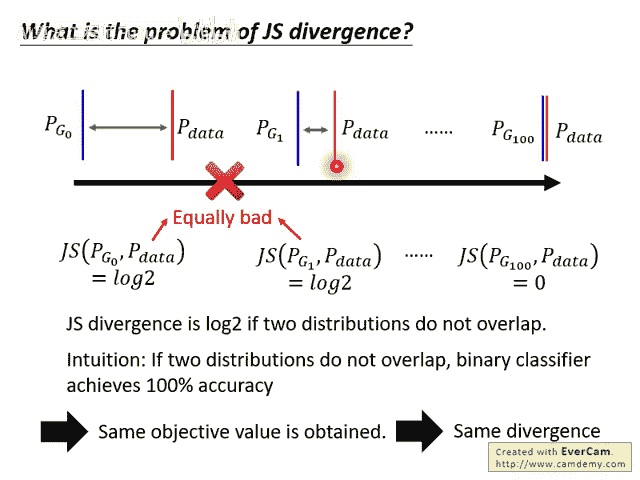
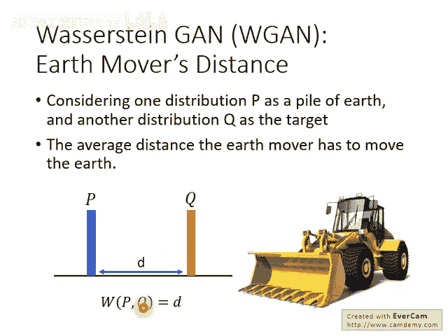
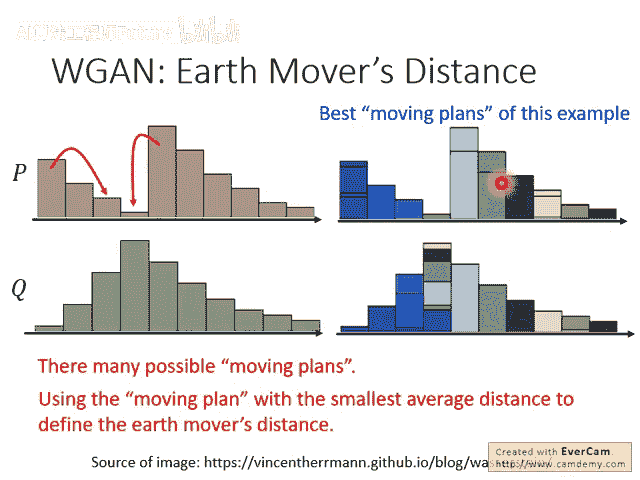
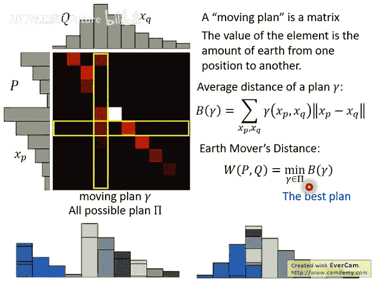
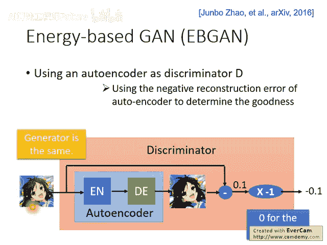
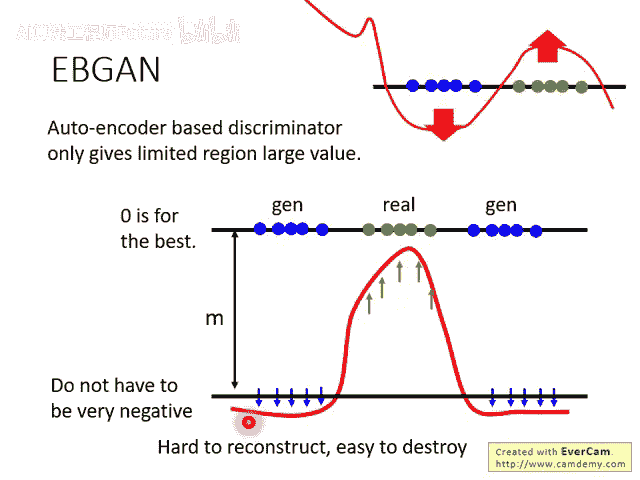
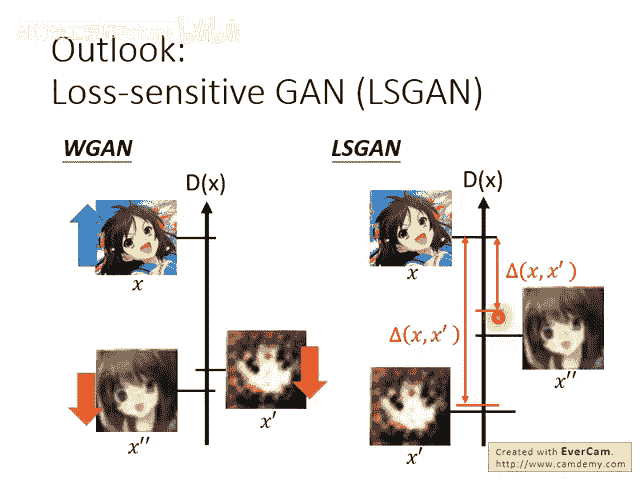
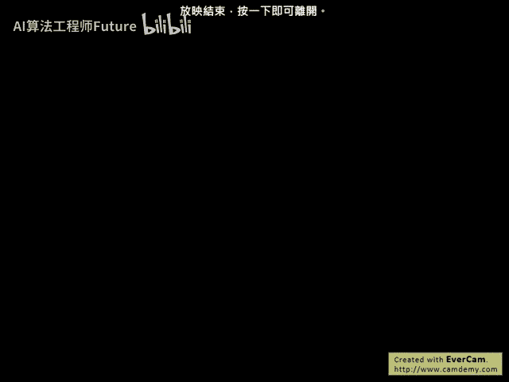

# 【官授搬运】2026年全新优化版李宏毅机器学习系统课程，这才是真正的初学者体系课程！—人工智能／深度学习／神经网络 - P48：7-选修-GAN 理论-3 - AI算法工程师Future - BV1ruqABeEFX

好，那接下来呢我们要讲一些可以improve game的，training的tips，但是尤其就是我们要强调的是，要讲的就是w game啊，讲的就是w game，好那我们之前已经有讲到说呢。

假设我们在train game的时候，最原始的game，他量的是全generated data跟real data之间的JSDIVERG，但是今天用js divergence来衡量的时候。

其实有一个非常严重的问题，这个严重的问题它的根源是什么呢，它的根源是你的generator产生出来的data distribution。

跟你的real data的distribution往往是没有任何重叠的，为什么generate出来的data，跟real的data往往是没有重叠的呢，一个理由是data本质上的问题。

因为我们通常相信说image是一个high dimensional的，其实是低维的一个MANIPHOR，就是你把你在三维空间中，然后呢把一个二维的平面折到三维的空间中。

这样就是一个低维的metaphor，或者说你有一个二维的平面，如果在image呢，在这二维平面上分布，可能就像是一条直曲线一样，就像是一条曲线一样，那你今天在一个高维高维的空间中。

的两个低维的metaphor，他们的overlap的地方几乎是可以忽略的哦，你有两条曲线，而在一个二维平面上，你有两条曲线，它们中间重叠的地方几乎是可以忽略的，比如PDA跟pg几乎是可以忽略。

但这是第一个理由，那有人可能会说嗯，我不相信，低维的manifold，那我从另外一个角度来说服你，我们实际上在衡量pg跟PDA的divergence的时候，我们是先做sample，对不对。

我们从两个data distribution里面做一些sample，得到两堆data，再用discriminator去量它们之间的divergence好，那所以我们现在就算你的pg跟p data。

这两个distribution是有overlap的，但是你是先从这两个distribution里面做一些sample，而且sample时候你其实也不会sample太多。

也就从红色distribution里面sample1些点，从蓝色distribution里面再simple1些点啊，你simple了两堆点，这两堆点他们的overlap几乎是不会出现的。

除非你simple真的很多，不然这两堆点其实完全就可以视为是两个，没有任何交集的distribution，所以就算是本质上实际上p data塔跟pg有overlap，但你在量divergence的时候。

你是simple少量的data出来才量divergence，那在你sample出来的少量data里面，pg跟BDA看起来根本就是没有重合的，那怎么办怎么办，会遇到什么样的问题呢。

当pg跟p data没有重合的时候，你用js divergence来衡量pg跟p data之间的距离，它们pg和p data塔之间的差异，会对你training的时候造成很大的障碍，什么样的障碍呢。

因为js divergence的这个divergence它的特性是这样，如果两个distribution没有任何的重合，算出来就是log2，不管这两个distribution实际上是不是有接近。

只要没有重合，没有overlap算出来就是log2，所以今天假设你的PDA是红色这一条线，你有一个G0generator，0号G0GENERATTRI的distribution是这样一条线。

你用js diversion去量他们的js diversion是log2，这个case你有一个g one，你拿g one的DI，你算g one跟PDA的divergence，它也是log2。

这实际上g one其实是比G0好的，因为g one产生出来的data其实相较于G0，它更接近real data distribution，所以实际上我们知道g one比G0好。

但从j diverse看起来，g one看G0是一样差的，除非说现在你的G100跟p data完全重合，这时候js diversion算出来才会是零，只要没有重合，他们就算是非常的靠近。

你算出来也是log2好，所以这样子会对你的training造成问题，因为我们知道是我们实际上training的时候，generator要做的事情，就是想要去minimize你的diversion。

用discriminator量出diversion，量出js diversion或其他divergence以后，generate要做的事情是minimize你的divergence。

但对generator来说，pg0跟pg one，pg one就是唱嘻哈的，哈哈就都讲过了，对不对，pg0跟pg one他们其实就是一样的，哎他们其实是一样差的，或是一样好的，他们其实是一样差的。

所以对generator来说，他根本就不会把pg0update成p g one，因为对他来说，P距零跟p g one是一样差的，所以你根本没有办法把pg0update到pg one。

你也不会最后也没有办法update到pg100，你要在pg里的电话就卡住了，他没有办法update到pg one啊，那所以所以今天如果你用js divergence，来衡量两个distribution。

而测量好这两个distribution又没有太多重叠，它们重叠几乎可以无视的时候，你会发现你是串起来是有问题的，那为什么这两个distribute没有重叠，我刚才试着用两个不同面相来说服你。

说data的distribution跟generator distribution，可能非常可能就是没有重叠好的，假如你说哦，你对js divergence不熟，你不知道说js divergence啊。

只要没有重叠，算出来就是log2，那我们从另外一个直觉的方向来告诉你说，为什么今天只要两个distribution没有重合，他们算出来的loss，他们量出来divergence就会一样，因为你想想看。

我们今天实际上在量js divergent的时候，我们做的事情是什么，我们是说我们有两群data，把它视为是两个class，另一个discriminator扔一个binary classify。

你用cross minimize cos entrobe当成loss function，你认一个finally the classify，去分别出这两组data塔之间的差异。

但假设你认的是一个binary的classify，其实只要这两堆data没有重合，它的loss就是一样的，对不对，因为假设你扔一个binary classify，它可以完全的分辨这两堆data。

它可以完全的分辨这两堆data只要没有重合，final classify加a capacity是无穷大，他就可以分辨这两堆data，它就可以分辨这两堆data，在这两堆data都可以分辨。

在这两堆data都可以分辨的前提之下，你算出来的loss会其实会是一样大，或者是一样小的，对不对，那我们说你在train binary classify时，你train到最后你得到的那个loss。

或是你得到那个objective的value，其实就是你的jazz diversion，今天如果你的binary的classify，不管在这个case还在这个case，他都可以完全把两对data分开。

他算出来的OBJECTI都是一样大的，他算出来的loss都是一样小的，那意味着你量出来的divergence就是一样，总之这边要告诉大家的事情是说，在原始的game里面。

当你确认的是一个binary classify的时候，你会发现你train你是比较难train的，因为对你的game来说。

这个case和这个case其实是一样差的，或者是这边是用另外一个直观的方法来说明，就假设这个是你的real data的distribution，假设这是你的fake data的distribution。

那我们今天要弄一个binary classify，这个binary classify会给这些蓝色的点零分，给这些绿色的点一份，那么知道说我们的binary classify。

它的output是由SIGMOID的，是SIGMOID方式哦，所以它在接近一这边特别平，它在接近零这边特别平，好了确认好这个classify以后，本来我们是期待说你缺一个generator。

这个generator会带领这些呃，自己带领这些蓝色的点，顺着这个红色的线的归点就选的，Ator，会顺着discriminator给我们的归点去移动它的，去改变它，Generator ution。

这本来期待是generator，会顺着红色的这个线的归点，把蓝色点往右移，但实际上你会发现说这些蓝色的点是不动的，为什么，因为在这个蓝色的点附近的硅点都是零。

如果你今天是穿一个binary classify，它的OPER个sigmoid function的话，它在蓝色的这个点附近，它是非常平的，所以你会发现说它的微分几乎都是零，你根本就劝不动它。

所以如果你真的实际上去TRA一个binary classify，你直接train game，然后TRA个binary classify的话，你很容易遇到这样子的状况，那过去的一个解法是说。

不要把那个binary的classifier劝的太好，就不要劝的太好，因为如果劝的太好的话，他把这些绿色的蓝色点都给他领，这边就会变得很平，绿色点都给他一就会变得很平，不要让他劝的太好。

不要update太多次，让他在这边呢仍然保有一些斜率，让他不要让他劝的太好，但这样的问题就是什么叫做不要劝的太好，你就会很痛苦，这样你搞不清楚什么叫做不要劝的太好。

你不能够在TRADISCRIMINATOR的时候，当然太小力不行，太小力没办法分别real跟fake data，但太大力也不行，太大力的话，你就会陷入这个状况，你会陷入这个微分式理没有办法确认的状况。

那什么叫做不要太大力，不要太小力，你就会很难控制，那在早年还没有我们刚才讲的种种tip的时候，game其实不太容易劝起来，所以train的时候通常就是你一边update discriminator。

然后你就一边吃饭，然后你就看他output的结果，这样就每十个iteration就output一次，结果要看看它好不好，如果发现结果不好的话，就就重做这样子啊，这样啊就一边吃饭一边看那个结果诶。

好那呃呃所以后来就有个方法叫做lisquid game，叫做l s game好，那LSK做的事情呢就是把SIGMOID呢换成linear好，把SIGMOID呢换成linear啊，那这样子是怎么回事呢。

这样子你就不会有这种在某些地方，特别平坦的情形，因为你现在的output呢是linear，那我们本来是一个classification的problem，现在把OPPO换成linear以后呢。

它就变成一个regression problem，那这个regression problem是怎样呢，这regression problem是说如果是positive the example。

我们就让它的值越接近一越好啊，如果是negative example，我们就让它的值呢越接近零越好，那其实跟原来turbinary classify是非常像的，只是我们把SIGMOID拔掉。

把它变成don，那这个呢叫做list great game，那我们之前有讲说呃，在那个作业里面，那个lisquid game，w game跟w game gp，你要选一个来implement嘛。

那其中一个你可以implement的tip就是this great game，那其实如果大家做出来这些game的替补，做出来没有比较好，也不用太担心，就你不一定要做出比较好来，意思是做来试试做。

来跟你原来的game比较一下，其实就可以了，然后这个是呃，作业里面其中一个你可以做的东西，叫做lisquid game哦，那今天很多人都会用的一个技术呢叫做w game哦。

Vs stdistance game，那这边有个冷知识啊，就是这个字啊，呃看起来好像应该念什么water stin，但其实它是念WESALSTIN，就这样，那visor stin是什么呢。

在veal st店里面的，我们做的事情是，我们换了另外一种evaluation的major，来衡量PDA跟pg，我们之前说，在原来game里面要衡量p data跟pg的差异。

我们用的是js divergence，在我们讲FGO的时候，我们说你不一定要js js diversion，你其实可以用任何其他的f divergence。

那在w game里面用的是earth movers的distance，或者又叫做vs than distance，来衡量两个distribution的差异，那其实不是FDIVERGENCY1种了。

所以呃在f divergence的那个table里面，在f skin那个table里面其实没有w game的，所以这边是另外不一样的方法，但是同样的地方是，就是你换了一个divergence。

来衡量你的generated data和real data之间的差异，那我们先来介绍一下什么是earth movers的distance。

那earth movers the distance的意思是这样，假设你有两堆data哦，这两个distribution呢叫做P根据那earth movers distance。

它的意思是说你就想象你是在开一台推土机，那把你的土呢从批的地方产到Q的地方，就P的地方是一堆土，Q的地方呢是你准备要把土呢移过去的位置，而且看你那个推土机啊，把P的土铲到Q那边所走的平均的距离。

就叫做earth movers distance，就叫做best assadistance，好，那这个veal sadistance怎么定义呢，如果是在这个非常简单的case。

我们假设说P的distribution，就集中在一维空间中的某一个点，Q的distribution也集中在一维空间中的某一个点，如果你要开一台推土机，把P的图挪到Q的地方去。

那假设P跟Q它们之间的距离是D，那你的better than distance p这个distribution跟Q这个distribution。

the best stdistance就等于一，好但实际上你可能会遇到一个更复杂的状况，假设你的peter distribution是长这个样子，假设你的quer distribution是长这个样子。

那如果你今天要衡量这两个distribution之间的，Earth movement system，假设你要衡量它们之间的real and system，怎么办呢，为什么会造成问题呢，因为你会发现说。

当你要把P的图铲到Q的位置的时候，其实有很多组不同的缠法，举例来说，你可以说欧把这边的土挪到这边来，把这边的土挪到这边来，想办法把P变成Q，但是你也可以说我舍近求远，我不应把这个土踩到这边来。

我把这个土铲到这边来，一样也可以变成Q，但是你的推土机走的平均距离是不一样，这样就会变成说同样的两个distribution，推土机轴的距离不一样，你不知道哪一个才是vs stdistant。

我们说vs stdistance，就是你把某一堆土铲到你的目标的位置去，平均所走的距离就是best sistm distance了，但现在你的问题就是，铲土的方法有很多种。

到底哪一个才是veal stm distance呢，所以今天veal stm distance，实际上的定义是说穷举所有可能的铲土的方法，每一种铲土的方法我们就叫它一个moving plan。

叫他一个铲土的计划，穷举出所有铲土的计划，有的可能是比较有效的，有的可能是舍近求远的穷，举出所有铲土的计划，每一个铲土的计划，推土机平均要走的距离统统都算出来，看哪一个距离最小。

就是VESALSTDISTANCE，就这样就这样好，那今天在这个例子里面呢，其实最好的铲土的方法是像这个图上所示，这个样子，那我们把同样的一堆土，就用同样的颜色来表示它，所以你把这堆土挪到这个地方。

你把这堆土挪到这个地方，你把这堆土挪到这个地方，粉红色这边土也挪一点到这个地方，这样你用这一个moving the plan来挪土的时候，你的推土机平均走的距离是最短的。

这个平均走的距离就是fast stin distance，而这边是一个更正式的定义哦，如果你要把这个Q的distribution挪到啊，比如说你要不应该是把P挪到Q，但其实意思是一样的，看P它是对称的。

所以P挪到QQ挪到P算出来的距离是一样啊，不过我们刚才都是讲P挪到Q的样子好，假设你要把这个P的图呢挪到Q这边，那首先呢你要定一个moving plan，那什么是一个moving plan呢。

moving plan其实你要表示它的话，你可以把它化作是一个matrix，把它化作是一个矩阵好，那今天这个矩阵呢就是某一个moving plan，我们把它叫做伽马。

那在这个矩阵上的每一个element，就代表说我们要从纵坐标的这个位置挪多少土，到横坐标的这个位置，就今天的每一个element的值，就代表说我们要从这个地方挪多少土，到这个位置上面去啊，那这边的值呢。

月亮就代表说呢我们罗的土呢越多啊，挪的土的越多哦，所以发现大部，所以说你会发现说哦，我们要从这边挪很多的土到这边，我们要从这里挪很多的图到这边，我们要从这里挪很多的图呢，到到这边，我们要从这。

如果是这一块土，我们要挪一些到这里，我们要挪一些到这里，我想大家应该应该会了解我的意思，那因为这是一个moving plan，所以实际上你会发现在它的这个color，你把color这些纸合起来。

就会变成这一个这个坝的高度，如果你把这个roll的这些子合起来，就会变成这个坝的高度，因为这边所有的土都会挪到这边，这边所有的土都会分配到这个位置，被分配到这个位置，所以这边合起来就是这个坝的高度。

这边合起来就是这个bug高度好，接下来你要做的事情是，假设给你一个moving plan，这个moving plan叫做伽马，你会不会算用你这个moving pl挪土的时候，要走多少距离呢。

那它很简单嘛，你就算说假设这边的每一个纵轴的值啊，叫做SP，横轴的每一个值叫做sq，那你先算说从XP的这个位置，你就穷举所有的SP跟sq的组合，然后再算说从SP你要挪多少的土到sq去，那这个土要挪多少。

是受这个伽马决定的，是这个moving plan决定的，然后再算SP跟SP之间的距离，在submention over所有SP跟sq的配，这个就是moving play。

就是就是给一个moving plan伽马的时候，你算出来的挪土的average distance，那接下来呢这个vs stdistance或2fofor distance，他做的事情就是穷举所有的伽马。

穷举所有可能的伽马，看哪一个伽马，它算出来的距离最小，那个最小的距离就是vesa state distant，所以你会发现说这个real sadistance，它是一个很神奇的distance。

为什么今天一般的distance就是呃算，就是直接套个公式运算出来，你就得到结果，对不对，但vs same distance，你要算它的话，你要解一个optimization的problem就很麻烦。

因为你要穷举所有的伽马，看哪一个伽马可以算出来距离最小，那个才是best scientist，所以你应给两个distribution，要算vest stati的，但distance是很麻烦的。

因为你要解一个optimization problem，才算得出vs stdistance好。

那我等下再讲说怎么用那个呃，discriminator来衡量vesl and distance，那我们现在先来看说，如果用vess and distance来衡量两个distribution的距离。

有什么样的好处，那我们之前有看到说，假设你今天是用js divergence，这个G0跟贝塔它的距离，G50跟贝塔之间的距离，对js directions来说根本就是一样的。

除非你今天可以把居里一步跳到G100，然后让G100正好跟PDA重叠，不然machine在update里的generator参数的时候，他根本没有办法从G里update到G50。

因为在这个case他们其实是JAVERSION，其实是一样大的好，那这个其实就让我想到一个，这个演化上的例子啊，我们知道说人眼是非常的复杂，它是个非常复杂的器官，那有人就会想说。

凭借着天泽的力量不断的突变，到底怎么可能让生物突然产生人眼呢，那也许这个呃这个天泽的假说并不是正确的，但是实际上，今天生物是怎么从完全没有眼睛变到有眼睛的，它并不是一部就产生眼睛。

而是透过着不断的微小的图片的累积，才产生眼睛这么复杂的器官，比如他一开始，生物质是在皮肤上面产生了一些感光的细胞，那透过图片，某一些细胞具有感光的能力，也许是做得到的好。

接下来呢感光的细胞所在的那个皮肤啊，就凹陷下去，就凹陷下去，压凹陷的好处是说呃，光线从不同的方向进来就可以，就是感官不同的感光细胞会受到刺激，那生物就可以判断光线进来的方向好，接下来因为有凹洞的关系。

所以就会容易堆灰尘，现在里面呢就放了一些液体，然后免得灰尘跑进去，然后再用个盖子呢把它盖起来，最后就变成眼睛这个器官，但是你要直接从皮肤就突然突变变异，产生出眼睛是不可能的。

所以就像人没有办法一下子就长出翅膀，变成一个鸟人一样，这个天泽只能够做小小的变化异，而每一个变异都必须是有好处的，那才能够把这些变异累积起来，最后才能够产生巨大的变异，所以从产生感光细胞到皮肤凹陷下去。

到产生体液，把盖子盖起来等等，每一个小小步骤，对生物的呃生存来说都是有利的，所以演化呢才会由左往右走，人类呢呃生物呢才会产生眼疾，那如果产生翅膀可能就比较困难，因为假设你一开始产生很小的翅膀。

没有办法飞的话，那就没有占到什么优势，所以人就没有办法一下子突变产生翅膀，变成一个鸟人，那对于这个generator来说也是一样的，他如果说G50并没有比G0好，你就没有办法从G0变到G50。

然后慢慢累积变化变到局域版，但是如果你用fastin distance就不一样了，因为对best sustain distance来说，这两个distribution他们之间的差异是第零。

这两个distribution之间的差异是第50，D50是比D6还要小的，所以从vs stdistance来说，这个distribution是比这个distribution好的。

所以在generator来说，它就可以update你的它就可以update参数，把distribution从这个地方挪到这个地方，直到最后你generator的open可以和data真正的重合好。

那接下来问的问题就是，我们现在要量pg和p data塔之间的差异，我们要量pg和p data之间的best steam，我们要怎么去改discriminator。

让它可以衡量pg和p data的vs stdistance呢，这边就是直接告诉大家结果，这个推论的过程呢其实是非常复杂的，这个证明过程其实很复杂，所以我们就直接告诉大家的结果。

怎么样设计一个discriminator，他劝完以后，他的objective function的值就是real and distance呢，就像下面这个样子，市值就像下面这个样好。

这个式子其实看起来很单纯，其实也是很容易理解的，这个是意思，意思是什么，意思是说如果今天X是从p data里面sample出来的，让他的discriminator的output越大越好。

如果X是从pg里面sample出来的，让他的discriminator的output越小越好，但是你不能够光只让从data里面渗透出来的X，但从pg里面sample出来的X。

你不能够只让这些从p data里面sample出来的X，它的值越大越好，像pg里面simple算X它的值越小越好，你还有一个control，这control是这样。

discriminator必须要是一个one this is function，那可能大家不见得知道lies function是什么，等一下会给大家定义。

你先记得说所谓的one this is function，意思是说这个discriminator它是很平滑的，它是很smooth的，这个就叫做one distance function。

为什么这个one distance function是必要的呢，当然可以说哦，根据证明就是要这么做，算出来才是veal stdistance结束这样子，但是你也可以非常的直观的了解这件事。

怎么样非常直观的了解这件事呢，你的直观的了解的方法可以是这样，这个是generator产生出来的sample，这个是从real data里面sample出来的sample。

如果我们不考虑这个control，我们只说要让discriminator的分数越大越好，就这些data带到discriminator里面，分数要越大越好，这些data带到discriminator里面。

分数要越小越好，那你劝的时候，discriminator就会知道说哦，这边的分数要让他一直拉高，一直拉高，这边分数让他一直在压低，一直压低，如果你的这两堆data是没有overlap的。

我们讲过说real data跟general data，它很有可能是没有overlap，如果这两对data是没有overlap的，今天如果只是discriminator。

一味的要让这些data值越来越高，这边data值越来越多越小，它就崩溃了，因为这个training永远不会收敛，他这个值可以越来越大，直到无限大，这个值可以越来越小，直到无限小。

你看training永远不会停止，所以怎么办，你必须要有一个额外的限制，这个额外的限制是说，你接的discriminator必须要是够平滑，因为如果你今天的discriminator没有给任何限制。

那他可能real data这边就跑到无穷大，这边就会跑到无穷小，但是假设这边跑到无穷大，这边跑到无穷小，这段距离之间的差距就会变得很大，对不对，他们就拉的很开。

那你的这个discriminator它就不平滑了，那么说我们给一个限制是discrimination，必须是平滑的，我们给一个限制是discriminator必须是平滑的，这样就可以强迫说。

你在认这个discriminator的时候，不会认到说这边一直上升，这边一直下降，永远不会停下来，但最终还是会停下来的好，那实际上什么是one this is function呢。

一个this is function它的定义是这个样子的哦，另外一个方式叫做F，如果它是一个listen function的话呢，它满足下面这个条件，你把XY带到F里面，你把s two带到F里面。

然后把FXY减掉FX two，这个差距呀必须小于等于K倍的，x1跟x2之间的距离是这样，所以这个this is function，它的意思到底是什么，它的意思是说这边是output change。

这边是input change，就是你的input从s one改到s two，然后呢你的output会从FX one变到fox two，那接下来这个input的差距乘上K倍。

要大于等于output的差距，意思就是说当你input有一个变化的时候，output的变化不能太大，才能够让input的差距乘上K倍，大于等于output的差距，也就是output的差距不能够太大。

不能够比input的差距大很多，那所谓的one listen方向，意思就是说把K设为零，就是one this function，所以当你把K设为哦，不是K设为零，说错了。

K设为一的时候是one listen function，当把K设为一的时候，意味着说你output的变化，总是比input的变化要小的。

那意味着说这个function它是一个smooth的function，举例来说，现在假设有两个方向，一个是绿色的function，一个是蓝色的function，那像蓝色的function哦。

它变化这么剧烈，它变化这么剧烈，在某些地方，它的output的变化可能会大过input的变化，所以那就不是one listing function，那像蓝色这个function它很平滑，它的变化很小。

它在每一个地方output的变化都小于input的变化，那它就是一个one this is function，那如果你这个你记不起来的话，也没有关系，反正你就记得说哦，一个方向只要很smooth。

它就是一个one this is function，它这很平滑，它就是一个one this is function，好，接下来问题是怎么解这个optimization的problem。

如果我们把这个constrain这个给discriminator，control拿掉，你，你就用gradient ascent去maximize它就好了，对不对，完全没有任何的问题，对不对。

你用gradient ascent，你就可以maximize大括号里面的这个式子，但现在问题是你的discriminator是要control的，我们一般在做gradient descend的时候。

我们并不会给我们的参数control，你会发现说如果你要给参数control的话，在learning的时候还还蛮困难的，因为不太清楚应该要怎么做，因为不太清楚应该要怎么做。

所以今天你要给discriminator concern是蛮困难的，那实际上到底是怎么做的呢，在最原始的w game里面，他的做法就是WAKEEPIN，那WAKPIN的想法很简单，他的想法是这样子。

他说我们今天呢一样用原来的gradient descent去，或者用gradient asset，因为现在要maximize你object function，所以其实gradient ascent。

用gradient ascent去train你的model，去train你的discriminator，但是train完之后，如果你发现你的weight大过某一个，你事先设好的常数C就把它设为C。

如果小于负C就把它设为负C结束，大家希望说透过这个WAKEEPING的技术，可以让你认出来discriminator，它是比较平滑的，因为你限制住它的weight的大小。

所以可以让这个discriminator他在output的时候，没有办法产生非常剧烈的变化，这个discriminator可以是比较平滑的，但是你可能会问说哎。

加了这个限制就可以让它变成一个one dance function吗，答案就是不行，就这样子，那就是，因为一开始也不知道要怎么解决这个问题，所以就胡乱想一招，这样子先能动再说。

那我觉得有时候做研究就是这样子吗，就是你不需要一次解决所有的问题啊，在w get第一篇原始paper里面，他就propose这个想法。

还有propose说如果D是one this is function，那我们就可以有2basal steam，但他不知道要怎么真的optimize这个problem，没关系，就先胡乱提一个，先挡着。

先先propose，先先把paper publish出去，然后再慢慢想这样子，所以先做一个方法叫做WAKEEPING，那WAKEEPING就非常简单，那我们说在作业里面你可以选择时做WAKEEPING。

那很容易这个就是秒做，对不对，秒做那但他performance不见得是最好的，因为你用这个方法，它并没有真的这样D限制在one this is function，它就只是呃希望透过这一个限制。

可以让你的D呢是比较smooth的好，那这个是W跟最原始的版本，他用的是WAKEEPING，后来就有一个新的招数，他不用WAKEEPING，他是用gradient的penalty。

那这个技术呢叫做improve w game，或者是又叫做w game gp，好那W跟GP这边想要讲的是什么呢，他是说他的观察是这个样子。

如果今天一个function它是one this is function，One this is function，If and only if，保证它呢，它在每一个位置的gradient的nor。

都必须要小于等于一，就这两件事情其实是等价的，一个discriminator，它是one list function，等价于，如果你对所有可能的input x都拿去。

对discriminator求它的gradient的话，这gradient的NO总是会小于等于一的，这两件事情是等价的，所以今天假设你不知道怎么弄它，那你能不能弄这一项呢。

你不知道怎么限制你的discriminator是wondering function，你能不能限制你的discriminator，对所有的input x去算它的gradient的时候。

它的NO都要小于等于一呢，这件事显然是有办法，approximate怎么样怎么approximate，the approximate方法就是说在原来的这项后面。

在原来这项后面再加一个CANONALIZED的项，这项的作用有点像是REGALIZATION，这项的作用是说它对所有的X做积分，然后呢取一个max0，然后gradient的NN减一。

也就是说如果这个gradient的none呢，好如果这gradient的N呢大于一的话，我这边就有值就有penalty啊，如果这个gradient弄小于一的话，那就没有panel。

那如果gradient的弄大于一，这一项呢就会有值，就会有penalty，所以今天在trader discriminator的时候，今天在training的时候。

会尽量希望呢这个discriminator，它的gradient的N呢小于等于一，但实际上这么做为一个问题，因为你不可能对所有的S都做积分，我们说一个function是this is function。

它的if and only，if的条件是对所有的X这件事情都要满足，但是你无法真的去check，说所有的你在不管你是在train还是在check的时候，你都无法做到说simple swor的X。

让他们通通满足这个条件，这件事你根本做不到，这ex代表的是所有可能的image哦，那个space这么大，你根本无法sample所有的X保证这件事情成立，所以怎么办。

这边做的做的另外一个approximation是说，假设X是从某一个事先定好的distribution，这个事先定好的distribution叫做p penalty。

这个X是从p penalty那个distribution sample出来的，我们只保证说在p penalty那个distribution里面的X，它的gradient的long小于等于一。

其他部分就管不了那么多，就无视它，就无视它，管不了那么多，你不可能让所有的X它的gradient弄都小于一，我们现在只能确保说，我们从的distribution叫匹配肉体里面去。

simple出S在那个匹配到题的distribution可以涵盖的范围内，我们让S的gradient的弄小于一好，那这个p penalty长什么样子呢，在W跟GP里面呢，他p piano体是长。

这个样子的，他说从p data里面sample一个点出来，从pg里面sample一个点出来，把这两个点相邻连，然后呢在这两个点中间呢做一个random的sample，就在这两个点所连成的直线间。

做一个random的sample，sample出来的X就当做是从PPYODISAMPLE出来的，而这个红色的点可以是p data里面，sample出来的任何点。

这个黄色的点可以是pg里面sample出来的任何点，从这两个点连起来，从这个连线中间去sample就是p pl te，所以P配LT的分布大概就是在pg看，p data塔中间，也就是蓝色的这一个范围。

那你可能会问说呃，为什么会是这样子呢，为什么我们本来应该对整个space，整个image的space所有的X统统去给他penalty，但为什么只在蓝色的部分给penalty是可以的呢。

在原始的improve double game paper，它是这样写的，他说呃，Given less enforcing this contraeverywhere is intractable。

刚才讲过很多次了，给每个地方都给他规定PENANALTY是不可能的，他说enforcing that only along this straight line。

The only allow this straight line，Six sufficient and experimentally，Resulting good performance。

就说实验做起来这样就是好的，这样子嘿实验做起来这样看起来是OK的，但是你从直觉上也可以了解说这么做是make sense的，哎，怎么说这么做是make sense的呢。

因为我们今天在train game的时候啊，我们不是要update那个generator，然后让选择RETUR，顺着discriminator给我们的gradient的方向，挪到p data的位置去吗。

也就是说我们要让generator的这些点慢慢往左移，往左移，在这个例子里面，generator点要慢慢往左移挪到p data的位置去，那所以那generator在挪动的它的位置的时候。

在update参数的时候，他焊的就是discriminator的gradient，所以应该只有在generator output the distribution。

跟discriminator output the dist哎with destroopa distribution，Generator。

oper distribution跟real data的distribution中间的连线，这个区域才会真的影响你最后的结果，对不对，因为因为今天这个pg，是看着这个地方的gradient。

这个地方的斜率去挪动它的参数，去update的参数的，所以只有pg和p data塔之间的这个区域，你需要去考虑那个你的discriminator的shape，长什么样子，其他这些地方，其他这些地方。

反正你的generator也走不到，那你就不需要去考虑discriminator的SHA，长什么样子，所以我觉得在pg和pc data中间做sample，也是有道理的啊，也算算是make sense好。

接下来啊要再做另外一个CLAIMATION，实际上在in w can gp里面，他真的做的事情是这样子，他说本来我们是希望这个gradient的NO，如果大过一给他penalty小于一。

不用penalty，因为我们就算规定动小于一嘛，没有没有说小于一会怎样，小于一是不用惩罚的，但实际上在w can的implementation里面，他说我们实际上training的时候。

我们是希望gradient越接近一越好，本来理论上我们只需要gradient小于一，大过一，给他惩罚小于一没有关系，但实做的时候说，gradient的NO必须离一越接近越好，gradient弄大过一。

有惩罚小于一，也有惩罚，为什么会这样呢，在paper里面说，Simply pianalyzing overly large，Gradient also work in theory。

就是PENANALYZE太大，GRADI当然是可以的，但是but experimentally we found on this approach。

Convert faster and to better optimal，就这样，就是实验上这么做的，performance是比较好，当然这个improve w game也不会是最终的solution。

实际上呃你很直觉的会觉得他是有一些问题的，举例来说，我这边举一个，我们这我这边举一个例子，假设红色的这个曲线是你的data，你在data上sample一个点是红色的。

你在黄色的是你的distribution，这边sample一个点，你说连把他们两个连起来，然后给这边的这些现constrain，你不觉得其实是有是不make sense的吗，因为呃如果我我们今天照理说。

我们只考虑黄色的点要如何挪到红色的点，所以照理说我们应该在红色的这个地方，simple的点跟黄色是最近的，然后pick比如sample在这边，然后指PANALYZE，这个地方跟黄色的点之间的灰一点。

这个才make sense吧，对不对，因为因为到时候黄色的点其实他要挪动的话，它也是走走走就走到最近的地方，它不会跨过这些已经有红色点的地方，跑到这里来，这个是有点奇怪的，我认为他会走这个方向。

而不会而不是走这样的方向，所以你规定panalt panel，在这个地方是有点奇怪的，那额其实w improve w game，后面还有很多其他的变形，大家可以自己找一下，其实像今年的ICR2018。

所以就有一个improve w game变形，叫做improve the improve w game，这样子，那improve1跟input单片。

他一个很重要的不同是说它的gradient penalty，不是只放在p data a跟pg之间，他觉得应该要放在这个红色的区块，红色的区块，而且还有另外一个也很像w game变形。

叫做那个dragon就是龙的意思，但paper title就是how to train your dragon，我发现他最开始没有，他最开始的版本叫做how to train your dragon。

但等后来SAM要comfort的时候没有很讨喜，所以后来名字就偷偷改了，这样子他在阿泰的这名字是有换过，本来叫how to change your dragon，他就改成一个正常的名字，这样子哈。

那篇paper也是propose说，今天你要放gradient penalty，应该放在p data的地方是有帮助的，那总之这个就是给给大家做，给大家做参考，那反正你在作业里面。

你只要ls s gaw game跟w game gp implement一个就好，那如果你要做的最快的话，就是w game做的最快吧，W更GP你还要算gradient penalty，这个其实有点麻烦。

就是了啊，其实还有另外一招叫做spectrum note，spectrum non是什么呢，spectrum on是说刚才那个什么w game，什么都是一堆approximation嘛。

你听了也觉得不太舒服，这样就他出现很多experimental，你就是这个样子，你听着也不太舒服，非常动，是这样，有他propose的一个方法，这个方法真的可以限制你的discriminator。

在每一个位置，the gradient note都是小于一的，本来WGGP它只是PANALYZE，某一个区域的gradient node小于一，但SPECTR弄这个方法。

可以让你的discriminator lear完以后，它在每一个位置的规定弄都是小于，都是小于一的，那细节，这个也是最近的paper ifr2018paper，那细节我们就不提，大家再自己去看看。

看看你作业里面有没有办法import的，这个你看一下他，你可以自己看一下demo，他的demo其实是就真的是蛮强的，他jr jerry出来图真的是蛮好的哦，哦这个可以放啊，就是这样来的，ZER不同的狗。

这样子哎就很清楚很清楚啊，都是狗，统统都是狗，各种狗我觉得还蛮厉害的，所以很强，好像很长，这一跳好几分钟，我们都，所以这个这个就是你可以看看，你自己做不做得起来，SPECHNO好。

那这个这个我们还是说一下，这个game的algorithm和game的algorithm，我们看一下怎么从game改成w game，那原来gain alism大家都很熟，我就simple1堆image。

从原来data里面sample出一堆image，然后sample1堆vector，根据这些vector呢产生generated的image export，然后另一个discriminator那认的好。

JT方向是这个样子，我们说这个ject function就是量sex diversion，根据这ject function呢去update你的discriminator好，这边呢你通常会跑K次，跑A4。

然后接下来呢你再从你的某个distribution面，sample1些noise，从find distribution里面sample1些noise，然后去update你的。

好如果你要把原来的game改成w game的话，你只需要做这几个改变，第一个改变是，首先呢你要把log d o FX改成DOFX，你要把log1减dio vs改成DIOFS结束，这个就是秒改，对不对。

秒改，那这边要注意的地方是在原来的game里面，你的discriminator有SIGMOID，这件事，必要的就有那个SIGMOID，你算出来才会是j diversion。

总之他是有那个SIGMOID的，但是在w get里面，你要把SIGMOID拔掉，让它的output呢是linear的，你算出来才会是fer stdistance，所以你要把他的output呢拔掉好。

接下来呢你在update discrimination，training discriminator的时候呢，要注意一下，就是你要加上we clip，或者是加上gradient penalty。

不然这个training呢可能是不会收敛的，它会一直吹下去，你要加上WEIBIN或gradient penalty，好，在确认那个generator的时候也很容易啊，就把本来是一减呃。

log1减d of g o z改成d of g of z等，结束了，所以总共只要改四个地方，一个地方是改这个object function，把SIGMOID拿掉，然后把那个WAKEEPING加进去。

然后改一下generator update的object function就结束了就结束了，这个就是作业里面大家可能会需要实做的w game，其实还有呃，我们还有时间稍微讲一下。

就是有一个还有个东西叫做energy base game，就是eb game，其实还有1ev get，还有个另外一个变形，就把EB改过来，就变B1键这样的另外变形，那我们就不讲了。

就讲energy base game，EV game就好，p b game是什么，Tv game，它唯一跟一般人跟不同的地方是，他改了discriminator的network架构。

本来discriminator是一个binary的classifier，对不对，他现在把它改成auto encoder，就这样，那generator不要动它，generator不要动它。

但你的discriminator是一个auto encoder，你discriminator是这样，Input on image，有一个encoder把它变成code，那个decoder把它解回来。

接下来呢你算那个auto encoder的reconstruction error，把reconstruction error成一个负号，就变成你的discriminator的output。

那所谓的这个A所以A呢去背skin的意思，就是说你这个discriminator跟一般的discriminator，其实也是一样，input on image open就是一个SCALER。

那这个SCALA是怎么来的，这个SCALA是从auto encoder算出来的啊，这个SCALA是从auto encoder算出来，本来你是说啊你有个binary classify。

他的output直接就SCALA，现在变成说你的discriminator是一个auto encoder，Auto encoder，丢一张image进去。

他的reconstruction error就是你的discriminator的open，也就是说他你这个这个energy base get，他的假设就是假设某一张image。

它可以被reconstruction的越好，他的reconstruction error越低，就代表它是一个high quality的image，如果它很难被RECONTRL。

它与control error很大，代表它是一个low quality的image，那这种eb game它到底有什么样的好处呢，我觉得它最大的好处就是你可以PRETRAIN。

你的discriminator，然后auto encoder在train的时候不需要next example，你要确认你的discriminator的时候，你需要net example，对不对。

你要确的discriminator的时候，他是一个binary的classifier，所以你要从你的data里面去sample1些real的image。

再用你的generator sample1堆fake的image，然后再去train你的discriminator，去分别real和fake的image，所以这个东西无法PRETRAIN，对不对。

你没有办法，只拿positive example去train一个binary的classify，你没办法普劝他，所以这边会造成问题是什么，会造成问题是一开始你的generator很弱。

加sample try，net example也很弱又很弱，Negative example，你认出来就是一个很弱的discriminator。

那discriminator必须要等generator慢慢变强以后，他才会越来越强，所以你discriminator1开始不会很厉害，你要撑很久才会让discriminator变得比较厉害。

但是energy base变成不一样，discriminator是一个auto encoder，auto encoder是可以PRETRAIN的。

open encoder不需要negative example，你只要给他positive example，让他去minimize reconstruction error就好了。

所以AUSTR你真的要用energy base can的时候，你要先PRETRAIN好你的discriminator，先拿你手上的那些real的image去，把你的OPENCODER先TRA好。

所以你一开始的discriminator会很强，所以因为你的discriminator1开始就很强，所以你的generator1开始就可以generate很好的image。

所以如果你今天是用energy base get，你会发现说你前面几个app就可以产生，还蛮清楚的image，那这个就是energy base game的一个厉害的地方。

那energy base gas实际上在确认的时候，还有个细节你是要注意的，就是今天呐在劝energy base game的时候，你要让real的example他得到的分数越大越好。

也就real example他的reconstruction error越小越好，但是要注意你并不是要让generated the example，他的分数越小越好。

或者他的reconstruction error越大越好，为什么，因为建设是比较难的，破坏是比较容易的，reconstruction error要让它变小很难，因为你必须要input一张image。

把它变成cold，再output同样一张image，这件事很难，但是如果你要让input跟output非常不像，这件事太简单了，Input that image。

你要让reconstruction error很大，不就output the noise就很大了吗，所以如果你今天太专注于说maximize。

这些generated the imagery construction error，那你的这个discriminator，到时候就学到说看到什么image都output。

那个呃noise就这边反正就牺牲掉就好，反正这个也增加不了多少，这边呢尽量压低到output noise，故意把它压低，这个时候你的discriminator的loss，可以把它变得很小。

但这个不是我们要的，所以实际上在做的时候，你会设一个margin，说今天generator的reconstruction of，只要小于某个fresh hold就好。

但这个fresh hold这个margin是你要手调的，还是你要手调的，所以要多一个参数，要调就是了啊，这个这个margin呢意思是说选择rate loss，只要小于margin就好。

不用再小小于MARIN就好，不用让它再更小，好那额，今天其实还有另外一个东西。

也是有用到margin的概念，叫做lost sensitive game，那至少要讲这个就是他一个很有趣的地方，就是它也是l s game，这样我们一个lisquare game。

这边还有一个lows sensitive game，而那lows sensitive game，它也有用到margin的概念，我们之前在做w game的时候是说如果是POSEXAMPLE。

就让它的值呢越大越好，next example就让它的值越小越好，但是假设你已经有一些image，其实已经很realistic的，你让它的值越小越好，其实也不make sense，对不对。

所以今天在l s game里面，它的概念就是他加了一个叫做margin的东西，就是你需要先有一个方法去evaluate，说你现在产生出来的image有多好有多好，可能是把你产生出来的image呢。

它这边有个错啊，又忘了改，这个是dx double five，这个是x double five，然后我先找到了，这个是x double f好，今天呢就是如果今天这个SWLY跟X呢很像。

很很很很已经很像了，但他们的margin就小一点，如果XY跟X很不下方的margin就大一点，所以你会希望s play的分数被压的很低，s double pl的分数只要大压低或margin就好。

不需要压的太低。

那这个呢就是loss sensitive game。

