# 【官授搬运】2026年全新优化版李宏毅机器学习系统课程，这才是真正的初学者体系课程！—人工智能／深度学习／神经网络 - P51：作业说明 Homework6 - AI算法工程师Future - BV1ruqABeEFX

上面那个就是我是难道我把这个缩小以后，它就不见了吗，有没有应该是一直有在。

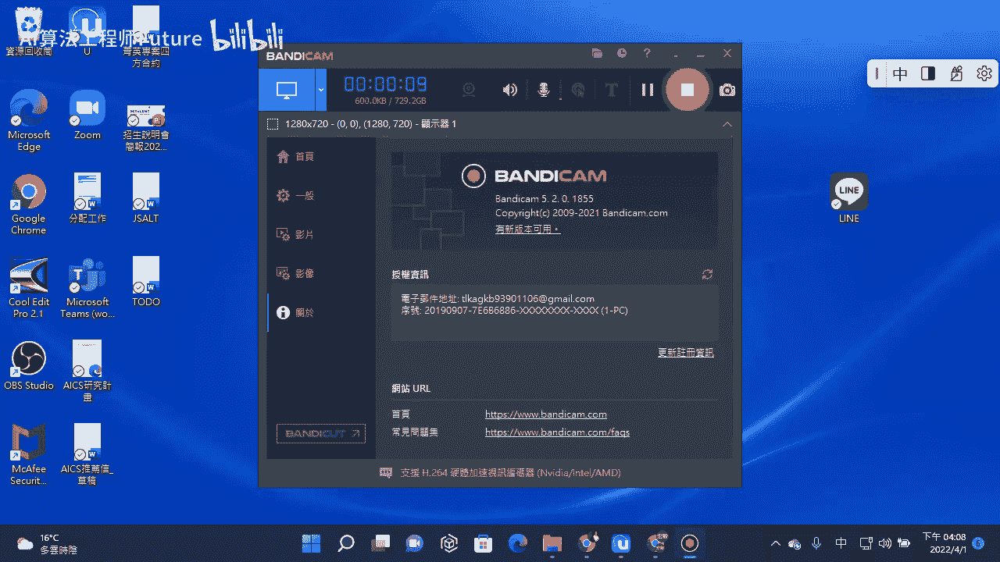

现在应该是有在录了哦，然后诶你要开这个吗。

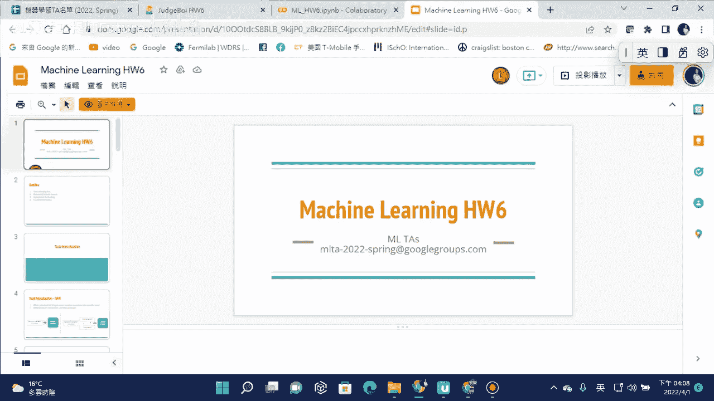

诶你要开这个，上个夜里好，然后，好那就等一下下吧，大伙切个下。

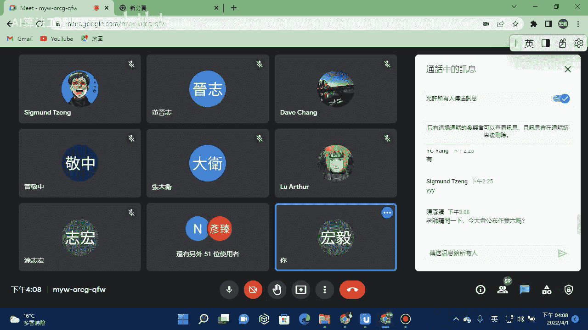

帮我在打火车可以下好啊，该是在录在录。

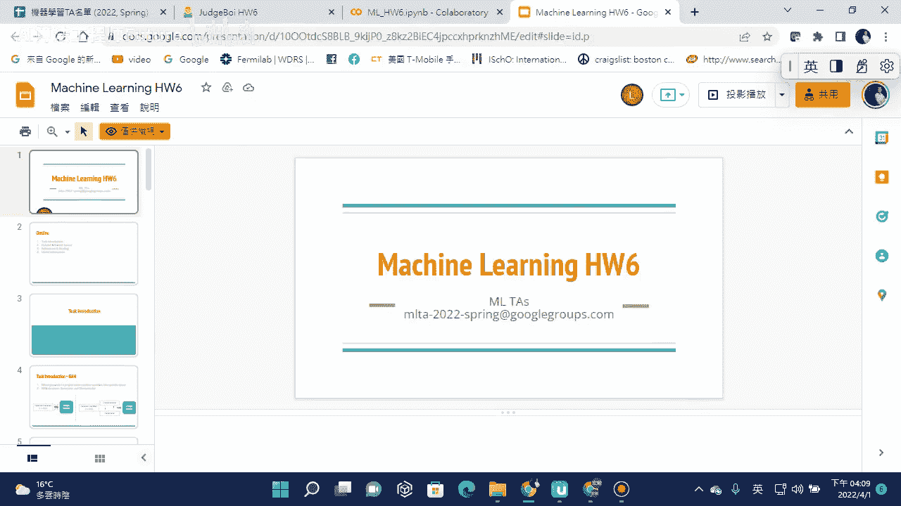

嗯嗯哼怎么有东西在跑。

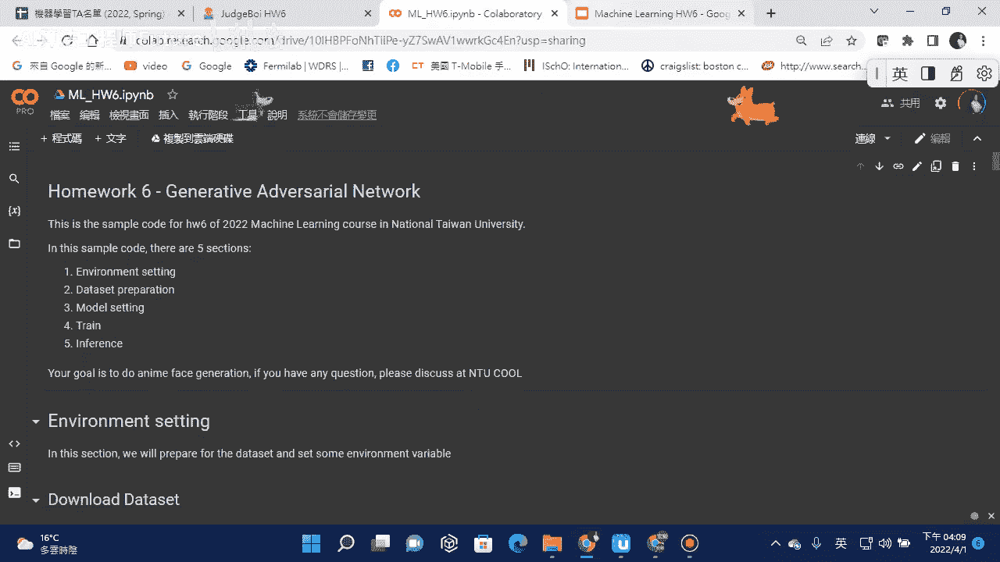

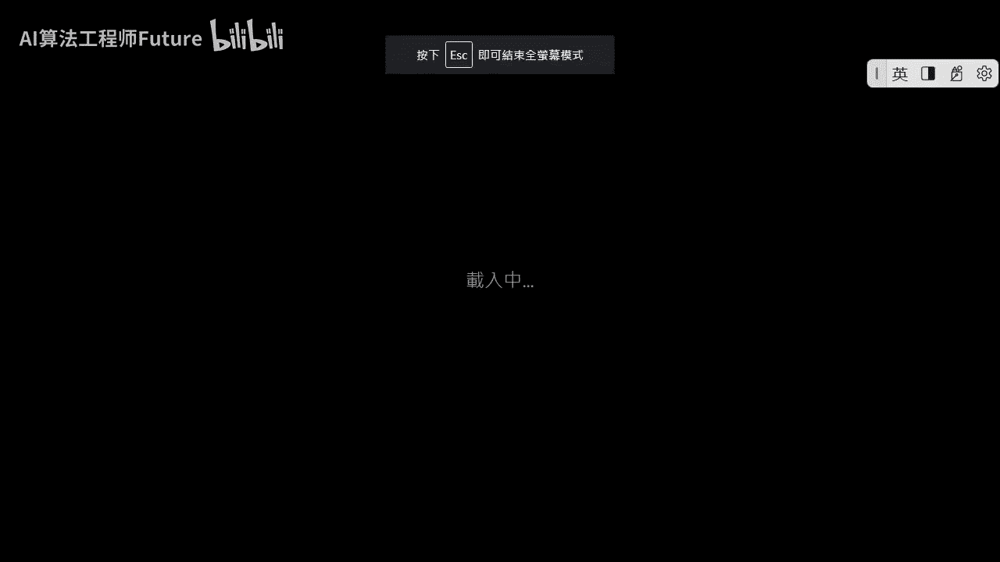

对我给你不要管，如果。

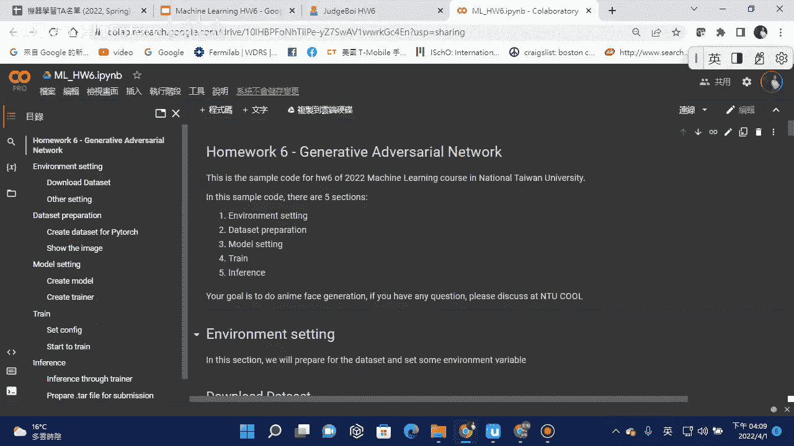

嗯可以可以可以对，然后那个也好，自动机叫你退后之后，我给我女找加入那个考拉control collaborator，OK好后再点进好，这个我再数一下，好意思，我晚上我晚上再跟你好，没问题哦。

嗯嗯我确认一下对吧。

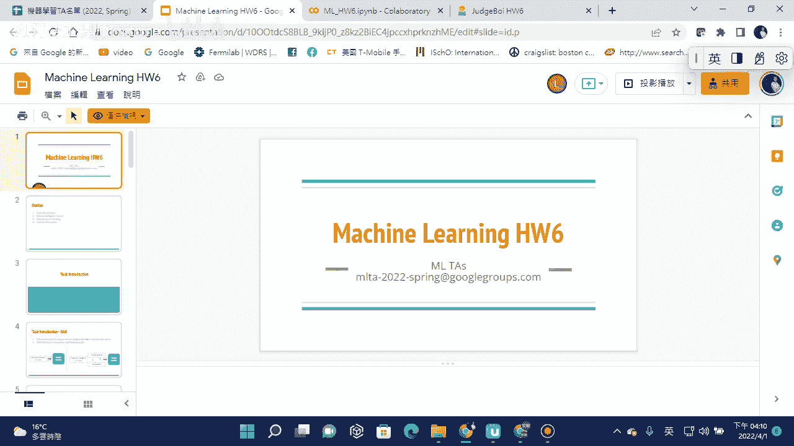

还有没有，那还没有分享一幕啊，分享一对嗯，按下分享这个哎这个再录一次，分享好，分享一幕了。

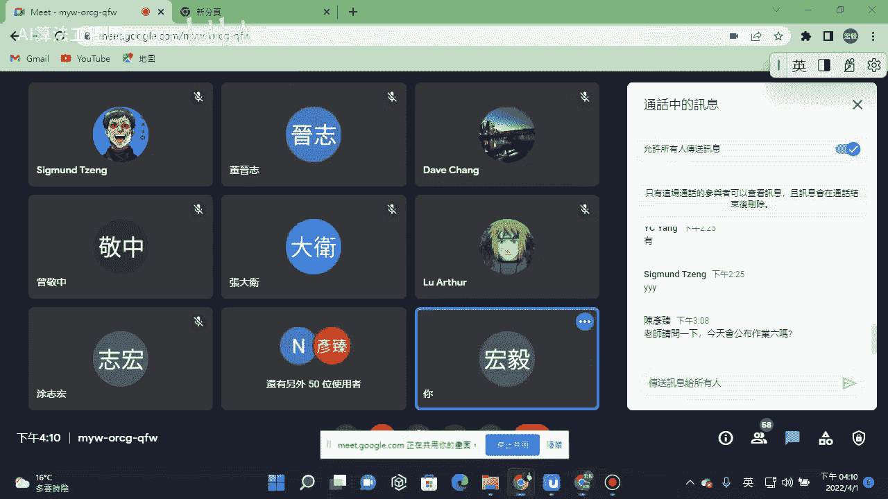

跟你情行干什么意，亲哥吧对，其实我觉得没差哦，第一其实我觉得regression，稍微其实讲一下就好了，因其实还好，大家都是自己看，但是好啊很好，他已经出发了，我不知道，其实我在想可以跟他讲不要买了。

但是如果他已经在路上，又告诉他怎来，完全，镜面有点距离，靠，4分钟骑机车八九请报好起了。

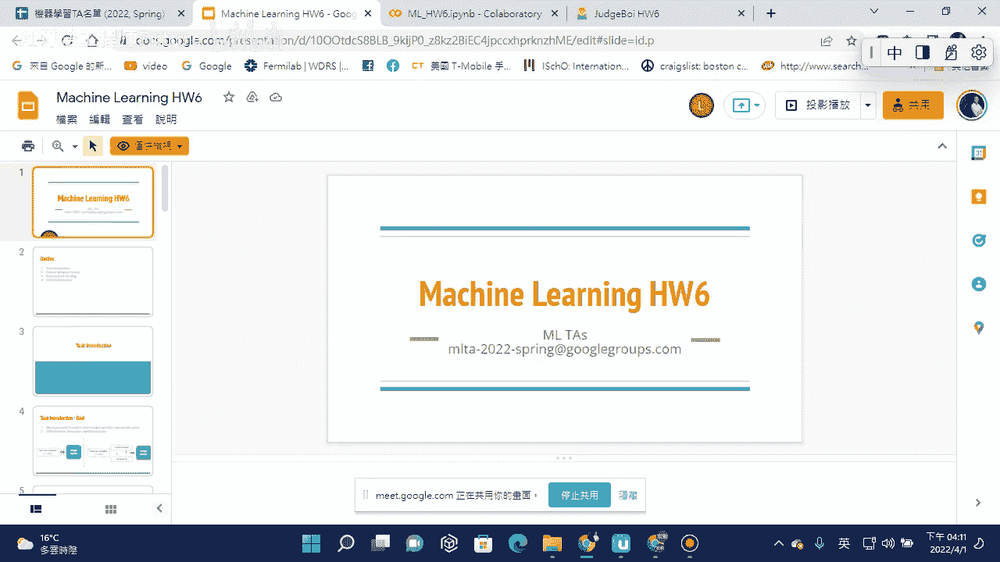

你可以你准备好就可以开始了，好线上的同学大家有听到哈，那我们准备开始了啊，喂喂好，大家好，我是王梅所说的冯希伦老师，负责这次攻啊作业六的主教，那今天就是要来讲解作业六好。

这是等一下的online之后会有四个部分，第一个会先介绍说，这次数约六究竟要做什么样的事情，在第二部分我会讲一下，这是所使用的DATASETS跟，以及我们要怎么样去做SAM好。

第三部分会讲说呃submission的规则跟规律规则，然后最后是有非常多实用的资讯，大家得特别注意一下这一块，而在test roduction部分，我们这个作业量是要做gay的这件事情，那gain啊。

像老师在啊，过去就可能有讲过很多类似东西，那我简单的概述一下，其实我们可以用个random variable，然后想用这个random variable去产生一些，它是影像之类的。

但我们并没有一个guy line，让这个winner variable怎么样去产生这个image，那这时候我们就有人提出一个呃架构，叫做game架构，那么就透过一个DISCRIMINOR。

一个generator，他们互相之间互相影响，那最后这个值的director就可以被引导到，可以output出一个啊我们人所看得懂的image这样子，那这就是所谓的game架构好。

那我们这次game的作业，要做的就是enemy face generation，那这个任务我input是一个random number，像是今年是2022，那我就input in202进去。

然后经过gain的架构，不管是DC game或者是打game等等东西，他最后up会出来那个anyway的那个影像，这样子，那我们这一次跟过去比较不一样，是我们有要求同学一定要实做三种game架构。

分别是bc game，WGAME跟w game gt对，看似有点多，但其实这三个差异都没有到很大，然后等下也会在这VO扣，带大家看一下究竟应该要怎么样去制作完成，好那讲完整体的任务的架构之后。

那来讲一下说我们要怎么样去做，对这个game做EVAUTION，因为game这个呃get这个模型架构本身是生成任务，这次任务我们很难有一个标准去评断说，你究竟生成的是不是好，除非我们有个人类好。

那我们这边game他的频段方式是用另外一种方式，就是我们拿了另外一个model叫做inception net，那我们就会把real的image，real image是像刚上面看到这张图片。

那还有一些fake image，fake image就是你generator所生成的图片，这样子都丢到这个inception net，那我们就会得到量子的feature，那这样我们就会算命。

Sender deviation，我再去看说这两个distribution啊，近不近，那我们我们所选用的distance是franchise distance，那我们希望这个指标越小越好。

代表说他跟啊实际的image的距离是很像的，那这是第一个指标，那也是同学在SAMDLBOSS时候，会遇到的一个指标，好在第二个词条部分，我们会有另外一个模型去detect。

你所撒密的1000张的影像之中有哪几张，他辨认得出是enemy的face这样子，那这就是一个ratio哦，那越低越好。

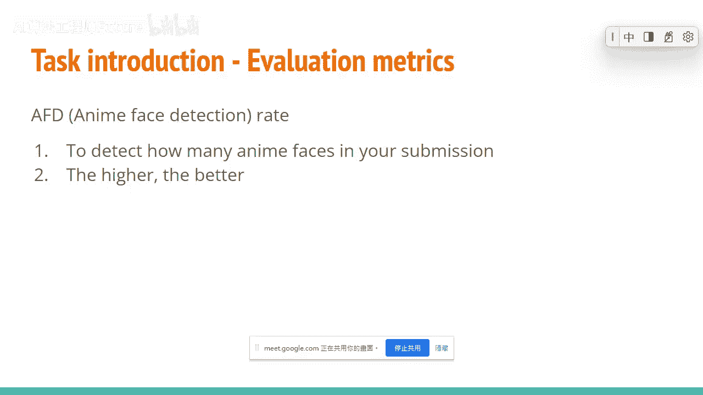

诶越高越好，好，那接下接下来讲一下说我们这次使用的DATASETS，跟一些submission的方式。

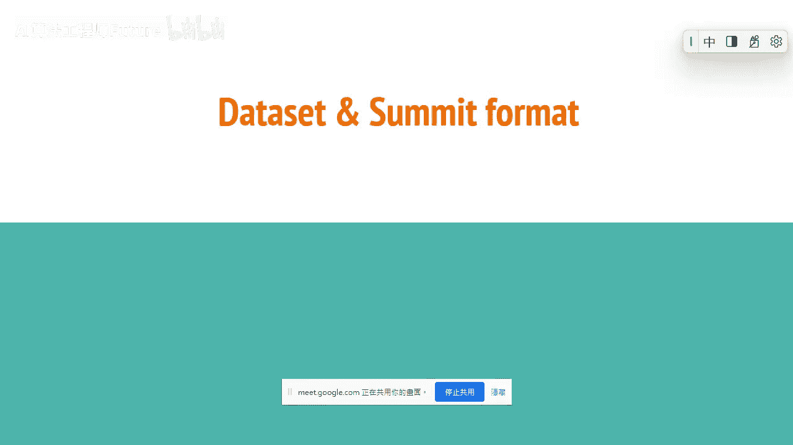

好这个DATASETS我们跟去年一样，也是用这个叫CRITCODE的DATASETS，那它是有它是有个网站，那在这个网站上它可以生成一些啊动漫的图像，这样子，那也感谢过去的学长帮我们扣类这个DCC。

他现在没办法很简单的就爬到相关DC这样子，那如果有兴趣也有附上我赛的link，大家可以去看一下他究竟在做什么事情，OK那我们这次提供的DATASET，是从上面所爬下来的DATASETS。

那DIASET的link已经在口类里面，等下也会带大家勾述一次，那这D是form美，大概长相右图这样子就是有一个啊，folder叫faith，那底下一共有7万1314张的图片，然后是照呃。

index是做编码的好，那这也是我们所使用的训练资料集，但是如果同学想要用一些额外的资料，例如你可能上网去抓一些呃动漫的图片啊，或是人的脸啊之类的，想要把generator真的更好的话，其实也是可以的。

但是你们要注意的是，如果你们要使用额外data话，请务必要保留这些data，然后因为我们可能会去啊，假设我们看到有人分数可能很高，类似这样子，我可能会去跟你讲说。

woman想要去看一下你用的哪一些额外点塔。

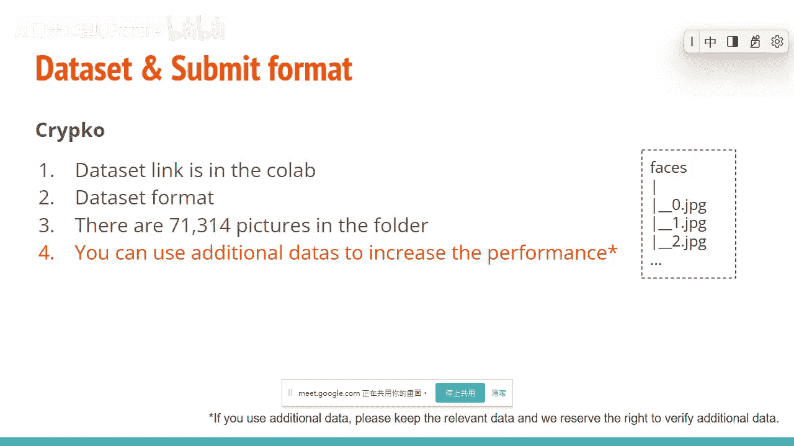

所以如果有使用的话，请务必保留。

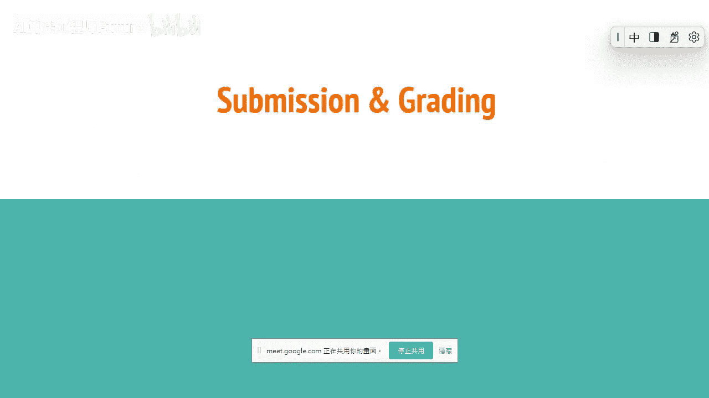

好再来讲一下submission的规定，好这次的任务是generator的任务吗，那我们一共会提供1000个呃随便的乱数，那你们就要去生成出1000张影像，那这1000张影像的命名方式就是根据呃。

第一个列所所阐明的，你有个number点JPG，那你的命名就是一点JPG到二点JPG都到1000点JPG，那这个也不用担心，因为这个在simple coo也有帮你都写好了，这样子好。

然后第二点是特别要注意的，特应该说特别容易犯错的，就是这一次我们角交的啊，image的话，你一定要用TAR这个指令，而不是zip这个指令去做压缩，那你压缩完之后，你可以跑出点TGC档案。

那压缩的方式就是像是下面有一个sample the script，也就是CD到image的folder里面，然后再下相关的指令这样子，那第二个要特呃要特别注意的点是。

你是要进到那个image的folder里面再去做压缩，再对1000张影像去做压缩，而不是把你原本的image folder去做压缩，这这这两个差别你会多一个，你在解压缩的过程中。

你会多一个呃folder这样子，那如果你直接把HODER压缩进去，那你在找教的时候你就会出现问题，那这个这两点是大家特别要注意的，第一个是用TAR这个指令，不要用zip，也不要用其他的。

那第二个就是你是CD到影像的folder里面，再去做压缩，这样好，然后呃，第六点就是说要确保里面只有1000张照片，不要有1000一张啊，或是怎么样的，因为这样都会不符合规定。

然会导致场面的时候会出现一些问题，好那接下来是一些关于啊神秘的啊josh board，因为我们这次使用的平台是josh board，应该是跟上次的作业是一样的，那也是类似的啊，规定当然是啊。

第一个规定就是说一天只杀兵五次，然后再来是啊，我们不会去限制那个呃request rate of for h IP，然后每每周五的六点到九点的时候，josh boys是不会运作，原来我们要每天这样子好。

那大家再帮我特别注意一下，这边关于josh boy的一些rose，这样子基本上应该是不会太啊，除了五啊五次闪避选以外，大家其实啊不用太呃，其实大家看一下就OK了，这样子好，那再来是关于这次神秘的一些呃。

OK然后再次关于这些的啊，刚才讲的那些规范包含啊，TGZ档案只能扫地命名啊，TGZ档案哦，并且这个档案要小于2米卡bx这样子，OK然后最后一点也是最重要的，就请不要直接从网络上找1000张影像。

结果先等六哦，这刚好家里过人好点，好哈喽，大家好，我是那个josh boy的助教boys，就是呃，其实大部分的规则跟之前homo five的规律是一样，不过有有一些特点。

我homo neo的room就写在这一页，那上面就有讲过，我们的档案的副档名一定要是TGZ，然后你的file size也要符合我们规范，不然就没办法安送出，那除了这个以外呢。

这次因为我们没有private的score，所以大家只能选择一个扫描选，然后你如果没选择的话，它deform会用你第一次上传的结果，作为我们的beer for的那个百句，那这个其实不是一个很合理的方式。

但是如果要改动的话，我们其实会需要做很多测试，因为可能会呃影响到其他功能，所以还是希望大家就是上传完以后，就去选择一下你最好的那个分数，那你如果真的忘记选了也没关系，这是我们之后都结束了以后。

你如果发现你忘记选了，你在即兴跟我们讲就好，我们都可以手动帮大家调整，因为这里没有公平性的问题嘛，反正他就是每一个画饼的分数在哪里，所以这就是希望大家可以的话，就是记得帮我们手动勾选一下，那如果再忘记。

也就不要担心在机器人跟我们讲就可以了，然后呃有另外一件事情，就是homo fight的时候，我们做variation其实不会用到GPU，然后它整体的value的速度是很快的。

但是这次的作业呢我们会用到GPU，而且还需要一点时间，那这会导致一个问题，就是我们大家按住啊，按下上传以后，其实我们很少有个request到我们的后端，那这个后端如果可以很很快会传结果的话。

其实我们的网站用起来会没什么问题，但是因为这次需要一般re的时间比较长，所以大家在使用上的时候，会有可能遇到一个问题，就是我们的那个进度条跑了很久，它就停住了，那停住你了解你继续等他就会讨好啊。

因为他有可能就永远停在那边，那就是因为我们那个进度条其实是骗人的，就是对，就是那个进度条集，根本不知道后端到底跑还几啊，他就只是只是跑跑身体健康，就让大大概看一下我们东西有在跑而已，但是当然之后会改掉。

不过今年来不及改，所以这边提醒大家都是，其实你按下送出以后，你只要看到进度条开始跑，你完全可以重新整理，然后你就过一段时间再回去看，说你的那个submission有没有被记录在，就是你上传的资讯里面了。

那如果没有的话，很有可能就是有一些问题，可能有些错误，那如果有错误的话，你可能就下次再上传一样东西，然后再等一段时间，理论上有错误很快就会跑出来，他就会告诉你说你的错误信息是什么，那如果没有错误的话。

理论上就是你过个12分钟，23分钟以后，你就可以在my my commission，那个地方看到你自己上传的结果，那如果大家有因为这个重新整理啊，导致你不小心连续两次上传到一样的结果，你可以继续跟我讲。

我会再帮你调整你的波浪，那也不要骗我，因为我会把大家上传的东西存起来，所以如果其实两次传的东西不一样的话，我也会知道对，然后因为这种东西，我不可能一直守在信箱前面去看，说大家有没有记性过来嘛。

所以这个可能会需要一些处理的时间，所以大家也也要希望借着这个规范，来钻一些漏洞，想要多存几次，那关于通过六要注意特别注意的事情，大概就是这个样子啊，好那我们继续讲解submission和分数的相关事项。

那这次分数的四项一共有分成三项，第一项是第六波的分数，一共占四和S，那在cos Mission的部分，一样是扫描到ntu CORE的网站一样啊，质量本身，而report话则是扫描到RESGO。

一共加四个线，好，然后这是这一次标一下哦，就是这一次神秘的呃，四个base line都分simple medium shot跟boss，然后以及刚才提前面提到的。

fid score跟a s d rates，那大家可以看一下，这是总共有四个标准，那这个四个标准总共呃，大概大致上要怎么样达到呢，如果你要达到simple备赛的话。

其实你只要用simple code的话，大概就可以达到了，然后你所需时间应该是小于一小时，应该就可以很轻松达到，然后至于medium跟strong的话，你则需要去跟动到wk跟w get gt。

但实际上因为在report内容，你一定会需要使用到WB和WBGP，所以其实你们同时应该也会做到strong feli，那至于boss base line的话。

仅仅只要用一个模型叫做啊style game，你可以去设呃，大家可以去设置一下，就是这是什么样的东西，并且去把它呃实做出来，那应该就可以顺利的通过boss stage来好。

那至于你要怎么样上传到ntu CORE，也跟过去的作业一样，你只要有student id dash h通work，六点Z上传就OK了，然后daylight是跟呃lead box也是一样的。

那这也是比较重要的reports的两个问题哎，一共呃，第一个问题是请大家描述一下表，game跟game这两个模型，有这两个架构有什么样的差异，并且去呃列出两个最主要的差异点，这样子。

那基本上大家不管是老师投影片啊，或者是paper这边有布写reference paper，大家都可以去稍微找一下，然后并且列出两个大家觉得OK的，you fri是这样子，那第二个是大家一定要做的。

而且大家做这个时候同时会接触到WGET，get到get gp，就是在这个report question，那这个问题就是说，请你画出w game跟咱们GGP的grade non的结果好。

那我具体来讲一下大致上要做什么事情，第一件事情是因为我们有train diasets嘛，刚才那个7万3000的那个base的DIASETS，那我们同时也有一个discriminator。

在sil cod里面，那它是呃四层layer的discriminator好，那希望大家就可以用这个setting，或者是你要把discriminator再加个C也是可以的，好。

那我们希望大家可以画出两条线，那这两条线第一条线是for wgame，因为WGAME是做呃最传统的DK制作，Wake clipp，让大家把WACLIP所产出的gradient。

note的这个结果画成一条线出来，给啊给放到铝扣上面，但第二个是做gradient penalty的时候，微踩出的那条线，这样子，那具体的图会长什么样子呢，其实就跟右图一样，哎其实跟右图一样。

那X轴是discriminator的layer number，Y轴是gradient nb的数值的大小，那你啊希望大家可以取log啊，那取log之后会比较好去做观察这样子。

那这是从paper上面截下来的图，大家可以看一下，理论上你们所出来的图片大概会长什么样子，那我们这次只是要求大家画两个模型，然后并且最低要四层DISCRIMINOR的layer，这样子。

那report的submission对拉也是4月22，好再就是一些regression的部分，但是不能cheating，然后以及你不能直接把animate的影像，直接上传到liner board里面。

然后以及我们啊能保留最后的解释权项。

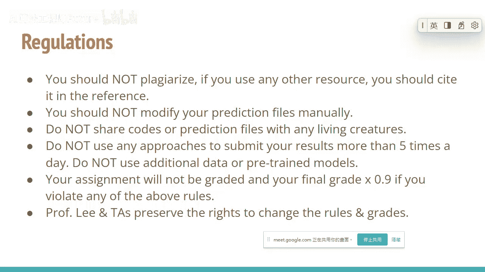

好再来讲一下，反对大家会蛮实用的。

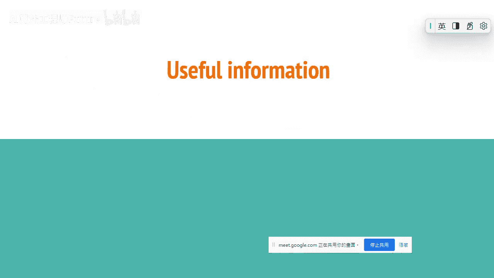

Useful information，这样子好，第一个部分是啊DC game，那这个DC game啊，其实老师在课堂上也有讲过很多次了，那反正就是你有个JACER跟DISCRIMINOR。

他们都是用CNN structure去构建的，那generator做的事情，就是把一个random variable变成一个影像，那只是个matter，就是根据这个影像去判别他是fake real。

并且把这个结果回传到generator的loss，让他去做一个啊训练，这样子好，接下来就是大家一定会实做的w game跟W跟GP，那在w game部分，其实虽然说论文上或者是讲解上感觉有点难。

但它实际上在code的INTEMAN，其实大概只要做四个修正就好了，那这四个我就列在这边，那第一个就是把DIPLOMATOR的最后一层的SMOE，layer给移除了。

然后再就是呃你算log lost的时候，不要算log类似这些规则，那等一下在simple code里面，大家也可以看到，我有稍微做些notice，大家可以注意一下，那在w game gp的话。

其实它是继承制w game，那它其实只要多一个function，像是gradient penalty及再修正一些w get，小小的地方。

把wake tripping设置成green penalty就可以了，那我底下都有附两个link，这两个link其实就是网络上，大家在啊，在KEHO上面一个可能快1000多颗星的啊。

DGAME跟up again gp的PYTORCH的1COMMEDICATION，所以大家如果没有idea的话，也可以直接看，那直接看的话可能就比较好去理解，说他到底要哪边要去做修改，这样好。

最后一个最useful information，那这个是style game，那style game跟前面模型不一样的地方，就是他是先把一个random variable。

通过很多层的three four network，然后到transform到一个比较大的space，是我们把它称为W，然后再generator在做a convolution layer时候，他把这个。

他这个W会不断在各个block里面去做安插，这样子，那他的paper的原意是希望透过这个安插的过程，把resolution也可以处理不同的resolution，那这边有一个非常好的link。

这个真的是非常好的link，那大家可以点进去看一下这个非常好的link，因为真的很不错，这样对对这个对嗯好好，然后再来一次呃，simple code的大家啊，等下我会带大家走一下整个call的过程。

这样子好哎，到目前为止大家有什么问题吗，好啊，大家有哎，线上的同学有问题就在那个聊天室打字哦，哦你可以举手好，如果大家没有问题就继续咯，好那继续啦，哎来来这边来诶，你再一找，哎同学报纸贴在手机。

我just for，有连接让我们发动，会直接放在，然后开口就扣好的，然后我们，这样子他们会听话，应该听不太懂好，那么诶发现一情歌来前面讲的，好刚刚那个同学的问题是说。

那投影片没有卡口和那个job boy的连接好，关于chara boy的，我们基本上在boy点点不会放在A影片里面，因为我们没有打算要公开给所有人，一直有说过，他可能有点脆弱。

就尽量减少一些他被攻击的机会，然后我们将会有连接呢，就是放在NQU库上的首页，就是之前大家怎么找到four five的链接，应该就可以用同样方法找到OVERSIX，那关于卡狗，刚刚呃。

诶子棋该是说可以直接把那个扣放到CP上面，就可以扣，那自己分泵，不要自己跟弄，自己要自己改一下，就就是把call net1级上去对，也就是就是如果需要用开口去跑那个扣的话，要麻烦大家自己把所谓啊。

COLAB的co做一些migration，把它移到IP上面应该就可以了。

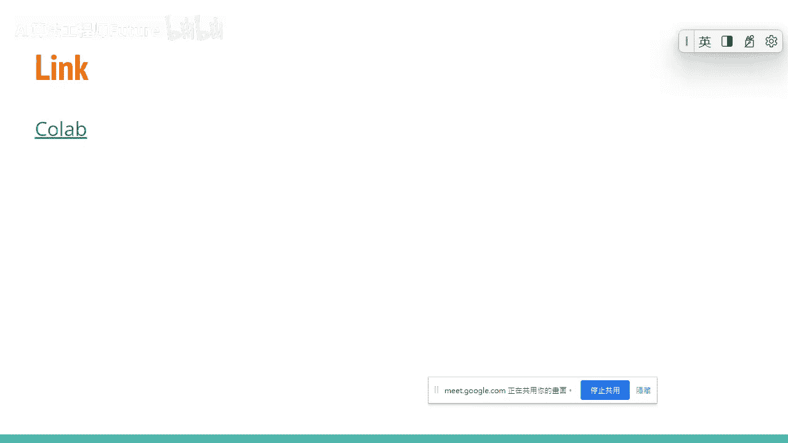

其实可以按隐藏诶，你要按右这里这里这里，好然后我们接下来来勾出一次这次的sample code，那这次sample code主要分为五大区块，第一个就是environment setting。

那就是包含DOWNLODATASET的一些SCP，然后跟一些呃C那个种子的设定这样子，那第二个的部分是如何去构建PYTORCH，dir cs for这个homework6，那我会建议说这前两个都不要动。

这样子好，而第三点是model setting好，包含你怎么去建构DISCRIMINOR跟generator，跟一些啊ways的东西，那第四点是实际上的training code。

那这次training code我是使用一个呃，我是直接把它包成一个很大的trainer，那为什么要这样子做呢，因为等到大家实际上，把这call给移到自己的本机端，用这个china去训练或者去做修改。

会觉得比较方便一点，那然后以后再做一下讲解，然后最后的一个部分就是你要如何去做inference，以及如何得到一个可以SAM的PGZ档案好，那大家可以稍微瞄一下左手边的这个档案的structure。

那大致上就如我刚才前面所述。

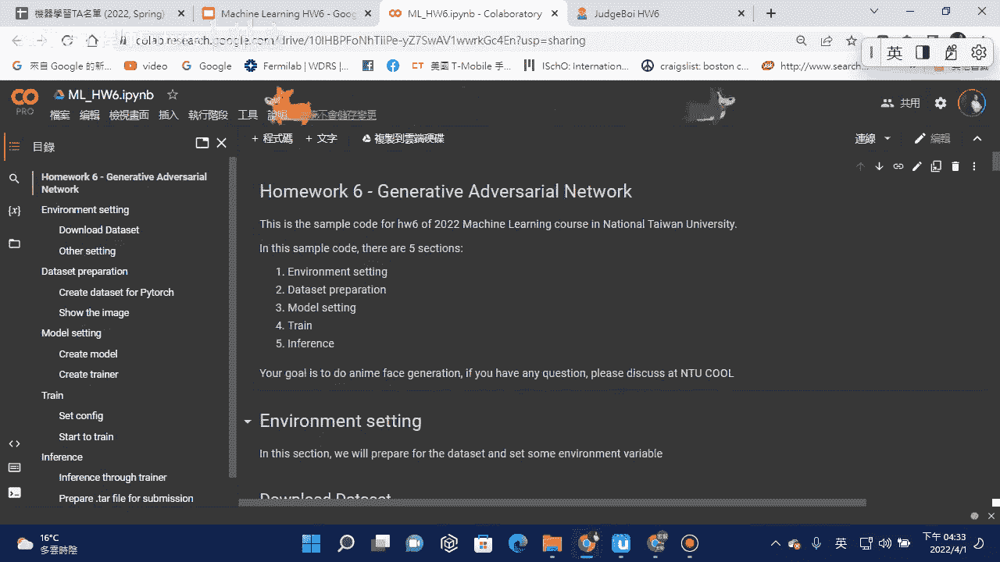

好在第一个部分是environment setting，那在environment setting话呃。

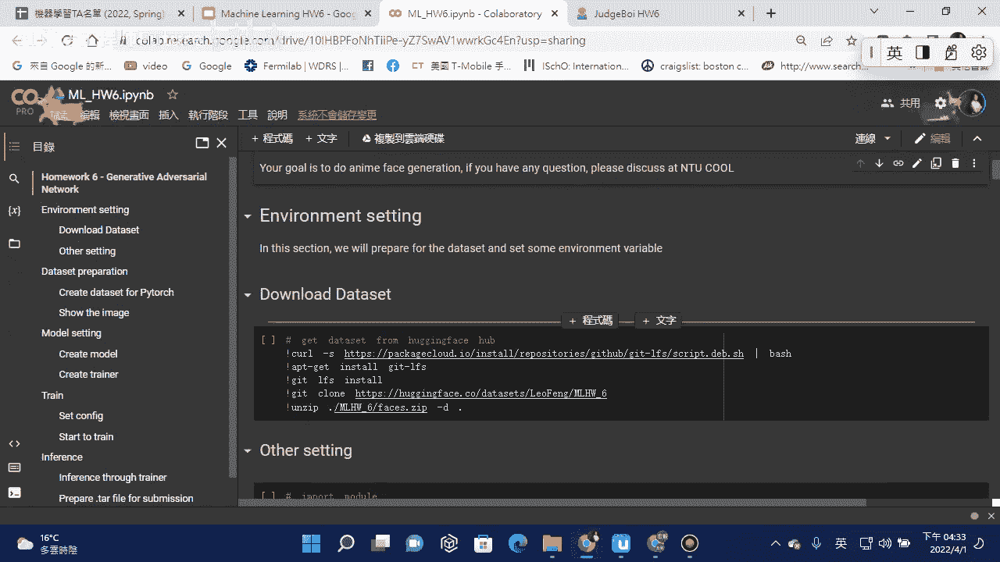

这个这个cos section是for啊，Double dr sex，因为我这次的dr sex放在having in face，的dr the hub里面，这样子，那大家反正就下这些指令。

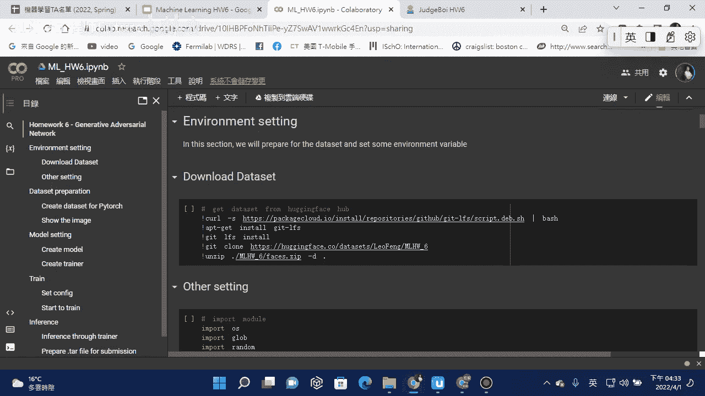

就可以得到DRZ这样子，那他会解压时在uh walk in the nuh work，the nurse scenery的那个地点，这样子好，然后在一些其他设定包含。

你去import1些我们所需要的module，然后以及一些seed的设定，这样子好。

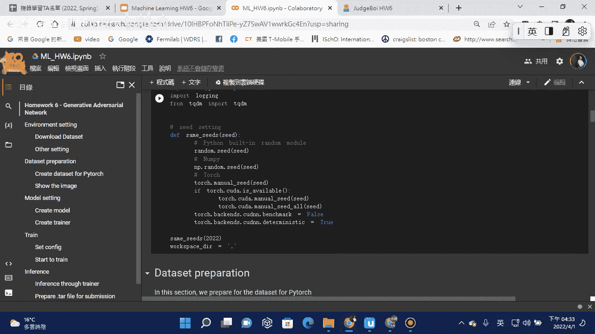

这基本上都不太需要动刀啊，好那再来是data set的preparation，那这个就是去创建一个呃PYTORCH的DATASETS。

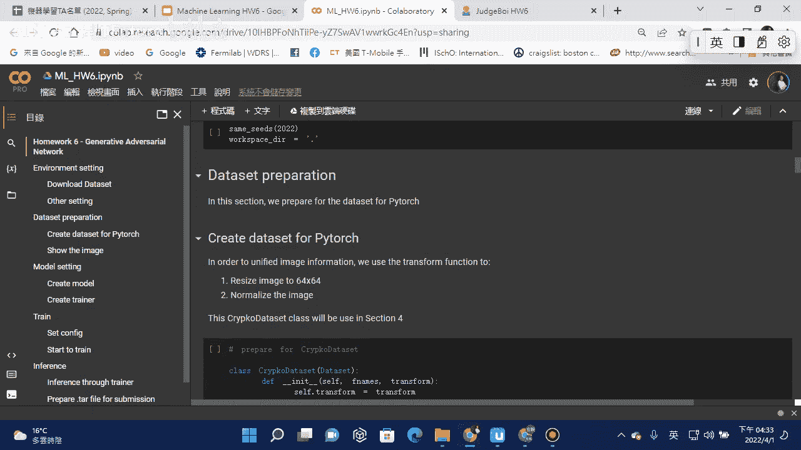

The chess，然后让大家可以比较好，顺利的把DIRSE弄到model里面，那我也会建议说这个东西其实不太需要动好啊，这就是critical datasets，然后以及get the set部分哦。

如果你真的想要尝试去做一些修改的话，我会建议在这个get set的co compose的这边，你可以多一些transform功能，你可以把影像去转成一些可像BARY啊，还是转成不一样的形式。

你可以去试试看，看这样子的效果有没有比较好好。

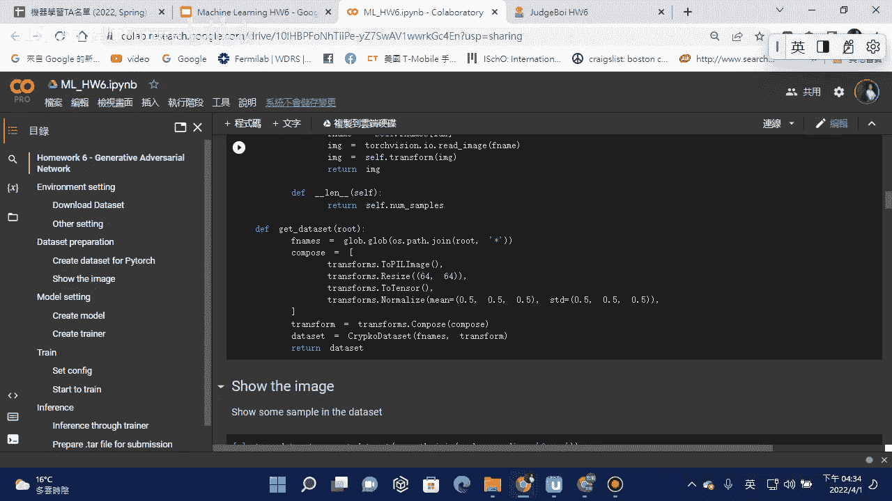

那也可以看到是啊，这是我们这次dr set里面用的image。

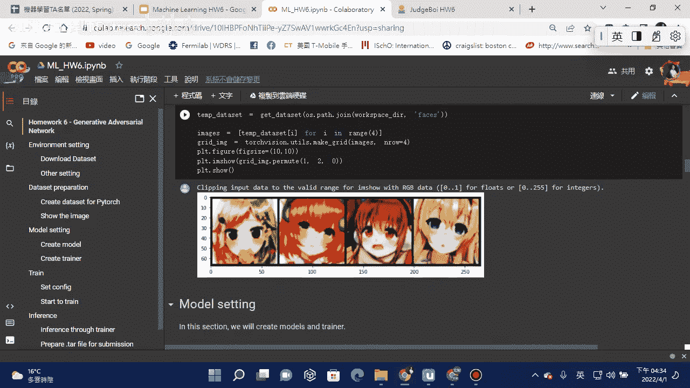

也是给大家看一下好，那接下来进入到第三个阶段，也就是我们设定model部分，那第一个model是generator，那第二个model是discriminator，然后我这边都有。

先标明说你的input shaft大概是多少，你的output shaft应该是多少，大家可以稍微去看一下吧，大概知道说呃如何debug两只，如果自己再重新设计的时候，如何debug好，那我这边会有。

而DISCRIMINOR也是类似的架构，那这边你可以发现说有时候会出现这种东西，叫做not，那这个note是什么东西，因为我们这次除了DC gay以外，我们因为report关系。

report第二题的关系，我们一定会使出WGAME跟w gag t，那这个notes就是让大家知道说哎，这边可能要做些修改，它才变得game，或者边要做些修改，它才变的get g t。

那这个note等一下也会充斥在底下的code里面，那在修改的时候可以注意一下，这边你们可能会更好的更快速的就把call改完，然后并且去跑report的时间，这样子，当然你们也可以不要管这些notes。

你就直接看刚刚我给的那些link的source code，直接去做修改，可因为理论上你应该改不超过20行，就可以达到这两个的标准，这样好，然后这也是这里CREMATOR，因为是ECK嘛。

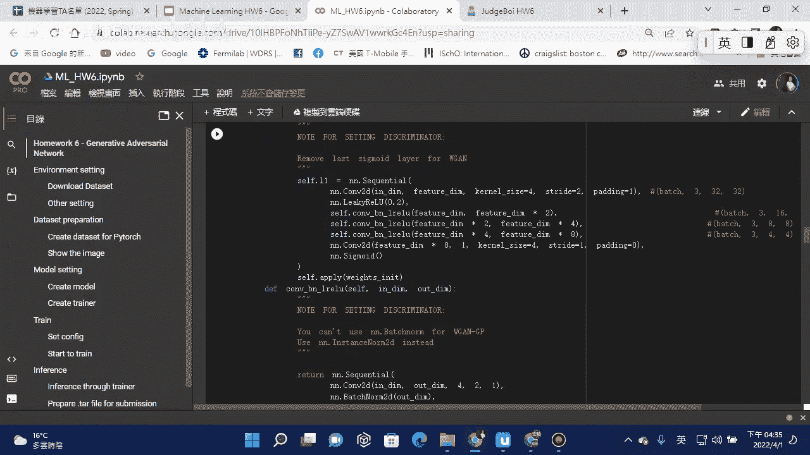

就CREMATOR也是很多的convolution所组成的好。

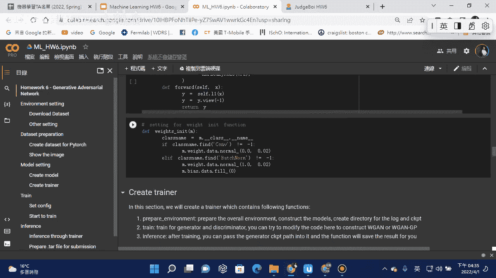

而这个位置in is，那这个我觉得啊不一定要这么刀，这样就是一开始的JING这样好。

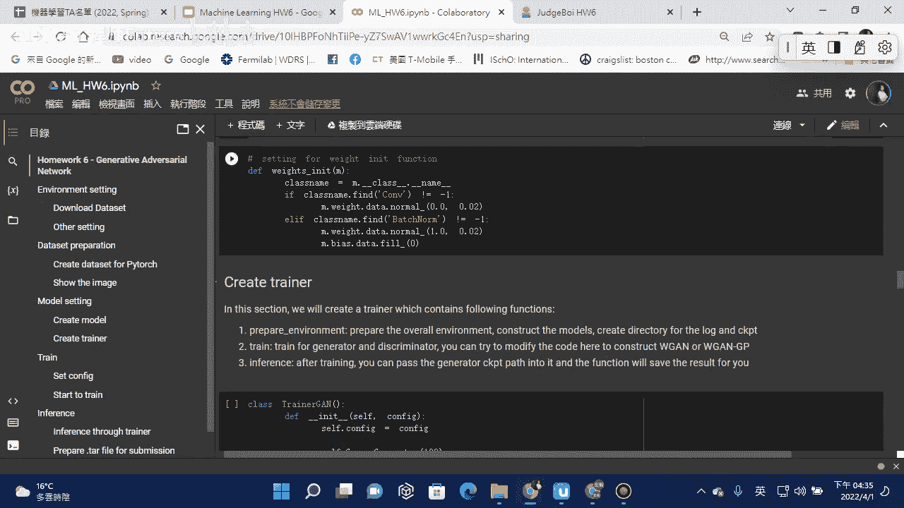

那再来的部分就是关于china的这个class，那这个class一共有三个啊，主要的function，那第一个是prepare environment。

那这个FRAINVIRONMENT是因为我把前面的generator，discriminator diais全部都包在这个function里面，所以你只要下了这个方式，你就会把前面的东西都准备好。

你就不用一个一呃，你还是要前面先把这cs给构筑好不好，但是你自己把这些code给移植到，你自己本地端的时候，你就会比较方便，就知道说这个方程就可以直接把它构建好好，再来是train。

就是顾名思义就是叫这个trainer，因为china是一个，你可以把它想象成一个管家的东西，只是叫他帮你做训练这样子。

然后这个china也有叫一个叫inference的一个function inference，就是可以产出，你可以直接扫密到啊，josh boy的结果这样好，那我们稍微go through一下。

那在一开始china game的地方，你只要把一个configure，你你在宣告这个开始的时候，你只要把CONFIG丢进去，那它就自动的帮你把一些generator，discriminator等下。

这全部都帮你建好啊，等到CONFIG在底下，等下会带大家看一下好，那建好之后，然后就有啊这个prepare environment，就如刚才所所讲，你会他会把一些你所需要的东西弄好。

因为我这次呃除了最后要伞面选的TGC档案，那同时也会产生出两个呃档案夹，分别是log跟checkpoints，那这个logo跟checkpoints log就是让你随时去观察，说你现在欠的情况怎么样。

如果你看到那个人的脸都烂烂的，代表说你可能要再努力一点，那如果是很好的话，那你就可以觉得哎感觉可以撒密这样子，那可以透过这个logo directionary去看一下。

这样那check point的话就是应该在inference的时候，我们需要把一个checkpoint in给输入进去，让这个模型知道说，你现在是要用哪个CHERPOINT去做inference。

那我这边啊也有直接帮大家把这个direction写好，所以你只要去找他，你找一个你想要的，就把它丢进去就可以了，然后这个GP这个方程是大家要自己写的，就是gradient penalty。

也就是WGGP的一个核心的防线，那至于你要怎么写，你可以直接看论文，你也直接可以看，刚刚那个link应该就很轻松就可以拿到，然后再是train的部分，好，那缺的部分。

因为啊gay架构之间train discriminator，或者在先change in generator，然后两个互相截抗嘛，那可能是我1train3次。

these roomto的train一次generator，类似这样架构，那这个就是靠有一个参数叫做n critic，我啊也写在CONFIG里面预做控制，那如果大家想要去做调整的话，也一样。

直接在CONFIG里面去做调整，就可以达到我刚才前面讲的效果，这样好，那这边一样也会有一些note，那这个notes呃，大家可以看一下，这个note就是如何去设计exo matter的note。

那因为一共有三个模型啊，分别是game，然后game，那分别就是用recreation的方式跟gradient，priority的方式，大家可以稍微去关注一下，这些notes到底在做什么事情好。

然后这是change the writer的部分，然后这个china在train的时候，因为同样也是为了方便，那他会把一些他在劝每称完每一个AIRPOD，或称完每三个a pop kt设定的时候。

他就output出一些image，直接在jupter notebook out出一些image，那可以让大家看一下，说你目前train的结果是怎么样子，这有两个来源，第一个是你可以从log档案去看。

说你目前确认结果怎么样，另外一个来源是你可以在这边note直接看，说你欠的结果是什么样子对，但如果你你后来用本机端，然后你不是用呃jp note，可以建议你直接把它删掉。

或是你直接加个if else的statement去把它做做，做一些呃，更改，这样好，那再来是influence部分，influence部分基本上呃不要动到安generate。

number of就是rise，因为一共是1000笔，因为我们最后就少了1000币这样子，然后后面这这两个也都不，我觉得是不太需要怎么照这样子。

那你只要把uh generator的pass the checkpoint。

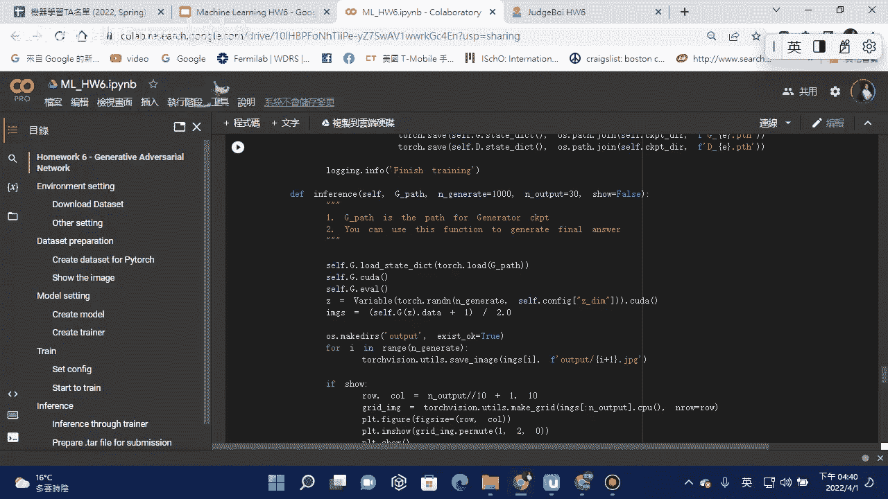

the path放进去就好了好好。

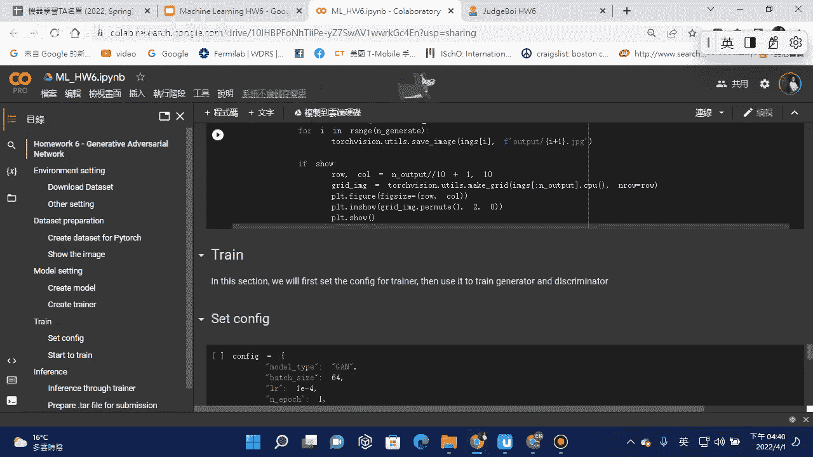

然后这大概是china的部分好，那再来，其实大家如果想要呃，如果在还没有modify chinder部的部分的情况之下，可以先试着调看CONFIG这个地方，因为这啊刚刚去宣告一个china之前。

我们其实是把CONFIG丢进去的，那CONFIG这件事在做什么，就是据宣告说诶我的learning ray要用多少的，EPOC要用多少的啊，discriminator跟generator个数要用几个。

像是先串三次discriminator，再change一次generator，类似这样子，那这个都已经写好了，那大家比较要注意的就是这个n critic，这是我刚才讲的change。

几次DISCRIMINOR的change in几次generator，如果我设三，就是三次给SCATOR，再一次ERATOR，这个大家可以特别注意一下。

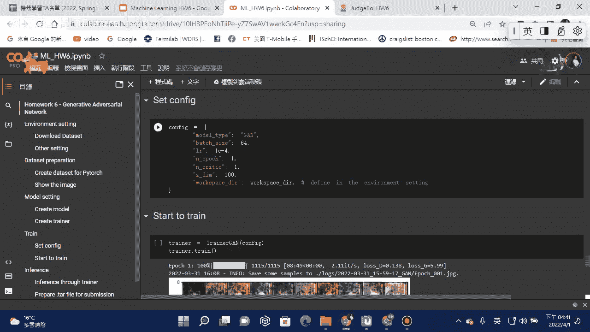

然后batch size啊，林锐这个应该比较常见，这样子，然后自己dimension，大家可以去做调整。

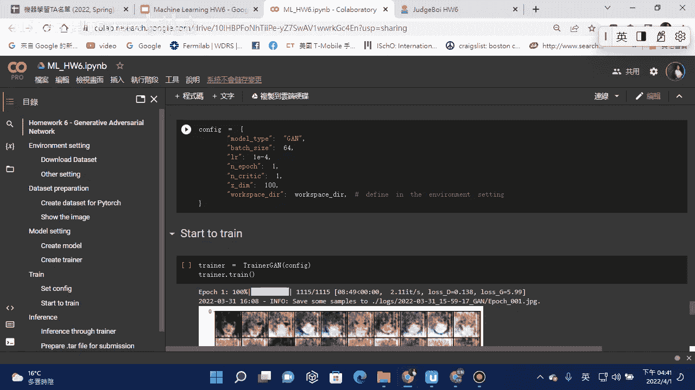

反正可以试试看，这样子好。

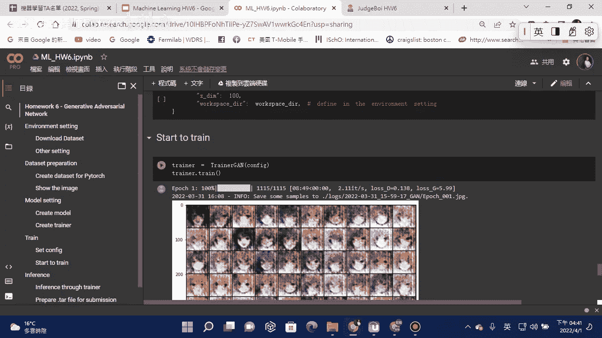

OK那实际上开始train的结果会长的像什么样子，一开始就是宣告一个china嘛，trainer等于traina game好fig，然后再下那个方形就可以开始train了。

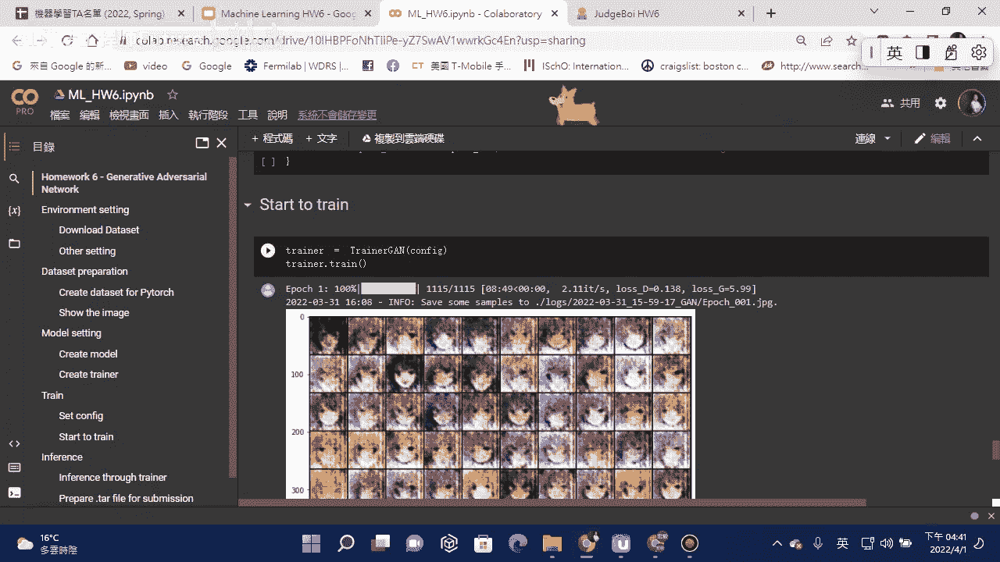

这样那那这个train结果它在每一个EPOX时候，它都会跑出这个图片，然后他也会跟你讲说，你到底把你的log呃存到哪个档案这样子，那目前因为呃我存档案的设计是这样子，会根据你的日期去新建一个子档案。

那大家可以较好去测一次，你到底今天有没有在做事，这样子好，那最后是influence部分，inference的话，就如这条扣所写，那你就把你的check point，然后你是什么时候训练的。

以及你要用哪一个AIRPOD，那这个g dash0就是我使用第零额，第一个AIRPOP的track point去放到这个china里面，那inference就会自动帮你把其他事情做好。

那你就会得到一个啊档案夹，那个档案夹叫做output output，里面就是所有也会有1000张照片这样子，那最后你只要CD进这个outputs，然后下去TT的指令。

那你就会拿到那个啊t g z file，那就可以直接神秘到你的george board system。

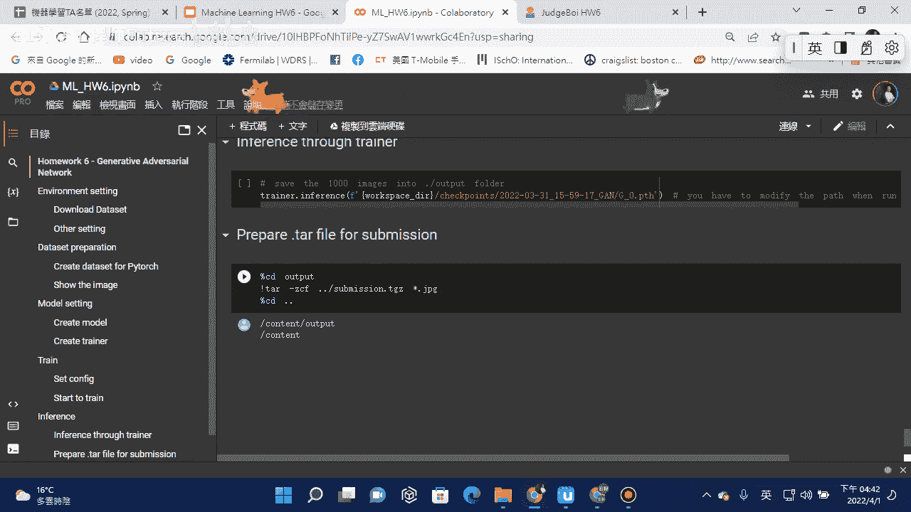

这样子好，大致是这样子这样，所以我会建议说如果你们在用这个simple code的话。

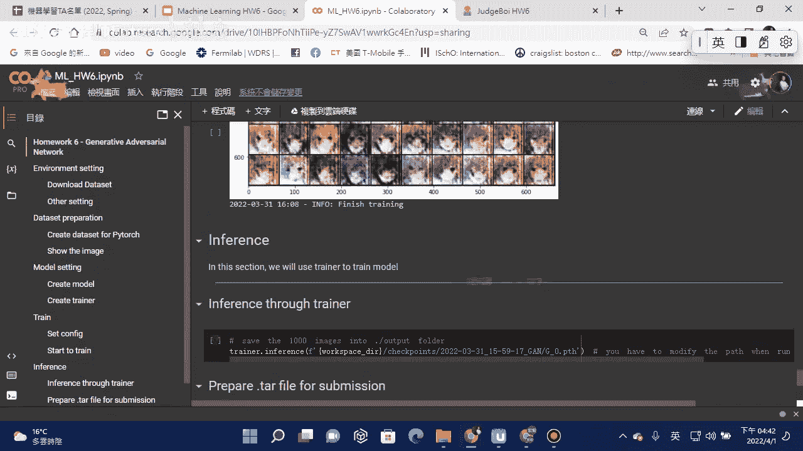

可以先试着玩一下这个CONFIG，看一下说到底有什么样的结果，然后先赏密到啊，George boy，现在小米一次先通过C啊，Base line，然后再看一下刚刚那几个很有用的，又是for link。

然后看一下，然后去改一下，应该就可以通过boss space line。

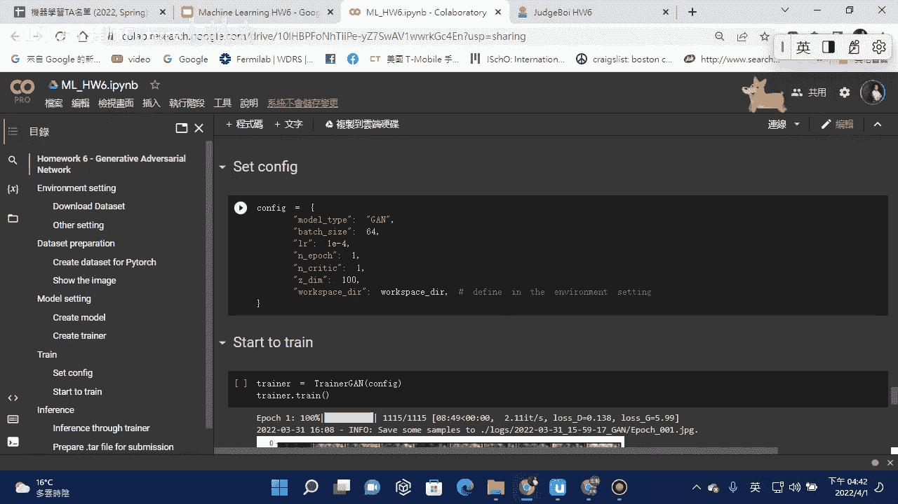

这样好，大致上是这样，我想问一下大家有什么样的问题吗，呃主管刚刚说他MVC的一起推荐啊，如果我这算低点半，然后再夸他，他说什，Oh uh，他，其实你在啊，我我在同学，意思是指说会不会说我每存一次。

就是新增一个答案，假是这个意思吗，因为我我这边哦，我稍微讲一下我这个是怎么设计的，反正你现在有一个log的资料夹，那你再按一下enter china，点train enter，那个瞬间。

它就会自动帮你根据现在一起，在log以下的log底下再建一个资料夹，是今天日期，那这个今天日期底下你有你的各个啊checkpoint，你的各个你所需要资讯，这样子就只是为了大方便，所以你其实组合一个。

所以就算你跨日，你只要你按的那当天组合一个而已，对对对，就这样嗯，好哎，你就是想要问你为什么是是因为经验法之类，exclude ental train的，其实不是这样交互对。

因为呃一开始的时候可能会整个热度会比较强，然后第四个位置比较弱，所以我们可能会采用3D1G，如果比较谨慎的话，这样的策略去做训练，这样子对，所以会通常的会所谓的trip的这。

对当然你也可以适当看JA的成本，做3D，我我自己都知道用那会随着训练多一些呃，也可以这样做，但我觉得可以看出目前他们都是，那如果你觉得诶好像两个势均力敌了，那就一定等等都中间都给不到。

那那有没有人就是就是在做这种调整时候，现有方法通常是扔回去感，我还是有一些呃可以写成程式的方法呃，我猜后者，因为我现我自己不太确定有没有相关的投币，但是如果真的要做的话，我觉得可以看那个lost。

因为我在训练时，导师都会把lost引出来，你可以get到lost的大小，那如果说你觉得诶好像两个呃差不多累了呢，可以再去把那个单可以去做调整，减一啊，加一啊之类的都可以，那你就可以达到好像伊辛格所说的。

去做单位可调整好理解，好诶，大家还有问题要问吗，我们看看线上有没有同学有问题的好。

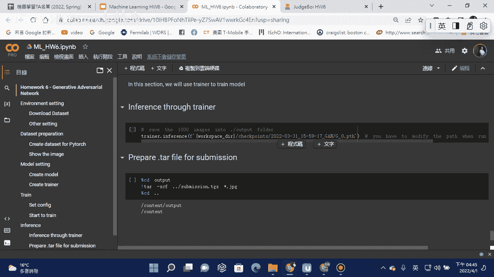

线上有一些问题，八成又不会，你好，我回复一下陈彦真同学的问题，我自己在测试的时候是会遇到这样子，因为这个用到的是，因为这个一共也才7万1000这样子图片，所以在REQUIT的时候。

我觉得是没有到很吃CPU，就还好这样子，好还有同学有问题吗，前面是刚才留下来的好，大家有问题可以啊，不管是你在这个线下还是线上，你都可以举手哦，懂吗好没有的话，我们就谢谢那个启轮跟一起两位助教。

谢谢老师，好如果大家没有更进一步问题的话，那其实就下课了，然后我看这个其他座位的助教有来，这样大家可以趁机问一下问题，好，那我就下课了，我们就下课啦。

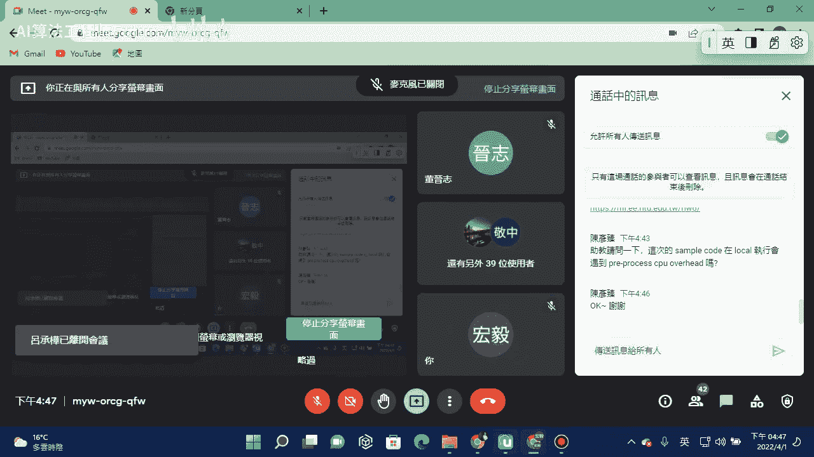

诶老师，我直接把结束录音吗，哦我就结束录音了。