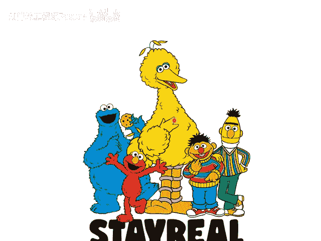
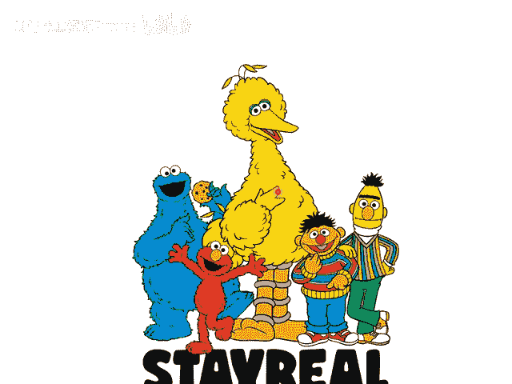
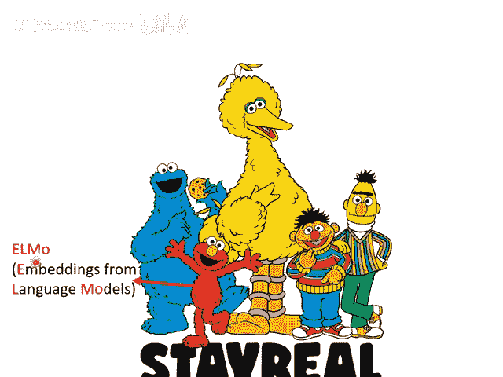
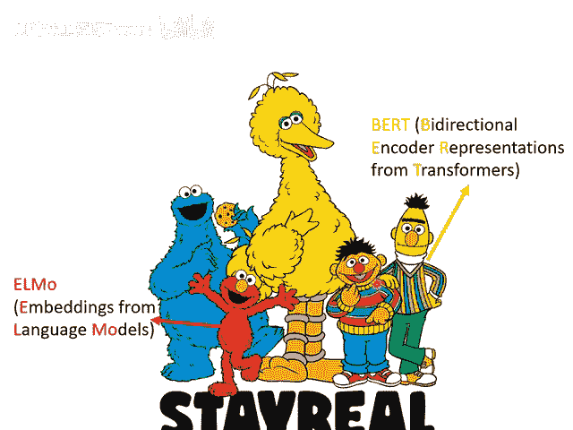
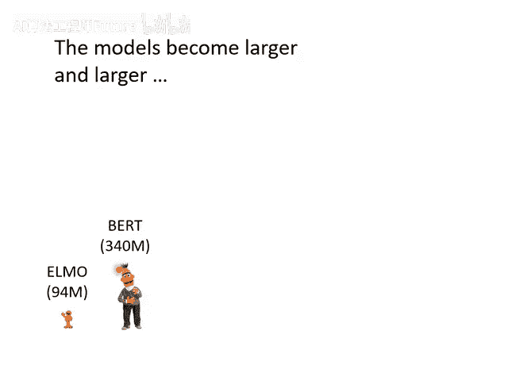
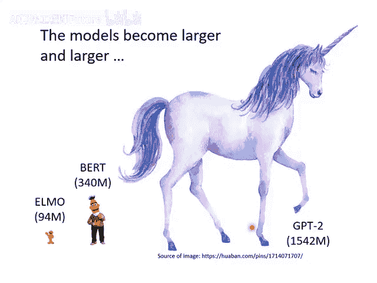
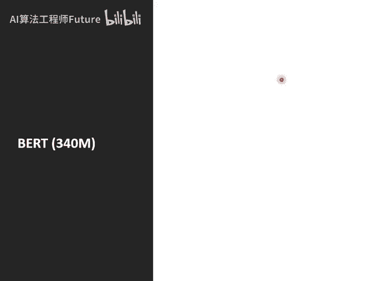
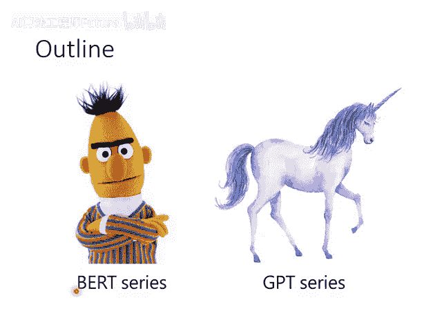

# 【官授搬运】2026年全新优化版李宏毅机器学习系统课程，这才是真正的初学者体系课程！—人工智能／深度学习／神经网络 - P52：【第7讲】1-自监督学习 (Self-supervised Learning)-1 - AI算法工程师Future - BV1ruqABeEFX

好那我们就讲下一个主题，我们接下来要讲的主题呢叫做sales supervised learning，那在讲sales supervised learning之前呢，就不得不介绍一下芝麻街啊，为什么呢。

因为不知道为什么，sales supervised learning的模型，都是以芝麻街的人物命名的，我今天特别穿了芝麻街的T恤，嘿给大家看一下，芝麻街的T恤诶，看不清楚的同学呢或线上的同学呢。

这个照片在这边呢是同一件，嘿也是同一件啊，这个是我本人，然后这个这些角色就是芝麻街的角色啊，那这些芝麻街的角色都是些什么样的模型呢，我们先来看看他们的名字。

在我们实际了解他们做的事情之前，先来认识他们的名字。

而这个红色的怪物呢叫做ELO啊，self supervised learning里面呢有一个模型叫做。

Embedding from language modeling。

它是最早的sale supervised learning model，它的缩写就叫做ALM。

那有了ELO以后呢，后来又有另外一个动物叫做。

这个是大家最耳熟能详的self supervise model，BT呢它是by directional encoder，representation from transformer的缩写。

ELMO跟bird都是芝麻街的人物，有了两个芝麻街的人物以后，BERT啊，他最好的朋友就是这一只，他是谁呢，他叫做ERNI，那事实上有了BERT以后。

马上就出现了两个不同的模型，都叫做earning，其中的模型缩写是这样啦，Enhance representation from knowledge integration，然后它缩写是early。

我就问说哎现在缩写这样都可以了吗，你根本就只是想要叫做EARNI而已啊，你可能以为这个已经很荒唐了，但是后来这只动物它叫做大鸟，Big bird，快就有一个模型叫做big bird。

Transformer from longer sequence，现在已经完全放弃要凑字了，已经完全要放弃凑出一样的名字了，直接就把它叫做big b就结束了。

所以我们现在在这个呃sales supervised learning的model里面，都有一堆芝麻街的人物，cookie monster还没有人去凑他啦。

就等着你来凑cookie monster就是了，好那讲到BT呢，又要提到晋级的巨人呃，以下我我以下会提到晋级的巨人的剧情，我个人是觉得没有雷，但是如果你有怕你怕被雷到的话，你就把眼睛闭起来。

耳朵捂起来这样好，我个人是觉得没有雷好，接下来呢是要提一下晋级的巨人，为什么要提到晋级的巨人呢，因为BERT是一个非常巨大的模型，有多大，还有340个million的参数。

也许我直接给你一个340million的数字，你没有什么感觉，那我告诉你作业四的模型有多大，作业四的模型它也是一个transformer，它只有0。1个million而已。

如果你觉得作业四的baseline很大，只有0。1个million，BT是它的3000倍那么大，所以它确实是一个非常巨大的模型哦，所以当我们想到BT的时候，我们就想到超巨大的巨人。

一脚可以踢破玛利亚之墙的那一种，超巨大的巨人，但是我有一个发现，我发现呐诶超巨大巨人的控制者是谁，你们知道吗，是贝尔托特，对不对，贝尔托特的名字里面是有BT的，这个绝对不是巧合，我相信这绝对不是巧合。

哎，但你可能会觉得很困惑，就是这个贝尔托特，它出现的时间，应该在BT这个模型被提出来之前呐，BERT模型什么时候提出来的，2018年的年底，那你知道晋级的巨人10年前就有了。

所以贝尔托特出现是在BERT之前，但为什么超巨大巨人会由贝尔托特所控制呢，那就是因为剑三创，他其实也有晋级的巨人的能力啦，所以他能够知道未来的事情啦，所以他就把那个贝尔。

他就把超级大巨人的控制者命名成贝尔托特，就这样结束了，好就这样好，所以这个就是bird，但是其实啊你可能觉得bird已经很大了，但是还有更多更巨大的模型，这个时代就像是被发动了地名一样。

有很多超巨大的巨人从地底涌出，有哪些超巨大的巨人呢，最早的是ELO哦，ELO也有94个million了啦，我们这边用这些角色的身高来代表它的参数量，BT大了一点，340个million。

远比在座位里面做的大了1000倍以上。

但是他还不算是特别大的，G p t two，它有1500个million的参数，但就算是g p t two，它也不算是太大的。

GP这个mega创有八个B列的参数，g p t two的八倍左右，后来又有t five啊，t five就是有一款福特汽车叫t five吧，算t five是google做的，跟车子也没有什么关系。

但这边就发个福特汽车，t five有11个B点，但这也不算什么，TURINGNLG有17个billion，但这也不算什么，GPT3有TURINGNLG的十倍那么大，还有十倍那么大，到底GPT3有多大呢。

如果我们把它具象化的话，它有这么大，我们先把这些模型的大小转换成身高。

BT340个million，我们就当做他有一公尺高，所以这个是BT，这个是我本人，那GPT3有多大呢，它就是背后的台北101那么大了，所以从BT到GPT3，模型从一个人高变成台北101那么高。

其实GPT3还不是最大的模型，我现在看到最大的模型是switch transformer，还有1。6个T那么多啊，还有上兆个参数啊，它比GPT3又再大了十倍，所以换了一个switch啦。

它跟领天他跟那个任天堂其实没有什么关系啦，你也可以想象说是啊，这个其实也是google做的啦，那我们把他的论文放在这边给大家参考，如果你有看到更大的模型再跟我讲，所以现在已经有上兆个参数的模型了。

好那这些巨大的模型他们都是在做些什么呢，那在等一下的课程里面，我们会讲两个东西，我们会讲bird跟GPT，那我会跟大家介绍这两个模型。

告诉你说这些sales supervised learning model，他们做的事情是什么好，那我想我们在这边还是正好告个段落，我们还是休息一下好了。

