# 【官授搬运】2026年全新优化版李宏毅机器学习系统课程，这才是真正的初学者体系课程！—人工智能／深度学习／神经网络 - P53：2-自监督学习-2 –BERT介绍 - AI算法工程师Future - BV1ruqABeEFX

好，那我们接下来呢就直接跟大家介绍bird这个模型。

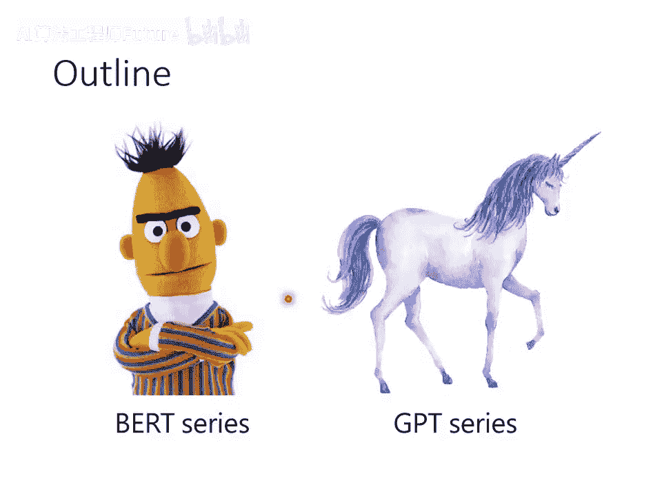

好，我们来讲一下什么是sales supervised learning。

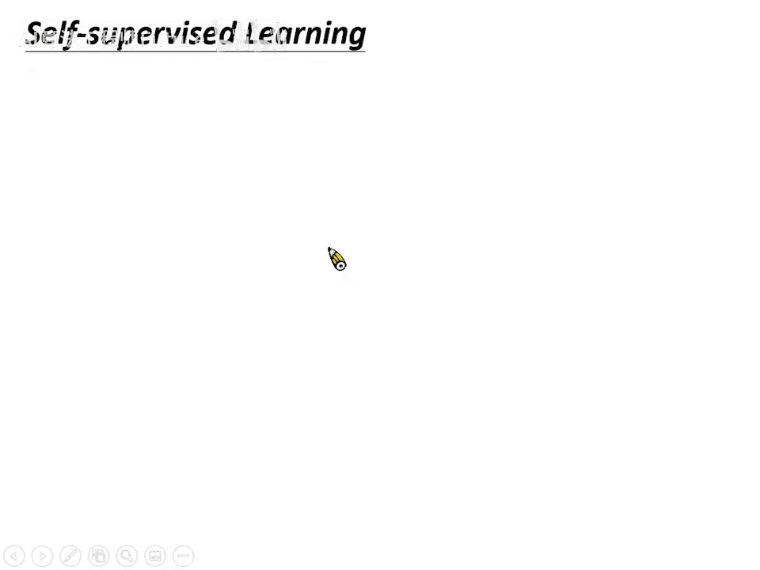

好，那什么是sales supervised learning呢，supervised learning大家都应该非常的熟悉了，作业12345都是supervised learning。

那在做supervised learning的时候，我们就是有一个model，这个model的输入是X，输出是Y，那怎么让model输出我们想要的Y呢，你得要有label的资料，所以你可以想象说。

假设你今天想要做sentiment analysis，就是让机器看一篇文章，然后决定说这篇文章是正面的还是负面的，那你得先找一大堆文章来，然后把这些文章都给它标注标，说是正面的还是负面的啊。

这个正面或负面就是所谓的label，你要有文章，有label才能够训练supervise的model，那什么叫sell supervise呢。

sell supervise就是自己想办法做supervise，在没有label的情况下怎么说呢，假设我们现在只有一堆文章没有标注，但是想办法从这些没有标注的资料里面，把资料分成两部分。

让一部分作为模型的输入，另外一部分作为模型的标注啊，假设你有没有标注的资料，比如说一篇文章叫做XX，你把它分成两部分，一部分叫x pine，一部分叫x double派，我知道到目前为止这样讲。

你一定觉得非常非常的抽象，等一下实际上讲bird的时候，你就可以体会什么叫做呃self supervise，怎么叫怎样怎样叫做，在明明没有办法做supervise的情况下。

自己想办法自己做supervise好，所以现在我们先非常抽象的讲一下，把X分成两部分，XY跟x double pl好，然后把XY呢输到模型里面啊，让它输出Y。

然后呢我们要让Y呢跟他的label学习的目标，跟他的label x double pl越接近越好，那这个就是sales supervised learning。

那sales supervised learning，可以看作是一种on supervised learning的方法，因为什么叫unsupervised learning。

有label叫做supervised learning，没有label就是on supervised learning嘛，就supervise的相反就是on supervise嘛。

那所以self supervise我们没有用到label的资料，所以我们可以说它是on supervised learning的方法。

但是这篇之所以特别称之为self supervised learning。

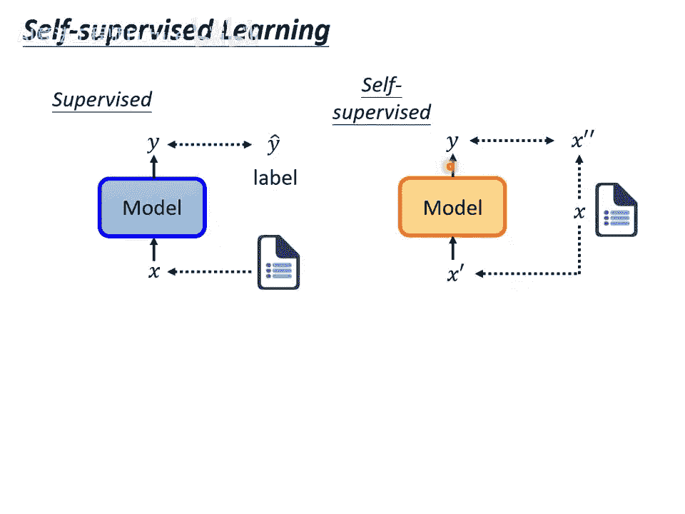

是为了让我们所指示的方法更为的明确，cell supervised learning这个词汇啊，最早应该是young luck更说的，那这个其实不是一个特别喜呃。

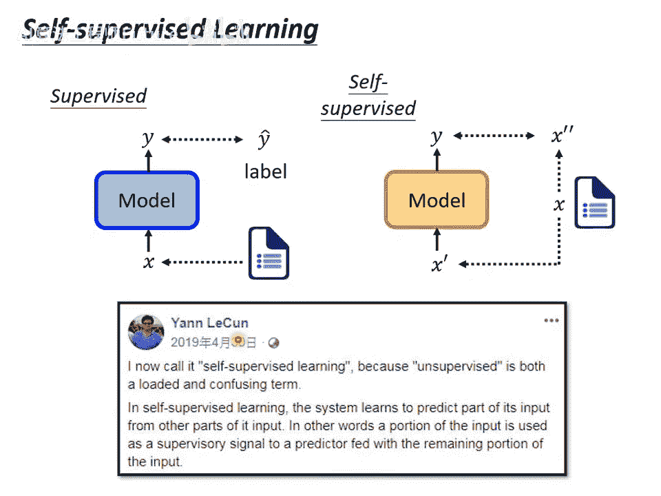

是特别旧的词汇，那这个young laquen是什么时候说这句话的呢。

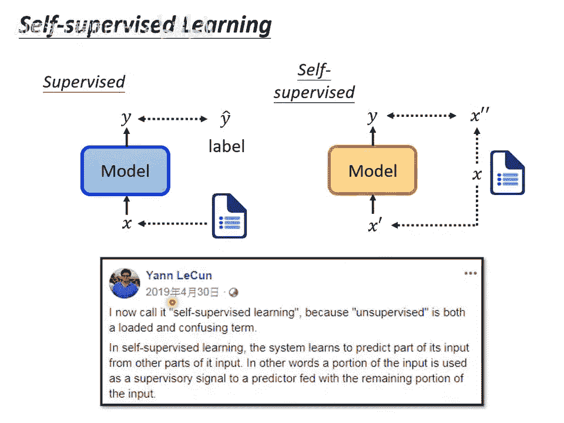

在19年4月的FACEBOOK上的贴文说的，他说他现在把这种方法。

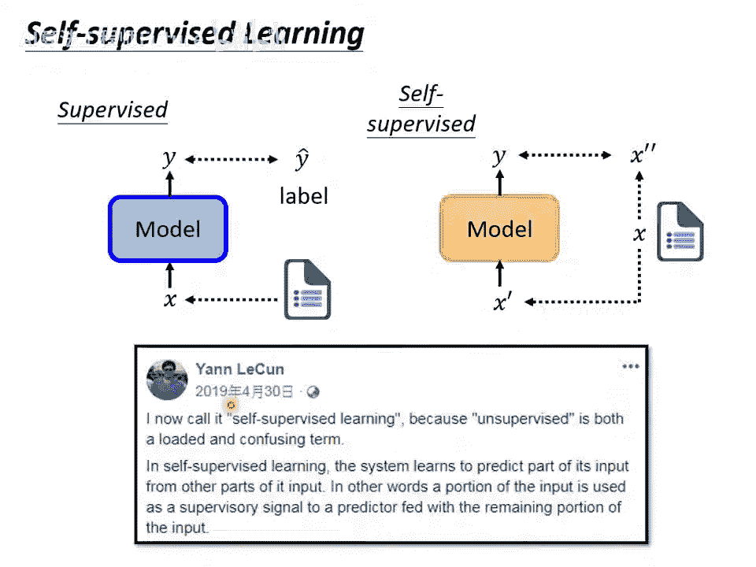

就是我现在讲的这样子的方法叫做self supervised learning，为什么不叫做unsupervised learning呢。

因为unsupervised learning是一个比较大的family，里面有很多不同的方法，那为了比较明确的说明说，现在在做的事情是什么。

所以说现在做的是sales supervised learning，好像因为我们像我们刚才讲的cycle game，那也算是unsupervised learning的方法。

我们也没有用到label的成对的资料啊，但是它跟sell supervised learning就是不太一样哦，所以unsupervised learning下面有很多的方法。

其中一种是self supervised learning。

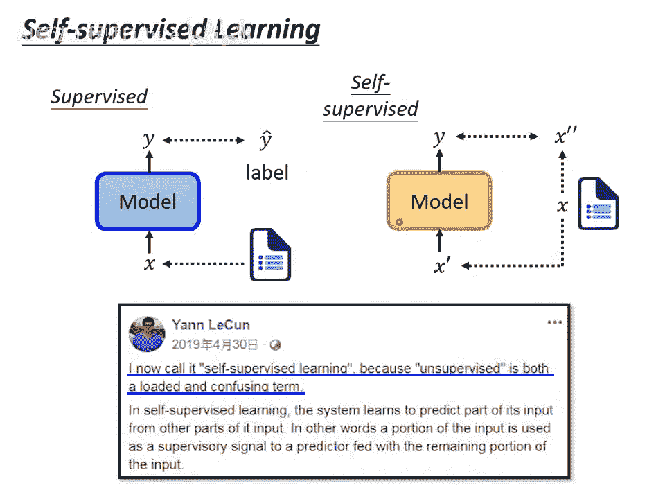

好，那刚才讲的非常的抽象，什么把X分成x pl跟x double pl，自己跟自己学，自己产生label，实际上到底是怎么回事呢，我们就直接拿bird这个模型来跟大家说明。

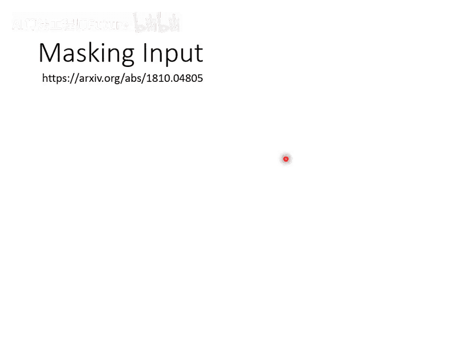

实际上是怎么做的好，那BERT啊，BERT这个model啊，它是一个transformer的encoder，那我们已经讲过transformer了嘛。

我们也花很多时间介绍了encoder和decoder，transformer的encoder就是bird，就是bird的network架构，就跟transformer的encoder1模一样。

里面就有很多self attention啊，有residual啊，有normalization啊等等，那这个就是bird，那如果你已经忘记呃，这个encoder里面有什么样的东西也没关系。

反正你就记得说BT可以做的事情，就是输入一排向量输出，另外一排向量输入多长就输出多长，那bird的输入是什么呢，BT一般是用在这个自然语言处理上，用在文字上，所以一般它的输入就是一排文字。

就是一个sequence，但我们其实在讲self attention的时候也说过，说不是只有文字是一个sequence，语音也可以看作是一个sequence。

甚至image也可以看作是一堆的factor，所以跟BERT同样的想法，不是只能用在NLP，用在文字上，它也可以用在语音跟影像上，只是因为bird最早是用在文字上，所以我们这边都拿文字作为例子。

你完全可以说我把输入换成语音，把输入换成影像也都是一样的好，那BERT的输入这边是一段文字好，那接下来我们要做的事情是，把文字输入的这串文字里面。

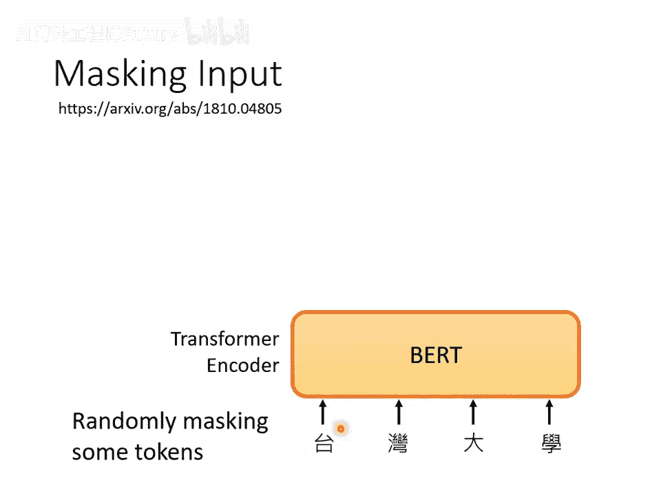

其中一些部分把它随机的盖住，哪些部分会被盖住呢，随机的随便sample，就你输入100个token，那token是什么，token就是你在除一段文字的时候的单位啦，那这个token的大小是你自己决定的。

但在中文里面，我们通常把我们通常把方块字当成token好，所以输入一个句子，那里面会有一些词汇随机的被盖住，那盖住哪些随机决定随便决定啊，那怎么把它盖住呢，所谓的盖住具体而言是什么样的意思呢。

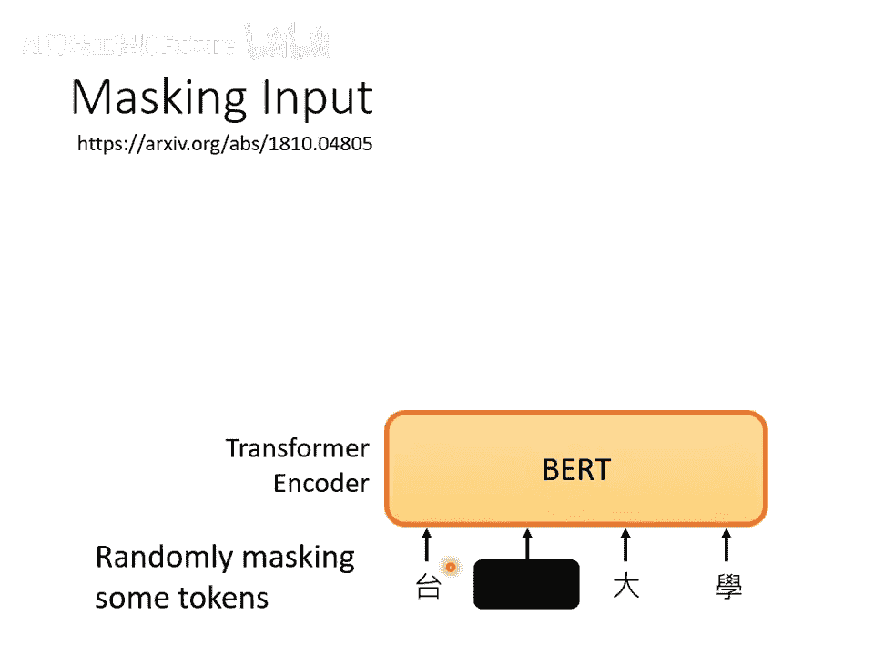

有两种做法，第一种做法是把句子里面的某一个字，换成一个特殊的符号，我们用mask呢来代表特殊的符号，你就想成它是一个呃新的中文的字，这个中文的字在你的字典里面，从来没有出现过的，这是个新的字。

它的意思就代表了盖住它。

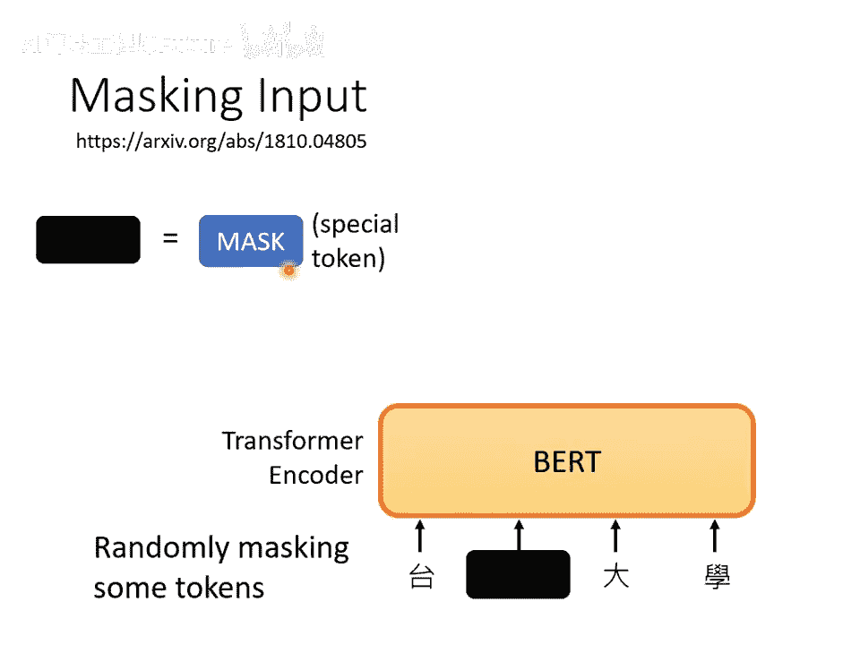

就代表了mask代表盖住，另外一种做法，就是随机把某一个词或某一个字，换成另外一个字，本来这边放的是弯，那就随便找一个中文的字把它替换掉，换成一换，换成天，换成大，换成小，随便换成某一个字。

所以有两种做法，一种是加mask，一种加随机的字，那用哪一种呢，两种都可以用，所以到底用哪一种也是随机决定的，所以在BT在训练的时候，因输入一个句子，所以先随机决定哪些中文的字会被盖起来。

接下来再决定说要怎么盖，是要换成这个特殊的代表盖住的符号，还是随便从中文的字里面挑一个出来把它盖住，所以这两种方法都可以用。

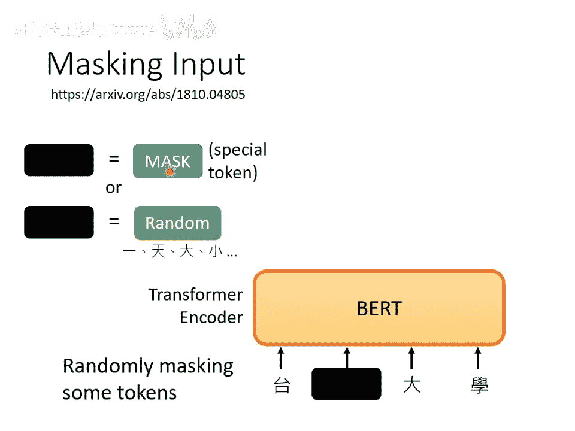

那盖住以后呢，盖住以后你一样是输入一个sequence。

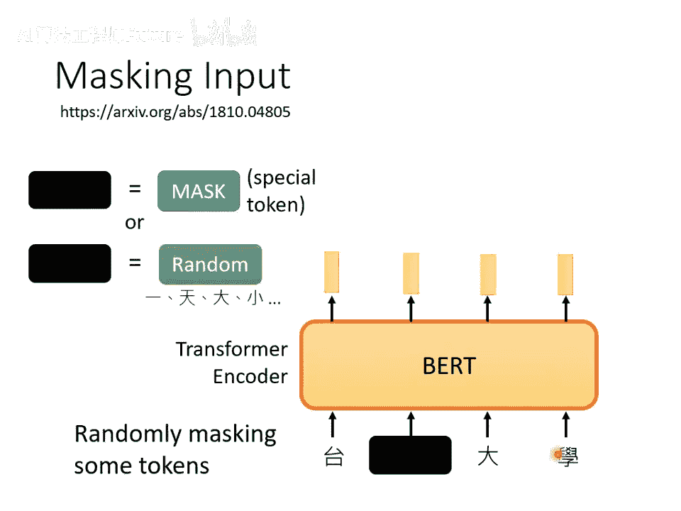

那bird的输出它对应的输出就是另外一个sequence。

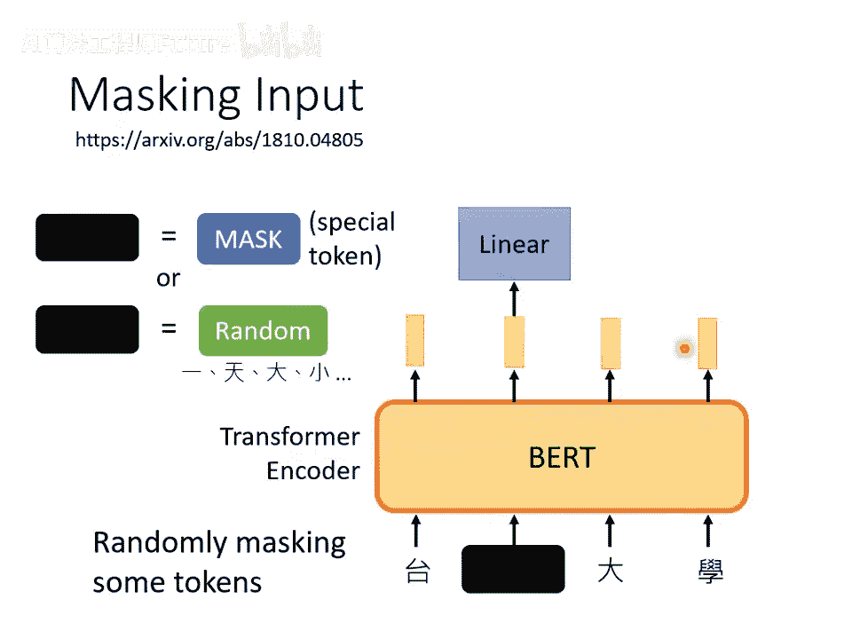

接下来啊你把盖住的部分所对应的输出啊。

就是盖住的部分，你还是有放东西进去嘛，只是他可能是mask或者是随机的盖住部分，还是有放东西进去，它一样输出一个向量，把这个向量做一个linear的transform。

所以做linear transform的意思就是乘一个矩阵，然后做soft max得到一个输出，输出一个分布。

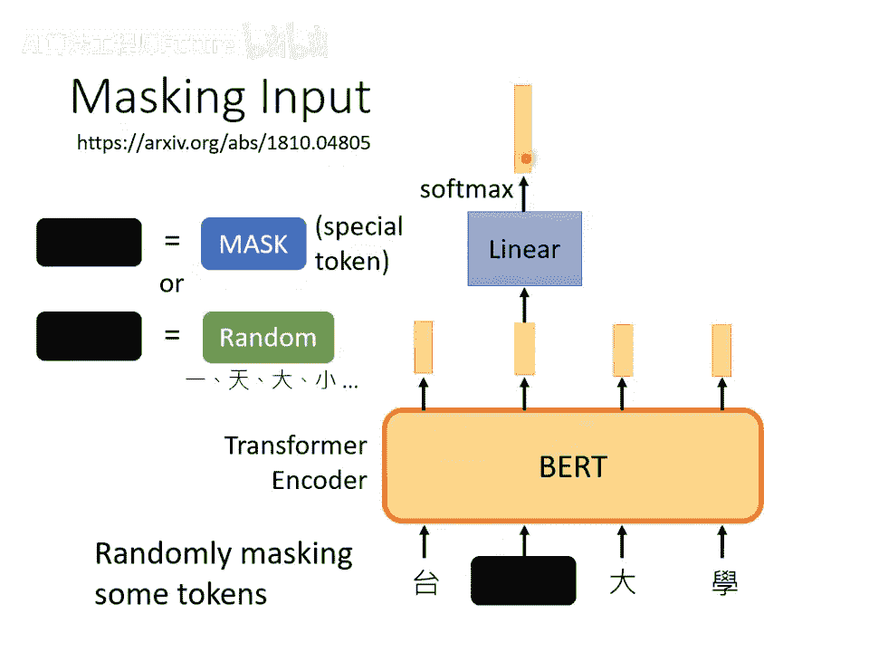

那这个输出的分布是什么东西呢，输出的这个分布就跟我们在做translation的时候，在讲sequence to sequence model，在讲transformer的时候是一模一样的。

它的输出是一个非常长的向量。

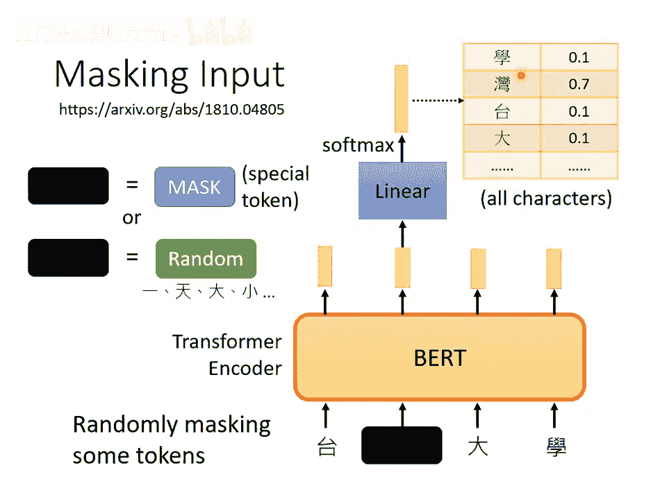

这个向量里面包含了所有你感兴趣的，你想要处理你你知道的中文的字。

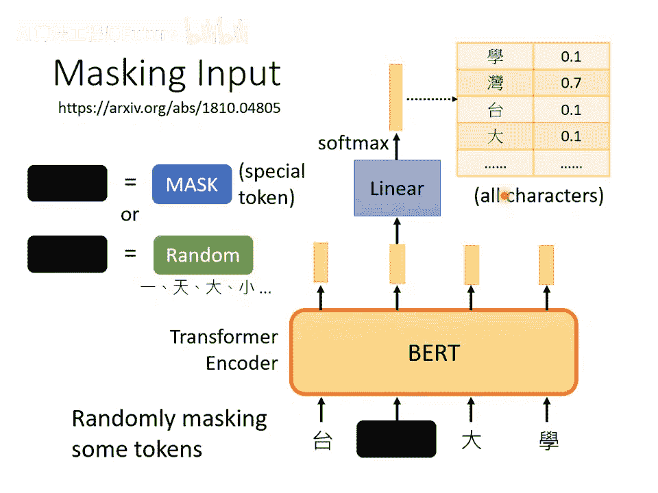

那每一个字都对应到一个分数。

它是一个distribution，因为这边有一个soft max好。

那接下来你要怎么训练这个BT呢，你训练的时候啊，他训练的目标就是。

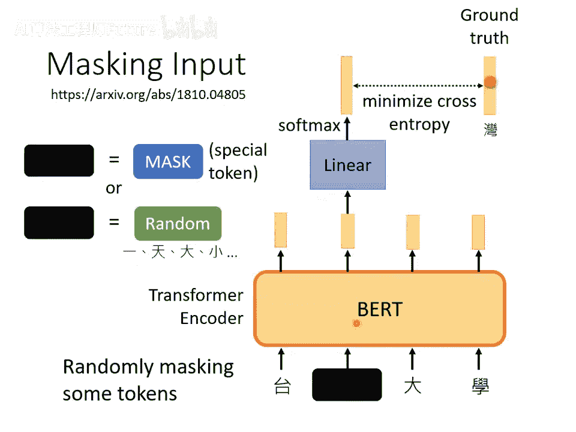

因为我们其实知道被盖起来的东西，原来是哪一个字。

BT本身不知道我们给BT的时候，它是被盖起来的，所以BT不知道这边应该是弯，但我们自己知道啊，我们知道说这个被盖起来的位置。

本来应该要是弯，所以BERT学习的目标就是，他要学到说这边的输出跟弯，这个character跟弯这个字越接近越好，你会把one呢表示成一个one hot的vector。

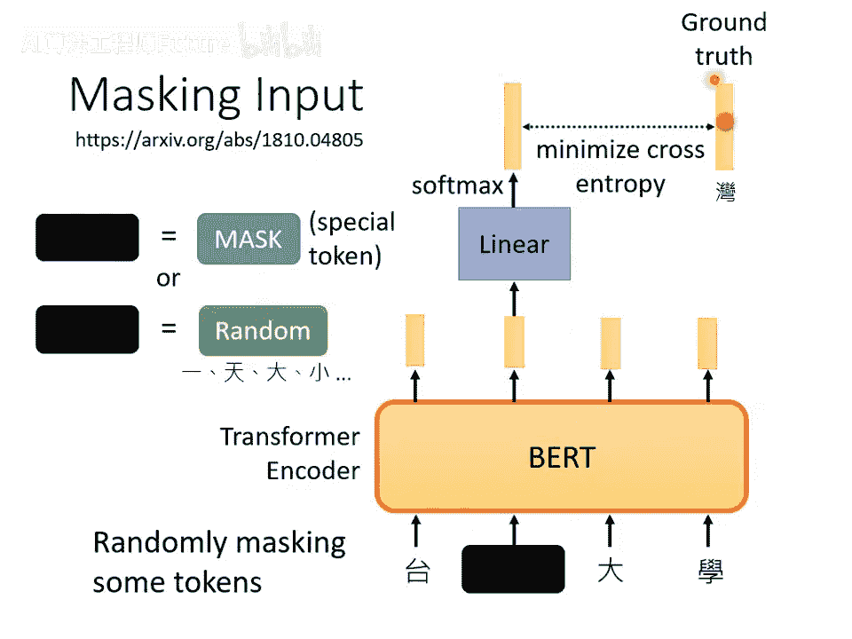

然后你会minimize这个这边的输出。

跟one这个one half vector的cross entropy。

或讲的更简单一点，你其实就是在做一个分类的问题，只是你有多少个类别，我们的类别的数目就跟中文字的数目一样多，中文字那就看你觉得有几个，如果4000个，那就是一个4000个类别的分类的问题。

那现在BERT要做的事情，就是他必须要成功的预测，说这个被盖起来的地方，它属于的类别就是属于one这个类别。

就这样啊，那在训练的时候呢。

你是BT加后面这一个linear的model，两者一起训练，就是BT里面它是一个transformer的encoder，有一堆的参数。

linear的model是一个这个matrix，那它也是有一些参数。

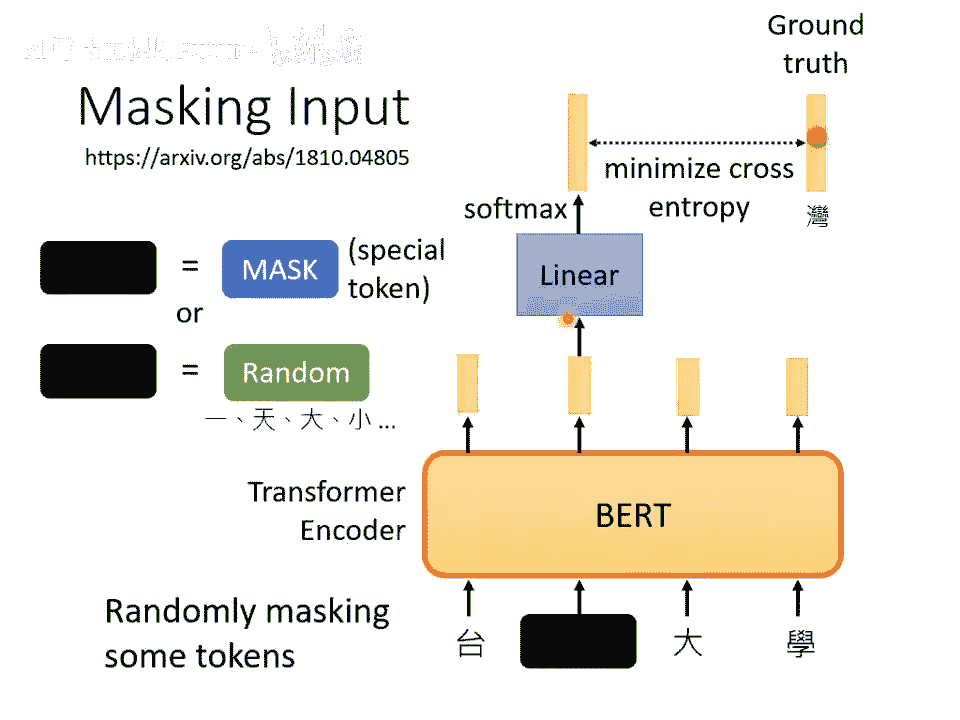

但是跟BT比起来非常小，杯水车薪啊，他们两个是一起训练的，要一起努力，然后呢输出要去预测说现在被盖住的词汇是弯，就这样，这个叫做mask，那其实贝尔在训练的时候，除了做masking以外。

同时也会做另外一个方法。

这个另外的方法呢叫做next sentence prediction，next sentence prediction的意思是说你拿出两个句子，从你的资料库里面就你会收集很多的句子。

那个网络上随便爬一爬就有了啊，收集很多的句子，从里面呢拿两个句子出来，好在这两个句子中间呢，你会加入一个特殊的符号，代表分隔，这样BT才知道说两个句子中，这两个是不同的句子。

这两个句子中间有个分隔的符号，那你还会在这个最前面呐，这整个sequence的最前面呐，加入一个特别的符号啊，这边我们用CLS来表示这个特别的符号，等一下我会知道这个特别的符号，有什么样的作用。

好现在我们有一个很长的sequence，它包括两个句子。

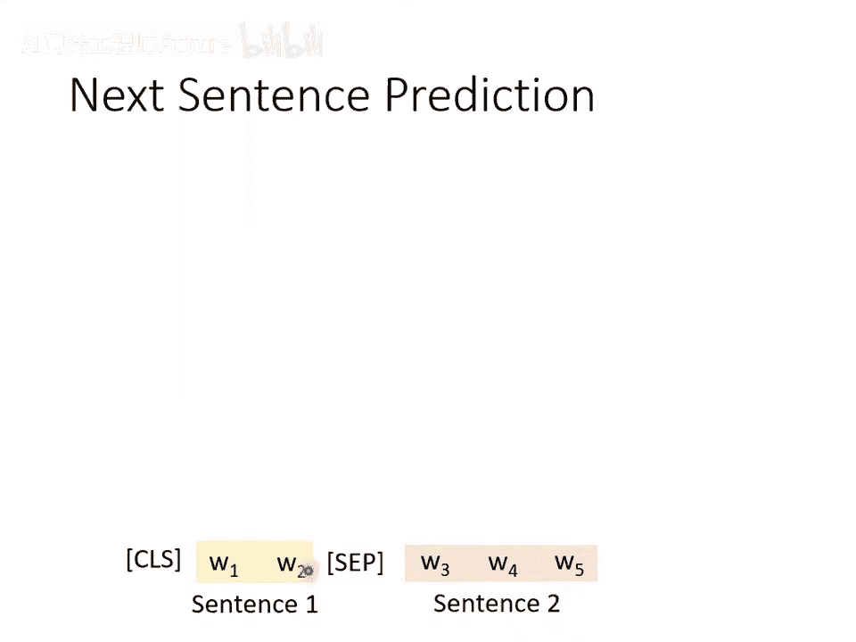

中间有一个分隔，还有COS的符号，整个一股脑啊把它丢到BT里面，然后照理说这边输入一个sequence，输出就会是另外一个sequence，这个就是encoder可以做的事情吗。

bird就是transformer encoder，这个是encoder可以做的事情，但是我们现在只取CLS所对应的那个输出，就这边也有输出，但不管它不去看它，我们只看CLS这边的输出。

把这个输出啊乘上一个linear的transform，然后呢他要做的是什么，他要做的是一个二元的分类问题，他要预测的就是yes或NO，这个yes或NO指的是什么呢。

这个方法名字叫next sentence prediction，所以yes或NO就是要预测说，这两个句子是不是相接的，如果这两个数值是相接的，Bt，它就要训练成看到两个相接的句子就输出yes。

看到两个不是相接的句子就输出NO。

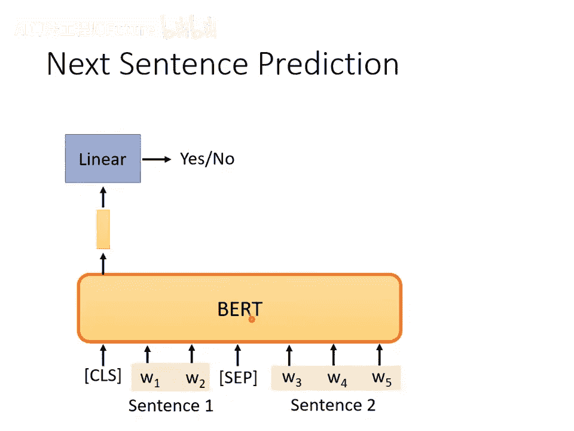

就这样，但是后来的研究发现说啊，Next sentence prediction，对于接下来bird所要做的事情其实帮助不大，那BERT接下来要做什么事情，我马上就会讲到了，总之这一招呃不太有用。

举例来说，在一篇叫做robustness optimized bird，approach the paper里面，它的缩写是ROBERTA，他就明确的指出说。

他尝试了做next sentipetition这个方法，但是没有什么特别的帮助，来到这个就是墙倒众人推啦，一个人说没有用，接下来会有更多文章说没有用，或者说amber啊，xl net啊。

通通都说next sentence prediction没有用，那还没有用的一个可能是next stand and prediction，这个任务可能太简单了，要知道两个句子该不该被接在一起。

也许是不是一个特别难的任务，因为今天这两个句子，你通常的做法就是你先随机选选一个句子，接下来你选接在它后面的句子，或者是从整个资料库里面随便选一句，那你通常随便选一句，跟你一开始选的这一句一定很不像啊。

所以对BT来说，它要分辨两个句子是不是接在一起，可能挺容易的，所以他们没有借由这一个任务，没有借由next sentence prediction，这个任务学到太多有用的东西。

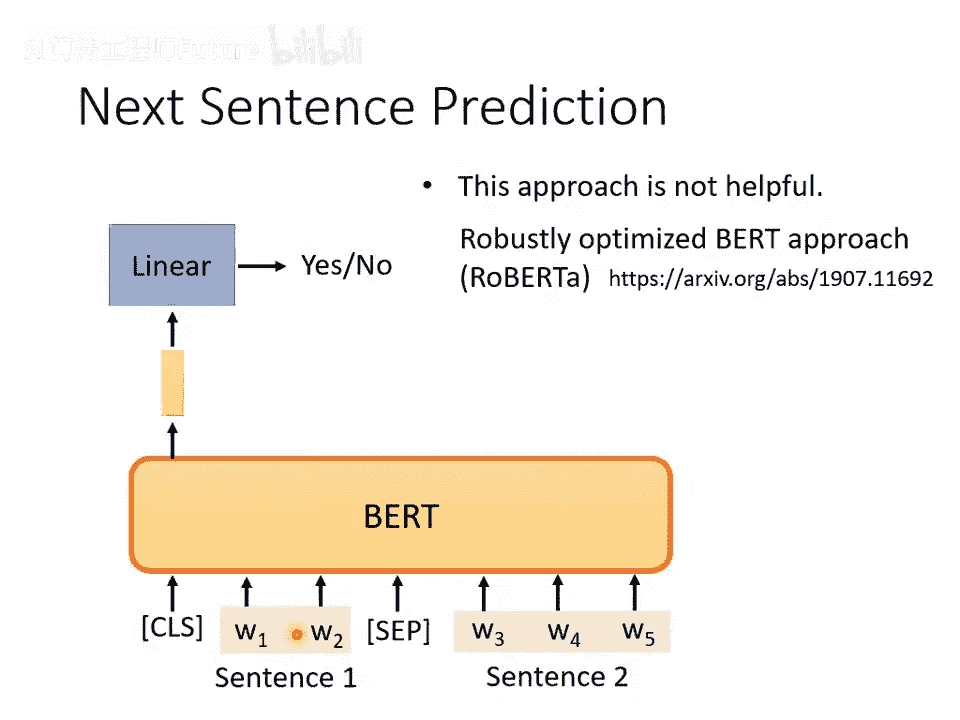

那后来还有另另外一招啊，跟next sentence prediction有点像，那但是大家但是在文件上看起来是比较有用的，叫做sentence older prediction，它的缩写呢是SOP。

然后这个方法是说我们找出来的sentence one。

跟sentence two啊，它本来就是接在一起的，只是你可能会把呃本来放在前面的那个句子。

当sentence one放在后面的那个句子，当sentence two或者是呃本来放在前面的句子，当sentence to放在后面的句子，当sentence one有这两种可能。

然后问BERT是哪一种，那可能这个问题比较难，所以sentence order prediction soo p呃，目前在文献上看起来是有用的。

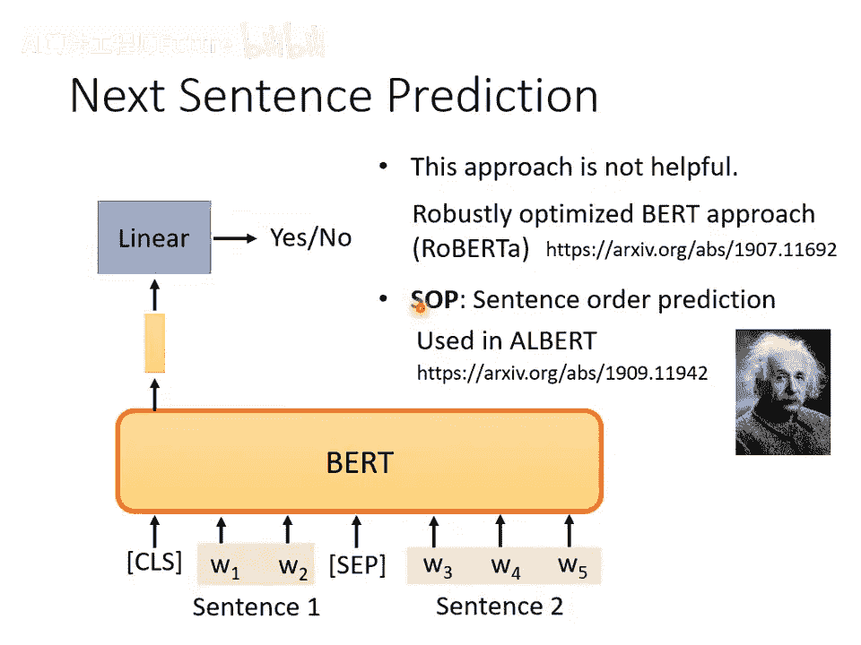

那它被用在一个叫做ALBERT，就是bird那个进阶的版本叫做ELBERT里面，那ELBERT就是爱因斯坦吗，爱因斯坦就叫ALBERT，这里就翻个爱因斯坦这边每一个模，今天这个每一个模型都有名字啦。

没有名字就不要说你有提出了一个模型，所以模型到要想办法取一个名字好。

那BT怎么用呢，我们刚才说我们叫BT会做的事情是什么。

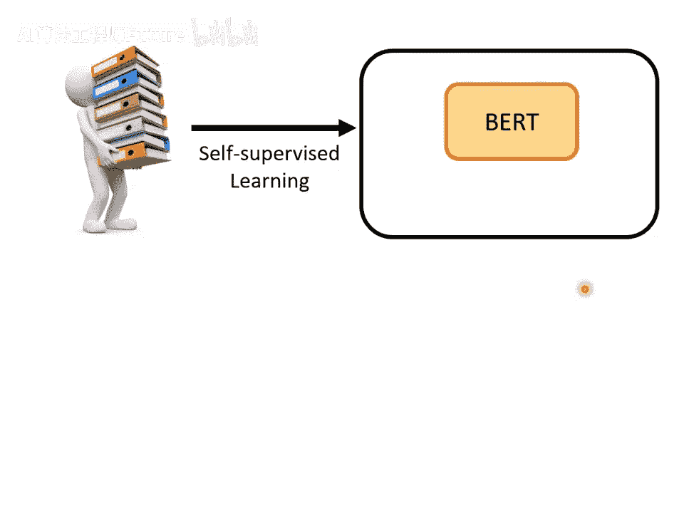

我们训练的时候就是叫BT学两个任务嘛，一个是盖住一些词汇，它盖住一些中文的字，它可以把盖住的部分补回来，他知道怎么做填空题，另外一个是它可以预测两个句子，是不是应该被接在一起。

但我说这句这招好像没有什么用，那所以整体而言，BERT真正学到是这BT他学到的是什么，它就是学到怎么做填空题，那你说那又怎样，如果我要解的任务就不是填空题的话，那这个BT有什么用呢，他就只会做填空题呀。

他学来就是做填空题啊，你教他的事情就是做填空题呀，然后呢接下来就是神奇的地方。

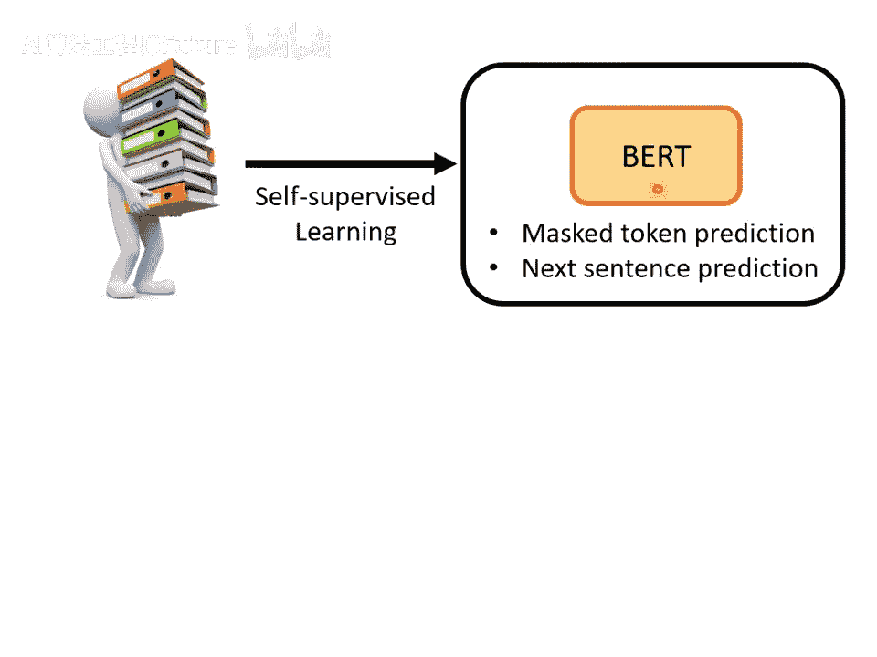

它可以被用在其他的任务上，这些任务跟填空题不一定要有关，甚至是根本就没有什么关系，但是bug可以被用在这些任务上，那这些任务就BT真正被使用的任务，叫做当STRE下游的任务。

down stream的task，那down string task就downstream的test等，我会举几个具体的例子，所谓down string task的意思，就是那些你实际上真正在意的任务。

但是我们要BT学会做这些任务的时候，其实我们还是需要有一些标注的资料的。

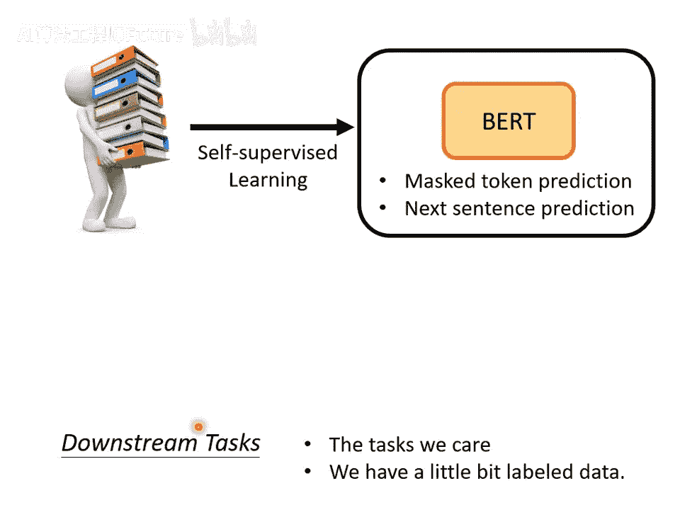

等一下我们会看的更清楚一点，唉所以总之BERT他只学会做填空题。

但接下来它可以被拿来做各式各样。

你感兴趣的下游的任务。

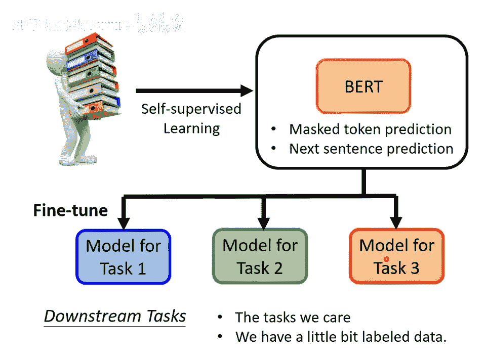

它有点像是胚胎里面的干细胞，它具有各式各样无限的潜能。

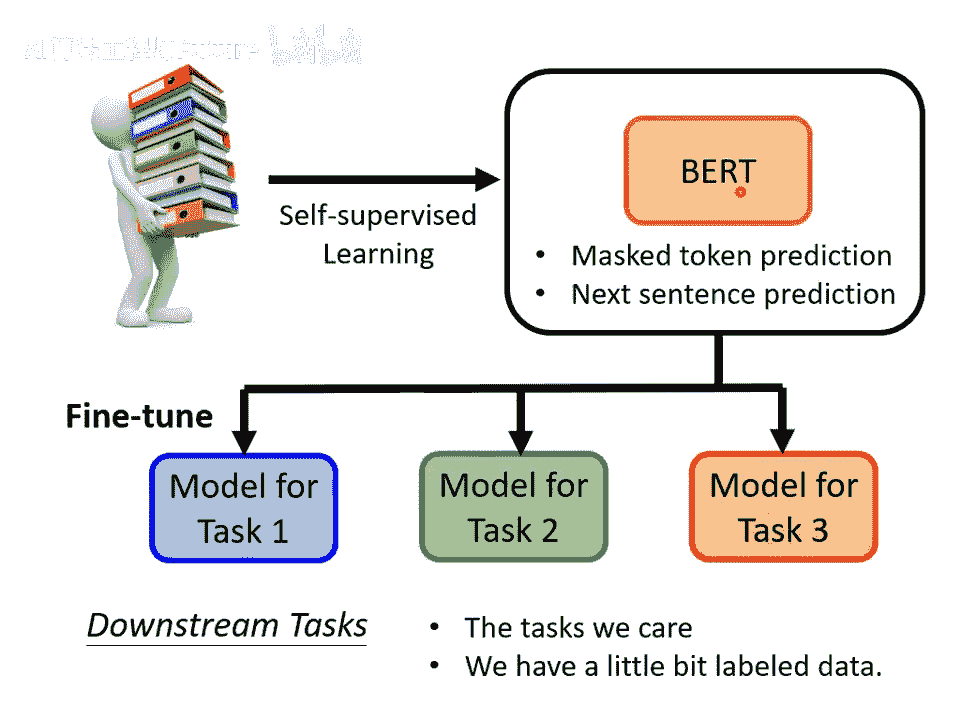

虽然现在还没有发挥他的能力，只会做啊填空题。

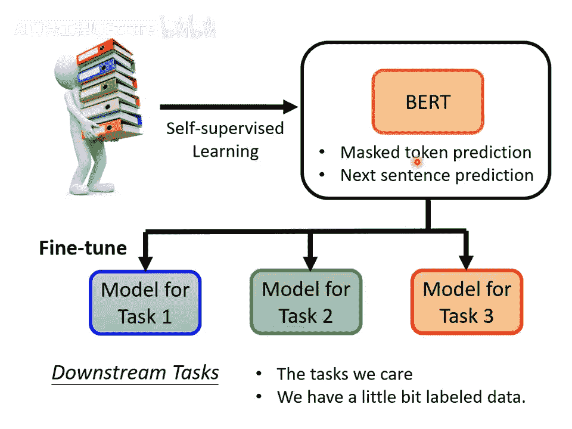

但是接下来他有能力去解各式各样的任务。

只要给他一点资料刺激他，他就可以，你知道干细胞就是胚胎。

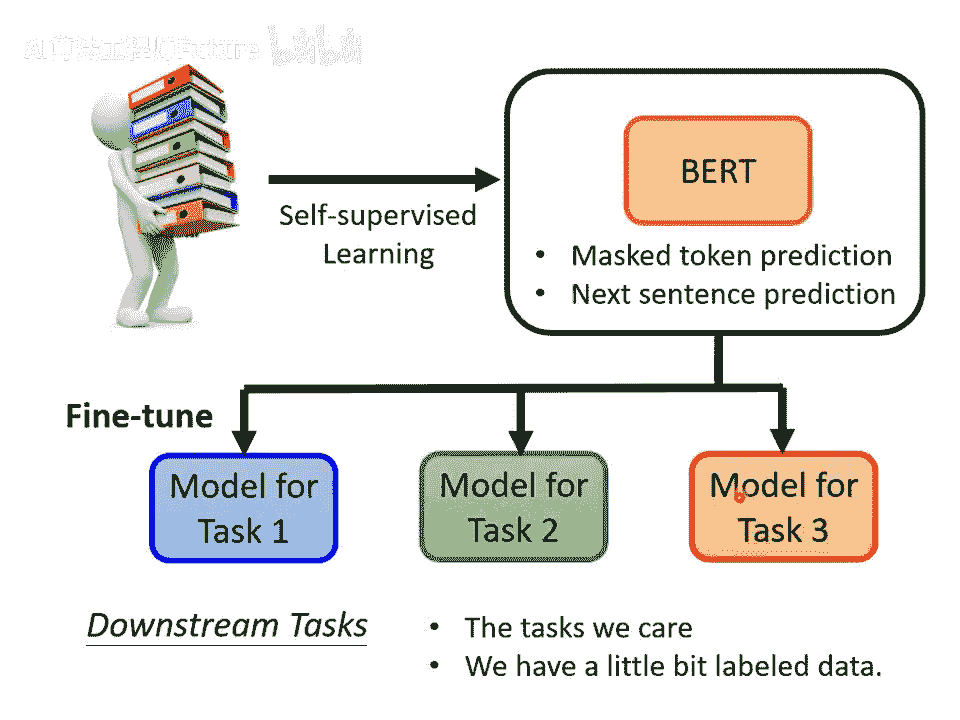

干细胞就可以分化成各式各样不同的细胞嘛，心脏细胞，肌肉细胞等等。

那bird也是一样，给它一点有标注的资料，他就可以学会各式。

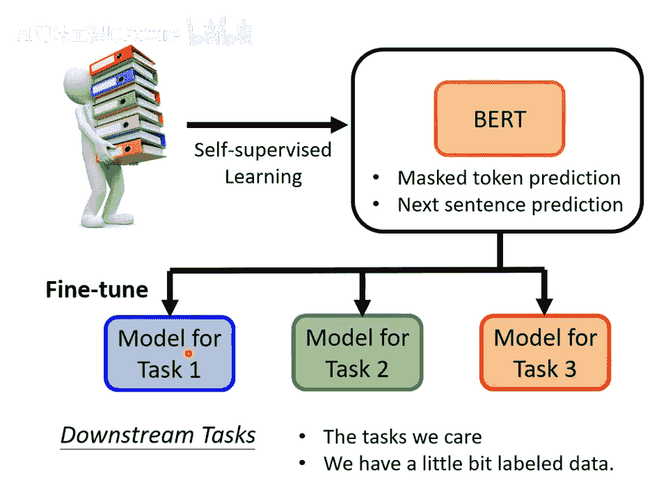

它就可以分化成各式各样的任务，那BT分化成各式各样任务。

这件事情叫做fighting，中文你可能会翻译成微调吧。

所以常常听到有人说他fight tune的那个bird。

指的就是他手上有个BIRT，他把这个BT呢拿来做微调，让他可以去做某一种任务。

那相对于find to，在翻译to之前产生这个BT的过程。

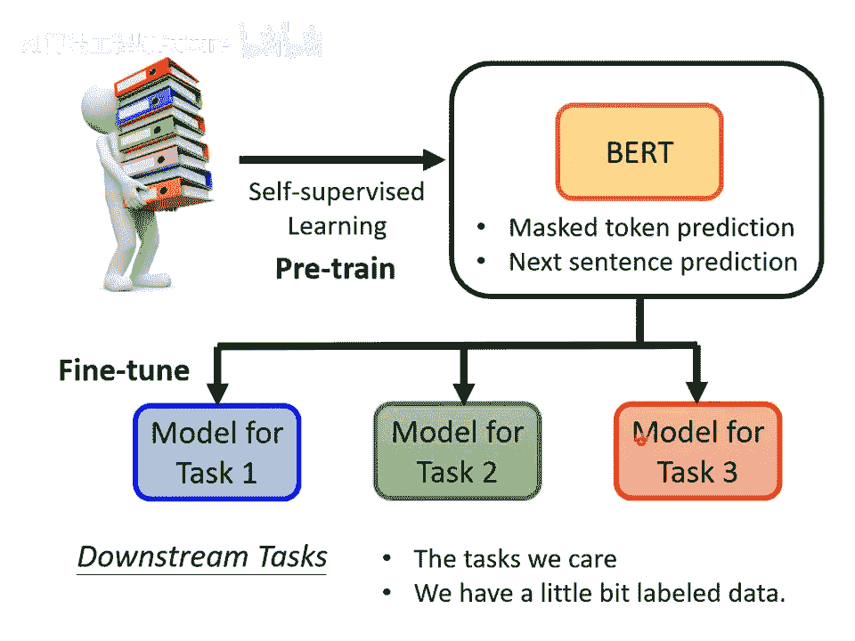

就叫做BETRAP哦。

所以产生BT的这个过程，它叫它是self supervised learning，但你也可以说它叫做PRETRAIN。

那你会发现说我们在作业里面其实有反复说诶，我们就不使用PRETRAIN的model。

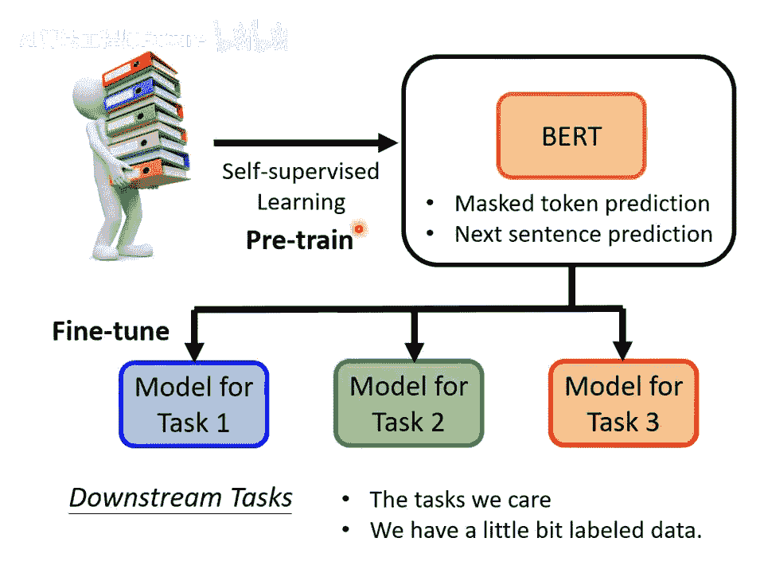

那如果你不知道什么是pretrain model。

没有关系，反正你既然不知道它是什么，你就不会用到它啊，如果你知道是什么的话，这边的意思就是说。

你不要用这种self supervised learning的方法，去别的地方找一个self supervised learning的模型。

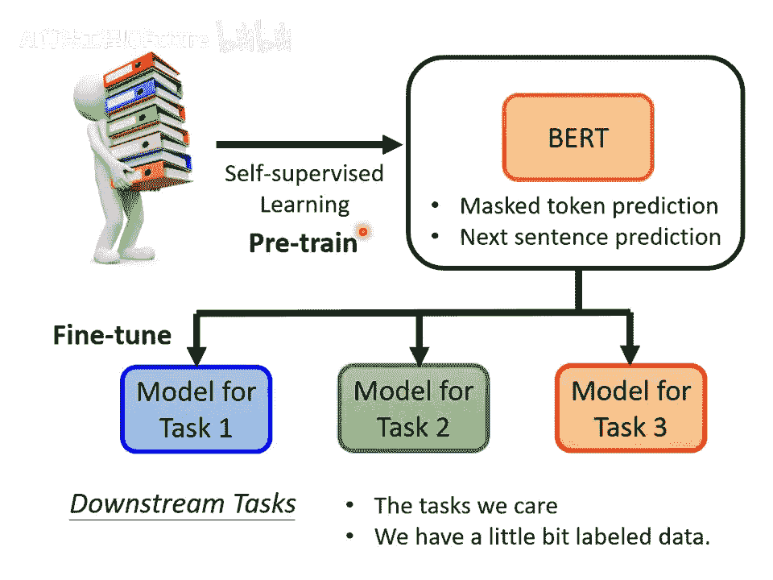

直接用在作业上，因为这些方法往往都有不可思议。

强大的能力，会让你接下来做的事情变得没有特别有趣好。

但是其实接下来有个bird的作业，作业七就是用BT的作业嘛，所以作业期当然就是可以用PRETRAIN的model的。

这是唯一个可以用pretrain model的作业。

因为作业期就是要做，就是要find to bird嘛，所以当然你要用PRETRAIN的bird来进行fine tune。

所以只有作业期是可以用PRETRAIN的model的好。

那在讲BT是怎么fighting之前，我们先来看看他的能力，今天你要测试一个self supervised learning的model的能力呀，通常你会把它测试在多个任务上。

因为我们刚才说bird就像是一个胚胎干细胞，接下来还要分化分化去做各式各样的任务，所以我们通常不会只测试它，在一个任务上的能力，你是会把这个BT分化去做多个不同的任务。

看看他在每个任务上得到的正确率是多少，再取一个平均值，那在这种任务组合，这种这样这样一个模型去测度，我们就叫任务集吧，在任务集里面最知名的一个标杆就叫做blue好。

它是general language understanding evaluation的缩写，那库里面呢总共有这个九个任务，那一般你想要知道一个，像BT这样训练出来的模型好不好，你就会把它微调。

再分别微调在九个任务上，所以你实际上会得到九个模型，分别做在九个任务上，看看这九个任务上正确率的平均是多少，那你得到一个数值，这个数值代表了这个self supervise model的好坏好。

那我们来看一下在路上面的表现，有了BT以后，gr的分数，就是那九个任务的平均的分数确实逐年攀升好，那在这个图上啊，横轴是不同的模型，这边有列嘛，诶你发现说诶来来去去都是有什么ELO啊，GPT啊。

BT啊BT啊BT啊BT啊，BT1大堆BT这样子各式各样的bird，而那这个黑色的线呢代表的是人类的，人类在这个任务上得到的正确率，那这个当做是一，那这边每一个点呢就代表了一个任务。

那你为什么要跟人类的正确率比呢，人类正确率是一，然后这些点呢如果做的比人类好，就是大于一，做的比人类差，就是小于一，那现在这些任务呃，他们用的那个评估的标准不见得是正确率，每个任务用的评估标准不一样。

不见得是正确率，所以直接把它的数值放在一起比，可能没什么意思，所以这边呢是看跟人类的差距哦，所以你会发现说本来九个任务里面，只有一个是比可以做的，比机器可以做得比人类好的。

后来呢随着越来越多技术被提出来，越来越就有，就有另外三个任务可以做得比人类好，而其他本来跟人类相差甚远的任务诶，也慢慢的追上来了，他的呃机器的效能也慢慢追上来了。

蓝色的虚线是机器的grouse sce的平均唉，发现说最近一些比较强的模型，比如说XL内啊，诶居然还超越了人类啊，当然你这只是在这一个资料集上面的结果，并不代表说机器in general真的超越了人类。

它只在这个资料集上超越了人类，这显示的是什么呢，就这个资料集被玩坏了不够难，所以接下来在group之后就有人做了super group，找更难的这个自然语言处理的任务，来让机器来记好。

但show这个图的意思主要想要告诉你说，有了BERT这样的技术以后，确实自然机器在自然语言处理的能力上面。

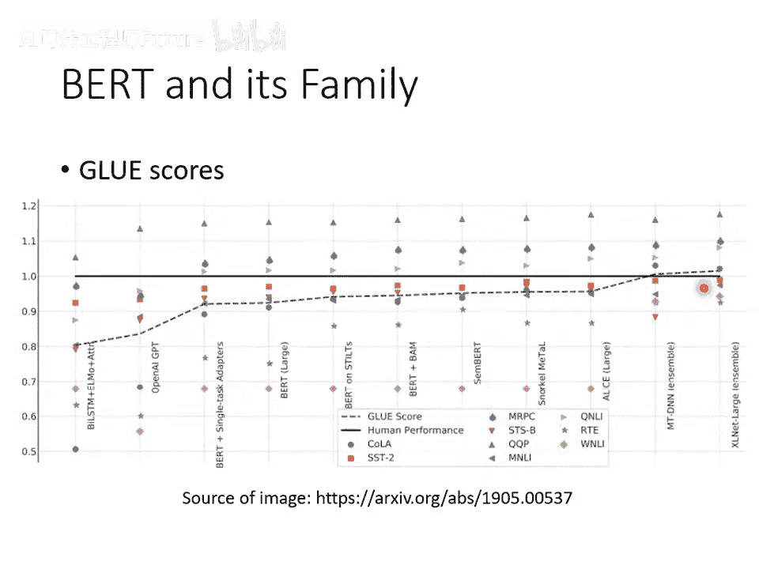

又往前迈进了一步好，那BERT到底是怎么被使用的呢，BT是这样子用的，我们等一下会举四个使用BT的case，第一个case是这样子的，第一个case是，假设我们的当训的任务是输入一个sequence。

输出一个类别，它是一个分类的问题，只是输入是一个sequence，什么样的任务是输入一个sequence，输出一个类别呢，比如说sentiment analysis，就给机器一个句子。

只要去判断说这个句子是正面的还是负面的，那对于BERT而言，它怎么解sentiment analysis的问题呢，你就给它一个句子，就是你要拿来决定sentiment的那一个句子。

然后把这个句子前面呢放CLS那个token，我刚才说c o s token，我上次提到他时候是在讲next sentence，prediction的时候，还前面放COS的token丢到BT里面。

那这四个输入其实都会对应给它四个输出，但我们只看COS的部分。

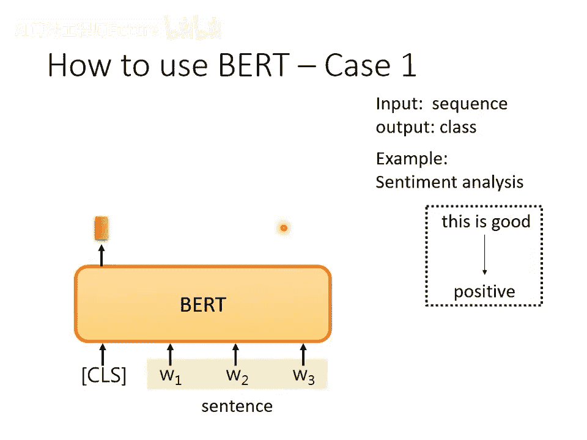

COS这边输出一个向量，把它做个linear transform，乘上一个linear的transform，乘上一个矩阵，那这边呢把soft max省略掉了啦。

通过soft max然后决定说输出的类别是什么，正面还是负面等等，好那这边实际上在做的时候，你需要有你下游任务的标注质量，也就是说，BERT并没有办法凭空去解。

sentiment analysis的问题，你仍然需要提供bird1些标注的资料，你需要提供给他大量的句子，跟每一个句子是正面的还是负面的，你才能够去训练这个bird的模型，在训练的时候。

我们其实是把BT加上这个linear的transform，合起来说，它是一个完整的sentiment classification的模型，在训练的时候。

linear的部分跟BT都会用gradient descent update，只是现在呢原linear的部分，它的参数是随机初始化的，而BT的部分，它的初始的参数是从学习了做填空题的，那个BT来的。

就我们在训练模型的时候，不是会随机初始化一个参数吗，然后用gradient descent去调那个参数，对不对，然后最后去minimize我们的loss，那这边也是一样。

我们有一个要minimize the loss，就是做sentiment classification，但是我们的参数不再是完全随机初始化了，有了BT以后，我们我有唯一初始化的。

随机初始化的只有这个地方，而BT这个本体啊，这边是一个巨大的啊，transformer的encoder，这个network它的参数不是随机初始化的，我们是直接把那个学会了做填空题的bird。

它的参数拿来填在这个地方，把那个可以做填空题的bird，参数拿来填在这个地方当做初始化的参数，那为什么要这样做，为什么要用那个学会做填空题的bird，把它放在这边呢。

那最直觉最简单的理由当然是比随机初始化好，当你这边放了那个会做填空题的BT的时候。

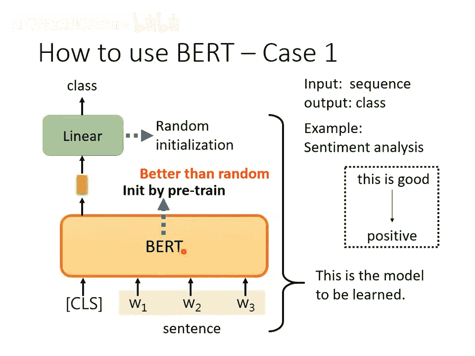

它得到的结果会比随机初始化好好了，这边有一个文献上的例子啦，横轴是训练的EPO，纵轴是training的loss，那大家现在一定非常熟悉这样子的图形了，那随着training的过程的进行。

training的loss当然会越来越低，那有趣的地方是，这边这个图上啊有各式各样的任务啦，细节是什么，我就不解释，这边就是各种不同的任务，那find two代表的就是有PRETRAINING。

就是BT那个部分，那个encoder那个部分是用学会做填空题的，那个BT的参数来做初始化的，scratch的意思就是整个整个model包括BT那个本体，包括encoder的部分都是随机初始化的。

那你会发现说呢，如果是scratch，scratch就是虚线，虚线就是scratch，如果是scratch的话，首先呢你在训练的时候，它loss下降比较慢，相较于有用BT初始化的，有用会做填空题的。

BT初始化的参数，它的下降比较慢，而且就算是最后降下来了，有随机初始化的参数，它的loss也比有做填空题，做初始化的有用填空题bird做初始化的参数，它的north还要更高。

所以这个就是bird可以在表面上带给我们的好处。

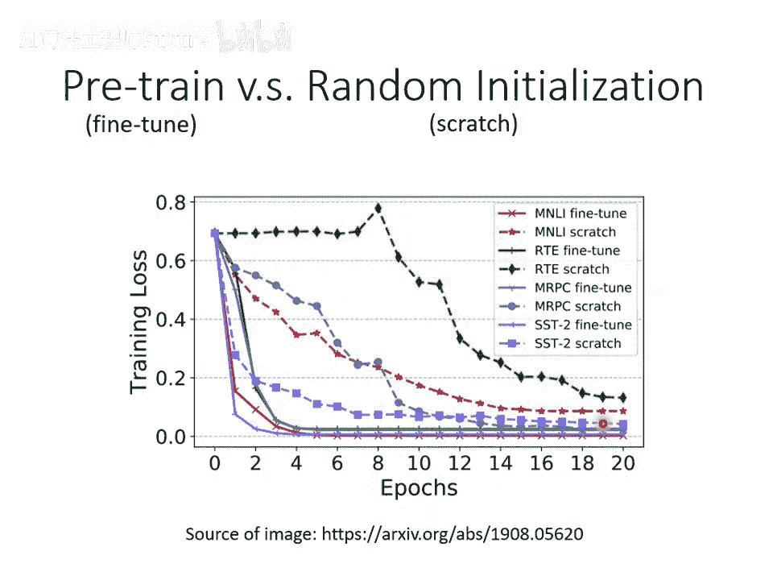

好讲到这边呢，我其实就特意留了一页投影片，想要停一下，就接下来还有其他内容，但我想在这边停一下，确定大家了解我所表达的意思，好在这边要听得懂，接下来你才有办法继续听下去，所以我想问一下，到这个部分。

大家有没有问题想要问呢，你可以了解PRETRAIN跟FQ是怎么一回事吗，啊刚才其实在下课的时候。

有同学问到说像BT这种做法，他是是不是semi supervised的呢，它是sei supervised还是unsupervised的呢，都是啊，就是呃self supervise那一阶段学填空题。

那一阶段是unsupervised，但接下来你要把BT用在下游的，down stream的这些任务上，用在下游的任务上，下游任务需要有标注的资料。

那你在做self supervised learning的时候，用了大量没有标注的资料，但下游任务有少量有标注的资料，所以合起来是sai supervise，所以sai supervise。

意思就是你有大量没标注的资料，少量有标注的资料，这种状况就是sei supervise，所以整个bird的使用的过程合起来就是，PRETRAIN加find two合起来。

它算是一种sei supervise的方法，好讲到这边，大家有没有问题想要问的呢，有吗没有吗。

好如果没有的话，就要继续下去了。

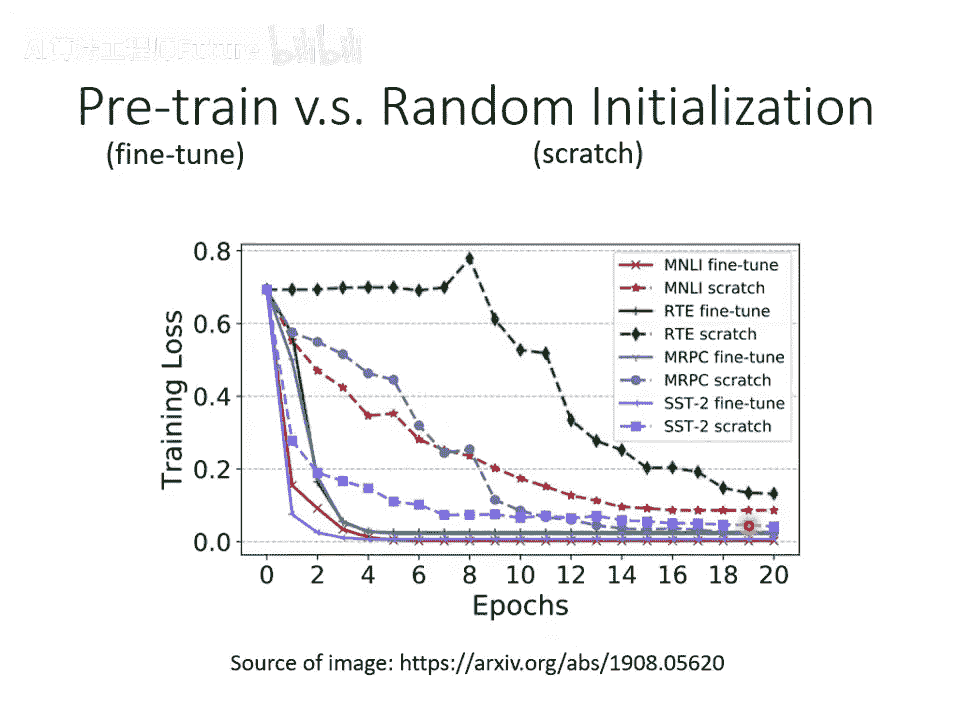

接下来其实跟刚才的这个case one都非常非常的像，所以如果你懂case one在讲什么，接下来就是一法通万法通而已。

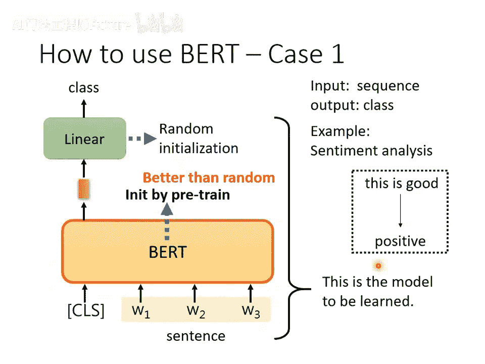

接下来还有三个K好，如果大家没有问题，就继续下去咯，好那接下来的三个case是什么呢，第二个case是输入一个sequence，输出另外一个sequence，但输入跟输出的长度是一样的。

那我们在讲self attention的时候，也举过类似的例子，什么样的任务是输入跟输出长度一样的呢，比如说POSTGGY，Poo s taggin，就是词性标注，你给机器一个句子。

他要告诉你说这个句子里面每一个词汇，它对应到什么样的词性，有时候就算是常用的词汇，也可能有不同的词性，这个我们在sales supermise learning的时候给我讲过了好。

那BERT怎么处理这种问题呢，你就给BERT输入一个句子，然后接下来呢呃这个输入这个句子以后，接下来呢这个句子里面的每一个token，如果在中文就是代表每一个字，就有一个对应的向量。

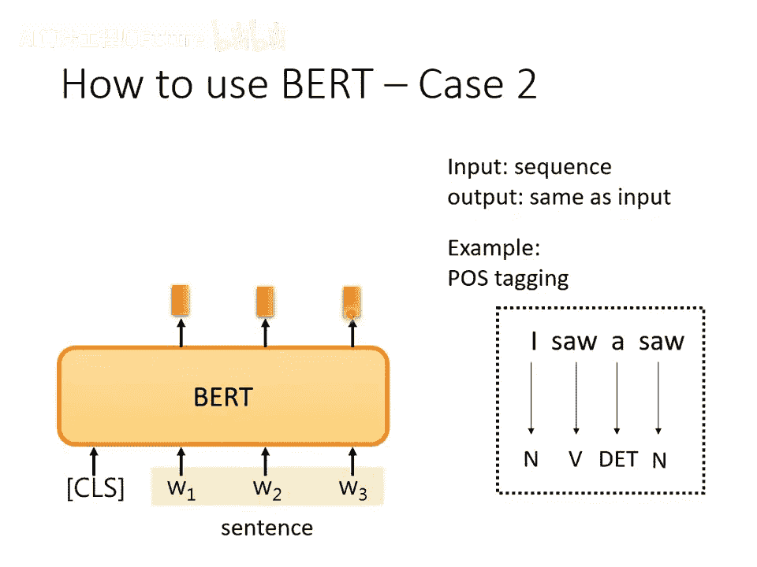

然后接下来呢再把每一个向量分别做一个linear，Transform，乘上一个矩阵，再过soft max，然后再去prefix说啊，这边输入的每一个词汇属于哪一个类别，比如说哪一个词性。

但随着你的任务不同，这边对应的类别也就会不一样，那接下来呢接下来就跟case one完全一样，也就是说你需要有一些标注的资料，这仍然是一个一般的分类的问题，只是跟一般分类问题不一样的地方。

是BT这个部分这个本体的这个encoder的部分，它的参数不是随机初始化，它已经在PRETRAIN的时候，找到一种比较好的初始化的参数了，好讲真，大家有问题想问吗。

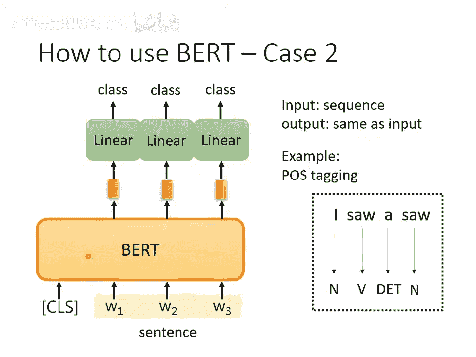

好没有的话呢，我们就再继续看case3，那case3是输入两个句子，输出一个类别，当我们这边举的都是自然语言处理的例子，但你完全可以把这些例子改成，比如说语音的例子或改成影像的例子，对不对。

我们在讲sales supervised learning的时候讲过说，不管是语音还是文字还是图片，都可以看作是一排向量，所以虽然我等一下举的例子通通都是文字的，但你不要把它想成这个技术。

只能局限在文字上，他完全可以用在文字以外的任务上好，那输入第三个case，输入两个句子，输出一个类别有什么样的任务呢，最常见的是natural language influence。

它的缩写是n l i natural language influence。

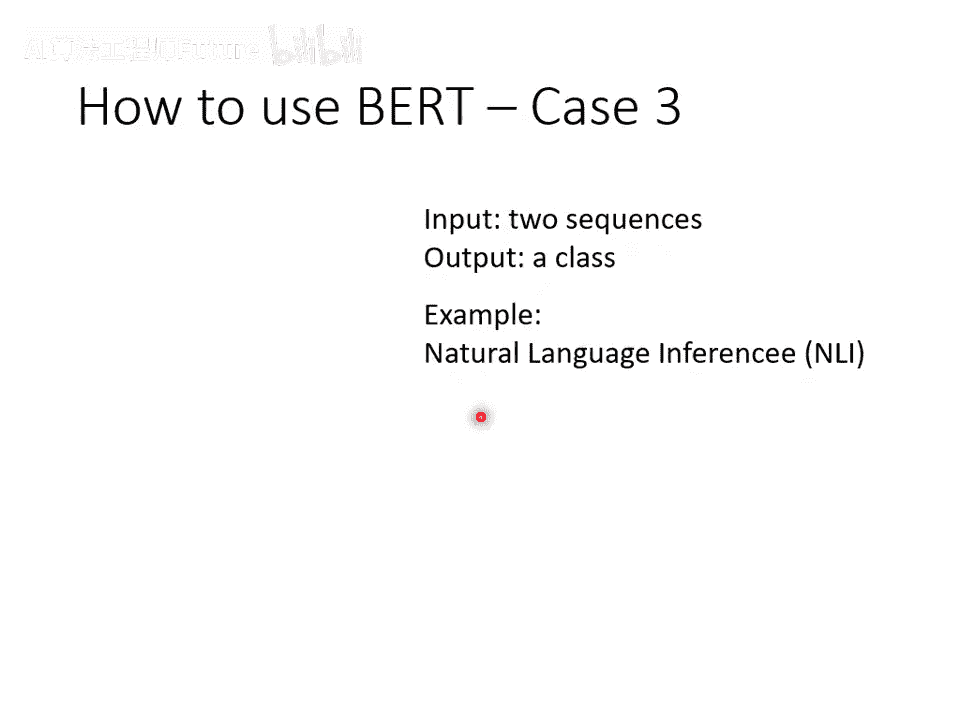

做natural language influence做的事情是什么呢，啊这边是给机器两个句子，一个句子叫做promise，就是前提，另外一个句子叫做假设。

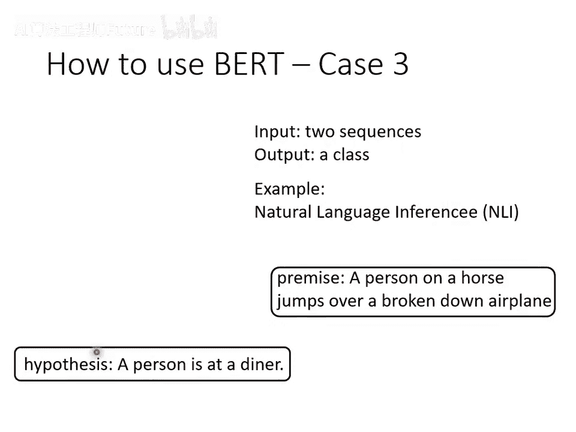

机器要做的事情，就是这个从这个前提能不能够推出这个假设，这个前提跟这个假设是矛盾的吗，还是不是矛盾的，在这个例子里面哦，我们的前提是有一个人，他骑着一个马，然后他跳过了一个坏掉的飞机，听起来有点怪怪的。

但是这个句子这个句子真的就是这个样子啊，这是一个呃，基benchmark corpus基础语料库里面的例子，就有一个人骑着马跳过了飞机，他在做一个杂耍，那这边的呃推论是这个人正在啊，哎这哎这个人呢。

哦这个这个dinner是应该是小餐馆的意思啦，就这个人在一个小餐馆里面是吗，不是所以这个是矛盾的，就这样，所以机器要做的事情就是吃两个句子，吐出这两个句子之间的关系，那像这样子的任务啊。

其实也还蛮常见的，举它可以用在什么地方呢，举例来说，立场分析就给一篇文章，然后下面有一个人留言，那这个留言是赞成这篇文章的立场，还是反对这篇文章的立场呢，那你就把文章跟留言都丢进模型里面。

那模型要预测的就是赞成还是反对哦，所以输入两个句子，输出一个类别也有蛮多的应用的好。

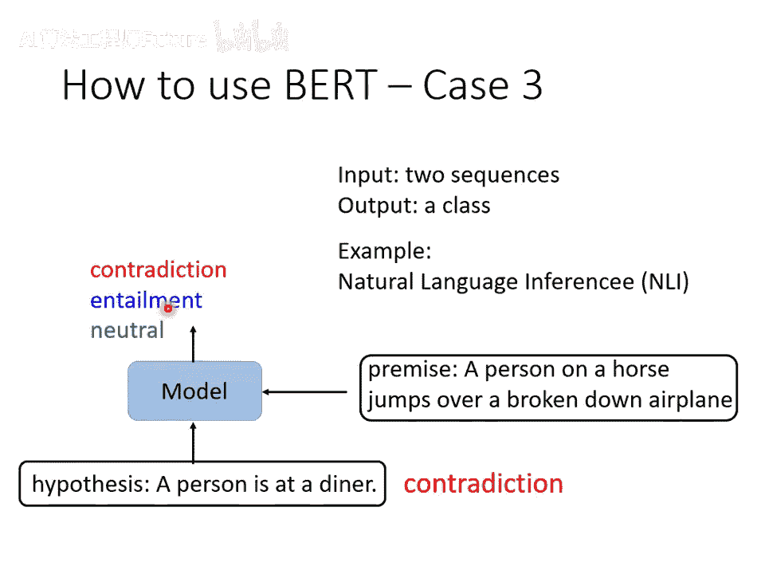

那BERT怎么解这个问题呢，你就给他两个句子，我们的模型要输入两个句子，两个句子中间放一个特殊的符号分隔的符号，那最前面再放COS这个符号。

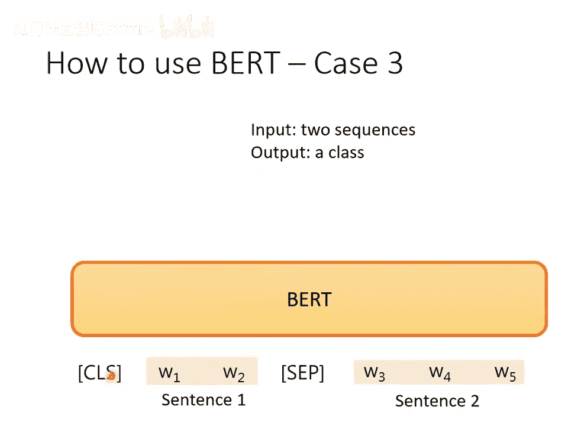

然后一整串东西丢到bird里面，bird也会给我们另外一整串东西。

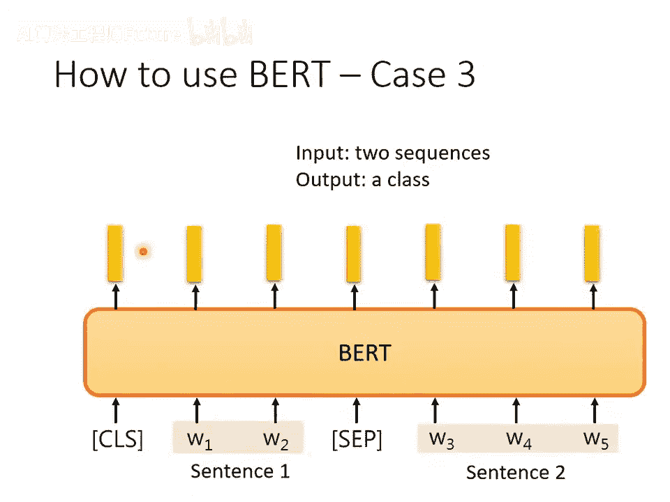

输入多长，BT就输出多长，但是我们只取COS这个部分，丢到transform里面，丢到linear transform里面，然后决定说现在输入这两个句子，输出应该输出什么样的类别才是对的。

这两个句子是啊是矛盾的吗，还是不是矛盾的，如果在NLI里面，就是要问说这两个句子是矛盾的，还是不是矛盾的好，这个是例子三，那一样，我们需要一些标注的资料，才有办法训练这个模型一样。

BT这个部分不再是随机初始化的。

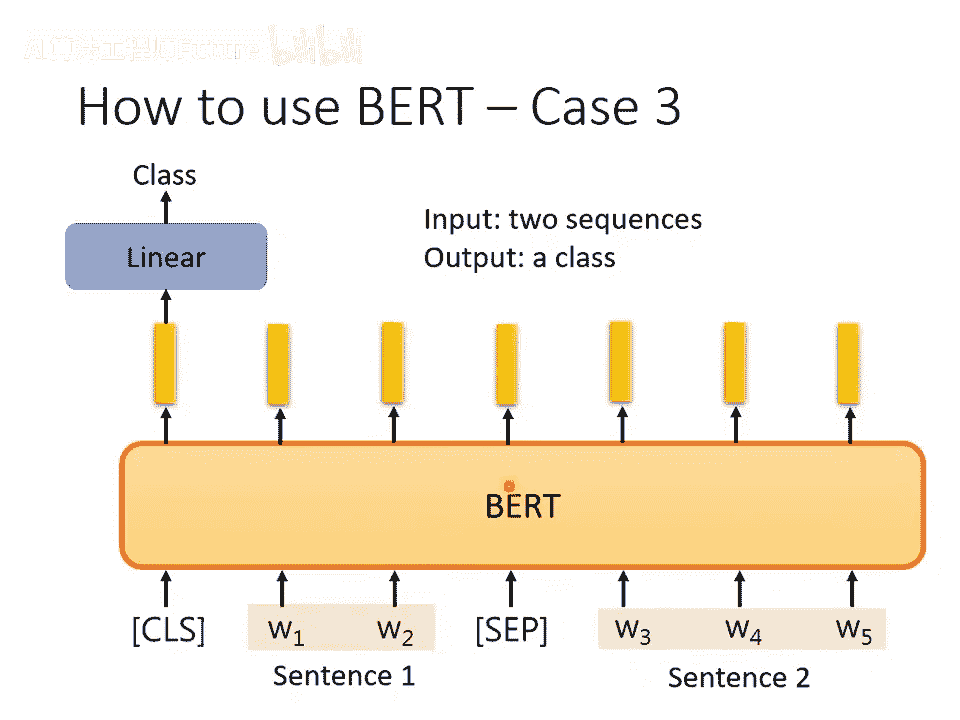

它是用BT用PRETRAIN来初始化的好，接下来进入第四个case，第四个case，其实就是我们在作业的里面会做的case了，所以你就如果前面没听懂的话啊，那就算了啊。

这个这个第四个case是我们在作业期要做的，作为七要做的是什么呢，作为七要做的是问答系统，也就是你给机器读一篇文章，问他一个问题，他真的会给你一个答案，但是这边这个问答不是嗯一般的问答。

它是稍微有点限制的问答，这种问答是extraction base的QA，也就我们假设说答案一定出现在文章里面，答案一定是文章里面的一个片段好，那怎么做这种呃问答系统呢。

怎么做expression base的问答系统呢，在这个任务里面，我们的输入有文章有问题，不管是文章还是问题，它都是一个sequence，如果是中文的话，这边每一个D就代表了一个中文的字。

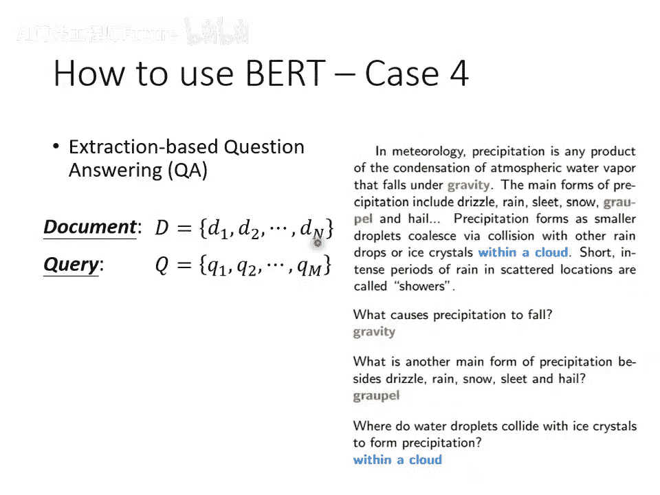

这边每一个Q就代表了一个中文的字，你把D跟Q都丢到QA的模型里面。

它会输出什么，我们要它输出两个正整数S跟一。

根据这两个正整数，直接从文章里面截一个段落出来，就是答案，输入S输出一代表的意思，就是说从这个文章里面的第十个字到第一个字，这一不是1234，一是字母E啊，而是从第四个字到第一个字串起来。

就是正确答案哦，这个听起来非常的狂，但这个其实是今天非常标准的做法，就我第一次听到说做这个56年前，第一次听到说做QA的时候，居然是读一篇文章，给一个问题输出两个正整数就是答案，我实在是不可置信。

但反正今天这个是一个非常呃常见的做法，好那是那如果我讲，如果你还有点听不懂的话，那讲的更具体一点，现在有一篇文章有一个问题，那正确答案是gravity。

机器怎么输出gravity这个正确答案呢，它要吐出。

就你的QA的模型要吐出两个整数，一个是S等于17，另外一个也是等于17，就gravity它出现在整篇文章里面的。

它是整篇文章的第17个词汇，那S等于17，一等于17，意思就是把第17个词汇抽出来当做答案，或者是举另外一个例子，今天最后一个问题，他的答案是within a cloud，在文章里面。

within the cloud是第77到第79个词汇，那你的模型要做的事情，就是输出77跟79这两个正整数，然后这两个正整数77~79，在文章里面第77~79个词汇。

这一段文字就是模型的答案就结束了啊，这个就是作业期要做的事情啊，当然我们这边不是从头from scratch，就从random initialized的参数来训练，这个QA的模型。

我们是有用bird pretrain的好，那用BTPRETRAIN怎么解这种QA的问题呢，这个解法是这个样子的，bird这个模型你要给他看一个问题，给他读一篇文章，文章跟问题。

中间问题跟文章中间有一个特殊的符号，然后前面再放一个COS的token，这跟刚才那个natural language influence的case是一模一样的。

只是在natural language influence里面两个句子，一个是前提。

一个是结论，这边一个是文章，一个是问题，那在这整个任务里面，你唯一需要训练的东西，只有对你唯一需要从头开始训练，所以从头开始训练，就是random initialized的东西只有两个向量。

这边用橙色的向量跟蓝色的向量来表示，这两个向量的长度跟BT的输出是一模一样的，假设你BT的输出，这边每个向量是768维的向量，那这两个向量也就是两个，768维的向量好，那接下来呢怎么使用这两个向量呢。

你就把这两个向量先把橙色的拿出来，分别跟对应到文章这个部分所输出的。

这边的每一个向量做inner pada，就文章这边输入三个token，这边就输出三个向量。

把这三个向量都去跟橙色的这个向量做inner product，算出三个数值，接下来过soft max得到三个数值，那这个这件这个算inner potter，这个部分就跟attention有点像啊。

你可以把橙色的部分想成是query，黄色的部分想成是key啊，那这就是做一个tension好，那接下来看哪里分数最高哦，这个地方分数最高吗，d two所对应的向量乘上橙色的向量以后，这个得到分数最高吗。

那S就等于二好，你输出的起始的位置，代表起始位置的那个正整数就输出二好，那蓝色的部分也做一模一样的事情。

蓝色的部分代表答案结束的位置啊，代表答案结束的位置，就我把蓝色的向量跟这边的每一个黄色的向量。

跟对应到文章里面，每一个token的黄色的向量做inner pada，在做soft max，再看谁的值最大，第三个位置的值最大吗。

那一就等于三，这个时候正确答案就是d two d3就结束了哦，所以你的模型要做的事情，其实就是去预测正确答案出现的起始位置，就因为答案一定在文章里面嘛，好在如果不在文章里面就不能用这一招了。

但这边假设答案一定在文章里面好，所以你要找出正确答案，在文章里面的起始的位置跟结束的位置，这就是这个QA的模型，这个question answering，问答系统所要做的事情啊。

当然你需要一些训练资料才能够训练这个模型，那这两个向量是随机初始化的，而这个BT的部分是在PRETRAIN的时候，已经得到它的初始化的参数了，好讲到这个部分，大家有没有问题要问呢，输入大小限制吗。

哦你说输入的长度有没有限制，对不对，好好这个是一个很好的问题，我复述一下，就是BT输入的长度有没有限制呢，呃理论上没有，但实际上有就是理论上，因为BT的model。

它是一个这个transformer的encoder嘛，所以他可以吃很长很长的sequence，你只要能够做self attention就行，但是你知道self attention它的运算量非常的惊人。

所以你发现石座上BT，其实没有办法吃太长的sequence，你可能最多吃个512就差不多了，如果你吃512长的sequence，中间self attention都已经要产生。

那个512512的attention的metric，那你可能运算就吃不消了，对所以实际上它的长度不是无限长的呃，在助教的城市里面呐，已经帮大家处理的这个问题，我们会限制BERT他吃的长度呃。

而且在训练的时候，一篇文章很长嘛，那我们会怎么处理呢，我们把文章截成一小段，一小段一小段，那我们每一次都只会拿一小段出来做训练，我们不会把整篇文章丢到BT里面，因为你是你那个掉的记忆太大。

你训练起来会有问题，这样回答到你的问题吗，谢谢好诶，大家有问题要问吗，哎来这边来，哎不好意思，你说他我没有听的很清楚，你可以再说一遍吗，哦你说跟填空题有什么关系。

对不对，哇，这个问题太棒了，你就会问说这个填空题就是填空题啊。

那后面不就是做问答，就这边是要做问答吗，这两件事情怎么会有关系呢，呃这个就是卖个关子，等一下就会就会试着回答你了，好这个大家还有没有问题要问，啊还有啊好没有的话。

那我们就继续了，下一页投影片就告诉你说BERT这么知名的模型，这就是全部了，那你可能会觉得说呃，这个BT这个呃PRETRAIN的时候就是做填空题啊，这个我自己应该也有办法做吧。

我就把那个作业四的城市改改，也可以做，让机器学做填空题呀，那这个厉害在哪里，厉害的地方就是哇，这个你真的是没办法自己做了，这个你真的是自己训练不起来，首先当初最早的google的BT啊。

他用的资料量也已经非常惊人了，他的资料量有三个billion的词汇，三个BILLI的词汇有多少呢，他是哈利波特全集的3000倍了，哈利波特全集大概是100万个词汇。

那google在训练bird最早的那个bird的时候，他用的资料量是哈利波特全集的3000倍。

所以你处理起来已经有点痛苦了，再来更痛苦的是训练的过程，为什么知道训练过程很痛苦呢，因为我们实验室有个同学，他也是也是助教之一，他试图自己劝了一个bird，他可不可以复现google的结果好。

所以在这个图上面呢，纵轴代表的就是GW的分数，我们刚才讲过glue，对不对，有九个任务，九个任务平均起来的，正平均起来的分数叫做GW的分数啊，这是google最原始的bird的GROUD。

分数是蓝色这一条线，那我们的目标其实不是做bird，是做ALBERT，ALBERT是一个进阶的版本，它是橙色这一条线。

蓝色这条线是我们自己训练的ALBERT，那么其实训练的还不是最大的版本，BT呢有base的版本跟large的版本，large的版本我们要自己劝，真的是劝不动啊，所以我们做了试着劝了最小的版本。

看看能不能够跟google得到的结果一样，那google这边像这个你可能会说啊，这个三个billion的data，三个billion词汇data好像很多，其实呃因为它是UNLABEL的资料。

所以你从网络上随便排一堆文字，就这么多资料，所以你要爬这个等级的资料并没有很困难，但难的是训练的部分，好这个横轴就是训练的过程参数，update几次呢，update1000000次。

那这要花多长的时间呢，用TPU跑了八天呐，所以你这个这个TPU都要跑八天，如果你用COLAB做的话，这个至少要跑200天以上，你跑到明年你都跑不出来，所以你知道这种BT这种模型。

你在自己家里真的是没有办法做，还好作业只是要微调它，微调它，你就有办法用COLAB做，用COLAB微调BD的话，大概半个小时到一个小时，你可以微调完，但你要从头开始训练，训练他做填空题这件事情哇。

太花时间了，你不可能用COLAB自己把它做出来好。

那你可能会问说，为什么我们要自己训练一个bird呢，那反正google都已经有训练出bird，而且这些这些pretrain model都是公开的，我们自己训练一个，而且结果跟google的BT差不多。

到底有什么意义呢，好那这边想要做的事情呢，其实是想要建立BERT胚胎学，bird胚胎学指的是什么意思呢，我们知道bird的训练过程，需要耗费非常大的运算资源，所以我们想要知道说。

有没有什么可能去节省这个运算资源，有没有可能让他训练的更快一点，那想要知道怎么让他训练更快一点，也许我们先从观察他的训练过程开始做起，过去从来没有人观察过bird的训练过程。

因为对google的paper而言，它就是啊就直接告诉你说我这个BT嘛，然后他在各个任务上都做的很好，那实际上在训练bird这个学填空题的过程中，到底bird学到了什么事情。

这个过程中他什么时候学会填动词，什么时候学会填名词，什么时候学会填代名词，没有人去研究过这件事情，所以我们自己劝了一个BT以后，我们就可以观察BERT在什么时候学会。

填什么样的词汇，它的填空的能力到底是怎么增进的好。

那这个细节呢就不是这门课的主轴了啦，所以这边就不讲了。

我们就把论文的链接放在这边给大家参考，这边爆雷一下，就是呃得到的结论，跟你直觉想象的是不太一样的好。

那我们还没有讲到，为什么bird会好，不过我们再补充说明一件事情，就是呃刚才讲的那些任务都没有，包括sequence to sequence the model啊，那如果我们今天要解的任务是。

Sequence to sequence model，怎么办呢，BT只有pretrain encoder，有没有办法pretrain sequence to sequence。

model的decoder呢，可以的，那怎么做好，你就说我有一个sequence to sequence model，有一个transformer，还有一个encoder，有一个decoder。

输入是一串句子，输出是一串句子，中间用cross attention连接在一起，那你给这个encoder的输入啊，你故意做一些扰动哈，弄坏等下会具体的跟你讲说什么叫做弄坏，然后decoder是什么呢。

decoder就是我希望输出的句子，跟弄坏前是一模一样的，encoder看到弄坏的结果，然后decoder要输出还原弄坏前的结果。

TRA下去就是PRETRAIN一个sequence to sequence model好。

那怎么弄坏呢，就有各种不同的方法，有一篇paper叫做mess，mess里面就说啊这个弄坏的方法就跟BT一样啊，就是呃把一些地方盖起来嘛，就结束了，那后来还有各式各样弄坏的方法，比如说把一些词汇删掉啊。

呃把词汇的顺序弄乱呐，把词汇的顺序做一个旋转呐。

然后或者是说呃既插入mask，又把一些词汇弄掉啊，总之有各种不同的方法把输入的句子弄坏，然后再请sequence to sequence model把它还原回来。

有一篇paper叫做，but它就是把这些方法一股脑的都用上去，发现说都用可能结果是比较好的，可比max还要更好，我这边就想问一个问题，为什么他不是芝麻街的人物了，这那你可能会问说。

那有这么多的方法，就有这么多弄坏的方法，有这么多masking的方法，哪种方法比较好呢，也许你想自己做一些实验来尝试一下，那这边告诉你说你已经不用做了，google都帮你做完了。

有一篇paper叫做T5，T5是什么的缩写呢，它是transfer text to text transformer，我有五个T好，所以叫T5的缩写啊。

这个T5里面呢他就是做了各式各样的尝试啊，你可以想得到的组合啊，他都做过了啦，就这样，那paper长达67页，你自己回去再慢慢读。

看看得到什么样的结论，这个T5啊，它是训练在一个叫做coal clive。

crowd copus上面的的这个data set上。

CLOSAL啊，就是克罗索CLOSAL，就是非常巨大的意思。

那合起来呢叫做c four或者叫c four训练T5。

而且大家都是命名大师，诶的命名都非常的厉害，这个c four有多大呢。

c four是公开的资料集，你可以载到它，它是公开的，但是它的原始档案的大小有7T呀。

你载的下来你也不知道放哪里，而且它载下来以后呢，google提供那个script去做PREPROCESSING。

据说前处理，那他有加一个说明书。

看网网站上有试出这个COOPPOS，网站上有加个说明说。

前处理用一张GPU要花355天这样子，其实这个哇这个你攒下来，你要钱处理也是有问题的哦，所以你发现说今天这个做deep learning用的资料量。

