# 【官授搬运】2026年全新优化版李宏毅机器学习系统课程，这才是真正的初学者体系课程！—人工智能／深度学习／神经网络 - P54：3-自监督学习-3–BERT的奇闻异事 - AI算法工程师Future - BV1ruqABeEFX

好接下来就是要回答刚才同学的问题，为什么BT有用呢，啊，那我们这边呢呃先提供一个最常见的解释方法，最常见的解释是这个样子的，好，这个输入一串文字，每一个文字接下来都有个对应的向量。

这个向量我们直接下来叫它embedding，那这个向量有什么特别的地方，它特别的地方是，这些向量代表了输入的那个字的意思，比如说输入台湾大学输出四个向量，这四个向量分别就代表台还有弯，还有大。

还有学的意思，那什么叫做代表意思呢，更具体而言是，假设你把这些字对应的向量把它画出来，或算它们之间的距离，你会发现说越意识越相近的字，他们的向量就越接近，比如说果跟草都是植物，它们的向量就比较接近。

但这个例子是假的，等下给给你看一个真正真真实的例子啊，鸟跟鱼都是动物，也许比较接近，那电不是动物，也不是植物啊，所以比较圆，那你可能会问说这个中文有一字多义的问题呀，啊其实不是中文。

很多语言都一字多义的问题呀，BERT他可以考虑上下文，所以同一个字比如说都是果这个字，它的上下文不同，它的向量是不会一样的哦，所以吃苹果的果跟苹果手机的果，这两个果通通都是果。

但是根据上下文它的意思不同，所以它的向量，它对应的embedding就会非常不一样，苹果手借果可能就跟点比较接近，BT真的可以做到这件事吗。

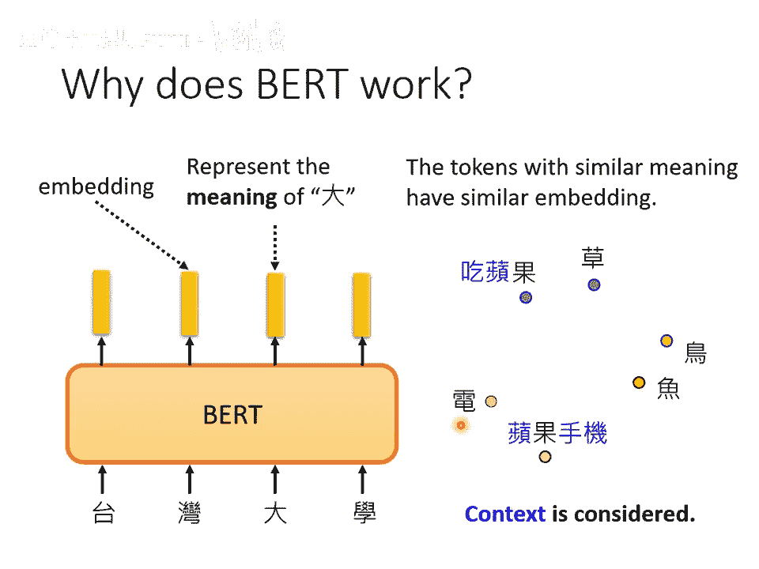

这边只是一个呃呃胡乱画的例子，那接下来就给你看真正的例子，假设我们现在就考虑过这个这个字好，那我们就收集很多有提到果这个字的句子，比如说喝苹果汁啊，苹果电脑啊等等，那我们把这些句子都丢到bird里面。

都丢到bird里面，接下来我们再去计算每一个果，它所对应的这个embedding，就喝苹果汁丢进去，我有一个向量，苹果电脑的果有一个向量，这两个向量不会一样，为什么不会一样，因为这是一个呃。

这是一个这个这个这个encoder，这是一里面有self attention，所以根据果上下文的不同，果上下文的不同，得到的向量会不一样，接下来我们计算这些果之间的cos similarity。

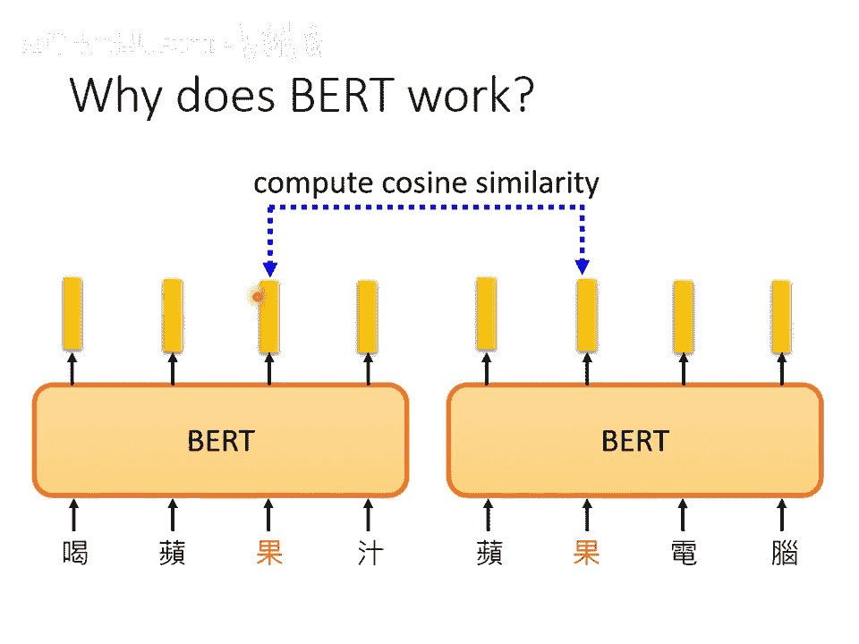

就是计算它的相似度，得到的结果是这个样子的，这边选了十个句子，前五个句子里面的果都代表了可以吃的苹果，比如说这第一个句子是今天买了苹果来吃，第二个句子是进口富士苹果平均每公斤多少。

第三个句子是苹果茶真难喝，第四个句子是智利的苹果季节将来到，第五个句子是呃，进口苹果怎怎怎样怎样怎样，所以这五个句子都有提到过，接下来有个句子也都有提到过，但他们指的是苹果电脑的果。

比如苹果即将在下个月发表新款IPHONE，苹果获得新的专利，今天买了苹果手机，苹果股价跌了，苹果押宝指纹辨识技术等等，这边有十个果，两两之间去算相似度，你会得到一个10×10的矩阵。

这里每一格就代表两个果，它们的embedding之间的相似度啊，那你会发现说前五个句子里面的果哦，这边这个值越偏黄色就代表算出来值越大了，所以自己跟自己算相似度一定是最大的，自己跟别人一定稍微小一点。

前五个果算相似度比较高，后五个果算相似度比较高，但前五个果跟后五个果，前五个果跟后五个果相似度就比较低，BERT自己知道说前五个果指的是可以吃的苹果，它们比较像，后五个果指的是苹果电脑的果。

所以它们比较像，但这两堆果它们的意思是不一样的好。

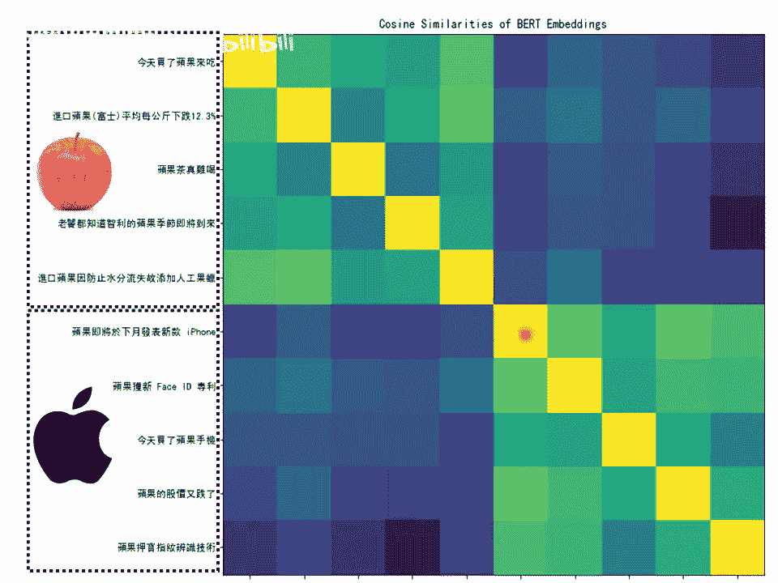

所以BIRT的这些向量输出来的向量，每一个向量就代表了那个词那个字的意思，所以我们也许可以说哇，这个BT在训练做填空题的过程中，他学会了每一个中文字，它有什么样的意思，他也许真的了解中文的意思了。

对他来说，每个中文的符号不再是没有关系的，他了解中文的意思，所以他可以在接下来的任务做得更好，那你接下来可能会问的问题就是，BT为什么有这样子神奇的能力呢，为什么他可以做到，为什么他可以呃做到说呃呃。

他的这个输出的这些向量，就代表输入的那个字的意思呢，好那这边呢基于一个语言学的假设，那这个john roper ff呢是呃，1960年代的一个语言学家，他那时候说我们怎么知道一个词汇的意思呢。

我们要了解一个词汇，要看他的company，就是跟他常常一起出现的词汇，也就是它的上下文，一个词汇的意思取决于它的上下文，所以假设可以吃的苹果的果，它的上下文常常出现的是啊，吃啊或者是树啊等等。

那他可能指的就是可以吃的那个苹果，那如果是苹果电脑的果，他后面常常接电呐，接专利啊，接骨架啊，那他指的可能就是苹果电脑的果，所以一个词汇的意思可以从它的上下文看出来，而bird在做的事情。

在学会做填空题的过程中，也许他在学的就是从上下文去抽取资讯，因为我们在训练BERT的时候，你给他w one w two w3W四，你就把w two遮起来，叫他去预测w two，他怎么预测w two。

他就是看他的上下文嘛，所以他就从上下文去抽取出资讯来预测w two，所以这个向量，它就是上下文资讯里面抽取出来的的精华，然后可以预测WTO是什么，那像这样子的想法。

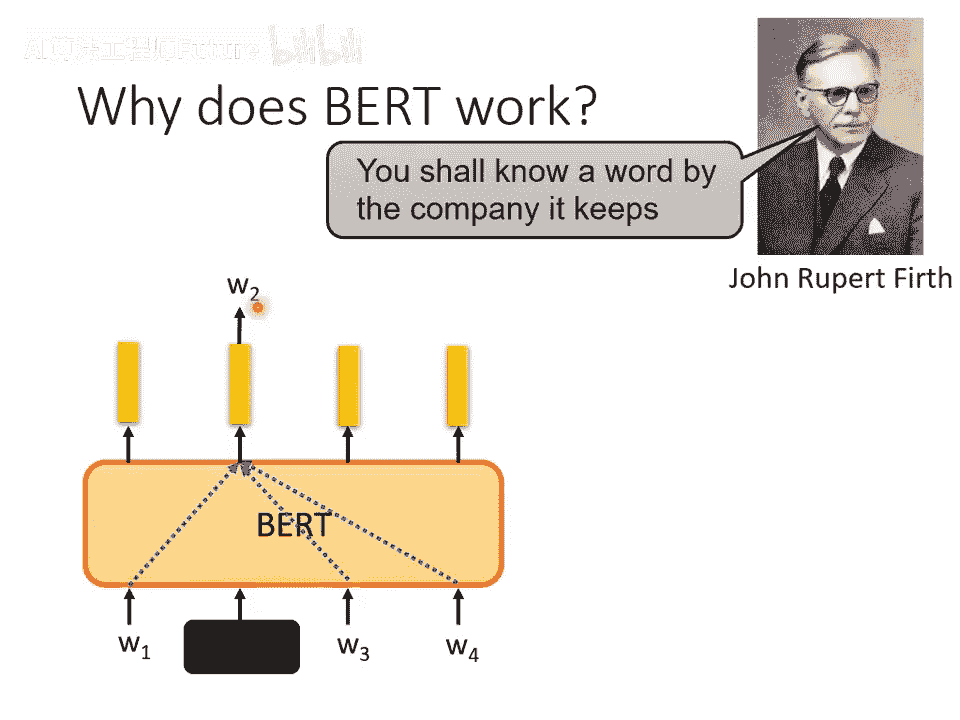

其实在BT之前就已经有了，过去有个技术叫way bedding，我embedding里面有个技术叫做SYL，SYL做的事情跟BT其实一模一样，就是把中间挖空，叫你预测空白的地方是什么东西。

那simple这种技术啊，这种war embedding的技术啊，它就可以给每一个词汇一个向量，那那个向量就代表那个词汇的意思，那有人就会问说，为什么SIO和SIO是一个非常简单的模型。

它就是两个transform，它是一个非常简单的模型，有人就会问说，为什么它只用两个transform呢，能不能够更复杂一点呢，之前这个CBL的作者啊，就thomas in call，洛夫曾经来过台湾。

那那时候常常之前我上课的时候，常常有人问我说啊，为什么SIO只有linear啊，为什么不用learning呢，那我就问thomas and close这个问题，还有说要用deep learning。

其实也可以，但之所以选择lindy linear model，简单的模型，最大的关键其实是运算的效能，当时computing power跟今日还是不在同个量级上，那个时候大概是这个16年的时候。

5年前还不在同一个量级上，那个时候要训练非常大的模型还是有困难的，所以选择了比较简单的模型，但今天你用BT其实等于就是deep版的SYBO了，你就可以做呃更复杂的事情。

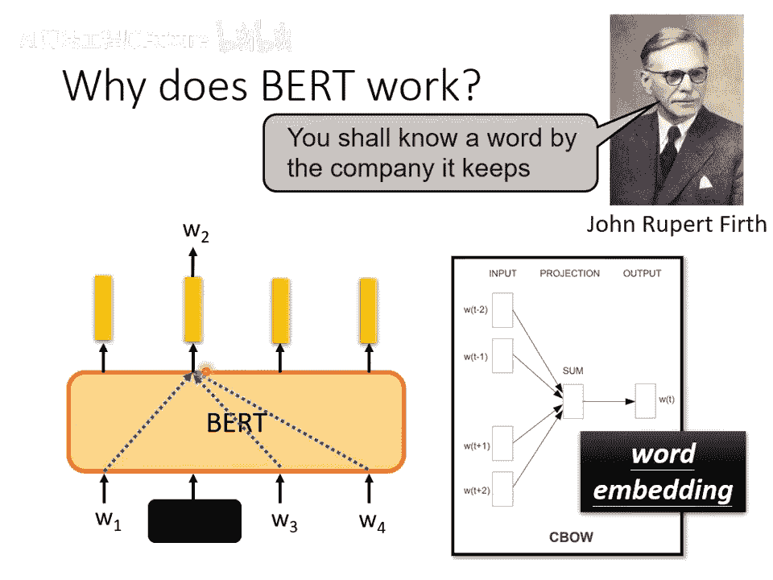

而且bird还可以做到同个词汇根据不同的上下文，他的embedding就不一样，那因为他是一个war embedding，进阶版，是考虑上下文，也就是context的WAEMBEDDING。

所以bird又叫做contextual life，the bt所抽出来的这些embedding，这些向量又叫做contextualized的word embedding，希望这样大家可以接受这一个答案。

好讲到这边大家有没有问题想要问呢，诶这样觉得可以吗，好诶大家有问题想要问吗，如果你可以接受这个答案的话，就很好，你今天晚上睡得着，但是接下来我要讲一个多余的，会让你今天晚上睡不着的东西。

就是这个答案真的是这样吗，就这个是你在文献上最常见到的。

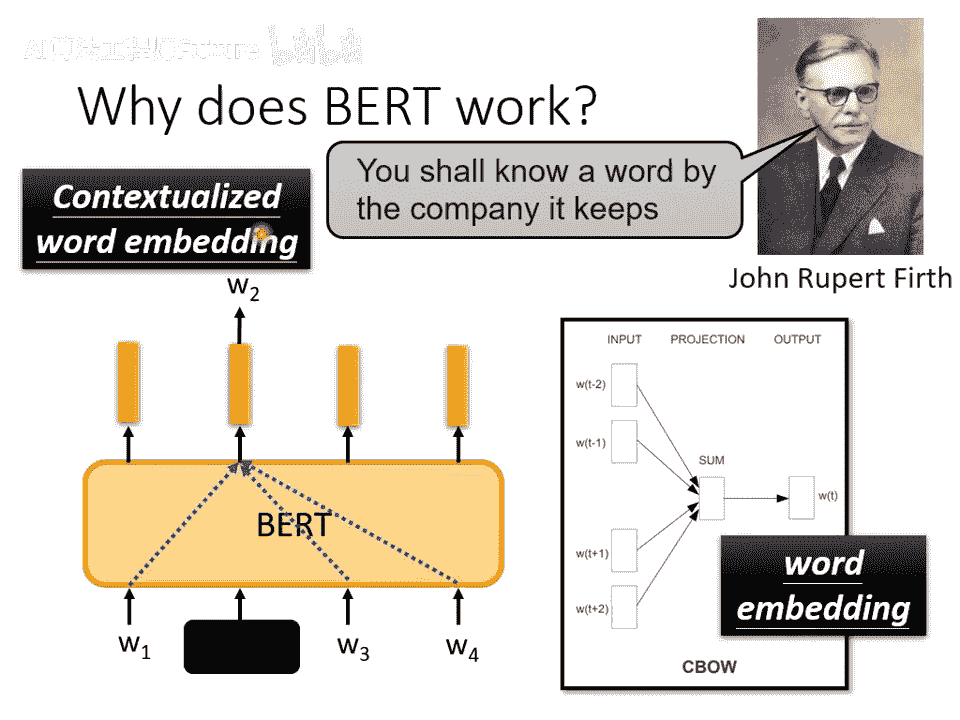

就你跟别人讨论bird的时候，别人最常告诉你的理由，真的是这样吗，我这边告诉你另外一个不知所云的，我们实验室同学做的实验，这个实验是这样子的，我们把在训练在文字上的bird，拿来做蛋白质的分类。

DNA的分类或者是音乐的分类，我们就拿DNA的分类做例子吧，DNA大家都知道说DNA就是由一连串三磷酸啊，不是三磷酸腺苷叫什么，叫做去氧核糖核酸，对不对，这个这个DNA就是一连串去氧核糖核酸所组成的。

去氧核糖和核酸有四种。

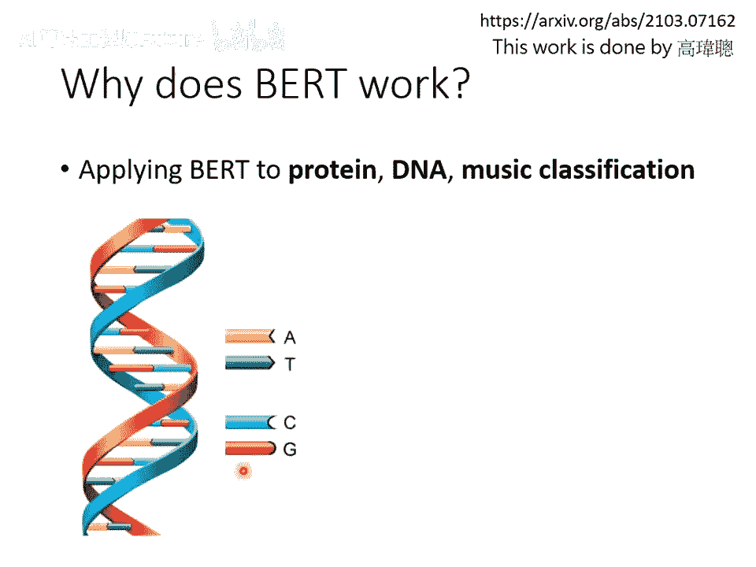

分别用ATCG来表示，所以一串DNA看起来就像是这个样子好，那我们要做DNA分类的问题，也就是给一串DNA，那要决定这个DNA属于什么类别，所以这边ATCG的这些字母啊，代表DNA啦啊。

这边这个东西呢代表是分类，你可能会说ERIEN是代表什么，不要在意这些细节，我也不知道，这样反正就是一个分类的问题，训练下去有训练资料。

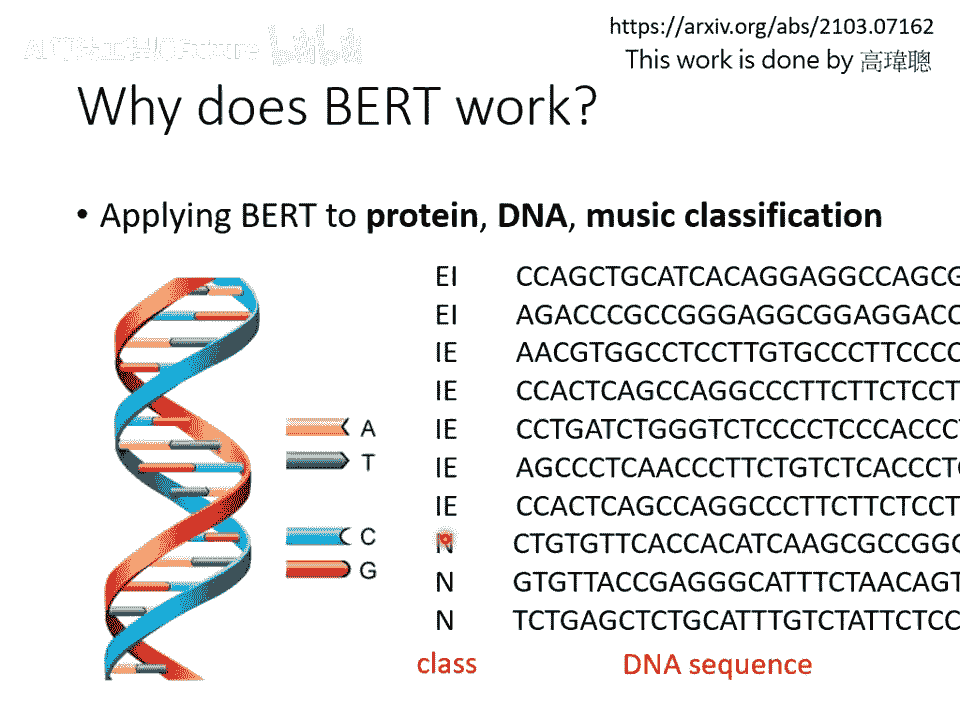

有label资料，训练下去就结束了，好那这神奇的地方是这个样子，DNA可以用以除ATCG来表示吗，那我们现在要把BERT用在DNA的分类上，到底是怎么回事呢，我们把ATCG分别对应到一个英文的词汇。

比如说A就对到wt，就对到UC就对到EG就对到she，那这个对应的表格不重要，你可以随机产生A可以对应到随便一个词汇，T对应到随便一个词汇T对，要随便一个词汇，C对，要随便词汇G对。

要随便词汇都没有关系，对结果影响不大，你就把一串DNA变成一串文字，其实这串文字是一串不知所云云的文字，比如说AGAC就变成未戌未系，不知道在说些什么，然后呢把它丢到BT里面了，一样有cl s啦。

然后一样产生一个vector啦，一样通过linear的transform了，一样分类啦，只是分类是这个DNA的类别，不知道在做什么的类别来一样，第一列的部分，Random initialized。

BT的部分，用PRETRAIN的模型来initialize，但是用来initialize的那个模型，是那个学会做填空题，他在英文上他学会了做英文填空题的哪一个pd，你可能会想说，这都什么乱七八糟的实验。

这样莫名其妙的实验，明明是要做DNA，把它转成一串看不懂的文字，用BT这样有什么意义吗，bird要他BERT，它可以分析语义啊，他知道每个词汇的意思啊，哎呀乱七八糟的句子他一定是看不懂的啊。

那这做这个实验到底有什么意思。

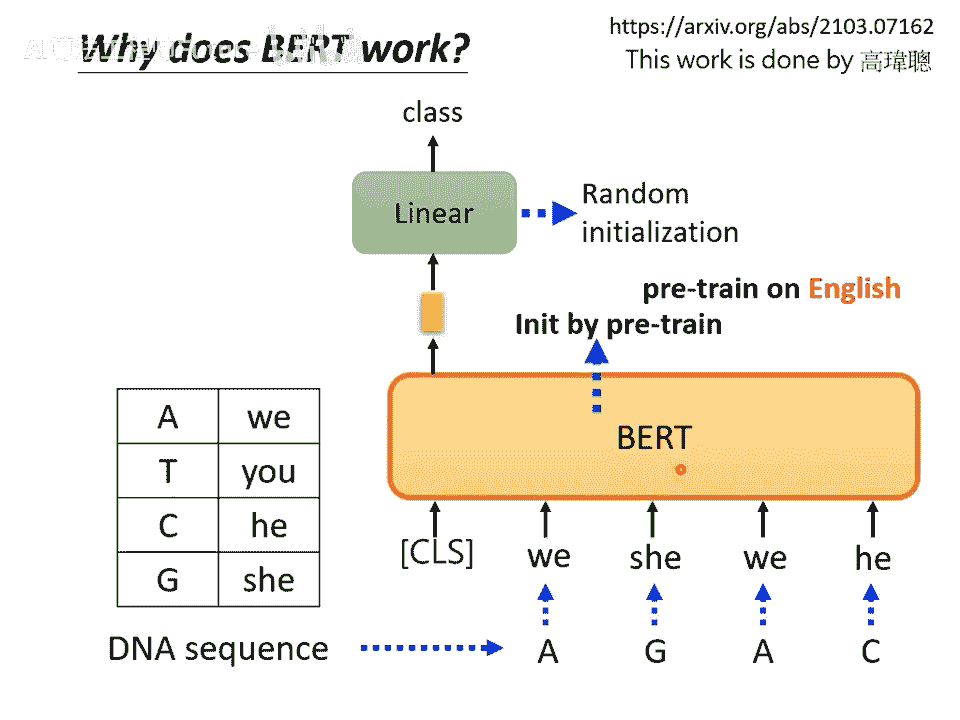

神奇的地方是啊，这边呢就做了不同的任务，第二那个蛋白质的分类做了三种，然后蛋白质就是由氨基酸所构成的，有十几种氨基酸，每一个氨基酸都随便给他一个词汇，然后DNA就是a t c g music。

就是那个音符嘛，每个音符也随便给他一个词汇，然后接下来就当做是一个文章分类的问题，硬做下去来发现说如果你是，所以你没有用BT，你得到的结果是蓝色的这个部分，如果你有用BERT，你得到的结果是红色的。

这个部分居然是比较好的。

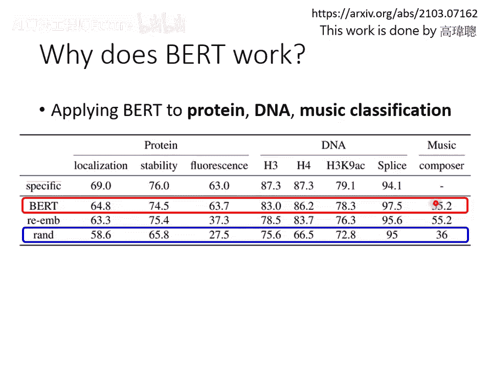

我知道你听了一定觉得满头问号了，你心里一定想起小朋友，你是有很多问号的哪一首歌啊，这个就是神奇的实验，不知道为什么没有特目前没有特别好的解释，但我之所以要讲这个实验，只是想要告诉你说BT到底为什么会好。

这里面还有很大的研究的空间，从这个实验看来，我并不是要否认说BERT学到语义这件事情呃，我们可以非常明显的从他的embedding里面，观察到，他确实知道每个词汇的意思，他知道哪些词汇意思比较像。

知道哪些词汇意思比较不像，但我真想要表达的的意思是说，你就算给他对他而言是乱七八糟的句子，它居然还是可以分类的比较好，所以他的能力不完全来自于，他看得懂文章这件事，而是可能有其他的理由，举例来说。

BT也许它本质上就是一个比较好的初始化参数，不见得跟语义有关，就这组初始化好参数，就是特别适合拿来做大型模型的训练，是不是这样呢，那这个还尚待更进一步的研究，我之所以想要告诉你这个实验的结果。

只是想告诉你说呃，我们今天你今天这些模型都是非常新的模型，他们为什么能够成功运作，还有很大的研究的空间。

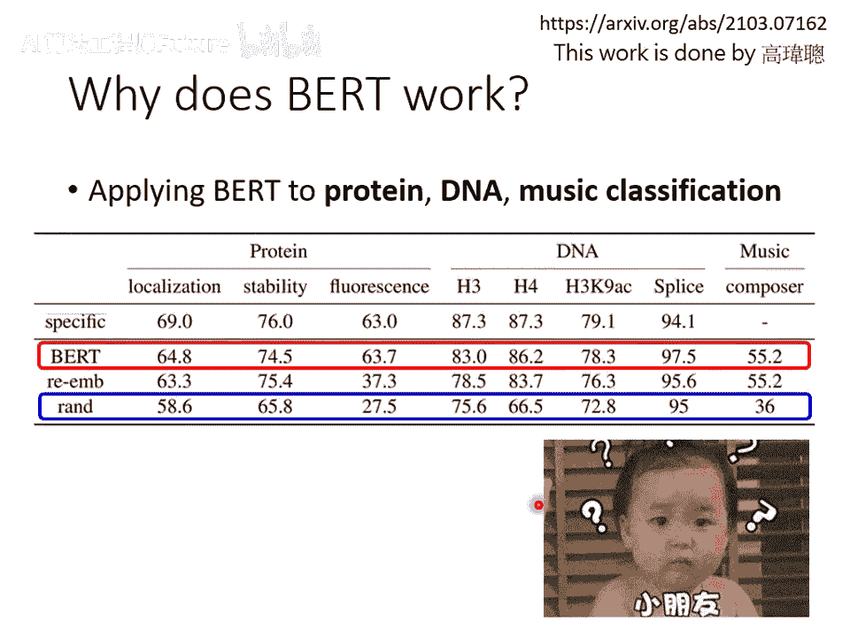

好那呃我后面还有一小段，我们就讲完那一小段再下课，好，有关那个BT的部分，我们今天讲的其实也是沧海一粟啊，我在这边再放了另外两个影片的连接，如果你想学完整版本的各种bird的变形。

你可以参见以下两个连接，但如果没有兴趣也没有关系，呃作业里面也用不上，接下来的课程也用不上，只是想告诉你说BERT还有很多其他的变形好。

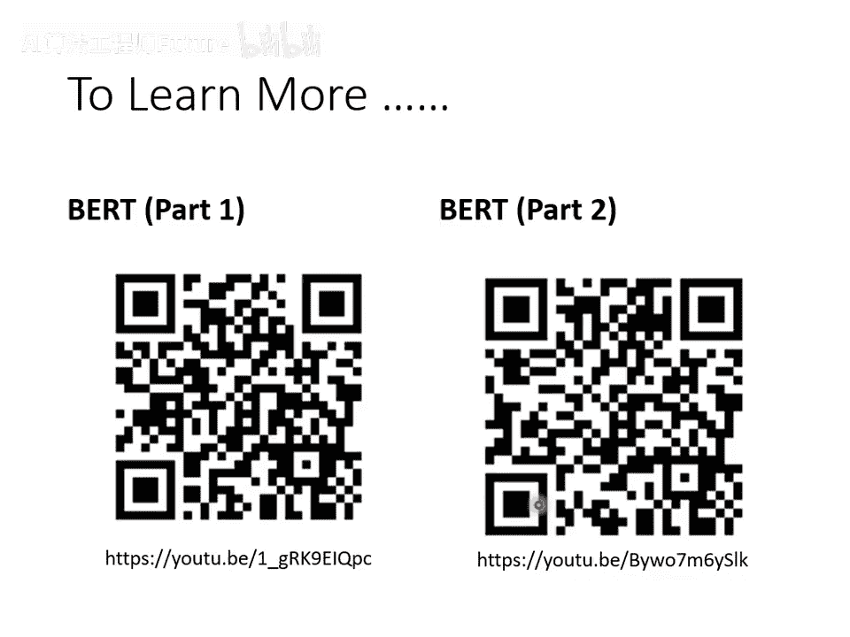

接下来要讲的叫做某台邻国的bird，多语言的bird，多语言的bird有什么神奇的地方呢。

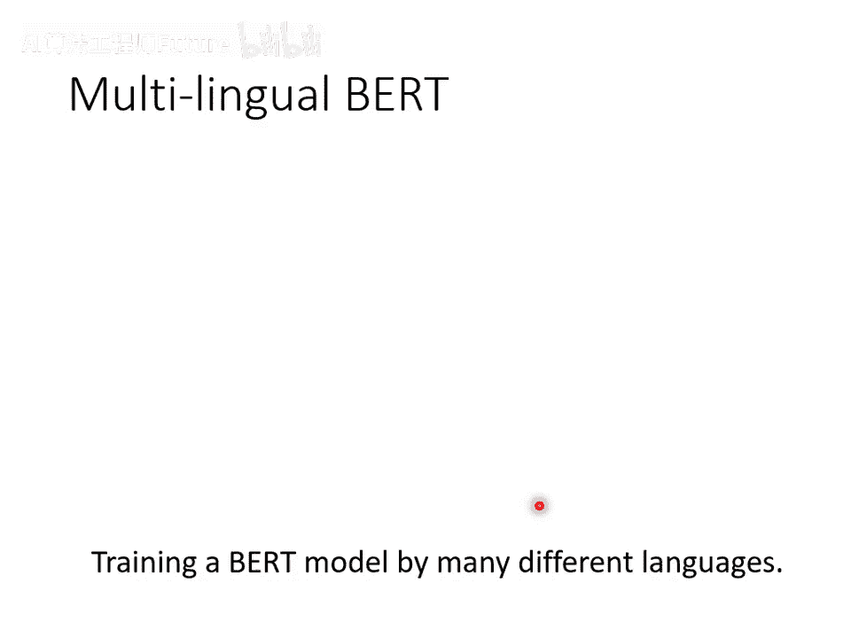

就是你在训练的时候，你会拿各种各样的语言，中文英文，德文，法文通通给他拿去做填空题。

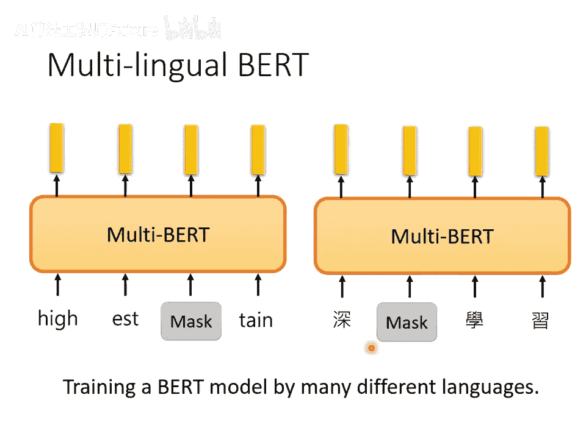

这个就是某台邻国的bird，某台邻国的bird有什么神奇之处呢，wow试出了一个某台邻国的bird，它是用104种不同的语言做成的，所以mortino bird会做104种语言的填空题。

但接下来真正神奇的地方是MOTLEGO的BT，拿英文的QA的资料去做训练，它自动就会学做中文的QA的问题，我不知道大家有没有听懂这句话。

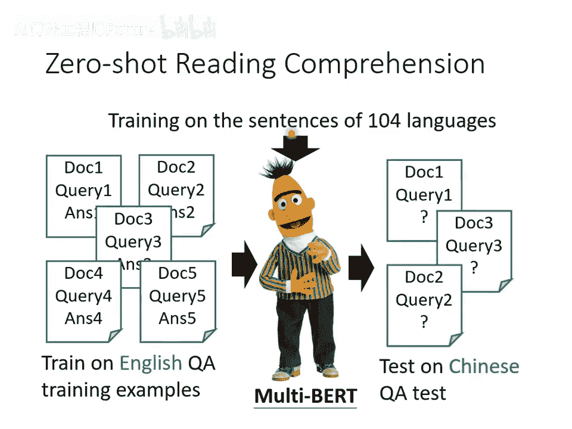

我接下来有一个真实的实验给大家参考，这边的训练资料，翻译two的资料用的是广，它是一个英文的QA的资料集，中文的部分是一个台达电试出来的，叫做DRCD的资料集，这个资料集就是我们在作业里面会使用到的。

资料集，好，那在还没有BT的时候，结果做出来不太好啊，在BERT之前最强的问答模型叫q a net，它的正确率只有我这个是f one score，其实它不是正确率，也就当做是正确率好了。

它的正确率就是78percent好，那BT呢如果是PRETRAIN，在中文上，在中文上学会做填空题，在中文的QA资料上做翻Q测试，在中文的问题上，那没问题，正确率89percent。

即使人在同样的资料上，也只能做到93percent，所以跟人即其实也没差那么远了，神奇的地方是，如果是嗯多语言的那个bird fight to，在英文上，你是拿英文的QA的资料去训练，它，直接测试。

在中文上居然也有78percent的正确率，跟之前的q a net不是用BT的network，正确率是差不多的，他从来没有看过中英，他从来没有看过中文的问答的资料集，对他来说，中文的问答的问题就是裸考。

他第一次看到他居然能够回答，怎么会这么神奇，当然有人可能会说呃，你在预训练的时候，我在PRETRAIN的时候不是看过英文，中文吗，看过104种语言里面有中文吧，但是他在预训练的时候。

他学习的目标只有做这个填空啊，他只会做中文的填空，然后你让他学会做中文的填空，但接下来教他英文的问答，他居然自动学会了中文的问答，就问你神不神奇。

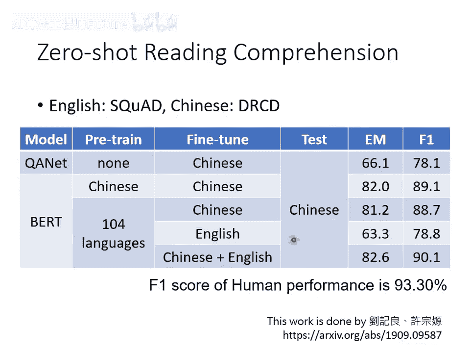

好那为什么会这样呢，一个比较呃简单的解释是说，也许对某台邻国的BT而言，不同语言间没有什么差异，不管是你给他看中文还是英文，最终中文和英文的这些词汇的embedding，只要是意思一样的，都会很近。

所以可能兔子跟rabbit他的embedding很近，跳跟jump的embedding很近，与跟fish的embedding很近，有跟swim的embedded很近，也许他在看过大量语言的过程中。

自动学会了这件事情，并不是只是一个猜测，我们其实是有做过一些呃验证哦。

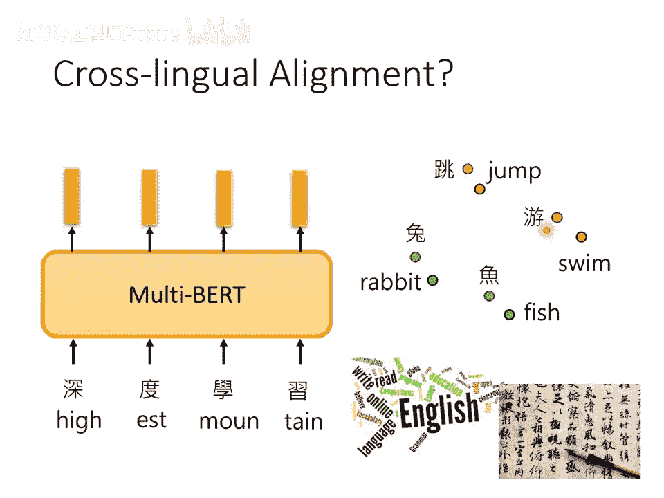

那这边验证的用的major呢叫做MINSTRESS，main reciprocal ranking啊，叫做缩写是NRR，那细节我们这边就不细讲，你只要知道说NRR的值越高。

代表两个不同语言的embedding，他们align的越好，所以ALI好的意思就是说同样意思，但不同语言的呃呃字，他们会被它们的这个向量是接近的，NR越高就代表说同样意思不同语言的词汇，它的向量越接近。

而这个深蓝色的最右边这一条线是什么呢，纵轴是NRR越高越好，深蓝色这条线是google试出来的，104种语言的某台LINUBIRD得到的NR，它的值呢都非常的高，代表说对他来说不同语言没有差。

他只看意思，不同语言对他来说没有什么不一样，那我们自己也试着去训练了某台英国的BT啦，我们用的资料比较少，每个语言只用了这个20万句而已啊，就算很少，我们自己训练的就结果很差。

不知道为什么我们自己训练的某台lego bird，没有办法把不同语言ALI在一起，他似乎没有办法学到不同语言，同样意思的那些符号，它们应该要一样的意思，那这件事情就困扰了我们很久，那为什么要做这个实验。

做这个实验当初为什么要自己训练motlego bird，是因为我们想要了解是什么原因，造成了motlego bird，我们想要设置设置不同的参数，不同的factor。

然后看看哪些factor会影响mortaingo bird，茅台林果的能力，但我们发现我们自己劝的茅台零国bird，不管怎么调参数，他就是做不到MORTA邻国的效果。

他就是做不到alignment的效果，那有一天我们突然觉得会不会是资料量不够呢，每个语言200K太少了，资料变五倍，看看做不做得起来，但做这个实验之前，大家都有点抗拒，有点害怕。

因为训练的时间要变成原来的北。

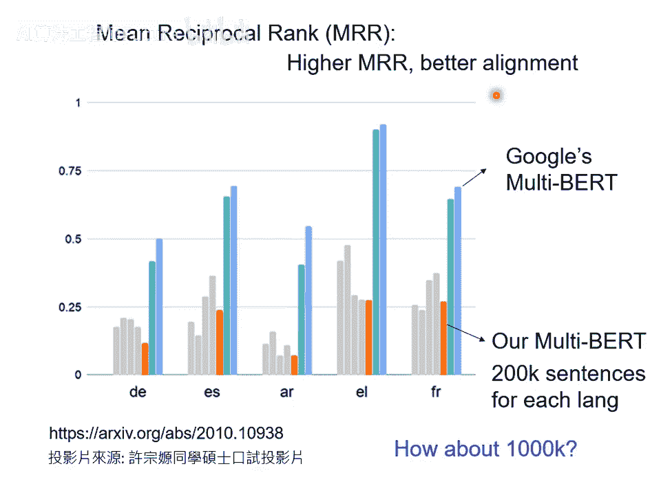

到底结果会怎样呢，好这个是loss下降的图啊，然后劝了两天，啥事也没有发生，loss都掉不下去，就在准备要放弃的时候，loss就突然掉下去了，这个是用八张V100券的，我们实验室没有八张V100啊。

是用国网中心的机器跑的，但是劝了两天呐，loss都不掉下去啊，正在放下，正要放弃的时候，loss就掉下去了啊，这是某个同学FACEBOOK的贴文，我把它引用在这边，告诉你当时内心的惊叹。

而整个实验呢要跑一周以上啊，要跑一周以上才能够把每个语言1000K的呃，问那个填空题把它学好。

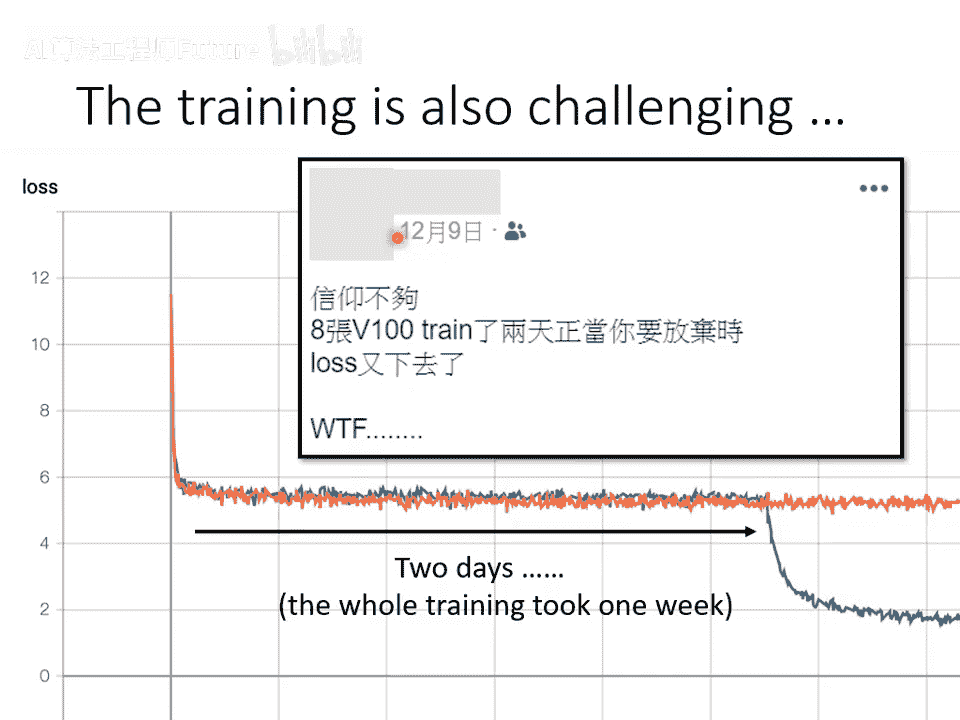

那资料变多有用吗，哇靠真有用，这样子资料变多，alignment就学起来了，所以看起来资料量是能不能够把不同语言，而ALI在一起一个非常关键的因素，所以有时候神奇的事情是，很多问题要在足够资料量的时候。

很多现象要在足够资料量的时候才会显现出来，过去都没有人说过什么model，有这种某台灵活能力，可以训练在A语言的QA上，直接transfer到B语言，或许从来没有人说过有这件事情。

这几年才有一个可能的原因，就是过去资料量都不够多，现在有够多的资料，有大量的运算资源硬做下去，这种现象才会被观察到好。

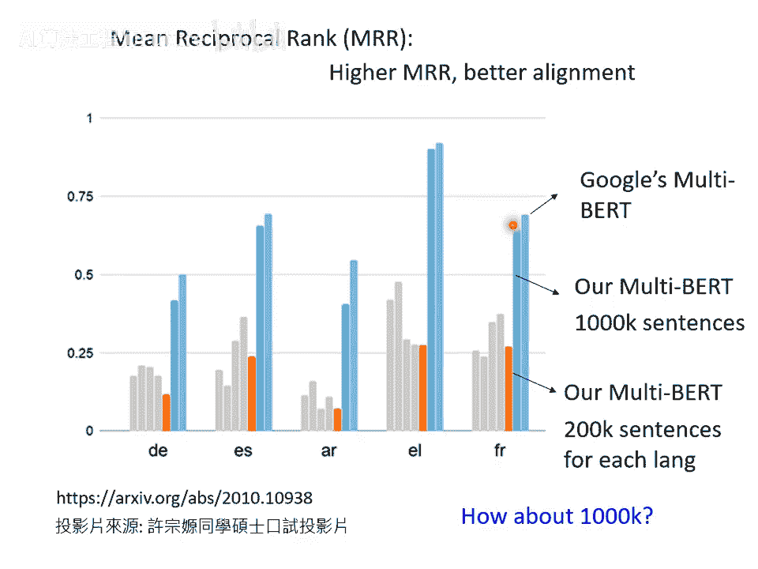

那这边有最后一个，我知道时间快到了，但我想讲最后一个神奇的实验呃，咦你不觉得这整件事情还是有点怪怪的吗，我就觉得整件事怪怪的，哪里怪怪的，你说BERT可以把不同语言同样意思的符号，让它们的向量很接近。

可是在训练more time lemore bird的时候，他明明是给他英文，他能做英文的填空，给他中文，他能做做中文的填空，它不会混在一起呀，那如果对他来说，不同语言间根本没有差的话。

那他怎么可能给他英文的句子做英文的填空，给他英文的句子会不会空格的地方，他就填中文进去，但他没有这样做，代表说他知道语言的咨询对他来说同样不同，来自不同语言的那些符号终究还是不一样。

它并没有完全抹掉语言的资讯，所以我就想了一个题目，我说我们来找一下语言的资讯到底在哪里，后来我们发现语言的资讯并没有藏得很深。

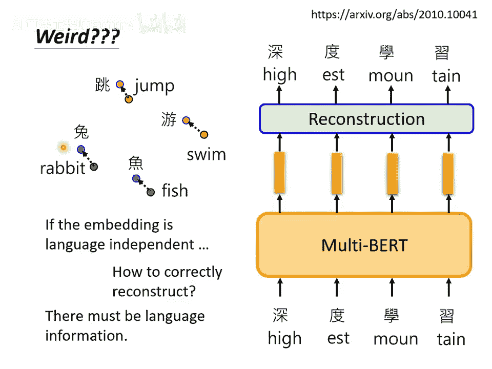

有一个同学发现说，我们把所有英文的embedding，就把所有英文的词汇都丢到mortingo bird里面，把它的embedded平均起来，把所有中文的embedding平均起来，两者相减。

就是中文跟英文之间的差距，你可以做到什么样神奇的事情呢，你可以做到现在给MULTILINGUBERTON1句英文，然后他得到embedding，把这些embedding加上这个蓝色的向量。

这个就是英文和中文之间的差距，这些向量对MORTAINGOBIRT来说，就变成了中文的句子，然后你再叫他去做填空题的时候，他居然就会填中文的答案了，所以非常的神奇。

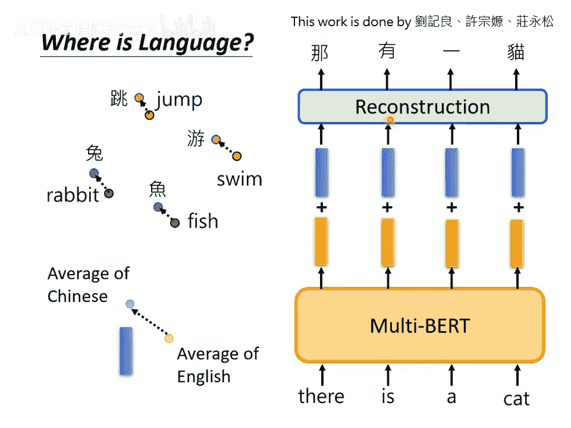

以下呢是真实的例子，现在你给mortilingual bird读的句子是，The girl that can help me is all the way across town。

There is no one，Who can help me，你给BERT读，There's no one，who can help me这个句子，那BERT把这个句子读进去以后。

那你再把这个蓝色的向量加到BT的embedding上，本来读进去的是英文的句子，变成embedded，加上这个蓝色的向量以后，birth就会觉得他读到的是中文的句子好，然后呢你再叫他做填空题。

把embedding变回句子以后，他得到的结果是这样的哦，他本来读进去的是，There is no one，Who can help me，那加上蓝色的向量在embedding上以后。

BERT输出的句子就变成there是无人人，can help我啊，就产生一个晶晶体啊，你发现他知道说NO one哦，就是无人me好，就是我啊。

他可以某种程度上做到unsupervised的poker level，translation好，虽然这不是很好的translation，但是这个实验告诉我们说。

BERT里面MOTILINGUAL的BIRT里面，虽然表面上它看起来把不同语言，同样意思的词汇拉的很近。

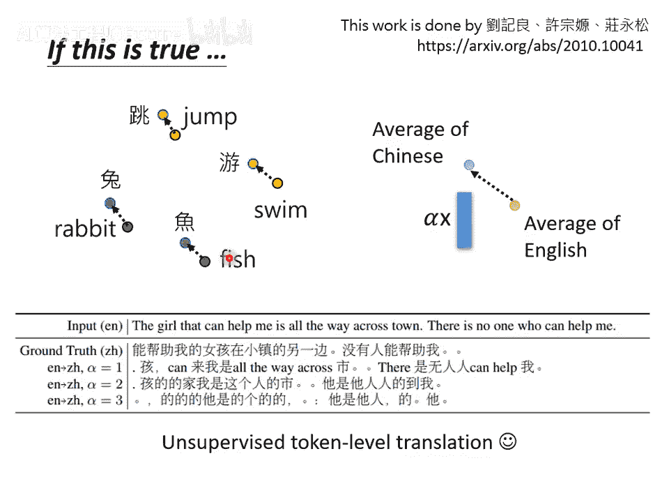