# 【官授搬运】2026年全新优化版李宏毅机器学习系统课程，这才是真正的初学者体系课程！—人工智能／深度学习／神经网络 - P55：4-自监督学习-4 –GPT的野望 - AI算法工程师Future - BV1ruqABeEFX

好那个上次啊，我们还没有把sales supervised learning的部分讲完，我们讲完了bird，那除了BT以外呢，还有下一个也是鼎鼎有名的模型，就是GPT系列的模型。

那GPT系列模型做的是什么呢，啊上次我们有说BERT做的是什么。

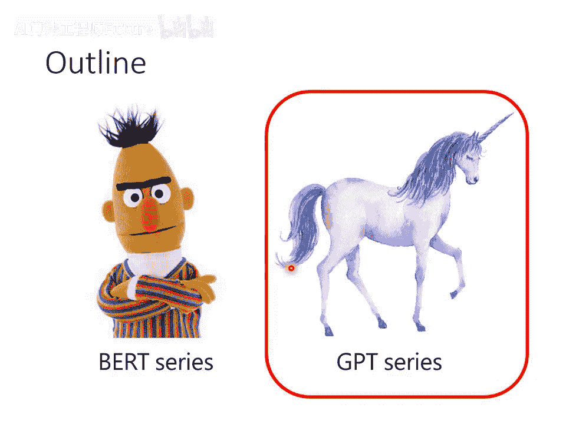

BERT做的是填空题，GPT做的事情是什么呢，GPT就是改一下，我们现在在self supervised learning的时候，要模型做的任务，GPT要做的任务是预测接下来会出现的，token是什么。

举例来说啊，假设你的训练资料里面有一个句子是台湾大学，那GPT拿到这笔训练资料的时候，他会做什么样的训练呢，他做的事情是这样，你给他begin of sentence这个token啊。

然后呢g p t output一个embedding好，接下来呢你用这个embedding去预测，下一个应该出现的token是什么，那在这个句子里面，根据这笔训练资料。

下一个应该出现的token是什么呢，哦下一个应该出现的token是台哦，所以你要训练你的模型呃，根据第一个token呃。

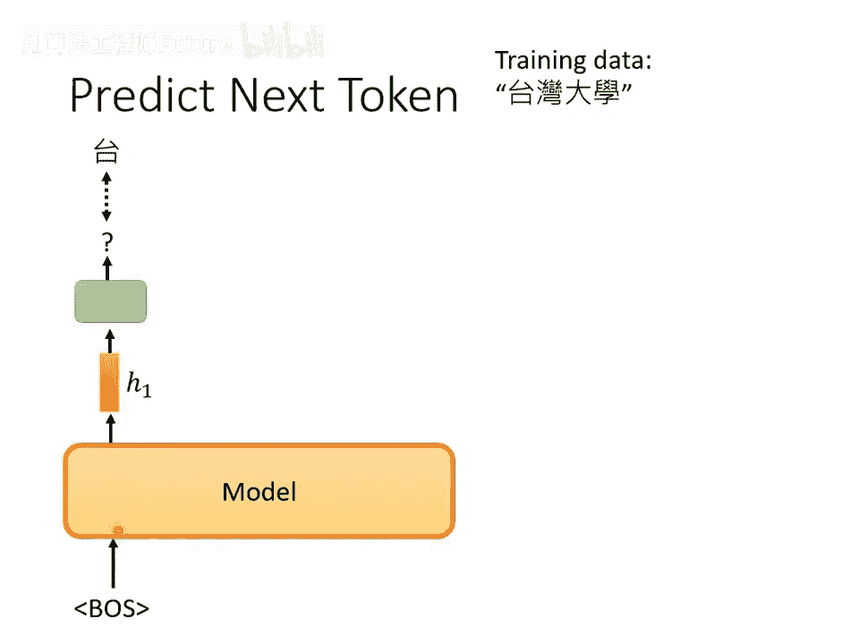

根据begin of sentence给你的embedding啊，那他要输出台这个token，而如果这个部分呢详细来看就是这样啊，你有一个embedded，这边用H来表示。

然后通过一个linear transform，再通过一个soft max得到一个distribution，跟一般你做分类的问题是一样的，接下来你希望你output the distribution。

跟正确答案的cross entro比越小越好，也就是你要去预测下一个出现的token是什么好，那接下来要做的事情就是以此类推了，你给你的g p t begin of sentence，跟台。

它产生embedded，接下来他要预测下一个出现的token是什么，那你告诉他说下一个应该出现的token是one好，再反复继续下去，你给他beginal sentence台跟湾。

然后预测下一个应该出现的token，他应该预测大，你给他抬跟弯跟大，接下来下一个应该出现的token是学，谈个预测出下一个应该出现的token是学，那这边呢是只拿一笔资料，一个句子来给GPT训练。

但实际上你不会只用一笔句子，你会用成千上万的句子来训练这个模型，然后呢就没有然后了，这样子诶就这样子说完了，那他厉害的地方就是呃用了很多资料，训了一个异常巨大的模型，然后看看他会有什么厉害的地方好。

那这边有一个小小的应该要跟大家说的地方，是说这个GPT的模型啊，它像是一个transformer的decoder，我们知道transformer有encoder和decoder，对不对。

这我们上课的时候都有讲过，模型呢它的架构像是transformer的decoder，不光要拿掉prose tention那个部分，也就是说你会做那个mask的attention。

就是你现在在预测给begin of sentence，预测台的时候哦，你不会看到接下来出现的词汇给他弹，要预测弯的时候，你不会看到接下来要输入的词汇。

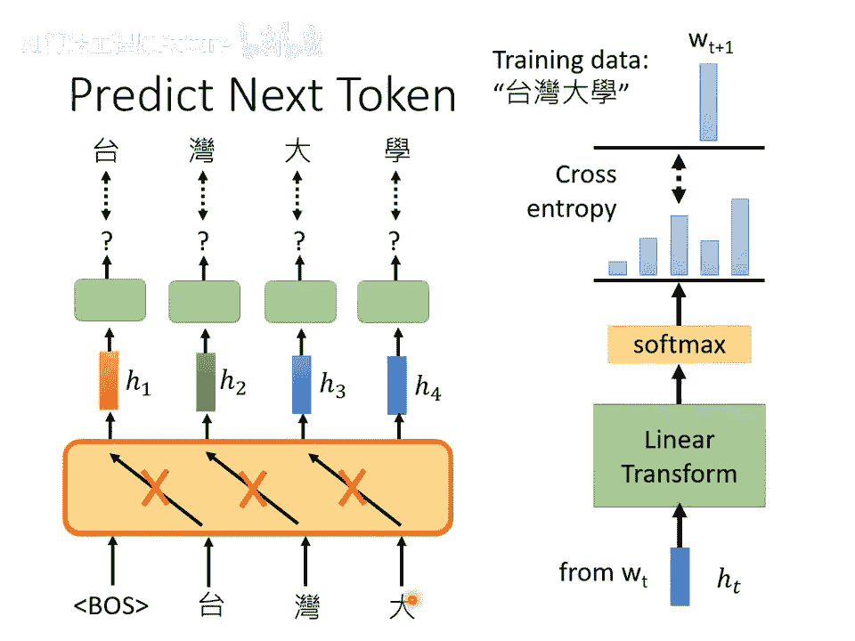

以此类推，这个就是GPT啊，那这GPT最知名的就是，因为GPGPT可以预测下一个token，那所以他有生存的能力，你可以让他不断的预测下一个token，产生完整的文章，所以我每次提到GPT的时候。

他的形象呢都是一只独角兽哦，为什么他的形象是一只独角兽呢，因为GTP最GPT系列最知名的一个例子哦，就是用GPT呢写了一篇跟独角兽有关的新闻，让他放个假新闻，然后在假新闻里面说啊。

在安第斯山脉发现独角兽等等，一个活灵活现的假新闻啊，所以大家提到GBT的时候，都会想到那一则假新闻啊，那为了让你更清楚了解，GPT运作起来是什么样子，那这个线上有一个demo的网页啦。

叫做talk to transformer啊，就是有人把一个比较小的，不是那个呃最大的GPT的模型，最大GPT模型不是不是public available的，有人把比较小的GPT模型放在线上。

让你可以输入一个句子，让它会把接下来的呃其余的内容把它补完，而他他就他这个运作起来啊，看起来像是好，这个就是GPT系列，它可以把一句话补完，那把一句话补完，怎么把它用在当string的任务上呢。

举例来说，怎么把它用在question answering，或者是其他的跟人类语言处理有关的任务上的，GPT用的想法跟bird不一样，其实我要强调一下，GPT也可以跟BT用一样的做法。

大家还记得bird是怎么做的吗，把bird model拿出来，后面接一个简单的linear的classifier，那你就可以做很多事情，你也可以把GPT拿出来接一个简单的classify。

我相信也是会有效，但是在GPT的论文中，他没有这样做，他有一个更狂的想法，为什么会有更狂的想法呢，因为首先就是BT那一招，BT用过了嘛，所以总不能再用一样的东西，这样写paper就没有人觉得厉害了。

然后再来就是GPT这个模型也许真的太大了，大到连FQ可能都有困难，你想想看，我们在用BT的时候，你要把BERT模型后面接个linear classify。

然后BT也是你的要train的model的一部分，所以它的参数也是要调的，所以在刚才助教公告的BT相关的作业里面，你还是需要花一点时间来training，在助教说好，大概20分钟就可以train完了。

因为你并不是要train一个完整的BT的模型，BT的模型在之前在做这个填空题的时候，已经训练的差不多了，你只需要微调它就好了，但是微调还是要花时间的，也许GPT实在是太过巨大，巨大到要微调。

它要圈一个AIRPO可能都有困难，所以gt系列有一个更狂的使用方式，这个更狂的使用方式和人类更接近，你想想看，假设你去考，比如说托福的听力测验，你是怎么去考托福的听力测验的呢。

这个托福听力测验的叙述是长什么样子的呢，首先你会看到一个题目的说明，告诉你说啊，现在要考选择题，请从ABCD4个选项里面，选出正确的答案等等，然后给你一个范例，告诉你说这是题目，然后正确的答案是多少。

然后你看到新的问题，期待你就可以举一反三，开始作答，GBT系列要做的事情，就是这个模型能不能够做一样的事情呢。

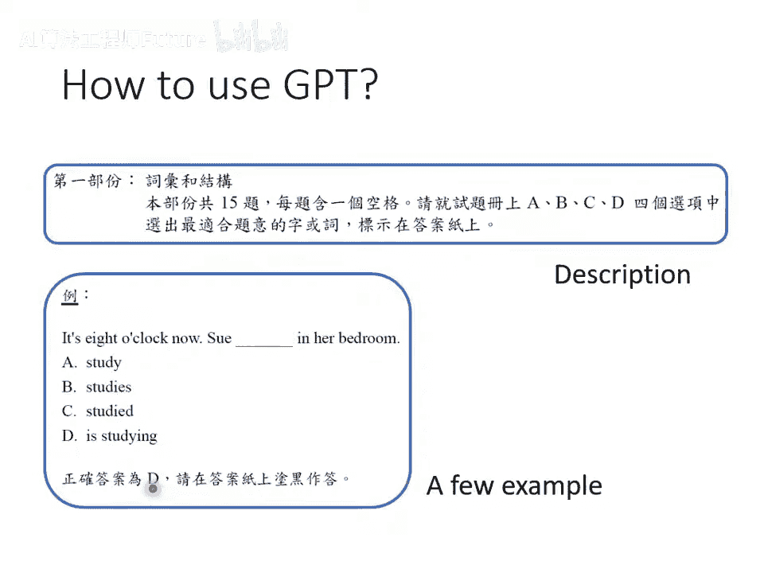

举例来说，假设要GPT这个模型做翻译，你就先打translate english to french，就先给他这个句子，这个句子代表问题的描述，然后给他几个范例，跟他说c alter。

然后建号后面就应该长这个样子，或者是或者是这个什么plush giraffe哦，后面就plush giraffe，后面就应该长这个样子等等，然后接下来你问他说去建号，叫他把后面的补完。

希望他就可以产生翻译的结果，不知道大家能不能够了解，这一个想法是多么的狂，在training的时候，GPT并没有教他做翻译这件事，他唯一学到的就是给一段文字的前半段，把后段后后半段补完。

就像我们刚才给大家示范的例子一样，现在我们直接给他前半段的文字就长这个样子，到时候他说你要做翻译了，给你几个，给你几个例子，告诉你说翻译是怎么回事，接下来给他cheese这个英文单字。

后面能不能就直接接出法文的翻译，结果呢，这个叫这个在GPT的文献里面，叫做few shot learning，但是它跟一般的fuel shell learning又不一样，所以FUUSHA的意思是说。

确实只给了他一点例子，所以叫做FUSHELL，但是他不是一般的learning，这里面完全没有什么gradient descent，我们成年的时候就是要跑gradient descent嘛。

这边完全没有gradient descent，完全没有要去调GPT那个模型参数的意思，所以在gt的文献里面，把这种训练给了一个特殊的名字，他们叫做in context learning。

代表说它不是一种一般的learning，它连gradient descent都没有做啊。

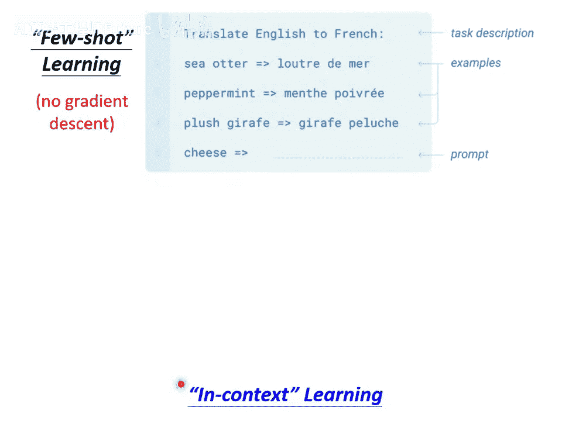

当然你也可以给GPT更大的挑战，我们在考托福听力测验的时候，都只给一个例子而已，那GPT可不可以只看一个例子，就知道他要做翻译这件事，这个叫one shot learning。

还有更狂的是zero shot learning。

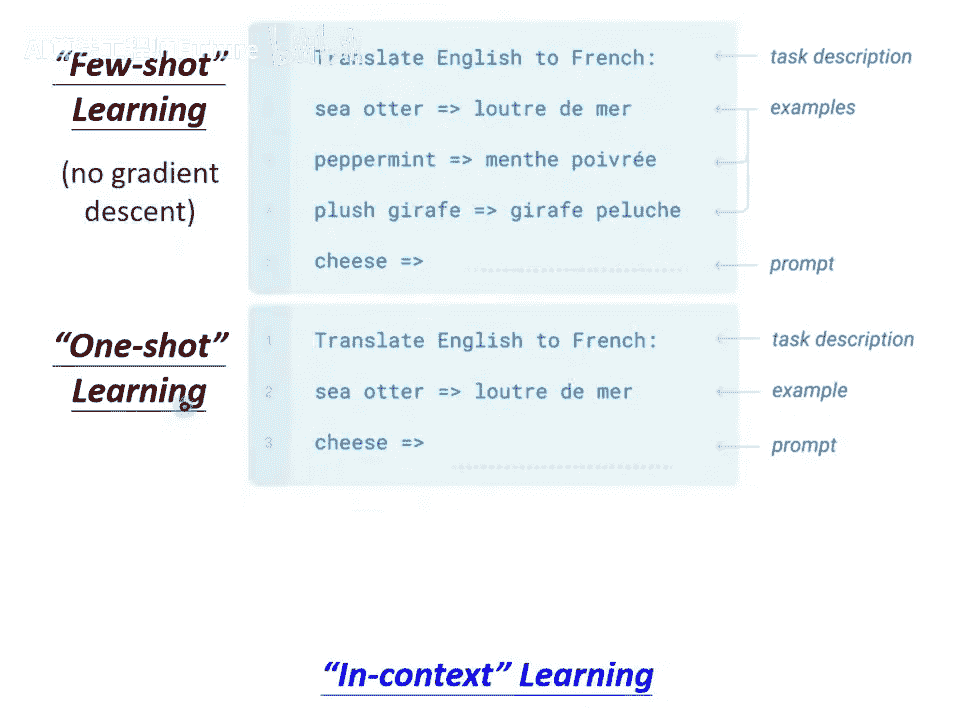

直接给他一个叙述，说我们现在要做翻译了，GPT能不能够自己就看得懂，就自动知道说要来做翻译这件事情呢，那如果能够做到的话，那真的就非常的惊人好，那GPT系列到底有没有达成这个目标呢。

这个是这个见仁见智的问题啦。

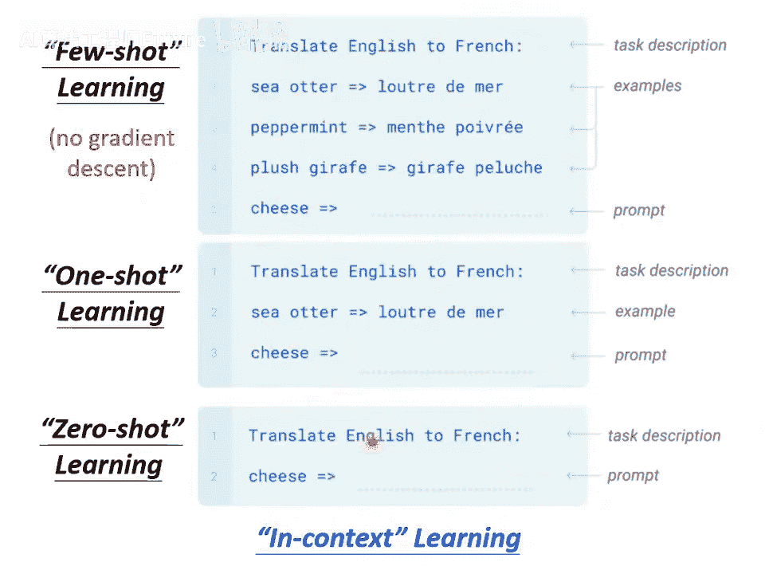

你他不不是完全不可能答对，但是正确率有点低，相较于你可以微调模型，正确率是有点低的，那细节你就再看看GPT那篇文章，GPT第三代的GPTR，他测试了42个任务啊，42个任务啊，这个纵轴啊是正确率。

那这些实现呐，这三条实线是42个任务的平均正确率，那这边包括了FUSH弯下跟zero下好三条线，分别代表FU向弯下跟zero下横轴代表模型的大小，他们测试了一系列不同大小的模型，从只有0。

1个B点的参数，到175个B脸的参数好，那而从0。1个billion的参数，到175个billion的参数，我们看future learning的部分，从20几percent的正确率，平均正确率。

一直做到50几percent的平均正确率，乃至于50几percent的平均正确率，算是有做起来还是没有做起来，那这个就是见仁见智的问题了，那目前看起来状况是有些任务他还真的学会了，举例来说二这个加减法。

这样你给它一个数字加另外一个数字哇，他这个可以得到正确的两个数字加起来的结果，但是有些任务他可能怎么学都学不会，比如说一些跟逻辑推理有关的任务，他的结果就非常非常的惨好，那有关GPT3的细节啊。

这个就留给大家再自己研究，然后这边有一个过去上课的录影。

我把链接放在这边给大家参考，而刚才举的例子啊，到目前为止我们举的例子都是只有跟文字有关，但是你不要误会，说这种self supervised learning的概念只能用在文字上。

在语音CVCV就是computer vision，也就是影像好，在语音跟影像的应用上，也都可以用self supervised learning的技术。

那其实今天self supervised learning的技术非常非常的多，我们讲的BT跟GPT系列，它只是三个类型的，这个sell supervised learning的方法的其中一种。

他们是属于prediction那类，那其实还有其他的类型，那就不是我们这一堂课要讲的，那接下来的课程呢你可能会觉得有点呃流水账，就是我们每一个主题呢，就是告诉你说这个主题里面有什么，但是细节。

这个更多的知识就留给大家自己，来做更进一步的研究，所以这页投影片只是要告诉你说，在sales supervised learning这个部分，我们讲的只是整个领域的其中一小块。

那还有更多的内容是等待大家去探索的好。

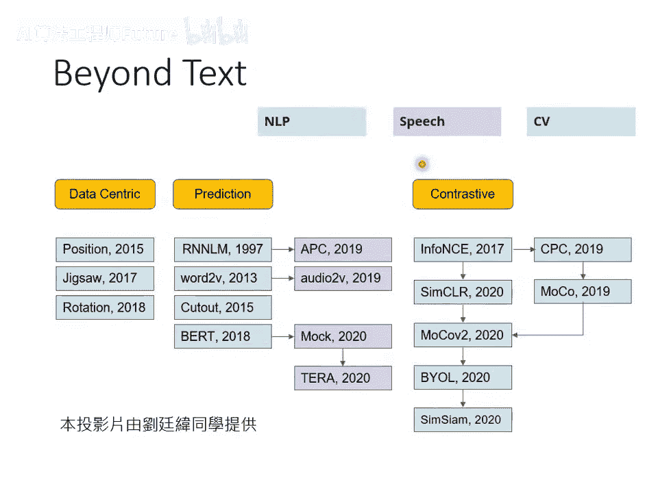

那有关影像的部分呢，我们就真的不会细讲，我这边就是放两页投影片带过去。

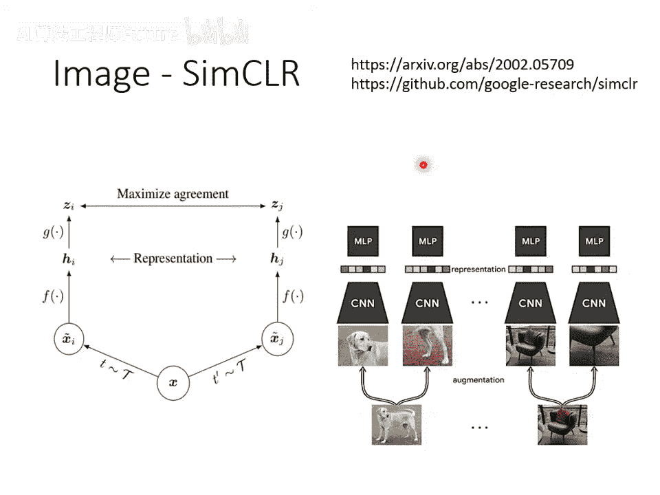

告诉叔叔，你说有一招非常有名的叫做CCR。

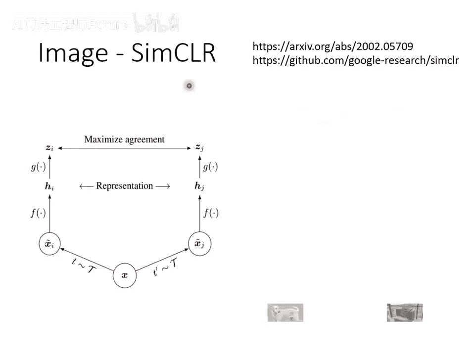

它的概念也不难，我相信你自己读论文应该也有办法看懂它。

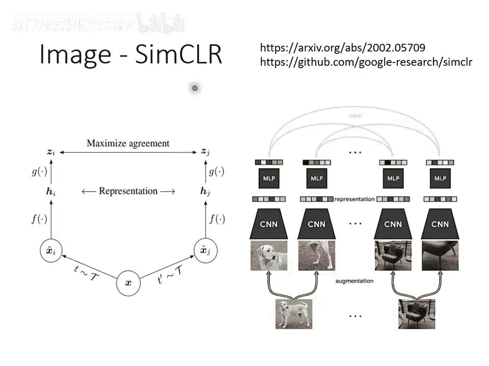

那还有很奇怪的叫做boil boil这个东西呢，啧嗯我们我们是不太可能在上课讲，他为什么呢，因为根本不知道他为什么会work，就是这个这个这个这是很新的论文啊，这个是去年夏天的论文，那这个题。

这个论文呢是假设他不是已经发表了文章，然后学生还跟我提这个想法，我一定就是我一定不会让他走，我觉得这不可能会，这不可能会work的，这是个不可能会实践的想法，不可能会成功的。

这个想法感觉有一个巨大的瑕疵，但不知道为什么他是work的，而且还曾经一度得到state of dr的结果，就deep learning就是这么神奇好。

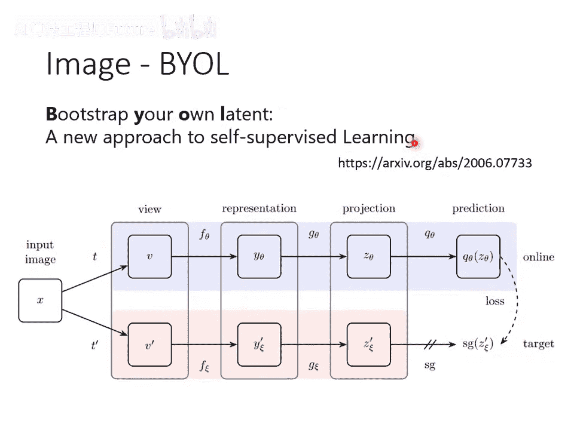

所以这个呢我们也就不细讲，就跳过去好，那在语音的部分。

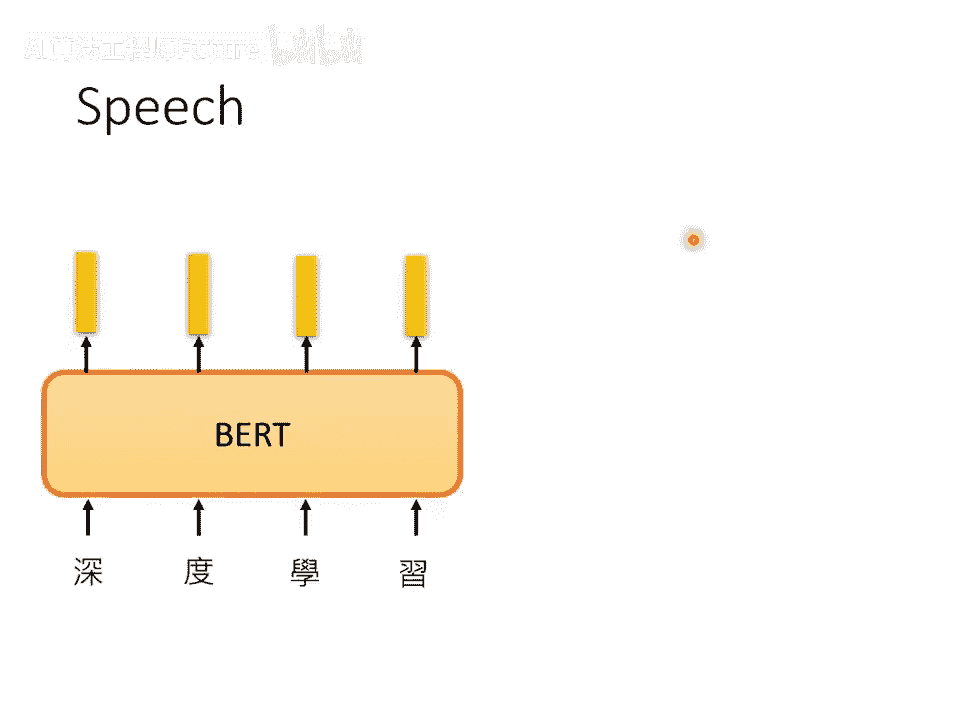

你也完全可以使用self supervised learning的概念，你完全可以试着去练语音版的bird，那怎么训练语音版的bird呢，你就看看文字版的bird是怎么训练的，比如说做填空题。

语音也可以做填空题，就把一段声音需要盖起来，叫机器去猜被盖起来的部分是什么吗，语音也可以预测接下来会出现的内容，像GPT就是预测接下来要出现的token嘛，那语音你也可以叫它预测，叫模型。

预测接下来会出现的声音讯号，所以你也可以做语音版的GPT，不管是语音版的bird，语音版的GPT，其实都已经有很多相关的研究成果了哦。

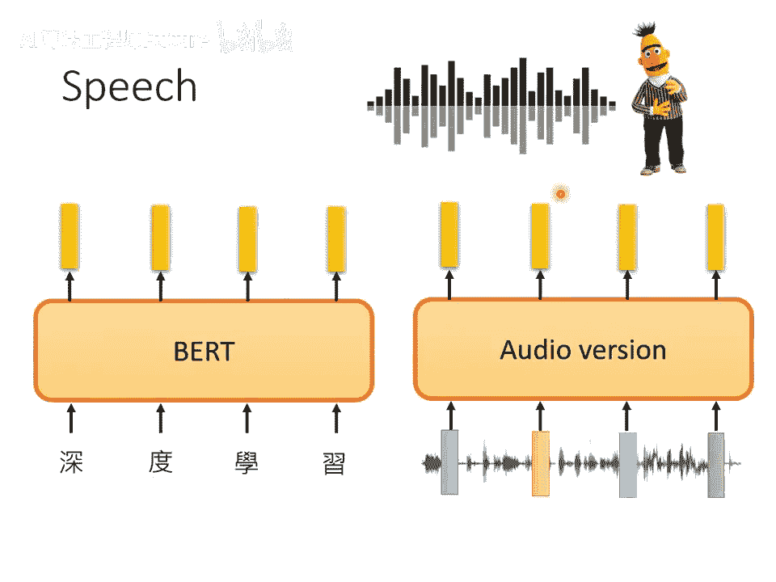

不过其实在语音上啊，就相较于文字处理的领域，还是有一些比较缺乏的东西，那我认为现在很缺乏的一个东西，就是像group这样子的，Benchmark copus，在自然语言处理的领域，在文在文字上有入热。

Coopus，我们在这堂课的这门课的刚开头，这个投影片刚开头就告诉你说，有一个这个基准的资料库叫做gr。

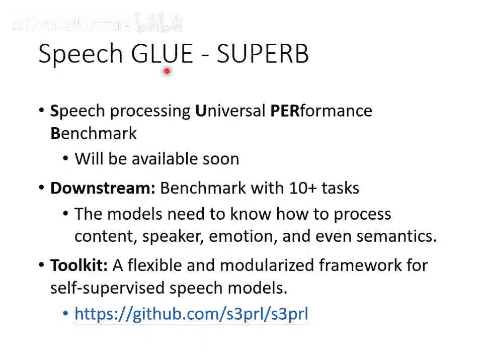

它里面呢有九个NLP的任务，今天你要知道BERT做的好不好，就让他去跑那九个任务，再去平均，那代表这个self supervised learning模型的好坏，但在语音上。

到目前为止还没有类似的基准的资料库好，所以我们实验室呢就跟其他的研究团队，共同开发了一个语音版的glue啦，我们叫做superb哦。

它是speech processing universal performance benchmark的缩写，你知道今天你做什么事，做什么模型都一定要硬凑梗才行啊，所以这边也是要硬凑一个梗。

把它叫做super，那其实我们已经准备的差不多了，其实网站都已经做好了，只等其他团队的人看过以后就可以上线了，所以现在虽然还没有上线，但是再过一阵子你应该就可以找到相关的链接，而在这个基准语料库里面。

包含了十个不同的任务，那语音其实有非常多不同的面向哦，很多人讲到语音相关的技术，都只知道语音辨识，把声音转成文字，但这并不是语音技术的全貌，语音其实包含了非常丰富的资讯，它除了有内容的资讯。

就是你说了什么，还有其他的资讯，举例来说，这句话是谁说的，居然这个人说这句话的时候，他的语气是什么样，还有这句话背后他到底有什么样的语义哦。

所以我们准备了十个不同的任务，这个任务包含了语音不同的面向，包括去检测一个模型，它能够识别内容的能力，识别谁在说话的能力，识别他是怎么说的能力，甚至是识别这句话背后语义的能力。

好从全方位来检测一个cell supervised learning的模型，他在理解人类语言上的能力，而且我们还有一个toolkit了啊。

这个TOOLKE呢呃里面就包含了各式各样的sales。

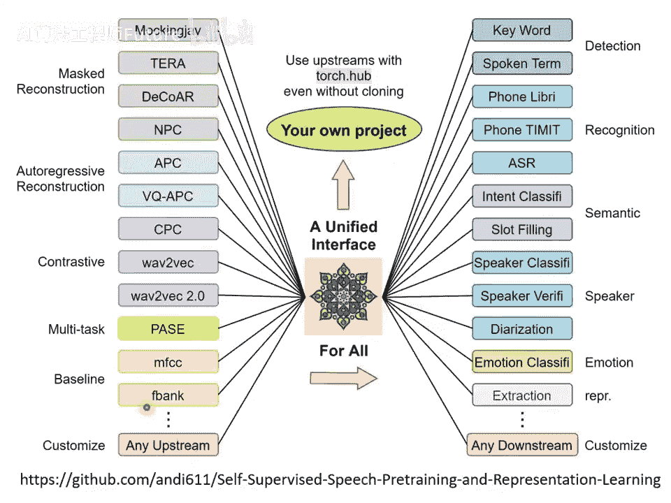

supervised learning的模型，还有这些sales supervised learning的模型。

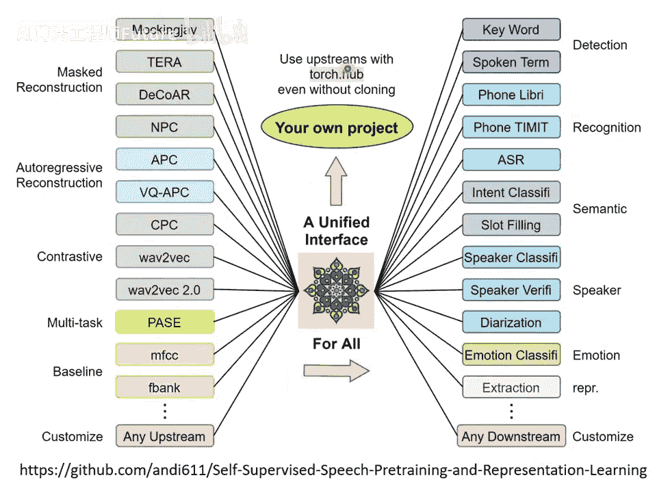

它可以做的各式各样您的下游的任务，然后把链接放在这边给大家参考，那讲这些只想告诉大家说，cell supervised learning的技术不是只能被用在文字上，这个影像上。

在语音上都仍然有非常大的空间，可以使用self supervised learning的技术。

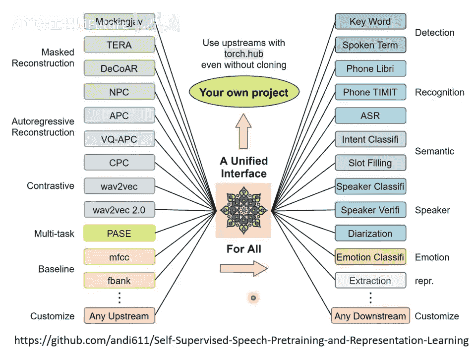

好那这个这个呃self supervised learning的部分呢，这个bird跟GBT啊。