# 【官授搬运】2026年全新优化版李宏毅机器学习系统课程，这才是真正的初学者体系课程！—人工智能／深度学习／神经网络 - P56：5-选修-BERT的预训练和微调 - AI算法工程师Future - BV1ruqABeEFX

好那接下来呢我们就是要跟大家讲一下，NOPL领域鼎鼎大名的BERT跟他的好朋友们，而那过去呃在NLPL领域通常是一个任务，一个模型，但是今天已经逐渐迈向。

能够让希望能够让机器先general的了解人类的语言。

以后再去解各式各样NLP的任务，我们今天在NLPL领域一个常见的做法是，我们能不能够训练一个模型，这个模型是根据大量的文字训练出来的，你去网络上排一大堆文章，这些文章没有任何标注。

可能也跟任何NLP的任务没有直接关系，但是我们透过这些大量文字的标注，能不能够训练出一个模型，这个模型是可以读懂人类文字的，当然什么叫做读懂这个，我们等一下再讲，那这个过程呢往往叫做PRETRAIN。

好，就是呃我们在让机器解某个任务之前，先训练一下，然后接下来针对你想要机器解的某一个，特殊的任务，你可能可以收集部分的少量的资料。

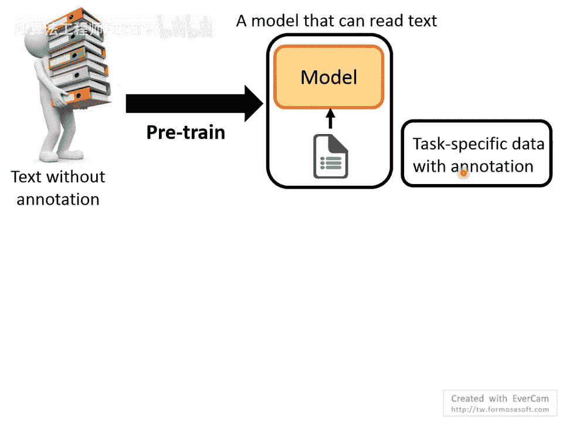

接下来你只需要用这些少量的资料，去微调你的模型，微调一个可以读懂人类语言的模型，然后就可以让机器解各式各样的任务啊，在这个投影片上，你可能有三个任务要解蓝色绿色灰色的任务，这三个任务。

你只需要把原来的模型再加上一些少少的修改，用有限的只跟某一个任务有关的资料去训练，期待它就可以得到好的结果，那这个其实也比较接近人类学习语言的过程，我们知道说啊，今天要测验你的英文能力的好坏。

你去考个托福雅思多义，那里面有各式各样的任务，有听说读写，有各种各样的题型，有填空有选择，但是你学习这个英文的方法，并不是说你去做大量的选择题，然后最后3号你就学会英文了。

而是你可能是阅读大量的英文的文章，所以你in general的只知道了解每一个词汇的意思，那你只需要做少量的考古题，就可以通过某一个语言能力的检定，那这个比较像是今天NLP的领域所追求的目标。

期待可以训练一个模型，它真的了解人类的语言，接下来要解，让他解各式各样的任务的时候，只需要稍微微调一下，给他看一点考古题，他就知道怎么解这些任务，好那讲到这一种PRETRAIN的model啊。

最知名的就是bird，那常常有人说NLP的领域。

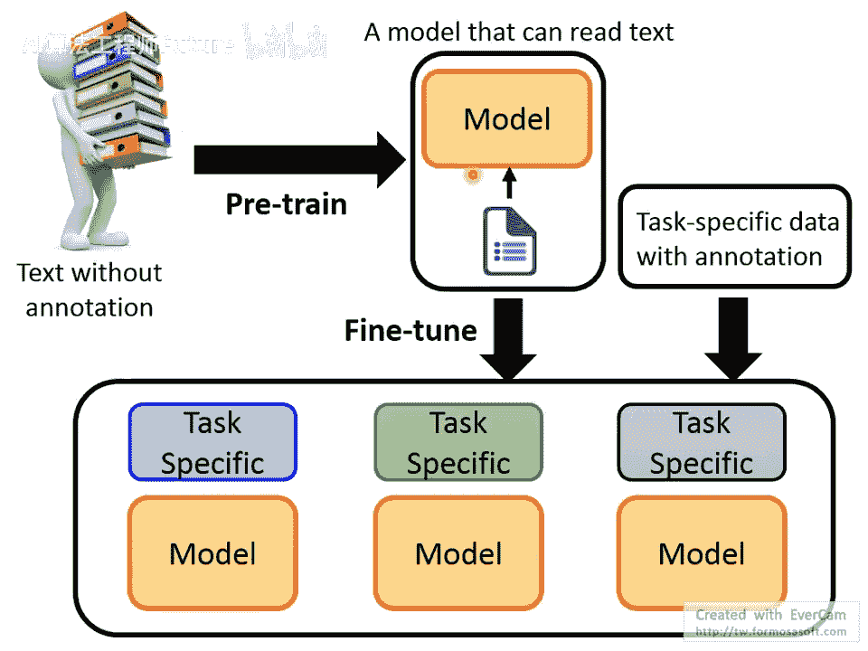

今天呢都是芝麻街哦，因为这些pretrained model，很多都以芝麻街的人物来命名啊，那为什么要放这张照片呢，这个是死肥仔本人啦，嘿呃因为女朋友送我一件芝麻街的衣服，希望我在讲到BT的时候穿啊啊。

不过现在都是线上课程，所以你也不知道我现在穿什么样的衣服啊，所特别放这张照片，他就跟你讲说我有一件芝麻街的T恤，这哎而这上面的图比较小，还有时候把它放大来看是这个样子的，而这些是芝麻街的人物啦。

而包括很多知名的PRETRA的model，都是用芝麻街的人物来命名，最早的是，是embedding from language model的缩写，这个没有问题，还是ELMO，后来又有了。

我觉得知名度最高的B好，bird是by directional encoder，representation from transformer的缩写，这个也没有问题，到后面我觉得就凑得很硬的。

像early early是enhance representation through，knowledge integration的缩写，我第一次知道说今天产生缩写的时候。

是可以不用取词汇的第一个字母的，这根本就是为了要凑儿女为凑而凑，你根本就是想先想好要EARNE来命名，再去再去应试，从你的模型里面抽一些相关的字母出来，就组成early。

这个N居然是从knowledge的第二个字母出来的，今天IE居然这个E居然是从integration，第四个字母抽出来的这个嗯非常的硬，但是反正他就死儿女了，而你是BT的好朋友啦。

所以有BT以后就是要有儿女了，而这个蓝色的东西呢，它是cookie monster，没有人去臭cookie monster的model啊。

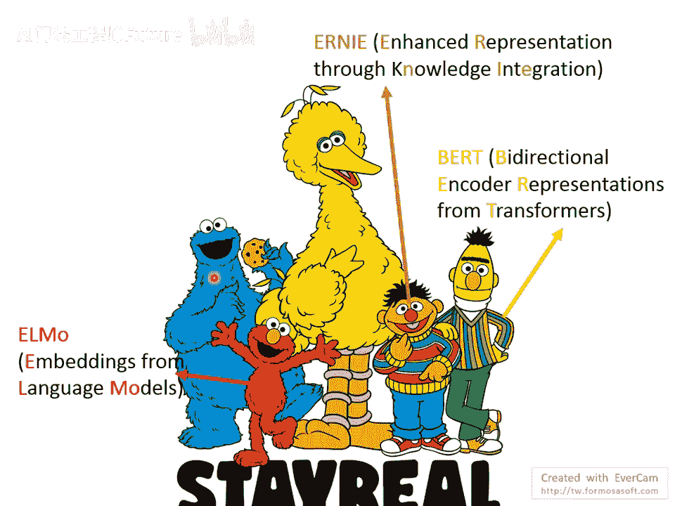

可能太这cookie monster显然太难凑了，但是有另外一个蓝色的角色。

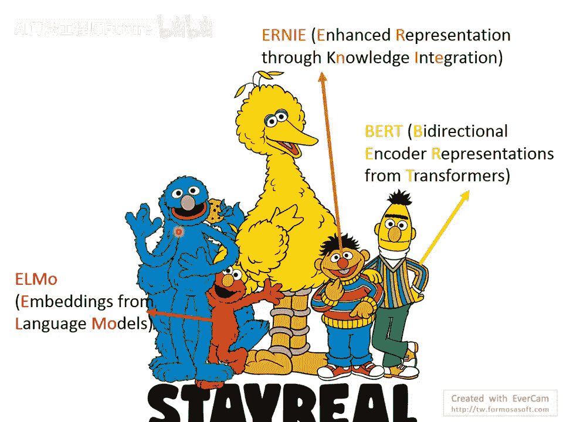

这个角色叫做郭over，郭VER又有人凑出了GROVER，GROVER是generating article by only viewing meta records，这个也是这个也是真的凑的非常的硬。

这个R跟E也也不是字，也不是词汇的第一个字母啊，但他凑出了郭over，那还有人凑那个bird and pills，然后birth跟他的好朋友们啊。

这个pills呢是project attention layers的缩写，那我比较在意的是，就是怎么没有人去凑这只鸟啊，这只鸟叫做big bird，big bird明明就非常好凑啊。

怎么会没有人去凑这只鸟呢，这个bird应该是很好凑啊，这个摆可以是by directional啊，R可以是很多的RECURREN呢，呃recursive啊，reduce啊，都可以，有很多词汇可以用。

第一可以是比如说decoder啊，你可以抽一些什么big就big就很大啊，参数量很多就是big哎，Binary recursive，decoder就是big bird。

我不知道为什么怎么没有人去凑这个big bird呢，那其实芝麻街花很多人物了，那些人物都没有，还没有还没有模型对应啦，就等着大家来凑梗就是了，还有很多人物还没有被凑，还有什么奥斯卡，还有个公爵啊。

那个目前为止都还是没有人去凑的好，那接下来呢我们这一个赞投影片里面，要跟大家讲三件事好，第一件事情呢是到底，今天我们所谓的可以读人类语言的pretrain model，它是长什么样，他可以做什么事。

接下来我们再讲说这样子的prep model，假设你手上有一个以后，你怎么拿它来做翻译to，然后我们最后呢再讲说这样的pretrain model。

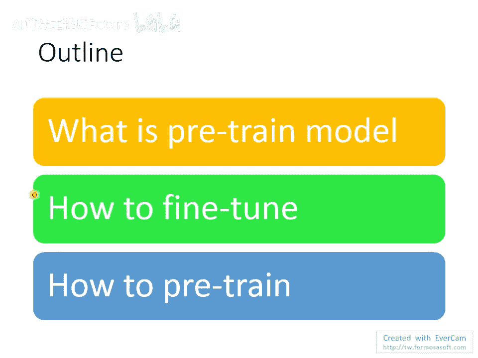

要怎么被训练出来，好那这个匹克的model长什么样子呢，那在过去啊，在还没有bird和LELMO这一套之前，其实就已经有pretrain model，那pretrain model做的事情就是。

我们希望把输入的每一个token，表示成一个embedding的vector，这个vector应该包含了这个token的语义，意思比较相近的token，他们应该要有比较相近的embedding。

这些embedding里面的某一些维度，应该可以看出跟语义的关联性，那像这样子的model啊，他能过去在还没有ELOBT这一套，这一套这一套东西之前，通常就是七一个token输出一个向量就结束了。

唉那怎么样吃一个token就输出一个向量，那11个token出出一个向量有非常多的做法，举例来说，你可以有一个table，这个table里面存的呢，就是每一个你输入的token，都有一个对应的向量啊。

羊有一个向量，猫有一个狗，有一个鸡，有一个猪有一个，然后再看你输入什么样的token，输出又是什么样的向量，但像过去这样子的技术，它最大的问题就是只要是同样的token，那它就会有一样的向量。

像这样子的模型是不考虑每一个token，他的上下文的，我们并不在意一个token他上下文接了什么样，其他的token，同样token就是同样的embedding，就对应到同样的向量。

那像这样的技术呢有很多非常非常知名，今天你路上随便拉一个人都知道的东西，比如说word to vector，比如说go，那我们这边呢就不会再跟大家细讲。

what to back the grove这些东西了，因为这个呃，这个很有可能都是你已经知道的事情，好，那呃除了word to vector跟GF以外，还有什么样的技术呢，如果你今天考虑的是英文。

如果你的token是英文的word，那你可能会遇到一个问题，就是英文的word实在太多了，你不可能穷举所有英文的词汇，每一个词汇都给它一个向量，因为太多英文的词汇不断的被创造出来。

如果你只是有一个table，里面存了所有英文词汇的向量，那你永远会有新的词汇，你永远会有table里面找不到对应向量的词汇，所以怎么办呢，也许我们可以把model改成输入是英文的character。

输出就是一个向量哦，那也许你期待你的model就可以读，这个英文词汇的自首字，更可以从英文词汇的自首自更，判断一个没有看过的词汇的意思，那具有代表性的其中一个模型，就是鼎鼎大名的fast tx。

那如果是中文呢，中文还可以有特别的解法，我们说在中文里面呢，你可以有边读边啊，这个中文里面呢这个部首啊，也是跟羽翼有关系的，看到毁部就跟虫有关，看到水部就跟水有关，看到幕布就跟植物有关，那我们又说中文。

其实每一个词汇就像是一个图画，那我们能不能够就把中文的一个token，中文的一个字就当做是一个image，比如说中文写这个信这个词汇，而不是词汇，它是一个字，而写信这个方块字。

它就是一个这个解析度6060的image，然后把这个image丢到一个CNN里面，诶，一看到image处理image，你就上CNN嘛，把这个image丢到CNN里面，期待这个CNN也许可以学会。

他看到人字边看到言啊，就知道人言为信，输出，信对应的embedding好，那这个不见得能真的做到我刚才讲的人言为信，止戈为武，这样子的理解了，他不见得能够做到这么高端的理解了。

但这样的模型还是可能可以带来一些帮助，至少还可以认一下词汇的部首偏旁等等，好，那这个是过去，那像这样子模型最大的问题就是，他不会考虑每一个token的contact，所以对这样子的模型来说。

养只狗的狗跟单身狗的狗，它们所对应的向量就是一样，但我们知道说虽然这两个token都是狗啊，就像这个总裁大人说的，大家听我说我们都是狗，但是这两个狗的意思是不一样的。

那在过去还没有ELOBT这一套想法之前，那时候有有人会想说，那也许我们就给不同意思的狗，就给它当做不同的token来看待，我们可以在这个狗加给这个狗加一个下标一啊，给这个狗加一个下标二等。

因为它们是不同的token，也许就可以给它不同的embedding，但是这样的想法又不是一个非常好的solution，因为这两个狗虽然它的意思不一样，但它的意思也是有相关的，为什么说单身就是狗呢。

为什么不是单身猫呢，为什么不是单身猪呢，为什么不是单身鸡呢，为什么不是单身狮子呢，不知道为什么就是狗就是有时候会让人轻贱，比如说呃我们在词汇我们常常会说啊，常常有负面的意思，所以单身也许是因为这样。

单身才会被叫做是狗啊，所以嗯这两个狗又不是意思完全不一样，所以嗯把他们当作不同的token也不太对，所以后来就有了contextualized的embedding，这样子的概念。

那我们刚才讲的ELMO啊，BT啊等等，他们就是contextualized的embedding，那contextualize embedding，跟过去的我们说were embedding呢。

growth啊，fast text啊等等模型不同的地方，就是过去的模型吃一个token，就要to一个embedding，现在这些contextualized的war embedding。

elmo bird等等，他们都是吃一整个句子，把一整个句子都看过以后，再给每一个token embedding，虽然他们也是一个token，就给他一个embedding。

但是他们是在看过这个token的上下文，看过这个token的上下文以后再给他embedding，所以对mach来说，他就有机会知道这两个狗因为上下文不同，也许就应该给他不同的embedding好。

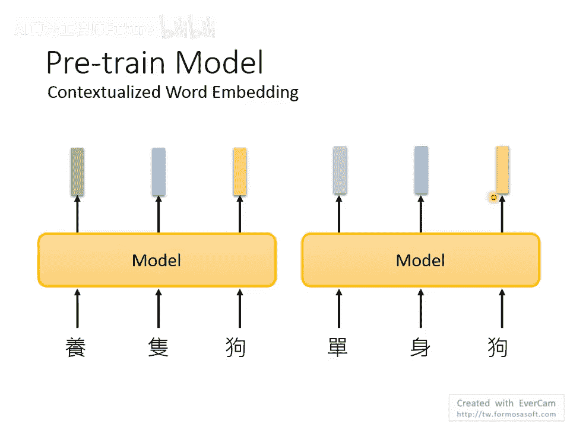

那像这样子，contextualized the way embedding model应该长什么样子呢，因为它的模型的架构，它的network架构应该长什么样子呢，其实你只要找到一个模型的架构。

它可以给你input一个token的sequence，output1串vector的sequence就可以了，就结束了，但实际上这样的模型怎么训练出来，这个我们之后再讲，但总简单来说。

你需要的就是一个像是我们之前在讲sequence to，sequence model的时候的encoder这样子的东西，你需要的就是一个encoder啊。

这个encoder输入一个token的sequence输出，就是给每一个token，一个factor，一个embedding好，那像这样子的model，今天往往都非常的deep，他们有很多个layer。

六层，12层，24层等等，今天往往是非常的deep，那至于normal的架构，你可以用LTN，你也可以用self attention的layer，比如说ELMO就是用LSTN。

那BERT就是用self attention的layer，那有人可能会觉得说，我们今天既然处理的是文字，那文字有比如词汇和词汇之间，他会遵守某些文法的关系，也许应该要把文法的数考虑进来吧。

所以你也可以考虑用一些tree base的model，把文法的资讯引扣在你的模型里面，不过像这样子的想法呢，嗯今天并没有非常的流行，也许你应该反过来说，这是self attention的layer。

跟LSTN他们在PRETRAIN以后，也许就已经学到了文法的资讯，也许不见得需要再给他tree base的model，那这个tree base model，如果你想知道它是什么的话呢。

你可以参考以下的呃。

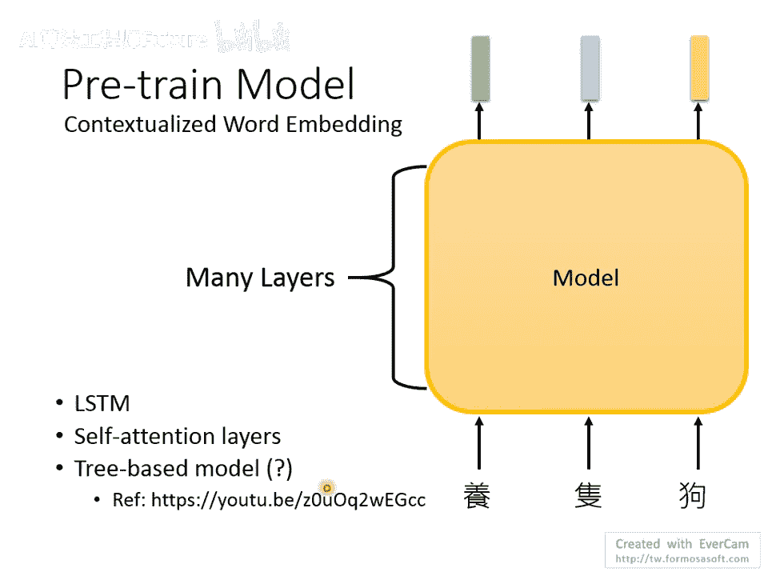

上课录影好，那像这样子的这个contextualize away mbedding，他确实可以做到同样的token，不同的意思就给它不同的embedding，以下是一个实际的例子。

那我实际使用了这个中文的BT呢，来让他引扣的，让他处理一些句子以后的结果，那我这边呢有十个句子，那每一个句子里面都有贫，这个字都有平，这个字只是前五个句子的评呢指的是苹果啊，今天买了苹果来吃，进口苹果。

平均每公斤下降12。3，percent苹果茶真难喝等等，这前五个句子他们的评指的都是苹果，下接下来的五个句子，他们的评指的都是那一家公司，他们也都是苹果，但是指的是苹果哪家公司。

比如苹果即将下月发表新版IPHONE，苹果获得新的face id的专利等等，然后我们现在把这十个句子里面的屏呢，通通把他的embedding抽出来，然后两两之间去计算它的相似度，而这些图片讲的是说。

我们把这十个句子里面的平，通通都把它embedding拿出来，两两去算相似度，那你就会发现说前五个句子的平，它们就是比较像后五个句子的平，它们就是比较像代表机器资料，说这前五个句子的平直的。

跟后五个句子的平直的是不同的东西，所以它确实可以做到contextualized the way embedding，它确实可以做到同一个词汇会有不同的意思，好呃，还有同学问了一个问题哦。

是因为tree base的model不好写吗，哦知道你的意思，你想要问问的问题，就是说为什么今天大家比较少用tree base的model，是不是因为它不好写的原因，呃，当然好不好写是一个问题啦。

但是如果他非常厉害的话，那自然会有人写出他的model，放到TENSORFLOW或PYTORCH里面呢，那有有人把它写成MAGIL以后，你就好写了。

那我觉得tree base model之所以不流行的一个原因是，因为呃其实当年在经过一番验证以后，tree base model好像没有特别强呃，就有了tree base mother。

会一开始大家觉得哇好潮哦，就是这个处理文字就是要考虑文法资讯啊，所以我们就是需要tree base model啊，但是呃后来实际上比较了，有人拿很多任务来比较。

tree base model跟LTN以后发现在很多任务上，LSTN往往比较强，tree base model呃，就算有赢也是小胜，没有大胜，那tree base model什么时候最强呢。

他在process是那种呃，文法结构真的非常清楚的问题的时候会比较强，什么时候你的文法结构会非常的清楚，非常严谨呢，比如说有人就拿tree base model去process数学式。

就如果你今天要弄一个model，这个model输入就是数学式，输出是数学式的结果，那这个时候tree base model是可以明显赢过LSTN，但是general的任务你只是要做NLI。

做一些SUMMARIZATION，做一些QA，结果发现tree base model并没有大胜LSTN，这LSTN往往比较强，所以呃这就是为什么tree base model。

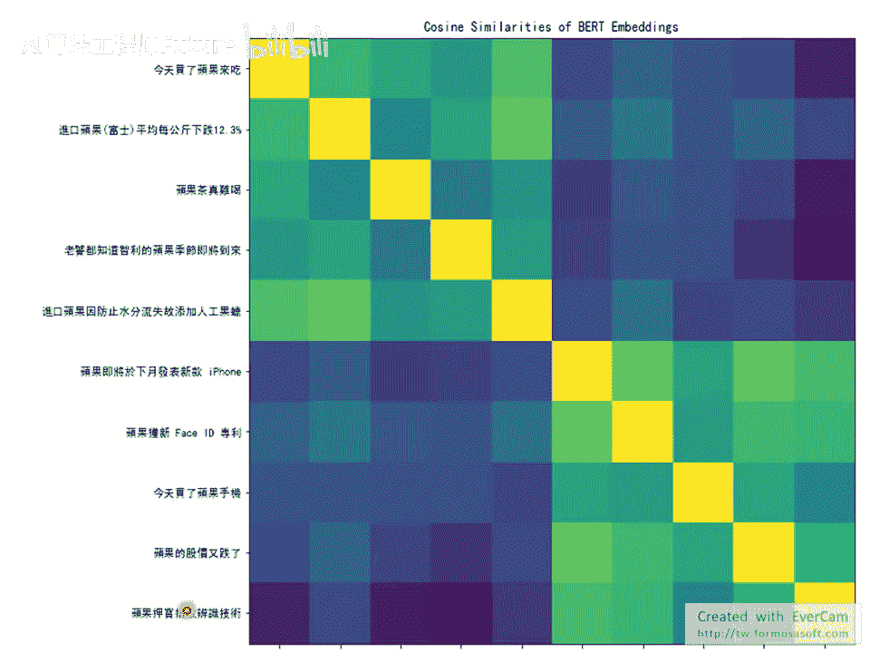

没有流行起来的原因好，那今天的流行趋势就是model越来越大啊，有点像是在盖高楼，大厦跟金字塔一样啊，这个图有点小啦，但这个图上只选没有没有特别重要啊，大家可以看一下这个连接就行了啊。

那一开始ELO啊很小，然后有GPT有BT，有g p t two啊，跟今天的大模型比起来都很小，以前刚有GPQ的时候，大家也觉得哇怎么这么大啊，太大了吧，还有上亿个参数啊，好大。

但是NVIDIA后来出了一个mega tro啊，他的GPET的大概八倍大，后来MICROSOFT又出了ti n lg，还有mega tr的至少两倍大啊，所以现在模型就是变得越来越大。

好有同学说那堆感觉只有大公司可以用，对哦对哦，所以除了让模型越来越大以外。

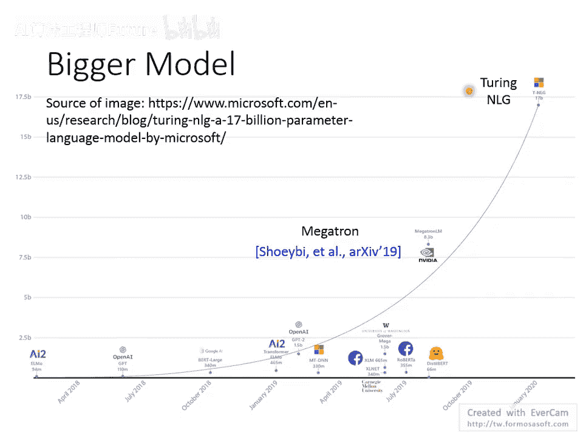

另外一个方向就是穷人在做的诶，让模型变小，BT非常的巨大，那我们能不能够让模型变小呢，那就有一系列的研究是做穷人做的bird，好穷人用的BT，穷人的蔷薇哎，嗯比如说有disctail bird。

Tiny bird，Mobile bird，这一听就觉得他们是很小的啊，Q8bird跟ELBERT这个其中最有名的就是ELBERT，ELBERT是什么呢，ELBERT神奇的地方就是呃。

它跟原来的BT架构几乎是一样，但不一样的地方是原来beat12层，24层通通都是不同的参数，它12层24层都是一样的参数，而且它的performance不止没有掉，还比原来的bird稍微好了一点哦。

所以这是个神奇的model，它叫ALBERT和。

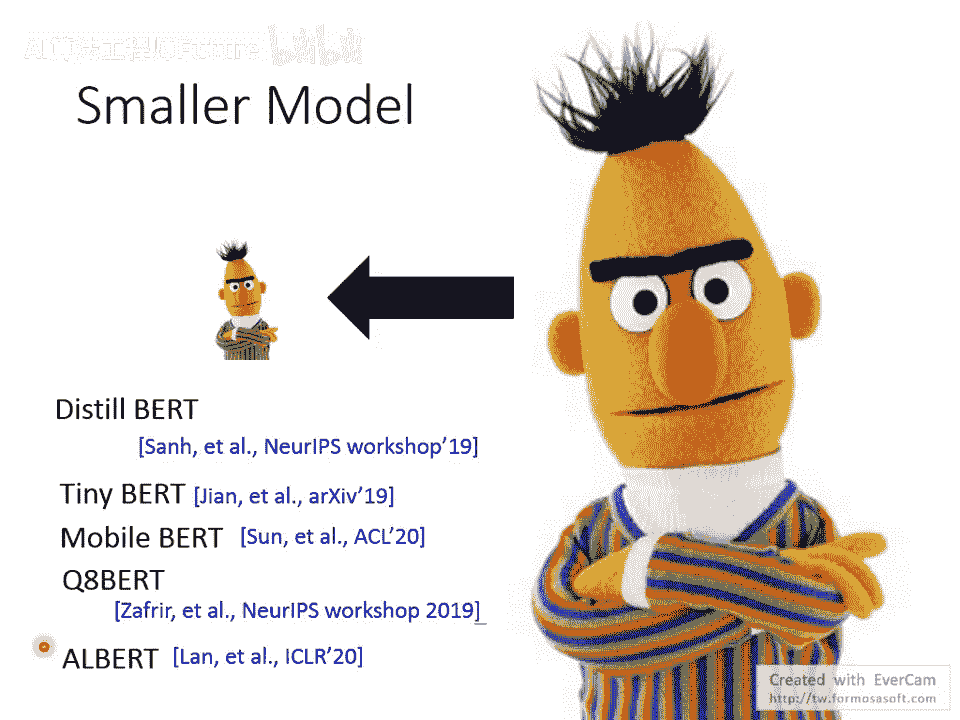

我觉得在这系列的模型里面，ALBERT呢是特别知名的好，那怎么把model变小呢，其实现在用来让这些pretrain model变小的技术啊。

呃呃这个都是我们之前在讲network compression的，在机器学习那门课，讲network compression的时候讲过的技术啦，比如说network的pointing。

ANODGEDESTATION呢，parameter的quantization啊，architecture的design啊等等，那我们这边就不再细讲，那如果你想知道有哪些模型，他们用了什么样的技术。

那我找到一个非常好的reference，里面记载了很多各式各样的模型，还有他们压缩的技术给大家参考，那这边我们就不再赘述。

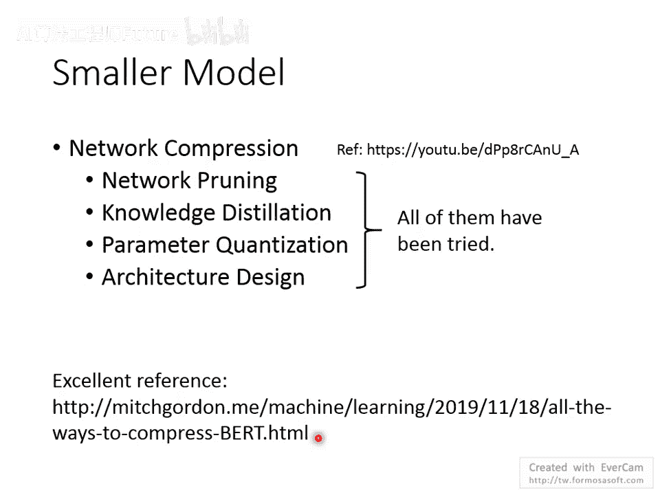

你在reference里面可以找到的东西，啊那除了用一些我们讲的network的压缩方法，让让network变小以外，在network architecture上面近年来呢也有一些突破。

那这些architecture的design啊，我觉得他们设计的目标，都是为了要让马逊可以读非常长的sequence，这些model设计的这些model in本身都是general的。

也就是说你不一定只能用在呃文字上，但是我认为他们的出现很大一部分来自于今天，我们希望我们的pretrain model可以读非常长的句子，可以读不止一整篇文章，甚至是一整本书这样子的长度哦。

所以有了一些model，它的出现就是为了要处理非常长的sequence，举例来说，transformer的XL，那过去呢这个transformer也就是像BT这样的model。

一次只能够读一串token，比如说512个token，那transformer tile，亚马逊可以读跨segment的token，那至于实际上怎么做，这个我就呃留给把文献留在这边，给大家自己参考。

那近年来还有一些新的变化，叫做reformer或者是long former，reformer跟long former，他们想做的事情呢，是想要减少self attention所带来的运算量。

我们知道self attention它的运算量啊是N平方啊，这个N是什么，这个N是你的sequence的长度，所以随着你的sequence是越来越长，长到一定地步以后，举例来说一整本书。

那也许你要算attention，要做N平方，这样子complexity就会有问题了，所以有reformer或long former这样的想法出现，他们存在的目的是为了要减低。

self attention的complexity，那至于实际上他们是怎么做的，一样把文献留在这边给大家参考，那以上这些是network architecture近年来新的进展好了。

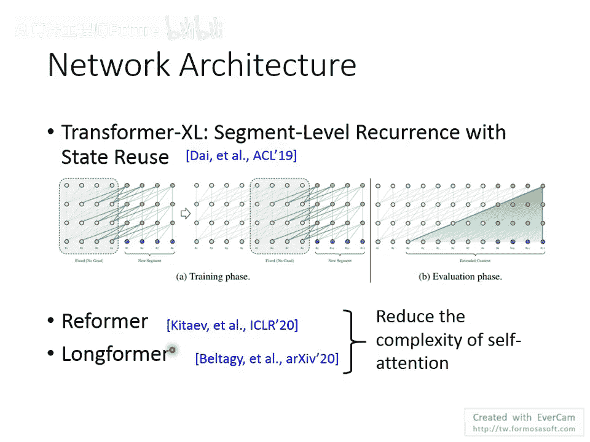

接下来呢我们就要进入fine tune的部分，好我们说我们有一个pretrain model以后，我们希望在这个pretrain model上面，再叠一些test specific的部分。

然后接下来让这个model就可以用。

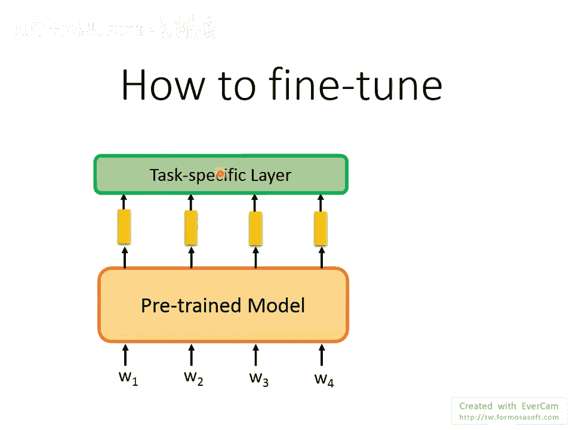

在特定的NLP任务上，那怎么把PRETRAIN的model，也就是输入一个token sequence，输出一堆vector sequence，这样的model改造成，在所有的NLP的任务上都可以使用。

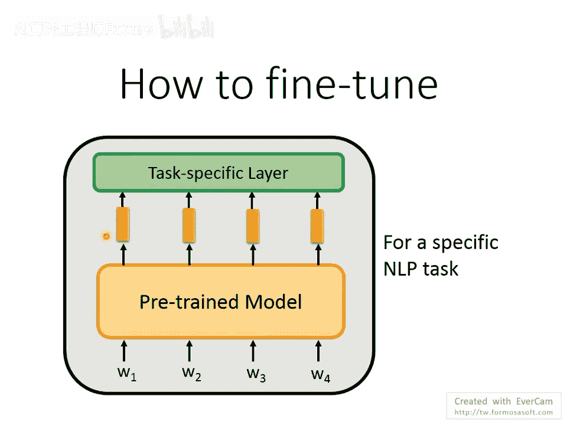

那首先我们先来看一下NLP任务的分类，这是我们在前一堂课才刚看过的东西，我们说根据输入可以分成两类，根据输出可以分成四类，接下来我们就是要看一下，怎么把pretrain model做一下修改。

让他可以来解这些问题，我们先看输入的部分，输入的部分如果是一个句子，那这个没有什么问题，就把一个句子丢到你的pretrain model里面就结束了，如果是多个句子怎么办呢，那今天常见的一个解法是这样。

你有两个sentence，那举例来说，什么时候你会用到两个sentence呢，如果是QA的问题，可能你的sentence one是query，你的sentence to是document。

如果今天是NLI，可能是你的sentence one就是premise，就是前提，你的sentence two就是hypothesis，那你会在这两个sentence之间呢，加上一个特殊的符号。

叫做SEP，代表说这两个sentence不是同的sentence，中间给它一个分隔的符号，当然你要让机器认得这个分隔符号的意思，那显然你今天在训练你的pretrain model的时候。

你是需要给他看过SEP这样的分隔符号的，我这个我们之后讲到pretrain model，实际上从PRETRAIN出来的时候再跟大家说明好。

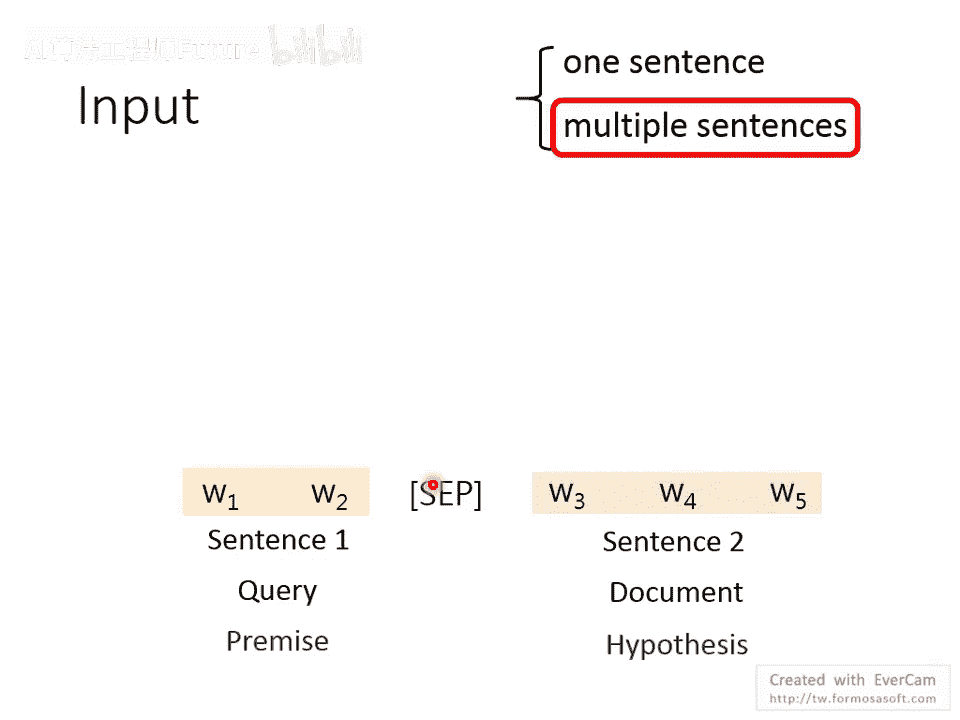

那接下来呢就没有什么了啊，就现在把两个句子中间SEP分隔，它变成了一个很长的句子，再把这个很长的句子丢到你的model里面，model会把每一个token抽出embedding，然后就结束了。

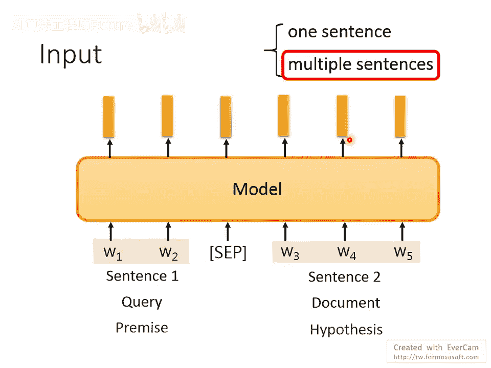

好刚才讲的是输入的部分，输入的部分我们已经处理完了，接下来看输出的部分，我们说输出的部分就是四个，可能我们就把这四个可能一个一个的看过去好，第一个可能是输出一个class。

机器读一整个句子以后输出一个class，那要怎么让机器读一整个句子以后，输出一个class呢，在原来的bird paper里面呢，它的解法是这个样子，你在输入的时候要加一个特别的token叫做cl。

那在PRETRAIN的时候呢，你要告诉机器说，看到CLS的token，就是要产生跟整个句子有关的embedded，就原来呢你的model都是看到一个token。

它产生一个代表这个token的embedding，但是现在你希望你的COS和token，输入进去的时候，这是一个特殊的符号，这个特殊符号输入进去的时候，你的model的输出是跟整个句子有关的。

那至于怎么实际上做到这件事，那讲到PRETRAIN的时候，我们再讲好，那怎么让机器输出一个class呢，你就把这个跟整个句子有关的embedding，再丢到一个model里面去。

然后你的model呢就做一下分类的问题，那证明这个model是什么，那就看你要做的多复杂，在原来bt paper里面，这个model可以，甚至就是一个linear的transform就足够了。

那如果你觉得linear transform太简单，也许你可以说多点几个layer也完全是可以的，那另外一个做法是说，也许你在训练的时候，他就没有COS这个token了，怎么办。

那你可以说我今天有一个test pacific model，它就是把所有token输出的embedding都读进来，比如说这个test city model是一个RNN啊。

把这些embedding都读进来，然后输出一个class就结束了，或者甚至是说啊这些embedding统统平均起来，直接丢到这个model里面，输出是什么class也许就结束哦。

所以这个是处理只要输出一个class的做法好，接下来下一个是每一个token都给他一个class，怎么每一个token都给他一个class呢，那你就需要有一个model。

这个model把每一个token对应的embedding都吃进去，然后再给每一个embedding in个class就结束了，那这个test savior model。

比如说它可以是一个呃LSTNLTN，把这个token的sequence都读进来，然后给每一个token一个class哎就可以了。

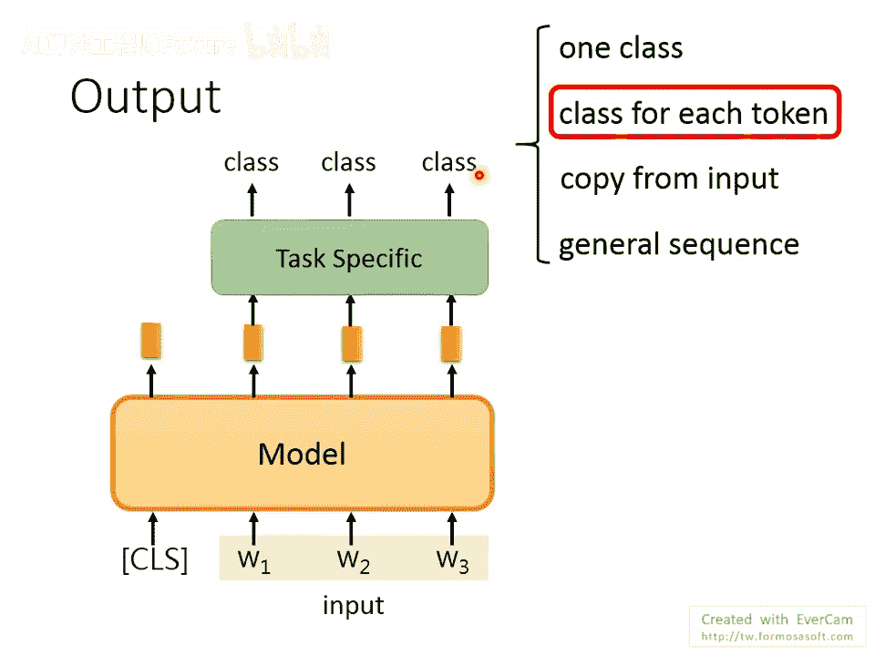

好那第三个case怎么从输入做copy呢，那从输入做卡，完全从输入做copy的任务是呃没有那么多了，那最经典的就是expression base的QA。

那extension basiqa需要的就是你有一篇文章，你有一个问题，你把文章跟问题丢给你的qa model，你的qa model就只要输出两个integer，告诉你告现在告诉你说。

现在输出S这个integer跟E这个integer代表说，我们要从这个文章里面的第ask个word，到第一个word把它取出来，就是我们的答案，举例来说。

现在假设你的答案是within the cloud，它是在整篇文章里面的第77个word，跟第79个word，那你希望你的model就是输出77跟79，这两个数字，那实际上这样子的模型是怎么做到的呢。

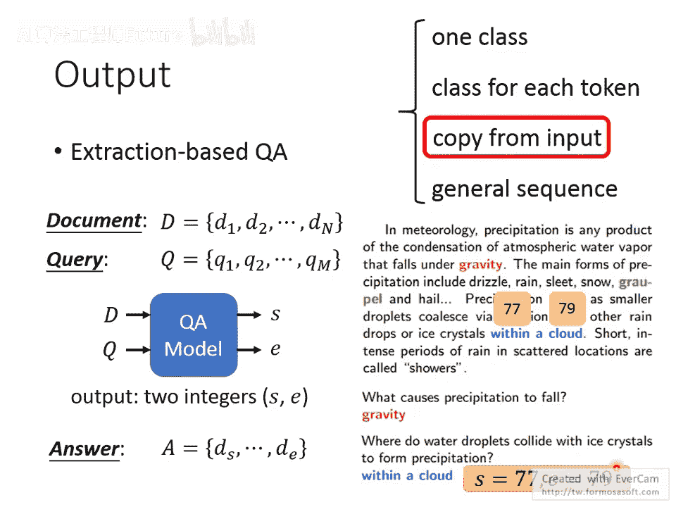

我们这边用原来BT里面的做法给大家做举例好，因为现在是extraction base和QA，所以你不，所以你会input一个question跟一个document。

然后接下来啊你的test pacific model在BT里面呢，在BERT拿来做QA的时候，你的test safia model就是两个vector就结束了。

其中一个vector专门负责侦测star的位置啊，怎么侦测star位置呢，假设这个红色vector是专门侦测star的位置，那就把这个红色vector拿出来，跟document这边输出了这个黄色的美。

每一个vector做大夸大，然后做完搭pa以后呢，你再过一个soft max，然后看看谁的值最大，它就是star p，那这个是原来BT的做法啊，如果你想要做的更复杂一点也可以，你可能会觉得说。

也许我嗯一个向量太简单了吧，也许我需要个LSTM把它读过去，然后再决定说哪一个位置是呃，spar point也可以啊，这完全取决于你要怎么设计你的test pacific model。

这边只是给大家一个例子，说如果是extraction的QA，如果你用BT的话，有这样子的做法，在原始的bird的paper里面，提供了这样的这个蓝色的这个向量啊。

代表了侦测结束的answer结束的位置的test pacific model，那就把蓝色的向量跟这些黄色的向量，蓝色向量跟这些黄色的向量做搭pa，然后呢再通过soft max。

然后看说啊这个位置的分数最高啊，那这个位置就是end point，那我们就知道说啊，star是第二个were，and是第三个were哦，所以当然是第二个word and是第三个word。

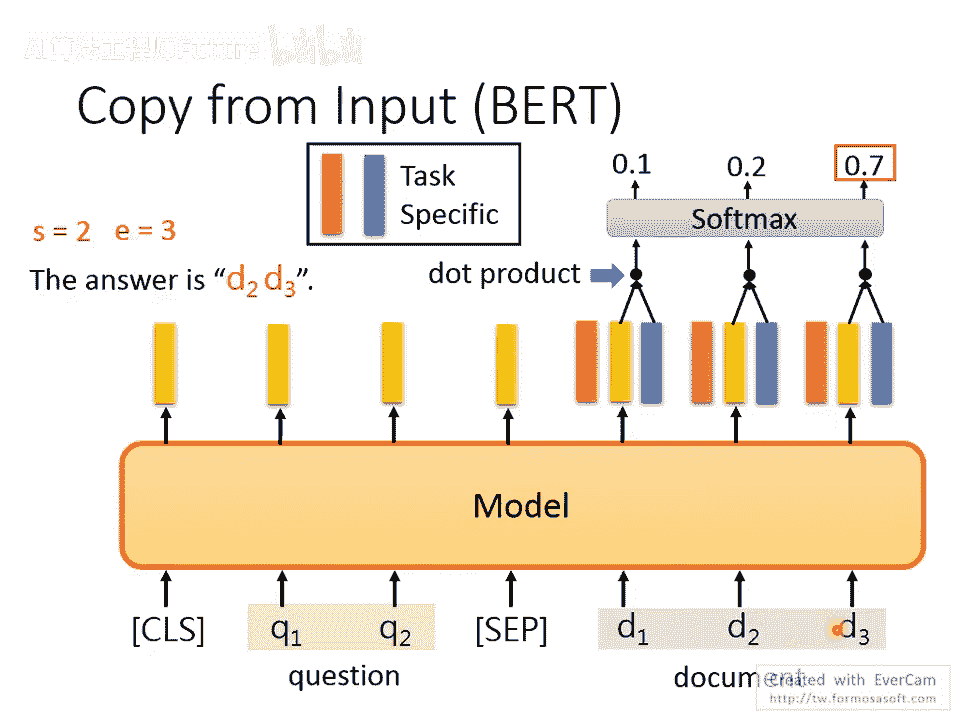

所以第二第三就是我们的answer好，最后一个问题是，怎么让这样子PRETRAIN的model输出general的sequence呢，也就是说怎么一把这种普train的model。

用在sequence to sequence的model里面，那最简单的做法，最直觉的做法是这样，我们现在这些model就是input1串word sequence，Intrinput，一串token。

Sequence，会给每一个token一个embedding，那这样子的东西正好适合拿来做sequence to，sequence model里面的encoder。

那你的test safe model就是你的decoder，然后接下来呢你就跟一般sequence to sequence，model一样，做一下attention。

然后让你的test acific model，your decoder输出一串token sequence就结束了，但这样的坏处就是你这个test acific model啊，就没有PRETRAIN到。

就是一般呢，我们今天test specific的label data会很少，不会太多，所以我们会期待说今天test pacific model越小越好，希望整个模型里面多数的参数都是普TUR过。

但如果像今天这个投影片这样设计，就代表说你的整个decoder完全没有return过，那也许这不一定是最好的设计，那今天如果你想要把PRETRAIN的model用在sequence to。

sequence model里面，其实还有另外一个可行的做法好。

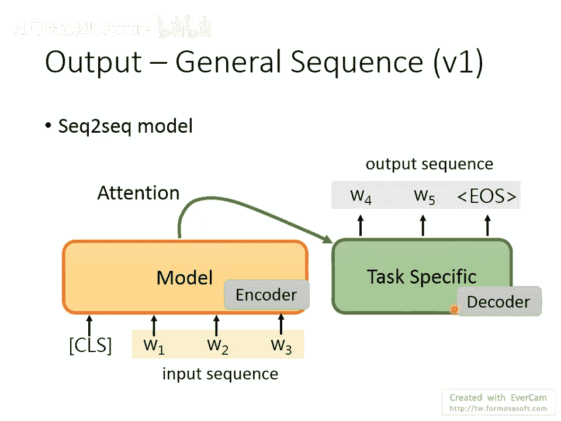

所以这个是virgin two，好，这个version two呢是怎么做的呢，现在这个w one w two啊，是你的input sequence。

那我们希望今天这个model呢它可以input a sequence，以后，output一个general的sequence，怎么用pretrain model做到这一件事情呢。

啊你先把w one w two，你的input sequence丢到pretrain model以后，接下来你给他一个特别的符号好，你给机器一个特别的符号，他看到这个特别的符号以后呢。

他输出一个vector，这个vector你再给他丢掉一个test specific的model，然后让它output产生出来的sequence的第一个词汇，接下来再把这个词汇丢到你的model里面。

然后接下来呢再产生一个embedding，再把这个embedding丢到test pacific model里面，再产生下一个词汇，因为你现在你的model就是他会的东西。

就是给他一个token output的embedding嘛，所以你今天确实可以先给他一个分隔的符号，先给他一个特别的token，让他输出，现在要输出句子的第一个词token。

然后再把这个再把这个token再拿来当做第二第，再把它当做输入，再把W3这个token当做输入，让它输出下一个token，然后这个同样的process呢就反复下去，现在产生w four这个token。

把w for这个token再拿进来，一样可以产生一个embedding，再丢到test shift model里面，又产生W5，然后就跟原来的sequence to sequence model一样。

再把W丢进去，直到test acific model产生end of sentence，就结束你的decoding的process，所以今天我们其实也有机会把PRETRA的model。

当作decoder来使用。

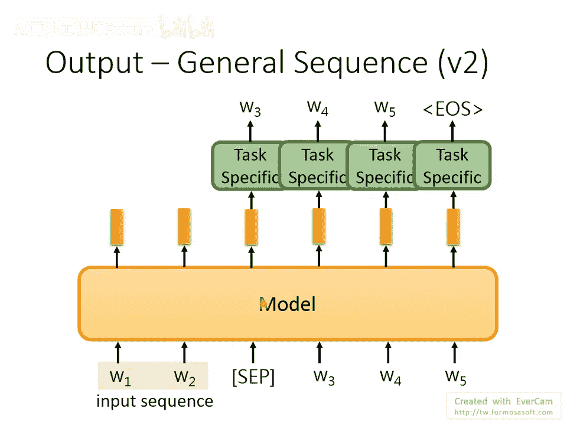

刚才讲的是，怎么把PRETRAIN的model加上一些东西以后，让它可以使用在各式各样不同的，NLP的任务里面，那我们讲说NLP的任务，input有两种可能，output有四种可能乘起来总共八种可能。

那我们刚才通通都已经讲过了好，那接下来呢假设你有一些呃，Task specific label data，你怎么来fight to你的模型呢，这边有两个做法。

第一个做法是你的pretrain model，他出生以后，他训练完以后就固定住了，他变成一个feature的ATTRACTOR，你输入一个token sequence，抽出一大堆的feature。

抽出一大堆embedding，他们代表了某些feature，把这些feature丢到test specific的部分，我们只find to test specific的部分，另外一个做法是。

我们把PRETRAIN的model跟test specific部分接在一起，在fight to的时候，我们不止会调test specific的部分。

我们也会find to pretrain the model，也就是你把PRETRAIN的部分，跟test presiv部分合起来，当做是我们有一个巨大的model，我们用这个巨大的model来解决。

我们想要解的NLP的任务，那一般如果你直接劝这样巨大的model，往往很容易OVERFIT了，但是今天因为你的这个model的本体呀，最主要的部分已经PRETRAIN过了，它已经它不是随机的。

它的参数不是随机初始化的，test specifi部分的参数是随机初始化的，那PRETRA的部分它不是随机初始化，所以也许就没有那么容易OVERFIT，那今天在文献上看来啊。

这个fighting可能是呃fight to，整个model，往往你得到的performance会比把pretrain model固定住，只TRTEST和si model performance还要好。

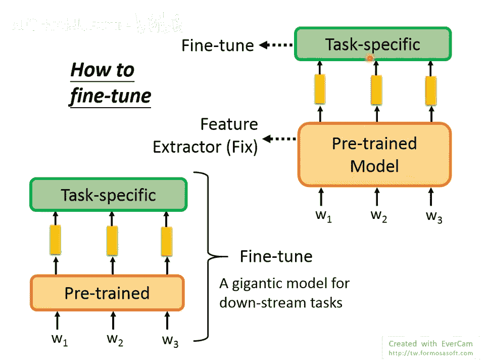

好，那但是如果我们现在采取的是翻译成，整个model的话，会遇到什么样的问题呢，你可能会遇到这样子的问题，我们现在有三个不同的任务，每个任务里面我们都有PRETRA，好的model。

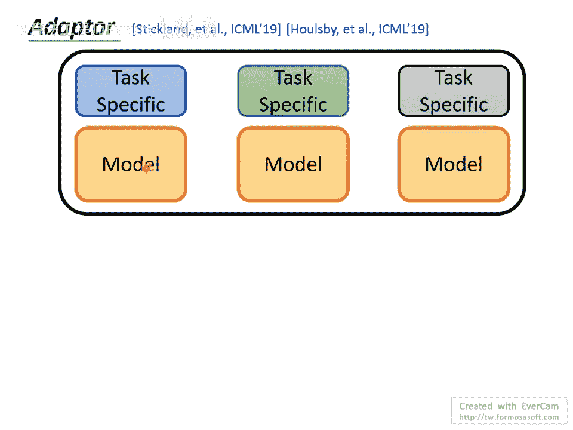

你把它加上test的shift部分，接下来你find to整个model，所以这些PRETRAIN的model在不同的任务里面，通过翻to以后，他们都会变得不一样啊，本来都是一样的。

所以我这边用黄色来表示，然后但是有三个不同的任务，所以训练完以后，它一个就变蓝色的，一个就变绿色的，一个就变灰色的，那每一个任务你都需要存一个新的，这样子的模型，那这样子的模型今天往往非常的巨大。

我们刚才已经在那个呃前面前面在讲这个模型，大小说说啊，有的模型居然有上亿个参数啊，说10亿个参数太大了，这些模型太大了，你说NOP有这么多的任务，每个任务你都要存一个巨大的模型，也许是行不通的。

所以怎么办呢，所以有了adapter的概念，也就是说我们今天想要调这个pretrain model。

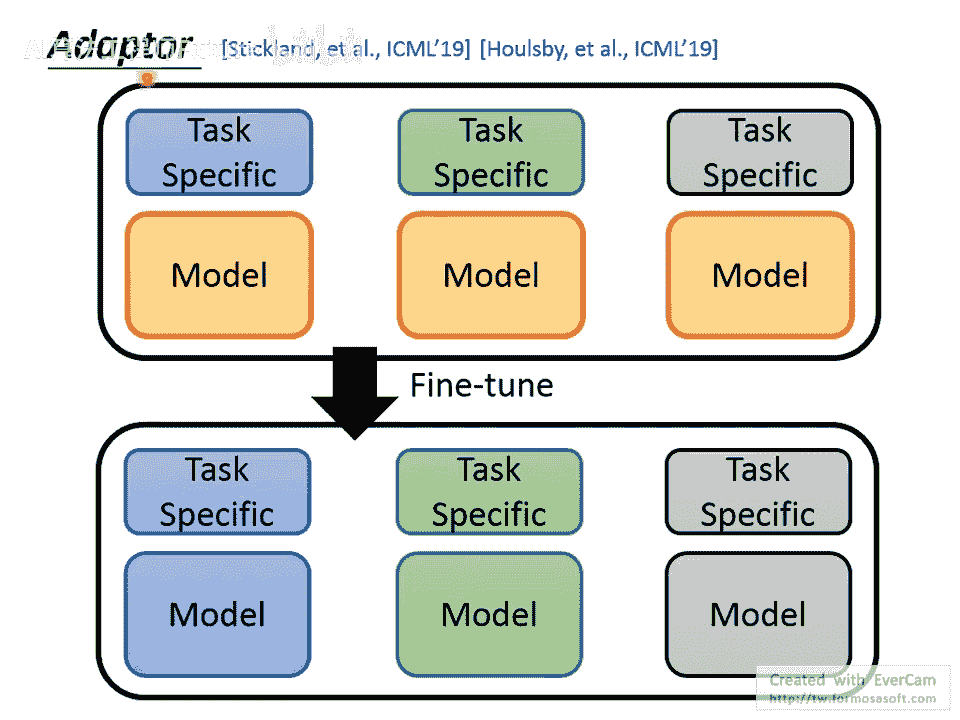

但我们能不能只调pretrain model的一部分就好了，我们在pretrain model里面加入一些layer，这些layer叫做adapter，我用apt来代表adapter缩写了。

那我刻意把它画的比较小一点，代表说这些部这些模，这些layer呢是整个模型中的非常少量的一小部，分的参数而已，那我们在find to的时候，你也许会想要调PRETRA的模型。

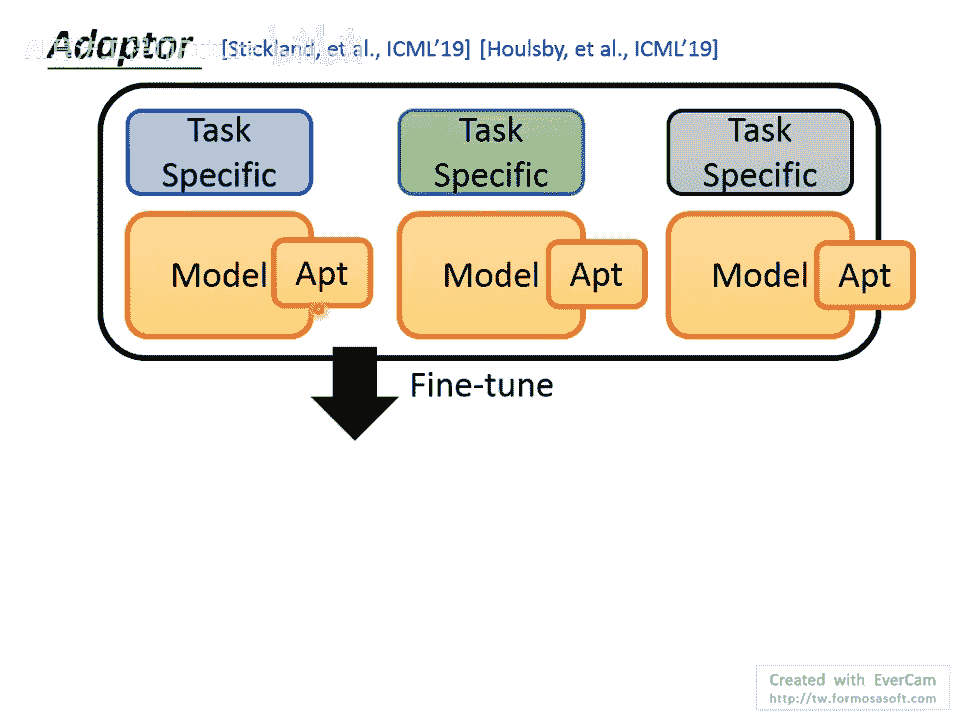

但是我们只调ADAPTOR的部分，所以PRETRA的模型大部分是维持原样的啊，你发现它颜色没有变，但是只有adapter的颜色变，只有adapter的颜色变，那你到时候再存你的模型的时候。

假设你有现在有三个任务要解，但是你并不需要把所有的参数都存下来，你只需要存原来模型里面不会被调的部分，还有每一个pretrain model里面的adapter就结束了，所以这样你需要储存的参数量。

就会比每一个任务都要存一个完整的pretrain model，还要少得多好。

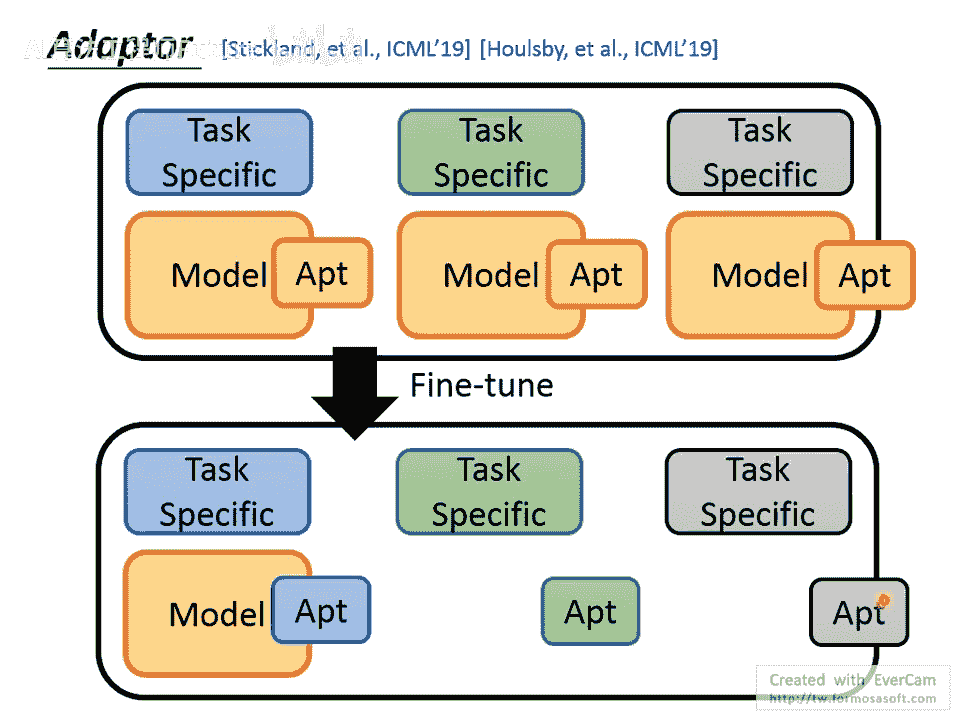

那这个adapter长得是什么样子呢，那这边就是给大家一个文献上的例子来参考了，那像这样子的研究呢也有好几篇文章了，那每篇文章的解法呢不见得是都不太一样啊，那至于怎么样解才是好的。

那这个其实还是一个值得研究的问题，那这边呢只是举一个例子给大家参考，举例来说，在这个ICNL19的paper里面，人家是怎么做的呢，他们的做法是说这个是transformer的layer。

我们知道今天pretrain model的主体呀，往往就是一层一层的self attention，也就是transformer的layer啊，你可能会先做一些self attention。

然后通过一些feedforward the network，然后他把ATTETTER插在feforward network open，他把ADAPTOR插在feforward network open。

然后这个adapter啊是呃，PRETRAIN的时候是没有adapter的，呃PRETRA的时候是是没有adapter的，adapter呢是准备翻two的时候才插进去。

然后翻译to的时候只调adapter的参数，其他部分什么attention的参数啊，这边feedforward layer啊都是不动，然后data就很简单哦。

有一个fee forward network，然后有一个bottle name的layer，又有另外一个feedforward network，那它的参数量会把它调到不会太多，会尽量让它参数量少一点。

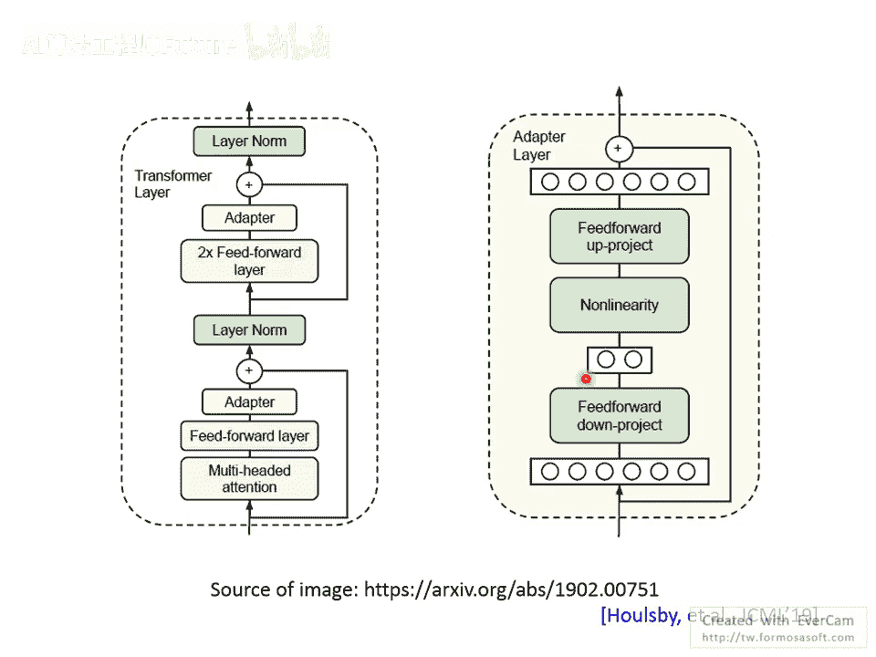

那在这篇目i c NO paper里面呢，它确实提供了非常好的结果，这个结果是这样子的，这个accuracy的delta代表说呃，这个零代表说呃，唉如果我们翻to整个model的时候。

会得到的performance，因为今天往往翻出整个pretrain model，得到performance是最好的，所以翻to整个pretrain model的结果呢，我们当做是零。

那如果你只翻掉一部分的参数，不find you，整个model performance往往会掉一点，那蓝色这一条线呢是，如果我们只find to最后几个layer，就越越往右边参数是越多了。

而越往右边参数是越多啊，所以横轴呢代表我们five two的时候的参数量好，越往右边参数是越多，最最左边这个点代表啊只翻to top layer。

这是find two最后一个layer跟倒数第一个layer，这翻译two最后一个layer，倒数第一个layer跟倒数第二个layer，以此类推，那find you的参数越多。

当然performance越好，那如果你只翻译to最后一个layer，虽然你已经翻出很多参数了，但是performance相较于final，整个model相较于零，这边是有一个非常显著的差距的。

那今天这个蓝色的range啊，其实代表的是就在这个paper里面有试验了，各式各样不同的任务，我们今天用这种PRETRA的model，就是要解多个任务，这才是prefect model目标。

那他是把不同的任务，他得到的performance的drop呢都呈现出来，就是这个蓝色的区间，但是如果使用ADAPTOR的概念的话，你就会发现说如果我们只劝ADAPTOR。

那你当然还是可以调整一下adapter的参数，但如果尺寸adapter的话，performance呢不会掉太多，但是至于这个ADAPTOR实际上要怎么设计，要插在network哪里哦。

我觉得这个其实还有蛮大的研究的空间的啊。

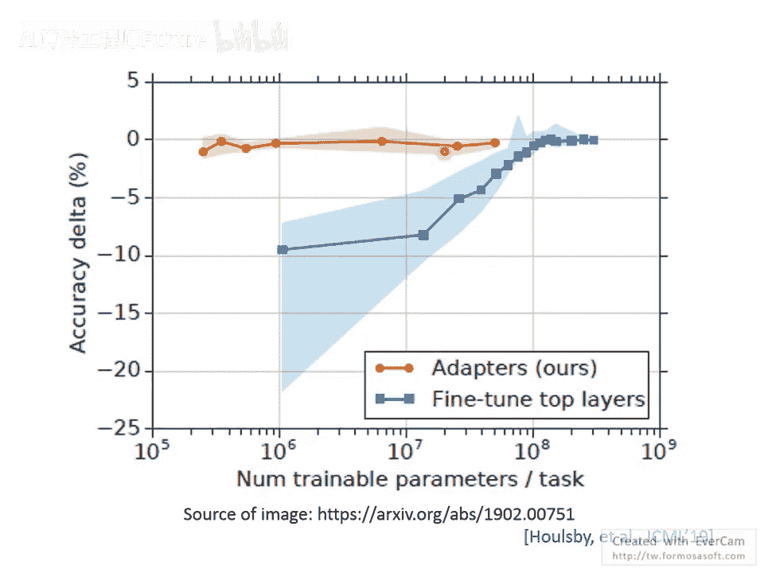

那为什么我们诶哦这边是哦，这边是要讲说我们在刚才讲呃，我们在刚才讲到目前为止啊，我们都是让整个model输入token sequence，然后最后一个layer，你可能有12个layer。

24个layer，然后就吐出每一个token所对应的embedding，然后再把这个embedding丢到当讯的task里面，丢到specific的layer里面去，但是还有另外一个做法。

因为也许每一层所抽取的资讯是不一样的，所以有一个做法呢是把不同层的feature，把它waited sun起来，也就是说第一层的feature同样是输入同的token。

第一层的feature呢输出一个x1，第二层呢输出一个x2，我们可以把x1跟x2呢把它waited上起来，把w one一个weight乘上x1，加上w two乘上x2，得到一个新embedding。

这个embedding，同时综合了搭第一层的输出，跟第二层输出的资讯，然后再把这个综合每一层资讯的embedding，丢到接下来的任务里面去，那这个w one w two应该要设多少呢。

这个w one w two啊可以是学出来，你可以把w one w two视为是test acific layer，参数的一部分，就test acific layer的参数。

你需要在接下来NLP的任务里面，接下来的downstream task里面被学出来，那这个w one w two，可以跟着这个test specific layer一起被学出来好。

所以你就说不同的layer也许抽了不同的feature，他们关注不同的资讯，那在不同的任务，我们就可以使用不同layer抽取出来的不同资讯，那哪一个layer比较重要，用w one w two来决定好。

那这个是weighted feature的方法好。

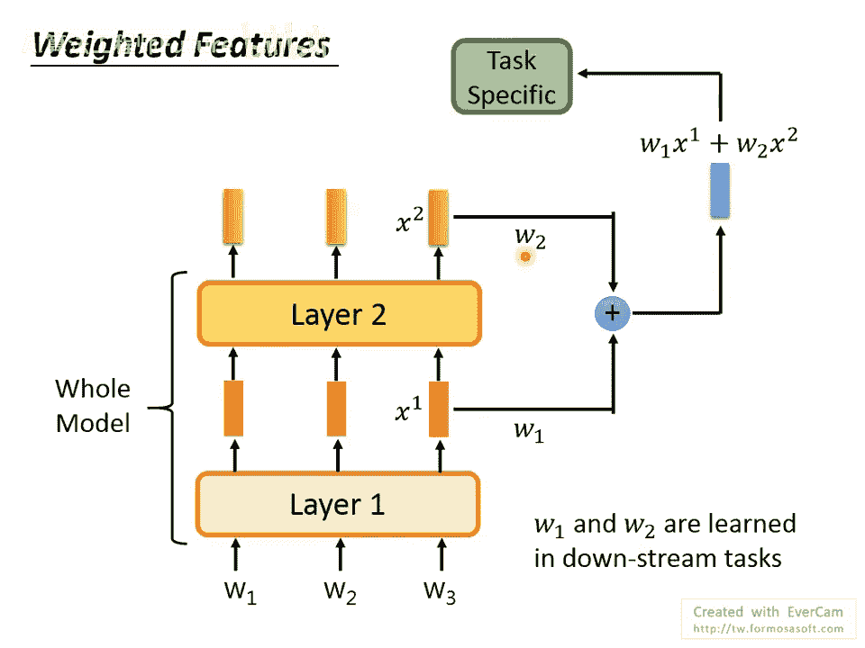

那为什么我们需要这些PRETRAIN的model呢，一个简单的回答是，这些PRETRA的model真的带给我们比较好的performance，我们刚才在上一堂课看到了录这个东西。

LUE这个东西是要检测一个模型，On in general，了解人类语言的能力，那在这个图上啊，黑色这一条线代表人类的能力，而每一个color代表一个模型，这边每一个点代表这个模型。

在不同任务上的performance，蓝色这一条线虚线代表不同任务的平均好，那这最早有ELO以后的结果，但后来就有gpd two，有BT等等，有各式各样的模型，各式各样的模型。

直到今天有了这种普确模型以后，这个机器的performance居然已经跟人不相上下了，所以这显示GROUTH在有了这种PRETRA的model以后，在group这个copper上确实带来了一些进步。

当然呃不敢说就是有这样的模型以后，以机器，它到底他理解语言的能力，真的跟人类相提并论了，但至少在GW这个open上，在GW这个BENCHMARCOP本上，机器它得到performance。

居然已经可以跟人相提并论了。

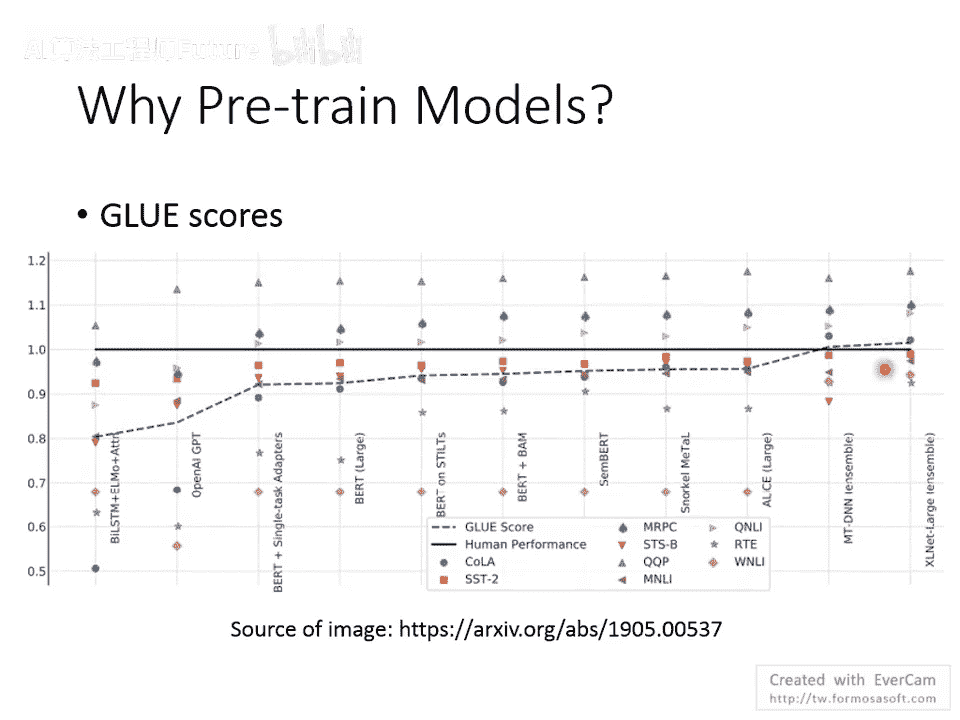

好，那还有很多其他的分析，是你可以在文献上找到的啊，有很多其他的文章会告诉我们说，为什么PRETRAIN的model比较好，这种PRETRAIN的model带给我们什么样的好处。

那这边我是引用一篇ENNLP2019的paper，那在这篇paper里面其实做了非常完整的分析了，那我这边只截了两个实验结果来给大家参考好，第一个实验结果是今天在training的时候。

有没有PRETRA，到底会带给我们什么样的不同，在这个图上啊，有这个呃虚线，虚线代表的是这个没有PRETRAIN的结果，也就是我们有一个巨大的模型，这个巨大的模型直接random initialize。

然后transform scatch，那实现呢实现代表有PRETRAIN，我们先PRETRAIN好一个model，在接下来的downstream task，我们只微调这个模型的参数。

那你会发现说这些实现呢他们在training的时候，他们的loss都非常快下降，而那这些虚线呢这些虚线他在training的时候，他们的loss比较难下降，而且这些模型其实它们的大小是一样。

就这些虚线就没有PRETRAIN的model跟有PRETRAIN的model，它的模型大小是一样的，照理说呃这个模型大小是一样的，他们去fit那个training data，能力会不会其实是差不多的呢。

它模型是一样的，所capacity这个模型的能力应该是一样的，所以fit training data也许是差不多容易的啊，但是如果你是随机开始的话，你会发现说你很难fit你的training data。

如果你已经有PRETRAIN好，那你fit training data就会容易很多好，那这个是training的时候，但我们知道说光看training的performance，也不见得有用啊。

光看training的loss可以压的很低，搞不好是OVERFITTING呢，那如果testing的时候如何呢，machine generalized的能力在此看，没有看过的测试资料的状况下是如何呢。

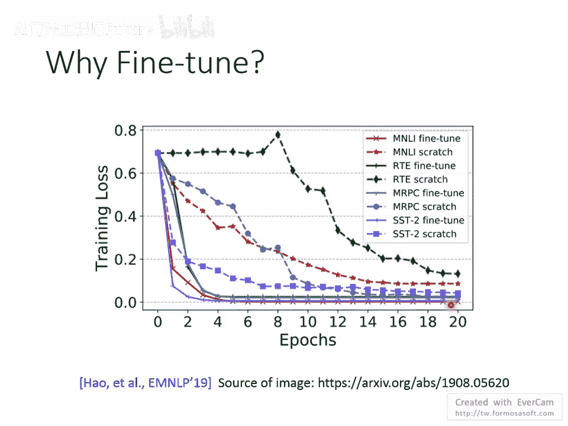

那这篇paper里面也分析了一下MACHGENERALIZE的能力，那怎么看模型generalize的能力呢，那你可以看一下呃，呃我的课程的YOUTUBE频道里面有讲过这个呃。

一些deep learning的theory，那里面有讲了一些分析模型generalize能力的方法，那这边呢就只给大家看一下，这个文献上面所做出来的一些观察，那这个图啊代表什么意思呢。

这个图代表说你给模型不同参数的时候，模型的呃呃的在在模模型的loss这那这样，那肯定会说这个图怎么得到的，因为我们今天一个模型里面的参数，不是有上亿个吗，那你怎么能够用两个dimension。

就来表示你的模型呢，那像这样的图怎么画出来的，就请参考过去上课的录影，那假假设我们现在大，就就假设大家知道说啊，你的模型我们可以用呃二维来表示啦，然后这边每一个点这个二维的平面上。

XY轴所形成的这个平面上，每一个点就代表了不同的模型，然后这个海拔的高度就代表这个模型呢，可以在训练资料上面的loss好，那在训练的时候起始点。

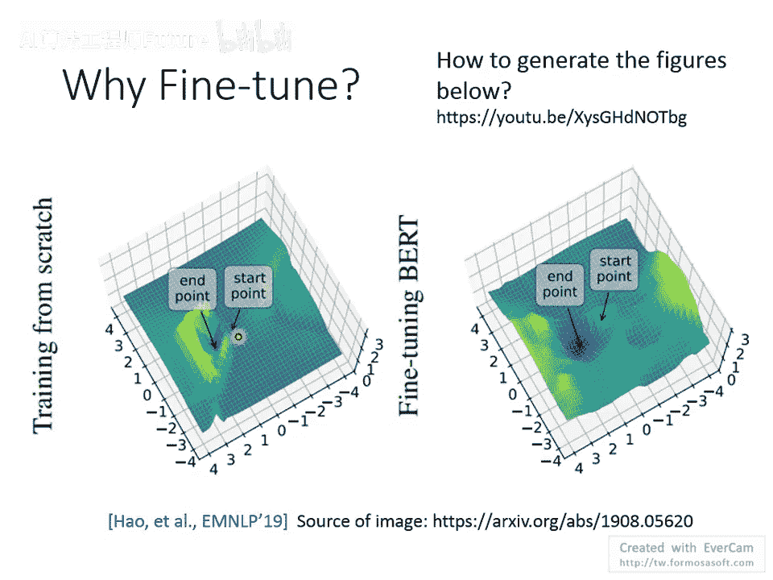

假设你今天是train from scratch，你的起始点呢在这个地方有random随机的参数，它起始点在这个地方，经过一番训练以后呢，他就跑到m point，就是这个地方好。

那如果今天有find to的话，你的起始点在这个地方，那你的m point呢在这个地方，那这两个图有什么不同呢，你想要不是都是从一个地方开始，一个地方结束，一个地方开始，一个地方结束。

都找到一个比较低的地方吗，都结束在一个呃类似这个local minimu的地方吗，结束在一个local minimu的地方吗，但他们有什么不同呢，我们从一个local mini马的这个三凹的宽度啊。

其实有机会看出一个模型generalize的能力哦，这个三凹的宽度跟general模型generalize，能力的关系是什么呢，如果今天这个三凹越陡峭，那模型generalize的能力往往就越差。

如果这个山凹这个盆地啊越平滑，那你的模型一般化的能力就会越强，所以如果你今天你跑到的那个local mini嘛，就这两个点，同样是local mini嘛，如果你跑到那个local mini嘛是一个峡谷。

那一般化的能力会比较差，如果你跑到这个local minimu是一个盆地，那一般化的能力往往就比较强诶，好那么呃现在已经超过12点了，快快十分了，所以正好讲到这边报一个段落，那也许我们就在这边停下来好。

那看看大家有没有问题想要问的呢，好我们今天上课就上到这边了。

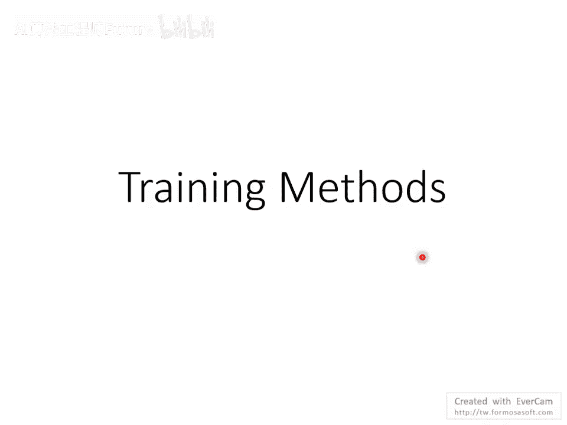