# 【官授搬运】2026年全新优化版李宏毅机器学习系统课程，这才是真正的初学者体系课程！—人工智能／深度学习／神经网络 - P57：6-选修-BERT的各种变体 - AI算法工程师Future - BV1ruqABeEFX

好那我们来上课吧，好那我们讲到这种BT的pretrain model，然后我们说今天NLP的任务，已经不再是一个任务，就给他一个模型，而是我们先PRETRA好一个模型以后。

然后再把这个PRETRAIN好的模型find to，在很多不同的任务上，那上周我们已经讲过怎么翻king啊，上周我们是假设已经有一个普TRA好的模型，接下来我们要把这个PROJE好的模型find to。

在各式各样不同的任务上，那这周我们要来讲，怎么得到这个PRETRAIN好的模型好，那怎么得到这个PRETRAIN好的模型呢，上周我们讲说。

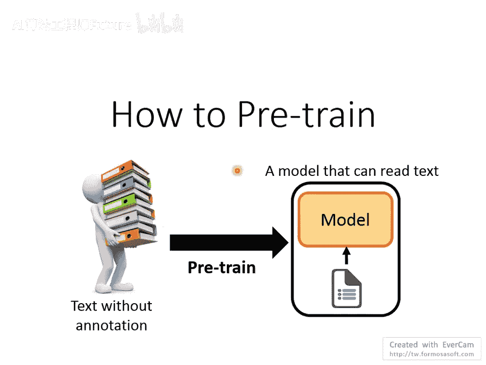

我们需要什么样的PRETRAIN的模型呢，今天我们希望我们可以有一个普turn的模型，是把一串token吃进去，接下来他把每一串token，变成一个embedding的vector。

而且我们希望说这些embedding vector，它是contextualized的，它是可以考虑上下文的好，那怎么样训练这样的model呢，今天你在训练这种model的时候。

多数时候你用的方法呢是unsupervised，不过像这种抽contextualized的embedding啊，抽contextualize the war vector的方法。

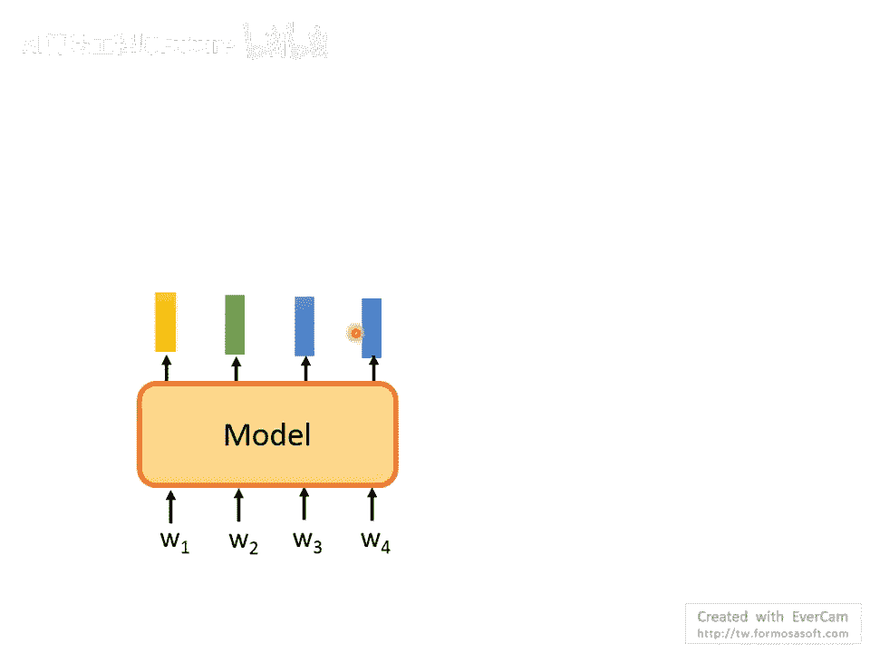

我觉得最早的一篇文献应该是cf这篇paper，然后cf这篇paper呢它并不是unsupervised，得到这个model的，cf这篇paper paper呢。

它是用translation的方法来训练出这个model的，而你从他的名字也可以看出来说，COVECTOR他是contact vector的缩写哦。

所以显然他就是可以考虑text information的war embedded啊，就跟今天bird可以做到的事情很像，我们都说bird跟ELO相较。

原原来的water ve不同的地方是它是contextualized的，那cough它是contextualized的啊，那cf呢就是海湾啦，然后他是取contact的CO跟vector的V1凑成cf。

然后那个时候呢臭名字呢还没有那么硬，也没有一定呢要凑成芝麻街的人物好，那怎么用translation来得到这样子的model呢，那你其实呢。

就是把这个model当做translation的encoder，而在训练translation的时候，你的input是某一个language是a language。

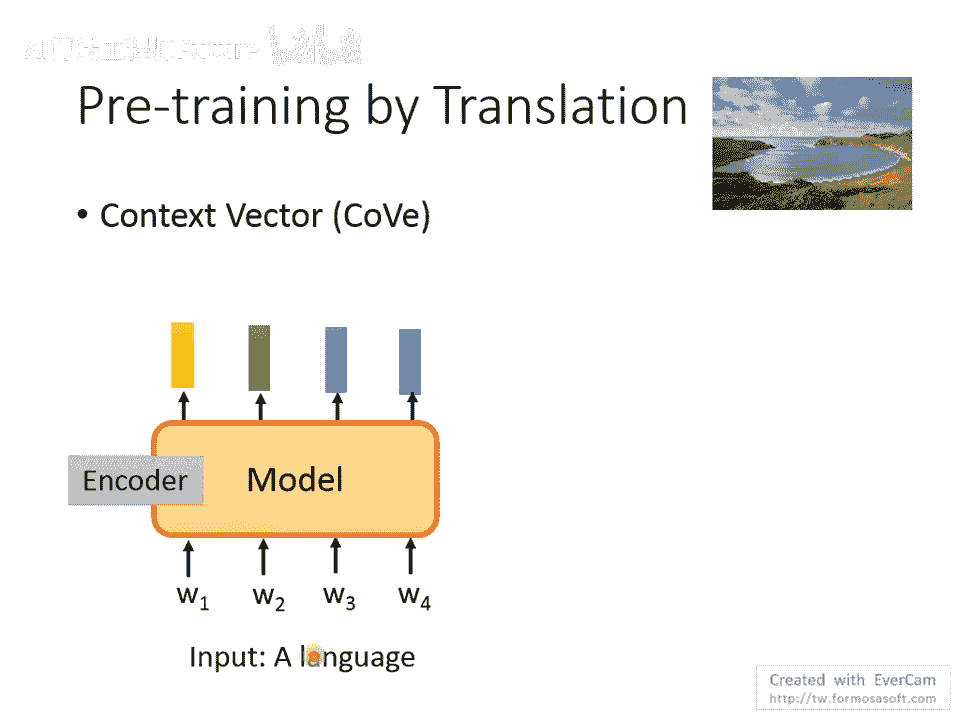

然后呢你有一个decoder，这个decoder呢根据encoder的output做一下attention，然后呢得到b language的输出啊。

然后呢你有很多这种呃language a跟language b的pair data，然后NTN的train你就可以劝好这个encoder，turn好这个decoder。

然后这个encoder就是我们pretrain model，就是可以拿来得到contextualize或embedding的model，那这边我想之所以选择这个翻译作为呃，这个PRETRAIN的任务。

我想是有道理的，因为如果你你选择的是别的任务，比如说SUMMARIZATION，也许你就没有办法得到比很好的，每一个token的representation，你想想看。

如果是SUMMARIZATION这个任务，我们需要做的事情是找出重要的词汇，无视那些不重要的词汇，找出重要的词汇组成一个摘要，然后把不重要的词汇滤掉，所以也许你的encoder就会学到。

说看到不重要的词汇，我们就给他一个特殊的embedding，叫做不重要的词汇哦，所以这样子你的encoder可能就没有办法，真的学到每一个token的representation。

那这边选择的是翻译这个任务，那翻译这个任务就是要把输入的这个句子，它里面的资讯如实地呈现在输出里面哦，所以所有的这个句子里面，每一个词汇可能都需要被考虑到。

所以如果用translation这样的技术来当做，PRETRAIN的方法来训练这个encoder，那encoder可能比较有机会给每一个输入的token，都得到一个它应该有的。

对应到它语义的这个embedded，当然如果你用translation这样，最大的问题就是你需要大量的pair data，才有办法训练这样的model，那收集pad的data终究是比较困难的。

所以我们期待的是。

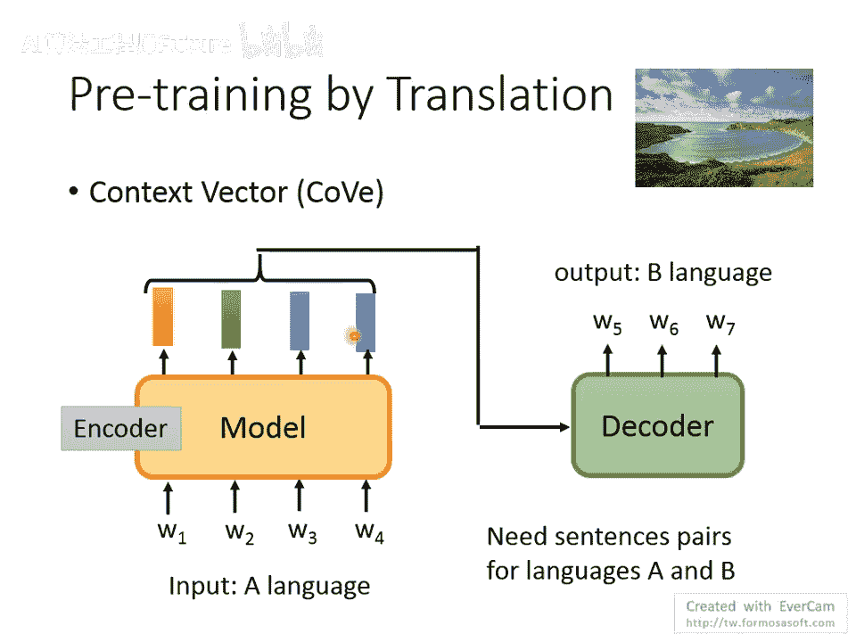

我们有没有办法用唾手可得的没有标注的文字，就直接去训练出一个模型，就直接去训练出一个pretend的model，那过去这样子的方法就叫unsupervised learning。

就从没有label data做学习啊，就是unsupervised learning，不过近年来呢呃更常被叫做self supervised learning啊。

那我想之所以会被叫做sell supervised learning，的一个原因是因为YANA克呢有发一个抛文，说，就是以后呢我们要把这个unsupervised learning呢。

改叫self supervised learning，因为unsupervised learning呢很容易让人confused，那所谓的sales supervised learning是什么意思呢。

他说sale supervised learning的意思就是说the system learns to，Predict part of its input。

Other part of its input，就是他用部分的输入去预测另外一部分的输入，也就是说呢今天我们输入的资料，有一部分被拿来提供supervise的signal，那有一部分被拿来提预测别人啊。

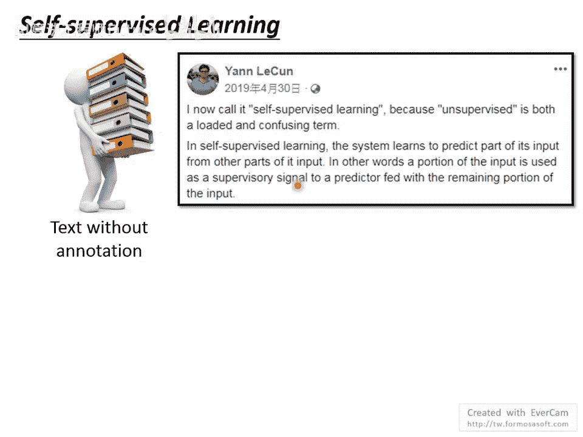

这个是self supervise的概念好了，下面这个图呢，就是解释一下self supervised learning的概念啊，如果是supervised learning，我们要训练model。

有一个input x，有一个input y，然后Y是哪来的，Y是label来的，需要人提供label给我们XY的pair，我们才有办法训练一个模型。

那self supervised learning是怎么回事呢，self supervised learning model的input和output是自己产生出来的。

人没有去label input和output，但我们根据我们手上没有label的data，自己用，非常呃low cost，完全不需要人工标注的一些简单方法，去产生输入跟输出的P。

然后就用这种输入跟输出的pair，它是自己产生的，不是人标注的来做self supervised learning好，那这个就是self supervised learning的基本概念。

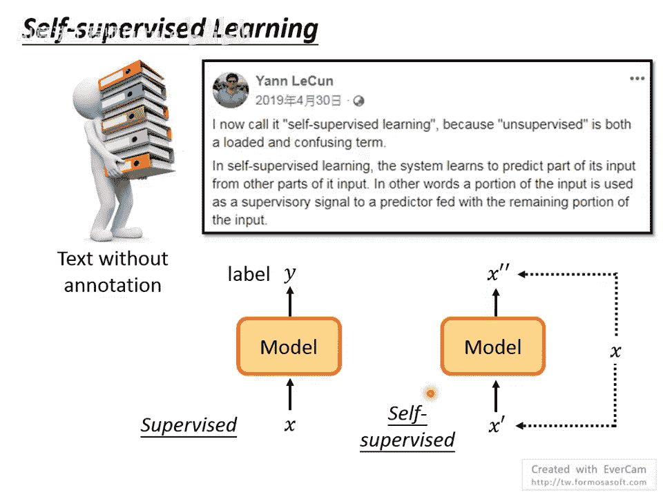

啊那怎么制造这一种输入和输出的关系呢，最经典的做法就是呃在文字上，最经典的做法就是给一个sequence，预测下一个token好，就你训练个模型，他的工作呢就是给他w one。

然后呢他会输出一个representation叫做h one，然后根据h one我们要去预测w to，预测w one后面接的下一个token，w two是什么，那这边W呢都代表一个token好。

那这个h one怎么预测w two呢。

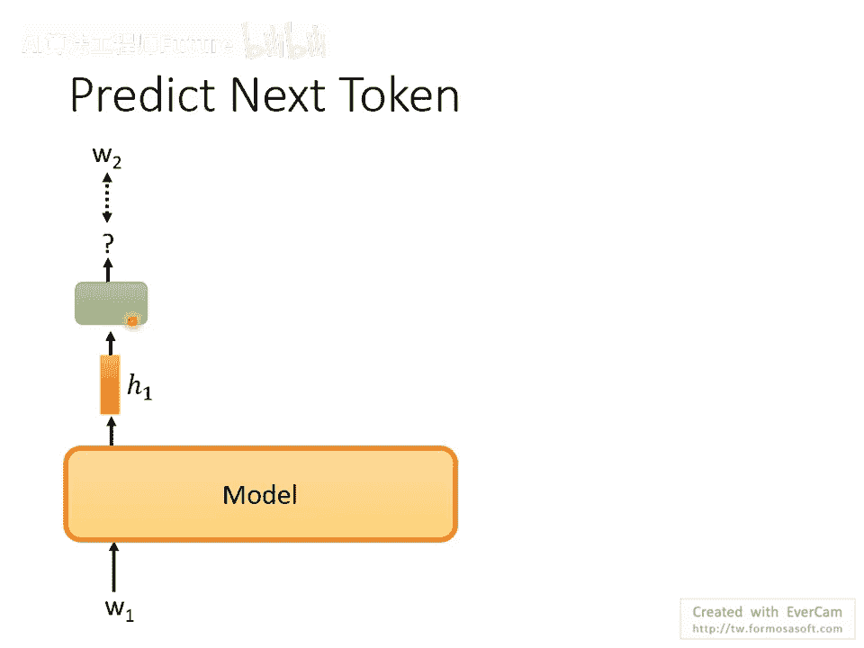

那这边呢还是帮大家说明一下哦，你有一个这个HTE，它是从WT得到的，这个HT呢通过一个linear transform，其实不一定是linear transform啊，其实也可以是更复杂的东西。

这个都是看你高兴啊，通过一个linux form再加soft max，得到一个over你的token的probability distribution，也就每个token都给他一个几率。

你得到一个probability distribution好，那接下来呢你会希望这个probability distribution跟你的target，跟你训练的目标。

他们的cross entropy越小越好，那你的target是什么呢，你的target就是下一个word，而且你的target的distribution就是wt减T加一的几率是一。

那其他token的几率是零，而你用w one产生h one，然后要希望h one可以拿来预测w two，那同样的process呢就反复进行下去，你的model呢是w one w two。

接下来呢它输出h two，然后你用h two呢去预测W3啊，你要马老师W万W就W3，然后接下来产生H3，然后你用model h3去预测w four啊，以此类推，使w one到w four。

他要预测W5好，那这个东西呢就是预测下一个token，那在使用这样的model的时候啊，有一件事情你是需要注意一下，我们今天在当我们今天要做一个model，去预测内下压一个token的时候呢。

我们要设计我们的model，你必须你不可以让你的model一次，把W跟n one跟w four通通都读进去，然后再去预测H1跟h four，这样是不行的。

因为如果你让你的model直接吃w one到w four，然后预测h one到h four会发生什么事情呢，那model可能会学到说呃w one进来什么也不重要了，整个句子自选不重要了。

我们就看右边的token是什么，就把右边这个token移来当做h one，我们就可以成功预测了，把右边的token依赖当做HT5，就可以成功预测了，那你的模型就学不到什么有用的东西哦。

所以你在预测next token的时候呢，要注意设计一下你的模型，不要让他偷看到他不该看到的答案好。

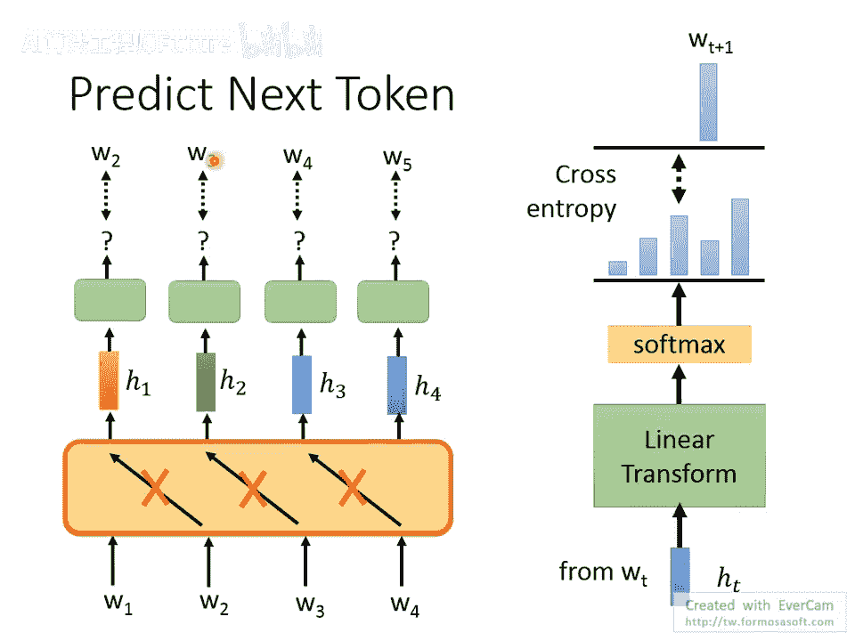

那像这种预测，下一个token呢，是最早的unsupervised pretrain model哦，最早期的unsupervised pretrain model，都使用这样子的技术。

那我想这也是非常自然的，因为在过去NLP领域的人，就知道要训练language model这个东西，而language model他本来做的事情就是predict next token。

所以我们今天讲的这个PRETRA的model，其实就是一个language model好，那要用什么样的network架构来训练这个language model，来预测下一个token呢。

最早我们当然会想到要用LOSTN哦，所以有很多知名的使用LSTN的PRETRAIN模型，其中最知名的就是大家今天都熟知的ELO，还有另外一个model也比L1个也跟ELO非常类似。

也是LSTN也是language model，也是希望pretrain a model，find to在各式各样不同的task上，但它没有ELO那么知名的。

叫做universal language model，fine tunity和ULNFIT好，总之这些模型都是language model，都是用LSTM。

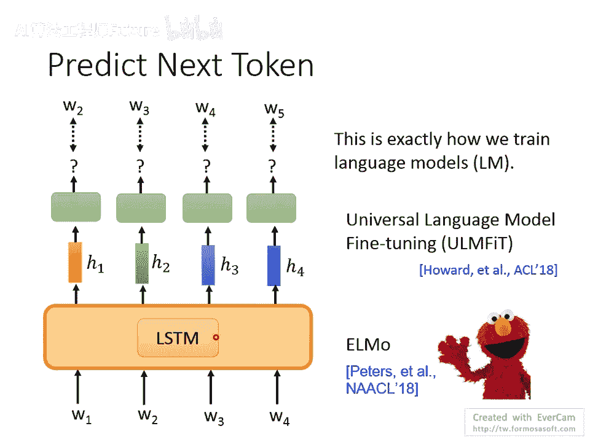

那今天呢人们不再那么喜欢LSTN，很多时候你会把LSTN换成self attention好，那也有很多language model使用self attention。

比如说有g p t mega tron跟two rain n l g，他们都是知名的例子，但是如果你今天你的level里面用的是self，attention的架构的话，那你其实就要稍微小心一点。

要小心什么呢。

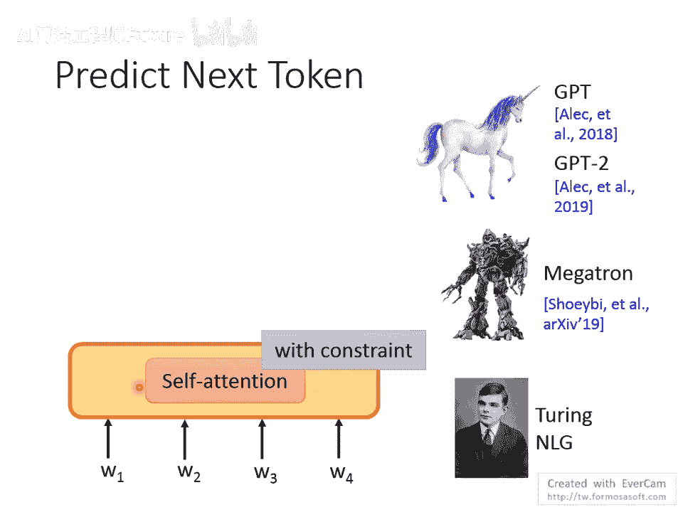

你要控制你的attention的范围，我们知道说这个self attention layer啊，他做的事情就是把整个sequence平行的读进去，然后每一个位置都可以attend到其他的位置。

就general的self attention，是每一个位置都可以attend到其他的位置，所以如果你把一般的self attention，用在这个地方的话，那是会铲掉的，那是不对的。

因为对你的network来说，他只要attend到下一个位置，他就可以得到他想要的资讯，他就可以成功地预测下一个token，这个显然不是我们要的，所以怎么办呢。

今天如果你是用self attention来做predict，net token这件事的话，你要注意一下，你要给你的self attention下一个control，你要告诉他说。

只有某些位置是你可以去attend的，某些位置是你不能去attend好，那在这个表格里面呢有涂色的地方，代表可以attend的位置，所以你就告诉你的self attention network。

说告诉你的self attention layer说在w one这个位置，你只准attend自己在w to这个位置，你只准attend w one，w two在W3，你只准attend123。

在w four，你才可以attend整个句子，那这样就可以避免在predict next token的时候，你的model看到未来的答案。

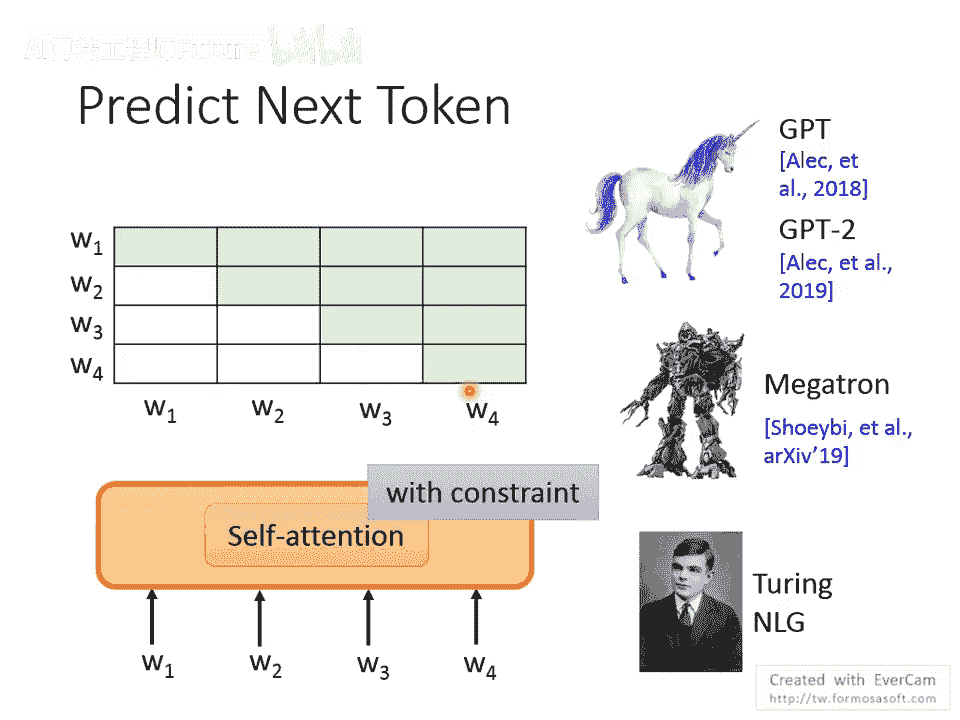

好那这个g p t two啊，这个大家都已经非常熟悉了，这个我们就不用再讲，那在网络上有一个连接叫做talk to transformer啊，你可以用g p t two呢来产生文字啊。

那因为我们刚才讲的这种predness token的，Pretrainer model，他们在训练的时候其实就是一个language model，所以他们擅长做的事情。

不只是可以拿来在当时的test进行翻Q，他们还可以拿来做generation，你就可以直接拿这种language model来产生一个，长篇大论的文章，那gp two。

之所以在我的心里的形象是一个独角兽哦，就是为他产生了一篇非常知名的独角兽的文章，而今天呐这种用机器产生的文章啊，都满街跑了，举例来说啊，有一个人就说哦，他强迫这个机器看了100个。

1000个小时的蝙蝠侠的电影啦，然后机器呢就自己写了一个蝙蝠侠的剧本啦，而且这个剧本的第一页看起来像是这个样子啊。

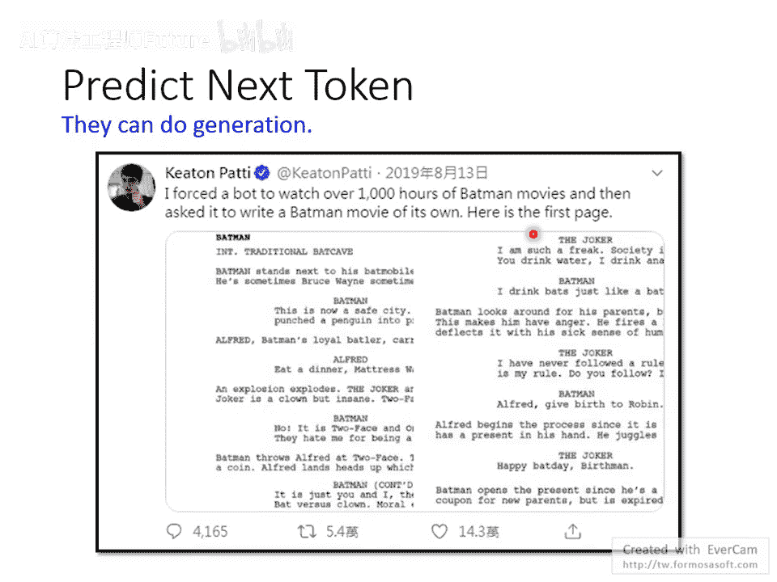

啊就是BMAN啊，蝙蝠侠，然后他就回他家啊，他就遇到ALFRED，ALFRED是谁呢，ALFRED就是蝙蝠侠的管家，就是阿福，而在这个时候呢，场这这这句句子场景啊发生了什么事呢，这个场景发生什么事了。

就会发生一个爆炸，这时候joker的跟two face，小丑跟双面人呢闯进了他们的山洞，然后joker呢他就是个小丑，然后他疯疯癫癫的那two face呢他是个人，但他又是一个律师啊，不知道在说些什么。

然后BMAN就说哦，不是双面人和单面人诶，这个还蛮聪明的，他说joker是是单单面人啊，这么一个双面人，然后他说他们讨厌身为蝙蝠的我，那这个时候呢bad man呢就很坏啊，就把阿福呢丢给了双面人。

然后双面人呢就把阿福像一个铜板一样，抛在空中，然后双面人就回家了，不知道在干嘛好。

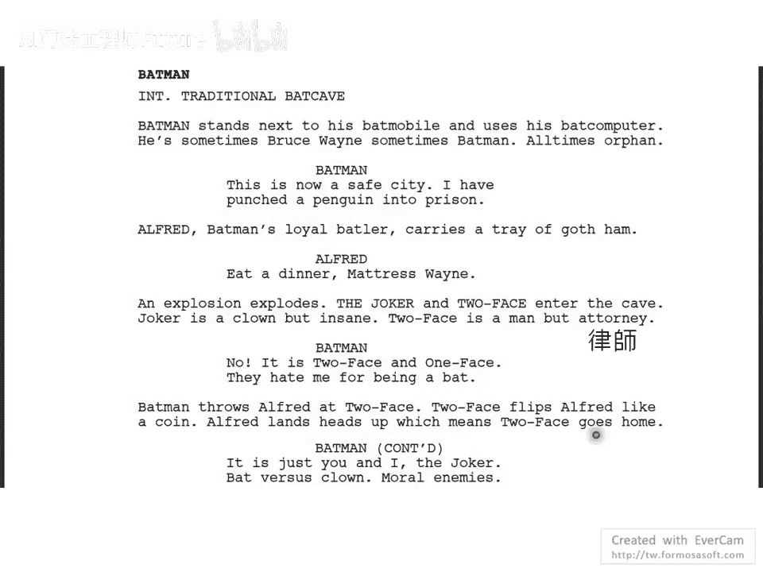

那ben man呢就跟这个joker说，现在只剩下你跟我了啊，然后joker就说哎这个句子还蛮不错，他说you drink water，I drink archy，就是说你喝水，我喝混乱，哎，这个太奇。

这个不错，好好句子，好台词，然后BMAN说我喝蝙蝠就像蝙蝠一样，都在说些什么，然后接下来呢，就是他蝙蝠侠跟joker就开始打起来了，然后蝙蝠侠就说阿福生下罗宾，不知道为什么生下罗宾。

然后阿福就真的生下罗宾了，这就是因为他在做的事情，那然后joker呢就给蝙蝠侠一个礼物，然后joker就说happy birthday，他不是说happy birthday。

他说happy that day，这个一语双关还蛮厉害的，然后蝙蝠侠呢就打开他的礼物，里面是什么呢，里面是一个coupon for new parent，就是给可以兑换新父母的兑换卷，但已经过期了。

这this is a joker，joke啊，这是小丑的笑话，我看了觉得哇这个也不错，机器也可以产生有趣的剧本，这个大概是怎么做的，我在想说啧，看1000个小时的蝙蝠侠电影。

应该意思不是让机器真的去看那个电影吧，应该是看电影的剧本吧，因为今天是产生文字啊，你光看那个荧幕有什么用，你刚刚放画面有什么用，应该是有1000个小时的蝙蝠侠的剧本，那剧本里面一定就是写谁说了什么啊。

有场景，然后呢你再圈一个language model，当然只用1000个小时的剧本，那个量太少了，那吹不出什么好language model的，所以大概是用g p t two ft吧。

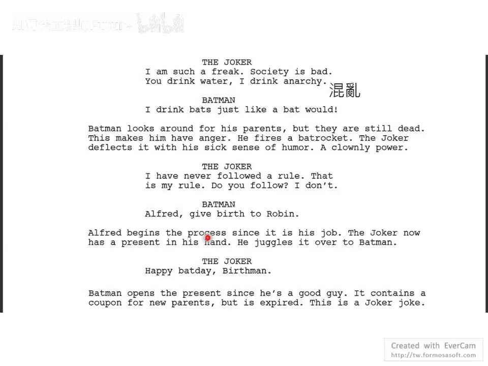

但是我发现我错了，这个就是是人在模仿机器模仿人呐，这这不是机器在模仿人呐，这是人在模仿机器，模仿人呐，这是人在模仿机器，模仿人是什么意思呢，就其实我强迫机器看了1000个小时的什么东西，是一个梗啊。

这个东西是那刚才那个文章其实是人写的啊，人故意仿造机器的风格来写啊，所以这是人在模仿机器在模仿人呢，然后那个作者还让机器看了很多1000个小时。

不同的东西啊，不是走蝙蝠侠而已啦，这是个系列做啊。

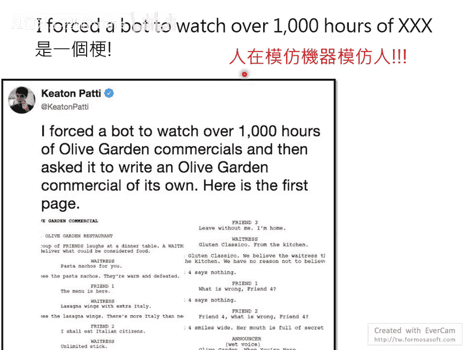

有什么olive garden啊，还有各式各样奇奇怪怪的东西啊，总之这个是人在模仿机器。

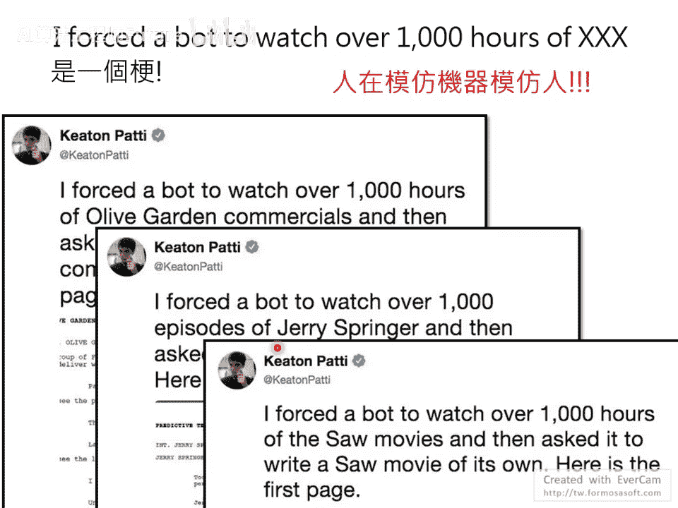

模仿人就这样子嗯好好，那这个故事只告诉我们说嗯，现在大家都觉得说机器可以写些剧本啊。

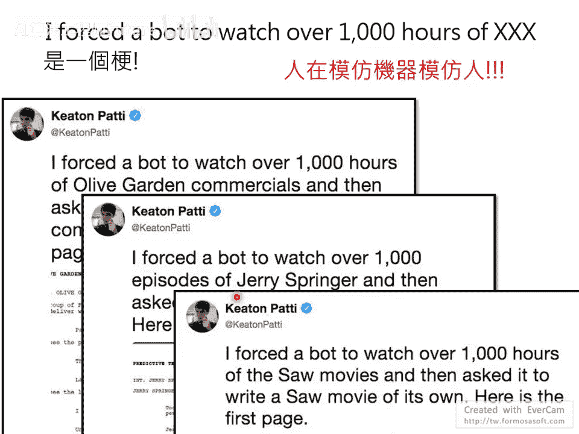

写些有的没的东西，好，那为什么这样PRETRAIN，next token的方法，可以让我们得到我们想要的embedding呢，可以让我们得到embedding，这个embedding代表一个词汇的。

一个一个token的意思呢，反正有有这个JOEROBERSERF啊，这个这位语言学家在1950年的时候，就曾经说过，我们怎么知道这个词汇是什么意思呢。

You should know a word by the company，it kids呃，就你要知道一个词汇，你要知道跟他常常一起出现，跟它相邻的词汇是什么啊。

所以其实这个方法就是体现了usual a word by the company，eclipse这件事，那其实我们之前在讲这个war embedding的时候啊。

在machine learning那门课讲war embedding的时候，也有跟大家提过，说我embedding就早期还没有到contextualized，when embedding的时候。

传统的那一套，When embedding work of vector gulf，他们的想法也是一样的，我们怎么知道一个词汇的意思，把它变成embedding呢，要看这个词汇跟哪些词汇常常一起出现。

而predict this token其实也做了非常类似的事情，我们今天为了要用h four去predict，下一个word w5，我们要怎么回对W5呢。

我们必须要先知道w one到w four是什么意思，把w one到w four这样子的token，sequence en扣成h four，然后再用h four去预测W，所以这个h four啊。

它就包含了w four跟它的la context，the w four跟它左边在句子的前面曾经出现的word，我们把这些资讯变成一个vector，把w four跟他左边的邻居一起变成一个vector。

我们就把w four跟他的邻居一起的资讯，拿来表示w four这个token好，所以这个符合这个呃，呃语言学上常这这这个符合这个。

you should know a word by the company kids这句话，但是如果你这样想的话，你马上就有一个问题呃，这个h forts看了left context啊。

怎么不看右边的邻居呢，好那ELO这篇paper确实考虑了看右边邻居这件事。

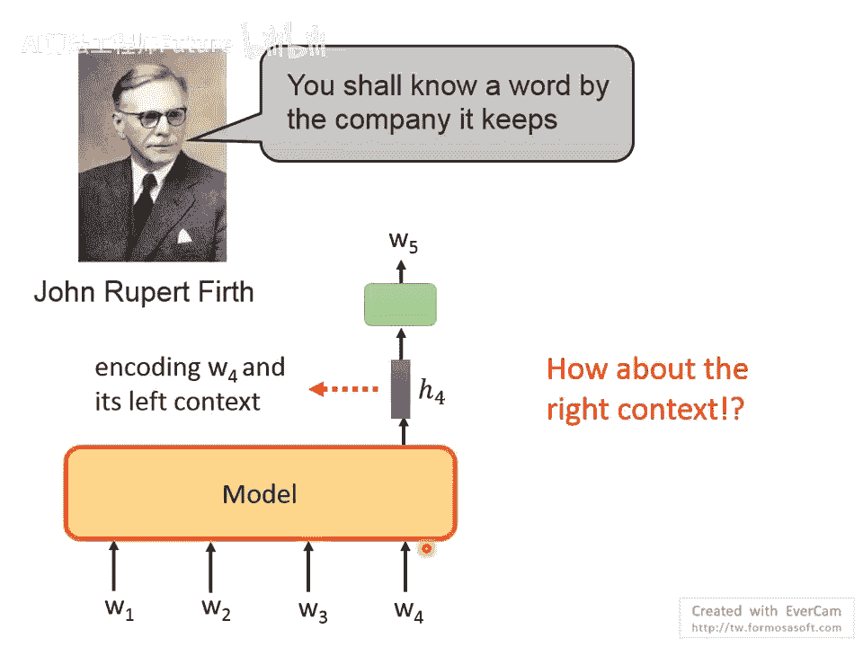

好在ELO这边paper里面呢，它有一个由左到右的LSTN，看w one到w four去预测W5。

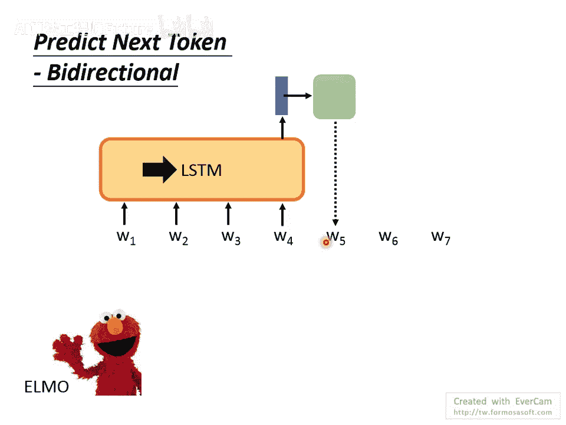

它有一个由右到左的l s st，这个由右到左l scan探W7，就假设W7是句子的结尾了。

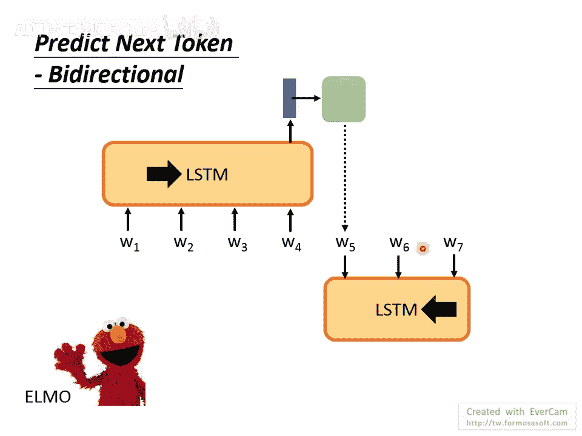

W7W6W五，然后呢它产生的embedding，用这个embedding去预测w for，那在ELMO里面呢，他会把这两个vector正向的LTN输出的vector。

跟逆向的LSTN输出的vector concat起来，他把这两个蓝色的vector concderate起来，当做代表w four的contextualizer representation。

所以在产生产，所以在得到这个w for的representation的时候，我们不只考虑了w four的左边的context，也透过逆向的LSDN得到考虑w for，右边的context。

所以左边的contest也考虑到了，右边的contest也考虑到了，这样人们应该要满足了吧，但是这样还不够，因为如果我我们我们今天算左边的context，跟右边的context都考虑到了。

但是今天你马逊在考虑左边的contest，在encow one w two w3的时候，他没看到句子结尾的部分，在考虑句子结尾部分的时候，他没看到句子开头的部分，所以他看到的整个句子他在引扣的时候。

在处理的时候，他看到这个句子是不完整的，他都只看到一半，这个正向和逆向的LSTN是没有交汇的，他们两个都是各自过做各自的事，各自得到一半的资讯，再把他们各自得到的资讯接起来，我们能不能够再处理这个输入。

再处理left context的时候，就考虑right context的资讯，在考虑right context的时候，在引扣right context的时候，就考虑left context的资讯了。

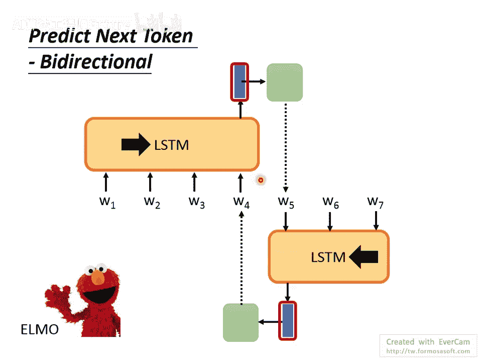

而bird就可以做到这件事，那BERT它就不再是predict next token，BERT做的事情是，他会把输入的一些token把它盖住，那这边所谓的盖住其实有两种做法了。

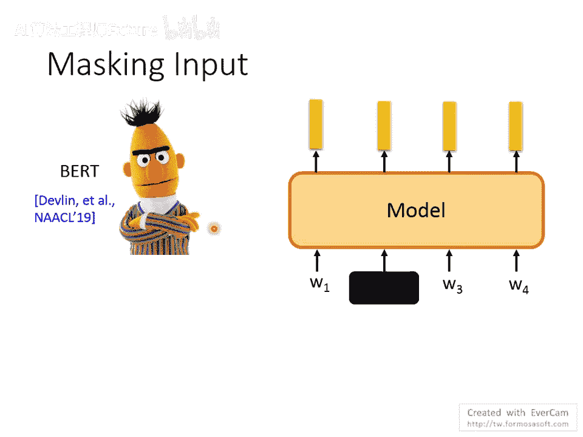

一个做法是说有一个特别的符号叫做mask，你就想说有一个特别的token，这个token呢不是表示任何意思，他就表示说我要把它盖住，你把原来的token换成max token。

就代表把原来的token盖住，或者是你也可以随机sample一个token，就把它放在这边好，然后不管你是mask还是随机盖住，随机换另外一个token，接下来你要做的事情就是呃。

根据这个位置所输出的embedding，去预测被盖起来的那个token原来是什么，而BT里面用的是transformer，而BERT的这个transformer啊。

他这边用这个self attention的时候，是没有任何限制的啊，什么叫做没有任何限制呢，就是每一个word都可以attend到其他所有的word，每一个word。

每一个token都可以attend到其他所有的token，所以当你在预测这个w to的时候，你是看了一整个完整的sentence，完整的token sequence才来预测w to。

而我们在process w3W四的时候，可以透过self attention看到w one的资讯，在发现w one的时候，也可以透过self attention看W3W4的咨询。

但W2的资讯呢已经被mask起来，或者是随机置换成别的token，所以我们不怕说你的这个self attention呢，偷看到w to的咨询啊，这个地方是被mask起来的。

然后最终呢要能够预测w two这个东西，就是bird。

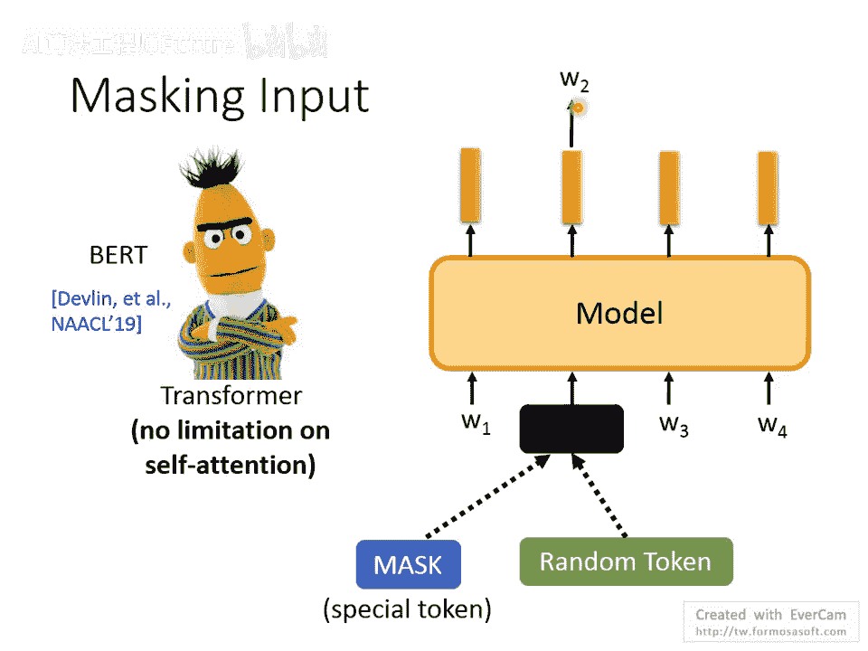

好那这个BT啊，这个想法其实如果你回溯一下历史，时光倒流到78年前，你会发现咦，这个东西跟SYL，就water vector的其中一个训练方法叫做SYL，其实很像SIO做的事情是什么呢。

SIO做的事情是说现在给我们一个token sequence，我们要我们的model去预测第七个token，怎么预测第T个token呢，根据第T个token，左边的一些token跟右边的一些token。

在这个例子里面呢，是左边的两个token跟右边的两个token去预测，第七个token只是过去啊，这种SEO这种train water vector的时候，我们用的模型非常的简单。

我们都是把这边的每一个token，就是过一个transform，然后再把它加起来，加起来的vector呢，再过一个transform就去预测DT个token的，那通常我们也没有办法真的看很长。

通常看左边20个，右边20个诶，就已经很长了，而你会发现，其实SYL的训练方法跟BT的训练方法，根本就是一模一样的啊，因为贝尔做的事情也就是给你一个句子。

你有它左边的contest跟右边的contest，那你要预测被盖起来的东西是什么，只是bot跟simple有几个关键性的不同，第一个关键性的不同是哦，BT它往左边可以看多长呢，你要看多长就看多长。

看你给BT多长的输入，self attention就看多长，往右边可以看多长呢，要看多长就看多长，看你给BT多长的输入，他就可以往右边看左长，不像C罗，它是有一个固定的window的宽度，只会往左边看。

固定一个东一一些token，右边固定看一些token，还有另外更关键的不同就是but很复杂，它有12层，24层的self transformation，而SYL它就两层。

中间还没有activation function，根本就是linear，它就两层，不过当年呐在讲SYL的时候，常常会会有同学问我问题，说诶那呃嗯怎么是LINUX的呢，改改D盘好不好呢。

或者是说呃呃这边我们都不考虑嗯，每一个word跟中间这个word它们距离的关系嘛，比较远的应该关系比较小吧，比较近的关系应该比较大吧，总种种等等等等复杂的考量，那那个时候嗯就反正SIO就是这样嘛。

那没有什么不知道该怎么回答，但是今天今天你就知道说，当年大家所提的种种的疑惑，为什么不用deep learning，为什么不考虑更复杂一点都可以的，把各式各样的东西考虑进去，用个最复杂的model。

这个东西就是bird，最近发现说这个远古时代，上古的神兽co的权力的方法，其实跟今天我们所用的BT根本就是大同小异，只是模型的复杂的程度不相同了。

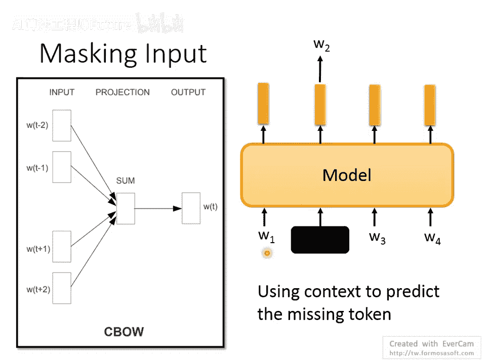

好那在原始的bird里面要mask掉哪些token呢，要max的token就是随机决定的，但是随机决定master的token好吗，也许不够好，那尤其是假设你如果做中文，那我们中文的token单位。

通常就是一个carrot的一个方块字，那你往往把一个方块字盖起来，你从这个方块字的前面跟后面，你就可以预测被盖起来的词汇，是被盖起来的字是什么了，machine可能不需要学什么太厉害的东西。

不需要看整个句子，就可以猜出被盖起来的方块字，比如说啊你说说一个地名啊，地名最容易被猜出来了，就是黑龙江还把龙盖住，那黑什么浆，那黑什么江除了黑龙江以外，难道是可以吃别的东西吗，可以是黑狗浆吗。

可以是黑猫浆吗，不太可能是别的东西，就是黑龙江了，所以如果盖起来一个token，机器可能就学到说看左右的token就直接可以拆，被盖起来token了，那你的机器根本学不到呃。

呃特别long tern的dependency，他只学到看看左右的token而已，所以怎么办呢，就会有一些比较复杂的masking的方法，举例来说，Whole word masking。

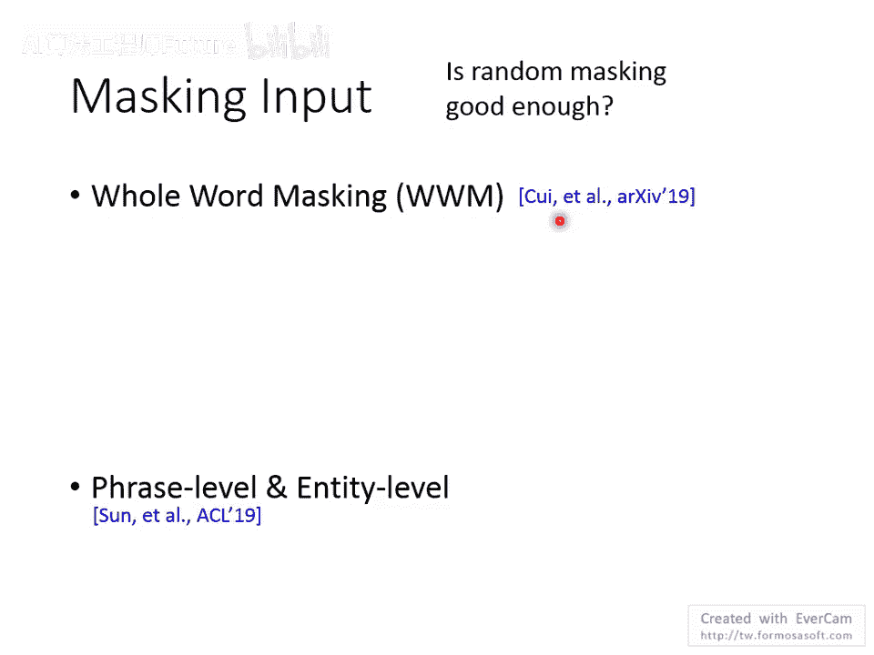

Ww n，就从他的名字就可以知道说，他就是要一次盖一整个word啊啊举例来说呃，在原来的BT里面，你每次都是中文，你每次只盖一个character，如果是英文的话。

因为有时候一个word也是被拆成好几个token啊，所以比如说probability，它被拆成三个token，那可盖住中间那个token，那几乎就可以猜出，说中间被盖住的东西是什么了。

但是如果是WWN的话呢，就是一次要盖一整个word啊，当然除了中文，什么是word，你得先有一个断词的系统，把word找出来好，所以模型是个word，所以是要把模型整个盖住，预测是个word。

要把预测整个盖住，Probability，这其实是三个token所组成的，但这三个token组成一个word，那你是要把三个token盖起来，那还可以盖更长的，比如说你可以盖phrase，Label。

phrase就是好几个word合起来就是一个phrase，你可以一次盖好几个word或者是entity level，entity level是什么意思呢。

entity level就是你先做name entity recognition，我们再讲NLP任务介绍时候讲过，Nine entity recognition，什么是nan entity。

那我说这个呃呃就是你关心的东西，通常是人人啊，地名啊，组织名啊，就是nt entity，你先把name entity找出来，然后再把nn entity盖住。

那这边你需要有一个nine entity recognition，NER的model才能够做这件事，那这个东西呀就是我说臭梗臭的很硬的ERI啦。

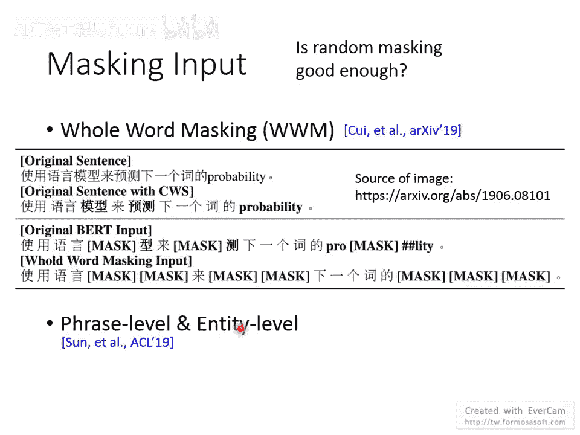

好，所以他所谓的knowledge integration，我想指的就是呃你需要知道什么是ENTALITY，什么需要知道什么是face，那才知道应该要mask什么样的东西好。

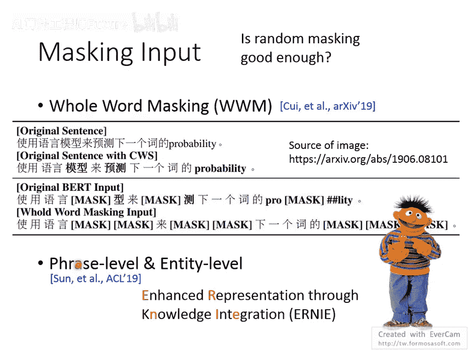

那还有一种mask的方法叫做SPAMERSPAMBER，就是说我们也不要想什么word啊，也不要想什么phrase entity，我们就是一次mask掉很长的一个范围。

原来bird是每次只随机选取一个token被盖住，但SPAMBUS一次我们就盖住一排token，就这样结束了，那至于要盖多长的呢，那他就定了一个这个几率的分布了，就说啊一次盖一个token几率是这样啊。

一次盖十个token，一次把十连续的十个token都盖住啊，那几率是这个样子好。

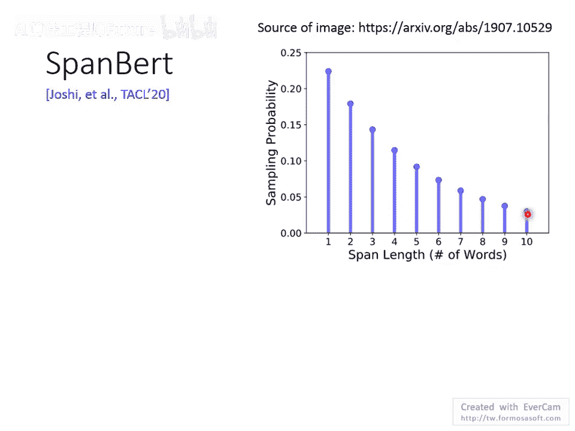

那这个在spin bolt里面呢，也比较了各式各样不同的mask的方法啊，比如说saward token一次只盖一个token，whole word呃，改整个word，改nt entity。

改名词的片语跟他所提出来的方法，它叫做geometric the spend啊，当然呃呃他会说哎自己的方法呢都是比较好的，当然不会在所有的任务上都比较好了。

今天我觉得这种BT这种PRETRAINING的方法，你往往很难找到一个技术，是在所有的任务上都会好的，通常PRETRAIN一个方法，新的PRETRA的方法都是某几个技术好，那也有些技术会变差。

但通常好的好，在某还在某某几个任务好，那有一些任务会变差，但多数任务如果都好的话，那其实就已经是不错的方法了。

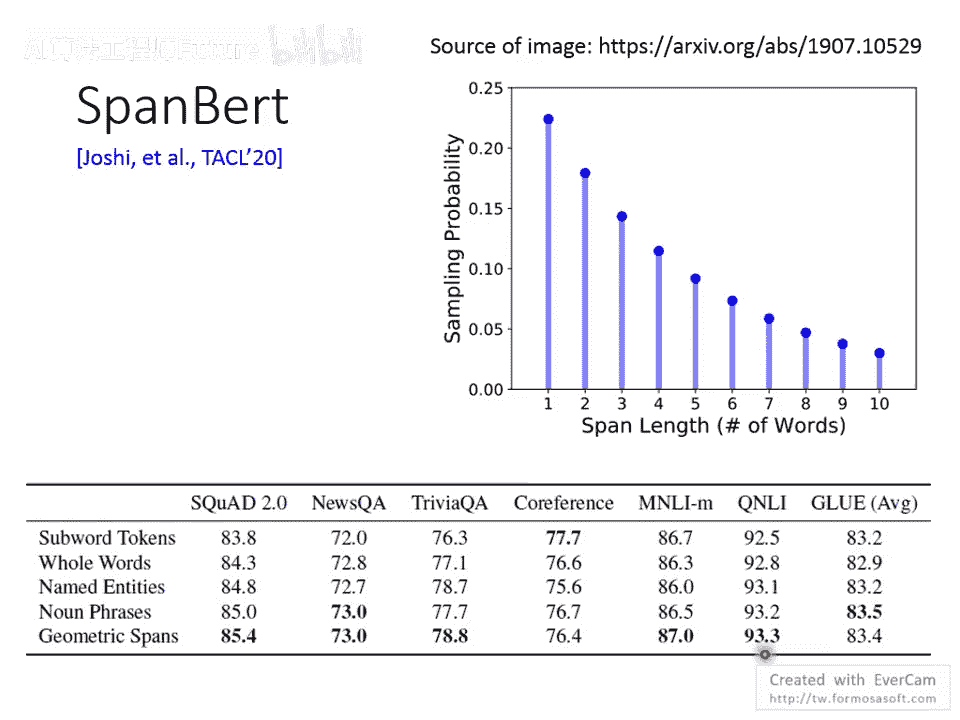

好那这个呢是SPAMBOT，在SPAMBOT里面呢，他还提出了一种训练的方法，叫做spm foundary objective，SBO啊，他不是HBO，而是SBO，SBO是什么呢。

SBO是说我们一般做的做法是，我们盖住了一些word以后，盖住了一些token以后，我们要把盖住的部分把它预测回来啊，SBO呢是说，我们希望根据这一个被盖住范围的，左右两边的embedding。

去预测被盖住的范围之内有什么样的东西啊，什么意思呢，就是你训练一个，你今天在训练你的STAMFORD的时候啊，你有一个objective叫SBO人捏个简单的小的module，叫SBO。

他会把这个盖住范围的，左边这个embedding次进来，右边这个embedding词进来，那再给它一个数值啊，再给他数值说三三代表什么意思，代表说我们要还原这一个span里面的，第三个token好。

然后SBO就要预测出来说啊，这第三个token是谁呢，哦这W3啊，所以W4W5W六，他叫说SBO就要知道说，那我现在要还原W6出来，如果这边输入的是二啊，那就要还原W5出来。

就要还原这一个span里面的第二个token，就是把W5呢还原出来，那这个东西乍看之下，你可能会觉得有一点匪夷所思啊，就是嗯呃原来的方法不好吗，呃呃直接用这些embedding。

把这些token预测出来不好吗，为什么要用左右两边的来预测中间的，那这个SBO，它的设计啊，是期待说呃一个spin，左右两边的token，可以包含它内部整个spend的资讯，那为什么要这样呢。

之后我们讲到CORREFERENCE的时候，也许你会比较清楚，在CORREFERENCE的时候，我们有很多机会都会期待说一个spend，前后两边的embedding，包含整个spend的资讯。

那这个我们留待CORREFERENCE的时候再讲，那SBO确实用在CORREFERENCE上，确实也得到了不错的结果，好那我看一下大家有没有问题要问的，好那个哎，李欣颖同学问了一个问题啊。

刚才有说SPAMER适合CORREFERENCE，但他分数比较低，对诶四个是这样子的，SPAMBD适合CORREFERENCE的部分，指的是spend boundary objective，这件事情。

我甚至是怀疑说，他因为看到啊，自己propose这个方法在CORREFERENCE上比较低，所以紧急在propose一个新的objective加上去，然后然后就把结果救回来。

这样哎好希望恰恰我回答到你的问题，所以SPAMER4和correction部分不是指那个spend，Mask，指的是SBO的部分。

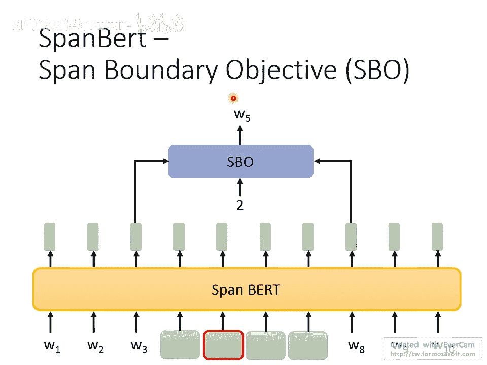

接下来啊下一个要跟大家讲的是xl net，那XL内的XL呢是什么意思呢，现在XL内已经不是芝麻街的人物了，这个XL呢指的是transformer才，也就是说它里面用的不是一般的transformer。

他用的是transformer，XL自transformer xl有什么厉害的地方，比如说他可以跨segment读取资讯，或者是他可以有relative的positional embedding等等。

这个跟PRETRA的方法比较没有关系，这个留就留给大家自己研究，那其实XL内啊嗯呃这篇paper也是红极一时，尤其是他嗯没有那么好懂哦，所以我等一下就是介绍一下它的大概念，那详细的细节也许你可以再去额。

我今天等下就是用我的理解讲一下大概念，详细的数学式，你可以再去看一下原始的论文，那XL那里面有一个观点是，我其实没有非常认同的，就他paper里面有强调一件事情，是他认为原来的BT有一个问题。

原来BT有一个问题是说假设给你一个句子啊，这个this is new york city，那原来的beat呢，总是把new york这两个token一起盖住。

那你就没有办法学到说根据new去predict york，根据YORK去predict，new叫new york，这两个token这两个词汇会是independent的，各自独立的被预测出来。

机器没有办法学到，说看到new后面就要接，又看到Y前面就要接new，但是呃真的实际上运作会是这个样子的吗，在BT里面嗯，你你你如果是random sample，你的mask。

那这有时候new y都会被盖住，但有时候可能只盖住new啊，那你就可以用YG去预测new啊，有时候是盖盖出YG啊，就可以用new去预测YORK啊，所以我其实没有非常认同这个clean了，但我可以了解说。

也许这个clean的来源是其实最早版本的BT，他的masking是fixed，这还蛮神奇，就是说给一个句子，那如果你每次你命你第一次sample的时候，说要mask135的token之后。

他就永远mask135的token就不会变了，不过后来呢呃在BERT的下一篇paper有一篇叫ROBERTA，他就有dynamic的masking，就每次mask的应该要random sample。

那我觉得每次mask都是random sample，那那new跟YORK会independent被被PREDIC这件事情，这个问题也许就没有那么严重了吧，那xl net是怎么运作的呢。

它可以从两个不同的观点来看，它可以从language model的观点来看，也可以从BERT的观点来看好，如果先从predict nest token的观点来看。

我们说predicnest token的问题，就是你只能看到left content啊，假如给你一个token sequence深度学习啊，你用深度啊去预测学，你只看得到left content。

那XLLN是说我们把这个句子的token，里面的顺序啊，把句子里面token的顺序给它打乱，那所以深度学习啊。

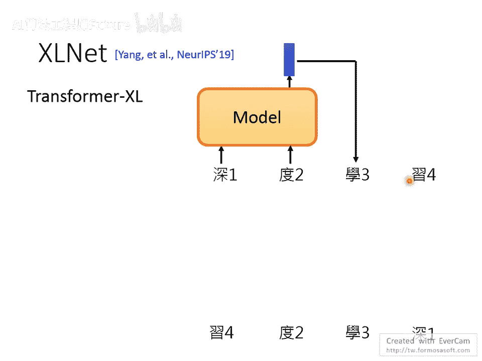

有时候打乱成啊习度学生，那你今天在预测学的时候，那你就是用习跟杜去预测学，所以有时候你用生根度去预测血，有时候跟席跟度去预测血，那这个打乱呢是随机的哦，所以有时候打乱成习度学生啊。

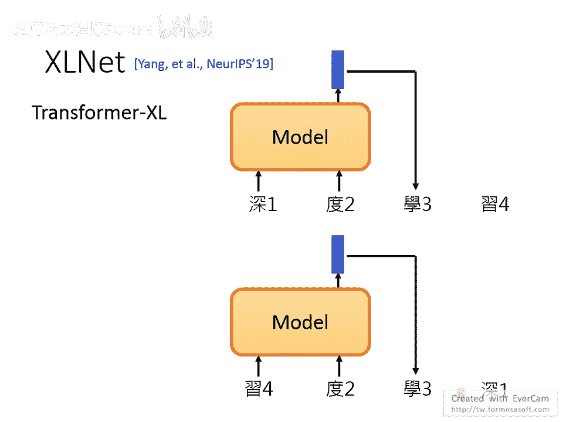

有时候打乱成升学度习，那你就用身去预测学，那就是要教你的model说，用各式各样不同的资讯去预测一个token，他可以学到比较多的dependency，他会知道深度跟学有什么关系，深跟学有什么关系。

度跟习跟学有什么关系啊，这个是从language model的观点来看好。

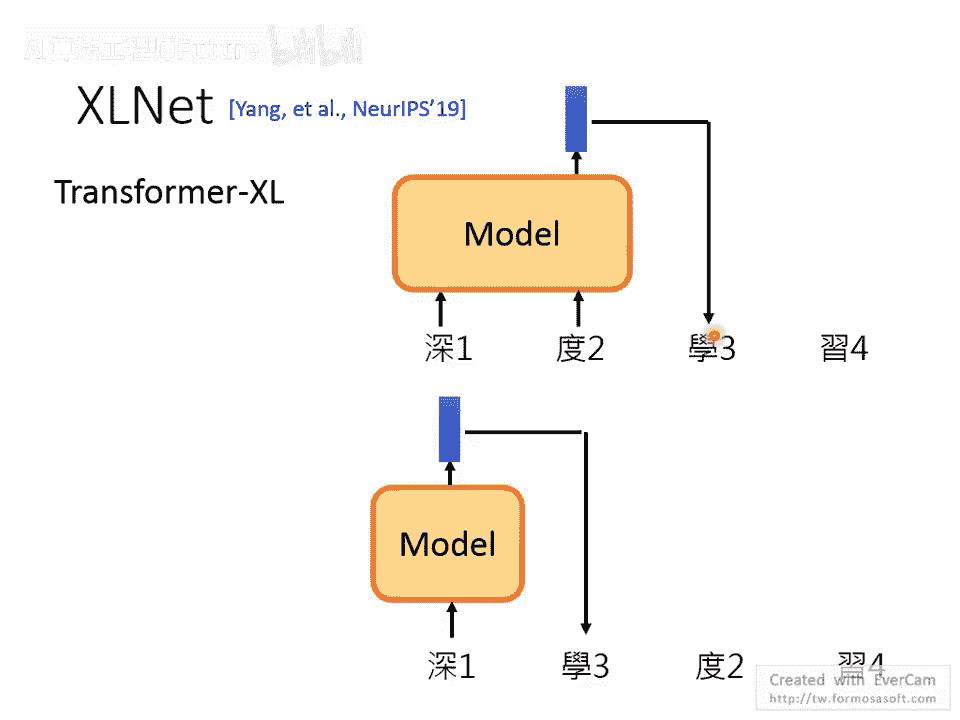

那如果从贝特的观点来看呢，在原来bird的方法是我们会把一些token mask起来，然后根据整个句子的资讯跟mask的资讯，去预预测出这个token，那如果在x l net里面呢。

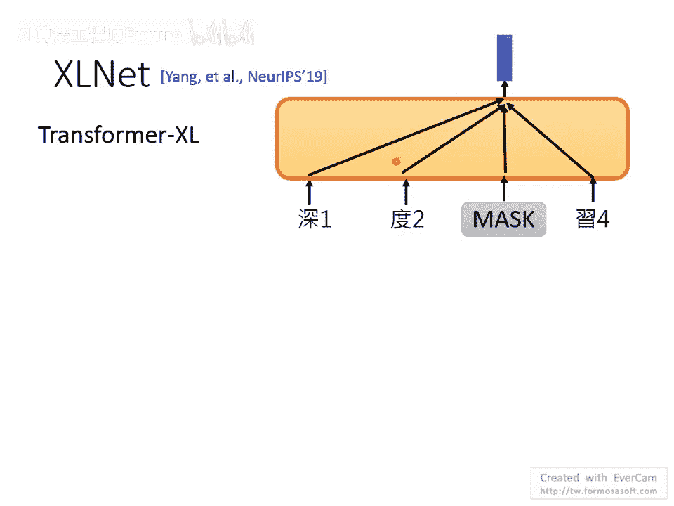

你不会根据整个sentence，你会只根据这个sentence的一部分，但到底是这个input token的sequence，哪些部分是随机决定的，你会让你的attention只可以看某一些部分。

比如说只看度跟席，就要predict mask的地方是什么。

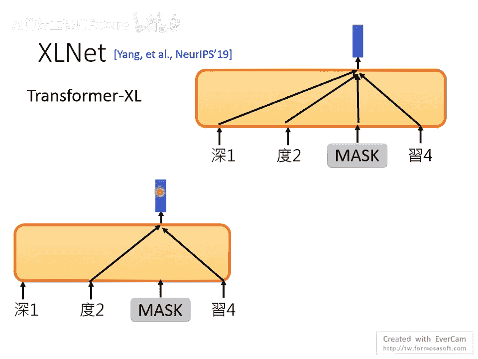

只看深就要predict mask的地方是什么哦，然后呢今天XL内还有一个特别的地方，就是他不会给呃你的model呢，看到mask的部分啦，看到mask这样子的token。

那这是XL内的paper里面强调的他一个厉害的地方，他觉得red bert你会给model看到max的这个token，点怪怪的，因为在downstream task里面。

根本就没有max的这个token，那他现在呢不给model看mask的token，不过虽然不给model看mask token，还是要给他那个positional information。

你还是要告诉他说，我们现在预测的word是第三个word，他这样才能够产生出正确的embedding，因为你的句子里面好，可能有好多个地方都被mask起来，你要告诉他说。

你现在是要让哪一个位置的mask被预测出来，你是为预测哪一个位置的word，所以你要给他，其实你还是要给他positional information。

那其实XL内为了要做到只给positional information，不给content的information，其实做了一个特别的network的架构的呃设计，那这个部分那就留给大家自己阅读。

XL内这篇paper的时候，自己细细的品味。

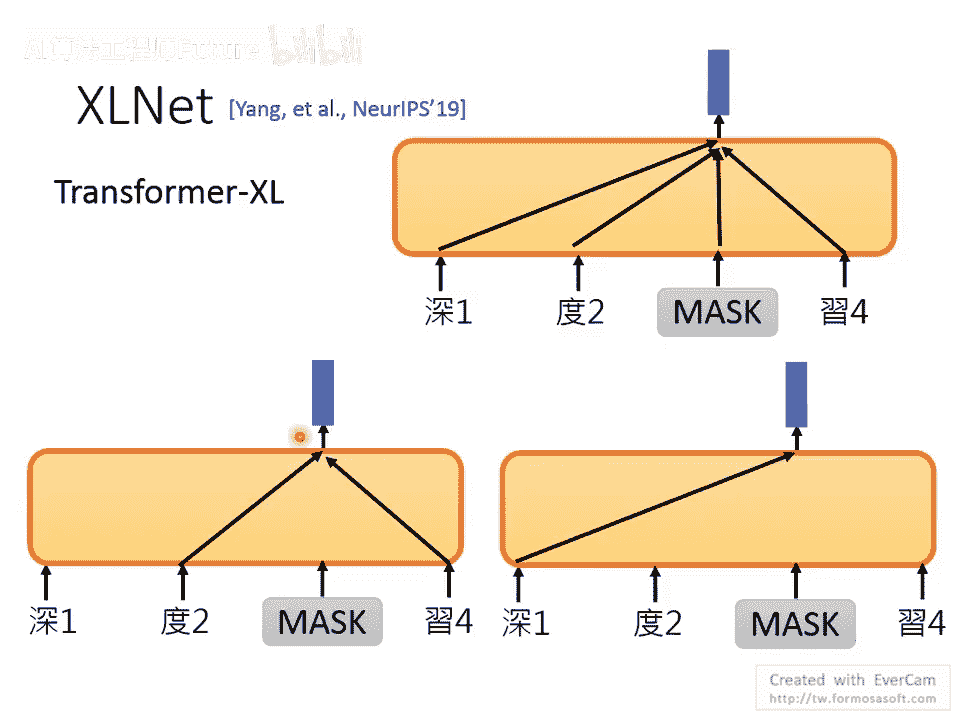

好那一般讲到BT啊，大家会说BT其实不善言辞，为什么说BERT不善言辞呢，所谓不善言辞的意思是说，BERT不擅长做generation这个task。

如果我们今天要把BT这pretrain model拿来用，在sequence to sequence的需要，sequence to sequence model的NLP任务里面。

那我们需要BT有产生聚集的能力，而怎么样产生一个句子呢，要有产生句子的能力，就是必须要给部分的句子，然后预测下一个token language model。

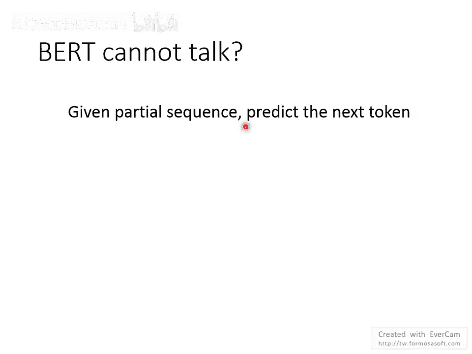

做这件事情就做了下下脚，因为他训练的时候，他本来就是要做这件事的，他最擅长的事情就是给部分的sequence，预测下一个token，对BT来说，我个人觉得也不是没有机会。

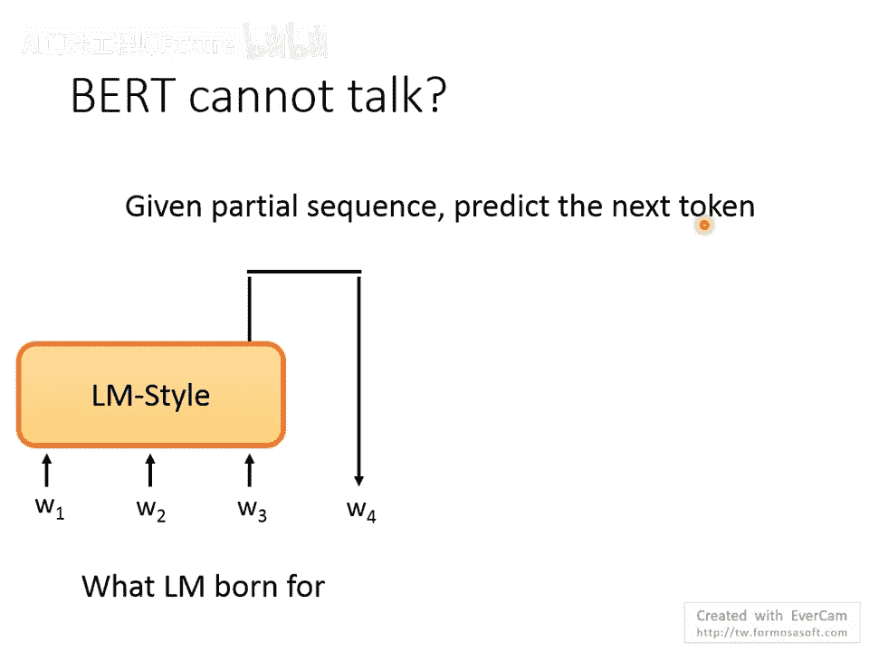

虽然我从来没有这样试验过，但是你可以说啊，我今天已经有w one w two w3这三个token，下一个token是什么呢，呃我在W3后面放一个mask，把W换到W3跟mask丢给bird。

叫他预测某一个word出来，预测出来w four也许就是下一个词汇一，但是用这样子的方法也许并不是很好，因为bird在训练的时候，他是看一个完整的句子的，但是如果你只给他看一个部分的句子。

只给他看句子的前半段，对贝尔来说，这跟他训练状况不一样啊，训练的时候他会看mask的左边有什么token，右边有什么token，怎么右边已经超出投影片范围之外了，来看右边有什么token。

再决定mask的位置是什么，但问题是，现在你是generation的任务，你只有左边已经生成出来的token，你没有右边的token，右边的token还没有生成出来，那对BT来说。

这是他训练的时候没有看过的状况，他可能就会很凄惨，不过这个讨论呢都只局限在auto regressive的model，什么叫auto regressive the model呢。

Auto regressive model，意思就是说我们在生成一个句子的时候，我们是由左而右生成token，我们生成第一个token，第二个，第三个，第四个，以此类推，我们是由左而右。

从句子的最左边写下第一个token，一直写到最右边那个token，我们一般人在写字的时候是这么写的，由左而右写的，但我们觉得说对模型而言，也许这也是一个合理而自然的产生句子的方式。

但是实际上我们在下周会讲到，nauto regressive的model，今天在NLP的任务里面，已经开始了一系列的研究，看看有没有更好的产生sequence的方法。

他不见得要由左而右来产生sequence，如果不是由左而右产生sequence，那也许BT反而就没有问题了，也许BT在不是由左而右的状况，他也是擅长言辞的，你只是没有把它放到适当的位置而已。

那不过等一下讨论，我们都只局限在假设，我们还是在讨论比较传统的auto regressive model，状况下哦，所以这个时候BIRT是不善言辞的，那接下来就要看看说。

有什么方法可以让bird学会说话。

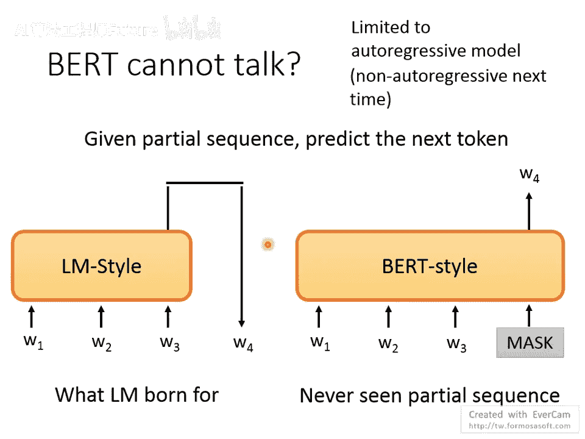

好BT因为缺乏generation的能力哦，所以他可能不太适合拿来做sequence to sequence，model的picture model。

所以假设你要解的是需要sequence to sequence，model的NLP的任务，那BT呢可能只能当做encoder，那decoder的地方你就没有PRETRAIN到。

那我们有没有办法直接PRETRAIN一个，sequence to sequence model呢，是可以的啊，你可以直接PRETRAIN一个sequence to sequence的model好。

那怎么用这种self supervised learning的方法来pretrain the，sequence to sequence the model呢。

啊你可以说我们现在input呢一个word sequence，进入encoder，然后你有decoder decoder的your attention，从encoder这边读一些资讯出来。

然后output一个word sequence，我们可以说我们今天training这个sequence to，Sequence，model的目标是要RECONTRACT原来的input。

也就是原来input是w one到w four，那你希望通过这个encoder，通过这个attention，再通过这个decoder以后，他的输出也是W1到w four，但在这边有一件事你要注意一下。

你一定要把这个输入的w one到w four啊，做某种程度的破坏，什么意思呢，如果你这w one到w four没有任何破坏，那这sequence to sequence model其实学不到任何东西。

这个decoder要怎么output w one到w four呢，太简单了，他只要知道说我先copy第一个word出来，再卡比第二个word出来，再看第三个position。

再看第三卡比第三个word出来诶，他就可以recontrol input，它就可以让input和output1模一样了，那这样sequence to sequence model学不到任何东西。

为了增加问题的难度，你要把输入的部分做某种程度的破坏好，那有什么样破坏的方法呢。

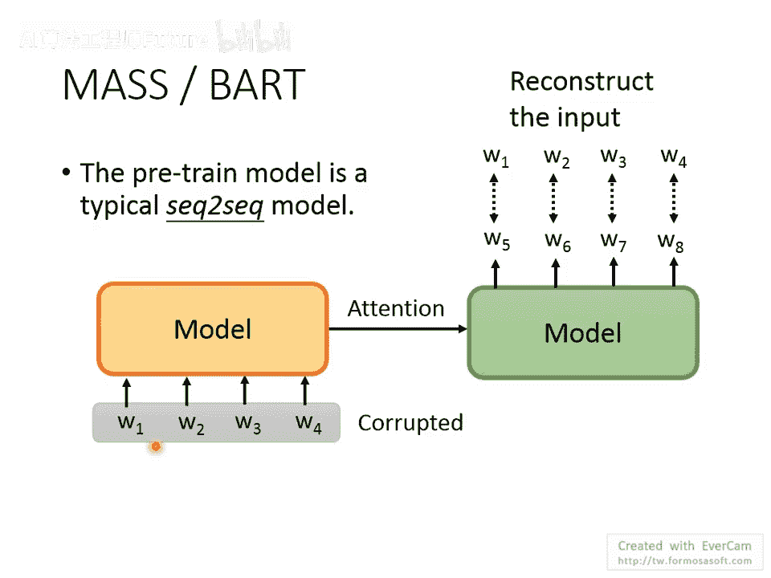

那这边呢有两篇文献都在探讨这种train，sequence to sequence models的时候，怎么对输入进行破坏，一篇叫做mah mass。

是mask sequence to sequence pretraining的缩写，另外一个叫做BART，BART是by directional and auto regressive。

transformer的缩写哦，虽然他们都有臭梗，但你知道这个这个比，比那个儿女还要合理太多了。

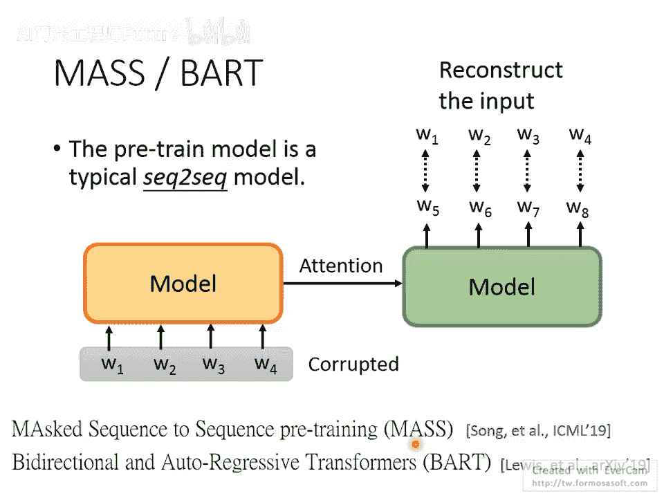

哎那max跟boy他们做的事情是什么呢，max的想法其实跟原来的BT是很像的，max的想法就是说这是你原来的句子好，那你要怎么把它弄烂呢，max的想法就是把一些部分random mask起来。

把一些部分随机的用mask那个token取代掉好，因为max就是质量的意思啊，所以我们就放一个砝码在这边来当做meth好，所以math的想法跟BT很像，就是把一些地方random mask起来。

那其实在max的原始paper里面呢，它并不要求今天吃这个sequence的时候，要还原完整的sequence，只要能够把mask的部分，比如这边mask的地方是D。

只要能够把mask部分吐出来就结束了，因为其他部分都是都是存在的，你只需要用attention直接copy就好了，那但是max呢，之所以max呢，就只要求把mask的地方把它还原出来就好，好。

那在大学那边，paper里面就又提出了各式各样的方法，比如说除了mask以外，还有直接delete delete跟mask不一样的地方，就是mask会留一个token下来，那delete都是直接拿掉。

船过水无痕，这样机器必须要自己知道，说读ABC1这个sequence，发现诶是不是中间有少东西啊，是不是少了D啊，要把D补回去，那如果在mask里面，就是直接告诉你说，这个地方就是有个洞被虫蛀掉了。

你要把它补回去，还有一个方法呢是permutation，permutation是说假设我们输入是多个句子，那这边是有AB跟CDE两个句子，那我们把这两个句子的顺序打乱就结束了。

这个是permutation，然后rotation是说，我们现在呢把某些放在尾部的东西拿到前面来，就是rotation，我们改变它起始的位置，比如说本来是ABCDE，现在改成D当作开头变DEABC。

这个就是rotation，那还有一个方法呢叫text infling啊，text infling是说我们会在这个句子里面加入mask，但加入mask状况有两种，一种是随机插入。

也就我们并没有把原来的句子盖住任何东西，比如说AB中间本来是没有任何东西的，我就插一个mask进去误导你机器，要知道说这个mask是是一个force line，他没有真刀插东西进去，记得要把它滤掉。

然后呢，今天不管我们盖掉的sequence有多长，比如说这边我们直接把C跟D两个token盖掉，但都只放一个mask的token机，需要知道说这边虽然只有一个max token，但是实际上在还原的时候。

它其实是有两个token被盖掉了，要把C跟D都还原回来，这个叫做text in building啊，这个就是BART，BART在他paper里面呢，就把这些方法呢都试了一轮好，那试玩的结论怎么样呢。

这边直接给大家看，but的结论呢，他的结论是permutation跟rotation呃，不太好这样，那我觉得这其实好像是可以预期的，因为permutation memorrotation呢。

会把原来的输入的句子的词汇的顺序打乱，也就是说对BT来说，他会看到奇奇怪怪顺序的句子，如果你训练的时候看的都奇奇怪怪顺序的句子，那嗯他在他的印象中，这个世界的句子的顺序是句子，都是这种奇奇怪怪的句子。

等到正常的句子的时候可能会反应不过来，所以but在permutation和rotation，使用permutation和rotation来做训练的时候，结果有点惨，那哪一种方法最好呢。

呃最好的方法是text in fling，那这也是可以预期的，因为看起来这个问题呢是最艰巨的好，总之bug告诉我们说呢，text infling这种input corruption的方法。

最后得到的结果是最好的。

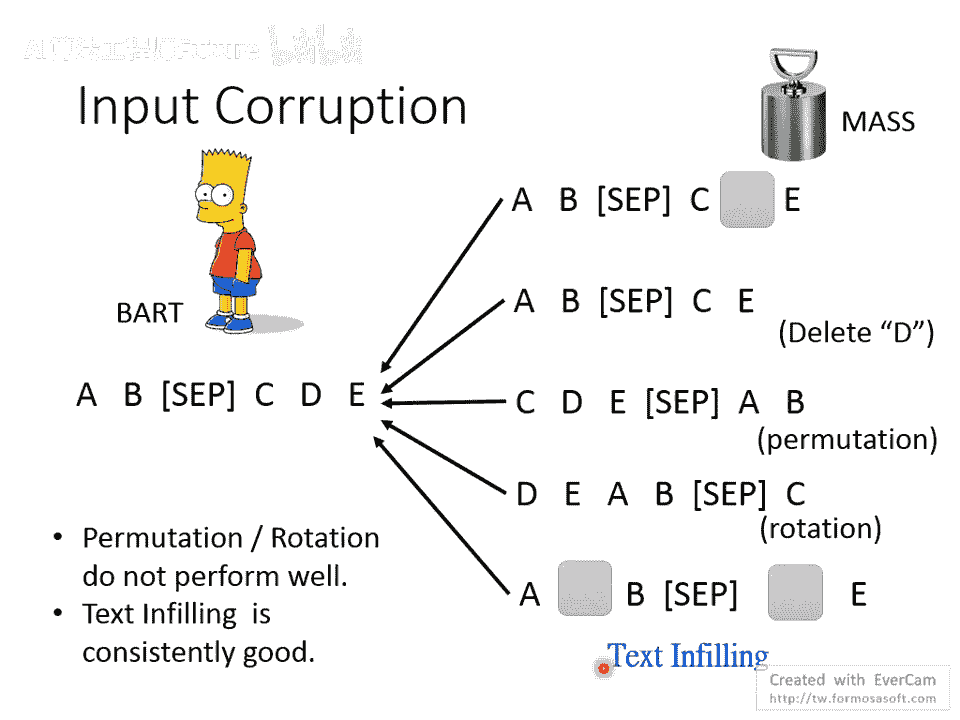

好那刚才讲了，but跟max，他们呢就是训练了一个sequence to sequence的model，那还有一个东西呢叫做uni l n，unit l n它是一个神奇的model。

这个同一个model它同时既是encoder，也是decoder，也是encoder加decoder，也就是同时又是一个sequence to sequence model。

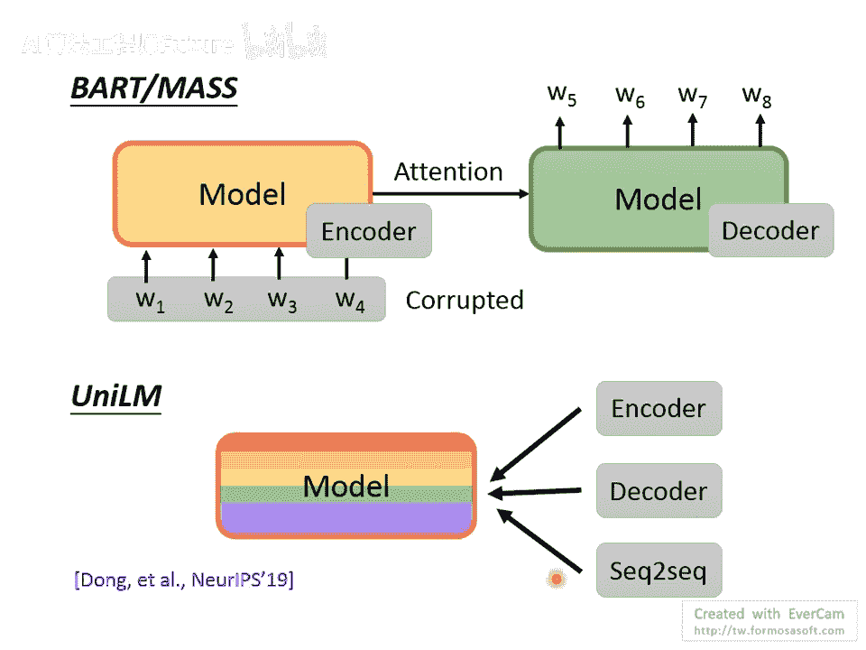

好了，这uni l n是怎么运作的呢，那这边就是直接截了uni l n那篇paper的图，来给大家看好，Unit l n，它就是一个这个有很多的self attention layer的model。

那他就是一个model，它没有切encoder decoder，不像刚才我们在讲bug跟max的时候，这个sequence to se model，切出encoder的部分跟decoder部分。

encoder decoder参数是不一样的，unit l n只有一个model，这个model同时进行三种训练，第一种训练好，所以他是多才多艺啊，十项全能啊，所以同时做三种训练。

第一种训练就跟BT一样啊，就把一些token mask起来，predict mask的token就跟BT一样，同时他也做GPT的训练，什么叫GPT的性训练呢。

把它当做一个language model来用，可是你说像这种有self attention的model，可以当做language model来用吗，把它当做language model。

因为它可以看到整个句子，你说给他第一个token，叫他不定下一个token的时候，他不是已经token到下一个token了吗，所以你要好好的设计你的attention，当他采取GPT这种训练的时候。

你会强制要求他只能够attend左边的token，只能attend左边的token，在这个图上，很明显的看到说，每一个token都只能看左边的token，都只能看左边的token。

然后接下来他居然也可以当做一个sequence to，sequence model使用，就跟bug还有max一样，它可以直接当个sequence to sequence model使用。

怎么当个sequence to sequence model使用呢，你就是把这个transformer啊，当他input这个token sequence的时候，把它分成两部分。

input第一个token sequence的时候呢，这一个token sequence上的token可以互相看，可以做self attention。

但是第二个sequence里面的token都只能看左边，也就是这个部分是一个encoder，输入给encoder部分的token，可以用self attention，互相爱看谁就看谁。

但是第二个sequence进来的时候，这个第二个sequence进来的时候，它变成了一个decoder，我们只能看左边的token，只能看左边的token。

所以今天如果这样子限制你的attention的话，诶同样是一个network，他就又摇身一变变成sequence to sequence tomo，那我觉得这个设计还蛮神奇的啊。

它可以同时当一个encoder用BT的方法训练，当个decoder，将当做language model gt一样训练，又可以做sequence to sequence，当做bus跟max一样训练好。

所以给大家参考这个神奇的做法，好那到目前为止啊，我们讲的PRETRAINING的方法，都是要预测一些失去的资讯，要预测下一个token，或者要预测被盖起来的部分，但是有没有其他的做法呢。

其实预测一个东西需要的这个运算量，需要的训练的强度是很大的，所以就有一个方法叫做ELECTRA，以ELECTRA就是想要避开需要预测的东西，需要生成东西这件事，ELECTRA它是什么的缩写呢。

它是efficiently learning and encoder that，Classify token replacement，而且还加了一个ACCURY，就加accuracy。

就是为了硬凑ELECTR，以ELECTR是谁呢，呃其实我也不是很清楚，以ELECTRA好像是一个这个希腊人物啊，那electra complex就是呃恋恋母情结的意思，这样诶好啊。

这个ELECTRA故事我是不知道了诶，好总之有一个希腊人物叫ELECTRA啦，然后有一个方法就是硬凑出了ELECTRA这个词汇，好了，ELECTRA做的事情是什么呢，相较于我们刚才讲的方法。

都是要把被mask或者是下一个token预测出来，ELECTRA不做预测这件事，以ELECTR只回答binary的问题，以ELECTRA怎么回答bon binary的问题呢。

ELECTRA的model啊，就是吃一个句子进来，比如说the chip cook the meal，然后接下来呢我们把这个句子里面，其中一些地方不是mask起来，而是置换成其他词汇。

比如说把这个句子置换成the chef at the meal，那这边放艾特，在文法上看起来也没有什么不对，但是意思有点怪怪的，这厨师本来在煮晚餐啊，但是嗯他现在煮完以后，自己把它偷偷吃了两个人。

这有意思有点怪怪的好，那接下来呢ELLITR就要知道说，在输入的这五个token里面，第一个没有被置换，第二个没有被置换，第三个有被置换，第四个没有被置换，第五个没有被置换。

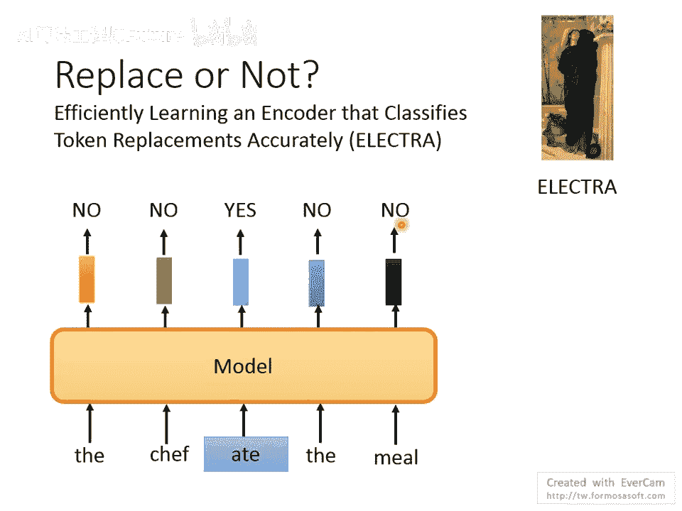

这就是ELECTRA的训练任务，这样做有什么好处呢，这样做第一个好处就是预测，Yes，No，比reconstruction简单多了，就这样，那第二个好处是说。

今天ELECTRA每一个position都有error的signal，不像之前在训练BERT的时候，只有被mask起来的地方，我们才会去做prediction，我就没有被mask起来的地方。

它输出什么就不管了，那但是ELECTRA每一个输出都是需要的，那所以每一个输出都可以有error，error的signal流进这个你的model的主体里面好，那但是现在问题来了。

怎么样把一些词汇置换成其他词汇，可以产生额文法上没有错，语义稍微怪怪的句子呢，因为这个这边如果你说你这边置换都是呃，置换成一些固定，置换成一个奇奇怪怪的token，那很容易就会被发现啊，很容易被发现。

那一类tr就学不到什么厉害的东西。

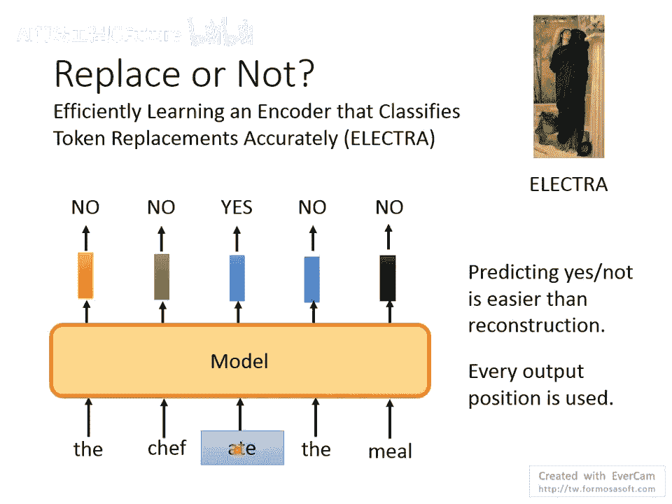

所以怎么办呢，这边用了另外一个比较小的BT，去产生被mask起来的东西呀，也就是说你今天给小的BT一个句子，把一些地方mask起来，然后告诉问BERT，说这个mask起来的地方你想要填什么word。

然后BT就说我想要填it，那我们就把这个地方变成at，然后丢给ELECTR看，ELECTRA知不知道说这个位置是被BT填上去的哦，所以有人就会说这个方法其实有点像gain啦。

就是这个SPIRT它把一些词汇呢mask起来，然后置换成别的词汇，然后ELECTRA呢要去抓，说哎这个词汇有没有被BT呢偷换过，不过这个bird呢不需要train一个很好的bird。

甚至你TRA一个很好的bird版比较糟，你穿一个很好的bird，如果他max起来的东西不一定都跟原来一模一样，这也不是你要的，所以以德查在训练的时候，这边就用一个没有很好的bird，小的bird就好了。

希望他预测的时候是有点错啊，错的地方呢要被ELLIA抓出来，说这个地方是被BERT已经置换掉的，被BERT已经动过手脚好，所有人就会说这个有点像game吧，这个什么小的BERT是generator。

那ELECTRA呢是discrimination，那其实他也不能说是game，为什么他不能说是game呢，因为如果是game的话，你的generator在训练的时候要去骗过discriminator。

也就是说你这个BT啊要想办法产生一些词汇，去让ELECTRA觉得很困惑，但实际上在实做的时候，这边paper里面并没有这么做，这个小的辈儿呢就是自己劝自己的诶，他就是自自自己玩自己的，他自己呃自己去训。

跟一般的BT训练是一模一样的，他自己去训练，说怎么把mask还原成原来的词汇，那之所以不把它当做game来劝，其实paper没有稍微提到一句，说大家都知道game很难劝嘛，然后BT这么大model。

你用game圈真的劝的起来吗，所以他就没有考虑这么做就是了啦。

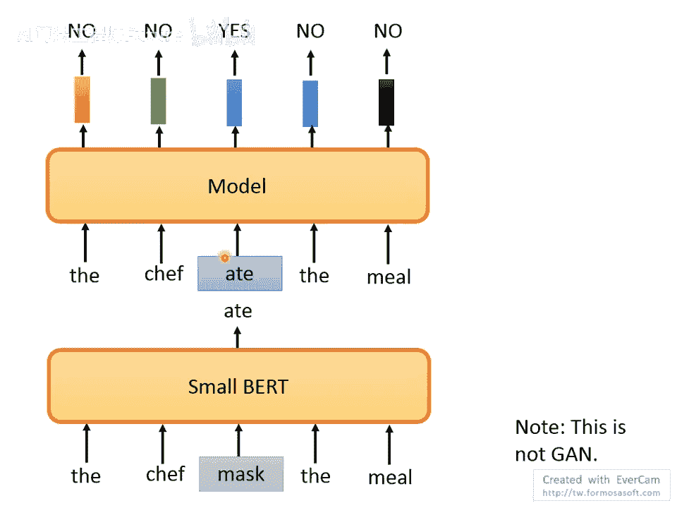

好那INTRA结果怎么样呢，那我其他觉得他结果还蛮惊人的，所以特别秀一下，给大家看这个横轴啊，这个横轴啊是训练的时候的运算量啊，那纵轴呢是glue score，就是在GW这个这个比赛这个任务里面的。

八个子任务上的平均的成绩啊，那你会看到说蓝色的点就是过去的方法啦，有GF啊，ELO啊，birds more啊，gt啊，BIRBASE啊，BLARGE啊，然后罗贝塔我还没有讲过ROBERTA，我没有Y。

反正就是一个BT的进阶版本啊，X9我那倒是讲过了啊，总之运算量越来越多越来越多，当performance也越来越好，performance也越来越好，那今天呢这个ELECTRA想要做到的事情。

就是在同样等级的运算量下，在同样等级运算量下，因为他做的事情比较简单嘛，所以只要同等级运算量，他就可以做的训练的比其他模型都要更好，甚至它只要1/4的运算量，它就已经接近excel内容。

那这个给大家参考，也许你自己不可能，TRAXL内曾经有人发一个twitter说哇，靠TRAXL内要和大概台币600万左右啊，如果你去租google的TPU的话行，但是没办法确认excel内。

但也许ELECTR你自己有办法劝你，只需要1/4的运算量，150万就可以圈起来啊，不过你还大概还是也没有150万就是了啦。

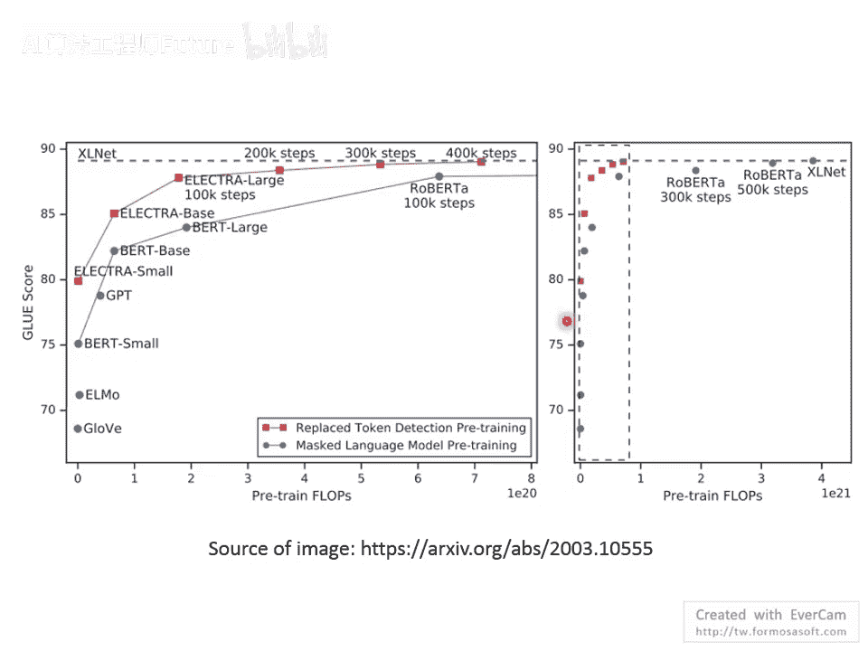

好，好了到刚才目前为止啊，我们讲的技术都是想要给每一个token，一个embedding，但有时候我们要做的不是给一个token，一个embedding。

而是希望给整个input的token sequence，一个global的embedding，我们先要用一个embedded，来表示整个input的token sequence好，那这件事情要怎么做呢。

那有很多任务会需要整个sentence token sequence，比如说你今天要对整个sequence做分类的时候，也许你希望有一个vector可以代表整个sequence。

那直接把这个vector丢到一个简单classify。

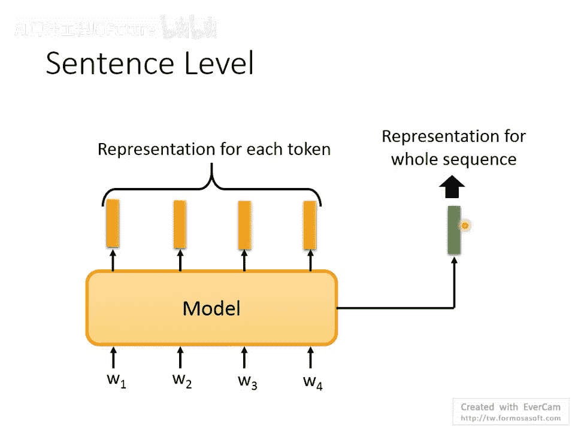

就可以知道这整个sequence属于哪一个类别，那怎么产生sentence的embedding呢，我们之前有讲过说呃，怎么理解一个word呢，要看这个word的company是什么。

看这个word跟哪些其他的word相邻，那怎么了解一个sentence呢，也许也可以用同样的道理，看一个sentence跟哪些sentence相邻，那基于这样子的想法。

有一招叫做skip so skix，so是说我们吹一个sequence to sequence model，这个sequence to sequence model，把一个句子读进去。

通过encoder变成一个vector，接下来要根据这个vector，用decoder去预测这个句子的下一句是什么哦，所以如果今天有两个不同的句子，他们下一句可以接的句子都很像。

那这两个不同的句子就会有类似的，embedding the skit soul的想法好，那SKIO训练起来是比较困难的，因为我们刚才在讲ELECTRA的时候，有说你要叫model去生成东西啊。

这个训练的运算量往往比较大好，所以怎么办呢，是gift so，有一个进阶的版本叫做quick so，那从他的名字一听就知道啊，这quick so就很快的意思，那quick so是怎么做呢。

它跟ELECTRA的思路一样。

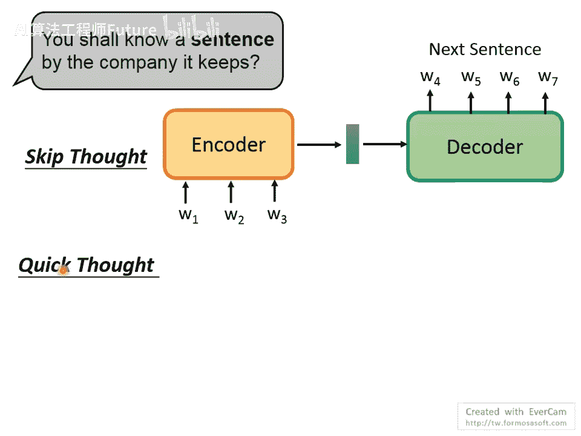

就是想办法去避开需要做深层这件事，有两个句子，这两个句子呢，各自通过encoder得到他们的embedded，然后接下来呢如果这两个句子它们是相邻的，那我们就让他的embedded越相近越好。

反之如果他们不是相邻的，就要让他们的embedded距离越远越好，那这个就是quick s，那他跟ELECTRA一样呢，想办法去避开需要做生成这样的问题。

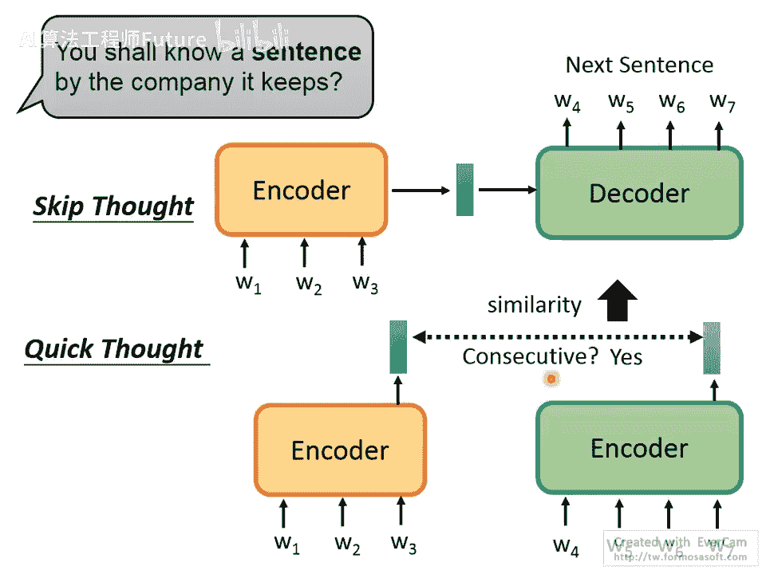

在原始的BT里面有一个叫做cl s的token，然后我们期待说当丢进c o s token的时候，我们会产生一个embedding，这个embedding代表了整个BT输入的所有的token。

整个token sequence的资讯，可是要怎么输出，这个要怎么训练出这个embedding呢，对BT来说呢，他希望去解一个比较global的任务好，什么样的global的任务呢，在原始的BT里面。

他提出一个任务叫做next sentence prediction，也就是给这个model输入两个句子，两个句子中间用个特殊的符号叫SEP分隔，然后在COS这边读出一个蓝色的vector。

再把这个蓝色的vector丢到一个linear的classify，里面去，要求这个linear classify，去判断说这两个句子它们是相接的，还是不是相接的，就是如果这两个句子接在一起的。

那这个classify就要output yes，如果这两个句子不是相接在一起的，那可能是来自于不同的文章，卷头不同文章，随便sample两个句子，它们不是相接在一起的。

那这个classify就应该要说NO，那要知道这两个句子是不是接在一起的，也许就需要看完这整个sequence，对这整个sequence都有一各整体性的了解以后，才有办法判断，所以我们期待说。

蓝色这个vector是对整个sequence都有所理解以后，才产生出蓝色的这个vector，然后再去判断说，这两个句子是不是应该被接在一起的。

这个方法叫做next sentence prediction，然后next sentence prediction就是后来被发现说嗯。

结果没有很好，有一篇paper叫做ROBERTA，那现在就是要凑梗才行，所以ROBERTA是什么呢，ROBERTA就是robustly optimized bird approach。

凑起来就是ROBERTA，但ROBERTA是什么我也不知道，我查了一下，感觉就是一个包包的品牌吧，那其实不止ROBERTA。

那ROBERTA这篇paper就说这个next centre prediction，其实试了一下嗯，没有什么用，那XL内也说嗯没有什么用，然后spamford and paper也说嗯没有什么用。

就墙倒众人推啊，大家都说NSP没有什么用，所以他就视为了那有另外一个方法呢，叫做SOP，它是sentence order prediction，Sentenorder prediction。

意思是说我们给机器两个相接的句子，他要说yes，然后我们把这两个句子反向，就把本来相接的句子呃倒过来，就本来在后面的句子移到前面，前面的句子移到后面，然后这个时候呢你的bird model呢要说NO。

这样那sop有用。

在ALBERT上，ELBERT就是爱因斯坦呐，嘿不知道dirt是是芝麻街的人物啦，但加上LALAL就是一个呃，简化版的清亮的bird呃，liveway bird啊，他就是ELBER啊。

那这个呃我觉得next sender prediction，也许他之所以没有什么帮助，一个问题，也许是说这个这个这个next center predition，也许太简单了，对机器来说。

你随机sample两个句子，那如果这两个句子讲的就是，完全风马牛不相及的事情，那他要知道说这两个句子本来就不是相接的，也许颇容易的，所以也许那sender predication。

没有办法让机器学到比较多东西，那sop因为它很困难，你把两个句子只是它的顺序弄反，那这两个句子从同同一篇文章来的啊，所以他们讲的事情可能是很像的，如果是NSP，他也许只要侦测说两个句子呃。

讲的事情是不是一样的，它的主题一不一样，就知道说两个句子是不是相接的，但SOV比较困难，这两个句子是来自同一篇文章的，只是你故意不按照顺序来摆放，然后机器要能够侦测出来，这是一个比较难的问题。

也许他对于训练你的pretrain model是比较有帮助的，至少在elver里面是有显示sop是有帮助的。

还有另外一个方法叫做STRUGBIRD啊，STRUGBT不知道为什么又叫做ALICE啊，这个是ALICE，就是爱丽丝梦游仙剑爱丽丝，她喜欢这个包包啊，所以他这边有很多爱心，爱丽丝，为什么叫爱丽丝呢。

我真的是不知道哎，如果有人知道的话，跟我讲一下嗯，爱丽丝是阿里巴巴propose的啦，所以也许A里指的就是阿里巴巴，但是C1是什么呢，我真的是不知道，他又叫做strap bird。

讲他DA本里面说STRAWBER又叫做ALICE，但没有解释为什么叫ALICE啊，这个stop bt呢里面也有用到很类似sop的想法，但是他不是完全就是sop，它有三个类别。

它等于就是把NSP跟sop结合起来，用在ALICE里面。

好，那今天到目前为止，讲了这么这么多PRETRAIN的方法，那到底哪一种比较好呢，不过因为要pretrain model啊，需要的运算资源其实太大，这个不是随随便便一般人都可以做的。

所以呃我们也不太容易自己来测试，说啊，什么样的PRETRAINOR方法好，什么样的pretraining or方法不好，不过google有一篇paper呢叫做t five。

它里面展现了google庞大的财力跟运算资源，它把各式各样当时可以想到的，PRETRAINING的方法都暴做了一次，然后这篇paper叫做t five。

t five是transfer text to text，transformer的缩写啦，因为这个里面有五个T啊，12345有五个T啊，所以叫做t five，google每个人都是模型命名大师啊。

这个就叫做t five，那在里面呢还有一个COPUS叫做c four，这样子c four是colossal，clean crow copus的缩写，colossal就是非常巨大的意思。

那之所以用这个冷僻的字，就是为了硬凑c four，这样哎在t five他用的corpus叫做c four，这这是臭梗王命名大师这样，而那篇paper呢你长达50几页了诶。

你有兴趣的话就自己慢慢看，里面都是试了各式各样不同的PRETRAINING的方法。

然后呃试图得到一些结论。

那这个就留给大家自己慢慢的品味好，那其实ear米呢有两个啊，刚才已经讲过了一个，其实还有另外一个early啊，这个EARNE叫做enhanced language。

Representation with informative entity，他的缩写也是early啊，但我觉得这个没有上个earning那么硬啦，至少他的每一个字母，都是在一个词汇的开头跟结尾啊。

这我还可以接受啊，但它叫earning，其实这篇paper里面还有特别用的注解啊，讲说还有另外一个儿女，然后他们按照这个NLP领域的传统，ELOBT之后应该叫做early，我想说其实也没有这个传统。

也只有两个芝麻街的人物啊，这也不算是个传统，总之就是他也叫做AI，而你做的事情是什么呢，而你是希望在PRETRAIN的时候。

就这一个earning跟三个earning不一样啊，这一个EARNEY是希望在PRETRAIN的时候加入，external的knowledge啊，那这个就是另外一个故事了，我们之后再讲。

总之bird它有external的knowledge。

比如说一个knowledge graph以后呢，他就进化成了earning。

那刚才到目前为止啊，我们讲的bird都是文字的，bird从大量的文字里面去学习如何理解文字，再去做各式各样的NLP的任务。

这个是文字的部分，但我们能不能有语音版的BT呢。

呃举例来说，我们能不能够让bird听大量的声音以后，他也从大量没有标注的声音里面学到什么，然后把它用在各式各样在这门课里面，我们提过的跟语音的相关的任务啊，那5月27号那一天呢。

我会请呃audio bird，其中一篇paper啊，叫做market jin的第一作者，由庭伟同学来跟大家讲一下audio bird相关的事情，好有关bird pretraining呢。

我们这个部分就先暂时停在这边，那接下来其实还有很多跟BT有关的内容。

