# 【官授搬运】2026年全新优化版李宏毅机器学习系统课程，这才是真正的初学者体系课程！—人工智能／深度学习／神经网络 - P59：作业说明 Homework7 - AI算法工程师Future - BV1ruqABeEFX

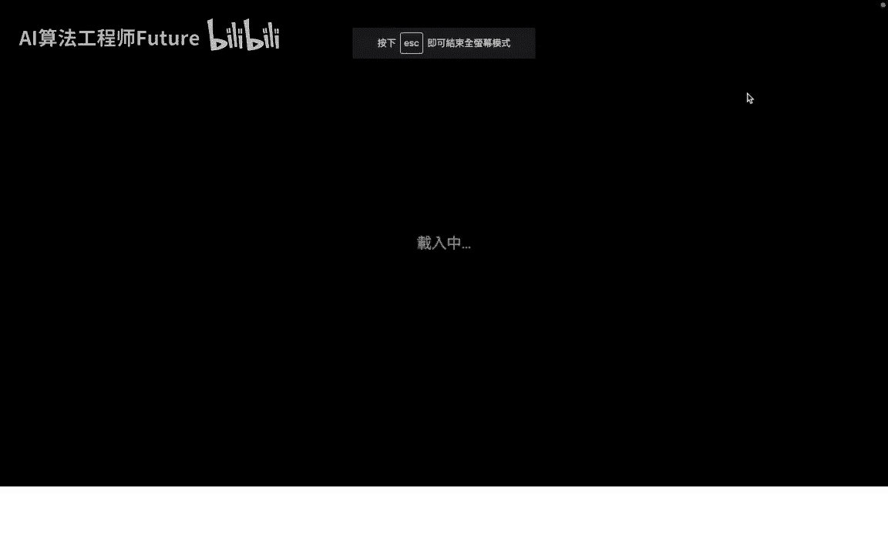

各位同学好，这次要讲解的是作业期使用bird去完成question，Answering，哪知这次的outline，首先就是对这个task做一些简单的介绍，以及实作方面的tutorial。

还有通过各个baseline的提示评分，还有report要回答的问题以及最后的规定。

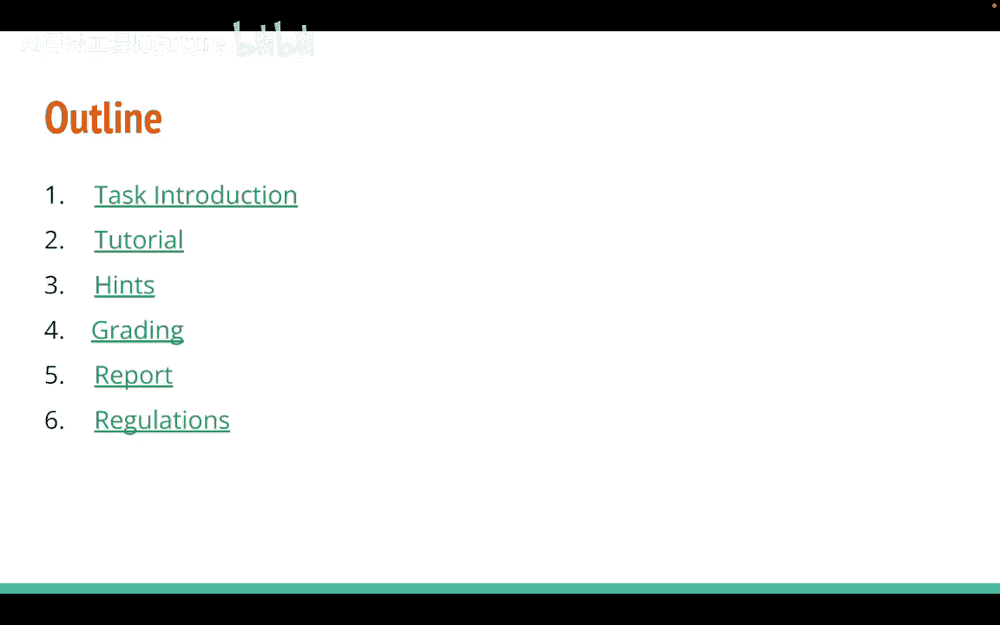

那首先是这个task的介绍。

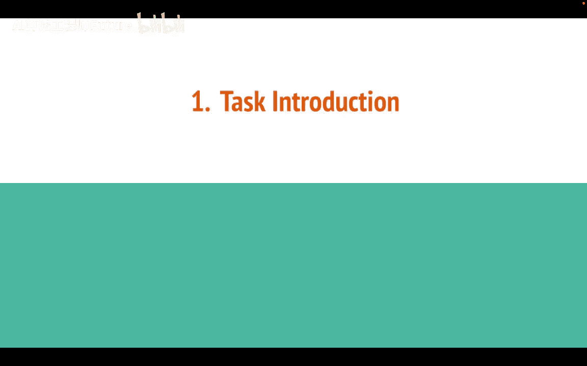

那有看过影片，还有有上课的同学，应该都已经对BT有很深的了解了，那bird其实就是透过收集大量没有标注的文本，去做预训练，那之后就可以在不同的下游任务中去做。

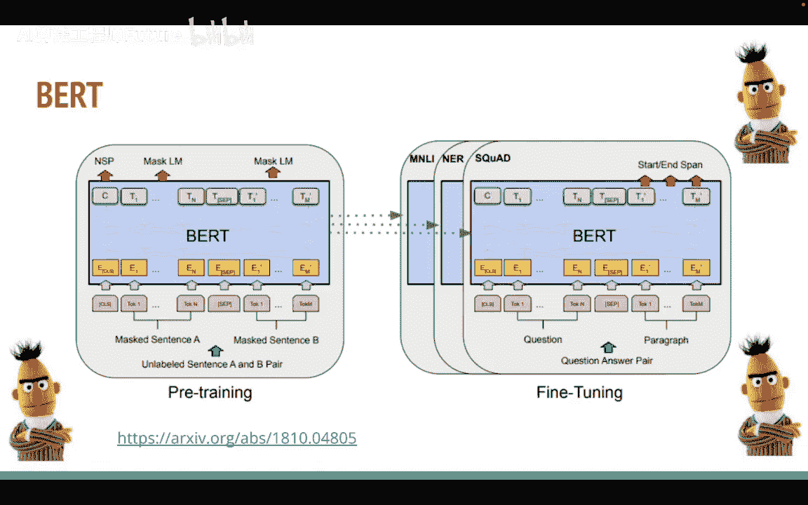

Fine tuning，那我们这次要完成的下游任务是extracted的，Conscienering，那主要是我们会将我们的文章，还有我们的问题传进我们的模型当中。

那我们的bird模型就会预测出正确答案的开始，以及结束的位置，那由于是extracted的，所以它会从我们的文章当中截取一段文字出来，当做我们的正确答案，所以我们的正确答案。

一定是存在于我们的文章当中的，不会有在文章中找不到正确答案的情况，那接下来就是介绍我们使用的资料集，那么使用的资料集有两个，第一个是DRCD，那它是一个中文的阅读理解的资料集。

那第二个比较不一样的是ODSQA，它是透过语音合成的方式，先生成语音资料，再将这个语音的资料透过语音辨识转变成文字，那当中可能会包含一些语音相关的noise，但是这个并不会影响最后选择正确答案。

那training data set部分包含1万多个文章，以及3万多个问题，所以一个文章会对应到差不多三四个问题左右，那development set跟testing set包含大约1500个文章。

以及4000多个问题。

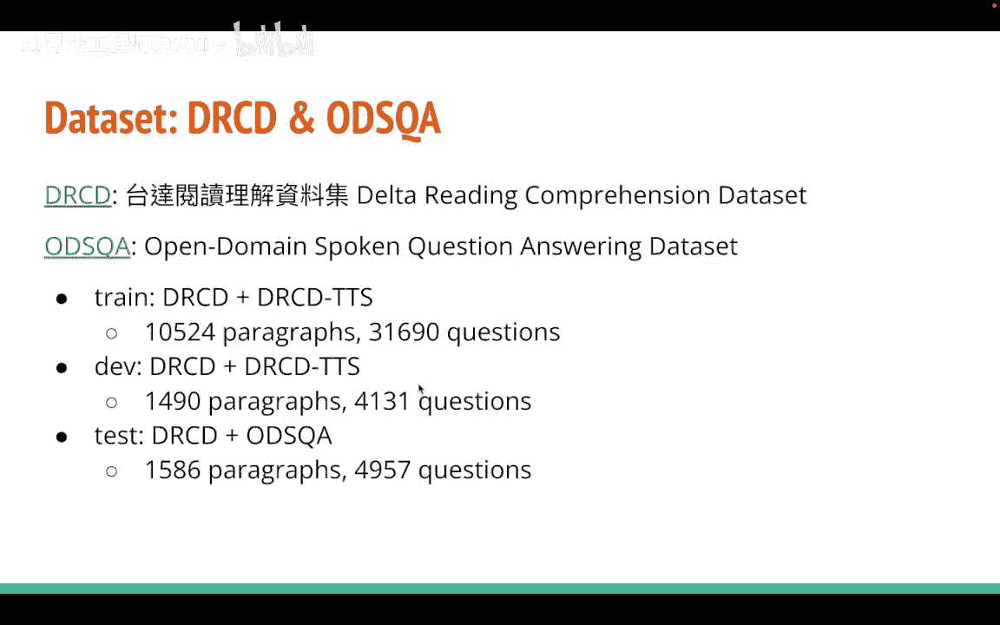

那这是我们档案的格式，它主要分为questions以及paragraph两个部分，那questions就包含一些像是PARAGRAID，就是对应到哪一个文章以及问题，还有答案以及答案开始与结束的位置。

那PARAGRAM就是有一个有排序好的很多文章，那testing set就是其实跟training set是格式是一样的，那不一样的地方，就只有它没有包含答案以及答案，开始与结束的位置。

那training development跟testing set，他们三个的文章可能内容有相关，但是都不会有重叠，但问题也是不会有相同的情况。

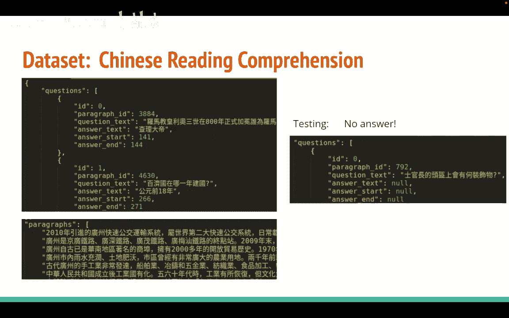

那这是资料的其中一个范例，那其实就可以看到说，我们可以在我们的文章中找到我们的答案，以及一个问一个文章会对应到不止一个问题。

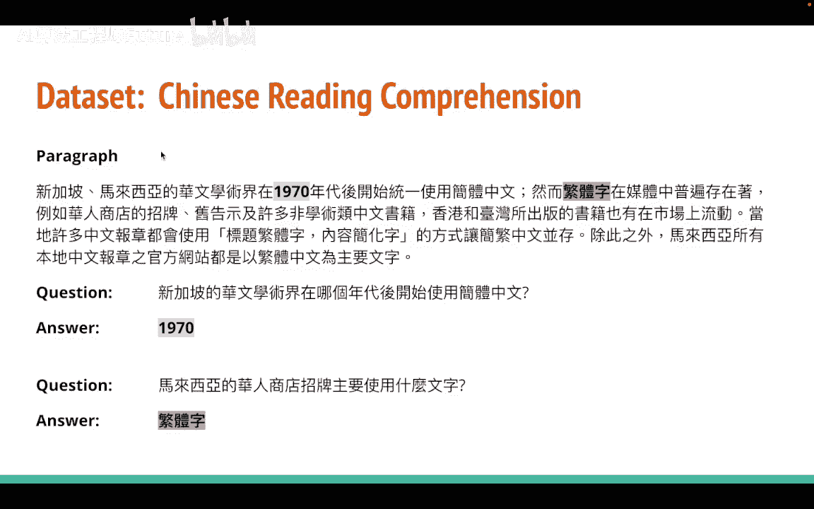

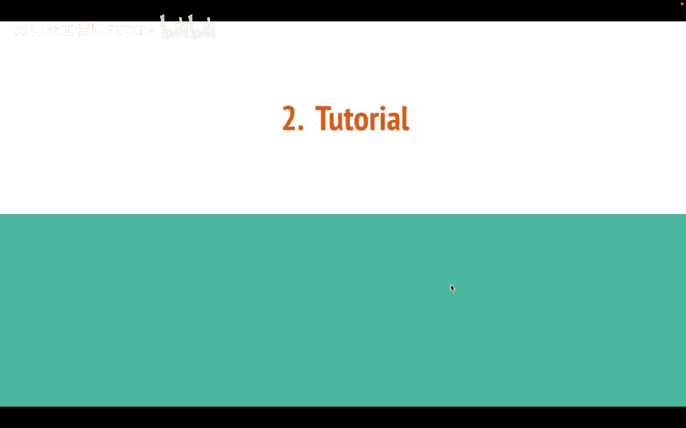

那接下来是石座上的tutorial，那首先要介绍的是，我们在把我们的文章传进我们的模型之前，它并不是直接将文字传进去的，首先我们必须要去做断词，那这里可以看到，我们可以将一个句子断成好多个词。

那段完词之后呢，我们必须在做one hot encoding，把它转成index，就是one hundred encoding的factor，才能传进我的模型去做训练。

那除了转成one hot encoding的factor之外呢，我们在传进bird之前还要做一些PREPROCESSING，那纯净BT主要有三个部分，其中第一个部分是input id的部分。

也就是我们的文章以及我们的问题，那首先我们第一个要先放一个我们的special token，然后再以一个separation token，把我们的question以及document。

就是我们的问题与文章去把它隔开来，但由于每一个文章跟问题的长度可能都不相同，所以我们可能就需要用一些padding tokens，去让我们的input都是一样的长度。

那处理完input ds下一个是token type id，那token type id的使用是主要是在我们传进模型，有两段文字的时候会使用到，那我们分别会用零的值，分别代表第一段文字。

以及一的值代表第二段文字，那padding token的部分就是设为零，第三个是我们的attention mask，那attention mask，就是我们希望BT模型学习attention的位置。

但由于padding只是为了让我们的文字的input，是相同长度，所以attention Mac的部分就设为零，那其余的部分都是我们希望他学习，attention的位置，所以都要设为一。

那解决完input的问题之后，还有另外一个问题是，因为我们的文章的长度都是不相同的，像以下面这个例子来看，我们大部分的文章长度都集中在三四百字左右，那有些比较长的可能会到接近1000个字。

那这样会有一个问题是，因为我们BT在传进去的时候，它有限制，只能有512个tokens，所以如果是文章过长的的的情况的话，就没办法将完整的文章传入我们的BERT模型，所以我们就必须想一个解决办法。

那我们会分别以training跟testing，两种不同的情况去做考虑，首先以training的情况，由于training的情况，我们已经知道正确答案所在的位置，那同学在做阅读理解。

或是这种类型的问题的时候，我们通常都会先可能去看我问题的一些关键字，例如可能新加坡学术界简体中文等等，然后再去我们文章看哪里有我们这些关键字，然后透过找到的关键字附近。

我们可能就有机会找到出我们答案的位置，所以我们在training的时候，使用的方法就是以正确答案为中心，去展开一个windows固定长度的windows，因为我们所需要回答问题的资讯。

可能就在这个windows里面，那第二种情况就是testing的情况，因为testing我们其实并没有我们正确答案的位置，所以没办法像training一样，以正确答案为中心去展开我们的window。

那我们所使用的方法就是将一个长的文章，就是把它切成很多个短的文章，就是很多个短的windows，那切成很多短的windows之后，我们要怎么预测，说正确答案是在哪一个windows当当中呢。

那其实主要是我们模型预测出来的结果，以第二个问题为例的话，我们在第一个windows中，我们会有起始位置的几率以及结束位置的几率，那它相加的结果可能是0。9，那在第二个windows当中。

就是起始位置的几率及结束位置几率，加起来可能是1。0，那么模型可能就预测说诶，他在正确答案在第二个windows的几率是比较高的，那我们就从而判断说，正确答案可能是在第二个windows。

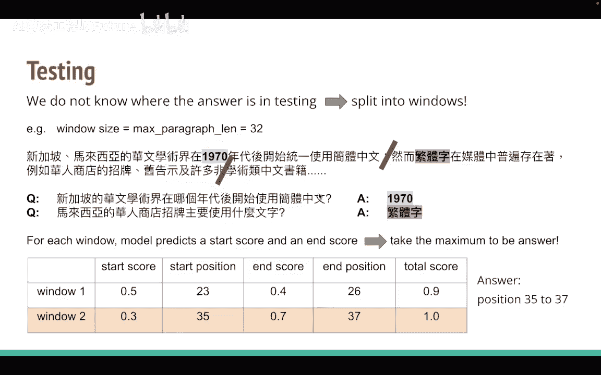

那这个就是我们testing set时候会使用的方法。

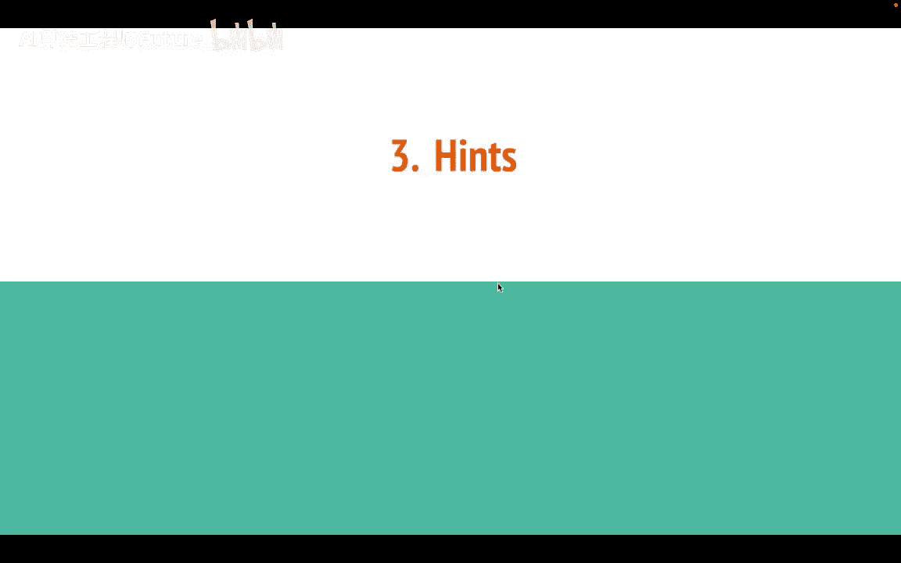

那讲解完这个text的一些介绍，以及实作上的方法之后，我们就要介绍如果要通过各个杯赛的话，需要实做什么样不同的方法，那首先simple baseline的部分。

其实只要跑过simple code就可以通过了，那medium basin的话就必须要实做linear learning redecay，还有修改一个叫dog stride的变数的的参数。

那这个后面会再详细做介绍，那如果要通过strong baseline的话，就需要去修改PREPROCESSING的部分，以及尝试不同的PRETRAIN模型，如果要通过boss space sign的话。

就需要去修改post processing以及再去更，就是去修改前面的一些提示，以及可能对一些超参数的调整，那右边这边就是我们就是助教，预估在不同GPU上的训练时间，那同学可以按照这个训练时间去做参考。

那下面又有一些训练相关的tips，就是在后面做介绍，首先是通过medium bas赛的第一个提示，就是请同学试做linear learning radic，那如果已经有完成作业四跟作业五的同学。

应该就对learning risk schedule，不会太就是已经有相一定的了解了，那他其实是learning rate schedule的其中一种，那实做的方法，助教这里提供两种方法。

第一种就是直接在每个step的时候去修改，手动手动去动态调整我们learning rate的值，让它可以呈现一个线性的下降，那如果要计算的话，就是主要是计算我们总共的training step。

让它每个step的时候都是下降下降一点点，那同需要注意的就是在计算learning rate的时候，要避免我们的learning rate之后变成一个负的数字。

因为如果learning rate变负的话，训练出来的结果就会有问题，那同学检查方法就是，可以在每个step更改完learning rate的时候，把它的值印出来，看一下，看是不是正常的。

那以这个地址的话，虽然这个数字看起来是负的，但它其实是一个趋近于零的数值，他可能是因计算上一些精度的问题，才导致它可能是一个负数，所以这种情况是可以接受的，只要不是很明显的负的值的话。

那基本上同学计算出来的learning r，应该都不会有太大的问题，那第二个比较简单的方法，就是可以直接使用hooking face，或是PYTORCH的套件，那使用已经实做好的套件。

使用起来也会比较简单，只要可能修改个三四行就可以完成，那这里有附上他们的连接，同学可以做参考，那想要通过medium bas赛的第二个提示，就是去修改DOCKSTRIKE这个参数。

那dust fry是什么呢，它其实就是我们前面有介绍到，说我们在做testing的evaluation的时候，我们会把testing的文章切成好多个windows，那duck strike。

其实就是两个windows开始之间间隔的距离，那在sample code的时候，它一开始是设成跟我们文章，就是windows的长度是一样的，也就是说两个间间隔的距离。

就是两个window之间其实是完全没有任何的重叠的，那这样会有一个问题是说，当我们的正确答案可能是在windows的附近边缘，或者是横跨两个windows的时候，那模型可能就没办法预测出正确的答案。

那避免这种情况，我们就希望每个windows之间可能多少会有些重叠，那大家就可以去修改dr。这个数字，可能把它调小或是之类的，来让我们的windows可以有重叠的效果，那至于调整的幅度。

同学就可以自己去尝试看，看看怎么样的效果会比较好，接下来就是如果要通过strong baseline的提示，第一个是PREPROCESSING的部分，那我们前面有提到说我们在训练的时候。

我们会以答案为正中心去做展开，但是其实我们在做阅读理解，就是回答问题的时候，其实正确答案并不一定永远都在，就是这个windows的正中心，如果我们这样去做训练的话。

可能就会让模型学习到说他永远找答案的时候，都会去windows的正中间去寻找答案，那其实这个是我们不希望他学习到的，所以大家可以去思考一下，可以怎么去调整，来让他避免学习到，就是这个不该学习到的部分。

那要通过strong bas赛的第二个提示，就是使用一个不同的PRETRAIN模型，那大家这次作业中可以挑选的模型。

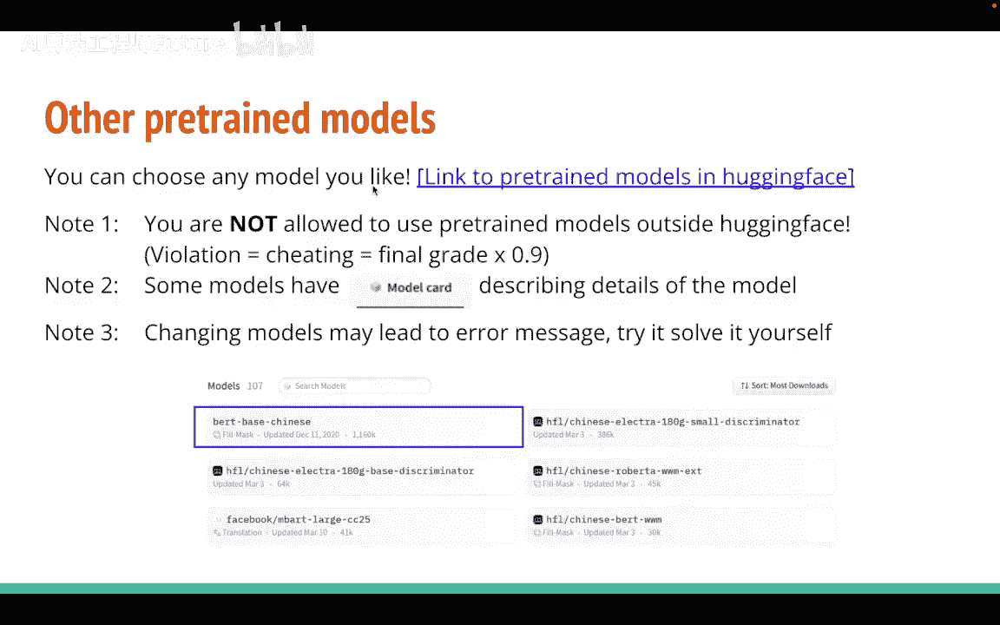

仅限于在hogin face这个网站里面的模型，点进去，其实就会看到有非常多的预训练的模型，那因为我们这次的阅读理解是中文的，所以我们这里的tag就先选择中文。

那我们这里可以看到bird base chinese，这个就是我们sample code会使用的模型，那其实还有很多不同的模型，可以供同学去做选择，那同学有兴趣的可以去尝试看看，那同学要注意说。

只能使用cooking face，这个网站里面所提供的PRETRAIN模型，如果使用这个网站以外的模型的话，就会被视为作弊，那如果想要了解这个模型，更多的就是相关资讯。

可以点击这个model card里面其实都会去介绍说，可能一些模型详细的，可能一些资讯，那可透过这个资讯，可能就可以帮助同学去做选择，说哪一个模型可能会有比较好的效果，那如果修改PTURE模型的话。

大部分的情况应该都是不会有问题的，就是城市码是不会有问题的，但是少部分的模型可能因为架构等等的问题，可能会导致sample code会出现问题，那这种情况就是可能要请同学自己想办法解决。

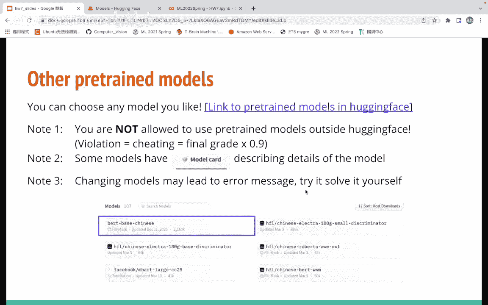

那最后就是通过boss baseline的提示，那就是请同学去修改post processing的部分，我们前面有提到说，如果我们要模型就是预测最终正确答案的时候。

会以开始位置的几率以及结束位置的几率相加，最大的作为我们最后预测的结果，但是同学可以就是打开就是跑完三坡扣之后呢，可以打开你们的就是预测结果的答案，看一下有没有什么不合理的地方，然后也可以想一下。

假设依照我们刚刚的决定方式，如果发生就是开始位置的index，其实比结束位置的index还要后面，那可能会发生什么样的问题，可GEORGE同学去修改一下，那讲解完通过各个baseline的提示之后。

就要讲解一些相关的training的tips，那第一个是automatic mixed position，那我们PYTORCH在做训练的时候，他都是使用sensor bit的浮点数去做计算。

那automatic mixed precision，它这个功能就是它可以帮助我们GPU，在训练的时候，当不需要使用到那么高精度的时，计算的时候可以转变成16B的浮点数，来让计算的时间加快。

那基本上使用automatic mix position，可以让速度从可能提升1。5到三倍，所以其实是可以节省蛮多时间的，那这个部分sample code已经有十做好了。

同学只需要将FP16training这个变数改成true，就可以使用了，但是有一点要注意的是，并不是所有的GPU都有资源，automatic mix position这个功能。

例如可能只有T4V100才有资源这个功能，那一些在COLAB上的GPU，例如K80或是VAP100等等，可能就没有资源这个功能，所以同学在使用的时候，需要先注意一下GPU是不是有提供这样的功能。

那相关资讯也附在下面的链接当中。

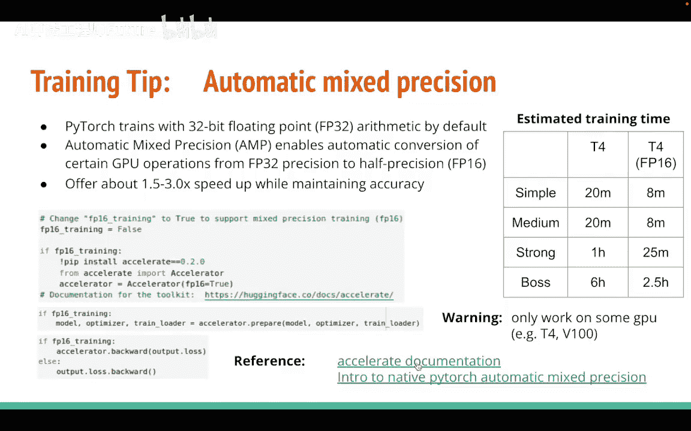

那第二个training tip就是gradient accumulation，当同学可能在训练的时候，想要使用更大的batch size，或是想使用一个模型架构参数。

模型架构更大参数更多的PRETRAIN模型的时候，可能就会遇到GPU memory不够的情况，那这个时候的解决方法就是，可以使用gradient accumulation，同学可以想成，就是。

我们不会在每个step的时候，都去更新我们模型的参数，而是累积到我们同学想要的batch size的时候，才去一次更新模型的参数，例如可能原本每个step的batch size是四个batch。

那如果同学想要的BASIZE可能是16或是32，那可能就是每四个step的时候，再去更新一次模型的参数，那gradient accumulation是没有时坐在sample code的。

所以如果同学有兴趣或是想要实做的话，就是可以上网去做搜寻。

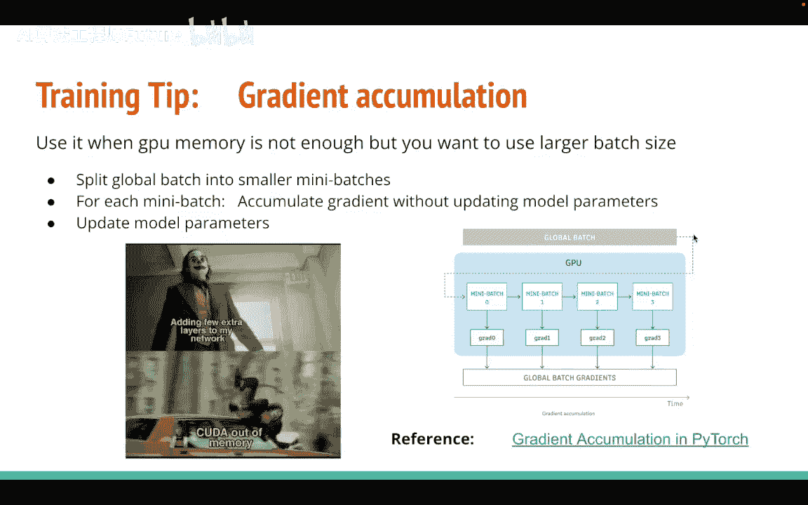

或是点击下面的这个链接去做参考。

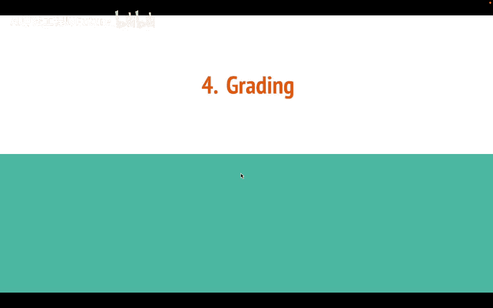

那接下来是评分的部分，那评分跟前面几次作业都是相同的，就是report占四分，然后cost submission占两分，然后其他每个杯赛都占各占一分，那public跟PRIATE各占0。5分。

那我们cargo的deadline，就是设在三个礼拜后的11。59分，那同学要注意说，cargo的team的名字记得要取成序号底线，再接后面任何你想要的名字，如果同学没有以学号为开头的话。

可能在计算分数的时候，就会没有计算到同学cargo leaderboard的分数，那testing set总共有4957个问题。

那我们的使用的evaluation metric是categorization，Accuracy，就是以右下角就这个地址，假设我们想要我们的答案就是有分的话，就是每个字都必须是一模一样的。

如果哪怕是只有一个字是不一样的，也不会算分，所以同学要注意，那这个是public score的分数，然后以及我们要缴交答案的格式，那cos submission的部分。

就是请同学将你的code压缩成学号底线，homework7点SP档再上传到NQ5扩上，deadline一样是三个礼，就是五月六号的11。59分，那请不要就是把你的模型或者是data set。

也压缩进你的档案里面，那如果我们执行同学的程式码，发现就是结果跟cargo leaderboard上的有落差，或是不合理的话，可能就会视为作弊，那这次一样是有bonus的部分。

如果就是caro leader board，结算之后，同学发现你的就是分数，是在PRIATE的前三名的话，你可以选择就是填写一份简单的report，然后再把它上传到NTU库的讨论区。

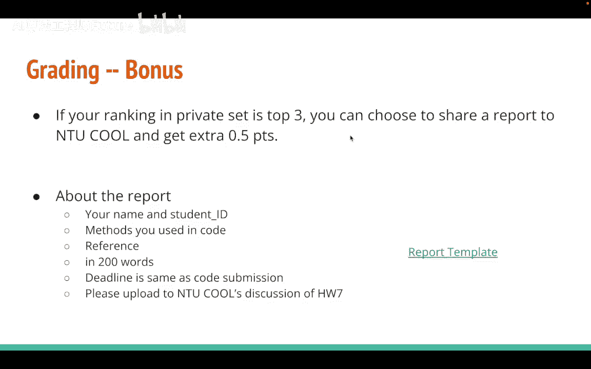

区上，助教JERRY帮你加顶给五分。

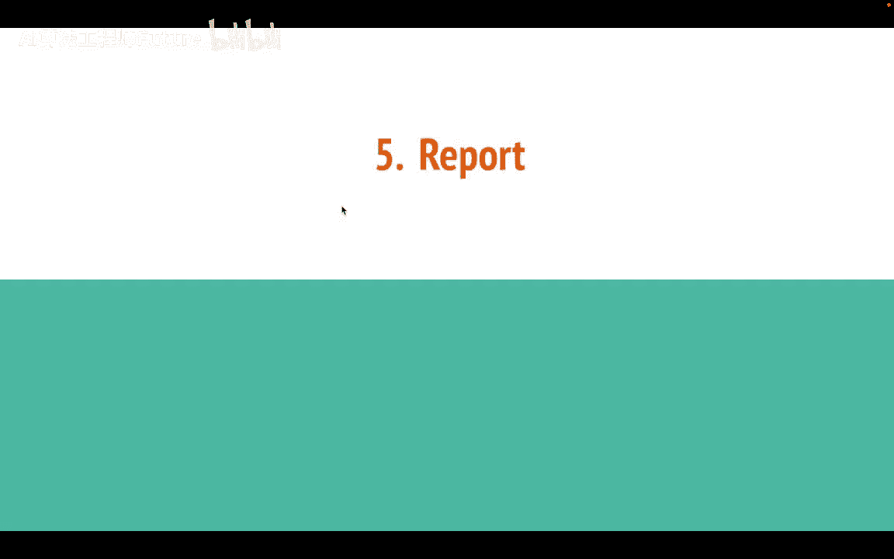

那report的话，就是请同学要到GREESCOPE上面去做填写，那主要有两个问题，第一个问题就是，当你的模型预测出正确知答案的，开始与结束的几率时，你有应用了什么样的决定方式，来决定出最后的结果。

那sample go所提供的方式是开始几率最大诶，开始几率与结束几率相加最大的，作为最后预测的结果，那其实前面也有提到一个问题，就是说这样的情况可能会发生，开始位置的index。

其实是比结束位置的index还要后面的，那其实这样就是一个不合理的情况，那就是请同学想一下，可以应用什么样的判断方法来改变，就是改善这个问题，那注意同学在回答这个问题的时候。

不能回答跟sample code提供的方法是一样的，如果回答一样的方法的话，就会不予计分，那第二个问题就是请同学去尝试一下，不同的PRETRAIN模型，就是除了bird以外的PRETRAIN模型。

那一样是在这个hooking face，网站上可以找到的模型，那请简单描述，就是你所选择的模型以及它的performance，还有他跟BT有什么样的差别，例如可能架构上的差别。

或是PRETRAINING的时候，他们有什么不一样的方法等等，那最后就是规定的部分，那规定基本上与前几次作业都是相同的，那比较需要注意的就是，请不要使用额外的训练资料。

还有禁止使用和king face这个网站以外的训练，PRETRAIN模型，那如果违违反以上的规定的话，这次的作业就会被记为零分，而且最后的总成绩乘以0。9。

那这个就是cargo以及COLLAB的link，那如果有任何的问题的话，都可以到NTU库的讨论区去做询问，然后也可以即兴，那即兴的话请记得开头要以homework7为开头。

那ta hours就跟以前的都是相同的。

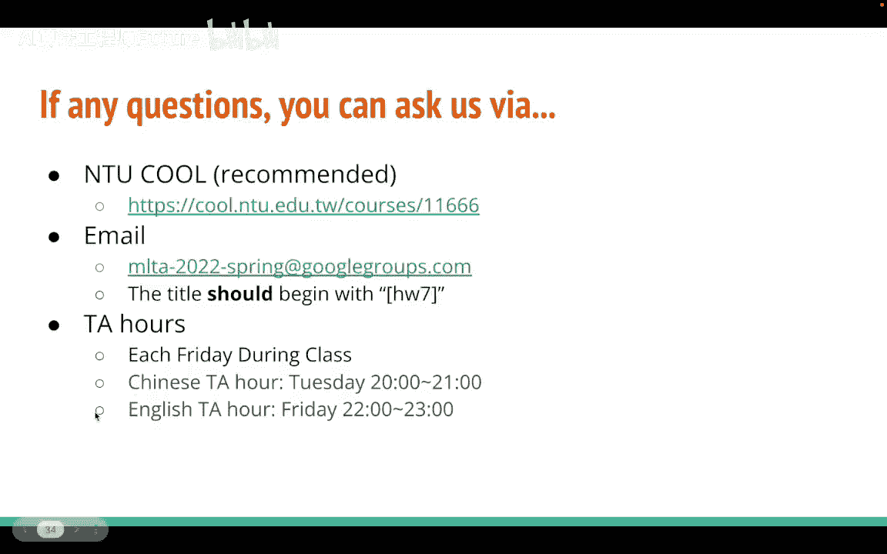

那接下来就是简单介绍code的部分，那首先这1test description，其实就是跟投影片里面讲到的内容都是相同的，那这里就是下载资料集的部分，那其实这次下载的资料其实档案算蛮小的。

所以下载速度也蛮快的，那如果同学有遇到，就是连接有出问题的情况的话，就是再麻烦使用另外两个备用的连接，或是也可以到cargo上去下载资料集，那这里就是安装我们transformers的套件。

那同学也可以挑选自己喜欢的版本，只要执行sample code不会出现问题，那就想要什么版本都是没有关系的，那这也就是import1些我们需要使用到的套件，以及固定我们的random seed。

那下面这一块就是前面有提到的一个training，Tip，就是FP16的部分，那请同学确定说自己的GPU，是可能T4或者V1版，就是有资源，这个功能就可以把这个变数设为true。

那就可以大幅的提升你的训练的时间，就可以大幅提升训练的速度，那这里就是我们把我们的模型，PRETRAIN模型给load进来，那如果同学想要更改不同的PRETRAIN模型的话。

其实就只要把这里改成hooking face，找到的名字再把它替换上去，基本上就可以了，那token nature这里的部分要注意，我们使用的token nzer是BT。

token neer fast这个module，那大部分的模型hocking face可以找到的，应该都是有资源的，但是可能少部分的模型是没有资源这个module的。

所以统计在使用上如果出现error的话，可能就要注意下是否有资源，那这里出现的warning message就是可以忽略的，那接下来这话就是读档的部分，只是把我们的资料给读进来。

那首先我们要做的PREPROCESSING，就是做TOKIZE的部分，我们会把question以及文章，就是问题与文章分开做TOIZE，那其实这里只就只是单纯的做断词而已。

那后面还会有后续的PREPROCESSING，那如果同学在这里看到有一个这样的warning message，是可以忽略的，因为我们在后续PREPROCESSING的时候，就会将BT传进去的input。

长度限制在512以内，好那这也就是处理资料的部分，那同学可以看到有一些参数，例如可能问题的长度或是文章的长度，这些都是可以去做调整的，那要通过medium bassi的其中一个提示。

就是去修改DOCKSTDE这个值，那比较复杂的可能是get item，这里这里主要就是我们去做PREPROCESSING的部分，就是前面投投投影片有提到的，就是我们在把我们的文章。

传入我们的BERT模型之前，要先处理好input id token time，DC g attention mask这三个部分，那这里就是去处理那三个部分，那同学可能就要多花点时间去看一下。

这里的code是怎么去做的，那同时这里也有如果要通过strong bassig的话，PREPROCESSING也是在这里去做修改的，那这个是BESIZE的部分，也是同学可以去做调整。

那处理完我们的资料之后，还有evaluation的部分，evaluation就是如果想要通过strong诶boss bas散的话，就必须要去调整post processing。

也就是说我们最后预测的结果，可能需要做什么样的调整，还有可能你打开你的prediction，就是的结果的时候，可能会看到什么样不合理的现象。

那training像是EPIC或是learning rick都是可以做调整的，那另外一个要通过medium bas赛的提示，在这里就是请同学去实做linear learning rededicate。

可以加在这个地方，那训练完成后，最后就是对我们testing set去做预测，那预测结果就会存在RESO点CSV这个档案里，那同学再将这个档案上传到cargo leader board的话。

就会显示分数，那格式的话就是必须按照这个固定的格式，那这次的讲解大概就到这边，如果有任何的问题的话，都可以到nt call上去发问，或者是寄信到助教信箱。

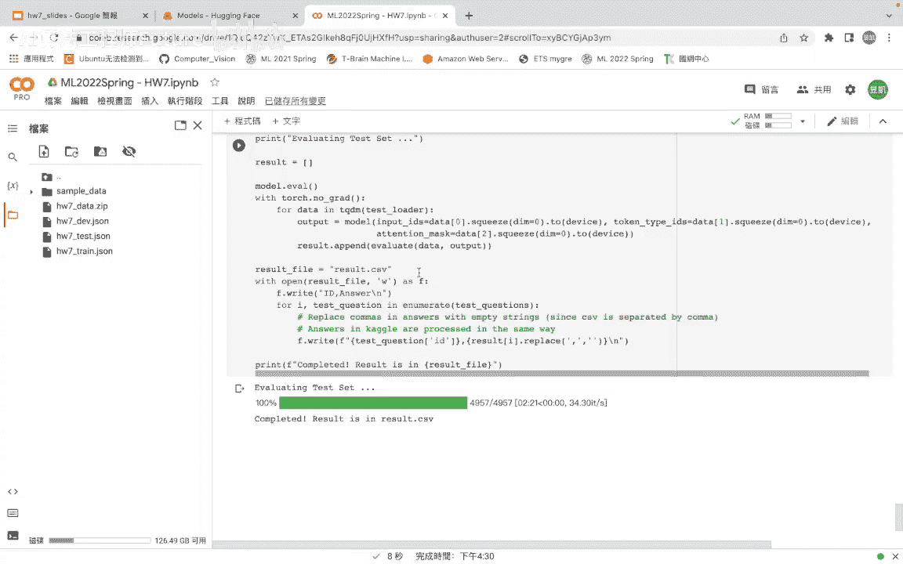