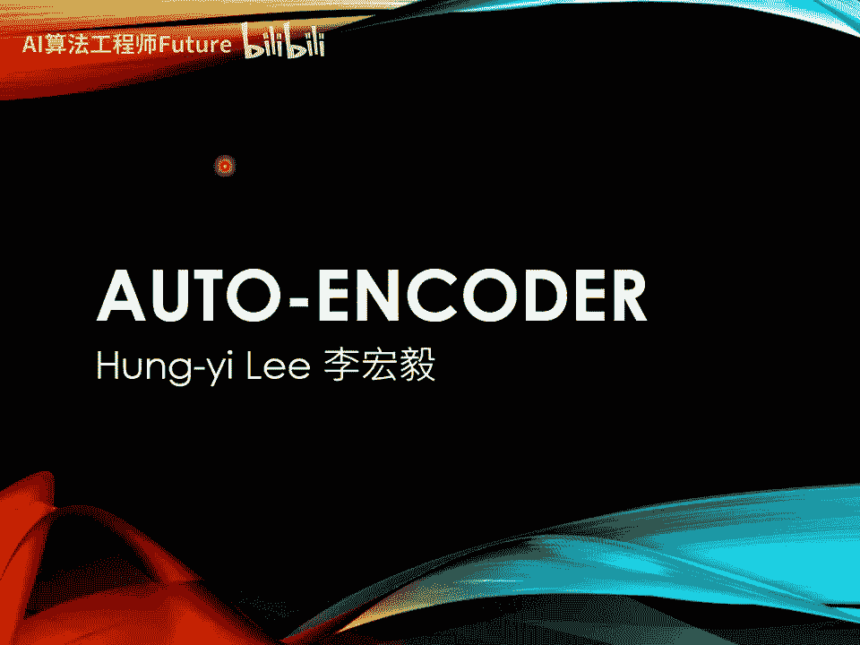
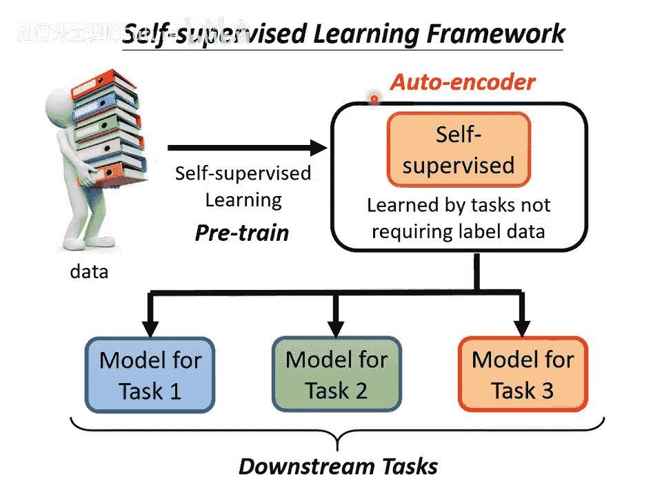
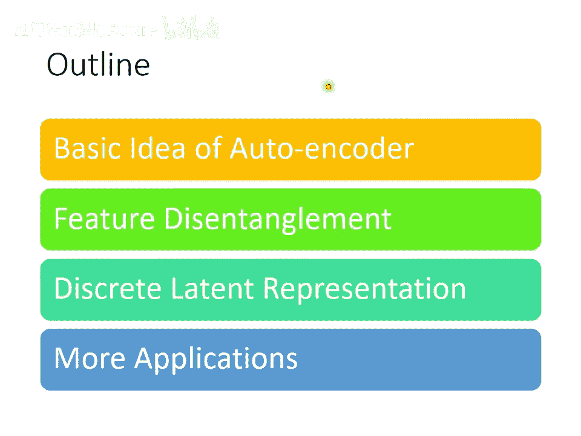
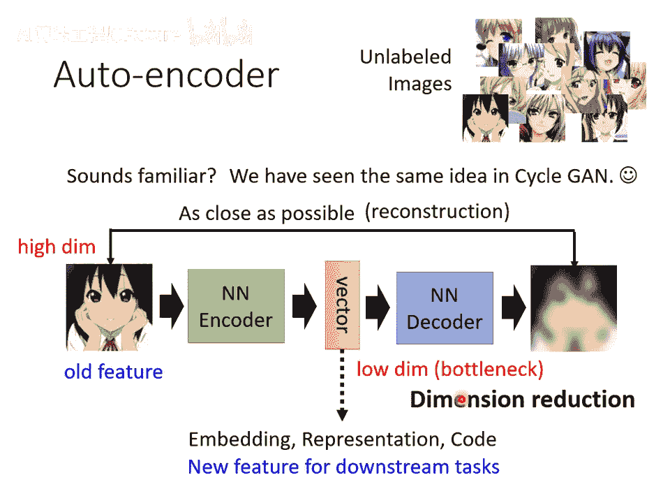
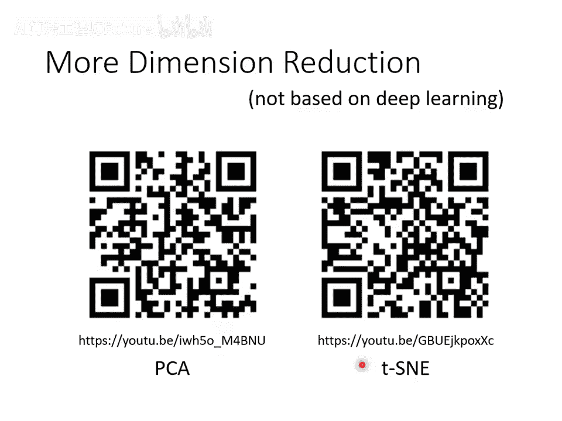
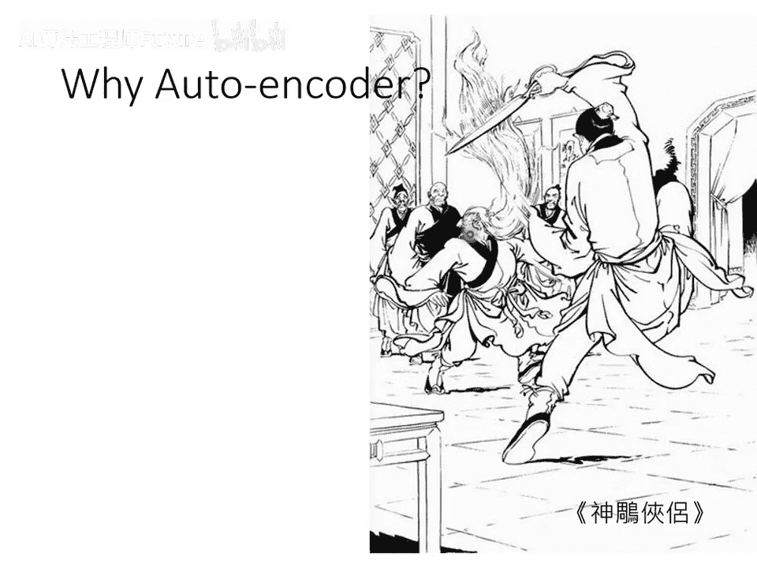
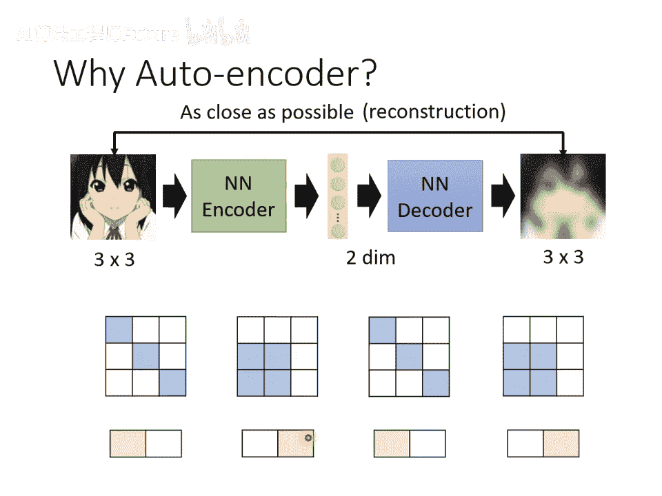
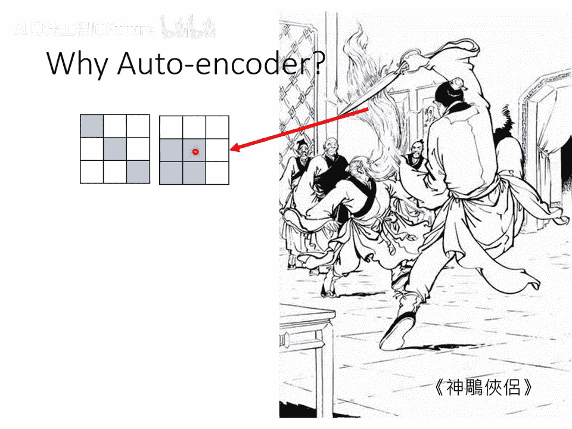
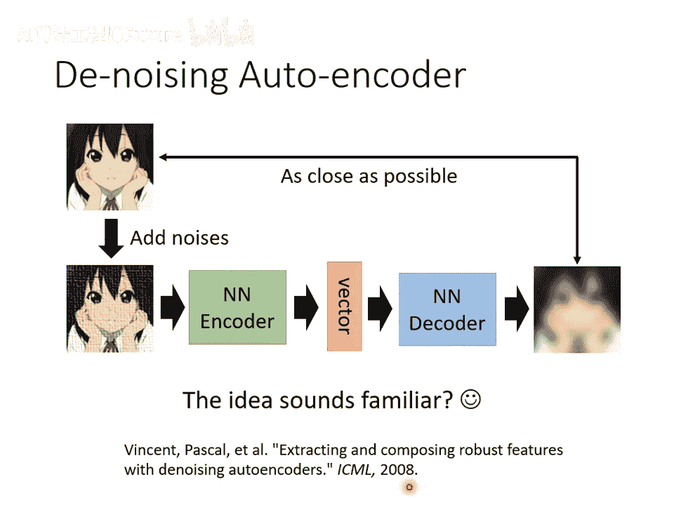
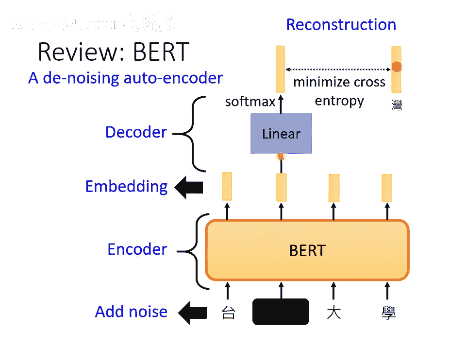

# 【官授搬运】2026年全新优化版李宏毅机器学习系统课程，这才是真正的初学者体系课程！—人工智能／深度学习／神经网络 - P60：【第8讲】1-自编码器 (Auto-encoder) (上)–基本概念 - AI算法工程师Future - BV1ruqABeEFX

好那个接下来呢我们要讲auto encoder，那auto encoder我们可能先讲一小段以后呢，我们就下课休息一下，然后再把auto encoder部分补完，然后等一下助教就会讲。

跟auto encoder有关的作业好。

那我们要来讲auto encoder好，那在讲auto encoder之前呢，其实auto encoder也可以算是sales supervised learning的一环。

所以再让我们用非常短的时间来看一下sale，supervised learning的framework好，那sell supervised learning是怎么运作的呢，首先你有大量的没有标注的资料。

用这些没有标注的资料，你可以去训练一个模型，你必须发明一些不需要标注资料的任务，比如说做填空题，比如说预测下一个token，你必须要自己想一些不需要标注资料的任务，给你的模型进行学习。

那这个不用标注资料的学习叫做sell supervised learning，或者是也有人叫PRETRAINING好，那用这些不用标注资料的任务，学完一个模型以后，它本身没有什么用，BT只能做填空题。

GPT只能够呃呃把一句话补完，但是你可以把它用在其他下游的任务里面，你可以把self supervised learning的model，做一点点的微微的调整，就可以用在下游的任务里面。

那在这些sell supervised learning的任务里面，在这些不用标注资料就可以学习的任务里面，在有BT在有GPT之前，其实有一个更古老的任务，更古老的不需要用标注资料的任务。

就叫做auto encoder，所以你也可以把auto encoder看作是cell supervised learning，的一种回train的方法，当然可能不是所有人都会同意这个观点，有人可能会说。

这个auto encoder不算是cell supervised learning啊，这个auto encoder很早就有了嘛，02006年15年前就有了嘛。

然后sell supervised learning是啊，19年才有这个词汇嘛，所以auto encoder不算sell supervised learning的一一环，那这个都是见仁见智的问题。

这种名词定义的问题，真的我们就不用太纠结在这个地方，从self supervised learning，它是不需要用label data来训练，这一个观点来看auto encoder。

我认为它可以算是cell supervised learning的其中一种方法，它就跟呃呃填空预测，接下来的token是很类似的概念，只是用的是另外不一样的想法好，那接下来我们就来先看一下。

auto encoder是怎么运作的，好好那auto encoder是怎么运作的呢。

那现在啊我们因为刚才在讲sale supervised learning的时候，都是用文字做例子了，那现在我们换成用影像来做例子，而假设你有非常大量的图片在auto encoder里面。

你有两个network，一个叫做encoder，一个叫做decoder，他们就是两个network，这两个network做的事情是什么呢，这两个network做的事情是encoder把一张图片读进来。

他把这张图片变成一个向量，我就encoder它可能是很多层的，Cnn，把一张图片读进来，它的输出是一个向量，接下来这个向量呢会变成decoder的输入，decoder呢会产生一张图片。

所以decoder的network的架构，可能会像是game里面的generator，它是11个向量输出一张图片，但不管是encoder还是decoder，反正就是多层的network好。

那现在训练的目标是什么呢，训练的目标是希望encoder的输入，跟decoder的输出越接近越好，假设你把图片看作是一个很长的向量的话，我们就希望这个向量跟decoder的输出。

这个向量这两个向量它们的距离越接近越好啊，也有人把这件事情叫做reconstruction，叫做重建啊，因为我们就是把一张图片压缩成一个向量，接下来decoder要根据这个向量重建原来的图片。

那我们希望原输入的结果，跟重建后的结果越接近越好，讲到这边，你可能会发现说这个东西这个概念似曾相似呢，没错，我们在讲cycle game的时候，已经讲过了这个概念，对不对。

我们说在做cycle game的时候，我们会需要两个generator，第一个generator把XDMAN的图片转到y din，另外一个generator把YDMIN的图片转回来。

希望最原先的图片跟转完两次后的图片，越接近越好，那这边encoder和decoder，这个auto encoder的概念，跟cycle game其实是一模一样的，都是希望输入的图片经过两次转换以后。

要跟原来的输出越接近越好，而这个训练的过程完全不需要任何的标注资料，你只需要收集到大量的图片，你就可以做这个训练，所以它是一个unsupervised learning的方法。

跟sell supervise那一系列PRETRAINING的做法一样，你完全不需要任何的标注资料，那像这样子这个encoder的输出啊，有时候我们叫它embedding。

我们在讲BT的时候也提过embedding，这个词汇了，那有的人叫它representation，有的人叫他code，就因为encoder是一个编码嘛，所以这个有人家把这个vector叫做code。

那其实指的都是同件事情好，那这个auto encoder的技术要怎么用呢，怎么把TRA完的auto encoder，用在当STR的任务里面呢，常见的用法就是原来的图片，你也可以把它看作是一个很长的向量。

但这个向量太长了，不好处理，那怎么办呢，你把这个图片丢到encoder以后，输出另外一个向量，这个向量你会让它比较短，比如说只有十维，只有100维，那你拿这个新的向量来做，你接下来的任务。

也就是图片不再是一个很高维度的向量，它通过encoder的压缩以后，变成了一个低维度的向量，你再拿这个低维度的向量来做，你接下来想做的事情，这就是常见的auto encoder用在dashing的任务。

用在下游任务的方法，那因为通常encoder的输入，是一个维度非常高的向量，而encoder的输出也就是我们的embedding，representation或者code，它是一个非常低维度的向量。

比如说输入是100×100的图片，那100×100，那就是1万维的向量了，如果是RGB，那就是3万维的向量了，但是通常encoder的output你会设的很小，比如说十啊100啊这样的等级哦。

所以这个这边呢会有一个特别窄的地方，所以这个部分呢这个encoder的输出呢，有时候又叫做bottle neck，而叫做瓶颈，就本来输入是很宽的，输出也是很宽的，中间特别窄。

所以这个段这一段呢又叫做bottle neck，而encoder做的事情是，把本来很高维度的东西转成低维度的东西，把高维度的东西转成低维度的东西，又叫做dimension的reduction。

那dimension reduction这个技术，我相信你在这个machine learning相关的应用上。

应该常常听到这个名词啊，那有关dimension reduction的技术啊，它其实呃这个牵涉的非常非常的广啊，所以我们这边呢就不再细讲，因为这门课呢，我们只专注在深度学习相关的技术。

你可以把auto encoder的encoder当做，拿来做dimension reduction，那其他还有很多不是deep learning base的。

不是以深度学习为基础的dimension reduction的技术，我就把录音的连接留在这边，比如说PCA，比如说TSN1，我就把录音的链接留在这边给大家参考好。

那auto encoder到底好在哪里呢，当我们把一个高维度的图片，变成一个低维度的向量的时候，到底带来什么样的帮助呢，这让我想到神雕侠侣的其中一段了，我不知道大家有没有看过神雕侠侣。

就是哎我可以做个调查，有看过神雕侠侣的同学可以举手一下吗，哇这么多好手放下，好比我想象的多太多了啊，我还以为现在大家已经没有在看金庸了，而这个神雕侠侣里面有一段，那就是杨过进去那个绝情谷。

遇到这个绝情谷谷主公孙子的弟子就是樊义欧，反义欧就是这个人，那凡庸的武器是什么呢，他的武器除了一根钢杖以外呢，还有他的胡子哦，他可以去甩动他的胡子，当做一个软边来使用啊，他的胡子甩起来有两丈那么长。

然后可以是一个很厉害的武器，而杨过呢跟他打了很久都难分上下，突然呢杨过说，我在三招之内一定要剪掉你的胡子，大家突然都很诧异，想说杨过虽然武功可能比反应红还高一点，但是也没有高太多。

怎么有办法三招就剪掉他的胡子呢，但后来杨过真的在三招内剪掉他的胡子，为什么呢，因为杨过发现说啊，这个胡子是由头所操控的啦，虽然胡子甩开来有两丈那么长，但是头能够做的变化还是有限的。

所以虽然表面是竹子的编法非常的厉害，但是呢只要直接去打他的头，就直接去打他脸，就会逼得他不得不闪避啊，就会逼得他这个胡子能够动的路线变得有限，然后就打败了反佣，就把他的胡子剪掉了。

故事结束，那这个跟auto encoder有什么关系呢，好我们来想一下auto encoder这件事情，他要做的是把一张图片压缩又还原回来，但是还原这件事情为什么能成功呢，你想想看。

假设本来图片是3×3，3×3很小啦，就当我们就假设3×3好了，买来图片是3×3，你要用九个数值来描述一张3×3的图片，假设encoder输出的这个向量是二维的，我们怎么有可能从二维的向量去还原。

3×3的图片，还原九个数值呢，我们怎么有办法把九个数值变成两个数值，又还原成三，又还原回九个数值呢，能够做到这件事情是因为对于影像来说，并不是所有3×3的矩阵都是图片，图片的变化其实是有限的。

你随便sample一个呃random的noise，随便sample一个矩阵出来，它通常都不是你会看到的图片或举例来说，假设图片是3×3的，那它的变化虽然表面上应该要有3×3的数值。

才能够描述3×3的图片，但是也许它的变化实际上是有限的，也许你把图片收集起来，发现说它只有这样子的类型跟这样子的类型，其他类型根本就不是，你一般在训练的时候会看到的状况，就是因为说图片的变化还是有限的。

所以你在做这个encoder的时候，encoder可以说我就只用两个维度，就可以描述一张图片，虽然图片是3×3，应该用九个数值才能够储存，但是实际上它的变化也许只有两种类型，那你就可以说看到这种类型。

我就左边这个维度是一，右边是零，按照这种类型，就左边这个维度是零，右边这个维度是一。

那所以对应到刚才这个反应用的例子啊，就是这个胡子是图片复杂的状态是原来的图片，是原来图片的。

pixel是原来图片的像素，而encoder做的事情呢就是化繁为简，本来比较复杂的东西，它只是表面上比较复杂，事实上它的变化呢其实是有限的，你只要找出他有限的变化，你就可以把本来复杂的东西。

把它变得用比较简单的方法来表示它，如果我们可以把复杂的图片，用比较简单的方法来表示它，那我们就只需要比较少的训练资料，在下游的任务里面，我们可能就只需要比较少的训练资料。

就可以让机器学到我们本来要大学的事情啊，这个就是auto encoder的概念哦，那auto encoder呢他从来都不是一个新的想法啊，他真的是非常非常的有历史哦，举例来说，在这个HINTON。

大家知道HINTON吧，就HINTON就是deep learning之父嘛，这个HINTON在06年的science的paper里面就有提到，auto encoder这一个概念。

只是那个时候用的network跟今天用的network，当然还是有很多不一样的地方，你想2006年是15年前内，15年前的auto encoder长什么样子呢。

那个时候啊人们不觉得deep的network是圈的起来的，那时候觉得说这个把network叠很多很多层，然后每每一层一起确认不太可能成功，所以那时候的信念是每一层应该分开训练哦。

所以HINTON用的呢是一个叫做restrictive，bosman machine的技术啊，缩写是RBN，我们特别把这个inter15年前的文章，把它的里面的这个paper里面的图拿出来。

给大家看一下，过去15年前，人们是怎么看待深度学习这个问题的哦，那个时候觉得说要圈一个这个很深的network，不太可能每一层分开要全，虽然这个时候很深，也没有很深啊，只是三层啊。

这个跟你作业二做的还要更更更SHAO，对不对，但是在15年前这个已经是哇很深啊，它有三层，太可怕了，好那这个三层呢要分开来训练才可以，那这边说这个分开来训练这件事情叫做PRETRA。

但它跟sales supervised learning的PRETRAIN又不一样，对大家了解我的意思吗，假设你说auto encode这个东西是PRETRAIN。

那现在这个PRETRAIN是PRETRAIN的PRETRAIN，他是要PRETRAIN那个auto encoder哦，而且每一层用一个叫做RBN的技术，分开来训练哦，先把每一层都训练好。

再全部接起来做微调这件事情，那这边的微调并不是BERT的微调，它是微调那个PRETRAIN的model好，那那个这个restricted bosman machine呢。

呃你会发现今天很少有人再提到它了，它其实不是一个deep learning的技术，他有点复杂，我们在这门课里面呢，也没有打算要深入细讲什么是restrict。

Restricted boston mach，那为什么今现在都没有什么人用它呢，就是因为它没有什么用，这样子，嘿嘿嘿，在15在过去呢，在10年前呢。

都相信这个deep的network一定要用restrictive portman machine，然后有一其实HINGTON后来在2012年的时候，有一篇paper偷偷在结尾下一个结论说。

其实regj boston machine也没有什么必要啦，这所以后来就没有什么人在用restricted，botim machine了，而且那个时候还有一个神奇的信念。

是觉得说那个encoder decoder啊，它必须是对称，所以encoder的第一层，跟encoder的最后跟decoder的最后一层，他们必须互为transpose，不过现在已经没有。

比较少有人在使用这样子的限制了，好了，这些图片只想告诉你说auto encoder不是新的概念，它是一个非常有历史的概念，而那auto encoder还有一个常见的变形呢。

叫做DNOISING的auto encoder，DNOISING的auto encoder是说我们把原来要输进去，给encoder的图片加上一些杂讯啊，就自己随便找一个杂讯把它加进去。

然后一样通过encoder，一样再通过decoder试图还原原来的图片，那我们现在要还原的不是encoder的输入，encoder的输入的图片是有加杂讯的，我们要还原的不是encoder的输入。

我们要还原的是加入杂讯以后的结果，而加入杂讯搜索，加入杂讯之前的结果哦，所以你会发现说，现在encoder和decoder除了还原原来的图片，这个任务以外，它还多了一个任务，这个任务是什么。

这个任务就是他必须要自己学会把杂讯去掉，encoder看到的是没有杂讯的图片，但decoder要还原的目标是呃，encoder看到的是有加杂讯的图片，但decoder要还原的目标是没有加杂讯的图片。

所以encoder加decoder它们合起来必须要联手，能够把杂讯去掉，这样你才能够把DNOISING的auto encoder训练起来，那说到the noising，The auto encoder。

有没有发现这个概念其实也一点都不陌生呢，denoisation auto encoder也不算是太新的技术，至少在2008年的时候，就已经有相关的论文了。

但是如果你看今天的bird的话，其实你也可以把它看作就是一个DNOISY的auto，encoder输入，我们会加mask，那些mask其实就是noise，BT的模型，就是encoder。

它的输出就是embedding，在讲BT的技术的时候，我们就告诉你说这个输出就叫做embedded，接下来有一个linear的模型，就是decoder和decoder要做的事情，就是还原原来的句子。

也就是把填空题被盖住的地方，把它还原回来，所以我们可以说BT，其实就是一个DNOISING的AUTOENCODER，那你有同学可能会问说，为什么这个decoder一定要linear的呢。

呃他不一定要是linear，它可以不是linear的，或者是我们换一个说法，这个bird啊它有12层嘛，最小的那个bird有12层嘛，它比较大的有24层或者是48层的好，那最小的BT是12层。

如果我们说这个12层，中间第六层的输出是以added，那你其实也可以说剩下的六成就是decoder啊，你可以说bird就假设你在用bird的时候，你用的不是第12层的输出，而是第六层的输出。

那你完全可以说bird的前六层就是encoder，后面六层就是decoder，总之这个decoder没有一定要是linear的好。

那讲到这边呢，正好告一个段落，也许我们在这边休息一下。

