# 【官授搬运】2026年全新优化版李宏毅机器学习系统课程，这才是真正的初学者体系课程！—人工智能／深度学习／神经网络 - P61：2-自编码器(Auto-encoder) (下) –更多应用 - AI算法工程师Future - BV1ruqABeEFX

好那我们了，接下来啊，除了auto encoder可以用来做downstream的任务以外，我还想跟大家分享一下auto encoder，其他有意思的应用。

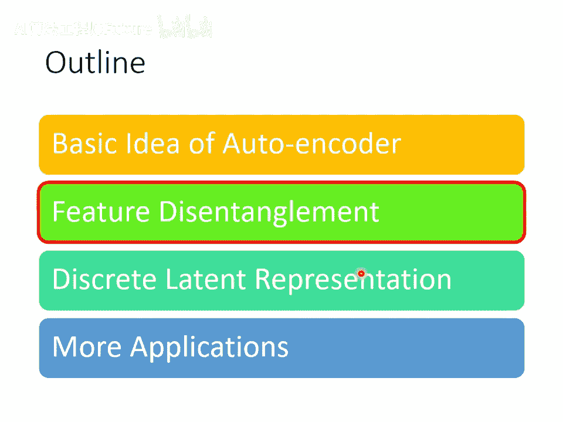

好那我跟大家讲这个feature的DISCANGLEMENT，而feature的DISINTANGLEMENT是什么意思呢，什么是DISINTANGLE呢，DISSECTANGLE的意思。

就是把一堆本来纠缠在一起的东西把它解开啊，这个东西呢就叫做DISETANGLE。

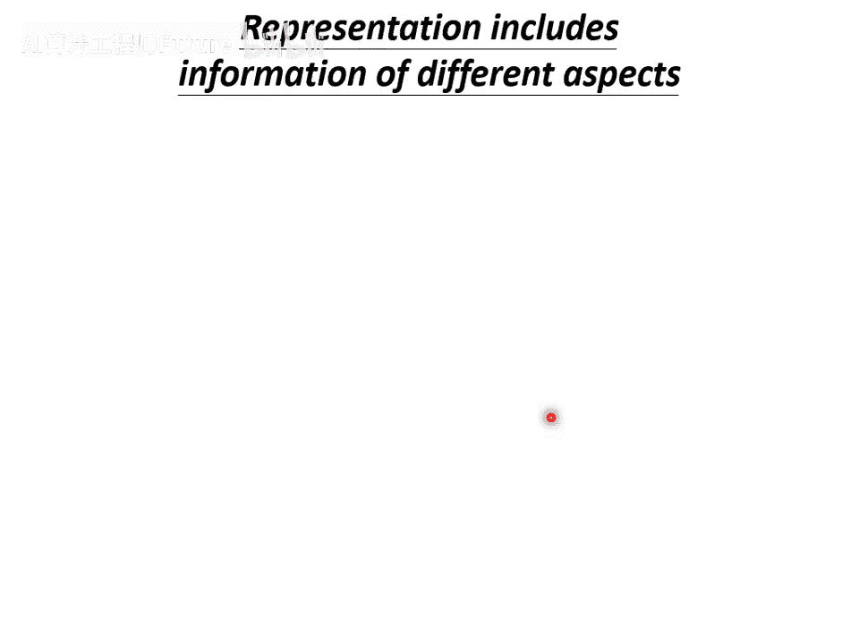

那为什么会有DISSETANGLE这个议题呢，我们来想想看auto encoder他在做的事情是什么，auto与code在做的事情是如果是图片的话，就是把一张图片变成一个code，再把cod呢变回图片。

既然这个code可以变回图片，代表说这个code里面哪有很多的资讯，包含图片里面所有的资讯，举例来说，图片里面有什么样的东西呀，图片的色泽纹理啊等等。

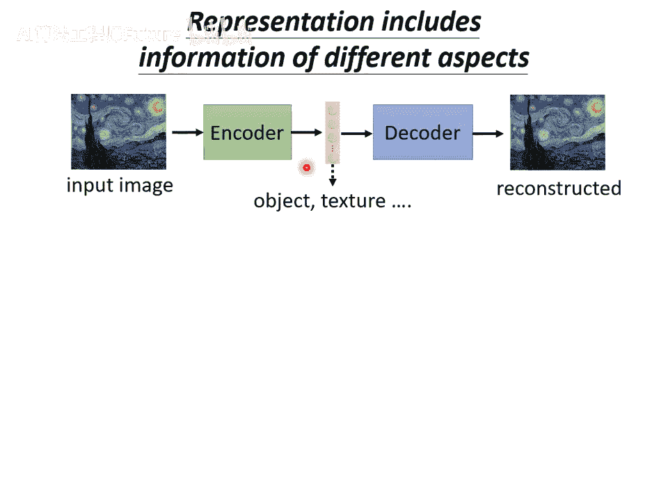

auto encoder这个概念也不是只能用在影像上，如果用在语音上，你可以把十段声音丢到encoder里面，变成向量，再丢回decoder，变回原来的声音，代表这个向量包含了语音里面所有重要的资讯。

包括这句话的内容是什么，就是content的咨询，还有这句话是谁说的。

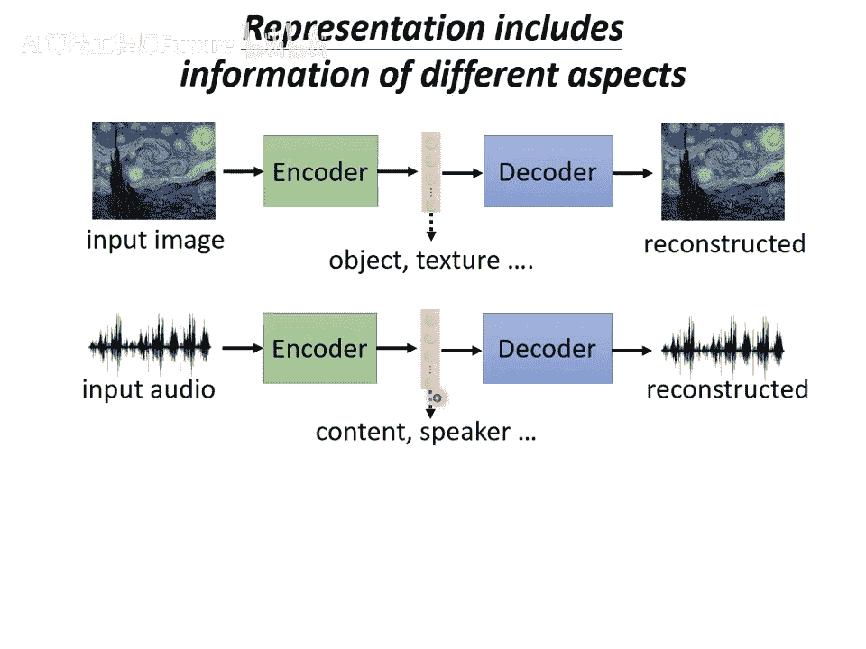

就是speaker愚者的资讯，那如果今天是一篇文章丢到encoder里面，变成向量，这个向量通过decoder会变回原来的文章，那这个向量里面有什么，它可能包含文章里面文具的句法的资讯。

也包含了语义的资讯，但是这些资讯是全部纠缠在一个向量里面。

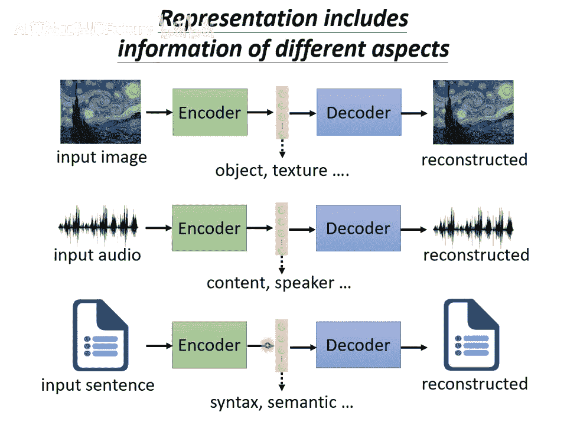

我们并不知道一个向量的哪些维，代表了哪些资讯，举例来说，如果我们今天把一段声音讯号丢进encoder，它会给我们一个向量，但是这个向量里面，哪些维度代表了这句话的内容，哪些维度代表这句话的愚者。

也就是谁说的，我们没有这样的资讯，而feature distant tango想要做到的事情，就是我们有没有可能想办法，在圈一个auto encoder的时候，同时有办法知道这个呃。

representation或又叫做embedding，或又叫做code，它们是一样的东西，我们这个embedding的哪些维度，代表了哪些资讯呢，我们有没有可能做到说encoder输出，一个举例来说。

100维的向量，我们知道说前50维就代表了这句话的内容，后50维就代表了这句话说话人的特征呢，那这样子的技术就叫做feature disetango啊，那feature disentangle呢。

其实有很多各式各样的技术啦，那实际上是怎么做的，我本来想要讲到后来犹豫一下，想说我们先不要讲这件事情好了，我们就是主要就是想告诉大家说，feature disentangle是有办法做的。

那至于实际上怎么做，我在这边就列几篇论文给有兴趣的同学参考，阿瑞没有兴趣的话，你就知道说这件事情是可行的，我们有可能知道auto encoder里面。

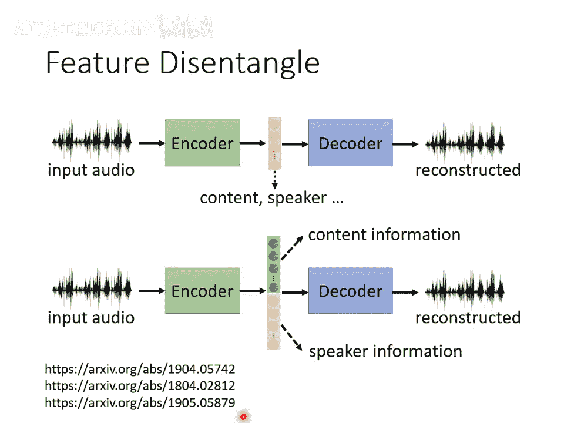

每一个dimension代表了什么样的资讯好，那现制作feature disentangle有什么样的应用呢，但你可以想想看有什么样的应用了，这边举一个语音上的应用。

这个应用叫做voice conversion，那什么是voice conversion呢，voice conversion的中文叫做余则转换，所以其也许你没有听过余则转换这个词汇。

但是你一定看过它的应用。

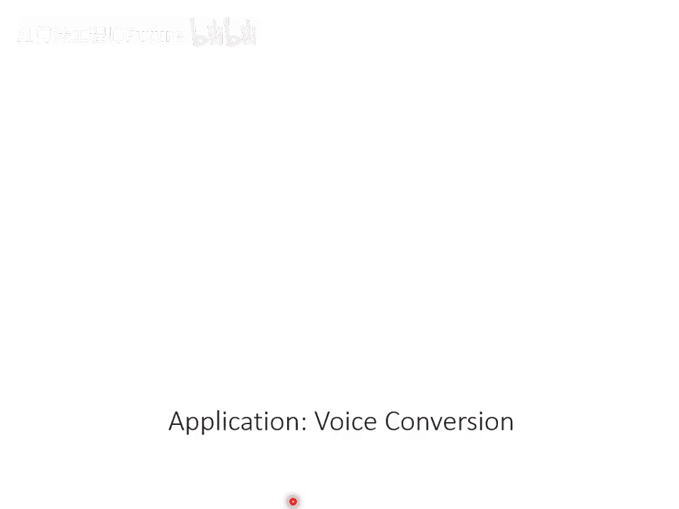

他就是柯南的领结变声器，这个在20年前，阿笠博士就已经做的很成功了啦，哎那只是过去阿笠博士在做这个voice，conversion的时候啊，我们需要成对的声音讯号，也就是假设你要把A的声音转成B的声音。

你必须把A跟B都找来，叫他念一模一样的句子，就A说how are you，B也说how are you，A说good morning，B也说good morning，他们两个各说一样的句子。

说了1000句，接下来呢就结束了，就是supervised learning的问题啊，你有成对的资料，吹一个supervise model，把A的声音丢进去，输出就变成B的声音就结束了。

但是如果A跟B都需要念一模一样的句子，念个五百一千句，显然是不切实际的。

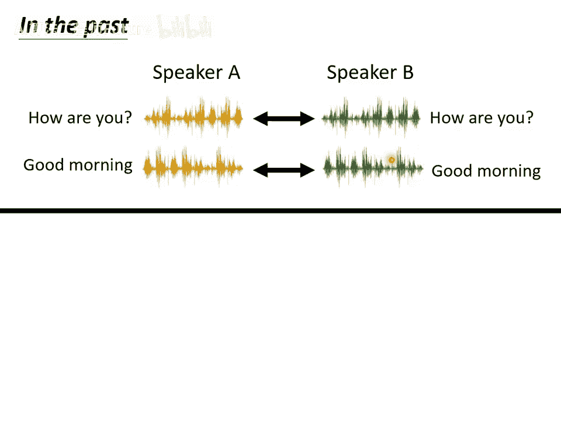

举例来说，假设我想要把我的声音转成新垣结衣的声音，我得把新垣结衣找来，更退1万步说，假设我真的把新垣结衣找来，他也不会说中文啊，所以他没有办法跟我念一模一样的句子。

而今天有了feature disentangled的技术以后，也许我们期待机器可以做到就给他A的声音，给他B的声音，A跟B不需要念同样的句子，甚至不需要讲同样的语言。

机器也有可能学会把A的声音转成B的声音好。

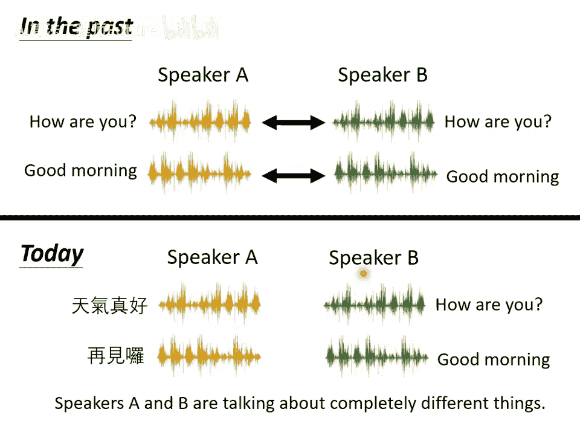

那实际上是怎么做的呢，哦假设我们收集到一大堆人类的声音讯号。

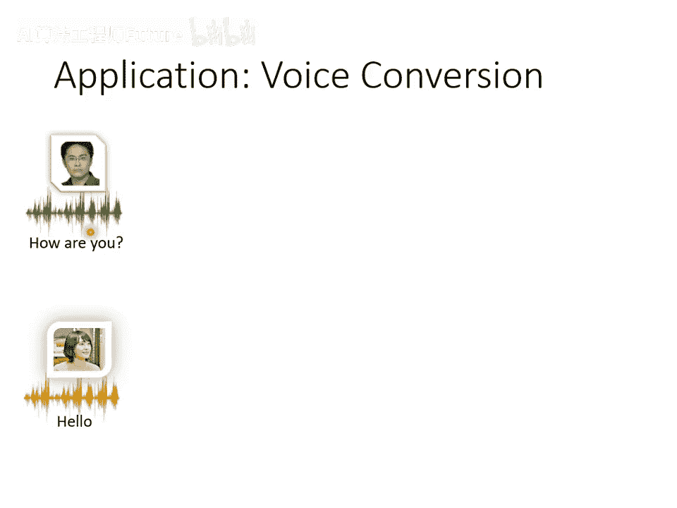

然后拿这堆声音讯号呢去train一个auto encoder，同时我们又做了feature disentangle的技术，所以我们知道在encoder的输出里面，哪些维度代表了语音的内容。

哪些维度代表了愚者的特征，接下来我们就可以做语音的转换了，怎么说呢，因为在encoder里面，我们已经知道哪些部分代表内容。

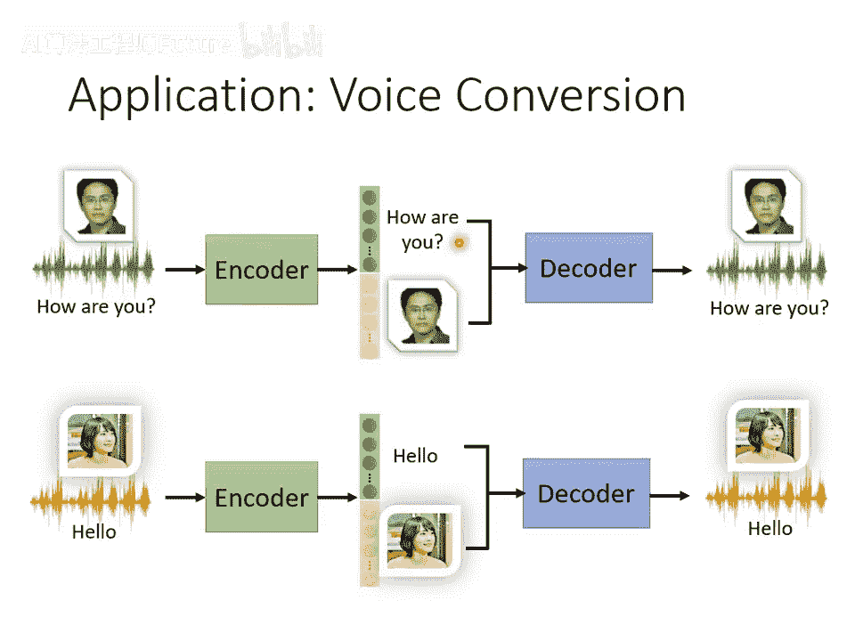

哪些部分代表愚者，接下来我们就可以把两句话，声音跟内容的部分互换，举例来说，这边是我的声音，我说how are you丢进encoder以后，那你就可以抽出。

你就知道说这个encoder里面某些维度代表，how are you的内容，某些维度代表我的声音，今天你把这个你老婆的声音丢进encoder，他就知道某一些维度代表你老婆说的话的内容。

某一些维度代表你老婆声音的特征，接下来我们只要把我说话的内容的部分取出来，把你老婆说话的声音的部分，声音特征的部分取出来，把它拼起来，丢到decoder里面，就可以用你老婆的声音将我说的话的内容。

这件事情真的有可能办到吗，以下是真正的例子，听起来像是这个样子的，do you want to study phd哦，这个是我的声音啦，就是问你要不要念博班啦，人这门课里面。

我们就是要冷不防开始叶配念博班这件事情，哎好那把我的声音呢丢到encoder里面以后呢，呃你可以想象说在encoder里面，我们知道哪些维度代表了念博班这件事，哪些维度代表了我的声音，那为了简化起见。

你就想象说他输出100维的向量，前50维代表内容，后50维代表说话人的特征好，接下来这句话是你老婆说的结果对，说过信的可能啊，不知道不太确定在说什么啊，就是日文啊，不太确定在说什么好呢。

把这句话呢丢到encoder里面一样，这个encoder的输出前50维是日文，后50维代表你老婆说话的特征好，接下来呢就把我的声音的前50位，代表内容的部分取出来，把你老婆的。

把你老婆声音丢进encoder以后，后50维的部分抽出来，拼起来一样是一个100维的向量，丢到decoder里面，看看输出来的声音，是不是就是你老婆叫你念博班的声音，听起来像是这个样子，诶。

诶你老婆叫你念博班了，知道吗，还不赶快乖乖签下去，而其实反过来也可以啦，就是换成把日文的部分拿出来，把我的声音的特征拿出来一样，串成一个100维的向量丢到decoder里面，它听起来就会变成这样。

什么对什么信息呢，哎我也不知道自己在说什么就是了好，所以确实用feature disentangle，你有机会做到voice conversion，那其实在影像上，在NLP上也都可以有类似的应用。

所以可以想想看feature disentangle。

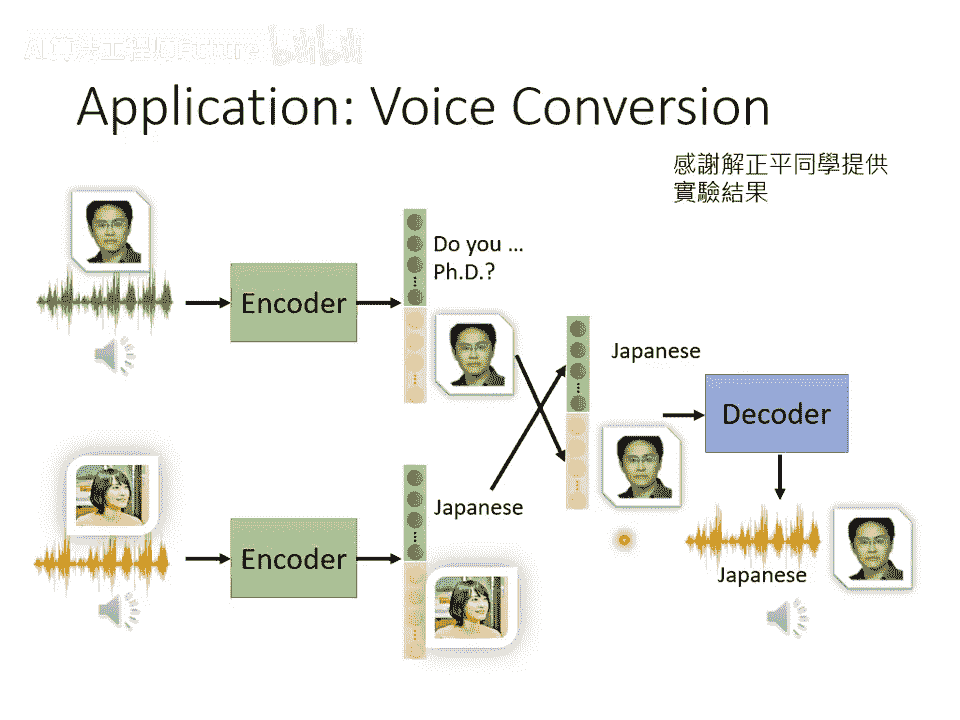

可以做什么样的事情好，那下一个要跟大家讲的应用叫做discrete later。

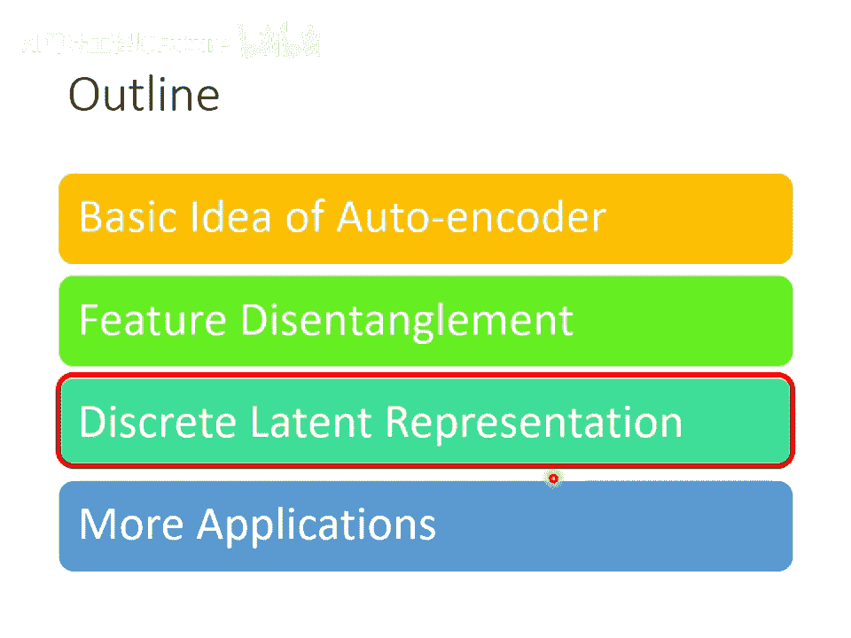

Representation，到目前为止，我们都假设这个embedding它就是一个向量，这样就是111串数字啊，它是view number，那它可不可以是别的东西呢。

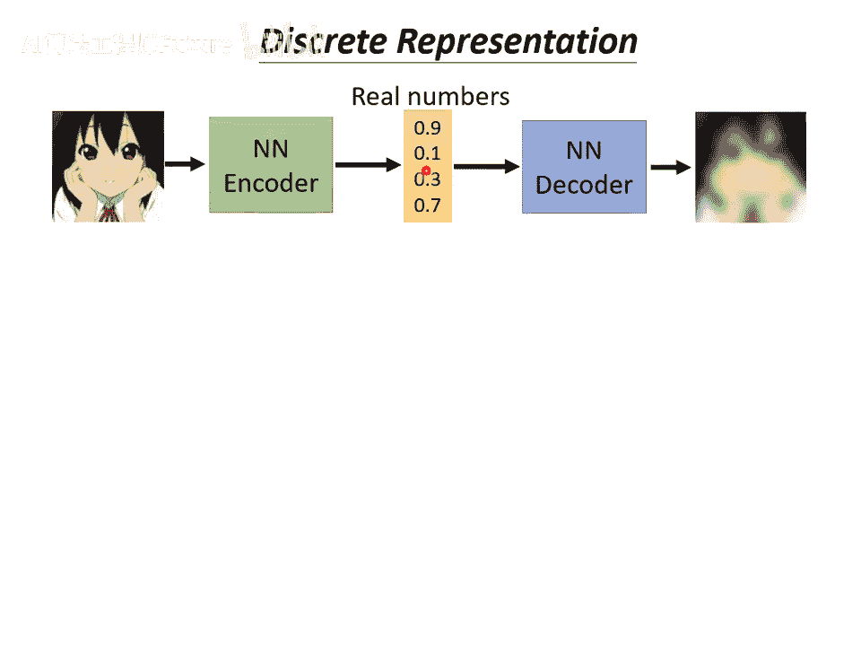

举例来说它可不可以是binary，那binary有什么好处呢，binary的好处，也许是说每一个维度它就代表了某种特征的，有或者是没有，举例来说，输的这张图片，如果是女生，可能第一位就是一男生。

第一位就是零，如果有戴眼镜，就是第三维是一，没有戴眼镜就是第三维是零，也许我们把这个向量这个embedding变成binary的，变成只有零跟一的数字，可以让我们在解释encoder的输出的时候。

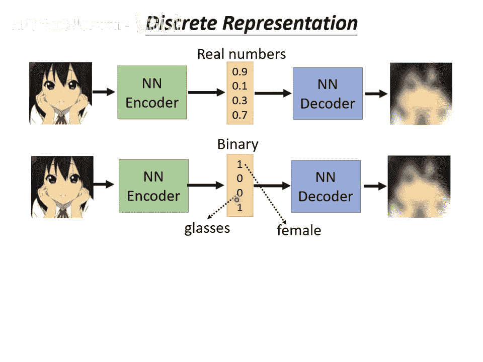

更为容易，甚至有没有可能，这个向量强迫他一定要是one heart呢，也就只有一维是一，其他就是零，如果我们强迫它是one tab，也就是每一个东西图片丢进去，你只可以有你的embedding面。

只可以有一维是一，其他都是零的话，那可以做到什么样的效果呢，也许可以做到on supervised的分类，举例来说，假设你有一大堆的，假设你想要做那个手写数字辨识，你有0~9的图片。

你把0~9的图片统统收集起来，圈一个这样子的auto encoder，然后强迫中间的later representation，强迫中间的这个这个code啊，一定要是one tap factor。

那你这个code正好设个十维，也许每一个one hard code，所以这十位就有十个词种，可能的one hard code，也许每一种one hard code正好就对应到一个数字，也说不定的哦。

所以今天如果用one hard的vector，来当做你的embedding的话，也许就可以做到，完全在没有完全没有label data的情况下，让机器自动学会分类，其实还有其他呃。

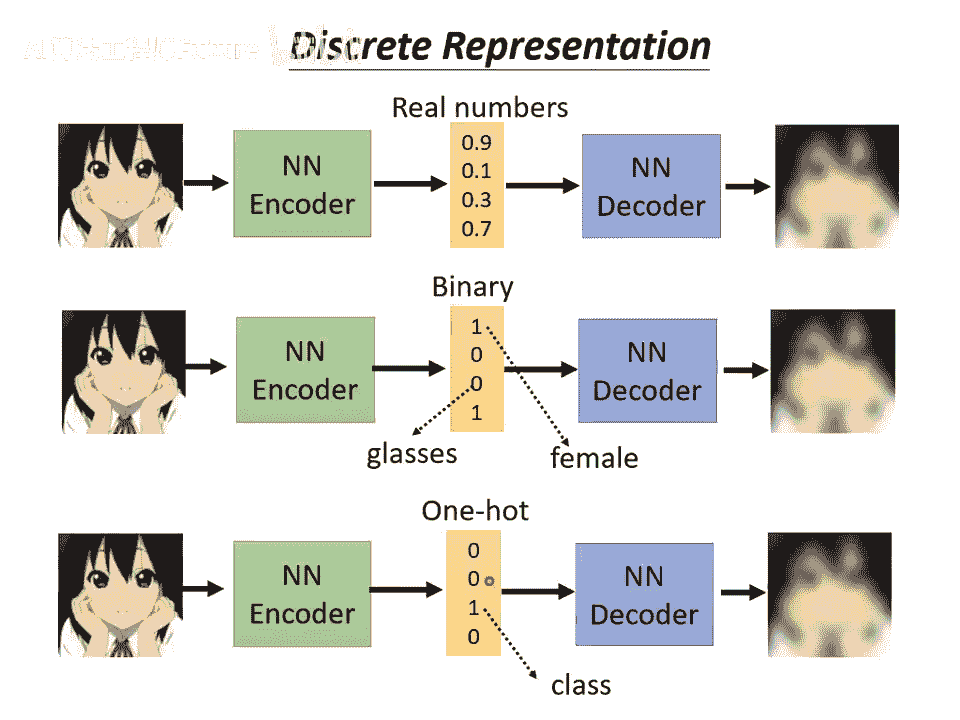

在这种呃discrete representation的这个呃，这技术里面呢，其中最知名的就是v q v a e vector，cortex的variable auto encoder。

那VQVAE啊是这样子运作的啊。

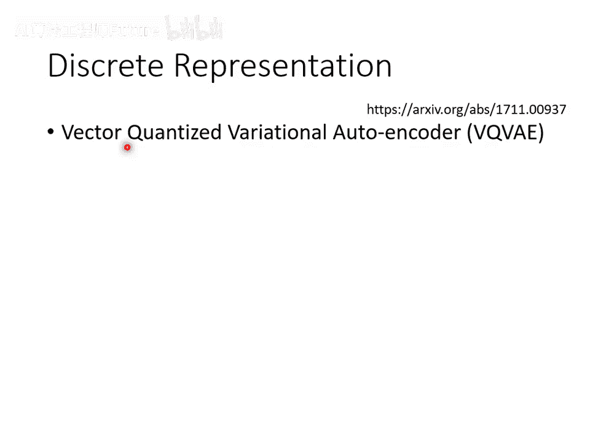

就是你输入一张图片，encoder呢输出一个向量，这个向量它是一般的向量，它是continues的，但接下来你有一个cookbook，所谓COBOOK的意思就是你有一排向量，这排向量也是认出来的。

你把encoder的输出去，跟这排向量呢都去算个相似度，哎你可以想这对于周期算的相似度，那你发现这件事情呢其实跟self attention有点像，对不对，这个vector就是query。

这些vector就是T对不对，就是跟那个attention是很像的，我们在讲self attention的时候，花了很多力气讲query key跟value。

所以这个东西就是query这个东西就是key，那接下来呢就看这些vector里面谁的相似度最大，那你把相似度最大那个vector拿出来，这边就是那个这个这个key跟那个value。

是等于是共用同一个vector啊，如果你把这整个PONS用叫attention来比喻的话。

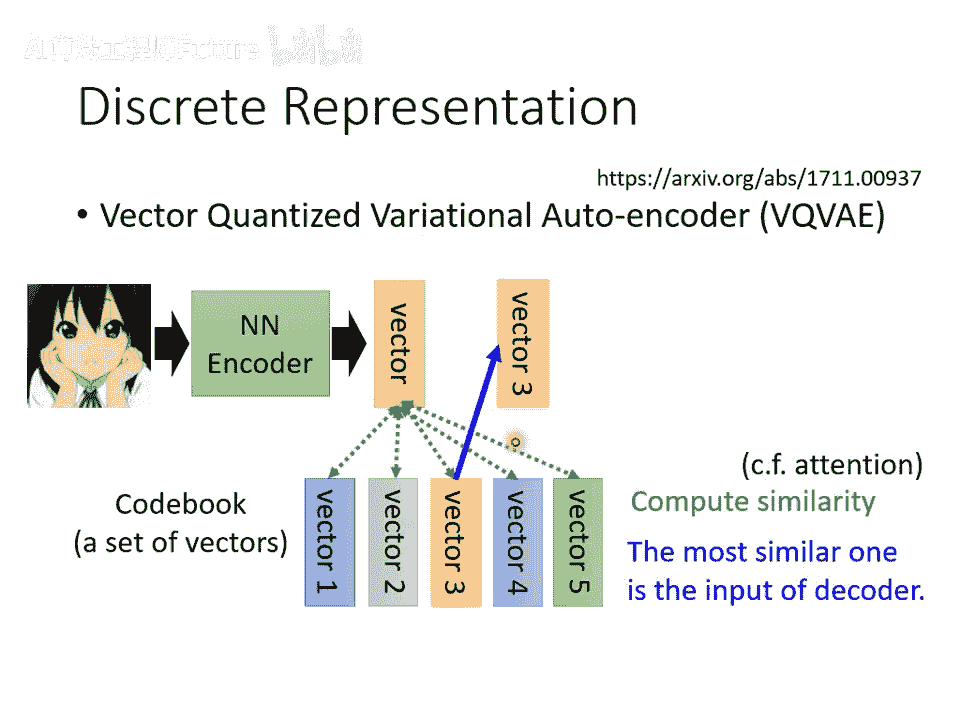

那就等于是key跟value是共同的vector，然后把这个vector呢丢到decoder里面，然后要他输出一张图片，然后接下来training的时候，就是要让输入跟输出越接近越好。

这个decoder这个encoder，这一个COBOOK都是一起从资料里面被学出来的啊，这样做的好处就是你就可以，你就有discrete这个later representation。

也就是说这边in decoder的输入，一定是这边这个cookbook里面的向量的其中一个，假设你COBOOK里面有32个向量，那你decoder的输入就只有32种。

可能你等于就是让你的这个embedded，它是离散的，它没有无穷无尽的可能，它只有32种可能而已，那其实像这样子的技术啊，如果你拿它把它用在语音上啊，你就是一段声音讯号输进来。

通过encoder以后产生一个向量，接下来呢你去计算这个相似度，把最像那个向量拿出来，丢给decoder，再输出一样的声音讯号，这个时候你会发现说你的cookbook啊，可能可以学到最基本的发音单位。

举例来说，你的空这个最基本的发音单位啊，又叫做ping，那如果你不知道封面是什么的话，你就把它想成是KK音标好，那你就会发现说这个cookbook里面每一个vector，它就对应到某一个发音。

就对应到KK音标里面的某一个符号啊。

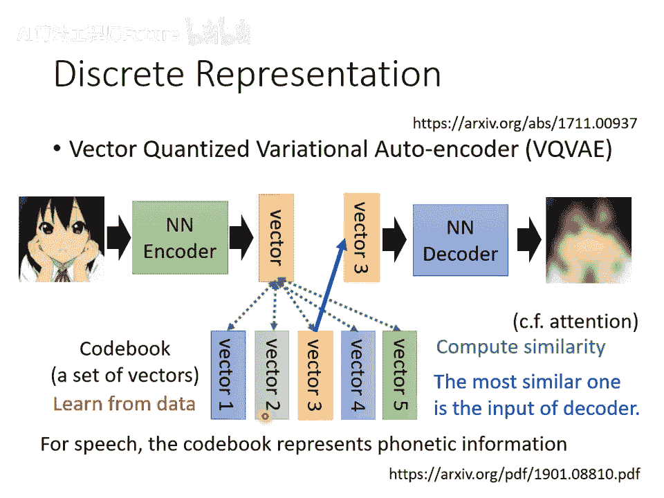

这个是VQVA1，那其实还有更多疯狂的想法，representation一定要是向量吗，能不能是别的东西，举例来说它能不能是一段文字是可以的，举例来说，假设我们现在要做文字的auto encoder。

那文字的auto encoder概念跟语音的影像的，没有什么不同啊，就是你有一个encoder，一篇文章丢进去，也许产生一个什么东西，一个向量把这个向量丢到decoder，再让它还原原来的文章。

但我们现在可不可以，不要用向量来当做embedding，我们可不可以说我们的embedding就是串文字呢，如果把embedding变成一串文字有什么好处呢，也许这串文字就是文章的摘要，因为你想想看。

把一篇文章丢到encoder里面，它输出一串文字，而这串文字可以透过decoder还原回原来的文章，那代表说这段文字是这篇文章的精华，也就是这篇文章最关键的内容，也就是这篇文章的摘殃。

不过啊这边的encoder显然需要是一个sequence to，Sequence the model，比如说transformer，因为我们这边输入是文章嘛，他这边输出是一串文字嘛。

啊这个decoder输入是一串文字，输出是文章嘛，所以都是输入一串东西，输出一串东西，输入一串文字，输出一串文字，所以encoder和decoder显然都必须要是一个。

Sequence to sequence model，所以可以想象说，这边是一个你作业五在训练的transformer，这个也是另外一个transformer，他们都是读一段文字，输出另外一段文字。

所以这整个auto encoder合起来呀，它不是一个普通的auto encoder，它是一个sequence to sequence to sequence的auto encoder。

他把长的sequence转成短的sequence，再把短的sequence还原回长的sequence。

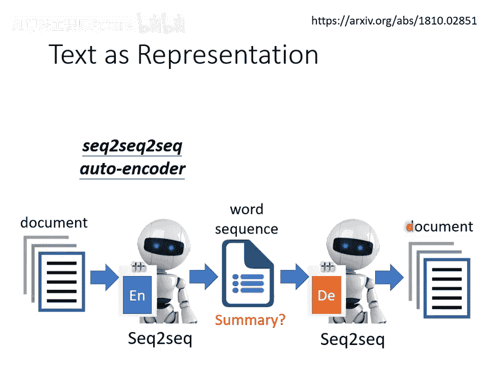

而这个auto encoder在训练的时候，不需要标注的资料，因为训练auto encoder只需要收集大量的文章，收集大量没有标注的资料，在这边就是大量的文章就可以了，如果你真的可以训练出这个模型。

如果这串文字真的可以代表摘要的话，你就是让机器自动学会做摘要这件事，让机器自动学会做unsupervised summarization，但是真的有这么容易吗，实际上这样劝起来以后发现嗯是行不通的。

为什么，因为这两个encoder和decoder之间，会发明自己的暗号啊，所以它会产生一段文字，但这段文字是你看不懂的，你看不懂的文字，这decoder可以看得懂，它还原的了原来的文章，但是人看不懂。

所以他根本就不是一段摘要。

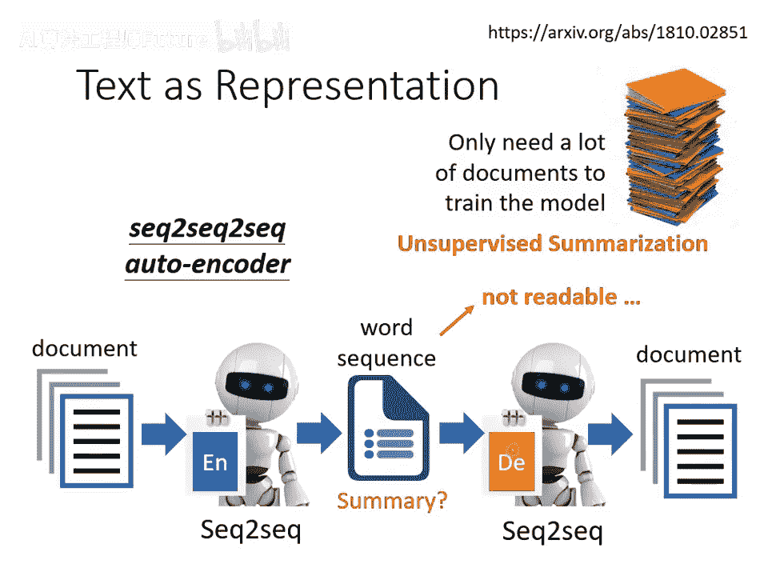

所以怎么办呢，再用game的概念加上一个discriminator，discriminator看过人写的句子，所以他知道人写的句子长什么样子，但这些句子不需要是这些文章的材料，就是另外一堆句子。

所以他知道人写的句子长什么样子。

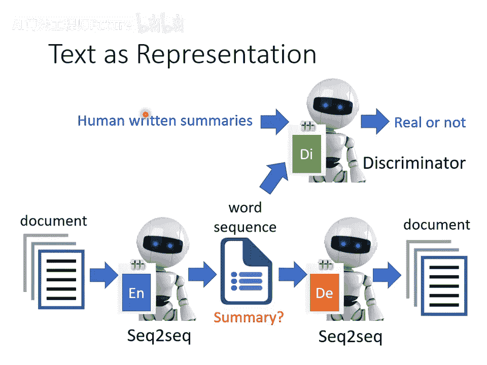

然后呢这个encoder要想办法去骗过discriminator，encoder要想办法产生一段句子，这段句子不止可以透过decoder，还原回原来的文章。

还要是discriminator觉得像是人写的句子，期待透过这个方法就可以强迫encoder，不止产生一段密码，可以给decoder去破解，而是产生一段人看得懂的灾要。

那你可能会问说这个network怎么train啊，这个这个output是一串文字哦，那这个文字要怎么接，给discriminator跟这个decoder呢，告诉你看到你没办法劝的问题，就用RL硬做。

这样这边就是用RL硬做就结束了，这样好，所以这个NEO后来映衬起来以后呢，呃你可为你这，你可能会觉得这个概念有点像cycle game，没错，你可以想这根本就是cycle game。

就这是一个generator，这是另外一个generator，这是discriminator，然后输入跟输出越接近越好，其实这根本就是cyle game。

我们只是从auto encoder的的的角度来看待。

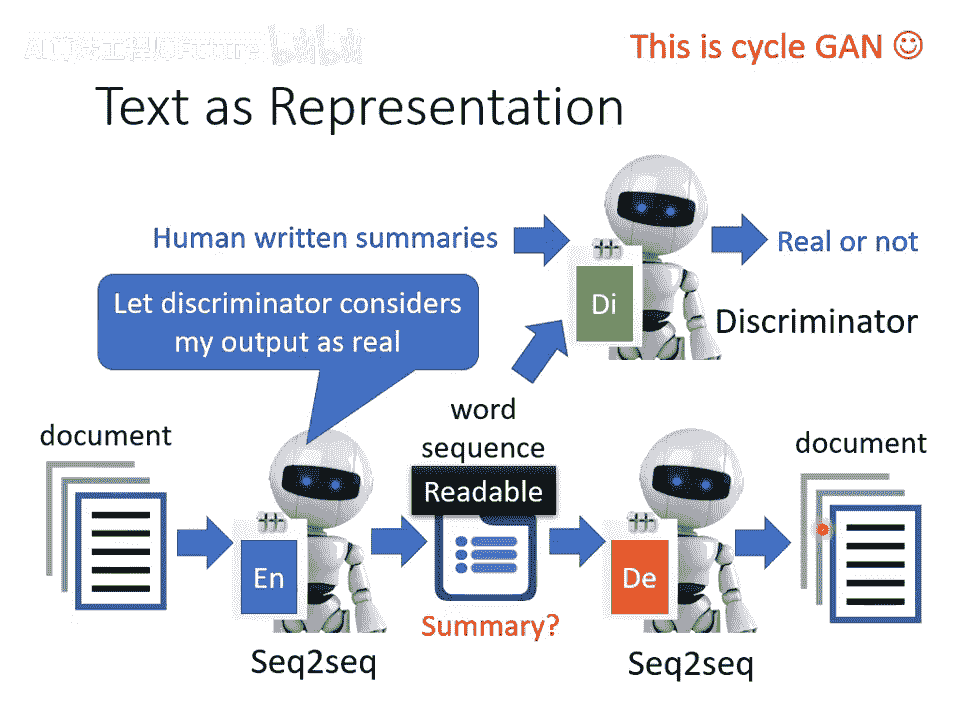

cycle game这个想法而已好，那实际上做的结果是怎么样呢，以下是真正network输出的结果了。

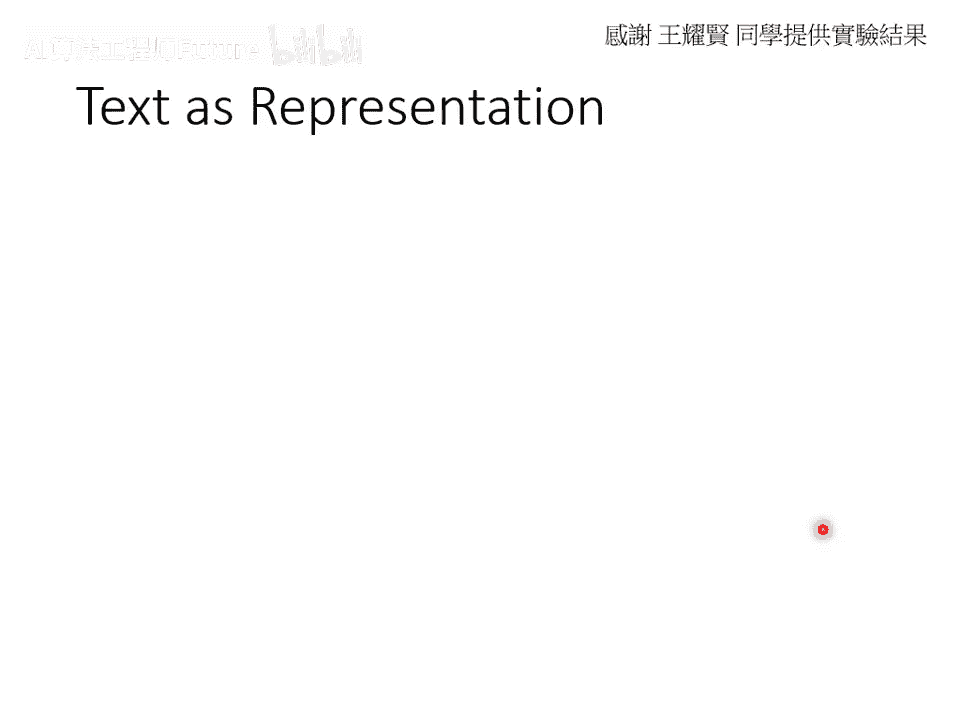

你给他读一篇文章，然后他就用auto encoder方法呃，拿300万篇文章做训练以后，然后看看给他一篇新的文章，它可不可以是那个encoder输出的句子，是不是就是人可以看得懂的，摘要举例来说。

给encoder看这篇文章，他的输出是澳大利亚。

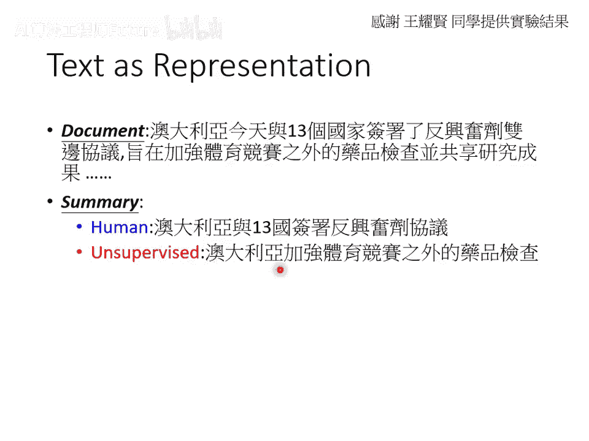

加强体育竞赛之外的药品检查，看起来还可以，那这边有一个特别强的啦，今天接到1992年冬季奥运会邀请函，丢给encoder之后，它的输出是奥委会接获冬季奥运会邀请他啊。

他知道把奥林匹克委员会自己就缩写成奥委会，这个不知道怎么回事，他自己就学到了这件事情，当然很多时候他也是会犯错的啊。

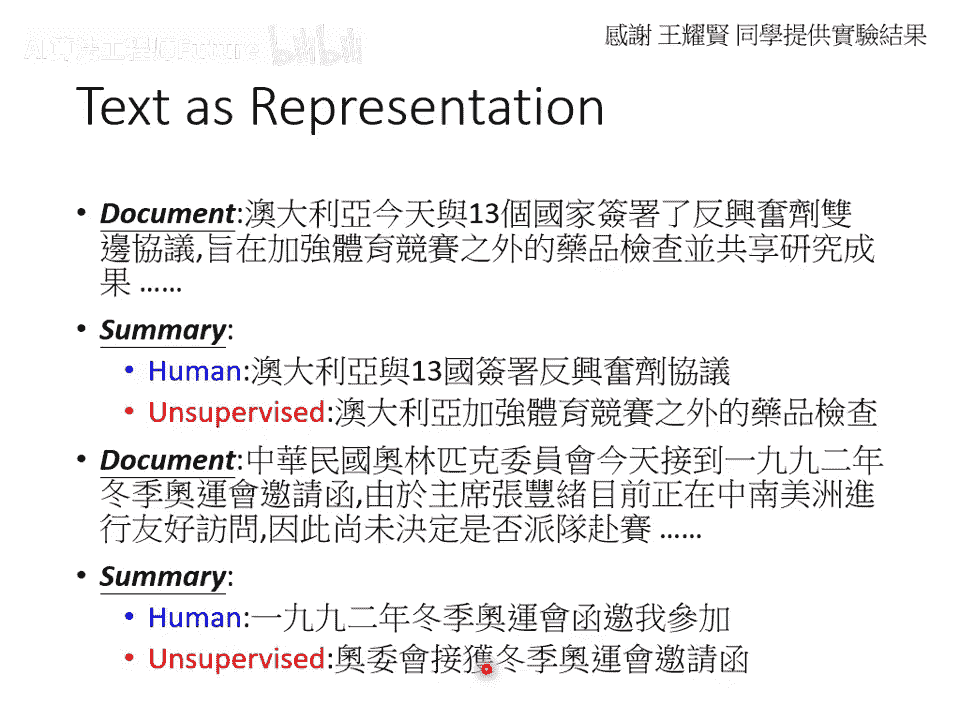

我特别喜欢举这种极其犯错的例子，举例来说，你给他读这篇文章，印度尼西亚苏门答腊岛近日来连降暴雨，机器产生的摘要是什么呢，encoder的输出是印尼门，洪水泛滥，印尼门是什么东西呢。

大概就是印度尼西亚苏门的缩写啦，可能人类写的句子里面常常出现罗生门，通二门等等什么门，所以机器觉得encoder觉得印度尼西亚苏门，应该可以缩写成印尼门，那有时候它也会产生莫名其妙的句子啊。

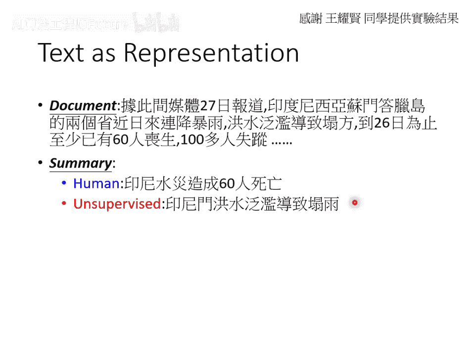

比如说把这篇文章给机器读了以后，encoder的输出是合肥领导干部下基层作稿，迎来送往，规定一律解决，不知道在说些什么，总之是个句子，不知道在说些什么好，所以这个例子只是想要告诉你说。

我们确实有可能哪一段文字来当做embedding。

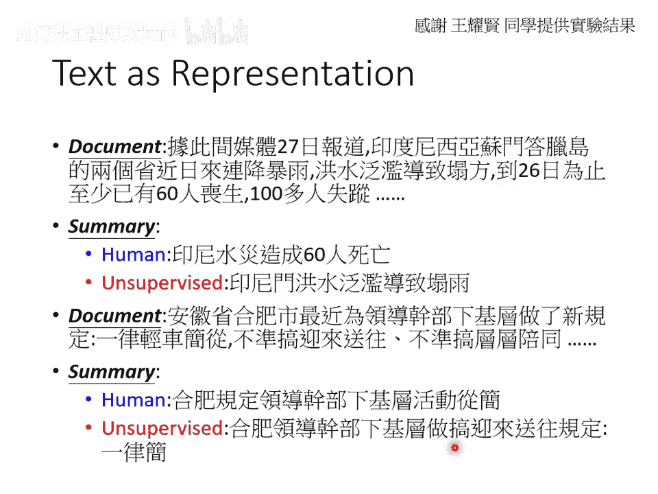

其实还有更狂的，我还看过有拿trees structure当做embedding，就一段文字把它变成trees structure，再用trace structure还原一段文字。

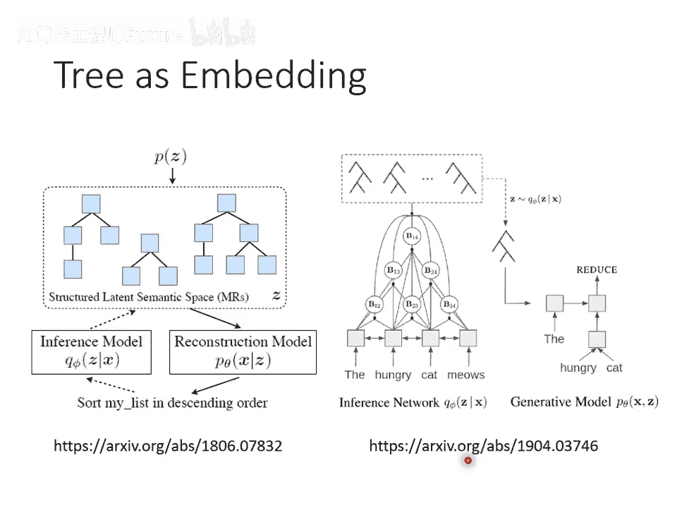

好，我把reference列在这边，给大家参考好。

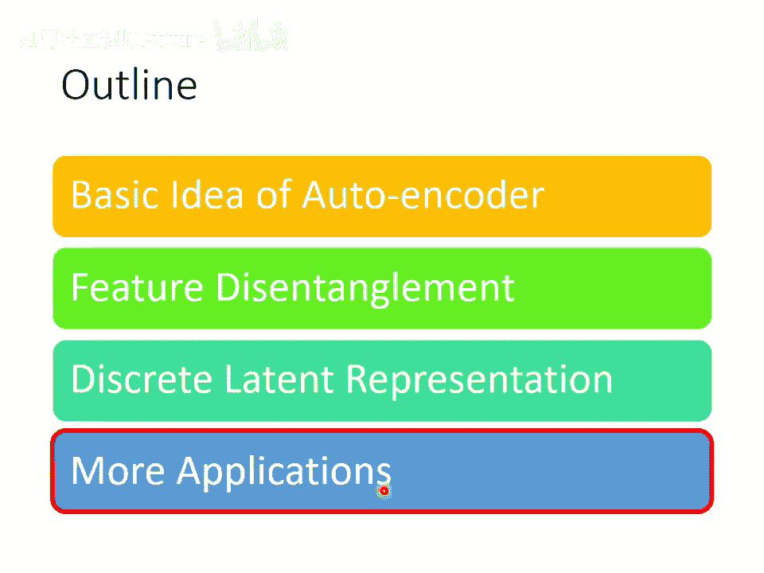

接下来啊还有auto encoder，更多的应用，auto encoder还可以拿来做些什么事情呢，举例来说，我们刚才用的都是encoder，那其实decoder也有作用，你把decoder拿出来。

这不就是一个generator吗，我们说generator不是就是要吃一个向量，产生一个东西，比如说一张图片吗，而decoder不正好是七个向量产生一张图片吗。

所以decoder你可以把它当做一个generator来使用，你可以从一个已知的distribution，比如说高选distribution sample个向量丢给decoder。

看看他能不能够输出一张图片，事实上在我们之前在讲这个generative model的时候，其实有提到说除了game以外，还有另外两种generative的model。

其中一个就叫做VAEVARIATIONAL的auto encoder，你看他名字里面都有auto encoder，显然是aun auto encoder非常有关系的。

那它其实就是把auto encoder的decoder拿出来，当做generator来用，但实际上他还有做一些其他的事情呢，至于他实际上做了什么，其他的事情就留给大家自己研究好。

所以auto encoder劝完以后，你也顺便得到了一个decoder。

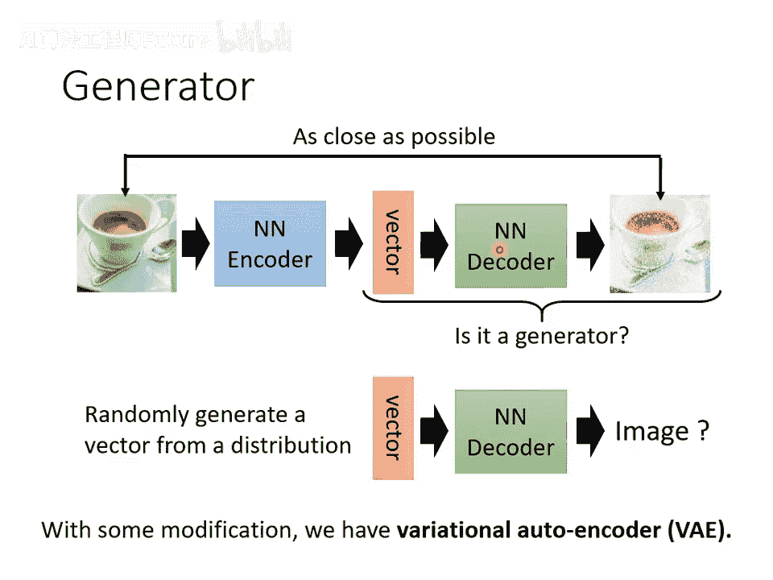

auto encoder可以拿来做压缩，我们今天知道说我们在做图片，我们图片如果太大的话，也会有一些压缩的方法，比如说JPEG的压缩，而auto encoder也可以拿来做压缩。

你完全可以把encoder的输出，当做是一个压缩的结果，因为一张图片是一个非常高维的向量，而一般我们encoder的输出，是一个非常低维的向量，你完全可以把那个向量看做是一个压缩的结果。

所以你的encoder做的事情就是压缩，而你的decoder做的事情就是解压缩，那只是这个压缩啊，他是那种LUCY的压缩和LUCY的压缩，就是它会失真，因为在train auto encoder的时候。

你没有办法劝到说输入的图片跟输出的图片，100percent完全一模一样了，它还是会有一些差距的，所以这样子的auto encoder的压缩技术，你拿这样的技术来做压缩，那你的图片是会失真的啊。

就跟JPG图片会失真一样啊，用这个auto encoder来做压缩。

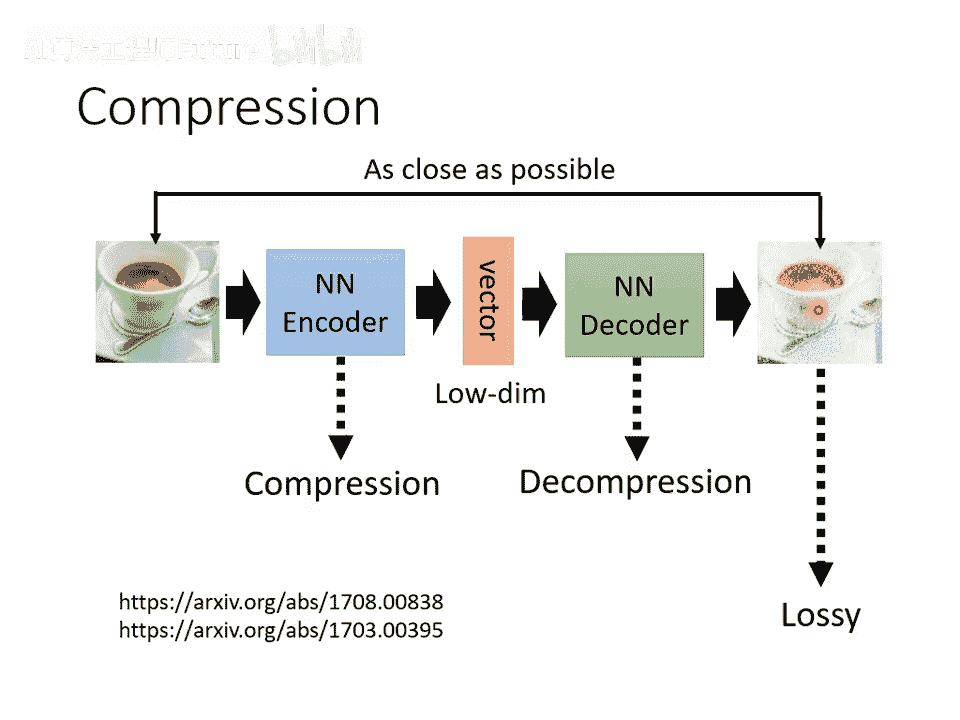

你的图片也是会失真的好，那接下来就是我们在作业里面要使用的技术，在作业里面，我们会拿auto encoder来做normally的detection，那我在规划作业的时候。

其实就是想要auto encoder出一个作业，那auto encoder的技术很多，那最后我决定做ANONYY的detection，因为这个是你在非常多的场合，都有机会应用到的一个呃技术好。

anonyy detection要做的是什么呢，他要做的事情就是假设你有一堆的训练资料，这边用x1到XN来表示我们的训练资料，而annomon anonyy detection。

它的中文通常翻译成异常检测，异常检测要做的事情就是来了一笔新的资料，他到底跟我们之前在训练资料里面看过的资料，相不相似呢，也就是说你需要找出，你需要有一个异常检测的系统，这个异常检测的系统。

是透过大量你已经看过的资料训练出来的，给他一笔新的资料，如果这笔新的资料，看起来像是训练资料里面的data。

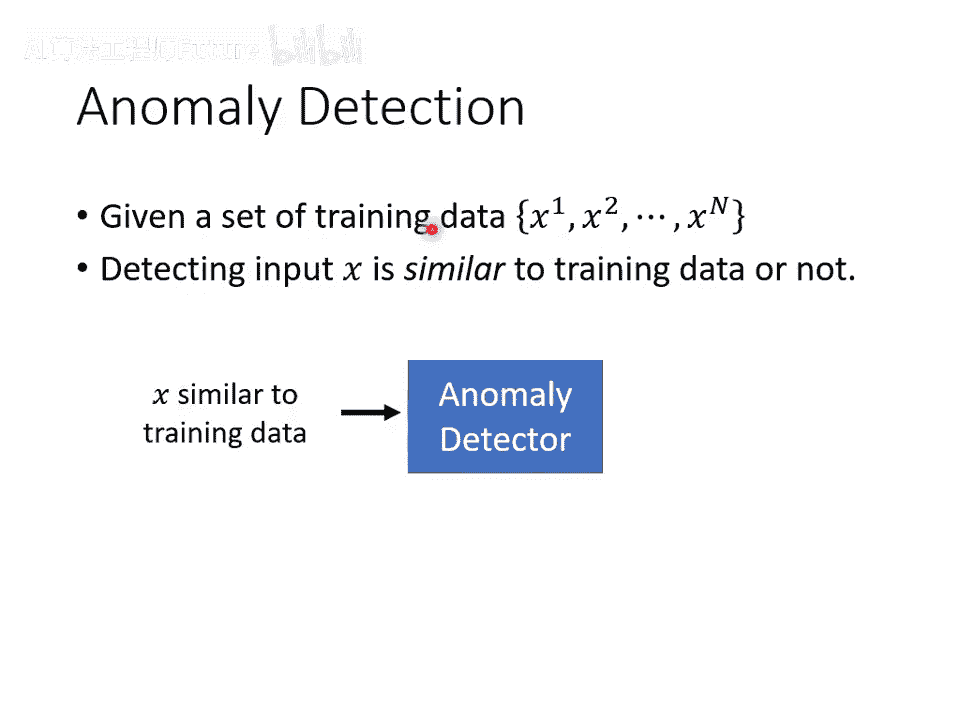

就说它是正常的，如果看起来不像是训练资料里面的data，就说它是异常的，那其实anomaly ananomaly这个词啊，有很多不同的其他的称呼，比如说有时候你会叫它outlier。

有时候你会叫它novelty，有时候你会叫它exception，但其实指的都是同样的事情，你就是要看某一笔新的资料，它跟之前看过的资料到底相不相似，但是所谓的相似这件事啊，其实并没有非常明确的定义。

它是见仁见智的，会根据你的应用情境而有所不同。

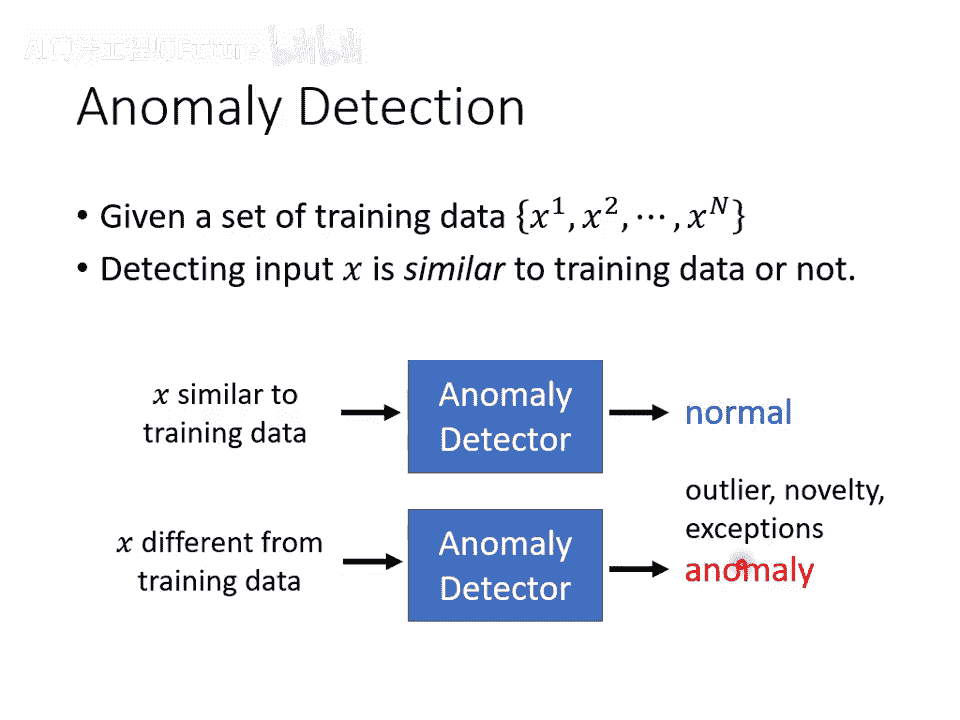

举例来说，假设现在你的训练资料，这个都是雷丘啊，那这个皮卡丘就算是异常的东西，但是假设你的训练资料里面，你所有的动物都是皮卡丘，那雷丘就是异常的东西，所以我们并不会说某一个东西，它一定就是normal。

一定就是a normally，我们不会说某个东西它一定是正常或异常，它是正常或异常，取决于你的训练资料长什么样子，或者是说假设你的训练资料里面，通通都是宝可梦，那雷丘跟皮卡丘通通都算是正常的。

而可能数码宝贝亚古兽，这个知道吗，这应该是亚古兽。

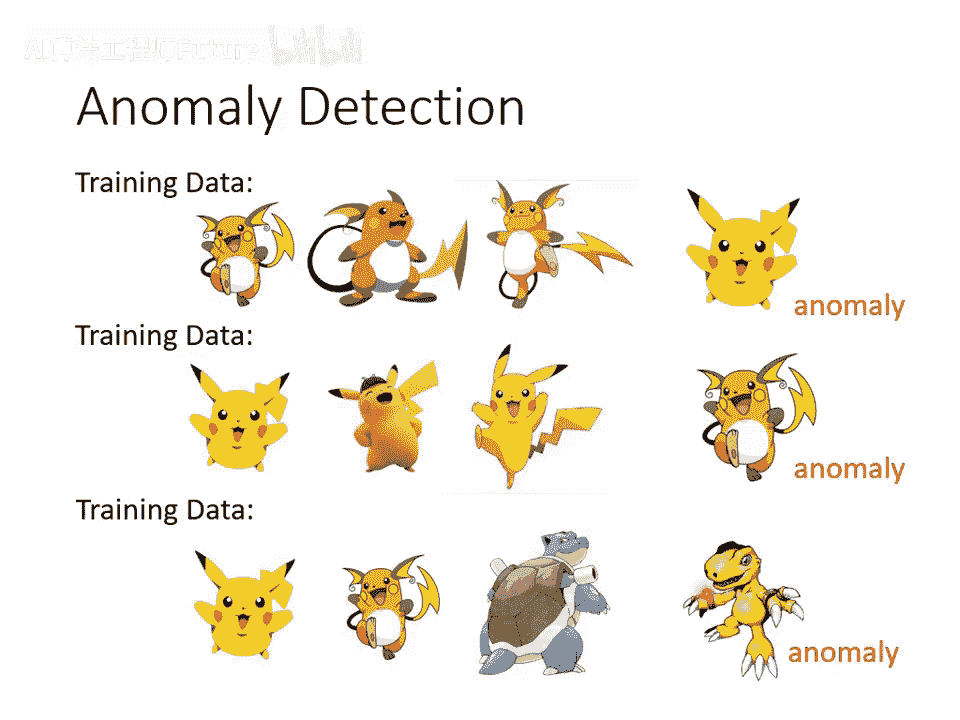

对不对，亚古兽算是异常的好，那怎么是那个这个异常检测有什么样的应用呢，举例来说，他可以来做诈期侦测，假设你的训练资料，里面有一大堆信用卡的交易记录，那我们可以想象说，多数信用卡的交易都是正常的。

那你拿这些正常的应用卡训练的交易记录，来训练一个异常检测的模型，那有一笔新的交易记录进来，你就可以让机器帮你判断说，这笔记录算是正常的还是异常的，所以这种异常检测的技术可以拿来做诈欺增程。

或者是它可以拿来做网络的这个侵入政策，举例来说，你有很多连线的记录资料，那你相信多数人连到你的网站的时候，他的行为都是正常的，多数人都是好人，收集到一大堆正常的连线的记录，那接下来有一笔新的记连线进来。

你可以根据过去正常的连线，训练出一个异常检测的模型，看看新的连线，它是正常的连线还是异常的连线，它是有攻击性的还是正常的连线，或者是他在医学上也可能有应用，你收集到一大堆正常细胞的资料。

拿来训练一个异常检测的模型，那也许看到一个新的细胞，它可以知道这个细胞有没有突变，也许有突变，它就是一个癌细胞等等，那讲到这边有人可能会想说，anonyy detection异常检测的问题。

我们能不能够把它当做一个二元分类的问题，来看呢，你说你要做诈期政策，你就收集一大堆正常的信用卡记录，一堆诈期的信用卡记录，训练一个binary的classifier就结束啦，就这样子不是吗。

比较难点就是你要搜资料，但是这种异常检测的问题，它的难点正在于就在收资料上面，通常你比较有办法收集到正常的资料，你比较不容易收集到异常的资料，你可能有一大堆信用卡交易的记录。

但是多数信用卡交易的记录可能都是正常的，异常的资料相较于正常的资料可能非常的少，甚至有一些异常的资料混在正常的里面，你也不太可，你可能也完全没有办法侦测出来，所以在这种异常检测的问题里面。

我们往往假设我们有一大堆正常的资料，但我们几乎没有异常的资料，所以他不是一个一般的分类的问题，这种分类的问题又叫做one class的分类问题，就是我们只有一个类别的资料，那你怎么训练一个模型。

只因为因为你想你要训练一个分类器，你得有两个类别的资料，你才能训练分类器啊，如果只有一个类别的资料，那我们可以训练什么东西，这个时候就是auto encoder。

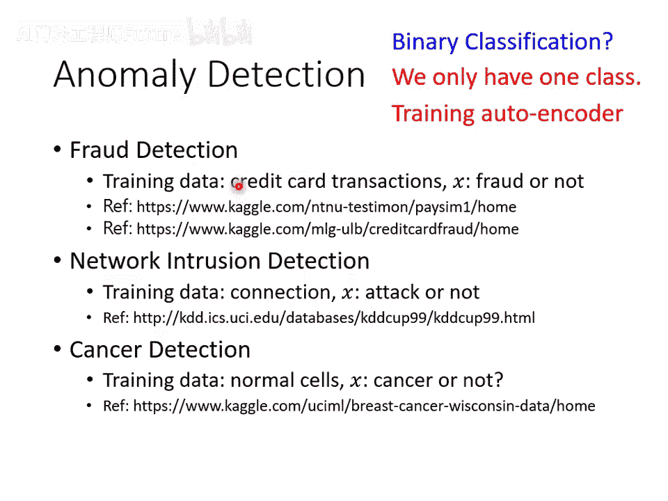

可以派得上用场的时候了，举例来说，假设我们现在想要做一个系统，这个系统是要侦测说一张图片，这举例来说他是不是真人的人脸，那你可以找到一大堆图片。

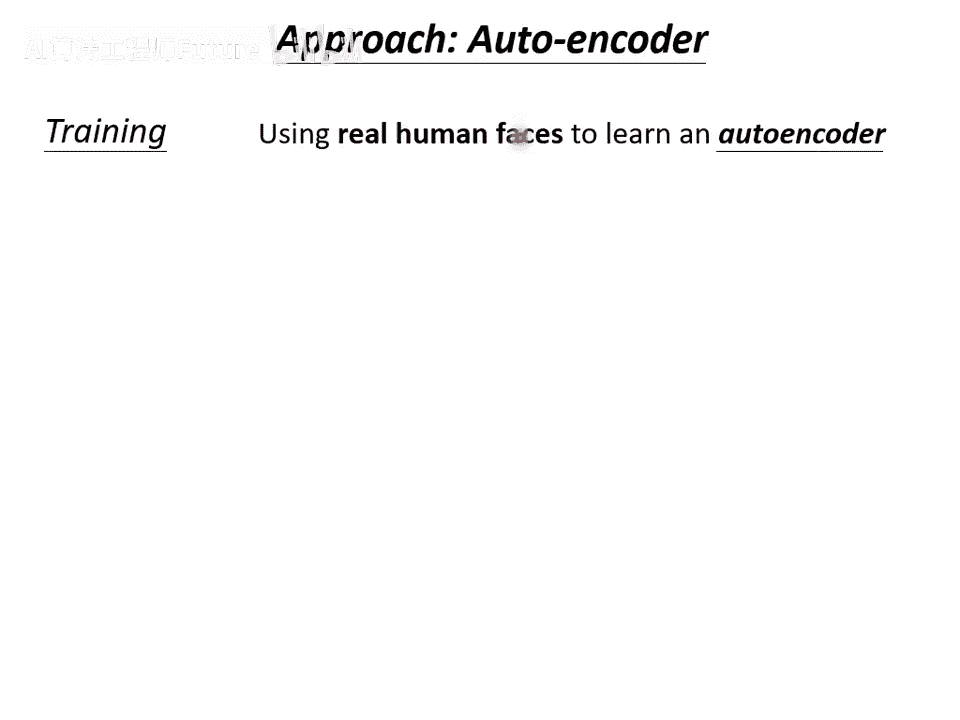

他都是真人的人脸，那我们就拿这些真人的人脸，来训练一个auto encoder啊，举例来说，这个是你老婆的照片，对你可以在我从聊天室可以，我老婆请测照，哎啊这是你老婆的照片。

那你可以拿它来训练一个auto encoder，那你训练完这个auto encoder以后。

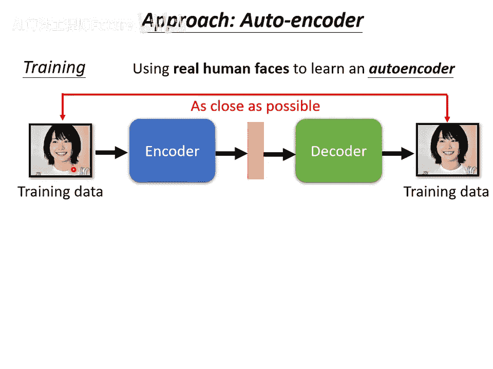

在测试的时候，如果进来的也是你老婆的照片。

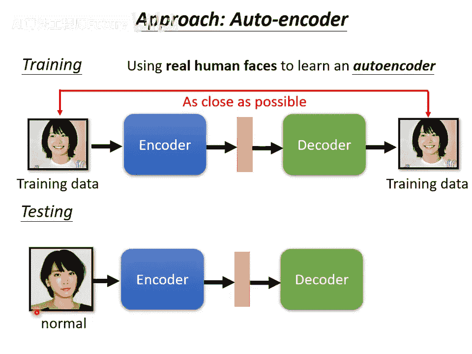

那因为在训练的时候有看过这样的照片，所以他可以顺利的被还原回来，你可以计算这张照片通过encoder，再通过decoder以后，他的变化有多大，你可以去计算这个输入的照片。

跟这个输出的照片它们的差异有多大，如果差异很小，你的decoder可以顺利的还原原来的照片，代表这样类型的照片是在训练的时候有看过的。

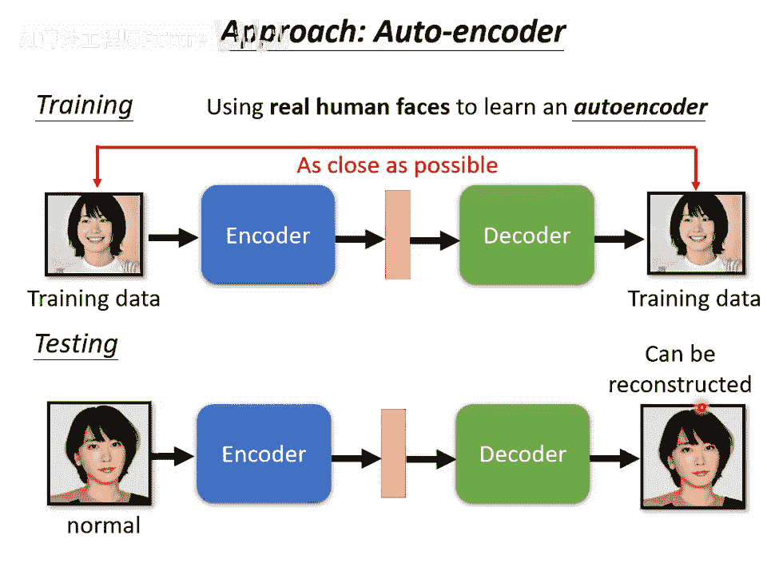

不过反过来说，假设有一张照片是训练的时候没有看过的，举例来说，这根本不是人的照，这个他是人吗，他是团长团长，他是那个凉宫春日，但是他不是真人，他是一个动画的人物，他是二次元的人物。

一个二次人员人物的照片，输入encoder。

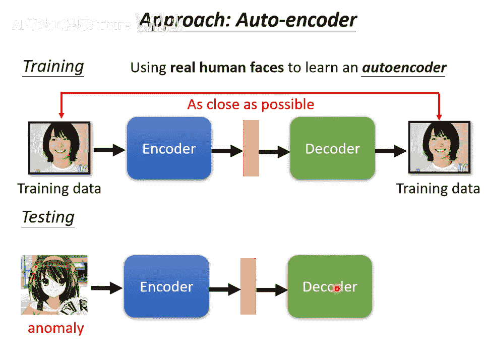

在输出decoder以后，因为这是没有看过的东西，这是训练的时候没有看过的照片，那你的decoder就很难把它还原回来，如果你计算输入跟输出的差异，发现差异非常的大，那就代表说现在输入给encoder。

这张照片可能是一个异常的状况，可能是训练的时候没有看过的状况，所以你就可以看reconstruction的north，这个这个reconstruction的好坏，来决定说你现在在测试的时候看到这张照片。

是不是训练的时候有看过同类型的照片啊，这个就是我们，啊喂喂喂，好。

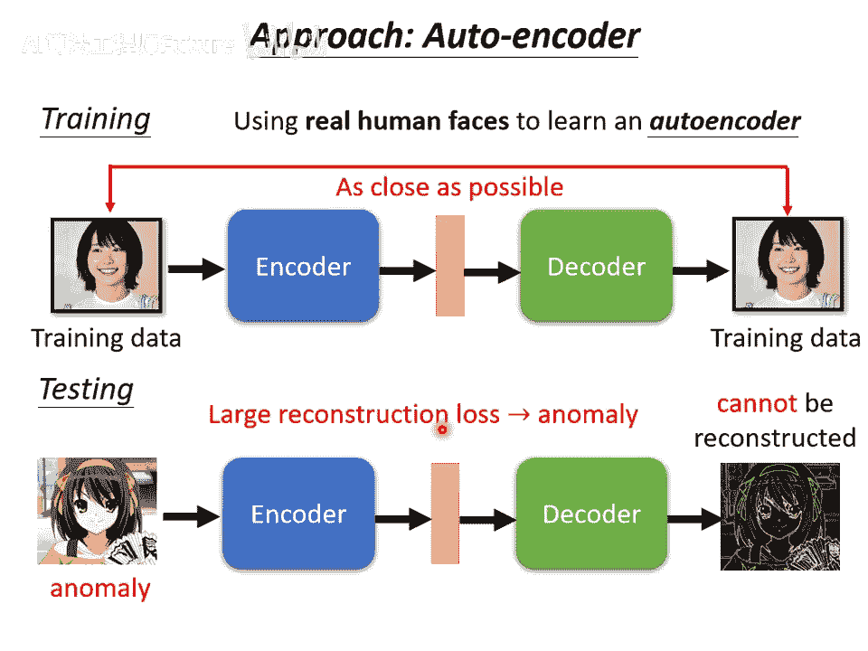

那这个就是我们在作业里面要大家做的事情啦，好那这个异常检测啊，其实也是另外一门学问，那么课堂上就没有时间讲了，异常检测不是只能用auto encoder这个技术，auto encoder这个技术。

只是众多可能方法里面的其中一个，我们拿它来当做auto encoder作业，因为我相信你未来有很多机会用得上，异常检测这个技术，那实际上有关异常检测更完整的介绍，我们把过去上课的录影放在这边给大家参考。

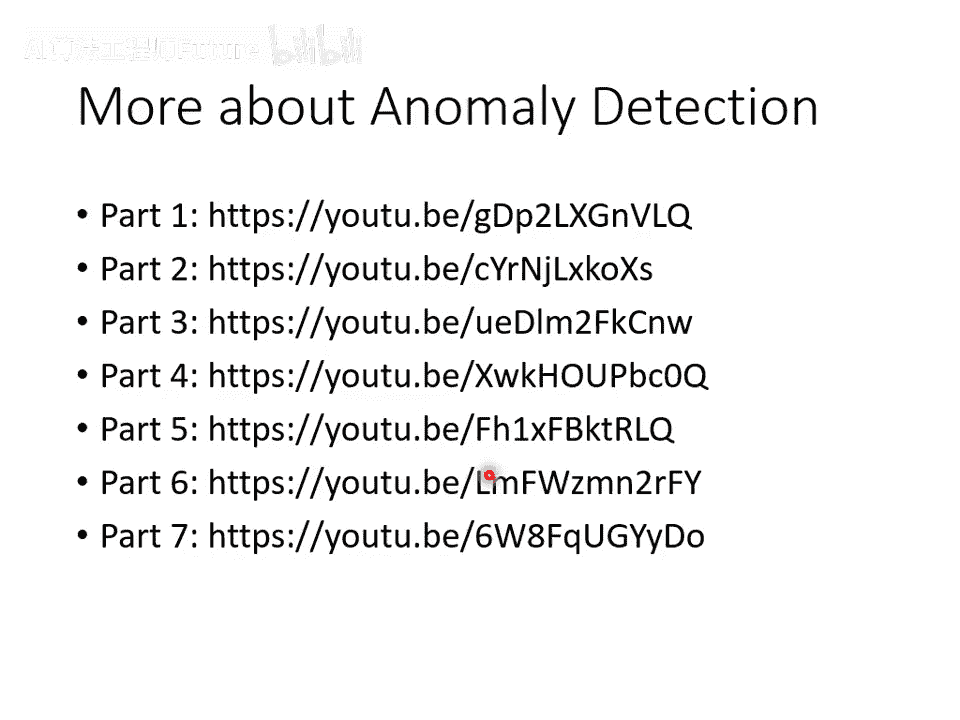

好那以上就是有关auto encoder的部分，在我们请助教来讲作业之前，我们看一下大家有没有问题想要问的诶，大家有问题想要问吗，没有啊好如果暂时没有问题的话。

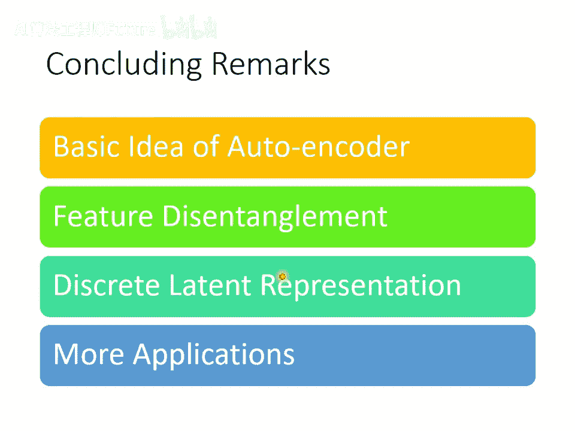