# 【官授搬运】2026年全新优化版李宏毅机器学习系统课程，这才是真正的初学者体系课程！—人工智能／深度学习／神经网络 - P62：3-选修-PCA理论介绍 - AI算法工程师Future - BV1ruqABeEFX

呃我把dimension reduction呢分成两种，那一种呢做的事情呢叫做化繁为简，那呃它可以分成两大类，一种是做clustering，一种是做dimension reduction。

所谓的化繁为简的意思是说呢，你现在有很多种不同的input，比如说呃你现在找一个function，然后它可以input看起来像树的东西，output都是这个抽象的数，也就把本来比较复杂的input。

变成比较简单的好本，那在做unsupervised learning的时候，你通常只会你只会有function的其中一边，比如说我们要找一个方式，它可以把所有的数都变成抽象的数。

但是你所拥有的training data就只有一大堆的image，一大堆的呃，各种不同的image，你不知道说他的output应该要是长什么样子，那另外一个方一。

另外一个这个unsupervised learning，可以做的事情呢是generation，也就是无中生有啊，做的事情是这样，我们要找一个方选，这个方选呢你随机给它一个input。

你比如给他一个random number，要输入一个数字一，然后就output这一棵树哎，输入数字二就OPER，另外一科输入数字三的就OPER，另外科这样。

然后就呃你输入给一个random number number，它就自动的画一张图出来，那输入不同的number给它，它画出来的图呢就不一样，那在这个task里面呢，我们要找的这个可以画图的方式。

你只有这个function的output，但是你没有这个function的input，你就只有一大堆的image，但是你不知道输入什么样的扣子，才可以得到这些image，那在这份投影片呢。

我们先focus在dimension reduction这件事情上，而且我们只focus在linear的dimension。

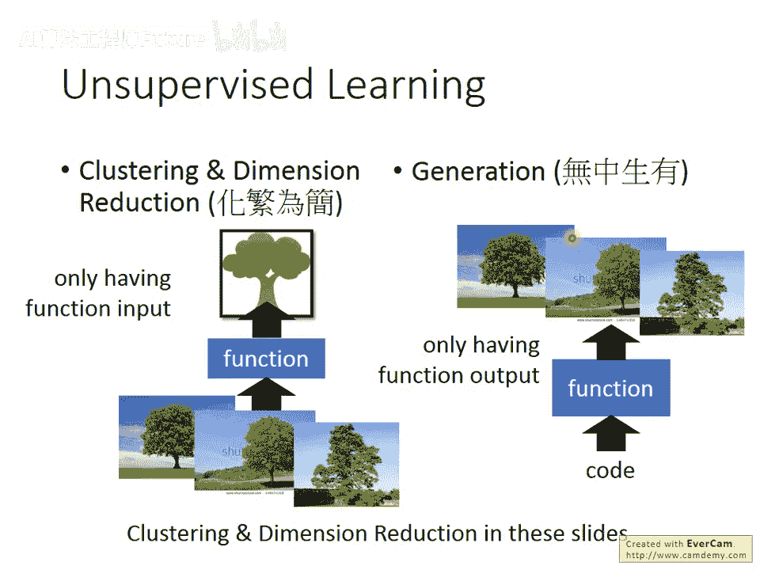

Ary，Dimension reduction，好，那我们先来说一下clustering啊，什么是caster呢，casting就是说呃这个太直觉了，其实也没什么好指，这个地方比较没有什么特别好讲。

就是有一大堆的image啊，假设我们现在要做image classy啊，就一大堆image，然后你就把它们分成了一类一类一类的，那接之后呢有人之后你就可以说哦。

这边所有的image都属于cost the one，这边都属于caster two，这边都属于cos3，就给他们呃贴标签的意思，那这样你就把本来呢有些不同的image，但是都用同一个class来表示。

就可以做到化繁为简这件事情，那这边最critical的问题就是，到底应该要有几个COSER，那这个东西没有什么好的方法，这个就跟neon network要几层一样，是是empirical的。

去决定你需要几个COSTER，那当然不能太多，比如说多到说你有一这边有九张image，你就九个caster，那你干脆就不要做caster就好了，每张image就自己一个caster，就像有做跟没有做。

意思是一样哦，或者是你说哦我全部的image都cluster成，我只有一个cluster，全部image放在很多class里面，但是有做跟没有做一样，但是要怎么选择适当的cluster。

这个你就要empirical的来决定它，我们在class方法里面呢最常用的叫做k means，然后很快讲一下k means是怎么做的啊，k means就是这样，我们有一大堆的这个data啊。

他们都是unlabeled，有一大堆的data x y一直到X大N，那这边每一个X呢它可能就代表一张image，那我要把它做成大K的pass怎么做呢，我们要先呃找这些cast的这个center，Ok。

那假如这边每一个呃object呢，都是用vector来表示的话，这边的这些center呢也是一样长度的vector好，那我们每一个cluster呢都要先找一个center，那有大K的cluster。

我们就需要C1到C大K1个center，那这些center这个初始的center怎么来呢，你可以从你的training data里面，就随机的找大K可object出来，就是你的K个center好。

接下来呢你要呃，对所有在training data里面的X都做以下的事情。

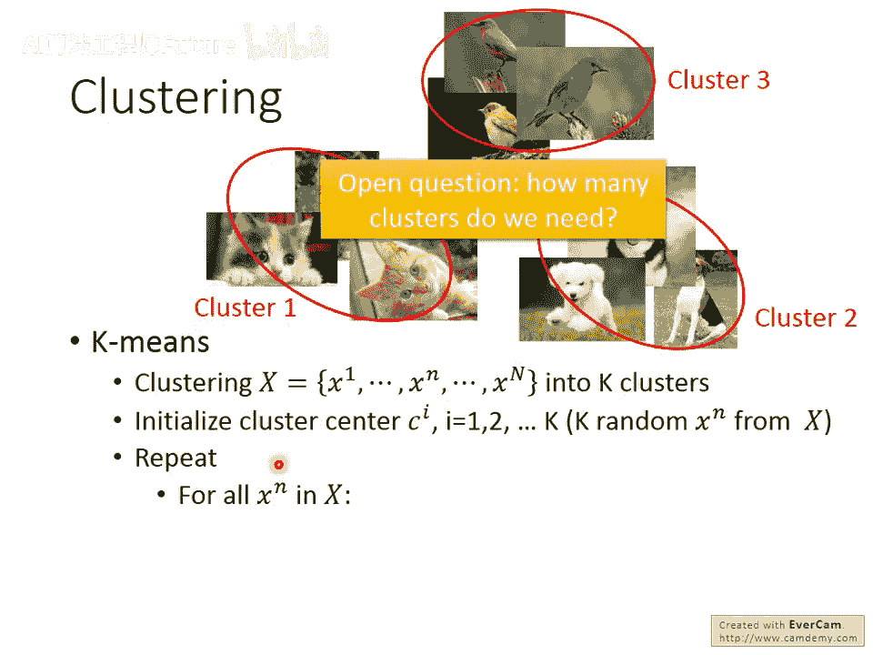

都做什么事情呢，你决定说现在的每一个object，属于一到大K的哪一个cluster，Ok，那那假设呢，现在你的object x n跟某一个cluster的center。

第I个class的center最接近的话，那XN就属于CI，那我们用一个binary的value b上标N，下标I来代表说N这个option，第二个option有没有属于第I个class。

如果第N个object属于d i class的话，那这一个binary value就是一啊，反之呢就是零，接下来呢你要update你的passer，我怎么update你的passer呢。

这个方法呢也是很直觉，你就把所有属于呃，假设你要update第I个cluster center，你就把所有属于第I个cluster的object呢，统统拿出来做平均。

你就得到第I个cluster的这个center，然后呢你要反复的做好，反复的做好，那这边之所以你在做initialize station的时候，你会想要直接从你的这个database里面去挑KER。

Example，挑K个up选出来做center的，有一个很重要的原因是，假设你是纯粹随机的，你不是从data phone里面去挑的，你很有可能在第一次assign这个up after的时候。

就没有任何example，跟某某一个看某一个cluster很像，就没有某没有，你就有可能是有某一个cluster，它没有任何example，你现在update的时候呢。

你城市就会seventation for，所以你最好就是呃，从你的training data里面选k example出出来，当做initialization好。

那呃CATHERING有另外一个方法叫做hierarchical，做mirative passer，那这个方法呢是先建一个建一个trip啊，假设你现在有五个example，你想要把它做cluster。

那先做一个tree structure，怎么建这个tree structure呢，你把这五个example呢2222去算它的相似度，然后挑最相似的那个pair出来，假如现在最相似的pair呢。

是第一个和第二个example，那你就把第一个example和第二个example，merge起来，比如说把他们平均起来得到一个新的vector，这个vector同时代表第一个和第二个example好。

接下来你再算说现在变成有四个example了，现在剩下只剩四笔data了好吧，这四笔data再两两去算它的相似度，然后发现说第三笔和第四笔的，最后这两笔是最下来再把它们merge起来，把它们平均起来。

得到另外一笔data，那现在只剩三笔data，再去两两算它的similarity来发现说黄色，这个看中间这个最像，那就再把它们平均起来来发，最后呢只剩红色跟呃绿色，那就只好把它平均起来。

那就得到这个tree的root哦，对你就根据这五比data它们之间的相似度呢，就建立出一个trees structure，好接下来你要决定一个这样，这样你没有做cluster人。

只是建了一个trees structure，所以这trees structor可以告诉我们说，哪些example呢是比较比较像，就是比较早分支代表比较不像，比如说这三个跟这两个。

一开始在root的地方就分成两类，所以他们这三个和这两个就比较不像好，那接下来你要做passion怎么做呢，你要决定这个在这个在这个树上呢，在这个create structure上面呢切一刀。

比如说你决定切在这边，如果你切在这个地方的时候，那你就把你的五比data a变成三个FASS，根据这一刀呢，这两个example是一个cluster，他自己一个cluster。

这两个example呢是一个caster，那如果你这一刀切在这个地方，那你就变成这三笔是一个cluster，这三笔是一个caster，这两笔一个caster啊，如果你这一刀切在这边。

那你就变成分成总共四个caster，那这个呢是HAC的做法，那HAC跟刚才讲的k means的，我觉得最大的差别就是，你如何决定你的caster的数目，那在k means里面。

你要决定你那个大K的value是多少，那有时候你觉得说我到底有多少pass，我不容易想，那你可以换成HAC，那好处就是，你现在把你现在不直接决定几个passer。

而是决定你要在树上切切在这个数的structure的哪里，那有的人会觉得说呃，呃这样子是有时候你会觉得这样子如此。

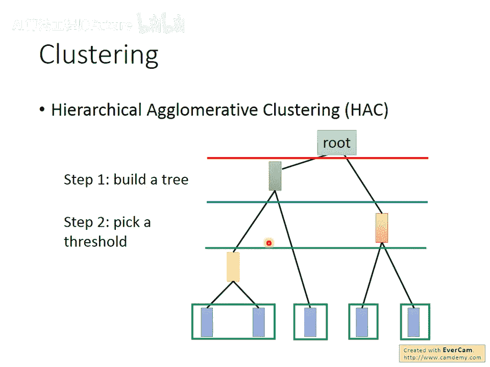

如果你觉得这样子比较容易的话，那HAC对你来说就有一些benefit好。

但是光子做cluster呢是非常卡的，在做cluster的时候，我们就是以偏概全，因为每一个option呢都必须要属于某一个cluster，这个就好像是说，我们知道说念能力有分成六大类，是，然后呢。

每一个人呢都会被ASSIG成六个，念能力里面的其中一类，而怎么决定他是哪一类呢，你就做水箭事，这样子你就是拿一拿一杯水，然后看看他会有什么反应，然后就把它晒成某一类啊，比如说水满出来了，就是强化系。

而是小结呢就是属于强化系，那我知道说这样子把每一个人都asset成，念能力里面的某一个系呢，是呃是不够的，是太过太过粗糙不断，比如说像比斯吉，就有说小杰其实是接近放，接近放出戏的强化系念能力者这样。

所以小结呢如果你只是说他是强化系的，其实是close掉很多information，你应该这样来表示小结，你应该说它是强化系，是0。7，然后放出去是0。25，那其实强化系和变化系是比较接近的。

所以有强化系，其实你也会有一部分的变化系的能力，所以也是是0。05，像小杰可以用剪刀，那个是变化系的，然后其他系的能力是零啊，哦所以你应该要用呃，如果你只是把你手上所有的object。

分别assign到它属于哪一个cluster，这样是以偏概全，量太粗了，你应该要用呃一个vector来表示你的object，那这个vector里面的每一个dimension，就代表了某一种特质。

某一种attribute，那这件事情呢就叫做distributed的，representation哦，那如果你原来的object是一个非常high dimension的东西，比如说image。

那你现在把它用它的呃ATTRIBU完，用它的特质来描述，它，就会从比较高维的空间变成比较低维的空间，那这件事情呢就叫做dimension reduction，那其实是一样的事情，只是有不同的称呼而已。

好那我们从另外一个角度来看一下，为什么dimension reduction是可能是有用的，举例来说呃，假设你的data的分布是长这个样子，好在3D的空间里面。

你现在的data的分布呢是长这个螺旋的样子，但是用3D的空间来描述这些data塔，其实是很浪费的，你从直觉上就会知道说，其实你可以把这个嗯，这个呃类似地毯卷起来的东西呢，把它摊开啊。

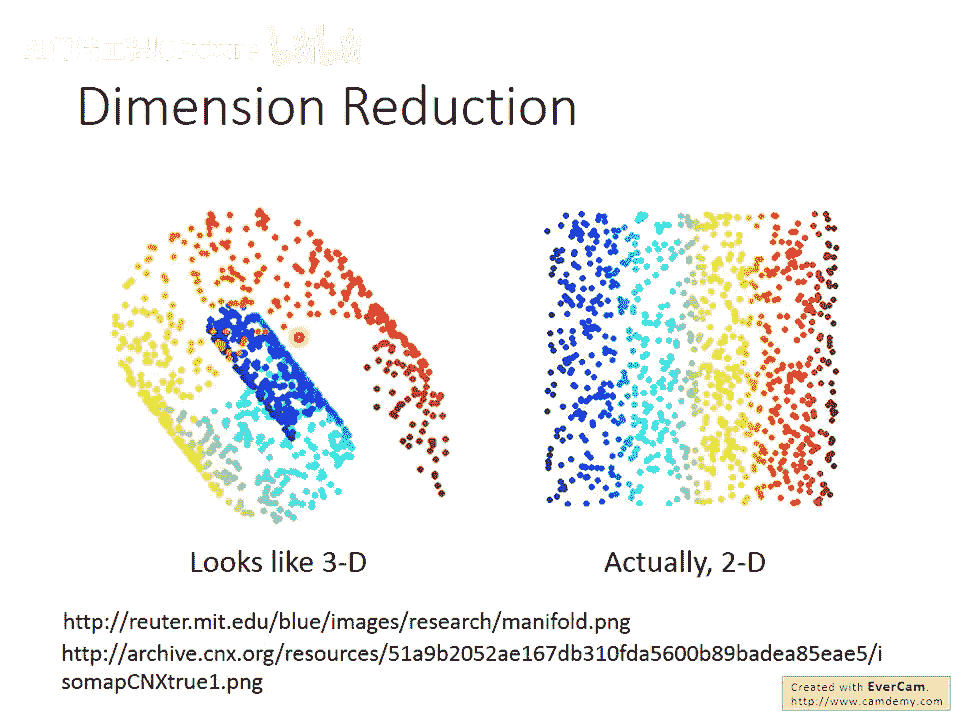

摊平就变成这样，所以你只其实只需要2D的，在2D的空间就可以描述这个3D的information，你根本不需要把这个问题放到3D来解，这样是把问题复杂化了，你其实在2D就可以做这个test。

或者是我们举一个比较具体的例子。

比如说我们考虑enlist，在enlist里面每一个input it dig，它是一个image，它都用2828的dimension呢来描述它，但是实际上多数2828的dimension。

的vector，你把它转成一个image，看起来都不像是一个数字，你认的sample，一个2828的vector转成image，看起来可能是这样，他其实根本就不像数字。

所以在这个28维乘28维的空间里面，是DJ的这个这个这个呃是DJ的，这个vector其实是很少的，所以他的这个所以其实你要描述一个DJ，或许你根本不需要用到28×28，我你要描述一个DJ。

你要的dimension可能是远比28为乘，28为少，所以如果我们举一个很极端的例子，比如说这边有一堆三，然后这堆三如果你是从pixel来看待它的话，你要用28位乘28维来描述每一张image。

然而实际上这些三呢，只需要用一个维度就可以来表示，为什么呢，因为这些三其实就只是说把原来的三放，正是中间这张image右转十度就变成它转20度，就变成它左转十度变，它转左转20度变它。

所以你唯一需要记录的事情只有今天这一张image，它是左转多少度，右转多少度，你就可以知道说他在28维的空间里面，应该长什么样子，就你只需要抓住这个重点，你只要抓住这个角度的变化。

你就可以知道28维空间中的变化，所以你只需要用一维就可以描述这些里，所以这就像我刚才举的例子，就这个是凡庸的虎子。

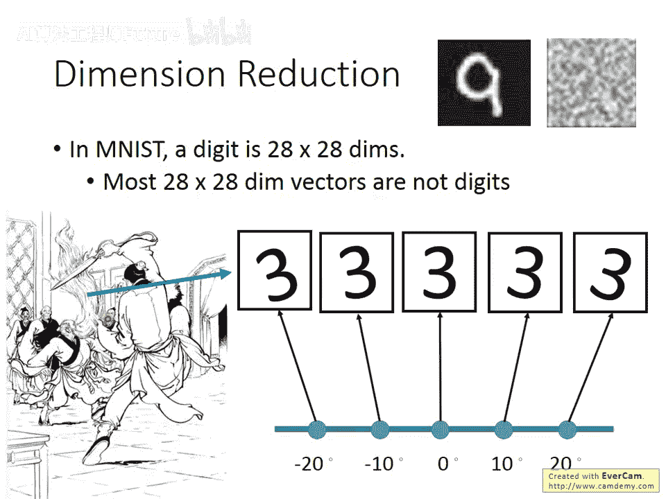

这个这个就是他的头这样子好。

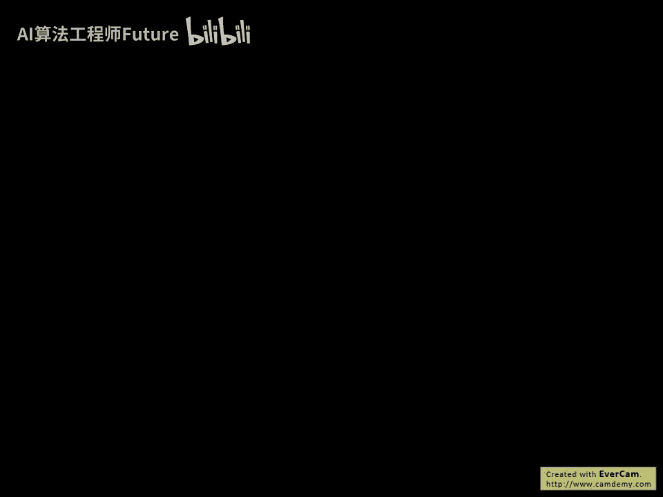

那怎么做dimension reduction呢，在做dimension reduction的时候，我们要做的事情就是找一个function，这个function的input呢是一个vector x。

它的open呢是另外一个vector z，但是因为是dimension reduction，所以你output的这个vector z啊，他的这个dimension呢要比input的这个X还要小。

这样你才是做dimension reduction，而在这dimension reduction里面，最简单的方法呢是feature selection，这个方法就没有什么好讲的，这个方法是这样。

就是哦，我们现在如果你把你的data的分布拿出来，看一下哦，本来在二维的平面上，但是其实你发现诶都集中在呃，x2这个dimension而已，所以x1这个dimension没什么用，把它拿掉。

就只有x2这个dimension，也就等于是做到dimension reduction这件事，那这个方法不不见得总是有用，因为有很多时候是呃，你的case。

是你你任何一个dimension都其实都不能拿掉，诶都不能拿掉，那另外一个方法呢，另外一个常见的方法叫做principal component，Analysis，叫做这个呃p ca啊。

这个PCI怎么做呢，这个PC做的事情是这样，他说这个function呢是一个很简单的da function，这个input x啊，跟这个output z之间的关系呀。

就是一个linear的transform，比如你把这个X乘上一个matrix w，你就得到它的output ery，那现在要做的事情就是根据一大堆的X，我们现在不知道自己长什么样子，我们只有一大堆X。

根据一大堆X我们要把这个W呢找出来，那如果你要知道比较细节的东西的话呢，你可以看一下bishop的的第12章，接下来呢我们来介绍一下PCA，我刚才讲过PCA要做的事情就是找这个大饼，那这个W怎么找呢。

假设我们现在考虑一个比较简单的case，我们考虑一个one dimensional的case子，呃，什么意思呢，我们现在假设，我们只要把我们data project到一维的空间上，也就是我们的Z呢。

它只是一个一维的vector，所以一维的vector其实就是一个SCALA啊，那Z是一个SCALA，或者是说我们可以这样写，就是这个呃，呃如果我们Z这边只是一个SCALER的话。

那我们W呢其实就是一个一个roll，对不对，只有一个roll而已，那我们就用w one呢来表示W的第一个roll，那我们把X跟W的第一个row w one做inner fada。

我们就得到一个scale z y，接下来我们要问的问题是，我们要找的这个w one应该要涨什么样子啊，长什么样子，那首先呢我们先假设这个w one的长度呢是一哦，w one的two note是一啊。

这个假设是有必要啊，等下你会看的更清楚，为什么我们一定要有这个假设，如果w one的two long是一的话，那w one跟X做INAPADA，得到了ZY意味着什么呢，它意味着说。

那所谓的ZY就是X呢在w one上面的投影啊，它这个投影的这个值呢，就是w one跟X的in德华达啊，这个就就没有什么问题，这个就是大一线代里面教过的东西好，那所以我们现在做的事情就是呃。

把一堆X跟又透过w one把它投影变成ZY，我们就得到一堆ZY，每一个X都变成一个ZY，那现在的问题就是这个w one应该长什么样子，我们该选哪一个w one呢，举例来说，假设这个是X的分布。

这个X的分布是什么呢，它是横坐标，而这个每一个点呢代表了一只宝可梦啊，它的横坐标是攻击力，它的纵坐标呢是防御力，OK那今天如果我要选，我要把这个二维的这个这边，这个X呢都是二维的。

我要把这个二维投影到一维，我应该要选什么样的w one呢，我可以选这样的w one，我可以选选w one指向这个方向，我也可以选w one指向这个方向，而我选不同的方向，我最后得到的结果。

得到的projection的结果它会是不一样，那我们会想要呢，那那那你你总是要给我们一个目标，我们才知道要选什么样的w one啊，他现在的目标是这样，我们希望呢选一个WY。

它经过projection以后，得到的这些z one的分布呢是越大越好，也就是说我们不希望说透过这个projection以后，所有的点呢统统挤在一起。

就变成把本来这个这个data point和data point，之间的奇异度呢拿掉，我们是希望说经过这个projection以后，不同的data point它们之间的区别，我们仍然是可以看得出来。

这么虚望，找一个projection的方向，它可以让projection hold vari的越大越好，那如果我们看这个例子的话，你就会觉得说如果是选这个方向的话，经过projection以后。

你的点呢可能是分布在这个地方，大概分布在这个range，那如果是projection在这个方向的话，那你点的分布可能是这个range，所以如果projection在这个方向上的话。

你会有比较大的VARI，那在这个方向上的话也会有个比较小的VR，所以你要选w one的时候，你可能w one方向呢会指向这个方向，指向这个方向，那其实这个w one代表什么意思呢。

如果你从这个图上可以看到，说这个w one其实是代表了这个宝可梦的强度了，就宝可梦有一个可能有一个隐藏的factor，就代表他的的强度，而这个隐藏的factor，同时影响了他的这个防御力跟跟攻击力哦。

所以防御力跟攻击力呢是会同时上升的，同时上升哦，那如果你我们要用equation来表示它的话，你就会说我们现在要去maximize的对象，是d one的vari z one。

variance就是some mention over所有的z one，然后z one减z one8的平方，而z one8就是说我例外的平均了，就说我例外的平均，好那这样子假设你我们先等一下再讲怎么做。

我们等下再讲怎么做啊，假设你知道怎么做，你解一解，你找到一个w one，你就可以可以让z one最大，那你就找到这个w one就结束了，好再来呢，但是你可能不要只投影到一维，你想要投影到更多维。

比如说你想要投影到一个二维的平面，OK所以那如果你想要投影到二维的平面的时候，这个时候你就把X跟另外一个WTO呢做ina FA，得到z two啊，这个z one跟z two串起来就得到这边的Z哦。

这个w one跟w two的transport排起来，就是W的第一个row跟第二个RO好，那这个z two我们要怎么找这个w to呢，跟刚才找z one一样，我们希望首先WQ他的two弄是一。

然后接下来的这个z two，它的分布呢也是越大越好，也是越大越好，但是如果你只是要让z two的variance越大越好，你让这个式子越大越好，那你你找出来不就是w one吗，w one刚才已经找过了。

对不对，所以你就等于什么事都没有做，所以你要再加一个CTRL，这CTRL是我们刚才已经找过w one，这个w two呢要跟w one是呃垂直的，或者是w one跟w two呢是SOOO。

w one跟w two他们做inner product呢等于零，而借用这个方法呢，你就可以先找w one，再找WQ再找W3，就看你要project到几维，然后project到几维是你你要自己决定的。

这个就跟那种要几个cluster，要几个he的那样，也是自己决定的啊，你要project到大K为，那你就找w one，w two到W大K，那就把你所有找出来的WYW叫W大K排，排起来。

当做大W的roll放在这边就结束了就结束了，那这边有一件事情，就是这个大这个找出来的大W啊，他会是一个哦SOGON的match，为什么呢，如果你看他的roll的话。

他的w one跟WQ是FOGONAL的，然后w one的to none跟w one two的two弄都是一哦，所以它的role是NO是一，而且都互相之间是OOOO，所以他是一个SOGAL的matrix。

接下来的问题就是怎么找w one跟w two呢，怎么解解这个问题呢。

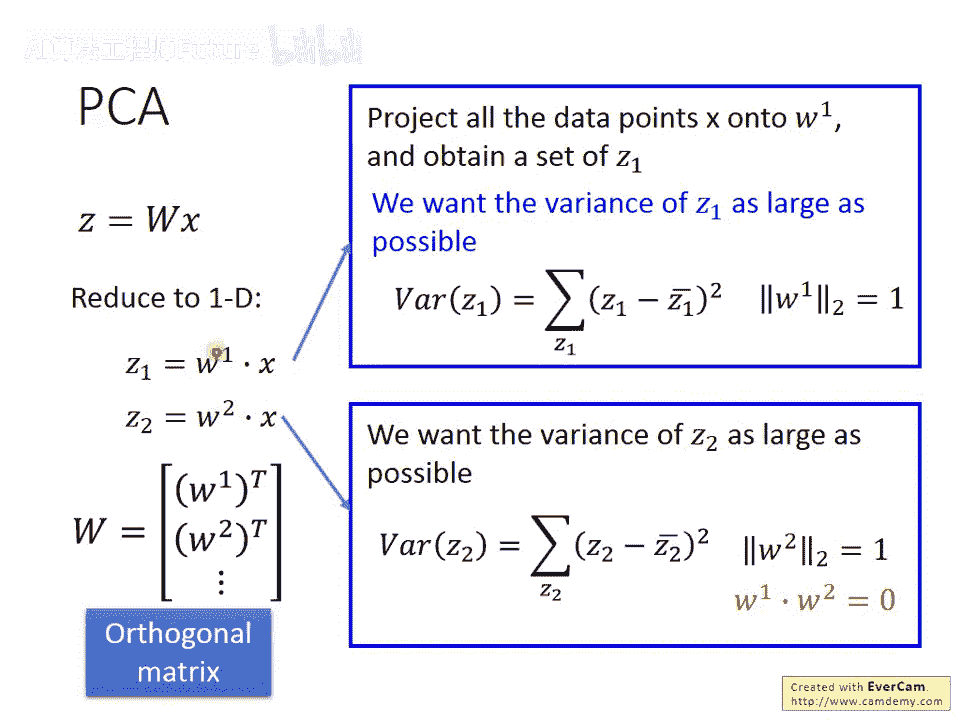

怎么解这个问题呢，这边其实有一个呃，这边这个解法呢其实是是蛮容易的啊。

这个怎么解呢，怎么解呢，你是要用那个lagrunch mua fire啊，呃这边有个warning of map，就如果你没有听懂的话就算了，这个可以直接这个这个都直接扣套件呃，这请括号键就有。

而且就算是你不会下面这一套东西的话，你其实可以用gradient descend的方法，在我们之后会讲，你可以把一个你可以把PCA这件事情，描述成一个neural network。

然后就用gradient descend方法呢来来解答这样，所以不一定要用lagrange mar的fire呢，来做这个PCA好，就这个PCI可以用grading。

可以可以把它看成像是一个neural network一样，但我们现在讲很快，讲一下lagrange mart fire这个方法，这是个很经典的方法，他怎么做的呢。

他这样子我们说z one等于w one跟X的一元化，那z one的平均值呢是some mention over sw的，Z one，也就是some mention over s的。

w one跟X等于一的发达，w one这边是submention over，所有data point跟w one无关，所以可以把w one提出来。

变成先扫mansion over so的X再跟w one做一的化达，得到w one跟X的平均的一能化达，接下来我们说我们要MAMAXIMIZE的对象，是z one的variance。

那z one的VARI我们可以写成z one，减它的平均值的平方，在summation over是我的z one，我们先把这一项整理一下，这项整理一下变成什么样子呢。

z one是w one跟X等于的发达，z one8是w one跟X8的一边画的，然后再取平方，那都有w one，所以可以把w one提出来，变成上mention oen。

w one乘以X减X8的伊德pa的平方，那这个平方这个平方你可以把它做一下转换，转化，怎么转化呢，w one是一个vector，X减X8是另外一个vector，两个vector。

比如说w one就是AX减X8，就是BA跟B的inner发达的平方，可以写成A的transpose乘以B的平方，可以写成A的transpose乘以B，再乘上A的transpose乘以B。

然后这一项呢其实可以写成呃，这个这个这个这个A的transpose乘以B，然后乘上呢这个A的transpose乘以B，然后再transpose，为什么这边可以直接加个transpose呢。

因为a transpose比是一个scale，所以再transpose还是他自己好，那transpose以后a transpose，B的transpose就是把它们顺序对调，再加上transpose。

所以变成a transpose，Bb transpose a，然后把这个把A带回WYB带回X减X8，你就得到这样一个式子，WY的transpose乘上X减X8，X减X8的transpose，再乘上WY。

接下来呢你这边是summation over，所有的data，Summation over，所有data，所以跟W无关，跟W无关，所以把w one的transpose拿出去，把w one拿出去。

注意一下这边SUBMENTION是samansion over，这个X减X8乘以X减X8的transpose，所以WY呢被拿出去，那X减X8的transpose。

X减X8乘以X减X8的transpose，想mention over说的data point是什么呢，它是它是这个X的COVARIOUS，对不对，它是X的covariance match。

所以这一项其实就是WY的乘FX乘以X的，Covariance matrix，乘上w one，我们用X来描述X的covariance matrix，所以现在呢我们要解的问题是这样找一个w one。

它可以maximize w one的transpose，乘上一个matrix，再乘上w one，但这个optimization对象是有constrain，如果没有constrain的话。

这个问题它会有无聊的solution，你就把w one变，它每一个值都是无穷大，就就结束了，这样子对，所以你要你要有CTRL，他的CTRL是说这个w one的two NO要等于一好，那有了这些以后呢。

我们就要解这一个optimization的八本，那这边这个S啊，S是covariance matrix的coversion match，它是写matrix的。

而且因为它是COVERANCEMATRI关系，它又是这个半正定啊，它是public kesemi demonly，也就是说它所有的icon value都是not negative的。

如果你对这件事有困惑的话，你就回去翻一下现代课本，你其实可以在我的那个个人网页上，找到那个现代的教学，这样子就在那个就在这个machine learning的网页下面，好那呃我我们就先讲结论，不讲结论。

就假设你不想听中间过程的话，结论就是这个programming problem，这个problem它的solution就是w one，是covariance matrix的icon vector。

它不只是一个icm vector，它是对应到最大的icon value，浪达one的那一个I跟Mac，那这个就是结论，那中间的过程是怎么样呢，中间的过程是首先我要用LAGRANGEMODIF。

如果你对这个东西有困惑的话，这不是我们这堂课应该讲的，就看一下b shop的appendix，好，在做拉罐马克拍马克派的时候就列一个式子，这式子涨价，这个式子涨价，他是先把这一项拿到这边再减掉。

阿尔法呢乘上这个control这个CTRL，然后接下来呢你把这个G对所有的W做偏微分，这W里面有W是一个vector嘛，对不对，W是一个vector，它里面有很多个element。

所以你把这个function对W的第一个element做偏微分，对第二个element做偏微分，然后令这些式子通通等于零，然后整理一下以后呢，你会得到一个式子，这个式子是这样告诉我们的。

这个式子告诉我们说，这个呃呃呃这边的这个这个solution啊，这个solution啊，它会满足下面这个式子，就S乘上w one减阿尔法乘上w one等于零，再整理一下，变成变成这样好。

那这个啊w one呢是就如果如果你写成这样，就X乘上w one等于阿尔法乘上w one的话，那w one就是一个I跟vector，w one就是S的I跟vector。

因为w one乘上S等于S等于自己乘上了就scale，所以w one是S的，I跟vector好，那但是现在SI跟vector有一大把有很多，而且你可以找到一大把I跟vector，它的弄都是一。

它的弄都是一，所以接下来要做的事情是看哪一个I跟vector，带到这个式子里面，可以maximize4个w one的transport，乘上X乘上w one好，谁可以maximize它呢。

我们把这个整理一下啊，把它整理一下，把WY的乘后乘上X乘上WY整理一下，它变成呃这个S乘上w one呐，就是阿尔法乘上w one，所以这一项就变成阿尔法乘上w one的transpose。

乘上w one，然后呢w one存放商w one，这个是一哦，所以这边呢就得到个得到个阿尔法，然后呢接下来就是找那谁可以，谁可以让这个阿尔法最大呢，像这个值等于阿尔法的话，谁可以让阿尔法最大呢。

就是w one4对应到最大的I跟value的那个icon，vector的时候，它可以让阿尔法最大，那这个阿尔法就是最大的I跟value让达弯，如果你没有听懂的话，你就记得这个结论就好好。

那第二个如果我们要找w to的话，我们要截什么样的式子呢，我们如果要找WTO的话，我们要解的是这样子的一个equation，我们要解说，我们要maximize这个W这个我们要maximize。

根据w to投影以后的variance，这个写成这样，w two的transpose乘上X乘上w two，同时w two要满足弄等于一，同时WQ跟w one的这个呃in the pada。

w one跟w two的他们还是哦SOGA，那这个结论是什么呢，这你你解完这个问题会得到什么，你会得到说w two也是covariance matrif，的一个icon vector。

然后呢它对应到这个第二大的icon value，not a two好，那现在呢我们就要用lagrange matt per来解它，这个解法就是你先写一个方程局啊。

这个function区里面包括了你要maximize的对象，还有你的两个CTRL，你的两个CTRL，然后分别要乘上阿尔法跟贝塔，接下来呢你对你所有的参数做偏微分，你对你的W里面的w to里面。

每个参数都做偏微分，你对w two的第一个element，WTO的第二个M以此类推都做偏尾分，做完以后，你得到这个式子来得到这个式子，S乘以WQ减阿尔法乘上WQ减贝塔，乘上WY等于零。

好接下来左边同乘w one的transpose，乘w one transpose，乘w one transpose，乘w one transpose成w one transpose时，会发生什么事呢。

乘w one的transpose以后，w one则全pose乘w one等于一，这边double one的乘后乘w two等于零，然后这边嗯w one的transpose，乘X乘上w two等于什么呢。

因为这一项啊它是一个SCALA，就这是一个vector，这是一个mattress，这是一个vector，所以乘完以后是一个SCALA，SCALA在做transpose后，还是他自己。

所以你可以直接把他transpose，结果是一样，做完transpose以后，你得到w two的transpose乘上S的全PO乘上WY，因为S是symmetric的。

所以做transpose还是他自己，所以这一项EXTRANSPOSE变成它自己，随便这样好，接下来呢我们已经知道w one是S的I跟vector啊，而且它对应到最大的I跟value浪达one。

所以S乘以WY等于浪达one w one，所以X乘w one等于浪达one w one，然后w one乘以w two，再TRANSF时又等于零，所以这一项第一项也是零，所以从这边我们得到什么结论呢。

我们得到的结论是贝塔等于零，然后写的是贝塔等于零，诶好如果是贝塔等于零的话，这一项就会被拿掉，所以剩下的就是X乘上WQ减阿尔法，w two等于零，然后他会告诉我们说。

X乘上w two等于阿尔法乘上w two，所以你知道w two是一个I跟vector，但是它是哪一个I跟vector呢，如果你选他是我们知道说，如果你们都是知道说这一项等于I跟value的值。

等于I跟value的值，但是你不能够选I跟value最大的那个icon vector，因为他会跟他跟w one不是SOFLOAD，但是你可以选第二大，而凭什么说选第二大的。

就跟第一大的是OSOGON的呢，你就去查一下你的这个呃现代课本，因为S自己metric的，所以你可以这么做，嗯好那我们今天就把map的部分讲完。

这个最后这个地方说在在这个end of warning之前，剩下最后一页投影片，这些投影片要说什么呢，这些投影片要这样说的说，Z等于W乘上X这里有个神奇的地方啊。

就是Z的covariance呢会是一个DIAGONO的matrix，也就是说如果我们今天做PCA，你原来的data的distribution可能是这个样子，做完DCA以后。

你会做DECORRELATION，你会让你的不同的dimension间的covariance治理，也就是说如果你算Z的COVEZ这个vector，convariance matches的话。

会发现它是DIVO，这样做有什么好处呢，这样做有时候会有帮助的，假设呢，你现在的这个PCA所得到的新的feature诶，这个Z呢是一种新的feature。

这个新的feature是要给其他的model用的，而你的model假设比如说是一个generative mode，那你用高选来描述每某一个class的distribution。

而你在做这个高选的假设的时候，你假设说你的input data就是孔，就是呃，就是这个这个这个他的covariance就是DIGOAL，你假设不同的dimension之间没有correlation。

这样子可以减少你的参数量，也是你做PCA的时候，接下来的model就可以呃，你你把你原来的input data做PCA以后，再丢给其他的model时。

其他的model就可以假设现在input data它是呃dimension，接mail pulation，所以他就可以用比较简单的model来处理，你的input data。

这样可以避免OVERFITTING的情形啊，这件事情怎么说明呢，这个也是很tribute coz的，covariant就是呃呃Z减Z的平均，再乘上Z减Z的平均的transport。

那这一项啊你仔细想想看，你把它展开，它是W乘上X乘上WTRANSPOS是X的COVERANCE，然后呢你就把它展开这个W的诶，额哦我这边有没有有没有写写错哦，没有写错。

OK这个这个W的transpose，它的第一个colon就是w one，一直到第K个column是WK好把S乘进去，好把S乘进去变成这个样子，好把X乘进去以后呢，这个s w one呐。

s w one是什么呢，w one是S的IC跟vector，所以w one乘X等于浪达万乘w one，那个wk乘X等于浪打K乘wk，这个W是I跟vector，然后long达呢是I跟value。

然后我们再把W乘进去好，把W乘进去，把W乘进去，W乘w one会是什么呢，W乘w one会是什么呢，这样看w one其实是W的第一个row，而W是一个OOGAL的matrix。

所以W乘w one会等于1万，1万就是一个这个呃vector呢，他第一位是一，其他都是零，W乘WK会等于1K1K就是DK，我也是一，其他都是零，那这个东西就是一个DIAGGAL的mattress啊。

然后蜗顶的部分就讲完了。

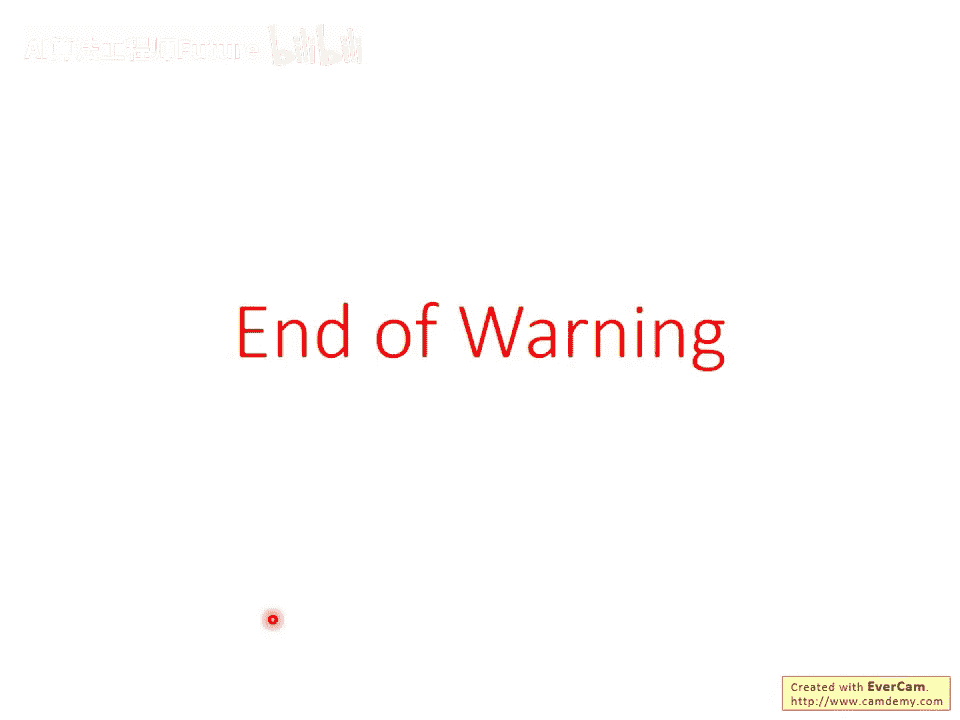

那那这个部分或许你觉得没有太容易理解，那我们下次从另外一个角度来看PCN。

你可能就会更清楚说PCS在做什么，今天最后先讲到这里，谢谢，好啊，各位同学大家好，我们来上课吧。

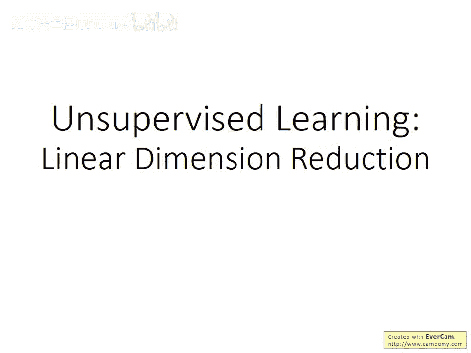

好那我们上次讲到呃p ca。

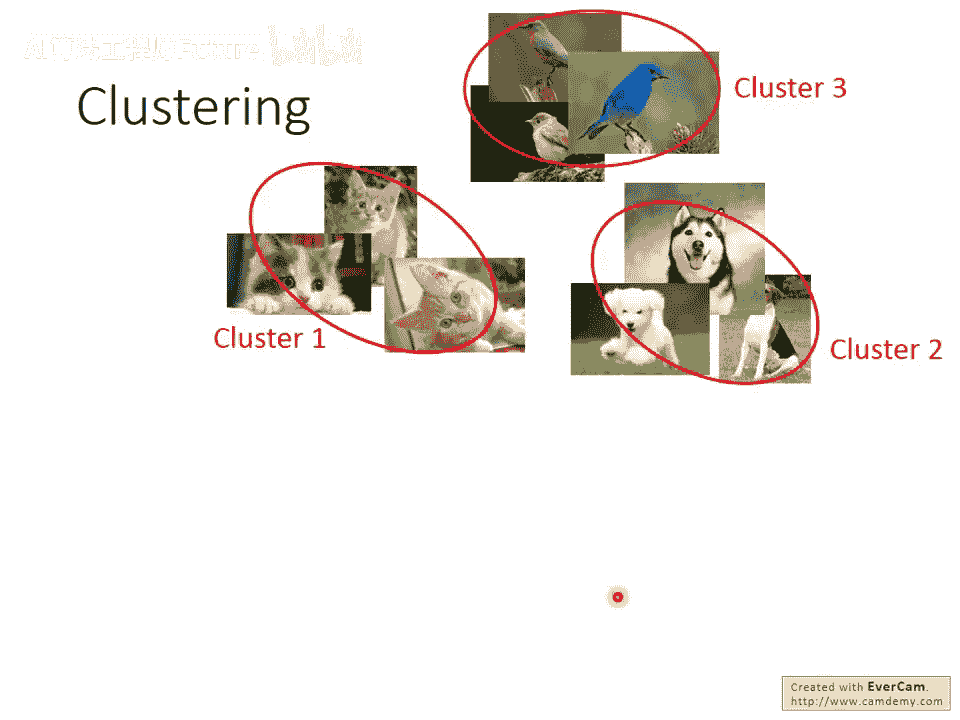

然后呢呃PCA有一个很很很冗长的这个证明，然后说呃p ca呢我们每次找出来的额。

W呢第一次找出来的w one是这个covariance matrix，对应到最大的icon value的icon vector，然后第二个找出来w to呢。

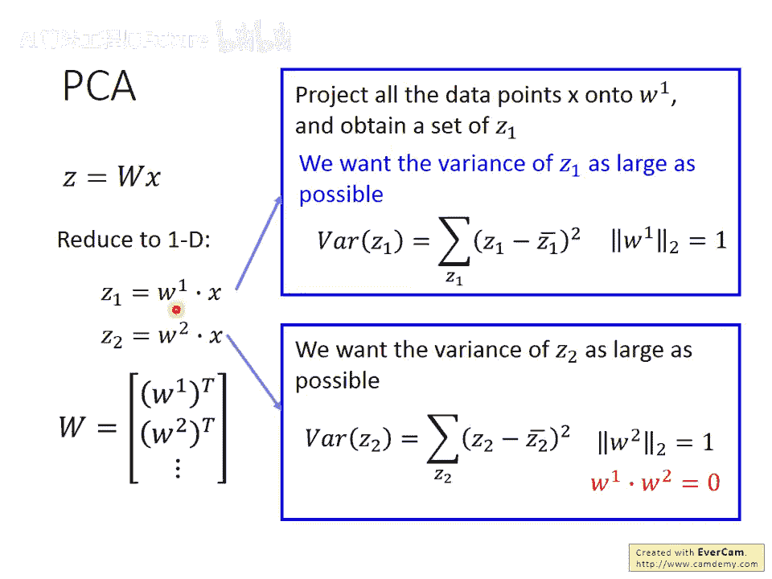

就是对应到第二大的icon value的那个icon vector，以此类推等等。

然后有一个呢很长的证明告诉你说，这么做的话，我们每次投影的时候都可以让variance最大，那假如以下这些东西你听不懂的话呢，额就算了，这样子，哎我们来看看另外一个可能是比较直观的说明。

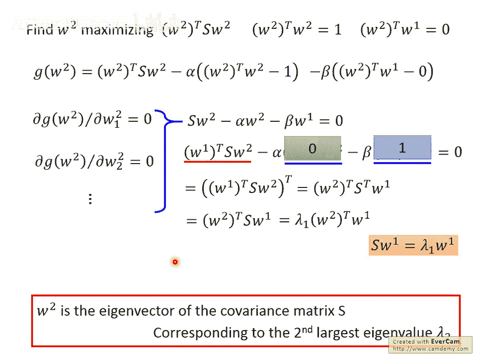

好，另外一个只比较直观的PCA的想法是这样子的，呃，假设我们现在考虑的是手写的数字，可那我们知道说，这些数字其实是由一些basic的component呢，所组成的。

这些basic component可能就是代表呢笔画啊，举例来说呢，人手写的数字呢，可能是由这些basic component所组成的，有呃斜的直线，横的直线比较长的直线，然后还有小圈呢。

大圈等等所组成的，而这些basic component他说呃把它加起来以后呢，就可以得到一个数字，那这些basic的component呢，我们这边写作u one u two u3等等。

那这些basic component其实就是一个一个的vector，假设我们现在考虑的是ANNEST的话，ENNEST的一张image是1828pixel，也就是2828维的一个vector。

那这些component呢，其实也就是2828维的vector，那把这些vector加起来以后呢，你所得到的那个vector，把这些component所代表的vector加起来以后。

你所得到的vector呢就代表了一个dig哦，或者如果我们把它写成formulation的话呢，写起来像是这个样子，X呢代表了这个某一张image里面的pixel哦。

某一个image可以用个vector来表示它啊，这个vector呢这边写作X，那这个X呢会等于u one这个component乘上CY，加上YOUTUBE这个component乘上c two。

一直加到U大K这个component乘上C大K啊，假设我们现在总共有大K个component的话，然后再加上呢这个X8X8，是所有的image的平均啊，是X8诶。

所以每一张image就是由一堆component的linear，Combination，然后呢再加上它的平均所组成的，举例来说呢，我们说七是这一个component，这一个component。

看这个component加起来以后的结果，所以呢这个这个对七来说啊，假设这个七就是X的话，c one就是一，c two就是零，C3就是一，以此以此类推。

那你可以用c one c two到C大K呢来表示一张image，OK假设你原假设你这个component的数目，是远比pixel的数目少的话，你就可以用这些呃。

这个component的weight来描述一张image，那如component的数目比image的PIPIXEL，数目少的话，那这个描述呢是会比较有效的，举例来说呢，七是一倍的u one。

一倍的U31倍的U5所组合成的，所以七呢你就可以说它是一个vector，它第一维第三维和第五维是一对好，那我们现在知道说哎，我们我们现在知道说X呢等于一堆component。

Linear combination，再加上呢平均，然后我们现在把平均移到左边好，所以X呢减掉所有image的平均，等于一堆component的linear combination。

那我们说这些linear combination的结果呢，我们写作x tab，那现在假设我们不知道这些component是什么，我们不知道u one到U大K的这些，这这大K个vector他们长什么样。

那我们要怎么找这大K的vector出来呢，那我们要做的事情，就是我们要去找这大K个vector，使得呢XH跟X减X8呢越接近越好，我们要找大K的vector，让X减X8跟x head越接近越好。

那他们中间的差呢，没有办法用这个呃component来描述的部分呢，叫做reconstruction error好，那接下来我们要做的事情，就是找大K个component，其实就是大K个vector。

它可以minimize这个reconstruction error，那这个reconstruction error，你如果你要把formulation写出来的话呢。

就是哦我有一个reconstruction error，写成L让我们呢要找大K个vector去minimize，它要minimize的对象呢就是X减X8和X减X8。

减掉呢这个呃下面这一项是x head啊，减掉x head的to know好，x head呢是一堆component的linear combination好，那我们先来回忆一下PCA。

PCA在PC里面有我们讲说呢，哦我们要找一个matrix w，那我们原来的vector x呢，乘上MATRIW以后，就得到呢这个呃dimension reduction以后的结果Z哦。

那我们可以把这个W的这个每一个row写出来，就w one w q到W大K然后X乘上w one，the transpose得到ZYX乘上w two的transpose，得到Z就以此类推。

那么说w one w到W大K，都是covariance matrix的这个item vector，那事实上呢如果你要解这个式子哦，你要解这个式子，找出u one u two到U大K。

这个w one到W大K就是你用PCA找出来的，这个解，其实就是可以让上面这一个式子呢最小化的，就可以让这个error这个reconstruction error，最小的u one到U大K这样哎。

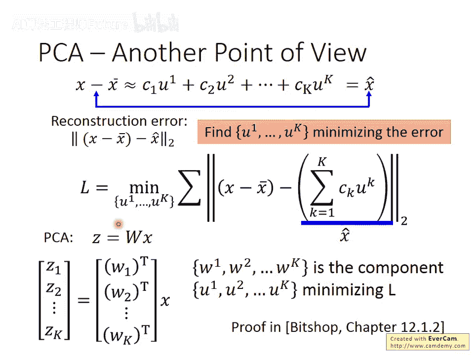

这个这个在bishop里面呢是有prove的，那我这边讲的跟b shop有点不一样。

我用一个比较简单的方式来说明给大家听，这个呃，我们现在呢在database里面有一大堆的X，和一大堆的X那现在假设有一个x1哦，这个这个x1减掉平均X8。

等于u one乘上component weight，C上标一下标一，这边C上标一下，标一的意思是说呃，C下标一代表说它是u one的weight，上标一代表说他是这个呃呃x1的。

u one这个component way，我想这个大家应该知道我的意思好，那所以X1减X8呢，就等于c one乘u one加c two乘u two，那XY减X8呢，它是一个vector。

OK那我们把这个vector呢拿出来，把这个vector拿出来，那这个u one u two到U大K呢，它们是一排vector，那我们就把它排起来啊，排起来其它排起来就是一个matrix。

OK他的这个呃colon的数目呢是大K1个color，那前面c one跟c c one c two呢，他们就是我们把这个这个c one c two啊，我这边有个错误的动画。

我们把这个c one c two呢把它排成一排，排成一排在这边，那你现在把这个c one乘上，它把这个c two乘上，它就会得到这个vector，也就是说你把这一个vector。

你把这些这些这个component的weight，排排成一一排啊，它这个是一个vector，这个vector乘以这个MATRIC就会得到这个B诶，那当我们的这个data set里面不是只有一笔data。

我们还有很多啊，比如这边有个x2，那x2点X8啊，它就是黄色的，这就另外第二个黄色的back，那u one u two呢就在这边，那c one c two啊。

第二个component的c one c two，而第二个component c one c two，跟第一个component c one c two，他们是不一样的啊。

只不要他们notation这边是不一样的，那我们把这个这个值呢，这个值呢摆在这边，摆在这边，那你把这个vector乘上这个matrix，就会得到这个vector啊，以此类推，以此类推。

你把这个vector，第三个11X3的component的weight呢，乘上component就会得到这个vector，那如果我们把所有的data都用这个式子来表示，都把它画在下面的话。

那这边呢我们就得到一个matrix，那这个matrix的横轴呢，它的这个这个color的数目呢就是你的data的数目，你1万比DA这个横轴呢就是1万，那我们呢现在要做的事情。

就是用这一个matrix去乘上这一个matrix啊，这两个都是metric2，把这个matrix乘上这个matrix，那希望它越接近这个matrix越好，OK所以你要minimize这两个相乘以后。

得到matrix跟左边这个matrix之间的差距啊，你要minimize这个reconstruction error。

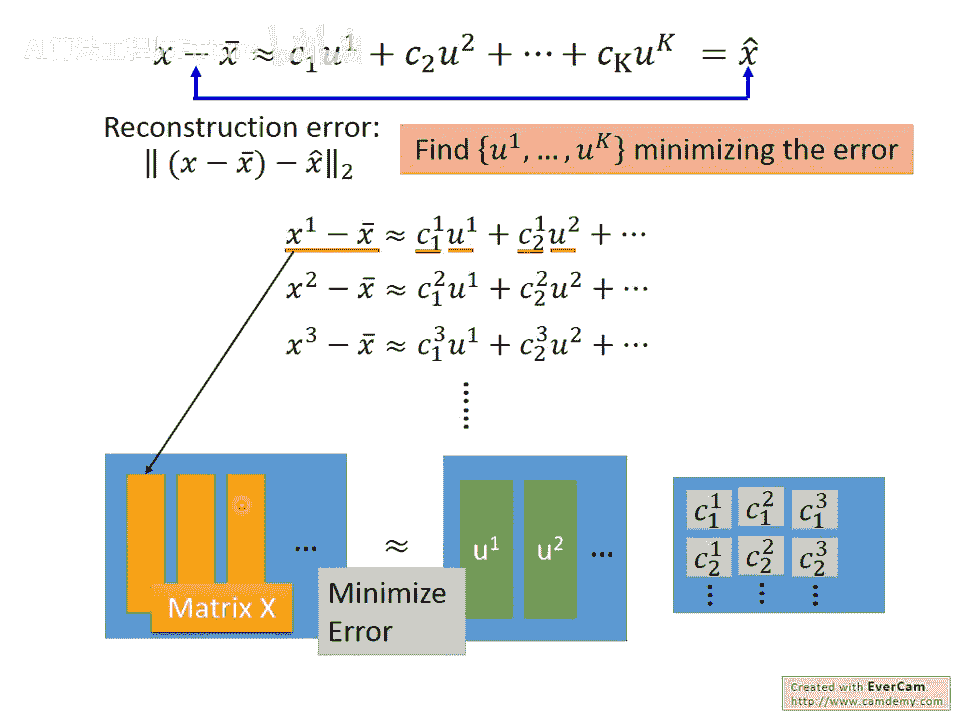

那怎么解这个问题呢，假如你有修过大一现代的话，你就知道这个问题呢是怎么治，是怎么解的，那以下是我我教现代的时候的投影片，放在这边给大家参考，那这个在现代里面是怎么说的呢，每一个matrix x啊。

每一个matrix啊，就这边这个matrix x啊，你可以用SVD把它拆成一个matrix u，乘上一个matrix sigma乘上一个matrix v，那这个U呢是M百K为，这个sigma是K百。

K为这个这个V呢是K百N为这个K啊，它就是这个component的数目，哎，所以我们把这个X呢可以分解成U西格玛跟V，这个U就是这个那这个西格玛乘上V就是这个，那我们知道说。

如果我们今天的这个我们用SVD的方法呢，把X拆成这三个MATRIC相乘，那右边这三个matrix相乘的结果，跟左边这个matrix，它们之间的这个FORBIOUS的那个NO呢，是会被minimize的。

也就是说呃，用SVD提供给我们的一个matrix的拆解方法，你猜出来的这三个matrix相乘，它跟左边这个matrix是最接近的，那解出来的结果是怎么样呢，如果你还记得的话，解出来的结果是这样子的。

这个U这个matrix它的K个color呢，其实就是一组哦of phenommal的vector，而这组of abo of abnormal的vector，他们是X乘上X的transpose。

他们是X乘上x transpose的这个icon vector，而他们这边总共有K个vector啊，这边有总共K个of normal的vector。

这K个of of of of normal vector，他们就对应到X乘上x x transpose，所以大的K个icon value的icon vector，这个大家大家听得懂吗，假的大家有问题吗。

好，那你会发现说呃这个X乘x transpose是什么啊，这个X乘x transpose是什么，这个X乘X2，X乘x transpose不就是covariance matrix吗。

那我们说之前p ca找出来的那些，就是covariance matrix的icon vector，而我们在这边又说我们做SVD，你解出来的U的每一个color。

就是covariance matrix的icon vector，所以这个U这个解啊其实就是呃就是PCA得出，就是就是PCA得出来的解对，所以我们知道说p ca现在在做的事情，你找出来的。

你从根据PCA你找出来的那些W，你找出来的那个呃dimension reduction的transform，其实呢就是在minimize cigareconstruction error。

那dimension reduction的结果呢，你得到的其实就是这些vector，你得到的就是这些vector，你在PCI里面，你得到的那些W其实就是就是卡通的，好那如果大家知道这些的话呢。

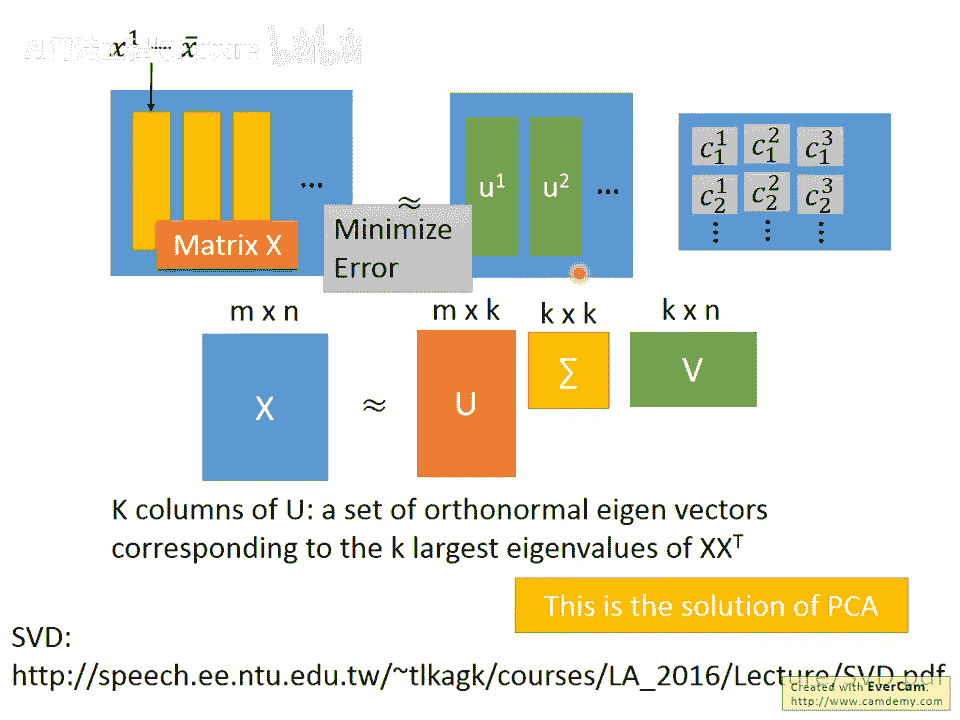

我们等一下会看，说p ca跟neural network呢有什么样的关系，那我们现在已经知道说呢，从用PCA找出来的w one到W大K，就是呃就是K个component u one，u two到U大K。

那我们说呢呃呃我们有一个这个根据component，linear combination的结果叫做XTA，它是WK乘上CK做linear combination的结果。

那我们会希望说呢这个x head跟X减X8啊，这个是X8啊，X减X8，它的平均呢是越小越好的，你要你想minimize这个reconstruction error，那我们现在已经根据SVD找出来了。

这个W哦，W已经找出来了，W已经找出来了，那这个CK的值到底应该是多少呢，这个CK啊是每一个example，如果如果是image regnition话，就每一个image都有一组自己的ck。

所以你要找这个K就每个image呢各自找就好啊，每个image各自找找就好，那这个问题其实就是问说哦，我现在呢有一个有大K为的vector啊，他们做span以后呢得到一个space。

那呃如果我现在呢要用c one到C大K对，对它做linear combination呃，呃怎么样才能够最接近X减x he，诶怎么样才能最接X减X8呢。

因为现在这大K和Mac or他们是是of enommal的，而是of enommal的，所以你要得到这个CK呢其实很简单的，你只要把X减X8跟wk做INOPADA，你得到的就是CK。

OK你要找一组c k k minimize，左边这个跟右边这个error，你只需要把你只需要把这个X减X8跟WK的，做inner pa就好了，而这个性质是来自于说。

这K个vector是of for normal的啊，这个如果你有困惑的话，你可以回去呃check一下线性代数的课本好，那现在我们现在已经已已经知道了这些事情，OK我们已知道说呃CK就是长得这个样子。

那这一件事情呢这个做linear combination的事情，其实你可以想成用neural network来表示它，什么意思呢，什么意思呢，假设我们的X减，我们的X减X8就是一个vector哦。

这边呢写作一个三维的vector，那我们假设现在呢K呢只有两个component，好，K呢等于二，那我们先算出c one跟c two怎么算c one呢。

c one就是X减X8跟w one的inner padda哦，所谓的inner padda就是element wise的相乘，也就是把X减X8的每一个component。

乘上w one的每一个component，接下来呢你就得到c one这件事情，就好像是说这个是neural network input，这是一个neural，这是neural的weight。

这个neural它是linear的neural，OK它是linear的，它是它没有exhivation function，它是linear的那这个neuron。

你把这个这个这个这个东西input乘上这个way，你就得到c one，那c two也是一样啊，你ok c two，可我们这边好，这边是这样子，那我们接下来呢要把c one呢，我这边犯了一个错误，诶。

这个应该是下标，这个应该是下标，这样如果统一起来的话，这个K呢应该是下标好，那我们把这个c one呢要乘上w one，所谓的c one乘上w one是什么意思呢，哎你就把c one乘上w one得到呃。

乘把c one呢乘上w one的第一维得到一个value，然后w one的第二位得到一个value，上w one第三维得到一个value诶，所以这一项呢就是c one乘上w one。

而接下来呢我们再算一下c two哦，c two一样，就是这个input乘上跟这个w two呢做inner quada，好得到呢c two，然后呢再把这个c two呢乘上w to的三个element。

三个element，这跟原来w one这边乘的三个element加起来，就得到最后的output，这一项呢就是x ha啊，这一项就是x tag。

那接下来我们training的criterion呢就是minimize，我们要让这个x head跟X减X8呢越接近越好，所以我们就是希望这个neural network output。

跟X呢减X8呢越接近越好，我们把这个这是我们的input x减X8，它乘上一组weight，然后再hidden layer的operc one c two，再乘上另外一组weight得到x head。

那我们希望这个X减X8的越接近越好，那你就会发现说，其实p ca呢可以表示成一个neural network，它可以表示成一个neural network。

然后这个neural network它只有一个hidden layer，然后这个hidden layer是linear在activation function。

那这个然后呢我们现在train这个neural network，criterion是要让input一个东西得到output，然后结果这个output呢要跟input呢越接近越好。

这个output和input越接近越好，这个output要跟input呢越接近越好，这个东西呢就叫做auto encoder，那这边你就会这边呢我们就有一个问题，我们这边就就有就有一个问题。

假设我们现在这个weight不是用PCA的方法，也就不是早用找那个什么I跟vector的方法，去找出这些w one w two w8K，而是多一个neural network，直接用。

我们要minimize error，这个criteria，然后用这个gradient descent去train1发的话，那你觉得你得到的结果会跟用PCA，解出来的结果一样吗。

好了我给大家一秒钟的时间想一下好，那你觉得会一样的同学举手吗，有些同学觉得会一样，好，手放开，你觉得会不一样的同学举手啊，又有些同学觉得会不一样哦，觉得不一样稍微多一点，那其实是会不一样的。

你仔你仔细想想，看PCA解出来的这些W他们是offer normal的，他们他们他们他们是否OMO的，他们是他们是垂直的，那你今天如果你用neural network。

你就兜一个这样的neural network，硬刃一发，你得到的结果你没有办法保证rate是垂直的，你只得到你会得到一个solution，但是你没有办法保证说这是这组weight。

这个w one跟WQ是垂直的，你得到的是另外另外一组解呃，让大家了解我的意思吗，那我们刚刚前面的SVD的证明里面已经说，p ca找出来的这一组解w one到W大K。

它可以让我们的reconstruction error被minimize，那你用这个neural network方法去用GRAENTITY，再硬解一发，你也其实也不可能找出来。

你不可能让你的那个reconstruction error，比PC早上的reconstruction error还要还要小样，OK那所以呃如果是在linear的情况下，或许你就会想要用直接用PCA来找。

这个W呢是比较快的，你用neural network呢或许是比较麻烦，但是呢用neural network的好处就是它可以是顶盒的，这边为什么只要只可以有一个hidden layer呢。

它的一个hidden layer就要改成很多个hidden layer，所以这个呢就是我们等一下会讲的，下一堂课会讲的这个deep auto encoder。

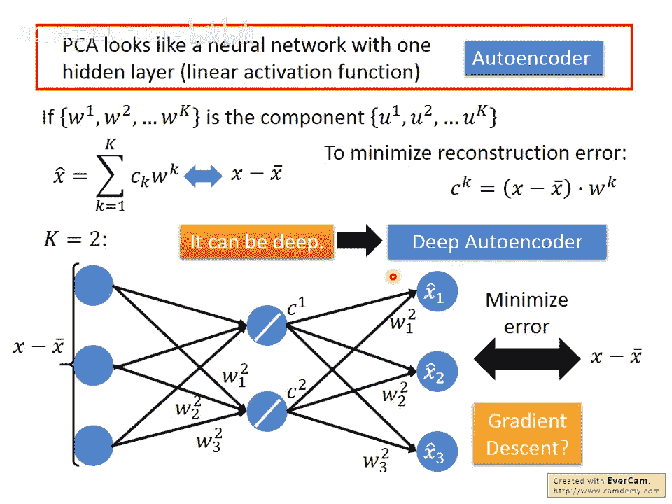

好那PCA其实有一些很明显的弱点，一个就是因为他是UNSUPERVISE，他是supervise，所以今天假如哦给给他一大堆点，没有label，那对PCA来说，它假设你只要把project到一维上。

PCA会找一个可以让data vari最大的那个dimension，比如说在这个case里面，或许它就把它破解到这一位上，把每一个绿色的点都破解到这一位上，但是有一个可能是。

或许其实这两组data point它们分别代表了两个class，代表两个class，如果你用PCA这个方法来做dimension reduction的话，你就会使得这两个蓝色跟橙色的class呢。

被merge在一起，他们在PCA找出来的single dimension上，完全被混在一起就无法分别，那那这个时候怎么办呢，呃你你可能会需要引入label data。

那LDA呢是考虑这个label data的一个降维的方法，不过它是supervise，所以这边呢就不是我们要讲的对象啊，这个LDA是linear discriminate analysis的缩写。

那另外一个PCI的弱点就是它是它是linear的，我们刚才在一开始举例子的时候，我们会说哦这边有一个S型的这个manifold啊，这边有一个有一堆点，它的分布呢像是一个S型的。

那我们期待说做dimension reduction以后，可以把这个S型的曲面呢把它拉直，但这件事情对PCA来说是做不到的，你要他做这件事情其实是是强人所难，因为你要把这个S型的曲面拉直。

是一个long lidia的transformation，PC做不到这件事情，如果你做PCA的话呢，你得到的结果呢，如果把这个S型的曲面做PCA，你得到的结果就是这样，OK你就是把它从蓝色这边呢。

把它像打扁一样把它打扁，把它打扁，有没有发现说蓝色跟红色的点呢就被压在一起，然后绿色的点在这边，黄色的点在这边，你会把它打扁，而不是把它拉开，因为把它拉开，这件事情是PCA办不到的。

那我们等一下呢会讲non linear的transformation好，再来呢我们就把PC用在一些实际的问题上，比如说我用它来分析宝可梦的data，这样我们这门课的那个例子都是宝可梦的例子。

那就宝可梦呢，我们都知道说他总共有800种宝可梦，那其实有人说是721种，因为那800种里面呢有一些是重复的，哎我也我也我也不知道怎么解释就是了，反正就是假设有800种好了。

那每一种宝可梦你可以用六个feature来表示，它，分别是生命值，攻击力，防御力，特殊攻击力和特殊防御力，还有它的速度等等啊，其实所以他们就是每一个宝可梦，就是一个六维的data point。

就是一个六维的vector，那我们现在呢要用p ca呢来分析它，那这样p ca的时候，常常会有人问的一个问题，就是我需要有多少个component，如果大家把它project到一维还是二维还是三维。

这个这个这个这个资讯量才足够呢，这这dependent你想要做什么，假设你想要做visualization，你想要做做，你想要让，因为现在六五，现在每个宝可梦都是六维吧，唉放在高。

你你没有办法了解这个宝可梦，它们之间的特性有什么样的关系，因为六维你没有办法看，所以你对你可能就会把它想要把它分解到二维，那就比较容易呢，分析这样子。

那其实要用多少个principal component，就好像是neal network要有几个layer，每个layer要多少个一的，even even variable要要有几个neural一样。

所以这个是你要自己决定的，那一个常见的方法是这样，一个常见的方法是说，我们去计算每一个principal component的浪打，我们知道每一个principal component。

就是一个icon vector，然后那个icon vector都对应到一个icon value啊，就是这边的long达，那这个I跟value代表什么意思呢。

这个AI跟value代表说我们把这个principal，我们用这个principal component去做dimension，reduction的时候。

在这个principal component的那个dimension上，他的variance有多多大啊，那个variance呢就是long大啊，今天这个宝可梦的data呢总共有六维。

所以它covariance matrix是六维，所以你可以找出六个icon vector，你可以找出六个icon value，那我们现在呢来计算一下每个icon value的ratio哦。

每个I跟value类ratio，我们就把每一个I跟value除掉呢，六个I跟value的总和，那你得到的结果呢会是这个样子，就第一个icon value它占全部的I跟value的0。45，第二个是0。

18，第三个是0。13，以此类推，所以看到这个结果呢，我们可以从这个结果看出来说呃，这边是0。450。18，0。13，0。12，再是0。070。04哦。

所以这个第五个principal component，和第六个principal component，他们的作用呢其实是比较小的，你用这两个dimension呢来做projection的时候。

你project出来的那个variant是很小的，代表说现在宝可梦的这些特性，在这第五个和第六个principal component上呢，是没有太多the information的。

它variance很小，虽然没有太多的information，所以如果我们今天要分析宝可梦data的话，感觉只需要前面四个principal，component呢就好了，所以我们就实际来分析一下。

实际来分析一下，那如果你做PCA以后呢，我们得到的四个principal component呢，就是这个样子，然后每个principal component就是一个vector嘛，而且每一个宝可梦。

它是有用六维的vector来描述它，所以呢每一个principal component，就是一个六维的vector啊，这四个principal component就四个六维的vector。

那我们来看一下每一个principal component，他在做的事情是什么呢，如果我们看第一个principal component，第一个principal component。

它的每一个dimension呢，每一个dimension都是正的啊，每一个dimension都是都是正的，就是那这个东西是什么意思，这个东西其实就代表了宝可梦的强度，知道吗。

就是呃如果你要产生一只宝可梦的时候，每个宝可梦都是由这四个vector，这四个vector做linear combination的，就每一个宝可梦可以想成是它的数值。

可以想成是这四个vector做linear combination的结果，这combine的weight每一只宝可梦是不一样哦，所以你如果在选第一个principal，component的时候。

你给他的weight比较大，那这个宝可梦就是它的六维呢都是强的，那如果选择只小呢，就是它的六维呢都是弱的，所以这第一个principal component呢，就代表了这一只宝可梦的强度。

那第二个pencipal component是什么呢，第二个pencial component，它在defense，它在这个防御力的地方是正值，它在速度的地方是负值，也就是说你要如果你选你。

你选就也就是说这个def这个防御力啊，跟速度啊是成反比的，是成反比的，你今天选，你今天给这个第二个component一个weight的时候，你会增加那只宝可梦的防御力，但是会减低它的速度哦。

所以呃宝可梦防御力提升的时候呢，它的速度呢会下降，那如果我们把第一个和第二个principal，component把它画出来的话，你会发现是这个样子，这个图上呢有800个点。

然后每个点呢就对应到一只宝可梦，来把它画到二维平面上，但这样我们很难知道每一只宝可梦是什么，所以我就做了一位做了一件发狂的谁做网页，而如果我们看第三第四个component的话。

那会发现说第三个第三个component呢，它是这个special defense是正的啊，special defense是正的，然后呢攻击力跟hp呢是负的，也就是说呢这是用呃特殊防御力来换取。

用用这个攻击力跟hp呢来换取，特殊防御力的宝可梦，那最后一个呢最后一个是他的hp是正的，然后呢攻击力和防御力是负的，也就是他是用攻击力和防御力来换取生命力的，宝可梦，那这些分别是什么呢。

如果我们把第三个和第四个pciple component，画在图上的话，其实它们也是椭圆的形状，也是椭圆的形状，我基本上考虑的是统计的结果，所以会有一些outlier，好嘞，我统计的结果最后算出来呢。

它是呃DECORRELATION的呃，其实呢呃特殊防御力，用用攻击力和生命值换特殊防御力的，其实也是虎符，这样他它不只是一个攻击力，而它不只是一个防御力特别高的宝可梦。

它还是一个特殊防御力特别高的宝可梦，第二名是这个这个冰冰住机器人，这样子好，然后如果我们看生命力的话，看第四个component就是生命力特别强的，那这个其实跟我们的预期是一样的。

就是这个是吉利蛋跟幸福蛋，对不对，哎，好大好，这你就可以用，所以今天至少我们回答到一个问题，我们知道最强的宝可梦其实是其实是超梦，还有那三只神兽是特别强的好。

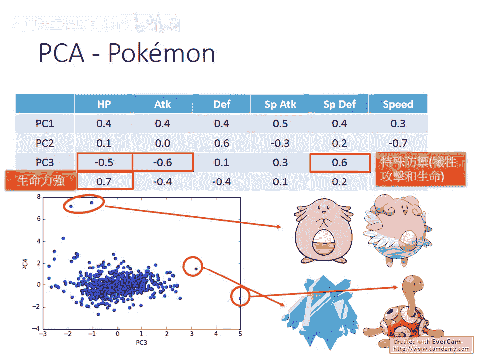

那如果我们可以拿它来做其他test，比如说我们拿它来做影像的这个数字，手写数字的辨识的话，那会怎么样呢，我们可以把每一张数字都拆成了，component的weight，乘上component。

加上component的weight，乘上另外一个component，但其实每一个component都是一张image，对不对，每一个component都是一个，2828维的vector。

所以你可以把它画在图上，把它变成一张image好，那我们先把我们如果画前30个component的话，我们画PCA得到前30个component的话，你得到的结果其实是这个样子的。

这个看起来就白色的地方代表有笔画的啦，而且这个是一哦，这个看起来有点像九，这个看起来是零呢，中间接一条线，这个看起来嗯不知道，这个看起来像是这样的，勾勾等等啊，后面呢这个很复杂。

看起来像玛雅文字那么复杂，然后这些这些啊，这些你你用这些这些component呢做linear combination，你就可以得到所有的digit，就可以得到0~9这样。

所以这些component呢就叫做icon digit啊，这也叫icon digen，就是说icon，就是说这些component其实都是conference matrix的icon，vector吧。

所以叫它icon dei，用这icon dj做linear combination，你就可以得到各种不同的点进。

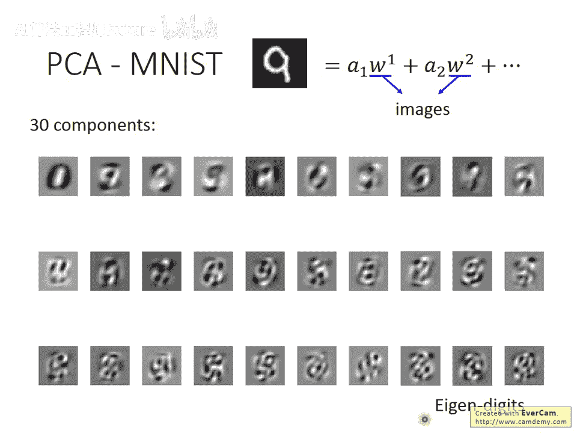

那如果做人脸辨识的话，论做处理人脸的话，得到的结果大概是这样，这边呢有一大堆的人脸，就一大堆人脸，然后呢你就做找他的这个呃，Principal component，哎就找他的。

你就找他的这个principle，你就找他的principal component，来找前30个principal component，每觉突然找出来就是这样，每一个都是都是那个哀怨的脸。

这样子对他叫哀跟face，就每一个都是你看每一个都是一个脸啊，每一个每一张呢都是一个脸，来把这些脸呢做linear combination以后呢，就可以得到呃所有的脸看，那但是这边你有没有觉得。

有些地方跟你预期的不太一样呢，我第一次看到这个结果时候，我觉得跟我预期的不太一样，是不成受有bug了，因为我们说PC找出来的是是component，对不对。

我们把很多component linear combine以后，它会变成一个face或者变成一个DJ，但我们现在找出来的不是component啊，我们找出来的每一个图，这都几乎都是完整的脸。

几乎都是完整的，连不你刚才看那个呃，刚才看前一个数字，你找出每个I跟DJ，他看起来都是玛雅文字，他们不是不是component，不是不是笔画一笔画这种东西不是圈圈啊。

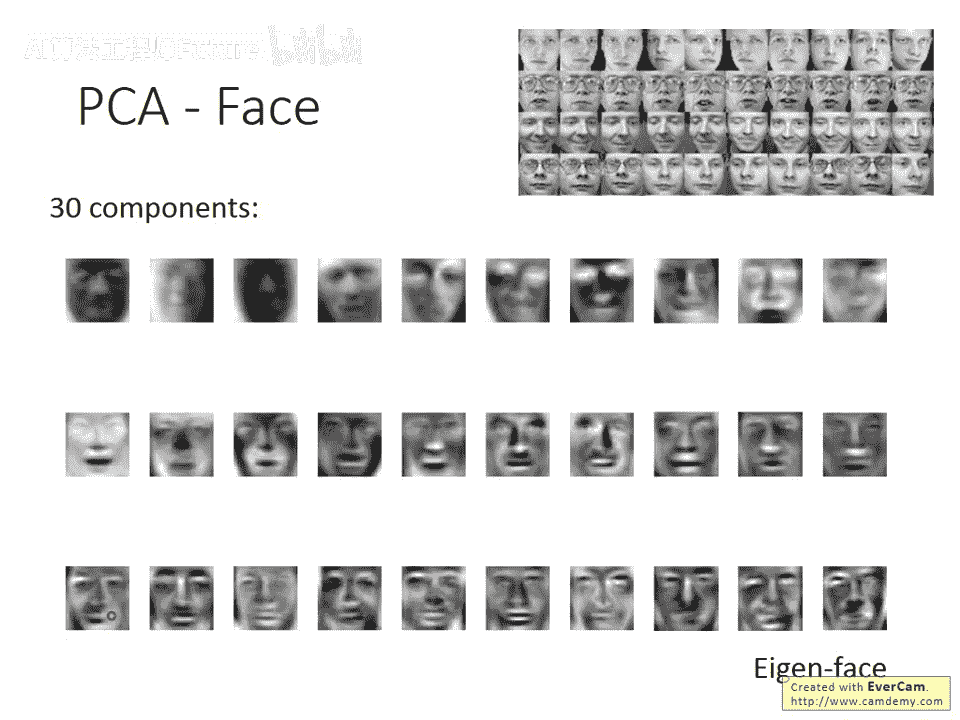

一竖啊这种东西，那为为什么会这样呢。

如果你仔细想想看PCA的特性，你会发现说会得到这个结果呢是可能的，因为在PCI里面，你的这个weight啊，你的这个linear combination的weight啊，它可以是任何值。

它可以是它可以是正的，也可以是负的，所以当我们用这些principal component，组成一张image的时候，你可以把这些component相加，也可以把这些component相减。

所以这这会这会导致说你找出来的con空呢，不见得是一个图的这个basic的facing的东西，为此举例来说，假设我想要画一个九，那我可以先画一个八，然后再把下面的圈圈剪掉，然后再把一杠加上去。

这样大家了解我的意思吗，因为现在我们把这些，我们不一定是把这些component加起来，我们可以把这些component相减，所以就变成说你可以先画一个很复杂的图，然后再把多余的东西剪掉，这是为什么。

我们刚才会看到一堆玛雅文字的关系，这些component其实不见得是类似笔画这种东西，那如果你想要得到类似笔画的东西的话，怎么办呢，你要用另外一个技术。

叫做那negative matrix的这个factorization，OK那在NNEGATIVEMETROPHORIZATION里面呢，我们刚才讲说p ca，它可以看作是对matrix x做SBD嘛。

而SBD就是一种metro factorization的技术，就是一种矩阵分解的技术，但它分解出来的两个metric的值可以是正的，可以是负的，那现在如果你用NF的话，我们没有打算要。

我没有打算讲他的细节，我等下列的reference给大家参考就好，但如果简单的话，精神就是如果我们现在用NF的话，我们会强迫所有的component呢都是正哦。

而我而且我首先我会强迫所有component的weight，都是正的，是正的的，好处就是现在一张image必须有component叠加得到，而你不能说我先画一个图很复杂的东西。

然后再把再把它再把复杂的东西去掉，一些一些部分得到一个解决，那现在呢因为每一个weight都一定要是正的，所以不能，所以你只能相加再来，就是所有的component呢。

它的每一个dimension也都必须要正，如果你用NNF的话，你会让你的每一个dimension呢都是都是正，那如果你用PCA的话，你得到dimension不见得眉尾都是正。

你找出来的principal component里面呢，它会有一些负值，还会有一些负值，那你知道如果你现在要画一张image的话，其实赋值你是有点不知道该怎么处理的，就如如我。

如果我今天把那个负值都当做，就是呃呃就没有笔画，就是零的话，你可整张图看起来都黑漆漆，但我的图都黑漆漆，就很怪，那我我前面那几张图的做法是，如果有负值又有正值，我会把它normalize。

把它做一个平移，让负的也都变成正的，你看起来图呢才会比较好看，那这个就有点麻烦，如果你用NNF就不会有这个问题了，你找出来的component呢都是正的。

所以那些component就很自然的会形成一张image啊，下面呢这个是reference给大家参考，所以如果在同样的task上，比如在手写数字的test上一样的快NNF的时候，这个时候呢。

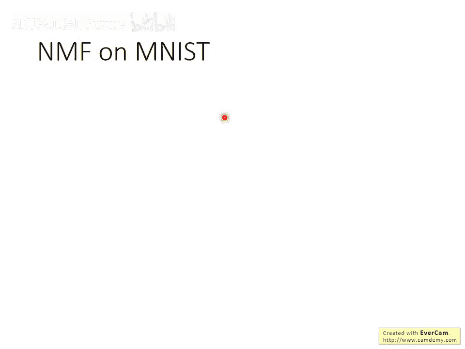

你找出来的那些principal component呢，它就会涨价，它就这样，它它就会它就会清楚很多，明白说这显然都是都是笔画，这个是重的，这个是零的两边，这个是斜的那一小一小点，一直线一撇。

这样子一横线一撇，这样子你会发现你找出来的每个东西，就都变成是笔画了，就变成笔画，这跟我们本来想要找的东西呢是比较像的。

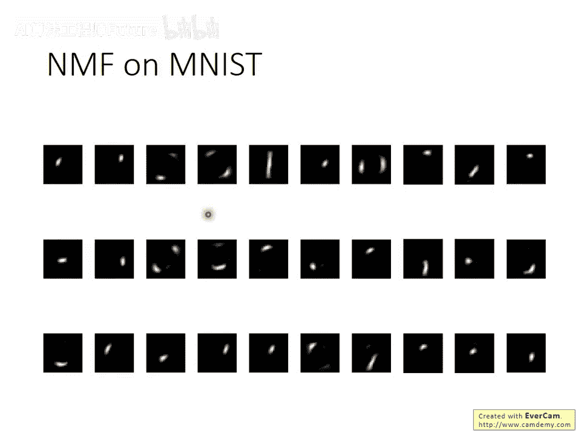

如果你看脸的话呢，你就会发现说呢他长得是这个样子，它比较像是脸的一些部分，比如说这个是呃人中的地方，这个是眉毛，这个是下巴，这个是嘴唇，这个也是这个也是嘴唇等等，如果你今天是用NNF来对。

你对这个人脸的图片做NNF的话呢，你得到的结果呢会比较像是你期待要找的，像是component一样的东西。

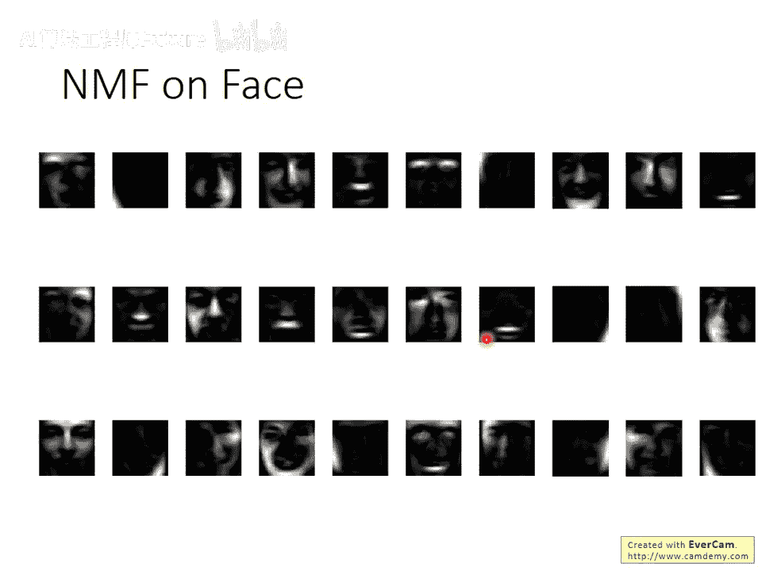

好，那接下来剩下时间，我们讲一下这个matrix的factorization，那metrics the factorization是这样，有时候呢呃你会有两种东西，你会有两种object。

它们之间呢是受到某种共通的latent的，factor呢去操控的，什么意思呢，就假设我们现在做一下调查调查，每个人手上有每个人有买的那个公仔的数目，这样子，然后ABCDE呢代表五个人。

我们调查一下每个人手上有的公仔的数目，比如说调查连A有五个量宫春日的公仔，B有四个，C有一个D有一个样子，然后这个是御坂美琴，然后A有三个，B有三个C有一个等等，那这个是这个是解释啊，解释知道吗。

那他呃我想看他的原名到底是什么啊，他是小野寺，OK他小野寺对不对，好好这是小野寺，然后D有四个EO5，然后这个这个是呃小维啊，这是平泽伟啊，然后C有五个，C有四个，D有四个哎。

你会发现说呢在这个matrix上面，每一个table里面的block并不是随机出现的，你会发现说如果有买凉宫，有凉宫春的公仔的人，就比较有可能有御坂美琴的公仔，有有这个解释。

公仔的人就比较有可能有小唯的公仔，那是因为说这个每一个人跟每每一个人呢，跟他的这个跟那个角色背后呢，是有一些共同的特性，有一些共同的factor呢来操控这些事情发生的呃，OTX这个是御宅族的意思。

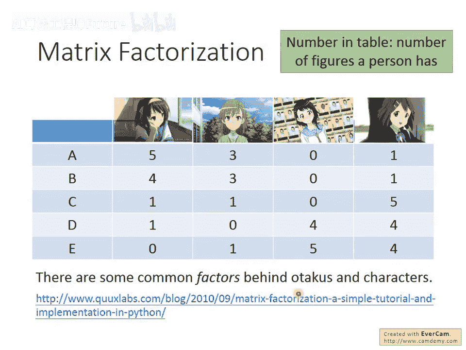

这样子哎，就每一个每一个预载组和每一个角色，后面呢是有一些共同的这个factor呢，在操控他们的，什么意思呢，什么意思呢，那其实呢这个呃动漫宅或许可以分成两种，有一种是萌傲娇的，有一种是蒙天然呆的。

而每个人呢其实就是在萌傲娇和萌天然呆的，这个平面上的一个点这样子啊，所以如果比较偏，所以A呢是比较偏萌傲娇的，那每一个角色呢它也是可能是萌傲，他可能是有傲娇属性，或者是有天然呆的属性啊。

所以每一个角色呢也都是平面上的一个点，我每个角色你也都可以用一个vector来描述它，如果某一个人某一个属性跟某一个角色，它本身所具有的属性是match的话。

所谓的属性match是说他们背后的这个vector啊，他们这个背后的这个vector啊，很像，而他们背后的这个vector啊，他们比如说你说inner padda的时候呢值很大。

那这一个人呢就会买很多凉宫春日的公仔，这样子啊，所以这个他们有没有match的这个呃degree呢，他们这个匹配的程度呢，就取决于他们背后的这个latent factor呢，是不是匹配。

所以只可能ABC，他们背后的这个他们萌的角色呢，是大概这个样子，A是萌傲娇的，B也是萌傲娇的，但没有A那么强，然后C是蒙天然呆的，然后每一个动漫人物的角色，后面呢也都有傲娇和天然呆这两种属性。

而每一个角色都有它不同的，都有它不同的属性，然后如果他们的属性，他们背后的属性是match的话，那这个这个这个人呢就会买这个公仔，就这个世界操控的逻辑是这个样子的。

但是这些factor就一个人到底是萌傲娇还是萌，天然呆，这件事情是没有办法直接被观察的。

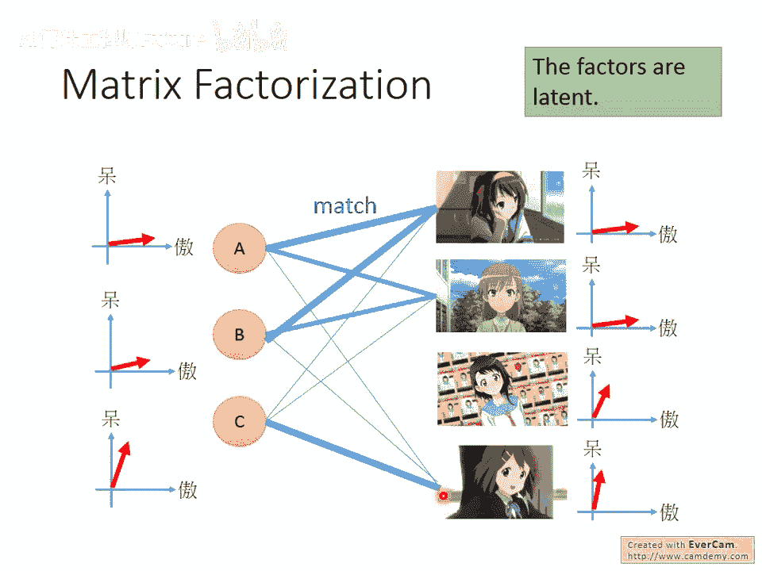

因为其实没有人在意一个阿宅，他心里想什么这样子，所以这些事情是没有人知道的，那你你也你也没有办法直接知道。

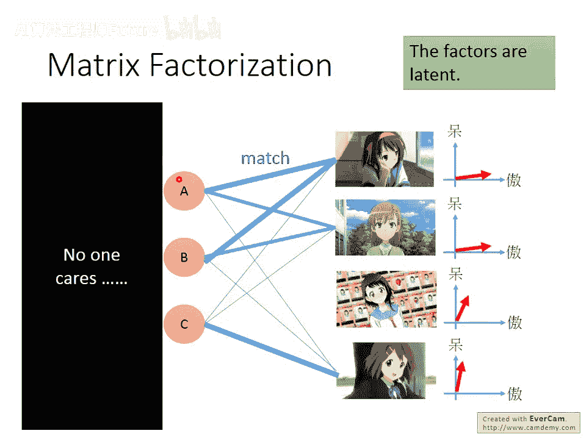

说每一个动漫人物他背后的属性呢是什么，这个也是没有办法直接观察到的，所以我们有的东西是什么呢。

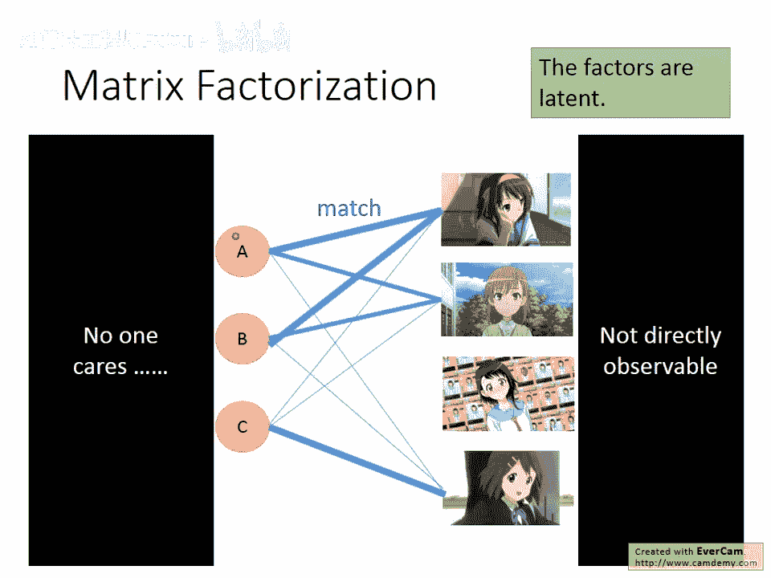

我们拥有的是这个动漫人物跟阿仔中间的关系，讲他们中间的关系，也就是也就是他手上有的公仔的数目，它们之间的关系，那么凭着这个关系去推论出呢，每一个人呢跟每一个动漫人物呢。

他们背后的later的factor，他们每个人背后都有一个二维的vector，分别代表了他，某，就每一个这个每一个这个阿宅背后呢，都有一个vector，代表了他萌傲娇或者是萌天然呆的程度。

他都是用一个vector来表示，那每一个人物呢他背后也都有个vector代表呢，他是他的傲娇的属性，还有天然呆的属性，而我们知道的每一个阿仔，他手上有的这个公仔的数目呢。

你就可以把它合起来呢看作是一个matrix x呃，你可以把它合起来呢看作是一个matrix ex，那这个matrix x呢，它的roll的数目呢就是OTAKU的数目。

它的这个colon的数目呢就是动漫角色的数目，那你现在我们现在要做的事情呢是做一个假设，这个假设是这样子的，每一个这个matrix里面的element，它都来自于两个vector的呃。

inner qua它都来自于两个vector的内积，就这个五呢，为什么A会有五个梁龙村的公仔呢，是因为RA跟r one的inner pada很大啊，他们的inner pada是五啊。

所以他就会买它就会有五个凉宫春日的公仔啊，如果RB跟r one他的inner发达是四的话，那就会有那B就会有四个量宫春日的公仔，以此类推，这样就这样，这个世界运作的逻辑就是这个样子的。

那这件事情如果你用数学式来表示它的话，你可以写成这样，我们把RA到R1排成一排，我们把IA到R1排成一排，把r one到r four，把r one到r four。

也当做是另外一个red metric的roll啊，把它排起来，把它排起来，那这个这个K呢是latent的factor的数目，这个东西我们是没有办法知道的，就我们把人分成只有萌傲娇和蒙天然呆。

这样是一个不精确的不精确的分析方式，如果我们有更多的data的话，我们应该可以更准确的知道说应该有多少factor，但是实际上要有多少factor，这件事情你必须要去试出来。

就是就像是principal component的数目，或者是这个P这个这个neural network层数一样，这个是你要事先决定好的，然后我们现在就假设说latent factor的数目呢。

Latent factor，数目呢就是KOK所以这个RA到RE呀，你把它当做MATCHROLL，这边就有N乘K个，就是一个N乘K的metric，你把r one到r four当做colon。

那就是K乘N的method，那你把这个N乘K的MATRIK乘N的MEI乘起来，你就会得到一个我写错了，这个应该是N的不好，这个应该是M这个应该是有N个and of top，所以是有N个人。

所以是有N个人，OK好，所以把这个N乘以K乘上K乘以N，得到N乘以N的matrix，那它的每一个dimension分别是什么呢，我们知道说最左上角这个dimension啊。

最左上角这个dimension，如果你现在熟的话，它就是RA乘上r one，对不对，那这个第一个roll，第二个colon的这个element，N下标A2就是RA乘上R2。

N下标b one就是RB乘上r one，N下标b two就是RB乘上r two，OK所以这个MATRIC是什么呢，这个MATRI其实就是这一个MATRI啊，其实就是这个MATRIC。

就假设我们说这个matrix就是这个matrix的话，那我们要做的事情就是找一组IA到R1，找一组R到R1，找一组r one到r four啊，找一组RN到r four，把这两个MATCHI相乘以后。

跟这个matrix呢它越接近越好哦，minimize这两个matrix相乘了以后，跟这个matrix之间的这个reconstruction的error，那这个东西呢我们刚才讲过，你就可以用SVD来记。

那可能说SBD不是解完以后有三个matrix吗，中间还有个西格玛的，你就看你要把西格玛并到左边，还是并到右边都可以，然后你就把日把这个matrix呢拆成两个MATRIC。

那他们可以minimize the reconstruction error，然后就结束了，但有时候你可能会遇到这个问题，就是有一些information呢是呃是是Missing的。

是你不知道这个与否没选的，比如说ABC，他们你并不知道ABC手上呢有没有额，有没有小野寺的公仔，因为也有可能就只是在他所在的那个地区，没有发行这个公仔而已，所以不知道如果发行的话，它到底会不会卖。

所以这边呢其实是问号，这个是问号，就假设这个table上有一些问号的话，怎么办呢，这table上有一些问号的话，你用刚才那个SBD的方法就会有点卡啊，就是有点卡，你可能说我把这个值呢都就当做是零。

然后硬做一法，这样也可以啦，不过总觉得有些怪怪的，可以描述的更精确一点，那所以如果今天在这个matrix上面，有一些Missing的value的话，怎么办呢，有一些Missing的value的话。

我们还是可以做的，我们就用gradient descent的方法来做它，就我们写一个lost function，这个lost function是这样子呃，我们要让RIRI指的是每一个这个OHUF。

背后的latent factor，而RJ呢指的是每一个动漫角色背后的，Latent vector，你要让I这个人，他的latent vector乘上J这个角色，他的latent vector。

这个inner parta跟他购买的数量，NIJ呢越接近越好，那重点是说我今天在some mention over这些element的时候，我可以避开这些Missing的data。

我们可以避开这些Missing的data，我在submention over这些IJ的时候，如果今天这个值是没有的，我就不算它，我们只算这个值呢是有定义的部分好，那接下来怎么办呢。

接下来呢你都把loss function写出来了，那你要找RI跟RJ就用gradient descent就好了，用gradient descent硬算一发，然后就结束了，这好那所以根据刚才那个例子呢。

我们就可以实际的用gradient descent呢来做一下，那我们假设呢，这个latent factor的数目呢等于二啊，假设lent factor的数目等于二，那每一个这个A到A到E呢。

他们就都会你就可以，他们就都会对应到一个二维的vector哦，所以A的vector这样，B是这样，C是这样，以此类推哦，每一个人呢都会对应到一个vector，那每一个这个角色呢。

它也都可以对应到对应到一个vector，那我怕大家如果我只写这个字的话，有人会不知道是什么意思，老师这边特别也把编号列出来啊，这个是春日，这个是炮姐这个解释，这是小维好，那你就会找出说。

每一个角色呢也都得到一个factor，也都得到一个latent factor，这代表了他的它的属性，代表它的属性，而这些这这个这个每一个人的letter factor，就代表了他他谋哪一种属性。

所以如果我们把它在两个维度里面，比较大的维度挑出来的话，你就会发现说呢A跟B呢是蒙同一组属性的，CDE呢是蒙同一组属性的，一跟二呢它们有同样的属性，然后三跟四呢他们有同样的属性，你没有办法真的知道说。

每一个属性分别代表的是什么，你不知道说，这个维度是代表的是傲娇还是天然带，你不知道这个维度代表的是傲娇还是天然带，你会需要先找出这些latent factor以后，再去分析它的结果，你就可以知道说。

因为我们已经事先知道说，解释跟小维是有天然呆属性，所以第一个维度代表的就是天然呆的属性，而第二个维度代表的就是傲娇的属性啊，接下来有这些data以后呢。

你就可以预测你的Missing the value，你就可以预测问号的值，怎么预测问号的值呢，我们如果已经知道R3，我们已经知道RA，那我们知道说一个人会购买公仔的数量，其实是它背后的公仔。

被这个这个动漫角色背后的latent vector，而那个人背后的latent vector做inner发达的结果，所以我们只要把R3跟RI做inner FA，你就可以预测说这个人会买多少的公仔样子。

所以做完inn夸大以后的结果呢就是这样子，这告诉我们说这个C呢会，如果说这个这个这个RC跟R3，他们的make or vector其实是match的，所以这个C这个人呢如果他可以买的话，他会买呃。

预期他会买2。2，他会有2。2个杰斯的公仔，所以你就可以推荐杰斯的公仔给他，也可以推荐他入坑这样子，所以这种方法呢比常用在这种推荐系统里面，大家可能都有听过那个NETFLIX的比赛啊。

你可以把如果你今天把这个动漫角色换成电影，你把这个中间的数值呢换成rating的话，就可以预测说某一个人会不会喜欢，某一部电影等等哦，线上推荐系统呢。

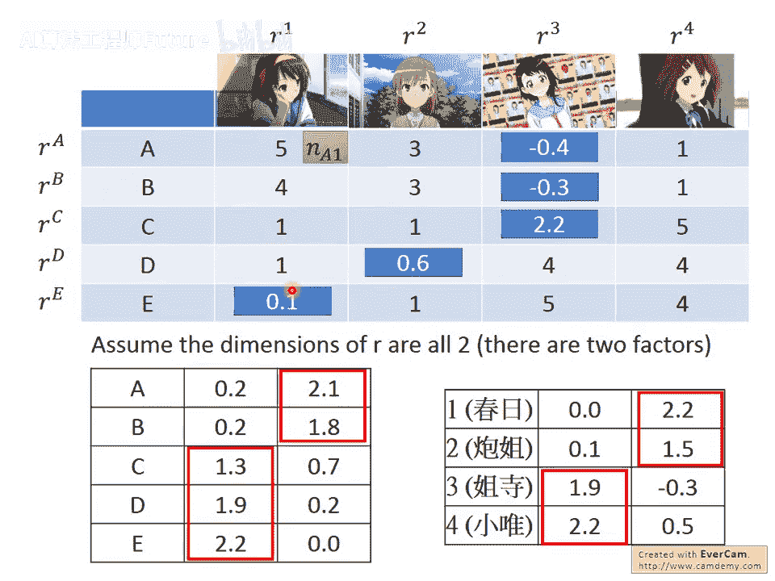

现在很多都会使用这样子的技术，那其实呢刚才那个model可以做的更精致一点，我们刚才说A背后的latent vector，乘上一背后的vegan vector，得到的结果呢就是table上面的数值。

但是事实上可能还有别的因素会操控它的数字，所以更明确的写法，或许是我们可以写成RA跟r one的inner fada，加上某一个跟A有关的scale，再加上某一个跟E有关的scale。

其实才等于这跟A有关的SCALA，BA指的是什么呢，它代表的是说这个A呢他有多喜欢买公仔，这样有的人呢他就只是他其实也不特别萌，那个角色，他就只是想要买公仔而已，所以这个A呢。

这个BA呢代表它本身呢有多想要买公多本，本身有多想要买公仔，那这个b one呢代表说这个角色，他本质上会有多想让人家购买，就这件事情是跟属性无关的，就是他他本来就会想要购买这个角色，比如说最近呃。

比如说最近凉宫春日，庆祝这个动画十周年这样子，然后就出一些蓝光DVD什么的，然后所以大家就可能会比较想要想要买阳光，春日的工程，其实也不会啦，所以所以就会有这个b one这样子好。

那所以你今天就改一下这个呃minimize的式子，就变成说把RI跟RZ的inn华达加上bi，再加上BJ，然后你会希望这个值呢跟NIJ越接近越好啊。

你会希望说这两个latent factor in a pada，加上呢这个呃代表I本身的SCALA，还有代表J本身的SCALA，要跟在table上面看到的值呢越接近越好，这样那这个怎么解呢。

这个没有什么好讲的，你就用gradient descent的硬解一发就好了，那你也可以加REGALIZATION，如果你觉得呃应该要REGALIZATION的话呢，你也可以在这个RIRJ。

BIBJ上面呢加上REGALIZATION，比如说你会希望说呢BRRIRJ呢是spars的，每个人呢他要么就是萌傲娇，要么就是萌天然呆，不会有模糊的人。

那你可能呢就会想要加上l one的regularization，然后呃如果你想要知道更多的话呢，以下是mei factorization，经典的paper，他讲的在这个NETFLIX上面呢是怎么做的好。

那METRIFIORIZATION还有很多其他的应用，比如它可以用在咖啡analysis上面，那这个呢应该是大家做呃，等下这个呃11点多的时候，助教会来讲一下这个作业四啊，作业是要做的是跟文字有关的。

那里面呢你可能会需要用到topic，analysis的技术，那如果是把刚才讲的MEJORCORNATION的方式，用在TBIANALYSIS上面的话呢。

就叫做latent semantic analysis usa，那他的技技术啊跟我们刚才讲的是一模一样的，而这只是换个名词而已，就只是把刚才的动漫人物统统换成文章，把刚才的人呢都换成词汇。

那table里面的值呢好吧，都把人物换成文章，人呢都换成词汇，那table里面的值呢就是太frequent，就是说投资这个word在document one里面出现五次股票。

这个word在document one里面出现四次，以此类推，那有时候我们不只会用turn frequency，也会把这个turn frequency呢再乘上一个呃weight。

代表说这个turn本身呢有多重要，如果你把一个turn呢乘上比较大的weight的话，今天你在做呃METAPHORIZATION的时候，mea turn呢它就会被呃比较考虑到。

你就会比较想要让那个turn的reconstruction error呢，也就比较想要让那个tender reconstruction error呢，这个这个这个比较小。

那这通常那怎么evaluate一个turn这么重要呢，那有很多方法，比如常用的呢就是inverse document frequency，这个呃我想等一下是不是教会讲，或是如你不知道的话呢。

你可以呃自己google一下啊，所以inverse dor frequ，简单的来讲，就是计算某一个词汇，在整个POPUS里面有多少比例的document，有涵盖这个词汇。

假如某一个词汇是每一个document都有的，比如说的每一个document都有，那它的inverse document frequency呢就很小，就代表说这个词汇的重要性呢是低的。

假如某个词汇是只有某一篇document有，那它的inverse document frequency呢就很大，而代表这个词汇的重要性呢是高的，那在这个task里面。

如果你今天呢把这个matrix做分解的话，你就会找到每一个document背后的lator factor，你就会找到每一个词汇背后的lain factor，那这边这个later factor是什么呢。

今天这个test里面，你的latent factor可能指的是topic，你可能指的是这个这个这个这个这个这个主题，这样就某一个document它背后要谈的主题，有多少部分是跟财经有关的。

有多少部分是跟政治有关，那某个词汇它跟它有多少部分是跟财经有关的，它有多少部分是跟政治有关的，比如说呢可能呃可能今天在这个例子，可能今天在这个例子里面呢，投资跟股票是跟呃财经有关的。

那呃DOCUONE跟document to又都有比较多的投资人，股票这两个词汇，那document one跟document to呢，它就比较有比较高的可能性呢。

它背后的latent factor呢是偏向于财经的，那其实他比analysis的方法呢多如牛毛，而像他们基本的精神呢是差不多的，但是有很多各种各样的变化。

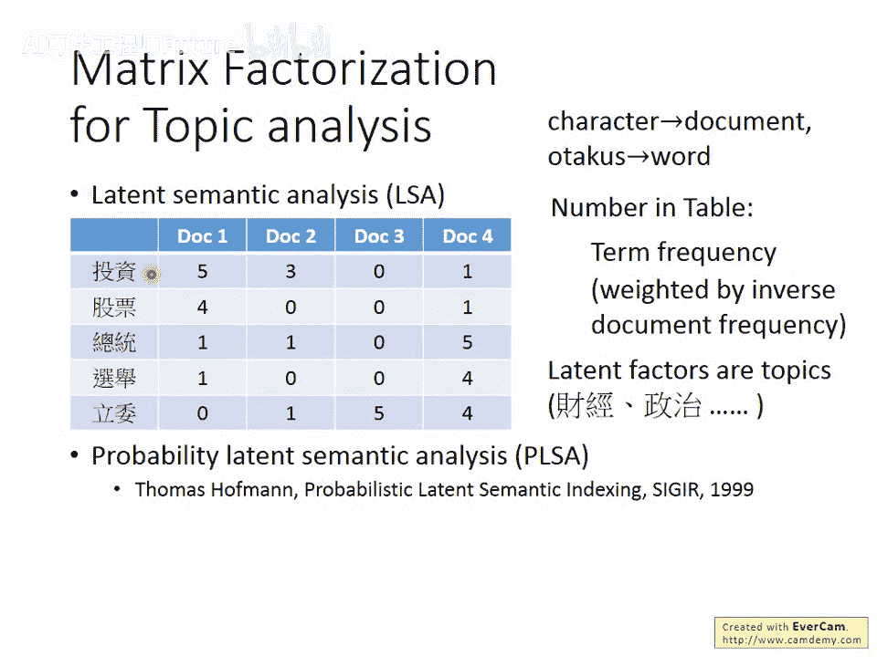

一个常见的是这个probabilistic，The latest semantic analysis p o s a，还另外一个是latent to replay location l da。

那这边呢就把REFERDI这边给大家参考，前面我们也有讲过另外一个LDA，就是在machine learning里面有两个LDA，那他们是完全不一样的东西，就是就是怎么回事啊。

这边就是一些reference给大家参考，其实呢这种dimension reduction方式这边还没有列，呃，这边只列一些跟PCA比较像，比较有关系的。

那这个呢呃呃这个dimension reduction的方法，多如牛毛，比如像NDSNDS，它特别的地方是，它不需要把每一个data都表示成feature vector。

他要知道的只有feature vector和feature vector，之间的distance，你只要这个distance你就可以做dimension reduction，那一般教科书举的例子都会举。

说我现在有一堆城市诶，你不知道怎么把城市描述成一个vector，但你知道城市和城市之间的距离啊，就有这个每一个data，每一笔data塔之间的距离来，就可以把它画在一个二维的平面上。

那其实NDS跟PCA是有一些关系的，你如果用某些特，如果用某些某某些特定的这个distance，来衡量两个data point之间的距离的话，你又做NDS就等于是做PCN，所以其实PCA有一个特性是。

在低维空间中，它距离也是远的，以此在高维空间中是接近的，在低维空间中呢也是接近的，那p ca有几率的版本，那probability of pc a p c a有非线性的版本，叫kernel的p ca啊。

另外一个东西叫CCA，CCA是说如果你有两种不同的source，这个时候你会想要用CCA，比如说如果你做语音辨识，那你的两个source一个是声音讯号，另外一个是假设你今天其实是有荧幕的。

那你可以看到这个人的这个唇形，你可以读他的唇语，那你现在有声音讯号，有那个人嘴巴的image，那你把这两种不同的source都做dimension reduction，那这个呢是CCA啊。

还有另外一种东西叫ICA，然他们名字听起来都很像，那ICA比较常用，在SSEPARATION上面，他要做的事情是呃，原来在PCI里面，我们找出来的components of sober。

那ICI里面我们不见得要找ICNS，我们不见得找Sol node component，我们找independent component就好，然后用一套很复杂的方法来定义。

什么叫做independent component，那还有呢刚才我提到的LDA他是supervise的方式。

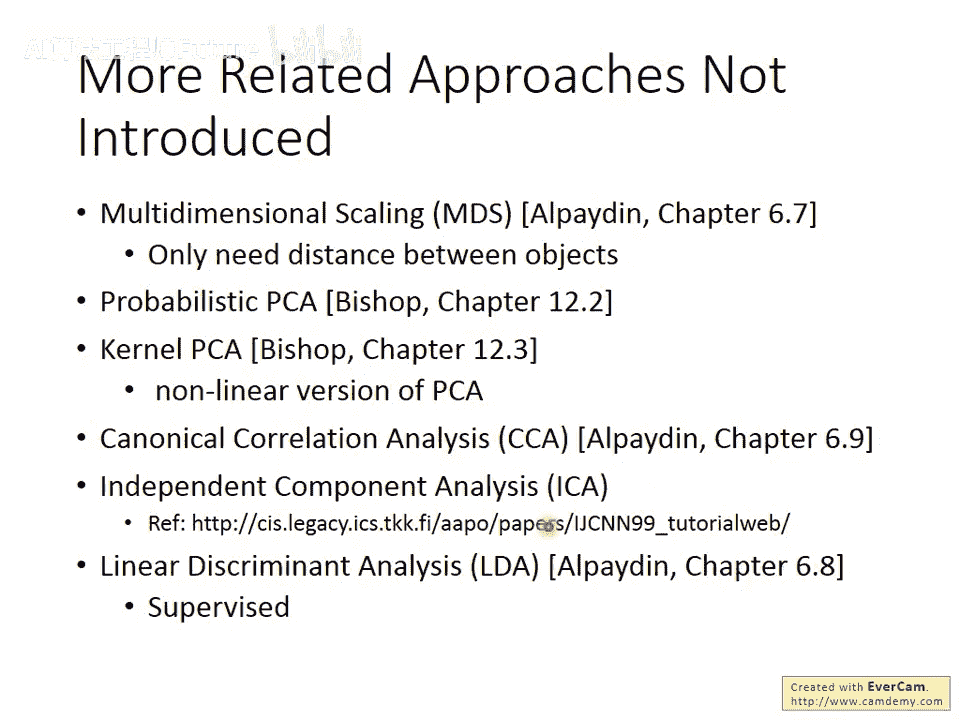

那以上呢给大家参考，我们在这边休息10分钟。