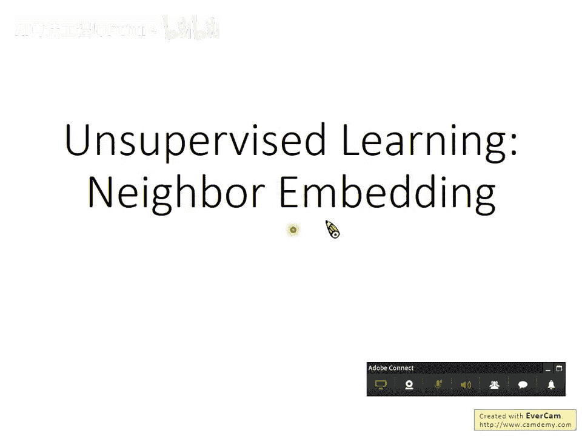
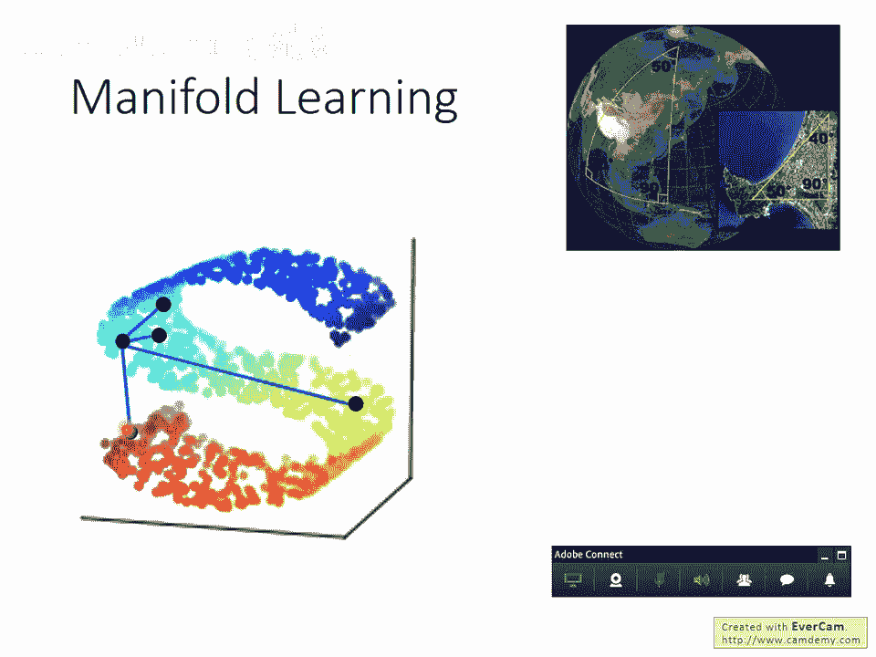
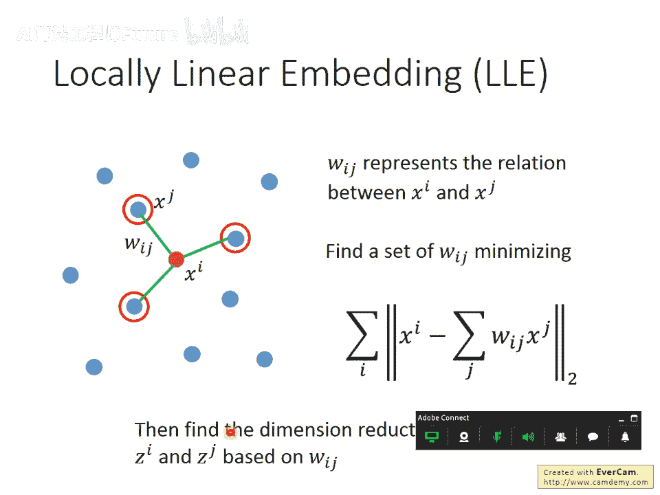
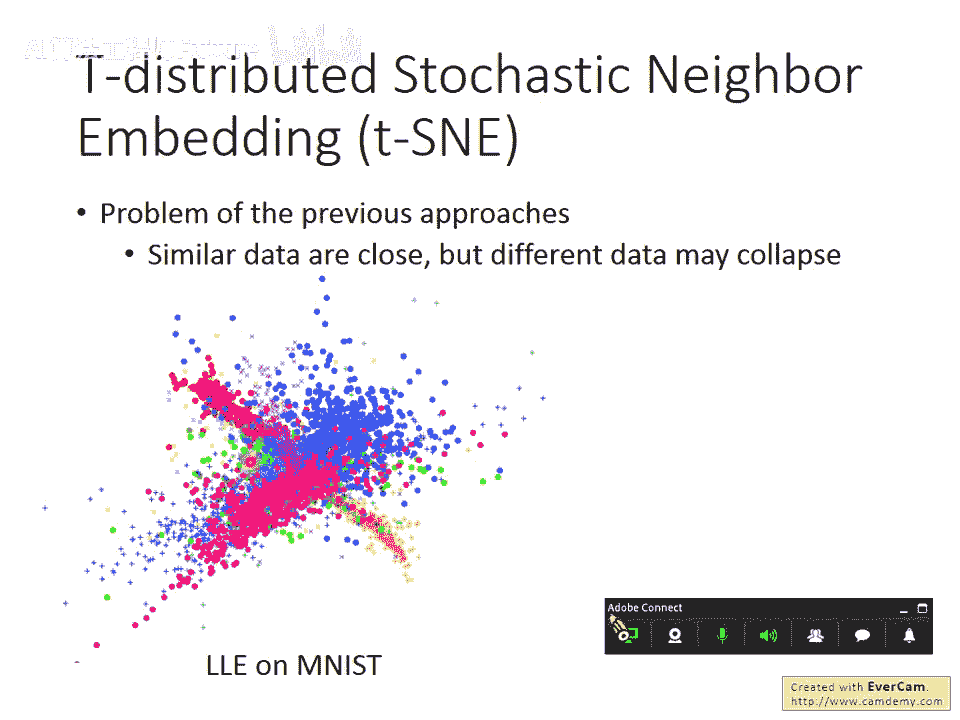
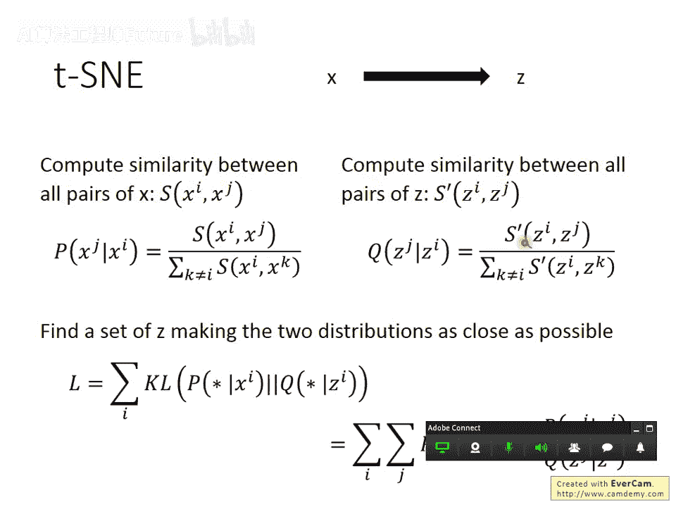
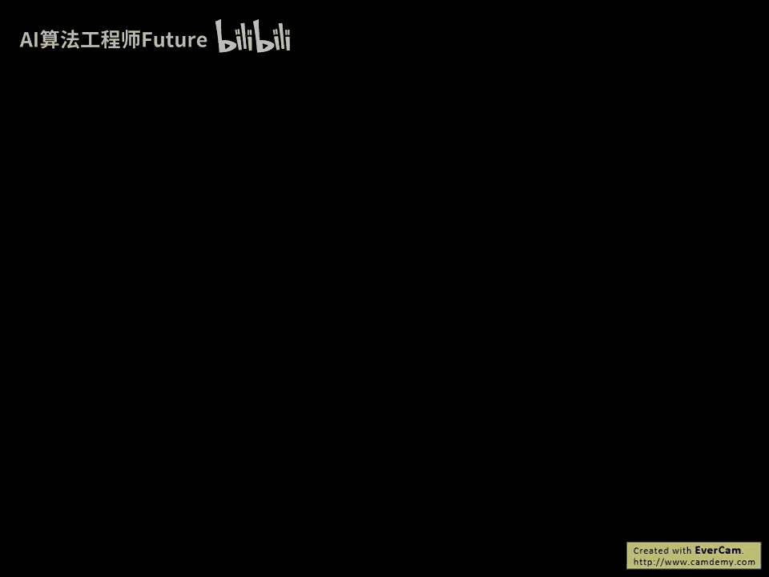
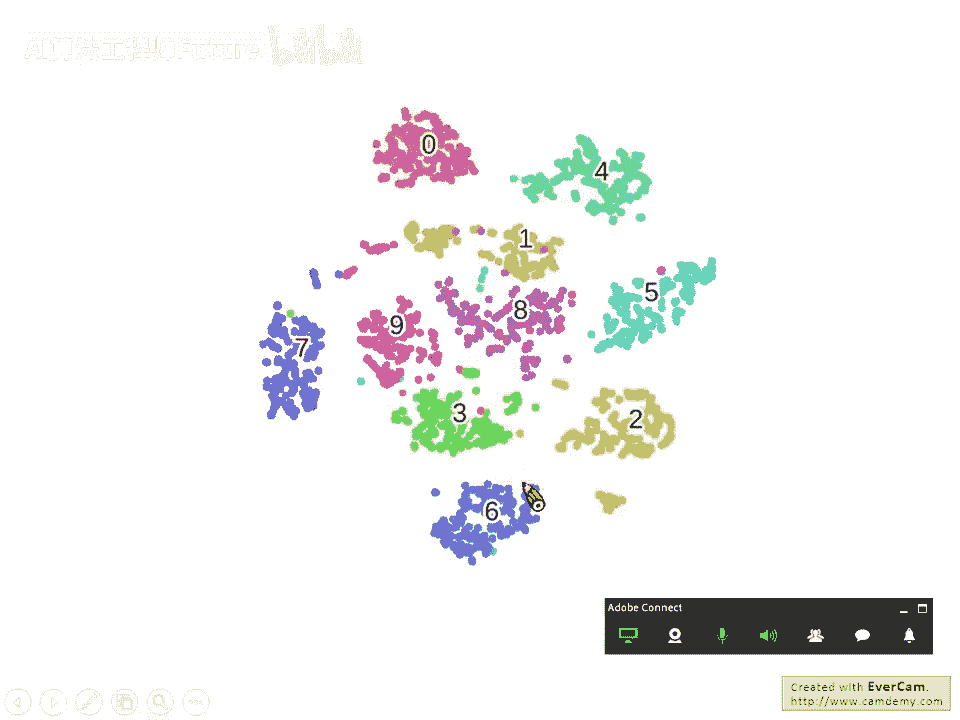

# 【官授搬运】2026年全新优化版李宏毅机器学习系统课程，这才是真正的初学者体系课程！—人工智能／深度学习／神经网络 - P63：4-选修-t-SNE介绍 - AI算法工程师Future - BV1ruqABeEFX

接下来呢我要讲的是呃，Neighbor in bending，就我们在这个作业，最后一个作业的这个投影片里面呢，助教有提到一个东西呢叫做TSN1啊，T s n1，我相信呢你在很多不同的场合呢也常常听到。

那但是如果有人问你说TSN1是什么的时候呃，有和大家往往都打不出来啊，现在我们要来讲一下TSN1是什么啊，TSN1的N1，其实就是neighbor embedding的缩写好。

那我们现在要做的事情呢。

其实就是我们之前讲过的降维，只是我们要做的事情是非线性的降维，而我们想要做到的事情是说我们知道说data point呀，也就是说data point的分布，它其实是分布在一个低维的空间里面。

那呃讲到metaphor的时候，常常举的例子就是这个呃地球这样啊，地球的表面就是一个metaphor，它是个二维的平面，但是被塞到了一个三维的空间里面，那在一个这样子的情况下呢。

在一个metaphor里面呢，只有这个很近的距离的点，在很近的距离的情况下，有plean distance呢才会成立，这如果今天距离很远的时候呢，这个额欧式几何呢它就不一定成立，也就是说。

假如我们在这个S型的这个空间里面呢，取某一个点是放在这边，那我们比较我们用ukan distance，比较这个点跟这个点之间的距离，比较他跟他之间的距离，看他跟他之间的距离。

或许这件事情是make sense的，它跟它比较不像，他跟他不像，但是如果今天是距离比较远的时候，你要比较这个点跟这个点的相似程度，跟这个点跟这个点的相似的程度，就变得不make sense了。

呃因为呃如果根据uclean distance，它跟它比较近，它跟它比较远，但是实际实际上呢，实际上呢很有可能他跟他是比较近的，他跟他是比较像的，他跟他是比较不像哦。

所以metaphor learning要做的事情是。

把S型的这一块东西要把它展开，要把展开，那摊平的好处就是，现在如果我们把这个低维空间摊平以后，我们做降维，摊平以后，那我们就可以在这个minimal上面用UPEAN，distance来。

我们就可以在这个平面上用ULEAN，在降维以后，我们就可以用uclient distance呢，来计算点和点之间的距离，这会对，接下来如果你要做classy。

或者是你要做接下来的supervised learning，都是会有帮助的，那类似的方法有很多，那我们今天就很快的介绍几种方法，最后呢讲一下这个TSN1好。

那有个方法呢叫做locally linear的embedding哦，这个方法意思是说我在原来的空间里面啊，你的点的分布是长这个样子，那有某一个点呢叫做xi，然后我们先先选出这个xi的neighbor。

然后我们叫做XJ，那接下来呢我们要找这个FI跟XJ的关系，那xi跟XJ的关系呢，我们写作WIJ诶，哦WIZ代表XI和XJ的关系，这个WIJ是怎么找出来的呢，这个WIJ是这个样子，我们假设说每一个X呢。

每一个xi呢都是可以用它的neighbor，做linear combination以后组合而成，那这个WIJ就是拿J去组合I的时候哦，WIJ就是拿SJ去组合xi的时候的。

linear combination的weight，那要找这组WIZ怎么做呢，你就说我们现在呢要找一组WIZ，这组WIJ对xi的所有NEXJ做v t sun的时候，它可以跟xi呢越接近越好。

或者xi减掉some mention over sword j w i j乘以XJ，他的to known呢是越接近越好，好，xi跟XJ的linear combination，他们是越接近越好。

然后some mention over所有的data point i呃，然后呢接下来呢我们就要做dimension reduction，好把所有别人来说，我的xi跟XJ转成ZI和ZZ。

但是现在这边的原则就是从xi s j，转成ZI跟ZJ，它们中间的关系呢WIJ呢是不变的。

这个东西呢，就是那个白居易的长恨歌里面讲的这句话。

这样子，我想那那句话叫什么，我想看这句话是出自长恨歌的结尾，他是呃临别殷勤重寄词，词中有誓两心知，7月7日长生殿，夜半无人私语时，在天愿作比翼鸟，在地愿为连理枝，天长地久，有时尽，此恨绵绵无尽。

其两子哎，好并不是我博文特好，谢谢谢谢谢谢谢谢谢谢谢这样的你，你不要误会，可能是我国文特别强，国文其实没有很强，为什么会被其实我可以从头背到尾，为什么呢，因为小时候呢我不知道犯了什么错，被老师惩罚。

被长恨歌这样子，然后我就整首背起来了，哎哎小时候背的东西你知道长大其实是不会忘，哎，那这个是什么意思呢，所谓的再添就是xi跟XJ在原来的space上面，比翼鸟呢就是WIZ。

再D就是把SI跟s j transform到另外一个space，就是ZI跟ZJ连理枝呢就是比翼鸟，就等于连理枝，所以他们关系呢还是WIZ好，那所以LL1他做的事情是这样子的。

首先WIC呢在原来的space上面找完以后，就fix住它，就不要去动它，接下来呢你为每一个SI跟SJ找另外一个vector，但我们现在要做dimension reduction啊。

所以你新找的vector要比原来的dimension还要小，原来原来100维，你这样维会变得比较少啊，十维两维之类的好，所以ZI跟ZJ是另外的vector，那我们要找这个这个ZI跟ZZ。

它可以minimize是什么呢，它可以minimize下面这个防线，也就是说原来这个xi它可以做linear combination，产生X原来这些XJ它可以做linear combination。

产生xi，这些ZZ它也可以用同样的linear combination，产生ZI，我们就知道这些ZZ也可以用同样linear combination，产生ZI，我们就是要找这一组Z。

可以满足这个WIJ给我们的constrain哦，所以现在呢在这个式子里面，WIJ变成是已知的，但是我们要找一组Z，让ZJ透过WIJ做v t sun以后，他可以跟ZI越接近越好。

ZJ用这一组weight做linear combination以后，他可以跟ZI越接近越好，然后some mention over所有的data com好，那这个LLE啊，你要注意一下。

其实它并没有一个明确的function，告诉你说我们怎么做dimension reduction，而不像我们在做auto encoder的时候，你认出一个encoder的network input。

一个新的data point，然后你可以找出它dimension的结果，今天在LL1里面，你并不会找到一个很明确的方式，并没有一个方式告诉我们说，怎么从X变到Z加Z，就是完全就是另外凭空找出来的好。

所以其实如果你用LL1这种方呃，如果用LL1或者是其他类似的方法，有一个好处，就算是你原来这个XIXJ你不知道，你只知道WIJ，你不知道xi x j用什么vector来描述它，你只知道大知道他们的关系。

你其实也可以用LL1这种方法，那LLL1呢，你其实需要好好的调一下你的neighbor选几个，这样你neighbor选的数目呢要要刚刚好，才得到好的结果啊，那这边呢是从原始的paper里面截出来的图。

原始的paper它的题目实在是太潮了，因为他是pink lobal里，feat local里这样子太浅太很好的一个题目，然后呢他呃调了不同的K调了不同的K，如果你今天K太小的得出来结果会不太好。

K太大得到的结果也不太好，为什么K太大得到的结果不太好呢，因为我们之前的假设就是，每一个这个这个这个upean distance啊，只在很近的距离之内会可以被这样想，所以这个这个呃点和点之间的。

data point和data point之间的关系，在全form前，全form后可以被keep住，只有在距离很近的时候呢才能够成立，当你K圈很大的时候，你会考虑一些距离很远的点。

你可以考虑一些transform以后，relation没有办法keep住的点，有些关系太弱了，transform以后没有办法keep住，那他不是这个比翼鸟或连理，这关系他太弱，无法keep住。

那但是你不应该把他考虑进来，所以你K呢要选一个适当的值啊，那另外一个方法叫la passion的I跟man啊，他的想法是这样子，我们之前有说呢。

这个呃我们之前在讲这个semi supervised learning的时候，我们有讲过smoothness的assumption，我没有说，如果你想要比较这个点跟这个点之间的距离。

算它的eclient distance是不足够的，你要看的是他们在这个high density的region，之间的distance，如果两个点之间。

他们有high density的connection，那才是他们才是真正的很接近，那这件事情，你可以用一个graph呢来描述这件事情。

也就是说你把你的data point construct成一个gram，你算你的data point两两之间的相似度，如果相似度超过一个fresh hold，就把他们connect connect起来。

而建一个graph的方法有很多，你可以把把原有很多不同方法，总之你就把比较近的点把它们连起来，变成一个graph，那把你把点变成这个graph以后呢，你考虑这个smooth，Smooth。

this smoothness的距离呢，就可以被这个graph上面的connection呢来approximate，那我们之前在讲samsupervised learning的时候，我们是这样说的。

如果今天x1跟x2在high density的region上面，它们是相近的，那他们的label y one hand和y two hand，很有可能是一样。

现在做semi supervised learning的时候，我们可以这么做，我们有一项是这个考虑有label的data的项，有另外一项是跟label data没有关系的。

我们只可以利用这个UNLABEL的data，那这一项的作用呢，他是要考虑说我们现在得到的label，是不是smooth的，它的作用很像一个REGALIZATION的turn，那这个S这一项啊。

哦这个这个S这一项啊，它等于呢YI减YJ的这个，他跟YI跟YJ的这个的这个距离，然后乘上WIJ哦，也就是说那个WIZ是什么呢，WIZ是说呃如果今天两个point。

两个data point xi跟XJ它们在图上是相连的，那WIJ就是它们的相似程度，而如果在图上是没有相连的，它就是零，然后我们说如果今天呢呃，WI跟WZ他们很相近的话，那WIZ就有一个很大的值哎。

就越期望YI跟YZ越接近越好，反之如果WIZ是零，那YI跟YJ要是什么值呢，就都可以，那这个S呢就是evaluate，说你现在得到的label有多么的smooth。

那我还说呢这个S可以写成一个Y的vector，乘上L再乘上Y这个L呢就是graph的LAFASION，那L呢等于D减W，这个不拉回去check一下之前的透明片就知道了。

那同样的道理可以被apply在完全unsupervised，the test上面，我们可以说如果x1跟s two在high density region，他们是closed的。

那我们就会希望z one跟z two他们也是相近的哦，所以我们可以一样，把刚才那个smooth any的式子写出来，我们可以写，说我这边可能写平方可能是比较不好了。

因为我这边应该写这个ukan distance比较好，或者写它的这个TUNNDISTANCE比较好，如果直接从前面左面卡过来，只是把这个Y改成Z而已，别忘了把它改过来好，没关系好，那今天这个呃。

这个把把x1跟x2变成z one跟z two以后，你的这个呃呃这个z one，z two应该是长什么样子呢，你今天应该是这样子，如果今天xi跟XJ啊，如果这个I跟J这两个data point。

他们之间WIJ很像，那ZI跟ZZ做完dimension reduction以后，它们的距离就很近，反之呢，如果他们的这个WIZ很小，那他们距离要怎样呢，就都可以，你觉得这样OK吗。

我们就找一个ZI跟z z minimize，这一个呃S的值，我们找个ZI跟z z minimize s的值，你不觉得这么做是有问题的吗，给大家五秒钟想想看这个问题出在哪，其实这个问题这样嗯。

你不需要告诉我WIZ是什么，我一秒就可以告诉你，说要mini mins的时候，我应该选什么心算就可以得到了，选什么值呢，我想所有的ZI跟Z在，统统设一样的值就好结束。

然而所有ZI跟ZZ我通通都设一样的值，比如说通通都设零，那S呢就等于零，这个问题就结束了啊，就结束了啊，所以额光照这个式子是不够的，那可能说刚才在sai supervised learning的时候。

你怎么不讲这句话呢，之前在sai supervised learning的时候，我们还有supervised learning，supervise那个label data给我们那一项。

所以如果你把所有的Y，所有的label都设成一样的，那你在supervise那一项你得到的loss就会很大，那我们要同时balance supervise那一项跟on super跟on su。

跟那个semi supervise那一项，我们要同时balance supervised耐向的cost，跟REGALIZATION的turn，所以你不会选择让所有的Y统统都是一样。

但在这边少了supervise的东西，所以变成所选择所有的Z都是一样，反则是一个最好的solution，所以这件事情是行不通的，所以怎么办呢，你要给你的Z啊一些control，什么样的control呢。

会给的control是这样，如果今天Z呢它降维以后的空间是N维的空间，而是呃是N维的空间，比如M是二之类的，那你不会希望说你的Z，它还分布在一个比N还要小的dimension里面，就我们现在要做的事情。

是希望把高维空间中塞进去的低维空间展开，那我们不希望说我们展开以后，其实展开的结果它在一个更低维的空间里面哦，所以今天假如你的Z的dimension是N的话，你会希望你找出来的那些点。

假设现在总共有N个点，z one到Z大N，他们做spin以后呢，会等于呢I哦，也就是说Z呢，它不是活在一个比N维更低维的空间里面，它就会占据整个N维的空间，那那其实呢如果你要解这个式子的话。

你解一解你就会发现说呢你解出来的这个Z啊，跟我们前面看到的那个LPGRABLAFASHIL呢，是有关系的，它其实就是graph lafasion的icon value呃。

I跟I跟vector对应到比较呃，比较小的I跟value的那些I跟vector，这个大家在自己check一下文献就好了啊，所以它叫做LAFASION，I跟BBC。

因为找的是那个laprussian matrix的icon vector好，那如果你今天先找出Z以后，你再去做classroom，我们先找出Z再用PAYMIES做classroom的话。

这一招呢有一个很强很潮的名字，叫做spectral的classroom，而接下来呢我们就要讲TSN1啊，T s n e2，它是这个t distributed the castic。

neighbor embedding的缩写，那前天神应该解决什么样的问题呢，前面那些问题呀，有一个最大的问题就是，它只假设相近的点应该要是接近的，但他们没有假设说互相近的点没有要接近。

他没有假设说不以不相信的点要分开，所以如果比如说你用LLESLLE，在and mist上，你会遇到这样的情形，他确实会把不同的点呢都，它确实会把这个不同颜色代表，不同的DJ和不同的plus。

它确实会把不同的plus呢都这个塞在一起，然后他就会把同一个class的点呢都聚集在一起，都聚集在一起，但它没有防止说不同class的点不要叠成叠成一团，然它它叠成一团的时候没有这个颜色。

这些点还是塞成还是挤在一起，还是没有办法分开的啊。

这是另外一个例子呃，做在这个COIL20上面，coo i l是一个image的这个这个这个这个COPUS啊，它里面的这个呃image呢就是某一个图标，一个汽车小一个玩具车，然后把它呃转一圈。

然后拍拍很多张不同的照片，这好那这边同样颜色呢代表同一个object，你会发现说呢他找到一些圈圈，它找到一些圈圈，那这个圈圈代表什么意思呢，这个圈圈代表同的object在做旋转的时候，它每一张图都很像。

但是就这个这个这个这个旋转的时候，每一张图都很像，但是你看一个东西正面和侧面，它确实非常不一样哦，所以这个圈圈就显示你把某一张图呢，这种做旋转以后。

你所得到做dim在做dimension reduction以后呢，你所得到的结果，但是一样，其实它们是挤成一团的，挤成一团的，没有办法分开哦，所以如果做TSN1的话呢，做TSN1是怎样呢。

做TN1我们一样是要做降维，从把原来data point x呢变成比较low dimension的vector z，那在原来的X这个space上面呢，我们会计算所有的点的pair。

xi和X之间的similarity，这先写成x of xi跟XJ好，接下来呢会做一个这个normalization哦，会做一个normalization。

我们会计算一个p of s a given xi，这个p o p x j given xi呢，它是从xi跟XJ的similarity来哦，等会说到这个similarity呢要怎么算。

我这个PO和XJT跟XI呢，就是在分子的地方是xi跟XJ的这个similarity，然后分母的地方呢就是some mention over，除了xi以外，所有其他的点和xi之间呢所算出来的距离。

我就会发现说xi对其他所有的data point，它所算出来的这个p of x a t和XI呢，它的SUMMENSION呢啊应该要是一好，那另外假设我们今天已经找出了一个low dimension。

的representation，就是ZI跟ZJ的话，我们把X变成Z的话，那我们也可以计算ZI和ZZ之间的similarity，这边similarity我们写成SP那一样。

你可以计算一个Q到ZZT和ZI和QZ，ZT和ZI，它的分子的地方就是SPZI，ZJ分母的地方就是some mention over zi。

跟所有data base里面的data point zk之间的距离好，那呃今天有做这个normalization呢，其实还额感觉是必要的，因为如果你要做这个normalization的话。

这个s xi跟XZ跟XYZIZZ，他们的这个scale是不是一样，如果你今天有做这个normalization，那你最后呢就可以把它们呢都变成几率，那这个时候他们值都会变于在介于0~1之间。

那么skill呢会是一样，那接下来我们要做的事情，就是我们现在还不知道ZI跟ZJ，它们的值到底是多少，这是我们要被找出来的，那么希望找一组ZI跟ZJ。

它可以让这一个distribution跟这个distribution越接近越好，我们要让在原来在这个根据similarity，在X的这个原来space上面算出来distribution。

跟在这个dimension reduction以后的space，算出来的distribution越接近越好，那怎么衡量两个distribution之间的相似度呢。

那你很直觉的衡量两个distribution是相似，distribution之间相似度的方法，就是我们之前看到的ko divergence哦，所以我们今天要做的事情就是找一组Z，它可以做到呢。

这个xi的这个distribution跟xi对其他point的distribution，跟ZI对其他point的distribution。

这两个distribution之间的ko divergence越小越好，然后some mention over soappoint，然后你要使得这一项呢它的值越小越好。

OK然后我把这个值呢就写在写在这边这一件，这这这件事情要怎么做呢，要怎么做，其实这件事情呢实际上并没有很困难，实际上你就从gradient descent做，你想想看。

这个是假设你知道这个similarity的matrix，它这个式子长什么样，你知道这个式子长什么样，那你把这些式子带进去，你把这些式子带进去，然后接下来你只要对C呢做微分。

然后做归ent descend就搞定，这个问题就结束了，OK好，那今天有一个问题就是你在做TSN1的时候，他会计算所有data point之间的similarity，所以它运算量有点大哦。

所以贴身有点麻烦，如果data point比较多的时候呢，你的这一段你的你这电脑也跑不动呃，呃第一个常见的做法是你会先做降维，比如说你原来的dimension很大。

你不会直接从很高的dimension直接做TSN1，因为你这样子计算similarity的时间太长，你通常会先做用比较快的方法，比如PCA先用PCA做降维，比如说先降到50位。

然后这样TSN1从50维降到两维，这个是比较常见的做法，那其实像我们今天讲的这些方法，他们你会发现说比如说像TSN1，如果你给他一个新的data point，他是没办法做的，对不对。

他只能够你给他一大群，已经先给他一大堆X，他帮你把每一个X的Z都找出来，但你找完这些Z以后，你再给他一个新的X呃，你要重新跑一遍，这一整套演算法很麻烦，所以呃一般你不会。

一般TSNE的作用比较不适用在呃，呃这种这种这种呃training testing的这种base上面，通常比较常用的做法是呃拿来做比较ALIZATION，就如果你已经有一大堆的X。

它是high dimensional的，那你想要visualize，他们在二维空间分布上是什么样子，你共提的声音，那TS1往往可以给你不错的结果。

那PS1现在可能是最多人使用的一种选择。

好，那呃呃我们要再来要讲TSMV，一个非常有趣的地方，就是他的这个similarity的选择是非常的神妙的，我们在这个原来的data point space，上面的similarity的选择呢。

它是选择这个这个RBF的function，就选择说我们要让xi我们就我们这个evaluate，similarity的方式是计算xi跟XJ的ukan distance，然后呢取一个负号。

再取EXFINANCIAL，那我们之之前有说，如果你要在graph上面算similarity的话，用这种方法比较好，因为它可以确保说只有非常相近的点才有值，那exponential它掉的非常快。

所以只要距离一拉开，similarity就会变得很小，那如果在在TSN1之前，哪有一个方法叫做SN1啊，就把前面的T拿掉，SN1就是个很直觉的想法。

在data point里边的space上用这个evaluation的major呃，当然在新的database，在新的space上面，你用同样的major就好了，选不同major呃。

就你直觉就选一样的major嘛，直觉就选一样的major，那TS1神妙的地方，就是它在你dimension reduction以后的space，他选的major跟原来的space是不一样的。

它在dimension reduction以后选的space，是这个t distributt distribution的其中一种，testy没有里面有参数。

我可以调它可以产生很多种不同的distribution，TTTRIBUTION的其中一种，它是这个1÷1加，11加uk an distance的这个平方啊，11加uk an distance的的平方好。

那你可能会说为什么会要这样做呢，有一个我可以提供一个很直觉的理由，假设横轴呢代表了在原来是space上的uklean distance，或者是做dimension reduction以后的。

咳咳咳的有kan distance好，那这个红色这一条线呢是这一项，是这一项，蓝色这一条线呢是这一项哦，红色这条线呢是r b f function，蓝色这一条线呢是t distribution诶。

你会发现说呢，如果原来在这个点跟这个点之后，做damage reduction以后，要怎么才能维持它原来的space呢，那你就把它变成这个样子，他就可以原来它就可以维持它原来的space就可以。

原你要如果你要维持他们原来之间的距离，你要你要你要如如果你今天呢，如果你今天呢要维持它们原来的几率的话，要维持原来他们之间相对的关系的话，那你就把它变成这样，你就把它变成这样。

那你会发现说如果本来距离比较近，他们的影响是比较小的，如果本来就已经有一段距离，那从原来的这个distribution变到t distribution以后，它会被拉的很远。

t distribution它的尾巴特别长，所以如果你本来距离比较远的话，变到t distribution也像以后它会变得更远，如果距离很近，那做完全ANSFORM以后它还是很近。

如果原来就已经有一段距离，有一个gate，那做完transform以后，它就会被拉的很远哦，所以你会发现说贴身衣呢，它画出来的图往往长得像这样，他会把点。

它会把你的data point in呢聚集成一群一群一群，而因为你的data point之间本来只要有一个gap，做完贴身衣以后，他就会把那个gap强化，那gap就会变得变得特别明显哦。

所以这是贴身衣做在enlist上面的的结果，那其实这个不是直接坐在enlist的这个pixel上面，直接坐在pixel上面的performance，看起来没有这么好，这是先做这个PCA降维以后再做。

在enlist的先先做对PCA做PC对PC的降维以后，再坐在enlist上面啊，不同颜色代表的是不同的数字，但你会发现不同数字呢会变成一群一群的，那TSN1，在这个COLL20上的这个结果呢。

其实还蛮惊人的，这边的每一个圈圈那就代表了一个OBJE呃，就代表了一个object，就代表同一个object，然后只是转转了一圈以后的结果，而你会发现这边有一些被这种扭曲的圈圈，扭曲的圈圈。

这扭曲的圈圈是什么意思呢，但是有一些东西，比如说杯子，它的它这个面长这样，它转180度转过来以后，它还是长得一模一样，所以你把那个杯子转360度，转一圈的时候呢。

你就会发现说它在中间某一个地方是很像的image，所以你会看到说这边有很多看起来像八的符号，看像八的符号啊，这边这很多条线呢，其实好像是说有四部都是小汽车啊，四部小汽车看起来呢是蛮像的。

所以这有四条线呢是被ALI在一起啊，这边有个从这个网络上找到贴身衣的那个呃，动画啊，他长得是这个样子，他这你看因为它是用gradient design trend的哦。

所以呢你会看到这个随着iteration的process，点呢会被分的越来越开，点会被分的越来越开，然后不同的点之间呢，假如这个是做这个不是这其实不是做n is。

史上是坐在另外一个手写数字变色的covers上面，还发出不同的这个DJ之间呢，它是会被分的很开的，好那这边呢就好这个TSNE的地方呢，我们就讲到这边啊。

我们在讲呃。