# 【官授搬运】2026年全新优化版李宏毅机器学习系统课程，这才是真正的初学者体系课程！—人工智能／深度学习／神经网络 - P65：【第9讲】1-机器学习的可解释性-1 - AI算法工程师Future - BV1ruqABeEFX

好我们现在要来讲explainable的machine learning，到目前为止。

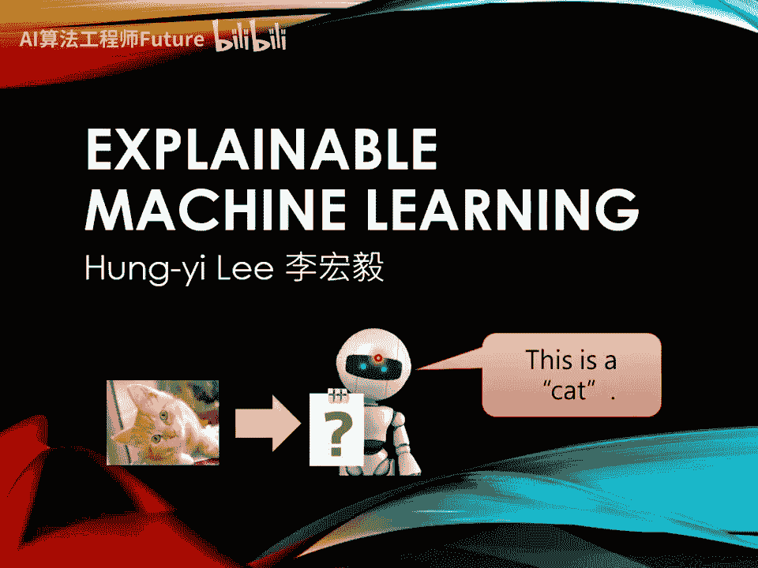

我们已经训练了很多很多的模型，也可能我们训练过影像变色的模型，给他一张图片，他会给你答案，但我们并不满足于此，接下来我们要机器给我们，他得到答案的理由。

这个就是explainable的machine learning，好。

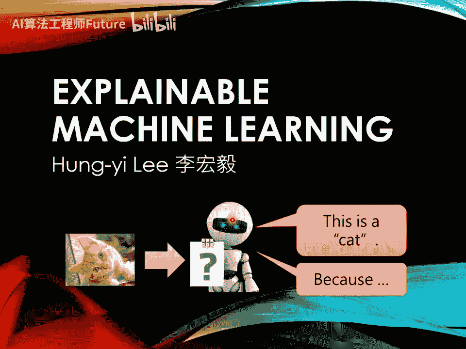

那开始之前开始介绍技术之前，我们需要讲一下，为什么explainable the machine learning是一个重要的议题呢，我觉得那个本质上的原因是，就算今天机器可以得到正确的答案。

也不代表他一定非常的聪明，举一个例子，过去有一匹马他很聪明，所以大家叫他神马汉斯，那这个神马汉斯可以做什么事情呢，他会做数学问题啊，举例来说，你问他根号九是多少，然后他就会开始计算得到答案。

他怎么告诉你他的答案呢，他会用他的马蹄去跺地板哦，所以如果答案是三啊，他就敲三下，好好就停下来，代表他得到正确的答案，然后旁边的人就会欢呼哦，所以这个是神马汉斯，然后一堆人呢在看他解数学问题。

后来有人就很怀疑说，为什么汉字可以解数学问题呢，它只是一匹马，他为什么能够理解数学问题呢，后来有人发现说，只要没有人围观的时候，汉斯就会答不出数学问题，没有人看他的时候，你问他一个数学的问题。

他就会不断的敲他的马蹄，不知道什么时候停下来，所以他其实只是侦测到旁边，人类微妙的情感变化，知道他什么时候要停下，跺马蹄，他就可以有胡萝卜吃，它并不是真的学会解数学的问题。

而今天我们看到种种人工智慧的应用，有没有可能跟神马汉斯是一样的状况呢，而今天在很多真实的应用中，explainable的machine learning，可解释性的模型往往是必须的，举例来说。

银行今天可能会用机器学习的模型来判断，要不要贷款给某一个客户，但是根据法律的规定，银行做用机器学习的模型来做自动的判断，他必须要给出一个理由，所以这个时候，我们不是只训练机器学习模型就好。

我们还需要机器学习模型是具有解释力的，或者是说机器学习未来也会被用在医疗诊断上，但医疗诊断人命关天的事情，如果机器学习模型只是一个黑箱，不会给出诊断的理由的话，那我们又要怎么相信他做出的是正确的判断呢。

今天也有人想把机器学习模，机器学习模型用在法律上，比如说帮助法官判案，帮助法官自动判案，说一个犯人能不能够被假释，但是我们怎么知道机器学习的模型，它是公正的呢，我们怎么知道他在做判断的时候。

没有种族歧视等其他的问题呢，所以我们需要希望机器学习模型不止得到答案，他还要给我们得到答案的理由，再更进一步，今天自驾车未来可能会满街跑，当今天自驾车突然急刹的时候，甚至急刹，导致车上的乘客受伤。

那这个自驾车到底有没有问题呢，这也许取决于他急刹的理由，如果他是啊，看到有一个老太太在过马路，所以急刹那也许自驾车是对的，但是假设他只是无缘无故就突然发狂，要急刹那，这个模型就有问题了。

所以对自驾车他的种种的行为，种种的决策，我们希望知道决策背后的理由更进一步，也许机器学习的模型如果具有解释力的话，那未来我们可以凭借着解释的结果，再去修正我们的模型，今天在使用这些深度学习技术的时候。

往往状况是这个样子啊，有某人说这个就是你的机器学习系统啊，是啊我就是把资料丢进去里面，就是有很多矩阵的相乘，接下来呢就会跑出我的结果啊，如果结果不如预期的话，怎么样呢，怎么样了，现在大家都知道。

就暴调一下参数，对不对，改个learning rate，对不对，调一下network的架构，对不对，你根本不知道自己在做什么，对不对，就调一下network的架构，我就把这一堆数学。

这一堆linear algebra再重新打乱一下，看看结果会不会比较好，那如果其他没有做过deep learning的人，就会大吃一惊，觉得哇这样怎么可以呢，但实际上今天深度学习的模型。

你往往要改进模型，就是需要调一些HYPERPARAMETER啊，但是我们期待，也许未来当我们知道deep learning的模型犯错的时候，他是错在什么样的地方，它为什么犯错，也许我们可以有更好的方法。

更有效率的方法来improve我的模型，当然这个是未来的目标，今天离呃用EXPLAABLE的machine learning，做到上述improve model的想法还有很长的一段距离。

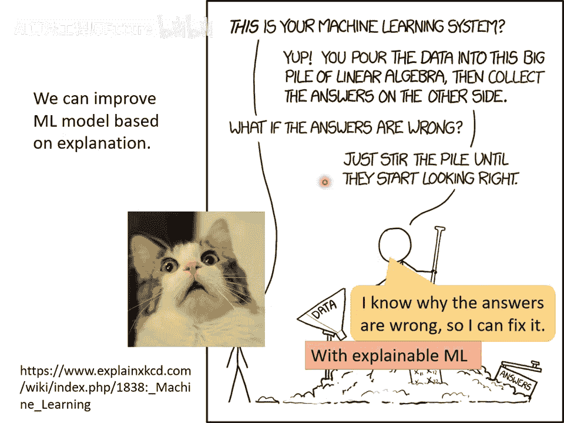

好那讲到这边呢，有人可能会想说呃，我们今天之所以这么关，这么关注explainable machine learning的议题，也许是因为deep的network它本身就是一个黑箱。

那我们能不能够用其他的机器学习模型呢，如果不要用深度学习模型，改采用其他比较容易解释的模型，会不会就不需要研究explainable machine learning了呢，举例来说。

假设我们都采用linear的model，linear的model，他的解释的能力是比较强的，我们很可以轻易的知道，根据一个linear model里面的每一个feature的weight。

知道linear的model在做什么事，所以你训练完一个linear model以后，你可以轻易的知道他是怎么得到它的结果的，但是linear model的问题就是它没有非常的powerful。

我们其实在第一堂课就已经告诉你说，linear的model有很巨大的限制，所以我们才很快的进入了david model，但是deep model它的坏处就是它不容易被解释，If the network。

大家都知道它就是一个黑盒子，黑盒子里面发生了什么事情，我们很难知道，虽然它比linear的model更好，但是他的解释的能力是远比linear的model要差的，所以讲到这边，很多人就会得到一个结论。

你可能常常听到这样的想法，我们就不应该用这种deep的model，我们不该用这些比较powerful的model，因为他们是黑盒子，但是在我看来，这样的想法其实就是血族试履啊。

我们因为一个模型它非常的powerful，但是不容易被解释，就洋气，他也就就扬弃他吗，我们不是应该是想办法，让它具有可以解释的能力吗。

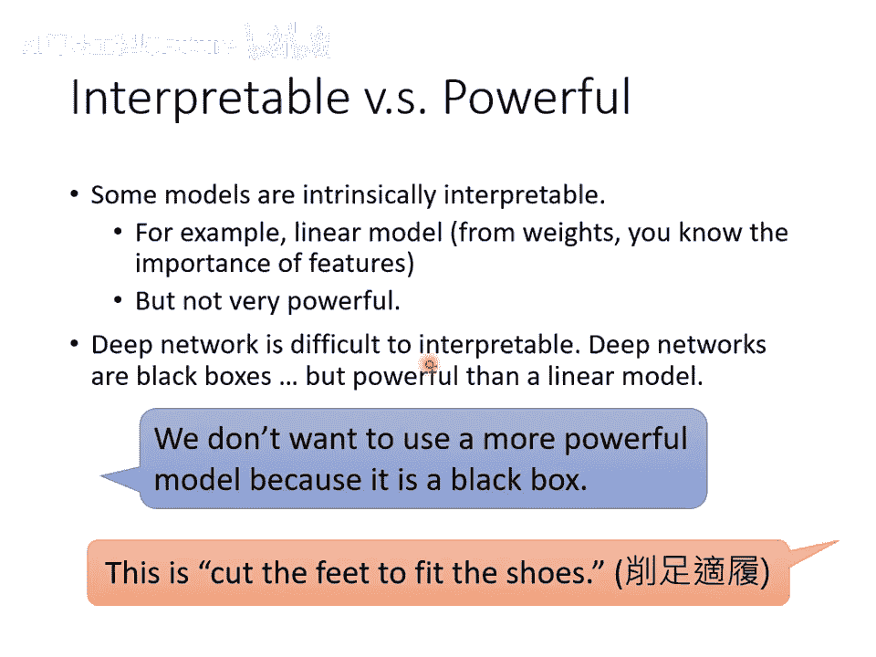

我听过young ana困呐，讲了一个故事，这个是young拉COU讲，那这个故事啊，这个老梗谁都听过啊，就有一个醉汉，他在路灯下面找钥匙，大家问他说啊，你的钥匙掉在路灯下吗，他说不是因为这边有光。

那所以我们坚持一定要用简单，但是比较容易被解释的模型，其实就好像是我们坚持，一定要在路灯下面找钥匙一样，我们坚持，因为一个模型是比较IMPERFETABLE的，虽然它比较不好，但我们还是坚持要使用它。

就好像一定要在路灯下面找钥匙一样，不知道说真实的啊，真实的模型，真实powerful的模型也许根本在路灯的范围之外，而我们现在要做的事情就是改变路灯的范围，改变照明的方向。

看能不能够让这些比较puff的模型，可以被置于路灯之下，叫INTERPRETABLE，也叫EXPABLE，其实INTERPRETABLE跟explainable这两个词汇啊。

虽然在文献上常常被呃互相使用，但其实他们是有一点点差别的哦，通常这个EXPABLE指的是说有一个东西，它本来是个黑箱，我们想办法赋予它解释的能力，叫做explainable。

那interpret able通常指的是一个东西，它本来就不是黑箱，我们可以跟我们它本来就不是黑箱，我们本来就可以知道它的内容，这个叫interpret able好，不过这两者在文献上也常常被混用了。

所以我们这边就不特别跟大家强调，EXPABLE跟interpret able的差异好，那讲到既INTERPRETABLE又powerful的模型，也许有人会说。

那decision tree会不会就是一个好的选择呢，decision tree相较于linear的model，它是更强大的模型，而decision to的另外一个好处。

相较于deep learning，它非常的interpret able，你看那个decision tree的structure，你就可以知道说，今天模型是凭借着什么样的规则，来做出最终的判断。

那DCN去不是我们这门课会讲的东西，但是就算是你没有学过decision tree，你其实也不难想象decision tree它是在做什么，他做的事情就是你有很多的节点，那每一个节点都会问一个问题。

让你决定向左还是向右，最终当你走到节点的末尾，当你走到leave node的时候，就可以做出最终的决定，因为在每一个节点都有个问题，你看那些问题及答案，你就可以知道，现在整个模型凭借着什么样的特征。

是如何做出最终的决断哦，所以从这个角度看来，decision tree它既强大，又interpret able，所以这堂课我们可以就上到这边。

就是decision tree is all you need，然后就结束了，这样哎好，但是decision tree真的就是我们所需要的吗，你再仔细想一下。

decision tree也有可能是很复杂的，举例来说啊，我看到在网络上找到有人问了一个问题啊，他说还有一个这么复杂的decision tree，他完全看不懂这个decision tree在干嘛。

有没有人有什么样的explaable machine learning的方法，可以把这个decision tree变得更简单一点，我看34年过去了，都没有人回答这个问题，有人看到的话。

也许可以帮忙回答一下，但另外一方面，你再仔细想想看，你是怎么实际使用decision to这个技术的呢，我知道很多同学都会说啊，这个打cargo比赛的时候，deep learning不是最好用的啊。

什么decision tree那个才是最好用的，那才是cargo比赛的常胜军，但是你想想看，当你在使用decision tree的技术的时候，你是只用一颗decision tree吗。

其实不是你真正用的技术叫做random forest，对不对，你真正用的技术，其实是好多科decision tree共同决定的结果，一颗decision tree，你可以凭借着每一个节点的问题跟答案。

知道他是怎么做出最终的判断的，但当你有一片森林，当你有500棵decision tree的时候，你就很难知道说这500棵decision tree，合起来是怎么做出判断。

所以decision tree也不是最终的答案，并不是由decision tree，我们就解决了explainable machine learning的问题好。

那再继续深入讲explainable machine learning的技术之前，这边还有一个问题，就是expable machine learning的目标是什么，在我们之前的每一个作业里面。

我们都有一个lead ball，也就是我们有一个明确的目标，要么是降低error ray，要么是提升accuracy，我们总是有一个明确的目标，但是explainable的目标到底是什么呢。

什么才是最好的explanation的结果呢，那expansion learning他的目标其实非常的不明确，就是因为目标不明确。

你才发现说expable machine learning的作业就没有lead for了，因为出不了lead ball，我们只能够出选择题，让大家增加一些知识，我们只能够做这样子而已。

那到底explainable machine learning他的终极目标是什么呢，什么才是最好的explanation，那以下是我个人的看法，并不代表他是对的，你可能不认同，那我也不会跟你争辩。

那这个只是我个人的看法而已，很多人对于expable machine learning会有个误解，他觉得一个好的explanation，就是要告诉我们整个模型在做什么事，我们要了解模型的一切。

我们要知道它到底是，我们要完全了解他是怎么做出一个决断的，但是你想想看这件事情真的是有必要的吗，我们今天说machine learning的model dip，the network是一个黑盒子。

所以我们不能相信它，但你想想看，世界上有很多很多的黑盒子正在你的身边，人脑不是也是黑盒子吗，我们其实也并不完全知道人脑的运作原理，但是我们可以相信另外一个人做出的决断，那人脑其实也是一个黑盒子。

你可以相信人脑做出的决断，为什么deep的network是一个黑盒子，你没有办法相信deep的network做出来的决断，为什么你对deep的network会这么恐惧呢，那我觉得其实对人而言呢。

也许一个东西人不能让我们放心，能不能够让我们接受理由是非常重要的，以下呢是一个跟machine learning完全无关的心理学实验，这个实验那是1970年代就做了啦，这是alan danger。

一个哈佛大学教授做的这个实验，非常的有名，这个实验是这样，这个实验室一个跟印表机有关的实验，在哈佛大学图书馆印表机呢会大排长龙，很多人呢都排着排队要印东西，这个时候如果有一个人跟他前面的人说。

拜托请让我先印，我就印五页而已，那一般人会不会接受呢，会不会让他先应呢，有60percent的人会让这个人嫌疑，所以感觉哈佛大学学生人都还蛮好的，这个是接受程度是比我预期的要高啊，你跟一个人说。

让我先验有60percent的人平台，但这个时候你只要把刚才问话的方法，稍微改一下，你本来只说能不能让我先，你现在改成说能不能让我先，你因为我赶时间，他是不是真的赶时间，没人知道。

但是当你说你有一个理由，所以你要先硬的时候，这个时候接受的程度变成94percent，而神奇的事情是，就算你的理由稍微改一下，举例来说，有人说请让我先应，因为我需要先引，光是这个样子。

接受的程度也变成93percent，而最神奇的事情是，人就是需要一个理由，你为什么要先进，你只要讲出一个理由，就算你的理由是因为我需要先应，大家也会接受。

所以会不会explainable machine learning也是同样的道理，所以我们需要explainable的machine learning呢。

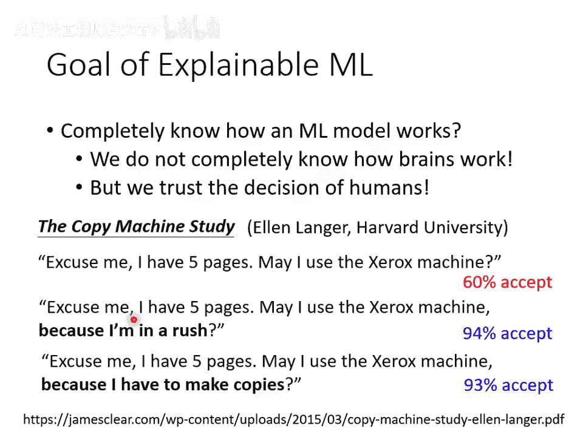

所以我觉得对什么叫做好的explanation，好的explanation就是人能接受的，explanation就是好的explanation，人就是需要一个理由让我们觉得高兴，而到底是让谁高兴呢。

这个是高兴的人，可能是你的客户，因为很多人就是听到deep network是一个黑盒子，他就不爽啊，你告诉他说嗯这个是可以被解释的，给他一个理由，他就高兴了，他可能是你的老板啊，老板啊，看了很多农场文。

他也觉得说对不对，你是黑盒子就是不好的，然后他说这个是可以解释的，他就高兴，或者是你今天要让，你今天要说服的对象是你自己，你自己觉得有一个黑盒子，deep network是一个黑盒子，你心里过不去。

今天他可以给你一个做出决断的理由，你就高兴，所以我觉得什么叫做好的explanation，就是让人高兴的，explanation就是好的explanation，其实你等一下再记在各种研究的发展。

才会发现说呃我们在设计这些技术的时候，确实跟我现在讲什么叫好的explanation，就是让人高兴的explanation，这个想法，这个技术的进展是蛮接近的好。

所以explain explainable machine learning，他的目标就像我刚才讲的，就是要给我们一个理由，那explain explainable。

the machine learning呢又分成两大类，第一大类叫做local的explanation，第二大类叫做global的explanation。

local的explanation是说假设我们有一个image的classify，我们给他一张图片，他判断说它是一只猫，那我们要问的问题是，为什么我或者机器要回答的问题是。

为什么你觉得这张图片是一只猫啊，根据某一张图片来回答问题，这个叫做local explin呃，这个叫local explanation，还有另外一类呢叫global的explanation。

Global exam explanation，意思是说现在还没有给我们的classify任何图片，我们要问的是对一个classifier而言，什么样的图片叫做猫，我们并不是针对任何一张特。

定的图片来进行分析，我们是想要知道说当我们给我，当我们有一个model，它里面有一堆参数的时候，对这堆参数而言，什么样的东西叫做一只猫哦。

所以explainable machine learning有两大类好。

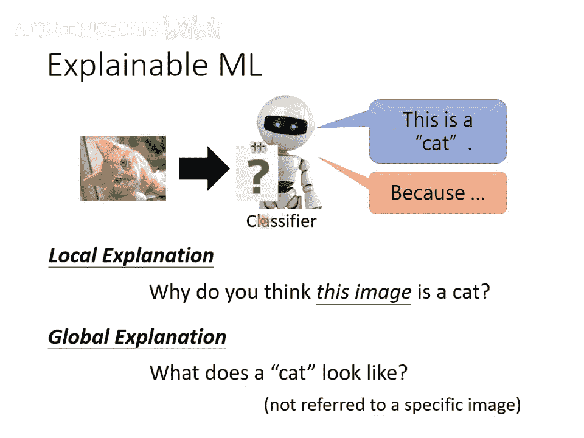

我们先来看第一大类，第一大类是为什么你觉得一张图片是一只猫，我们可以把一个图片这个问题问得更具体一点，给机器一张图片，它知道它是一只猫的时候，到底是这个图片里面的什么东西，让模型觉得它是一只猫。

是眼睛吗，是耳朵吗，还是猫的脚，让机器觉得他看到了一只猫，或是讲的更general一点，假设现在我们模型的输入叫做X，这个X可能是一张影像，可能是一段文字，而X呢可以拆成多个component。

XY到XN，如果对于影像而言，可能每一个component就是一个pixel，那对于文字而言，可能每一个component就是一个词汇，或者是一个token，那我们现在要问的问题就是这些token里面。

那这些component里面，那这个如果对文字来说是token，对image来说可能就是pixel，这些component里面哪一个，对于机器现在做出最终的决断是最重要的的。

那怎么知道一个component的重要性呢，那基本的原则是这个样子哦，就是我们把component都拿出来，然后把每一个component呢做改造或者是删除。

如果我们改造或删除某一个component以后，今天network的输出有了巨大的变化，那我们就知道说这个component没它不行，它很重要，如果某个component被删掉以后。

现在network的输出有了巨大的变化，就代表这个component没它不行，那这个component就是一个重要的component，讲得更具体一点，你想要知道今天一个影像里面。

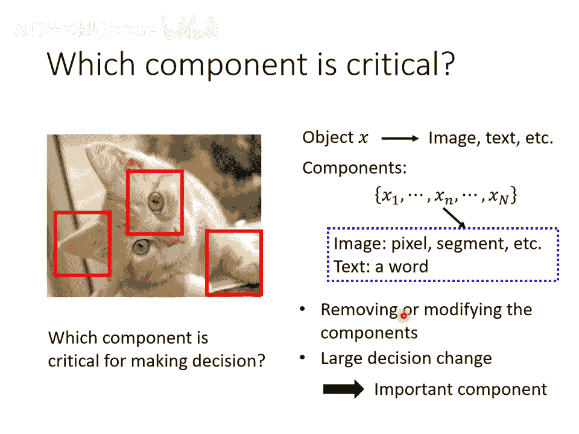

每一个区域的重要性的时候，有一个非常简单的方法，像是这个样子好，就给一张图片，然后丢到network里面，他知道这是一只博美狗，接下来在这个图片里面，不同的位置放上这个灰色的方块。

当这个方块放在不同的地方的时候，今天你的network会open不同的结果，那这边这个这个下面这个图啊，这些颜色啊代表今天network输出博美狗的几率，那蓝色代表博美狗的几率是高的。

红色呃呃蓝色说错了，蓝色代表博美狗的几率是低的，红色代表博美狗的几率是高的，而这边的每一个位置，代表了这一个灰色方块的位置，也就是说，当我们把灰色的方块移到这边，移到这边，移到博美狗的脸上的时候。

今天你的image classifier就不觉得他看到一只博美狗，如果你把灰色的方块放在博美狗的四周，好，放在博美狗的四周，这个时候机器就觉得他看到的仍然是博美狗，所以知道说他不是看到这个球。

觉得他看到博美狗，也不是看到地板，也不是看到墙壁，觉得看到博美狗，而是真的看到这个狗的脸，所以他觉得他看到了一只狗，那这边也有一样的例子，把灰色的方框，再把灰色的方块在这个图片上移动。

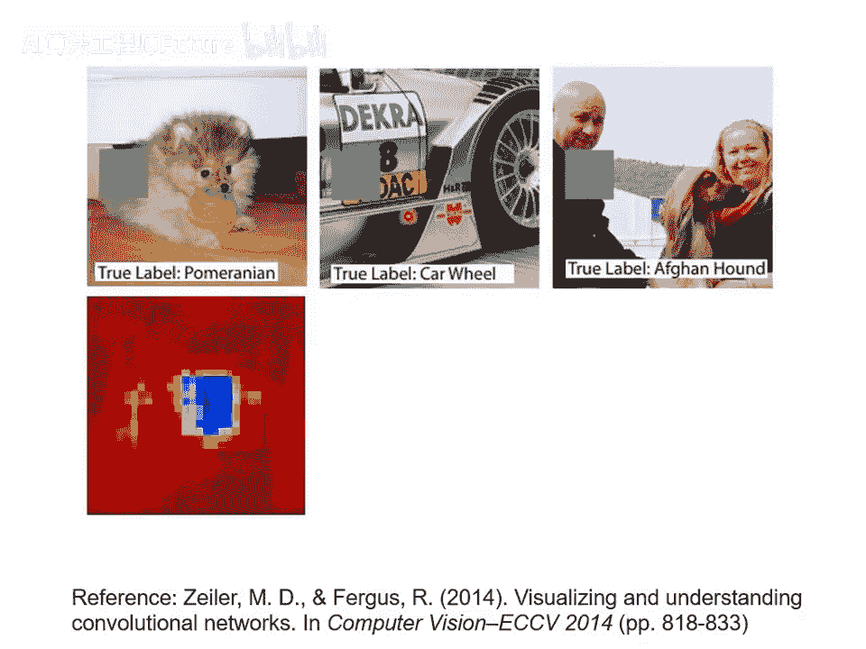

你会发现说呢灰色的方块移到轮胎上的时候，机器就不觉得他有看到轮胎了，所以机器知道轮胎长什么样子，他今天看到这个图片，知道答案是轮胎的时候，并不是瞎蒙蒙到的，而是他知道说轮胎出现在这个位置。

或者是或者是说哦这边有一张图片，然后这个图片里面有两个人，还有一只这个阿富汗猎犬，当但是机器到底是真的看到了阿富汗猎犬，还是把人误认为狗呢，啊，这个时候你就可以把这个灰色的方框，在这个图片上移动。

然后你发现这个灰色的方框放在这个人的脸上，或放在这个人的脸上的时候，机器仍然觉得他有看到阿富汗猎犬，但是当你把灰色的方框放到这个位置，放到这个位置的时候，机器就觉得他没有看到阿富汗猎犬。

所以他是真的有看到阿富汗猎犬，他知道这一只就是阿富汗猎犬，并不是把人误认为阿富汗猎犬，所以这个是最简单的，知道component重要性的方法好，接下来还有一个更进阶的方法是计算gradient。

这个方法是这样子的，好，假设我们有一张图片，我们把它写作XY到XN，这边的每一个X代表了一个pixel啊，接下来呢我们去计算这张图片的loss啊，我们这边呢用小一来表示好，这个小一是什么呢。

这个小一是把这张图片呢丢到你的模型里面啊，这个模型的输出的结果跟正确答案的差距好，跟正确答案的cross entropy，这个一越大就代表现在辨识的结果越差好，那接下来啊，我们知道某一个pixel。

对于影像辨识这个问题的重要性呢，那你就把某一个pixel的值做一个小小的变化，还加上一个德塔X，然后你接下来看一下，你的loss会有什么样的变化，如果今天把某一个pixel做小小的变化以后。

loss就有巨大的变化，代表说这个pixel对影像辨识是重要的，反之如果加了delta x，这个delta1趋近于零，这个loss完全没有反应，就代表说这个delta x这个这个位置。

这个pixel对于影像辨识而言可能是不重要的，那我们可以用delta1跟delta x的比值，来代表这一个pixel xn的重要性，而事实上delta x分之delta1这一项啊。

就是把XN对你的loss做片尾分，如果你不知道片尾分是什么的话，也没有关系，反正就是delta x跟delta1的比值，就代表了这个XN的重要性，那这个比值越大啊。

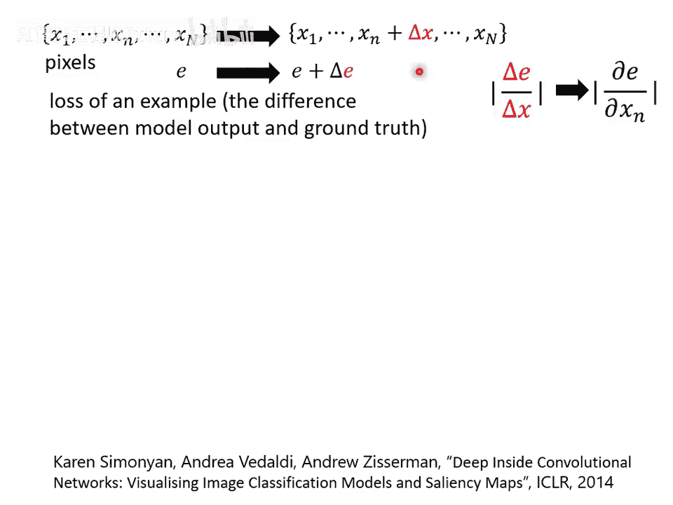

就代表XN越重要，那你把每一个图片里面，每一个pixel它的这个比值都算出来，你就得到一个图呢叫做saliency man，那在我们的作业里面哦，你会有很多机会画各式各样的saliency ma。

那下面这个图啊，上面这个是原始图片啦，下面这个黑色的，然后有亮白色点的是saliency map，那在这个saliency map上面呢，越偏白色就代表这个比值越大。

也就是这个位置的pixel是越重要的，举例来说哦，给机器看这个水牛的图片，他并不是看到草地，觉得他看到牛，也不是看到竹子，觉得他看到牛，而是真的知道牛在这个位置，他觉得判断这张图片是什么样的类别。

对他而言最重要的是出现在这个位置的pixel，要是真的看到牛哦，所以知道说所以才会open牛，这个答案，我继续看到这个图片，说他看到一个啊呃猴子，那猴子在哪里呢，猴子在树梢上面。

它并不是把叶子判断成猴子，它知道这个位置出现的东西，就是他判断正确答案的准则，我给他这个图片，他知道说狗呢是出现在这个位置，所以这个这个技术呢叫做saliency ma。

那sadic maker这个技术，我们等一下来举一个实际的应用啊，这个应用是什么呢，这个应用跟宝可梦还有数码宝贝有关了，哎不知道大家知不知道那个数码宝贝是什么，左边这个是宝可梦啦。

哎右边这个呢叫做数码宝贝，知道数码宝贝的同学可以举手一下啊，哦好多好啊，手放下，那我就不用解释了哦，不知道的同学，反正就是另外一种动物就对了，哎对真的还真就宝可梦是一种动物，而数码宝贝是另外一种动物诶。

然后在网络上呢看到有人说，他训练了一个数码宝贝跟宝可梦的分类器，然后正确率非常的高，所以我决定自己也来做这个实验，看看为什么可以得到这么高的正确率好，那你可以在网络上呢找到宝可梦的图库。

也可以找到数码宝贝的图库好，所以你有一堆宝可梦的图，有一堆数码宝贝的图，那这个对大家来说一定都不成问题，这个就是二元分类的问题而已，对不对，胡乱吹一个classify就结束了。

就把作业三的code改一改，然后把本来分成11类，改成分成两类就结束了，好那接下来呢训练完以后呢，你当然要用机器没有看过的图去测试它哦，所以你不能够把所有的宝可梦跟，所有的数码宝贝都拿去做训练。

你要特别留一些宝可梦跟数码宝贝，是训练的时候没有看过的，看看机器看到新的宝可梦跟数码宝贝，他能不能够得到正确的结果，好，这边呢我们来看一下人类能不能够正确的判断，宝可梦跟数码宝贝，好了，我来问一下大家。

你觉得这一只是宝可梦还是数码宝贝呢，哦觉得还是宝可梦的同学举手一下啊，把手放下，觉得他是数码宝贝的同学举手一下好，也有一些好手放下嗯，好老师说我答案忘记了，这样子，所以所以你可见这个宝可梦跟数码宝贝。

是很难分辨的啊，今天就算是人类，你也很难够，很难判断，说一只动物到底是宝可梦还是数码宝贝，机器的表现如何呢。

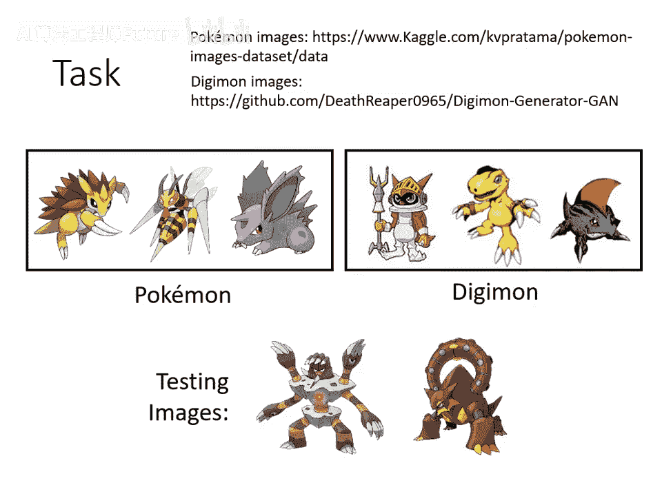

好这边就是随便兜了一个模型啊，也没有几层啊，券下去哇，Training accuracy，98。9percent啊，这个非常的高，但是不要高兴的太早，这个也许是OVERFITTING而已。

也许machine只是把training的data记下来而已，因为毕竟训练资料没几张啊，数码宝贝宝可梦才各几千张而已，所以也许open beating，所以测试资料上没看过的图怎么样呢，正确率98。

4啊，这个不可思议的伪灾机器学习，这样这个人类都没有办法判断，宝可梦跟数码宝贝的差异，但机器可以还有98。4percent的正确率好，那接下来我就很好奇，就想要知道说机器到底是凭借着什么样的规则。

判断宝可梦和数码宝贝的差异呢，所以我决定来画一下saliency ma哦。

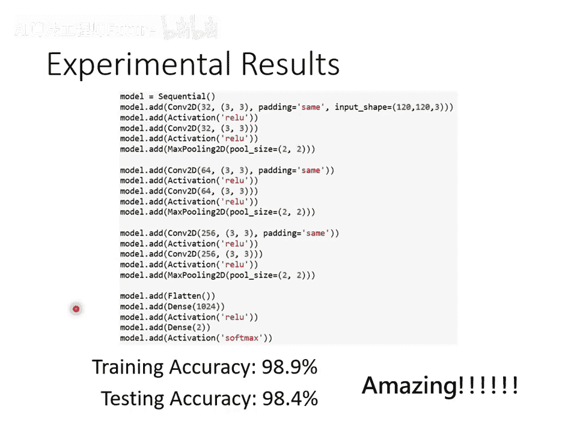

这边这边有几只动物，它们是什么呢，它们是数码宝贝，这些是数码宝贝，而接下来呢我就在这些图片上画saliency man，让机器来告诉我说，为什么他觉得这几张是数码宝贝，机器给我的答案是这个样子。

这边亮亮的点代表他觉得比较重要，有点怪怪的，好像亮亮的点都分布在四个角落，不知道发生了什么事，接下来我来分析宝可梦这个情况更明显，你发现说机器觉得重要的点，基本上都是避开宝可梦的本体啦。

都是在影像的背景上，为什么呢，因为我后来发现宝可梦都是PNG档啦，数码宝贝都是JK的档啊，PNG档读进来以后背景都是黑的啦，所以机器只要看背景，就知道一张图片是宝可梦还是数码宝贝了，就结束了。

这样子好对，这个例子就是告诉我们说，EXPLABLEAI是一个很重要的技术，那我刚才举的例子，可能你觉得有点荒谬，也许在正正正常的应用中不会发生这种事情，但真的不会发生吗。

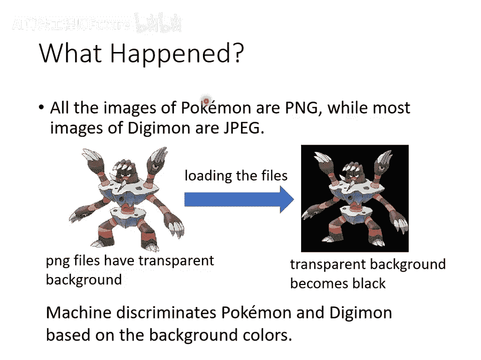

有一个真实的例子，有一个benchmark popus叫做PASTCOVOC，2007里面有各式各样的物件，机器要学习做影像的分类啊，机器看到这张图片啊，他知道是马的图片。

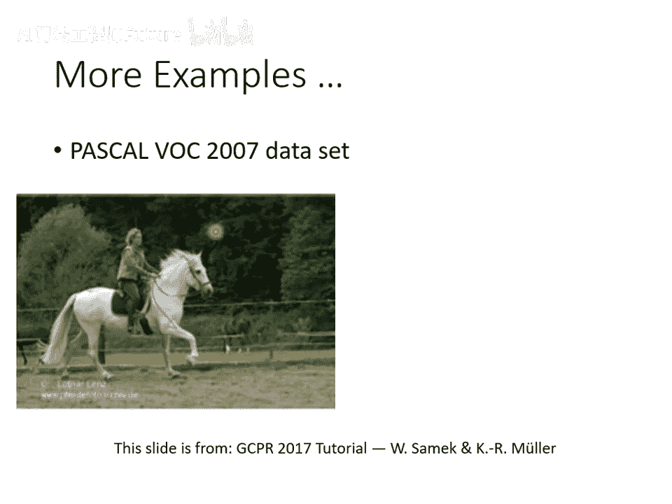

但如果你画saliency map的话，你发现结果是这个样子的，机器觉得左下角对马是最重要，为什么，因为左下角有一串英文啊，这个图库里面码的图片，很多都是来自于某一个网站啊，左下角都有一样的英文啊。

所以机器看到左下角这一行英文就知道是马，他根本不需要学习马是长什么样子，所以今天在这个真实的应用中，在benchmark copper上类似的状况也是会出现的，所以这告诉我们。

这种explainable machine learning这个技术是很重要的好，那有没有什么方法把explainable的machine learning，stadiency map画的更好呢。

第一个方法就是助教，刚才也有提到的这个smooth grade，什么意思呢，那你期待说你今天去做stadiency map的时候，机器会把他主要的精力集中在邓林身上，但如果你用刚才我们讲的方法。

直接画satic map的话，你得到的结果可能是这个样子，但是在其他地方也有一些杂讯啊，让人看起来有点不舒服哦，所以就有了smooth grade这个方法。

smooth grade会让你的这个sadiency map，上面杂讯比较少，如果在这个例子上，你就会发现，那spring grab这个方法是怎么做呢，非常简单，说穿了也不值钱。

就是你在你的图片上面那加上各种不同的杂讯，那加不同的杂讯就是不同的图片了吗，每一张图片上面都去计算caliency map，那你有加100种杂志，就有100张cdency map。

平均起来就得到smooth free的结果就结束了啊，当然有人会问说，哎，那你怎么知道说这个smooth grade这样子的结果，一定就是比原来的结果好呢，也许对机器来说，他真的觉得这些草很重要啊。

他真的觉得这个天空很重要啊，他真的觉得这个背景很重要啊，也许是那就像我一开始说的，Explorable machine learning，最重要的目标就是要让人看着觉得爽啊，你画了这个图。

你的老板就会觉得不爽啊，他就觉得哇这个model有点烂哦，这个model解释性好像很低哦，所以你就要把它画成smooth grade这个样子，然后告诉别人说，你看这个model。

所以这个嗯这个model不错啊，这个excel machine能力的方法也不错。

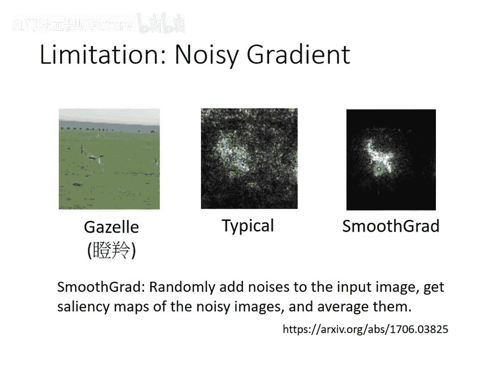

这样子好，但是呢其实光看gradient，并不完全能够反映一个component的重要性，怎么说呢，这边就举一个例子给大家参考好，这个横轴代表的是大象鼻子的某一个生物，鼻子的长度。

那纵轴代表说这个生物是大象的可能性，我们都知道说大象的特征就是长鼻子，所以一个生物它的鼻子越来越长，它就越有可能是大象，但是当它的鼻子长到一个极限的时候，再变更长一点，他也不会变得更像大象。

鼻子很长的大象，就只是额鼻子特别长的大象，所以当一个大象的鼻子变长的时候，呃长到超出一个范围的时候，你也不会觉得他变得更像大象哦，所以一鼻子的生物，鼻子的长度跟它四大象的可能性。

它的关系也许一开始在长度比较短的时候，随着长度越来越长，今天这个生物是大象的可能性越来越大，但是当鼻子的长度长到一个程度以后，就算是更长，也不会变得更像大象，这个时候，如果你计算鼻子长度。

对四大项可能性的偏微分的话，那你在这个地方得到的偏微分可能会趋近于零，所以如果你光看gradient，光看saliency map，你可能会得到一个结论是鼻子的长度对，是不是大象这件事情是不重要的。

鼻子的长度不是判断是否为大象的一个指标，因为鼻子的长度的变化对，是大象的可能性的变化是趋近于零的，所以鼻子根本不是判断是不是大象的，重要的指标，但事实上是这样吗，事实上你知道不是这个样子。

所以光看gradient，光看偏微分的结果，可能没有办法完全告诉我们，一个component的重要性，所以有其他的方法，有一个方法叫做integrated gradient，它的缩写叫做IG。

那这边我就不打算详细讲说IG是怎么运作的，我们就把文献留在这边，那助教的城市里面也有十座的IG，那如果你有兴趣，你可以自己研究看看IG是怎么运作的，如果你没有兴趣。

反正你按个enter就跑出那个IG的分析的结果了，好那刚才我们是看network，他是呃我们刚才是看一个输入，他的哪些部分是比较重要，那接下来我们要问的下一个问题是。

当我们给network看一个输入的时候，它到底是怎么去处理这个输入的呢，它到底是怎么对输入做处理，然后得到最终的答案的呢，好那有不同的方法，第一个方法最直觉的就是人眼去看。

今天network里面到底发生了什么事情，在作业里面是要你去看BT里面发生了什么事情，是跟文字有关的，那上课举的例子，我们就举语音的例子，在作业二里面啊，你已经训练了一个network。

这个network就是吃一小段声音当中输入，判断说这段声音是属于哪一个phony，属于哪一个KK音标，然后呢，假设你第一个layer有100个neural，第二个layer也有100个neural。

那第一个layer的输出，就可以看作是100维的向量，第二个layer的输出也可以看作是100维的向量，透过这些分析这些向量，也许我们就可以知道一个network里面发生了什么事。

但是100维的向量不好，不容易看，不容易观察，不容易分析，所以怎么办呢，你有很多方法可以把100维的向量，把它降到二维，那至于是什么方法，我们这边就不细讲，总之这些方法有一箩筐可以使用好。

把100维降到二维以后，你就可以画在图上，那你就可以细心的观察它，看看你可以观察到什么现象，以下呢举的是语音的例子啊，那这个例子来自于一篇2012年的paper，你会发现HINTON啊。

这个深度学习之父也是这篇文章的作者，这篇文章做的事情是什么呢，这篇文章其实老实说，这篇文章做的就是你写你的作业二，你知道吗，他跟你作业二用的data是一模一样的哦，所以假设你穿越时空到10年前。

拿你作业二的结果给HINTON看，他就吓一跳，这样你可以顺便告诉他说，这个只是我们15个作业的其中一个而已，他就吓一跳的，你还可以告诉他说哦，这个我只劝了一个小时就劝完了，那个时候要劝类似的东西。

大概要劝个一周以上吧，然后INGTON就会吓一跳，这样子我只能所以看到这些不过去的文章啊，我真的只能说哇这个大人时代变了啊，哦以前train network多么麻烦，现在真的是时代变了。

而且其实那个时候用的是d belief network，第belief network是deep neural network吗，不是这样子，嗨，那这个是什么东西呢，这个我们就不会讲它。

因为现在已经没有人在用这个东西了，好那但是他得到的结果啊，还是蛮值得我们今天拿来看的，其实你在作业二应该也可以观察到类似的结果，好这边做的事情是什么呢，这边做的事情是。

首先我们把模型的input就是acousic feature，也就是NMCC拿出来，把它降到二维，画在二维的平面上，好在这个图上啊，不每一个点代表一小段声音讯号，那每一个颜色代表了某一个speaker。

某一个讲话的人，那其实我们丢给这个network的资料，有很多句子是重复的，就是有人说A说的，How are you，B也说了，how are you c也说了，How are you。

很多人说了一样的句子，但从这个图上你看不出来，从accursive features上你会发现说，就算是不同的人念同样的句子内容一样，但是我们从acousic feature上看不出来。

同一个人他说的话就是比较相近，就算是不同的人说同样的句子，你也没有办法看到他们被ALI在一起，所以从这个结果，人们就会觉得哇这个啊这个语音辨识太难了，语音辨识不能做啊，这个同样的人说不同。

这这个不同的人说同样的话，看起来这个feature差这么多啊，这语音辨识怎么是有可能有有办法做的问题呢，但是当我们把network拿出来看的时候，结果就不一样，这个是第八层network的输出。

你会发现什么呢，你会发现这边变成一条一条啊，每一条没有特定的颜色，这边每一条代表什么呢，每一条就代表了同样内容的某一个句子，所以你会发现说不同人说同样的内容，在NFCC上看不出来。

但通过了八成的network之后，机器知道说这些话是同样的内容，虽然声音讯号看起来不一样，是不同人讲的，但他们是同样的内容，他可以把同样的内容，不同人说的句子，把它apply在一起。

所以最后你就可以得到精确的分类结构，好，那刚才讲的是，直接拿neural的输出来进行分析啊，你也可以分析这个attention的layer啊，现在sales attention用的很广嘛。

你也可以看attention的结果，来决定今天network学到什么事啊，我在作业里面也要求大家看了BERT的attention，但是当你使用attention的时候，还是有一些要注意的地方。

我们直觉觉得attention应该非常具有解释力，从某一个词汇end到另外一个词汇，那就代表说这两个词汇有关系啊等等，那在作业里面我们也挑了比较明显，可以看出关联性的例子给大家来送，给大家来回答问题。

但是实际上你在文件上会找到这样子的文献，Attention is not expable，attention并不是总是可以被解释的，当然也有人发文献说。

Attention is not not explainable，这样子你知道这个这个这个这个研究啊，进展的非常快，很快又搞搞不好，又会有人说。

Attention is na na na explanation，所以这个啊到底attention能不能被解释，什么状况可以被解释，什么状况不能够被解释，这个还是尚待研究的问题哦。

那除了用人眼观察以外，还有另外一个技术叫做probe popping a，就是用探针的意思啊，就是你用探针去插入这个network，然后看看说发生了什么事，举例来说。

假设你想要知道BT的某一个layer，到底学到了什么东西，除了用肉眼观察以外，不过肉眼观察比较有极限嘛，可能有很多你没有观察到的现象，而且你也没有办法一次看过大批的资料，所以怎么办呢。

你可以训练一个探针，你的探针其实就是分类器，举例来说，你训练一个分类器，这个分类器是要根据一个feature，根据一个向量决定说现在这个词汇，它的pos tag也就是它的词性是什么。

你就把BT的embedding，丢到POS的classify里面去，你就训练个POS的classify，他要试图根据这些embedding决定说，现在这些embedding是来自于哪一个词性的词汇。

如果这个POS的classify它的正确率高，就代表说这些embedding里面有很多磁性的咨询，如果它正确率低，就代表这些embedding里面没有磁性的咨询哦，或者是说你认一个n e r name。

entity regnizer的classifier，然后呢，他看这些feature，决定说现在看到的词汇属于哪一个，属于人名还是地名，还是不是任何专有名词。

那你透过这个nee r classify的正确率，就可以知道这些feature里面有没有名字，有没有这个地址，有没有人民的咨询等等，但使用这个技术的时候，有一点你要小心什么，你要小心呢。

小心你使用的classify它的强度，为什么，因为假设你今天发现你的classifier正确率很低，真的一定保证他的输入的这些feature，也就是BT的embedding，没有我们要分类的资讯吗。

不一定，为什么，因为有可能就是你的classify train烂啦，对不对，我们大家都有全都train没我的经验嘛，你没有办法百分之百保证，你classify卷出来一定是好的。

那搞不好你训练完一个classify，它的正确率很低，不是因为这些feature里面没有我们需要的资讯，单纯就是你learning rate没有调好，你什么东西没有调好，所以串不起来。

有没有可能是这样呢，有可能是这个样子哦，所以用py model的时候，你要小心，不要太快下结论，有时候你会得到一些结论，只是因为你classify没有train好或train的太好。

导致你classify的正确率，没有办法当做频段的依据，好那我知道说快要下课了，时间真的是过的很快，我们讲完一个语音的特殊的ping的例子，我们就下课，properly不一定要是classify。

我特别特别举一个例子告诉你说，promise有种种的可能性，举例来说，我们实验室有做一个尝试，是训练一个语音合成的模型，一般语音合成的模型是吃一段文字，产生对应的声音讯号。

我们这边语音合成模型不是吃一段文字，它是吃network output，Embedding，它是network output的embedding作为输入，然后试图去输出一段声音讯号，也就是说你在作业二。

你训练了一个classifier，那接下来训练了一个fling的classifier，接下来我们就把你的network拿出来，然后呢，把某一个layer的输出呢丢到TTS模型里面。

然后我们训练这个TTS的模型，我们训练的目标是，希望TTS的模型可以去复现network的输入，就network输入是这段声音讯号，希望通过这些分页以后产生的embedding，丢到TTS以后。

可以回复原来的声音讯号，那这样子的分析有什么用呢，你可能想哦，我们训练这个TTS产生原来的声音讯号啊，那不就产生原来的声音讯号，一模一样的声音讯号，就是输入的那一个，那有什么样的可看性呢。

那这边有趣的地方是，假设这个network做的事情，就是把比如说愚者的资讯去掉，那对于这个TTS的模型而言，这边layer two的输出没有任何愚者的资讯，那他无论怎么努力，都无法还原愚者的特征。

那虽然内容说的是hi，然后是一个男生的声音，你会发现说可能通过几个layer以后，丢到TTS的模型，它回溯它，它这个产生出来的声音会变成也是hi的内容，但是你听不出来是谁讲的，那这样你就可以知道说诶。

这个network一个语音辨色模型啊，他在训练的过程中真的学到谁，在学到去抹去愚者的特征，只保留内容的部分，只保留声音讯号的内容。

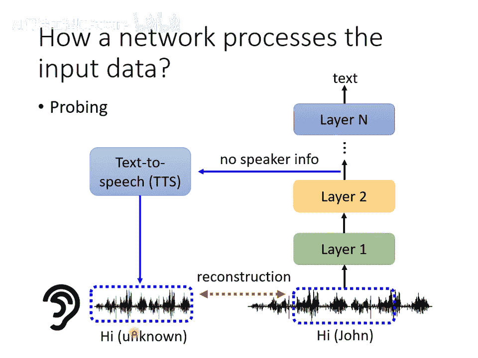

好，以下是真实的例子，讲完这个例子，我们就下课好，这个例子是这样子的哦，这边有一个五层的by directional的LSTI，他持声音讯号做输入，那输出就是文字，它是语音辨识的模型好。

那现在我们给他一段声音讯号做输入，哦是女生的声音，好，接下来再给他听另外一个男生讲不一样的内容，听起来像是这样的。

Very readily and retreated by the wiring mistress，hitzoth to the rear of the tech re好。

接下来我们把这些声音讯号丢到这个network里面，然后再把这个networks的embedding，用TTS的模型去还原回原的声音讯号，看看我能听到什么，以下是过第一层LSTN的结果。

And gentlemen success，你会发现声音讯号有一点失真，但基本上跟原来是差不多的，男生的声音是这样，Gave way to the others，Very readily。

And retreated unpreceived by this requirement，Mistressing ensue to the response，SU跟原来都是差不多的。

但通过了五层的LOSTN以后发生什么事呢，CD讯号变成这个样子，And the old gentleman was so delighted with this success。

Let me have much down into a series of shore，Turn to lain that occupied white space of time，The mom。

My wise，This is mine the other other scary，You will delier every morning retreating them to。

Seek my wire with this sixty three years of te，所以班本来一个句子是男生讲，一个句子是女生讲，通过五层LSCN以后，你就听不出来是谁讲的。

他把两人的声音都变成是一样的，那你可能说哎，这个不是10年前HTER就已经知道了吗，透过VIIALIZATION，然后这个研究有什么厉害的地方呢，它厉害的地方就是它潮知道吗，也就是我们可以把声音。

我们可以听内沃尔听到的声音，我这边再举最后一个例子，好苏的声音讯号是有杂讯的，Gentleman was success that he had，还有钢琴的声音。

好我们的network现在前面有几层CNN，后面有几层，i directional的LOSTN，通过第一层CNN以后，声音讯号变成这样，好你还是听得到钢琴的声音好，最后在最后一层进入LSTN之前。

声音讯号是这样的，Then he had to burst out into a series of shore。

Has been a lander that occupied quite a space of time，你还是听得到钢琴的声音，但是通过第一层LSSPN以后就不一样了，它听起来像是这个样。

That he has the burst out into a series of shore，Happy bit。

The laughter that occupied the white space of time，你会发现说那个钢琴的声音就突然小很多，所以知道说这个钢琴的声音，这个杂讯声音讯号之外。

杂讯是在哪一层被滤掉的呢，在第一层LSTN开始被滤掉，前面CNN似乎没有起到滤掉杂讯的作用，那这个就是这个分析可以告诉我们的事情好，那我们到讲到这边正好告一个段落啊，我们就赶快下课吧。

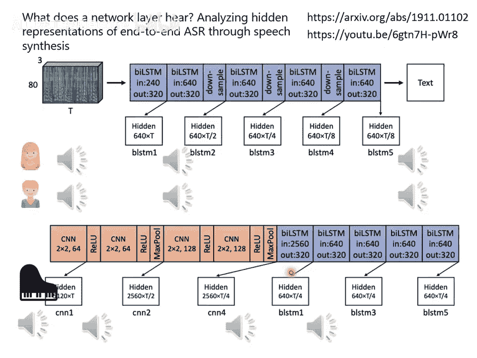

那大家有问题还可以留下来讨论，谢谢大家。