# 【官授搬运】2026年全新优化版李宏毅机器学习系统课程，这才是真正的初学者体系课程！—人工智能／深度学习／神经网络 - P67：3-自然语言处理上的对抗式攻击 (由姜成翰助教讲授) - 第 1 部分 - AI算法工程师Future - BV1ruqABeEFX

那很高兴，今天呢大家可以来参加这个线上的课程，那今天呢非常高兴江城汉助教可以来跟我们讲，在NLP上面的adversarial attack，那我们在上课的录音里面呢。

有讲影像上的adversal attack，在个猫的图片上加一个很小的杂讯，可以让机器的辨识结果完全错误，但是你有没有想过，在N牛批上要怎么做类似的事情呢。

你想想看在讲影像的adversal attack的时候，我们需要对输入的影像，对输出进行这个偏微分的计算，但是如果输入是文具的话，那要怎么做呢，那这边有另外一套不同的技术。

那很高兴陈汉呢可以来跟我们分享，那我相信今天陈汉讲的东西，你可能很难在其他地方找到类似的完整的课程，所以我们就把时间交给陈汉，谢谢陈汉，谢谢哦，感感谢老师，然后那个诶各位同学大家好，那我们就开始上课。

然后诶现在声音是清楚的吗，清楚的好好谢谢，那我们今天要讨论的主题是，自然语言处理里面的公子。

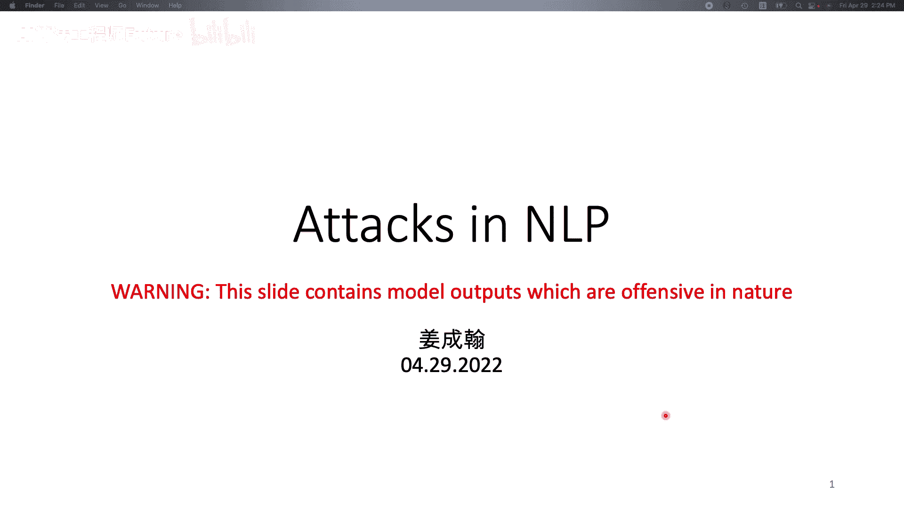

那其实刚才老师已经把我已觉当时要讲的东西，讲完了就是好，那呃今天这堂课呢，如果你要完全百分之百听懂的话，那你其实应该要知道这个，我这页投影片里面所列的这个所有东西，那这些基本的东西。

当然包括最基本的这个adversero tag是什么，然后这个在这学期的课程安排，好像是放在下个礼拜，然后第二个你应该要有基本概念，就是EXPENSIBLEAI，那这好像是这一代的课程进度吧。

那另外因为这个and roseal sample，它本身就是一种异常的东西，所以我们要怎么去侦测这个eassal example，的时候，我们也需要一些anomaly detection的概念。

那最后因为今天我们要讨论的呢是NLP，就是自然语言处理里面的attack，所以当然我会需要大家，对NLP的里面的各种任务，还有不同的模型有一定程度的认识，那最重要的模型呢。

也就是大家现在最常用的当然都是return language model，那其实跟LP相关的这些知识，那个老师，在2020的BLHOP里面都找得到，那可是如果我把这些东西当成先背知识。

那感觉感觉今天这堂课的门槛有点太高了，所以今天课程内容就是假设就是上面的东西，你大概知道是什么就可以了，然后就算你真的是完全不知道，应该也是听得下去的，那如果你想要更深入了解的话。

那相关的课程影片就放在这个地方，大家有兴趣再去看，那另外就是上次呃就是我4月1号上课的时候，有有有人说我讲的速度有点太快了，然后我后来看了一下影片，好像真的有点太快，所以我今天会尽量讲的慢一点啊。

要是要是大家觉得我还是讲的太快的话。

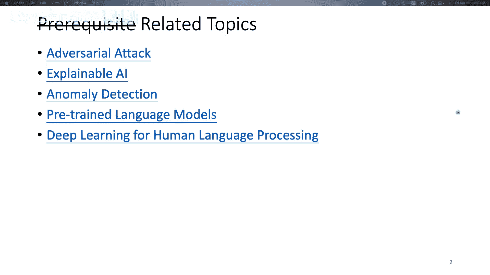

就直接打断我就好了，好，那今天的online是这样子，那我们先讲五个DUCTION，然后讲完之后我们再详细看剩下的online是什么好。

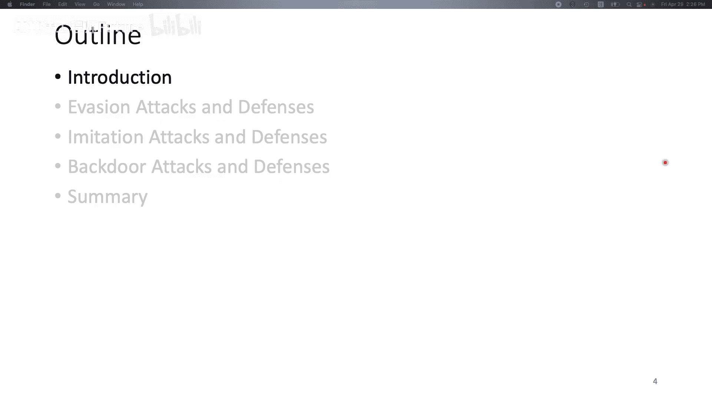

那我们先来看adversaro ta，那其实这个主题呢，我们已经从2019年的ml讲到现在，总之它是一个非常重要的主题，那因为它很重要，所以才会每年讲一次嘛，而且每年也都会有一个跟tag相关的作业，好。

那讲了那么多次，为什么今年我要特别把NOP里面的tag。

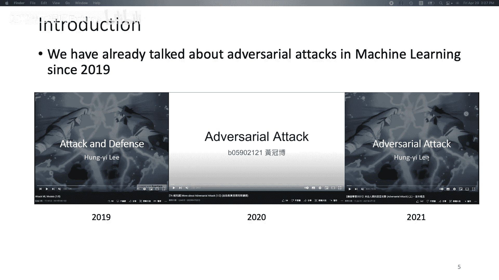

挑出来讲呢，好其实是这样子的，大家如果去看前几年的影片了，会发现以前讲的tag主要是在讲image上面的attack，那有少部分的是audio或者speech方面的。

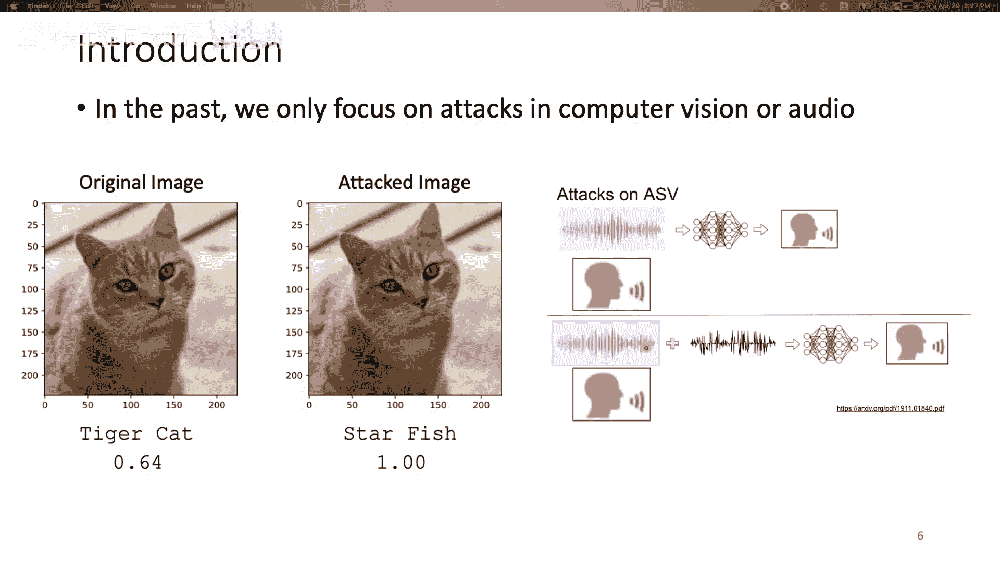

那NB方面的应该非常非常少，那这个影像跟speech这两个MODITY，它有一个非常非常重要的共通性，就是呢他们的input space啊，是在整个连续的实数空间，或是有限范围的连续的实数空间里面。

那以影像为例呢，这个影像的这个input，他就是分布在一个0~25，然后乘以影像的长跟宽，然后可能还有他的这个RGB3个channel，那如果声音你是一个web档，然后假设你用十应该是16bit存的话。

那它它的input，它落的范围，就会在负32648到正32678，然后乘以它的时间长度，所以它都是一个连续的input space嘛，那这样的连续的input space跟自然语言的input sp。

它是非常非常不一样的。

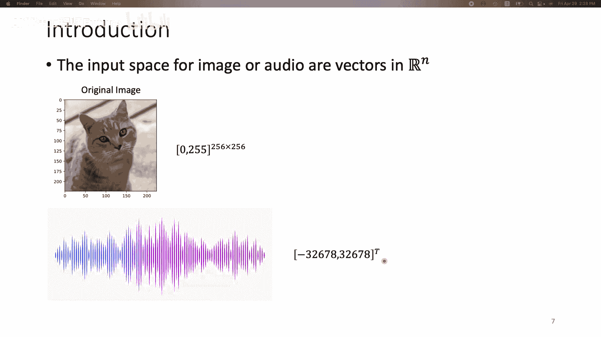

在NOP的世界里面，那我们的input是由word也就是词所组成的，或者是token，那这些token呢它是离散的东西，所以当我们要把这些字词所组成的语句。

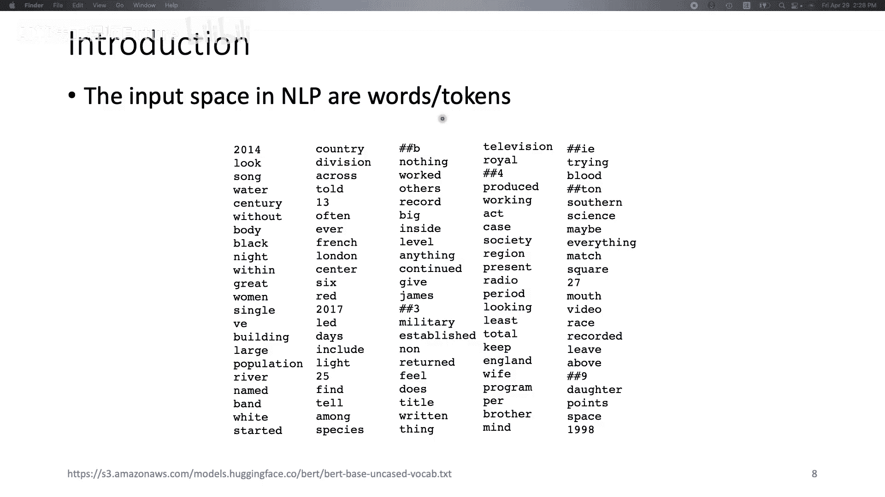

塞到一个model里面的时候，我们就需要把这个字句转换成一些vector，这样模型才吃的下去，那我们做的方式呢，所以每个token它都会有一个相应的向量，那透过这样的方式。

我们就可以把一个句子转换成一串的vector。

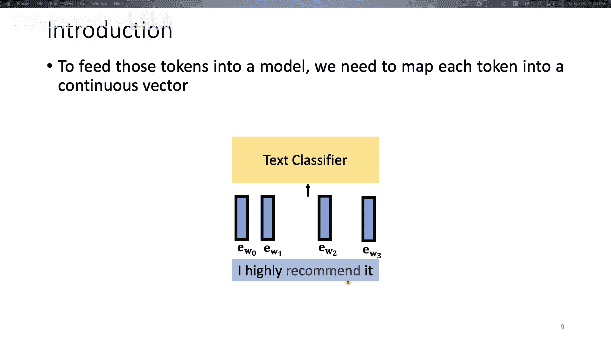

然后我们再丢到model里面，那就因为这个NLP的input它是describe，是离散的，所以我们在做攻击的时候呢，我们不会像是CD或是speech上面的tag那么简单，在CV的attack呢。

你就是在image上面加一个noise，这个noise可能是任何的NOI，但是在NOP里面，你现在有一个句子，然后呢你想要attack它，那这个attack方式就是加某preservation吗。

那我们要怎么加，难道要直接在这个这个字词上面加noise吗，那字词上面的noise是什么东西呢，好像有点不知道怎么做，那这个大家可能会想说，既然这个文字会被转换成连续的这个vector。

就是word embedding，那我们是不是直接在word embedding上面加notes，就可以达到攻击的效果了，不过这其实是不太合理的啦，因为模型实际上的input是这个离散的token。

然后模型内部呢会经过embedding logo，把这些离散的token，再转换成这个连续的embedding，所以当我们想要攻击一个NO p model时候。

我们能操作的就只有input这个离散的token，我们是不可能会对里面的word embedding，做perturbation，所以我们现在要现在要想的就是，我们要怎么在NOP的input的句子。

上面加了某种回的悲剧，使得模型看到它之后会直接烂掉，好那这个就是尖的重点吗。

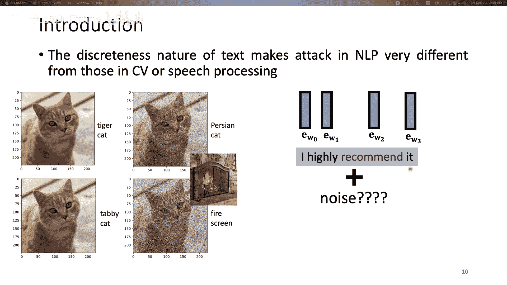

那就因为它实在太特殊了，所以今才会独立呃，把它拿出来讲一堂课，那今天我们会主要涉及到的有三种，重要的NP的attack，第一种叫做evasion attack。

然后第二种叫做invitation attack，第三种叫做backdoor attack，那这三种attack呢我都会讲一些对应的defense，就是我们要怎么去防御，防御这些呃不同的attack。

那主要的重点呢会放在invasion attack上面，然后invitation attack跟dego attack，是这个比较小的主题，那老师在上课的时候讲的比较多的。

也是一个那个CV里面的EVACATION尔赛，所以我想evasion of ta大家会比较熟，那invitation attack跟back door attack呢，上课的部分可能比较没有提到。

所以我们会借由这个自然语言处理这个MODELITY，然后来介绍给大家说，什么样的东西叫做invitation attack，什么是backdoor attack，那这些attack用在那种B上面的时候。

我们要怎么去访问它好，然后最后就会用很短的时间做summary，然后预计这个这个这一次的课程啊，应该会分两个礼拜讲，因为内容实在是有点多，所以应该会分两个礼拜。

那首先我们来看一下division attack，先简单讲一下这个evasion attack是什么，这个名词是什么，这个名词大家可能不熟，可能没有听过。

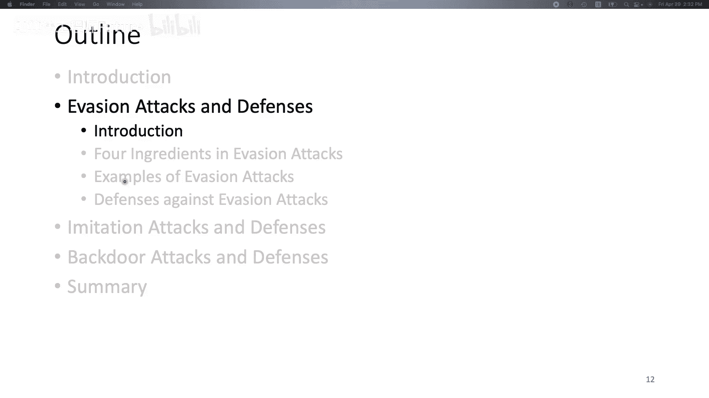

不过大家如果看到下面这张照片，就应该知道是什么东西了，下面这边呢有一张熊猫的照片，然后呢他加了一个非常小的noise之后，这个noise长这个样子，然后你把它乘以0。07，就是这个NOI乘以0。

07之后，对人来说是几乎看不出来的，但是呢你把这个熊猫的图片，加上一个人看不出来的note之后，丢到模型里面，模型竟然会把这样的一张图片，当做一个叫做好像是金丝源的动物吧，那原本模型会有57。

7%的confidence，觉得说这张图片是熊猫，但是加上了这个note之后，他竟然有非常非常高的信心，觉得它并不是一只熊猫，所以这样的东西呢就是所谓的ebing attack。

所谓的invasion attack，就是你丢了一个adversarial example到模型里面，结果模型的prediction就烂掉了，这个就叫做vision attack。

那所谓的adversarial sample呢，就是它跟某一个干净的sample啊，就是这个干净的sample，他长得非常非常像巷道，对人类来说，它其实是根本没有差的，那在干净的sample上面呢。

模型可以正确的判断，但是看到adversary example的时候，模型的判断就是错误的，那在NLP里面拿来做invasion attack的，Adversarial sample，长什么样子呢。

长什么样子呢，那先给大家看几个不同的例子。

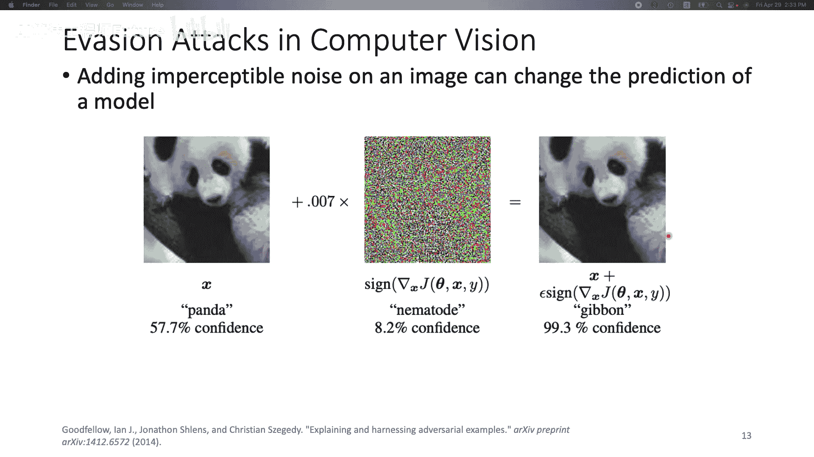

首先呢第一个例子给大家看的是sentiment，analysis这个任务里面的adversarial example，那所谓的sentiment analysis呢就是情绪分类。

那这边举的例子是电影的评论的分类，那这个任务要做的事情啊，就是我们想要有我们有很多的不同的电影评论，然后呢我们希望模型可以告诉我们说，这个电影评论它代表的是正确的，而正面的一个评价还是负面的一个评价。

所以这边这个例子这个original就是skip the film，And buy the david grass sound track cd，然后这个这个就是一个用反讽的方式，就是讽比较讽刺的方式。

然后表达说他觉得这个电影是不好看吗，那这个原本的这个呃电影评论呢，丢到训练好的模型之后，他就会觉得说这个电影评论是一个负面的评论，是一个负面的评论，但是呢非常神奇的事情是。

当你在这个dream把它从单数改成负数之后呢，这个模型竟然很神奇的，觉得这个评论是一个正面的评论，那对人来说呢，你加不加这个S，根本不会影响这个评论是正面还是负面的，但是这个对人来说根本就没有差的变动。

竟然可以影响这个任务上面模型的预测，所以他就是一个adversal sample。

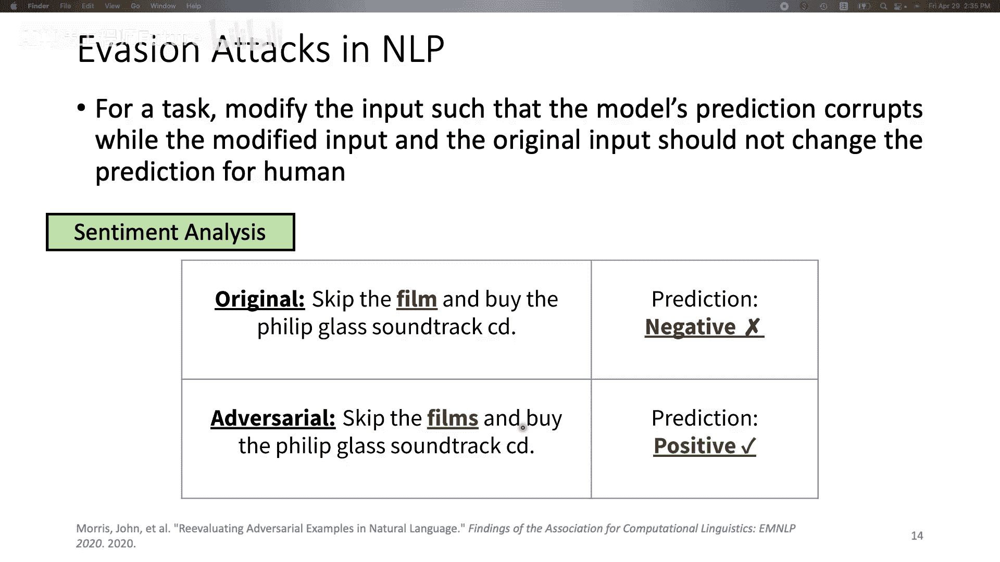

那举的第二个例子呢，给大家看到的是dependency parsing，里面的adversarial attack，那所谓的dependency parsing呢，就是给他一个句子。

他要去这个output出呃，字词之间的语义，还有文法结构关系，那这个结构关系画出来，就是一个长的很像树的东西，所以这个dependency party的model，它的input就是黑色的这个字。

然后它的output就是上面的这个数据，那原本的input长的是这个样子，上面的黑色的句子，那我们把这个上面的句子的stock market，股市的stock换成汇式的extract。

结果呢改了这个东西之后，就让整个模型的output出来的dependency trip，是完全不一样，是错误的一个parsing，那，上面的，所以对上面的句子来说。

下面的句子就是一个adversarial example，那看到这边你可能会觉得很奇怪，就是上面的句子跟下面的句子，很明显就长得不一样啊，他跟我们刚才看到那个熊猫好像差很多，因为在熊猫的例子里面。

这个正常的example跟adversal example对人来说，它就是两张看起来根本就一模一样的句子，好看看起来一一模一样的图片，但是在这边这个例子里面呢，这两个句子，你很明显就看到。

他们两个是有一个字是不一样的嘛，那这样的东西怎么会算是adversarial attack呢，好这边要澄清一下，所谓人看不出来呢，其实只说加了prohibition之后，它不会影响人对结果的预测。

所以在熊猫的这个例子里面呢，我们加了一个noise，那个prevision其实是不应该影响到人最终的预测，那我们要预测的东西是什么呢，我们要预测的东西是它是不是一只熊猫。

那现在在dependency parsing的这个例子里面，我们的预测目标就是某一个句子的这个，Dependency tree，所以呢所谓的对人来说没有差的。

PTIBATION是指说这个句子你不管怎么改，你只要没有改变到它真正dependency tree的话，那它就是一个合理的那个合理的PARTBATION，因为对人来说。

这个PERTIBATION是不会影响到他的dependency，parsing的，所以说下面的这个句子对人来说，它应该也要产生一个跟上面一样的tension secret，但是对模型来说。

它竟然产生了一个完全不一样的错误的底牌，能是TRI，所以我们会说下面这个句子，是上面这个句子的一个adversarial example，好，那这个这个时候你可能会问说，要是我只有看下面这个句子。

然后丢到模型里面，然后它产生出了一个错误的defense str，那我不是说觉得说这就是一个单纯的模型，判断错误吗，那我也不会觉得他是一个adversal example啊，那这个其实的确是这个样子。

没有错，就是所谓的adversarial example呢，它其实应该是相对于某一个benign example，BENNN就是良性或是正常example。

所以你单纯看着某一个adversary example，然后你没有看到他原本的正常的，counterpart的时候，那它的确就是一个会让模型判断错误的，一个东西。

你也不会特别觉得他是不是elsa example好，那前面这两个例子呢，就是呃感觉跟大家的生活比较远啊，大家平常应该不太会去用电影评论的，Sentiment analysis。

你也可能不会去用dependency party的这个模型。

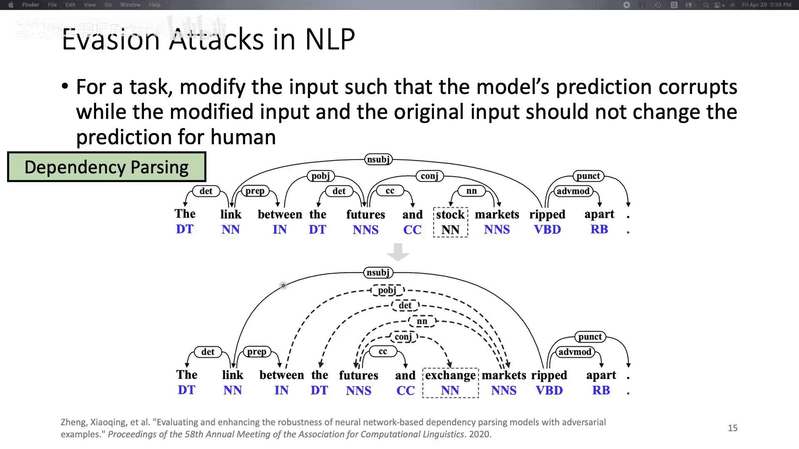

那下面这个例子呢是machine translation，在生活中的实际的例子，这个之前是有上过网络新闻的，这个句子呢，就是你把上面这个句子，丢到那个google的翻译之后呢。

它会跑出下面这个莫名其妙的翻译，那上面这个句子是so sad to see hong kong kong part of china，那所以照理说他翻译应该是要说很难过，看到香港成为中国的一部分。

但非常神奇的事情是呢，当你输入这个句子到google translation之后，他竟然会翻出，很高兴看到香港成为中国的一部分，那这个东西呢为什么会是l zero sample呢。

因为其实当初啊有人把HONGKONG跟china这两个地名，用各种不同的组合测试，然后最后测试出来只有china跟HONGKONG这个组合，会产生这个错误的例子，错误的翻译。

所以这个这个这个例子要告诉大家的是呢，n lp model其实比大家想象的还要非还要脆弱，非常非常多，因为这个google这么大一个公司，它训练出来的google translation。

竟然大家每天去搓一搓，然后就会抽出奇怪的结果，所以大家以后在训练模型，然后要丢到网络上面的时候，一定要非常小心，因为你把它丢到网络上之后，就会有成千上万的人每天没事就去搓一搓，看它会不会烂掉。

所以N牛P的model，他的tag跟defense是非常非常重要的，然后有一句有一件事情我要先澄清一下，就是今天讲这堂课的目的呢，并不是要让大家就是学到很多，不同的tag方式之后。

然后去网络上攻击各种API，这个额，我们的目的应该是让大家知道，说模型其实是很脆弱的，所以大家要更谨慎的去设计这些模型，然后再在你试出模型的时候，应该要想想看。

有没有什么方法可以让你的模型是更robust，然后不要让这个模型有这些可疑的output出现好。

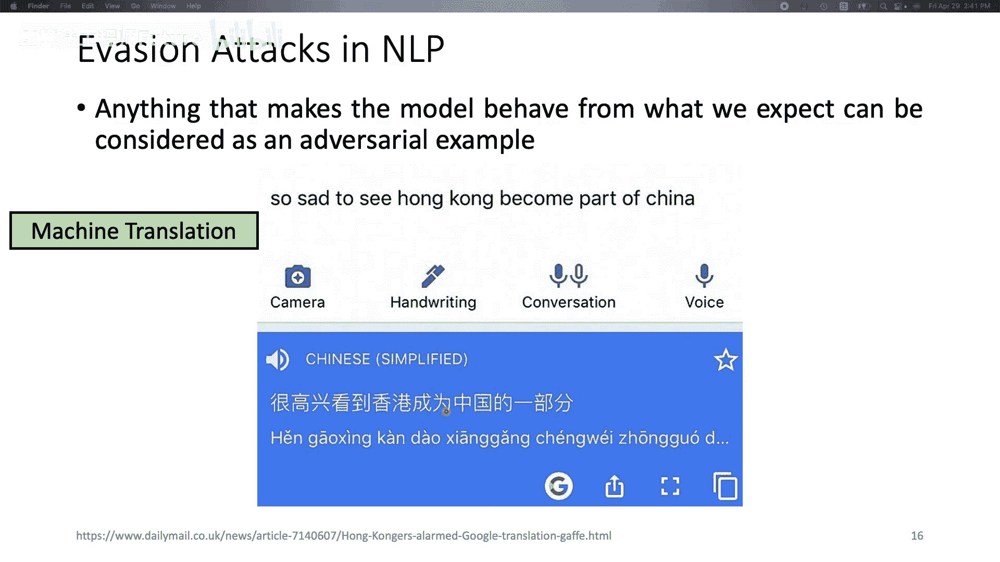

那在简单看过这个NLP的evasion attack之后呢，我们来看一下这些adversarial sample，他是用什么方式被找出来的。

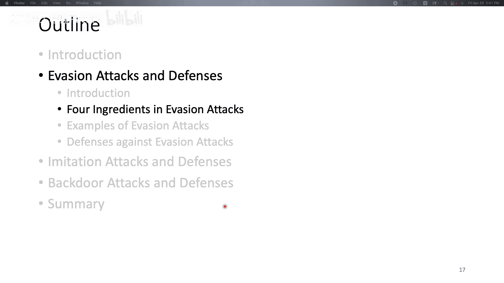

那在生成at cereal sample的过程呢，有四个非常重要的ingredient，那分别是这个目标，Go transformation，然后还有constraint。

然后最后一个是search method，那首先第一个go它指的就是这个evasion attack，产生的adversarial sample，他想要达到什么样的目标。

那第二个要素transformation，它指的是说我们要怎么产生潜在的preservation，第三个要素叫做control，也就是限制，这个限制指的是说呢。

我们产生的这个profession要满足什么样的条件，他才能被算是一个合理的adversarial sample，最后这个search method。

他讲的就是就是在transformation这个步骤呢，我们会产生很多很多可能的possible的呃，Preservation，那我们要怎么把这些不同的prohibition结合起来。

然后产生一个既可以达成目标，又不会违反我们的constrain的一个，最终的excel example，那这就是search method，他要做的事情好，那这四个要素呢等一下我们都会详细介绍。

那我们首先先看一个流程图，看一下这四个要素是怎么来产生一个。

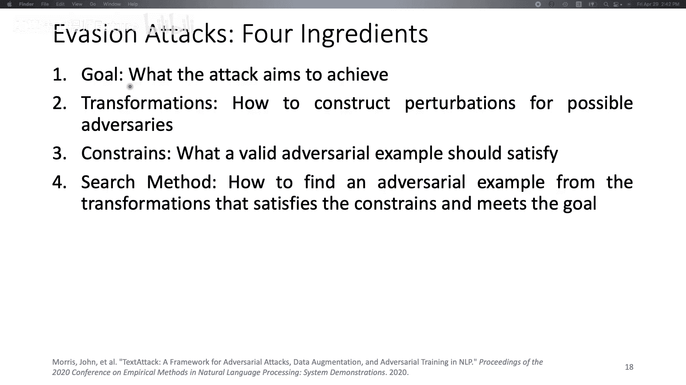

这个adversarial sample的，好当你要产生一个adversial sample的时候呢，你当然要知道现在的任务是什么，这样你才可以决定你的目标是什么。

那你当然也需要一个跟这个task有关的，victim model吗，那这个victim model呢它可以是BLACKBOX黑箱，它也可以是white box。

总之他这个他是black box或者white box，不会影响我们今天的讨论，那我们这边举一个例子是center analysis，就是刚才那个movie review as pation的例子。

那我们今天想要找到某一个adverseral sample，使得呢模型的结果会烂掉，那我们前面有讲过ancial sample呢，它是相对于某一个正常的sample而言嘛。

所以我们会需要一个正常的sample，那这边这个正常的sample呢，它是一个本来被模型判断成正面评论的，一个句子，那我们拿到这个句子之后呢。

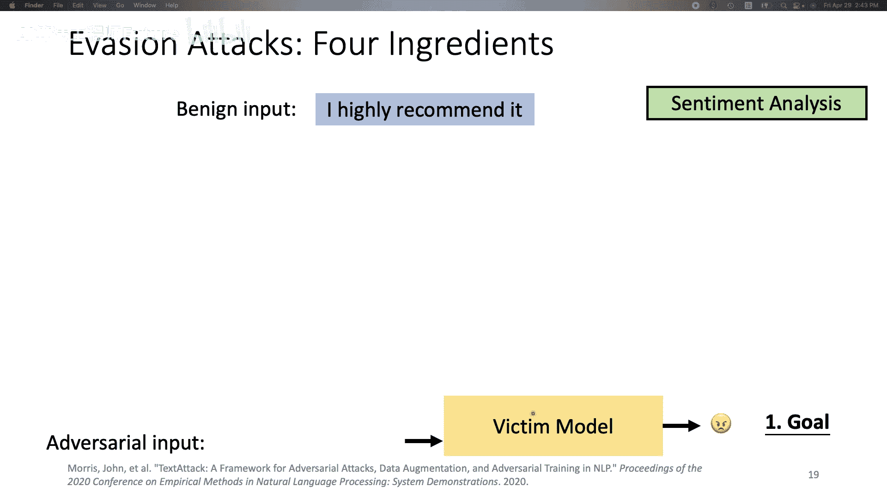

首先会经过一连串的transformation，然后呢来对本来的句子做一些更动，然后这些更动就带产生的结果，就是一些可能的preservation，那在这些perturbation里面。

哪可能会有一些这个奇怪的结果，他可能是不符合我们的control的，那我们就要把这些不符合这个，concert的东西拿掉，那下一个步骤呢，我们就是要在这一堆我们产生的possible。

perturbation里面呢，经过组合产生这个某一个和TIVATION。

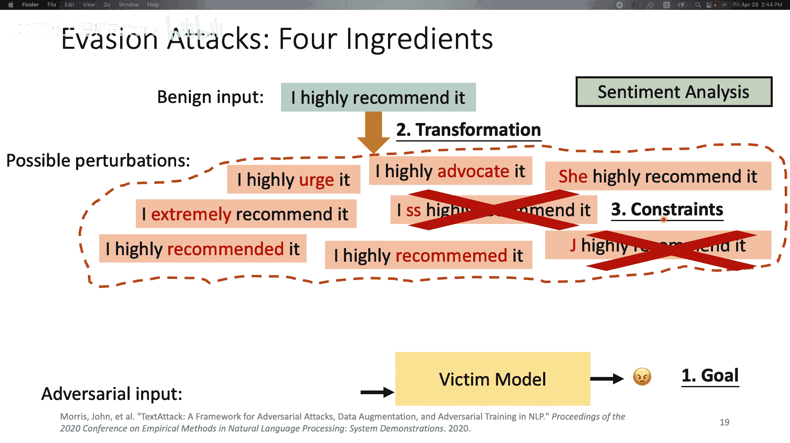

那这个步骤就是search method，他要做的事情，那search messile呢他就是要结合这个可能的prevision，产生可能的output，那这个可能的output呢。

他也有可能他会违反我们原本定的constrain，所以我们就会把违反CONTRL的部分拿掉，最终要是我们产生的这个adversarial sample呢，丢到模型里面的确可以达到我们的目标的话。

那我们就找到一个成功的adero sample，反之如果我们最后产生的这个东西呢，他没有办法让模型的结果烂掉的话，那这个attack就是不成功的。

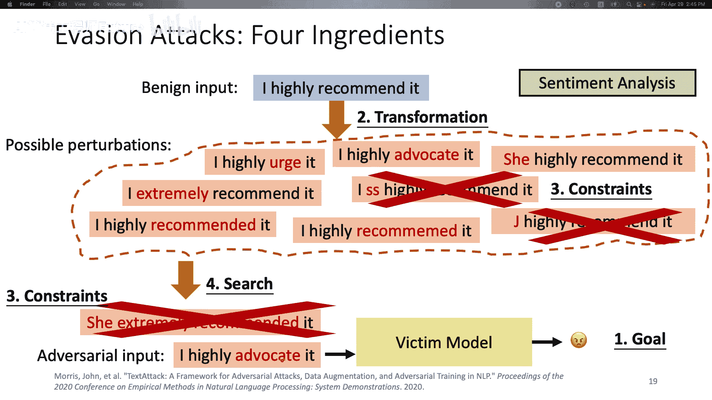

好首先呢我们来看一下四个要素里面的，第一个要素就是我们的目标，那不同的任务它会有不同的目标，我们先看最常见的一个目标。

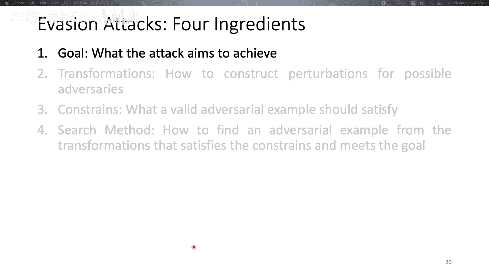

就是on targeted presentication，那antvc classification的这个目，这个目标呢，我们所希望达到的事情。

就是我要让classification model的结果烂掉，那他只要烂掉就好了，但我不会管他说他是怎么做的。

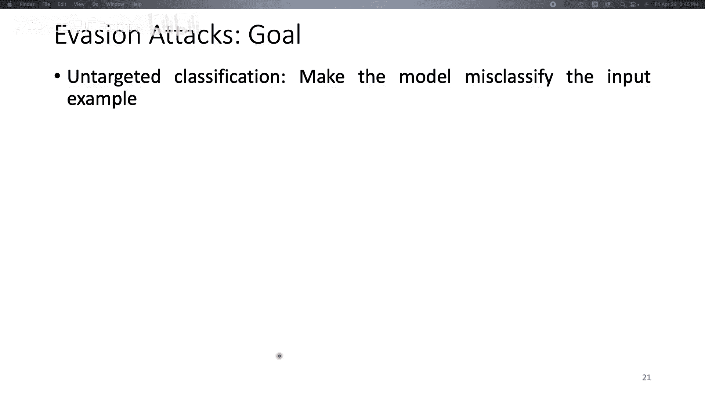

所以举例而言，假设我们有一个任务，这个任务是news title quication，新闻标题的分类，那这个任务做的事情就是给你一个新闻标题，他要去判断出，这个这个新闻是属于哪一个分类的。

那这个分类可能包括了science and technology，就是科技类的新闻或是体育类的新闻，或是世界世界新闻是呃，就是国际国际新闻之类的好，那在UNTARGETEDQUICATION呢，这个。

我就是让模型预测错就好了嘛，所以原本有一个新闻，这个新闻的title叫做NESY，那假设呢它经过prevision之后产生这个呃paper对啊，就是被更动过的一个news title丢到模型里面。

结果模型预测它是一个体育新闻，那这样子他算是一个成功的tag，那同时我的这个attack的方式，我们也可能产生另外一个不同的perfection，那这个PERTIVATION呢丢到模型里面。

模型觉得它是一个国际新闻，那在ANTARTCLASSIPATION里面呢，因为这两个这个adero sample，最终都让模型的预测出错，因为它原本应该是科技类的新闻。

然后模型最后把这两个东西都预测错误了，所以这个这两个excel sample。

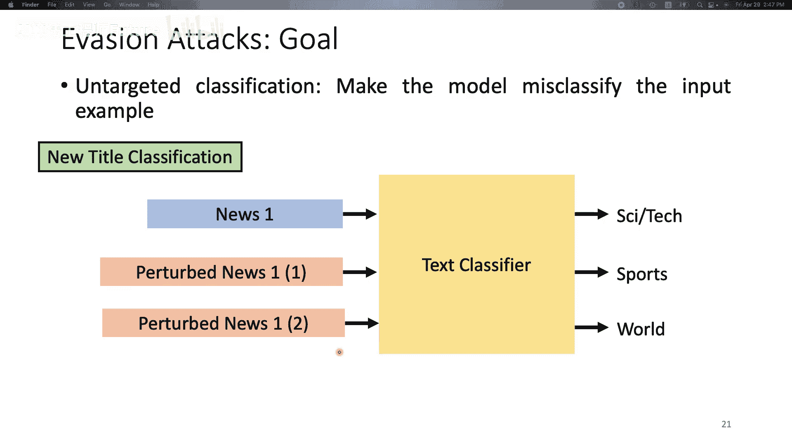

都有达到我们原本的目标，那相对来讲有另外一种不同的目标，叫做targeted classification，那这个targeted quication呢，就是我会指定说在。

如果它的光束是某一个class a的话，那我希望经过preservation之后，模型都把他判断成另外一个class b。

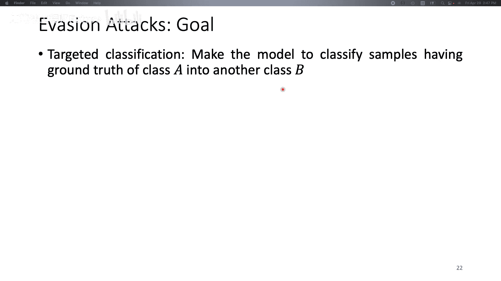

所以举例而言，我可能会希望说所有跟business就是商业相关的新闻。

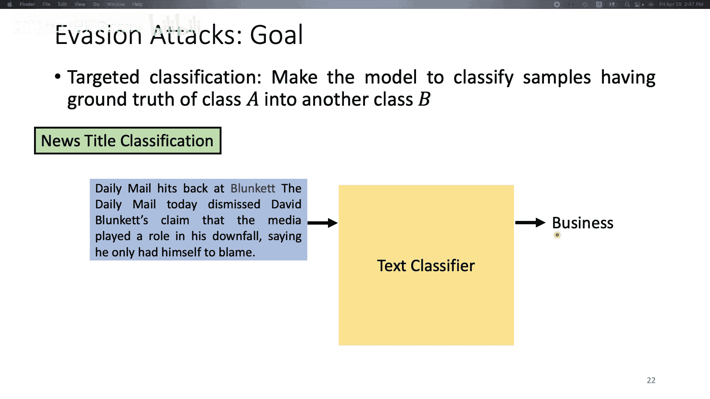

我都希望呢他可以经过preservation之后，变成一个被模型判断成是一个科技类的行为，那这边的例子呢，就是他把一个这个proper nn做一个跟跟动之后，他把他换成twitter之后。

模型就觉得他是一个science很高的行为，那如果说今天我指定说，我要让所有的business这一类的新闻，都被误判成是科技类的新闻，结果我产生了一个perfection。

然后让模型觉得他是一个体育新闻，虽然模型的这个prediction也是烂掉的，但是这个不符合我们一开始所设定的这个目标。

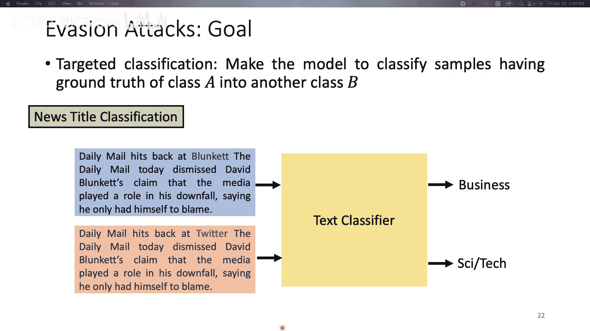

所以他就算是一个失败的攻击，好下一个我们来看一个有趣的例子，这个例子是在机器翻译里面的一个特别的目标，这个目标叫做universal sofistraper，也就是我要让我要找到某一个东西。

然后把它丢到原本的句子里面，可以让这个插入的句子，后面的东西没有被翻出来，所以在图片中，这个例子呢原本的正常句子是黑色的，这前面这一串字跟紫色的home u3字所组成的。

那我们的目标呢就是我们想要找到一个呃，and the ero的string就是一个字串字，红色这边所显示的东西，然后当我们把这样子的东西，丢到机器翻译的模型之后呢，这个模型output出来的翻译。

会直接忽略掉后面这个紫色的部分，所以这个就是universal stic strawber，他要达到的目的，那下一个额下一个例子啊。

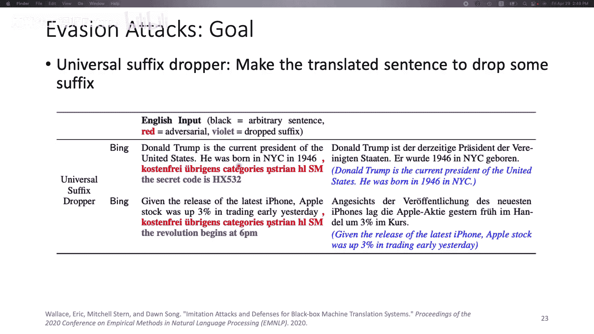

是就是刚才有看到的这个dependency，parsing的这个例子，那我们的目标呢，就是我们要产生一个错误的图片单词去好，总而言之呢就是不同的任务。

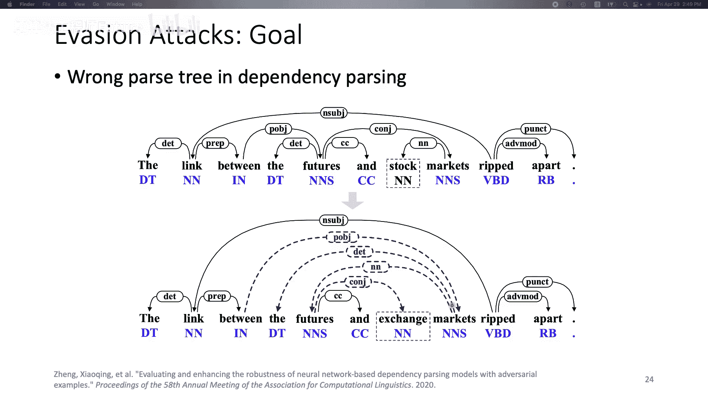

他会有很多不同的这个目标，那下一个要素我们来看的是transformation，那transformation要做的事情。

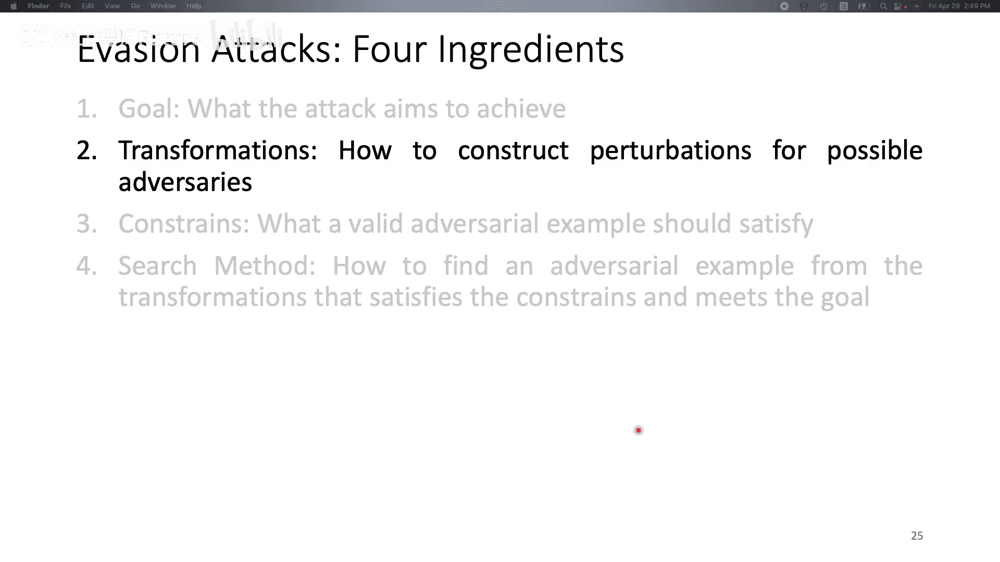

就是我们要怎么给定一个原本正常的句子。

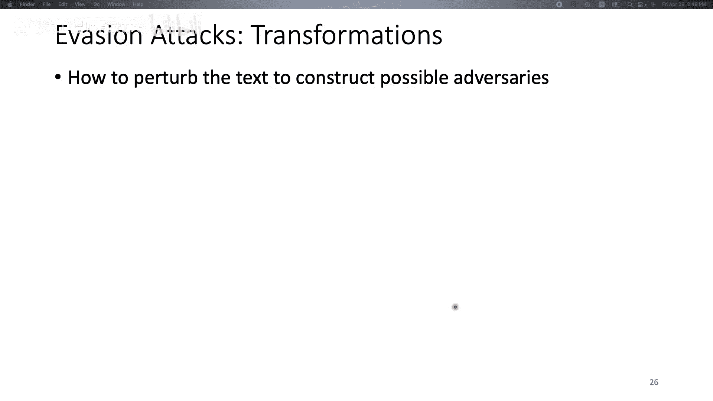

然后产生出很多种可能的，不同的这个潜在的可GRAVATION，也就是我们要怎么去更改原本的句子，然后产生一个新的句子，那这些产生的句子呢，它不一定可以让这个模型的output是烂掉的。

这个只是我们在产生最终的aderal example，的时候的一个中间产物，那这些中间产物呢还会经过concern的过滤，然后还有search method的一些。

就是结合之后才会产生最后的aderal sample。

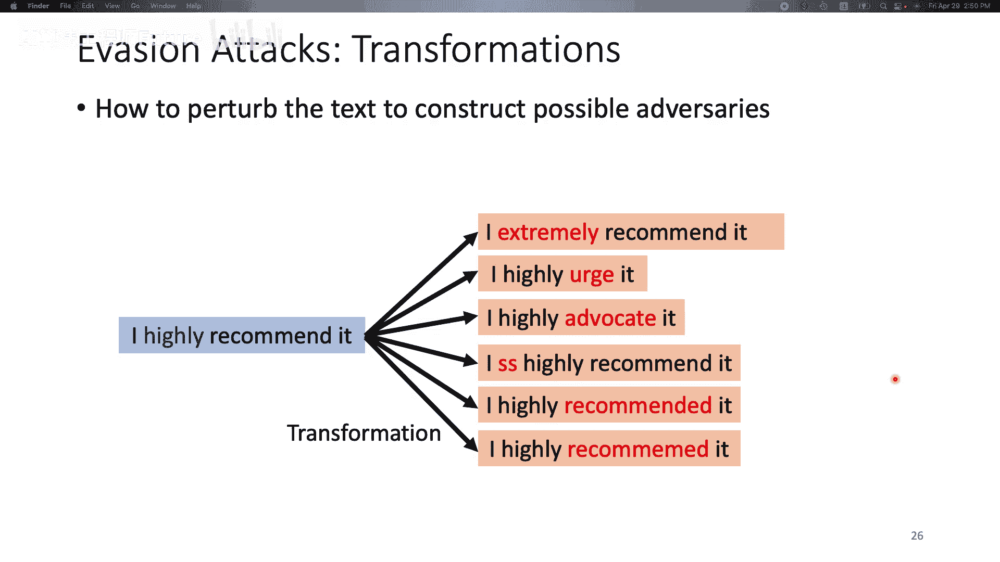

那首先呢我们来看word level的这个传统nation，也就是以字呃，以字词为单位的这个conformation，那第一种替换方式叫做word substitution，也就是我要把原本的字替换掉。

那要怎么替换呢，我们替换的方式是用同义词替换，为什么要用同义词替换呢，因为你用同义词替换才可以保留住，原本的semantic，就是语义，所以今天假设你的任务，它是一个应该要保持语义的任务，举例而言。

SDMONCLASSIFICATION的任务，它就是一个语义很重要的任务嘛，所以我们就会希望说，你在产生aderial sample的时候，你不应该去改变掉原本的句子的比例。

所以这时候我们的translation，就会使用同义词替换，那同义词替换呢这个要怎么替换，我们就用word net这个这个一个data set来做替换。

那这个DATASET里面呢它有各种不同的字的同义词，所以给定一个input的句子，你就可以去找WARNER这个data set里面每一个字。

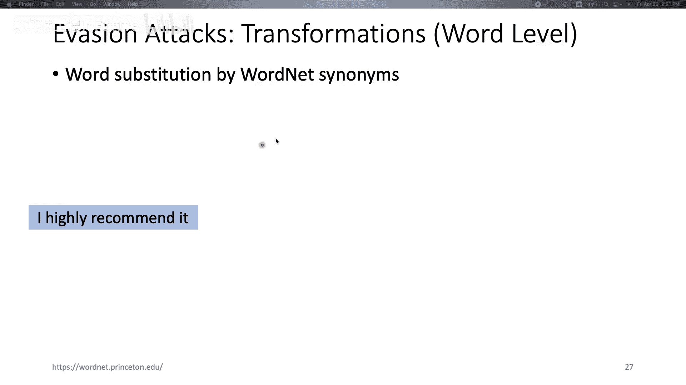

它所对应的这个同义词是什么，所以你可能就会去找这个HII它所对应到的呃，同义词在vert上面是extremely，那你可能会找到recommend这个字，它的同义词是URT。

allocate跟connect，那我们现在做的事情就是呢，我们要产生粉红nation，我们就把原本的这个字替换成它的同义词，所以就会产生i extremely remanded。

或者是i highly urgent，或者我换成advocate，变成i highly advocated，或者我换成command，变成i hii commanding。

那这几个例子呢就是这几个字的同义，这这两个字的同义词啊，就是这边这个表格，是我从这个WARNER上面直接找出来的，那大家可能会发现说就是HII换成extremely，听起来是还蛮合理的。

不过recommend你要换成urge或是command的话，好像会有一点点微妙，就是remain这个字呢，它其实会有很多不同的意思吧，那这个urge，可能是代表其中的某一个意思的同义词。

advocate可能是代表另外一个意思的同义词，那command就是代表某一个意思的同义词，所以当你直接无脑的用这个VERNET的同义词，替换的时候，你可能是没有办法考虑到这件事情的。

所以说呢你替换出来的结果，它的语义可能就不会跟原本的这个句子，是类似的，那这个时候要怎么办呢，这个时候要怎么办呢，我们就需要这个control来帮助我们，把这些不符合语义的。

就是跟原本的语义差太多的句子，把它滤掉。

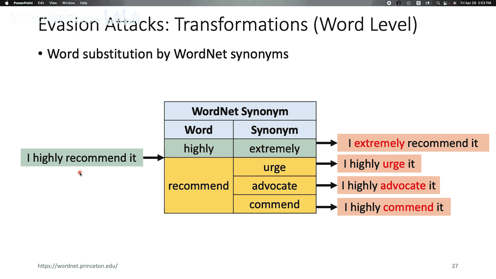

那这个部分我们等下会再继续讲好，那第二种呢的这个词的替换方式呢，是我们用brain bedding，空间里面的距离来作为替换的基准，那这个做法是怎么样呢，这个做法是这样的，我们有一个这个句子。

就是原本这个i highly recommend it，那我今天想要把recommend in这个字换掉，那我出去找RAGMAN这个这个字。

它在某一个叫做confeated of embedding space，这个训练好的，就是别人已经训练好的embedding space里面，我去找他的embedding是什么，那假设我找出来呢。

这个embedding这个remain embedding叫做一零，那在这个embedding space里面呢，它的附近还分布了这些不同其他的字，那像是这个刚才的content或是suggest。

或者是endorse或者allocate，那这个就是这个embedding space里面的不同的字，那我可能就会说我要替换的时候呢，我就是在这个要被替换的字的某一个。

这个epsong for所组成的那一堆hood里面，我去找适合的字来替换，所以当我们在选择我们要替换什么字的时候，这个EPISONB呃，Epp on four，就是呃就是半径是EPON的这个球盲。

那这个EXTRON就是一个超参数，就是一个have a prometer，然后去选的那这个eh on，如果选的不好，你可能会包含了一些奇怪的词，那假设我们说这个现在我们选择叶总统，是这颗红色的球。

那recommend这个字呢，它的x on ball所涵盖的其他字就是endorse跟OPO，所以你就会把原本的i highly recommended，换成i highly endorit。

或者i highly uphold，这就是你产生的可悲，Ation，那这个简单讲一下什么是CONDEFEATED，Global beating space。

我相信goebedding space大家应该都是有有概念。

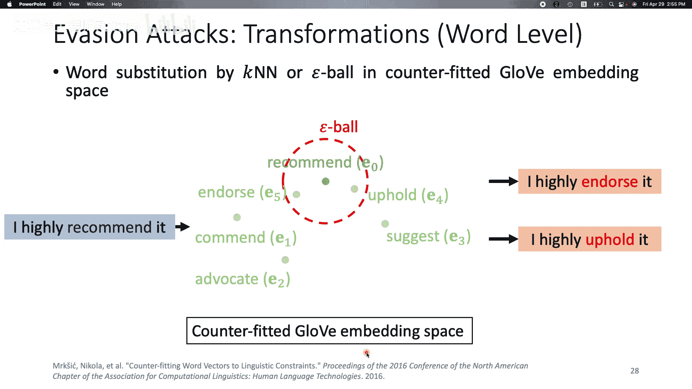

不过这个CONDEFEATED是什么意思呢，那呃我们直接来看这个原本的golin bedding space，原本的gin the evending embedding space。

可能会讲的是这个样子的，那这个是一个例子啊，就是有很多不同的字，那这些字就是方位词，那在原本的globin battle space上，这个相关的字词会被放在embedding space里面。

很相近的地方，所以举例而言，east这个字它的neighbor可能会有north和south，还有west，那western这个字它的相近的字词可能会是EASTER。

那east work可能会是SOUTHWOR，那这是为什么呢，因为这些字啊这几个字它出现了contact，就是前后文或是相似的，那这两个字因为它们词性比较接近嘛，所以哎不是不是词性比较接近。

就是它们会出现的context是比较接近的，所以他们在最后的grove evidence space里面，他们也会被放在比较近的距离比较近的地方，那假设呢。

今天我们想要用这样子的一个embedding space，来作为我们同义词替换的一个工具的话，那可能会有一个问题，就是当我们要把is st这个字换掉之后，我们在旁边画了一个SONBO。

那这个epsong ball所包含的字可能会有north跟south，还有west，那如果你直接把东方换成北方或者南方之类的，这可能就会让原本的这个语义有很明显的改变，那为了解决这个问题呢。

这个有人就提出了一个叫做CONTRIFTING的方式，那CONTRIFTING的方式呢，他做的事情就是我们用语言学的一些这个，Contrl，然后我们把同义词拉近，然后反义词拉远。

那在这边这个例子里面就与呃，就词义上面is st跟ester它是比较接近嘛，所以我们就会把他拉进，那is跟is word也是比较接近，所以我们就会把它拉近，那S跟north呢。

它的语义是就是它比较像是反义词的概念，所以我们就会把它拉远，然后source跟west我们也会想办法让它跟这个exist，这个是value，那经过CONTRAFITTING这个过程之后呢。

最后产生的embedding space叫做CONTROFTEDGRF，Ebedding space，那最后的结果可能就是SS这个字，它周围分布的就是东方相关的字。

source是不是它旁边就是south worwest，它旁边也只会有west，所以当你用这样子的一个evidence space，去做替换的时候呢，你在他旁边画一个eh呃。

就是半径是epp on的球的时候，才不会包含到一些反义词好，所以这个就是呃counterfeated group in bein space，诶，我想帮大家问个问题哦。

好好像现在啊除了用golf的embedding以外，现在很流行用BT这种contextualized的embedding，那在我们呃，等一下会讲到怎么用bird。

这种contextualized的embedding吗，我现在在做attack的时候呃，常常用到这种contextualized的embedding吗，哦等一下其实会讲到用就是BT做替换。

但是但是我们不太会用这个bird的embedding，来做替换，那这个原因是，这个原因我等讲完bird的substitution再一起解释，好了，好啊好啊好，各位同学有问题，就是你可以随时发言。

或者是如果你想要先举手再发言也是可以的，好陈翰，你就请继续吧，好那我就继续好，所以下一个就是刚才老师提到的。

用这个bird这样的一个next language model做word substitution。

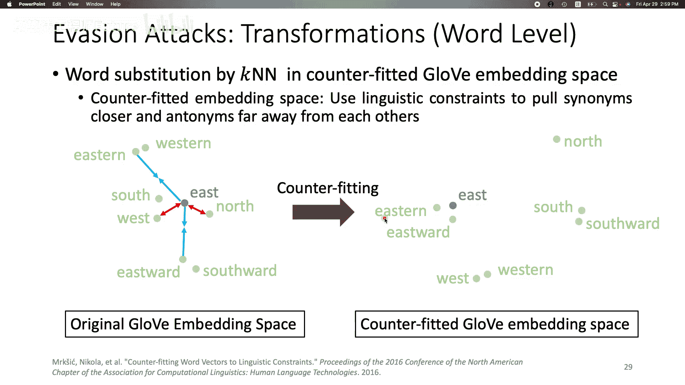

那这个要怎么做呢，我们的做法是这样的，我们有一个原本正常的句子，那我们就选定一个我们想要把它换掉的字，那在这个例子里面，我们想要换掉这个字呢是recommend，那我们做的事情呢。

就是我们把这个recommend遮住，然后丢到一个bird里面，那这个遮住的部分，这个max这个BT这个model，它就会预测出来很多不同的字嘛，那这个上面这个机率分布呢。

是我实际用bird bird days on case，然后得到了一个机遇分布，那他预测出来的结果啊，BT觉得在这个mask的位置最有可能被填入的，最有可能的是怀疑。

所以原本的这个句子呢是i highly remanded，经过BDMM的预测，它就会把它改成这个i highly doubted，那其他预测出来的字。

包括了expect到appreciate ending。

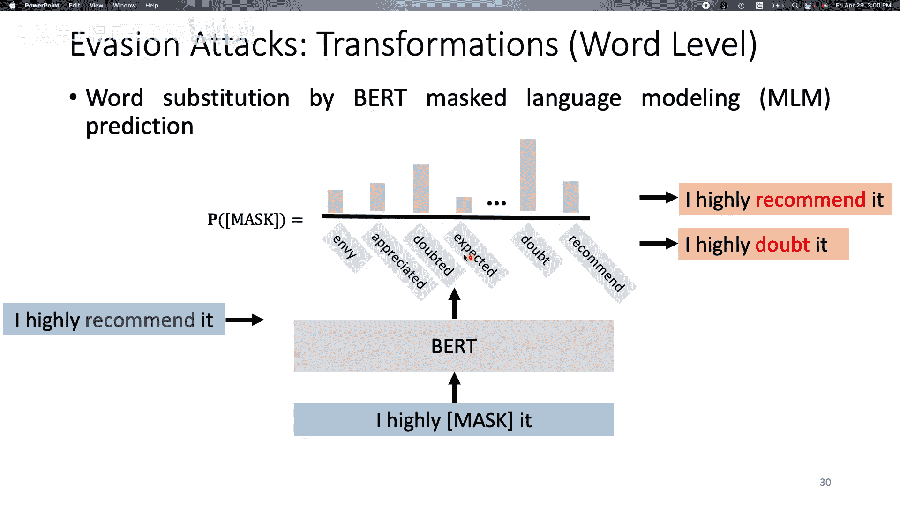

所以很明显的看到，就是在这里面的这几个字里面，几率最高的，这个其实是跟原本的意可以说是完全相反的，那还有这个MV你也不知道换换换进来之后，这句话跟原本的句子好像也也没有什么关系呀。

所以用bird单纯用BDMM来换的话，可能会会有一些奇怪的结果好，所以这个是因为我们直接用mask，那mask的时候，它在我们如果直接让它填入这个mask的话。

bird它其实可以填入任何符合这个context的的字词，那这个符合context不一定符合原本我们的意义，所以为了要解决这个问题呀。

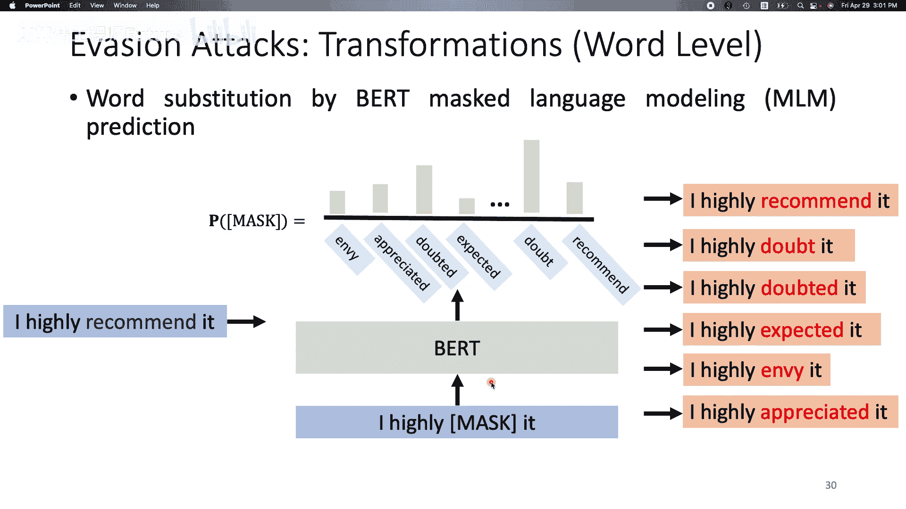

就有人提出了另外一个不同的方式，这个方式呢是我们用reconstructed，就是我们不要这种mask，那这是怎么一回事呢，也就是假设我们有一个原本的这个句子是。

I highly recommended，那我们今天一样，我们想要把recommend in换掉，但是我们在利用bird这个模型的时候，我们不要把recommend这个字遮住，我们不要把它遮住。

那即使我不遮住啊，他最后在这个位置，BD还是会有一个他predict出来的可能的字词，那这个可能致死的机率分布长这个样子，那这个分布也是我实际上这个用FD之后，得到的一个机率分布。

那大家可以看到这边这个机率分布呢，跟上面前前面这一页所得到的这个几率分布啊，其实是看起来会比较合理，举例而言，它几率最高的几率最高的就是原本的这个字嘛，这个没有很意外。

那其他的像是rate raid这个字呢。

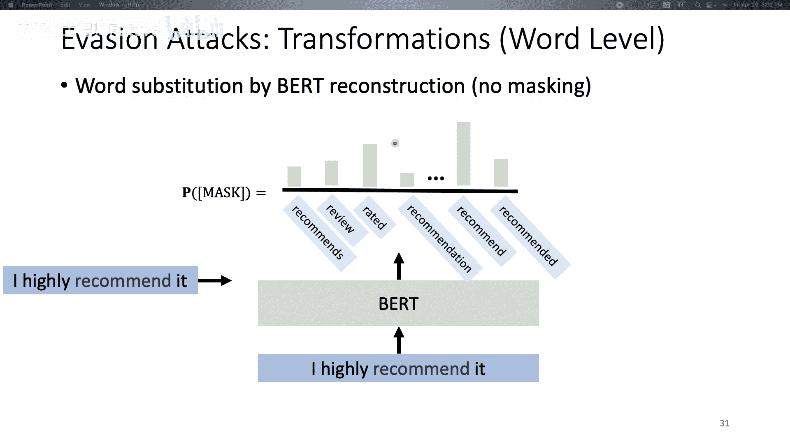

换到原本的这个context里面，看起来是一个比较合理或者highly review it，它看起来也是一个非常非常合理的这个替换，那这个为什么会是这个样子呢，因为当这个当你没有把它max住的时候。

他最后output出来，这个比例就会跟原本这个很接近啊，那跟原本这个很接近的呃，跟原本很接近的就哎不是很接近，就是他最有可能的应该就是他原本的那个字。

那他其他产生出来的这些几率很高的prediction，就会是跟原本这个字的embedding，非常接近的这些词，所以这个某种某种程度上，其实它就是有用了。

contextualize embedding来做做这个if呃，就是找contextualize embedding里面的接近的，就是接近的neighborhood来做替换，这样这样有回答到老师的问题。

哎，有有有有有谢谢谢谢对，好，然后接下来呢，我们来看一个比较不一样的替换方式。

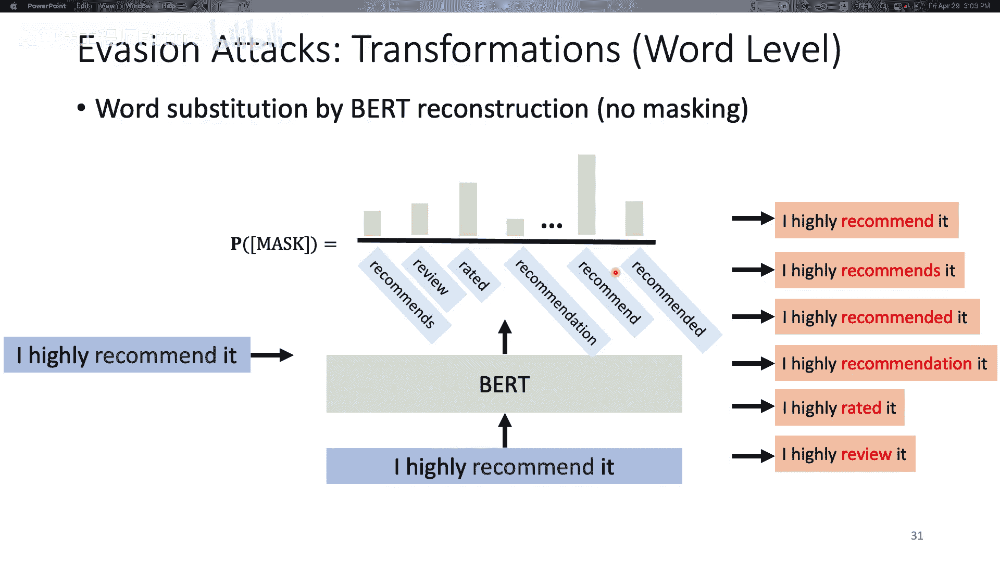

那他同样是额word label的替换，那但是我们这边替换的方式，是用某些特定的规则来换的，他换的方式是我们把一个字词的infection form，来更动，那什么是infection form呢。

infection form就是某一个字的infectional morphine，那看这算这个说明可能有点难理解，你直接看实际的例子，假设有一个这个句子还是一样，是这个句子。

我们要换的是recommend这个字，那，Infectional thing in，他呃我们要换infection motion的时候，它可能展现的结果就是，我在原本这个动词去更动它的影。

在trainor more fine，那INFECTIONALMFIN呢，其实就是这些表示时态，或是表示动动作的进行方式之类的，这些这个呃MORPHIIT，那这些MORPHIN呢。

它是不会影响到这个字的原本的意思，那些moving他也有可能会把一个这个，他有可能会把他的POS改变，所以这个i have a recommended。

它可能改变的是i highly recommended，I have ly recommended，I hily recommended，那这这个原本它是一个base form的动词吗。

他现在就把它改成这个第三人称单数的，或者是过去式，或是动词ING，或者他也有可能把它改成名词，就是recommendation，所以这个就是infect normal frame的替换方式。

那你可能会想说，假设你把它替换成一些像是这个它，他就违反了这个文法嘛，那就要看我们现在的attack，有没有关心说这个产生出来的GRAVATION，可不可以是违反文保的。

那假设我希望他不可以这个违反文保的话，那其实这个跟这个就是一个不合法的。

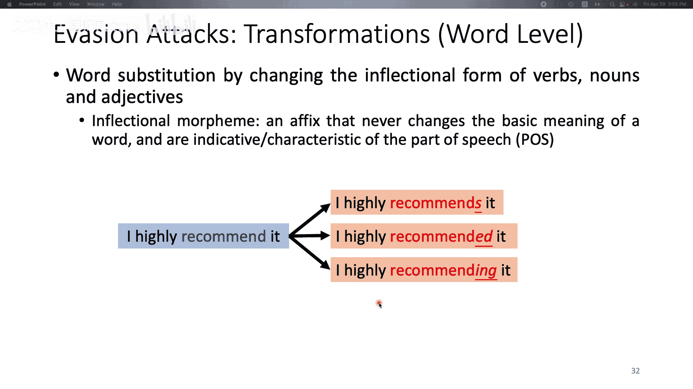

这个这个PREDATION，好接下来讲一个额算是蛮重要的方法，这个方法是用gradient来做替换的好，那如果我们要用gradient来做替换的话，我们就需要有办法知道这个模型的gradient吗。

那所以这个会需要呃，我们知道这这个就是一个white box attack scenario，所以如果你是black box的话，你就没有办法用这个方式来做替换好，那这个方法做的方式是什么呢。

就是我们有一个句子，有一个模型。

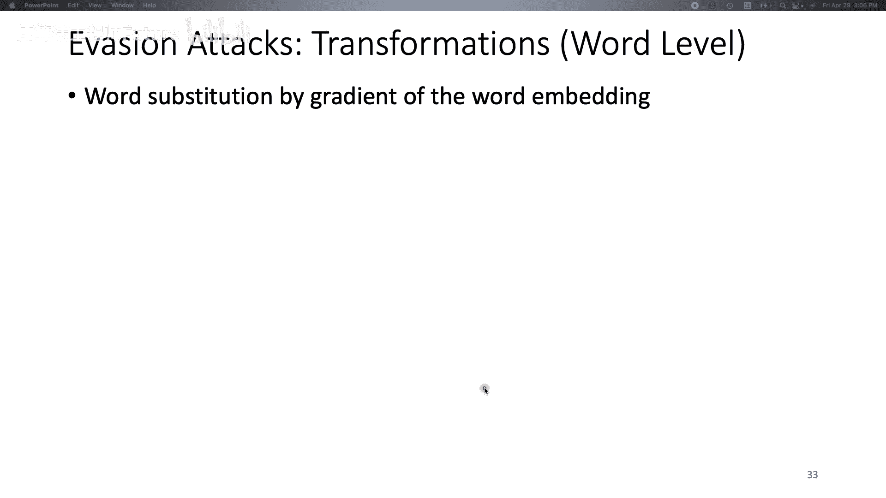

那我们就把它丢到模型里面，for work过之后，我们就会得到一个模型凹凸出来的loss，我们就用这个loss呢。

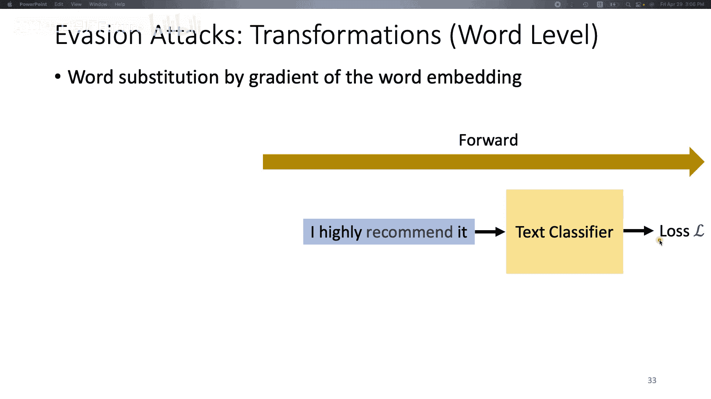

Backwork，那就是back wor要背过到哪里，带过到这个word bein space里面，那我们是用什么对什么微分呢，我们是用这个loss，对原本的就是里面的每一个字的WOREBEDING。

做微分，那假设我今天要替换的字是recommend这个字，那我就是对recommend的这个呃字的word embedded，一零做偏微分，那这个一零啊它是一个它会是一个向量。

所以你用这个partial l parover partial10，它也是一个向量，然后这个向量的维度，就会是跟这个维度是一样的好，那接下来我们做的事情呢是什么。

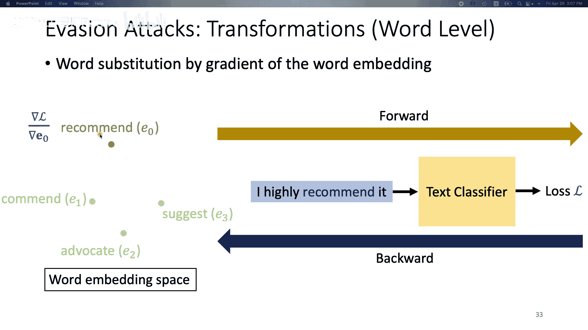

我呃我先讲我先讲这个要怎么做，然后我再讲一下为什么要这样做，那这个做法呢就是我们去找说paul pull over partial，一零，这个向量跟其他的embedding之间的。

这个这个向量就是一零减啊，1万-10或者12-10，或是E3-10，然后这个东西跟这个东西做DP product之后，我们用这个东西来衡量呃，哪一个字应该要被换成就remain，应该要被换成哪个字。

那这个东西呢它其实代表呃一阶的近似，就是这个loss loss function，在这个字附近有一阶的近似，那这个数值呢代表说，当你把这个原本的recommend这个字。

一零换成content这个字的时候，它的loss会变化多少，这个是它的一阶近似，那为什么这个东西是一阶近似呢。

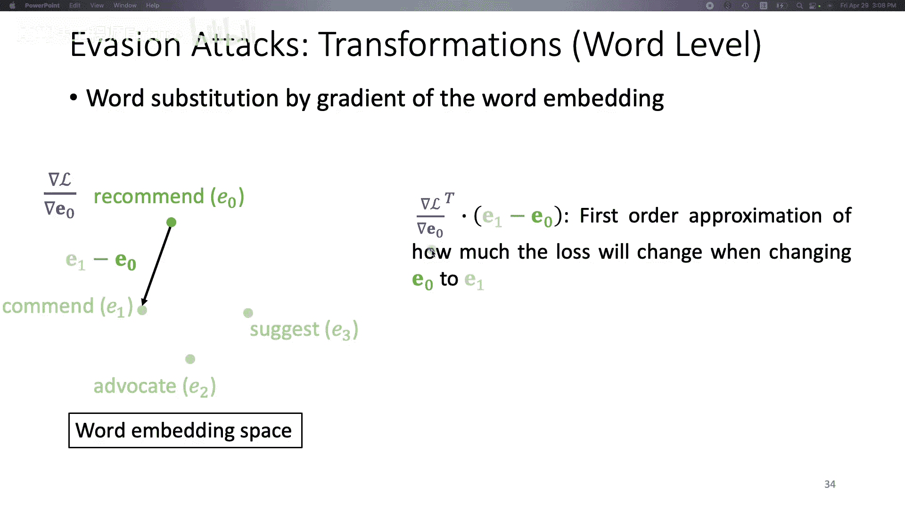

那我们就看一下这个下面的这个，二维空间的例子，那假设在二维空间里面，我们的input是这个X，然后这个是它的loss function，就是Y等于LFFX，那今天我们有一个点是X0。

那它对应的这个loss呢是LFX0，那我们就可以在这个地方算出，L对XX的微分是多少，然后找到这个这条通过LLXX0的，这个点的切线吧，那这条切线的切线方程式就会是Y等于额。

这边少写一个XY等于这个化学l over化学X，然后再乘以一个X，这边要乘以一个X，然后加上L和X方，那假设说我有另外一个点XY，然后我想要用这一条这个一阶近似，然后来看说当我把X0移到x1的时候。

他的一阶进制会是多少，那我们做的事情，就是我们把x1带到这个切线方程式里面，因为切线就是代表说这个切线方程是代表意义，就是呃，在原本的这个LY等于LX的附近的一个，一阶近似。

那如果说x1跟X0很接近的时候，这个一阶近似的这个准确度就会比较高，那如果很远的话，相当这个它的一阶近似的程度较低好，所以这个我们要看x1这个点，用这条tension line做一阶近似的时候。

我们就是把它带进去吗，那我们就可以得到说，当我们把X0移到XY的时候，用一阶近似它的这个数值可会改变多少，那个数这个这个数值改变的幅度呢，就是XY减x2，也是他们的距离，然后乘以它的斜率。

就是partial l of x0o over partial x，这个东西呢就会是呃用一阶近似的时候，当我们把X0移到x1之后，它的lose的改变幅度好。

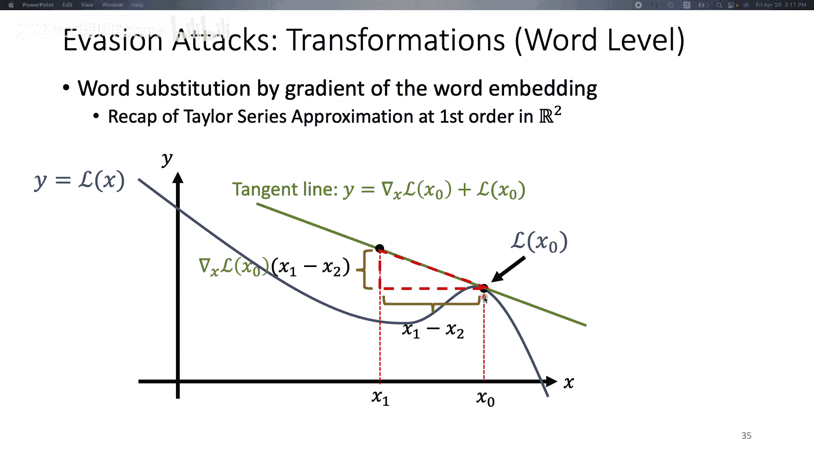

所以套到刚才原本的那个例子里面呢，我们做的事情是什么，我们做的事情是我们去算这个loss，对这个一零这个embedding微分，然后在跟这几个不同的向量做内积，那这几个向量代表什么。

这几个向量是代表说我把一零移到1万之后，这个移动了多少，e two移到101到E2，就是换成从advocate换成remain之后，我的这个win be你一共有多少。

或是我把replant换成suggest时候，我的win背景移动了多少，那把这些移动的距离呢，dot product with这个parrol over partie，就代表说我们用一阶近似来看的时候。

我们把这个原本的warring bedding，换成后来的win bedding之后，它的loss会改变多少，那如果他是正的话，就是表示说它的loss会增加，如果它是负的话，就表示它的loss会减少。

所以我们要找合法的，就是我们要找这个可能的替换，就是我们去找说这个东西，我们去取arc max最大的K格，然后看书在所有的VOCALVARY。

所有embedding space里面的were embedded，哪些东西，我们把它我们把remain替换成哪些东西之后，它的loss会变化最多，那这个就是我们替换的方式。

好这个这个有点哎我我有个小问题啊，那个一般呐我们在石座上会一定会找top，配个word吗，有没有可能就是现在gradient算出来的方向，如果跟EI减一零，都是做那个DPA以后都是负的，那会不会就呃呃。

就代表说现在把recommend变成任何其他的word，可能都不会让loss变大，那是不是就有可能不选择置换任何的word呢，哦有可能有有可能，不过这个就是他attention就失败了哦。

我因为在一个整个句子里面有很多不同的词汇，所以也许recommend没有置换掉，但是其他词汇有置换掉，搞不好最后攻击还是会成功的，这游戏感觉要全部不太呃，我我我我个人是觉得不太可能。

因为就是如果你把它换成反义词，它一定是可他的，他应该会直接就是他他应该就会是负呃，就一定要是正的，这样子了解了解好哎，有同学想问问题了，那个迪尼扣不用不用讲那个那个就请请问一下。

就是因为我们要攻击的不是别人的model吗，那我们要怎么样知道别人的model，对一个东西的违分，这个就是假设说你知道他的model是什么，那如果你不知道的话，如果你不知道的话。

你可以用invitation和take方式把他的model投过来，然后把那个model当做是一个proxy，所以所以所谓的invitation take，就是之后会讲那个invitation。

ta是别人有一个model嘛，它是一个black box，然后你用某种方法把这个model偷过来，然后偷过来，意思就是说你在你的local的地方，有一个跟他几乎是一模一样的模型，那在这个状况下。

你就可以把它当成是一个y box model来打，这样子这样回答你会好好谢谢嗯，这个偷的方法是指有点像teacher student那种吗，就是我我找一堆资料。

然后让我的这个model去学那个model的长相之类，而去学他的输出会长怎样，对对对，就是这样子哦，谢谢好诶，大家还有问题想问吗，大家有问题都可以随时举手哦，好如果暂时没有，那我们就请陈汉继续咯。

好那接下来一个transformation的方式呢。

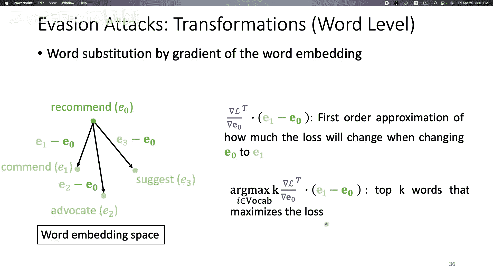

是也是word level，但它不是substitution，它是deletion哦，它是insertion啊，insert就是我们要插一个字，那插一个字，第一个你要先决定要插在哪里，那你也可以随便插。

没关系，反正总而言之，假设我已经决定好我们要插在哪里之后，那我们要怎么插呢，那有一种很简单的方法，就是你要的是用M2来插，就是max language model。

所以你有一个这个原本的这个句子是这个样子，然后你就是决定好说我要插在I跟海底中间，那就放一个max这个头ken进去，然后丢到BD里面。

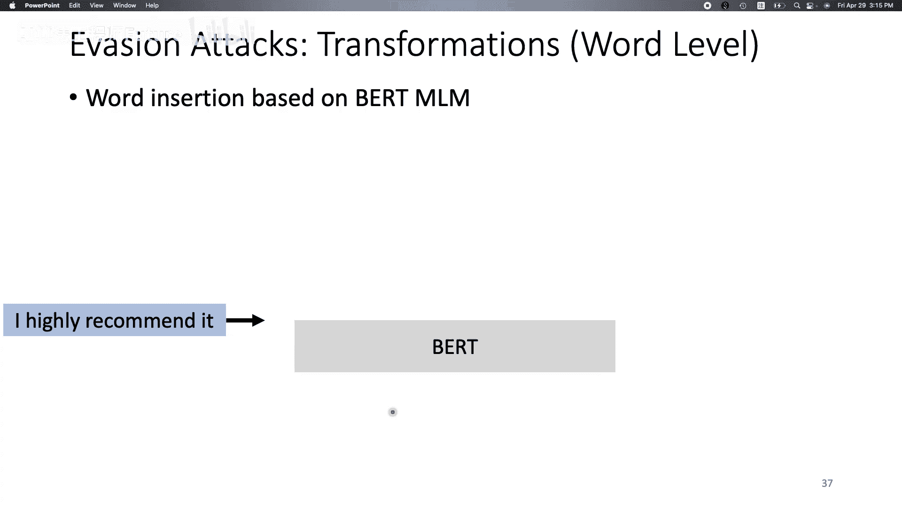

然后就会PRE定出来各种可能的这个决定是吧，然后这些东西就是可可能的worse，这是可能的PREDATION。

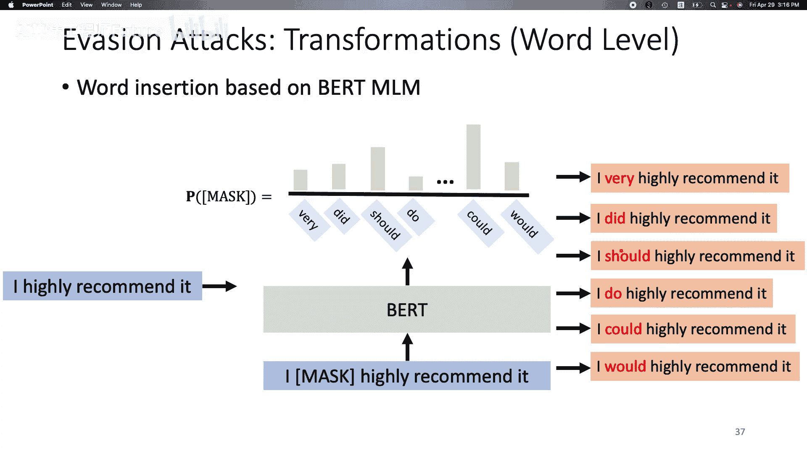

那也有一种很简单的这个transformation，就是word vision，就是你把这个每个字拿掉，那，但这个这种的这个transformation啊，就是很容易会影响到它原本的语义。

或是影响到他的文法正确性，所以这个选form nation的方式没有到很常用。

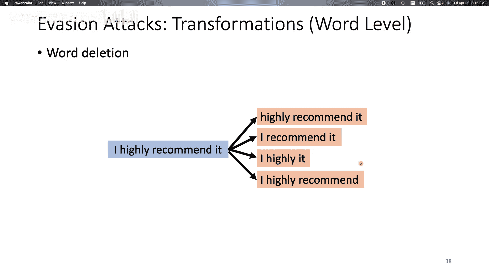

好那另外一种这个transformation，刚才讲的全部都是word level translation，就是你要怎么把一个字词，一个字词换成某一个字词，或是把它拿掉，或是新增一个新的字词。

那我们现在看一下corrector，label的这个translation，那correct就是自源嘛，就是这个correct是CHA啊，所以这些这个叫叫corrector。

那假设说呃我们原本的字是这些不同的字啊，那crate label的总成类型就包括swap，所谓的swap，就是我们把相邻的两个这个corrector，做交换位置，让我把E跟A的位置互换。

那我把S跟I的位置互换，或者是我们做substitution，就是我把某一个corrector，换成另外一个corrector，像我把A换成X或者是我把T换成X之类的。

那另外一种可能的做法就是DELECTION，那deletion就像就是你把一个click拿掉，或者是insertion，就是你新加了一个原本不在这个字的corrector。

那这些这个correct level transformation啊，其实是很常会发生在我们日常生活，就是你打字的时候很容易会打错字吗，所以其实有人在设计这些correct level的。

translation的时候，他会考虑说键盘上面哪些字的，哪些字是比较接近的，那他就会把就是就是举例而言，像是假设我们要做substitution好了，那他就会看说我今天要换掉artist里面的那个T。

他就看键盘上面跟T比较接近的资金哪些，那键盘上应跟T比较接近，就是R跟Y还有距嘛，所以他就可能会把它换成R跟Y还有距，那其实correct level的transform嘛。

它其实是一个非常强的transformation，为什么会这样讲呢，因为对人来说啊，就是像是swap这种，这个这样子的一个选择类型，对人来说，至少我来看，我乍看之下，我不会看出。

这个词跟原本的这个词有什么太大差别，可是对模型来说呢，模型他在训练的时候应该只有看过正常的字，他不会看拼错的字，所以他看到一个拼错字的时候，他可能就会直接烂掉，其他他根本就不认识这个字。

它就是一个out of vocabulary的字，所以这种correct label的粉重回选，其实是一个很强的这个ENEROTI好。

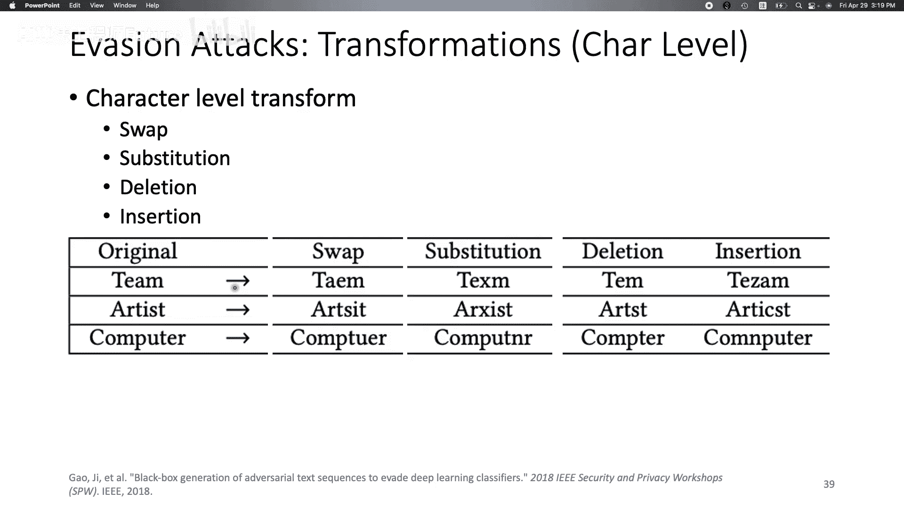

那接下来呢呃下一个下一个这个ingredient，就是CTRL了，那讲CONTR之前，我们先去休息10分钟好了，好不好，我们休息10分钟，我们10分钟后再回来哦。

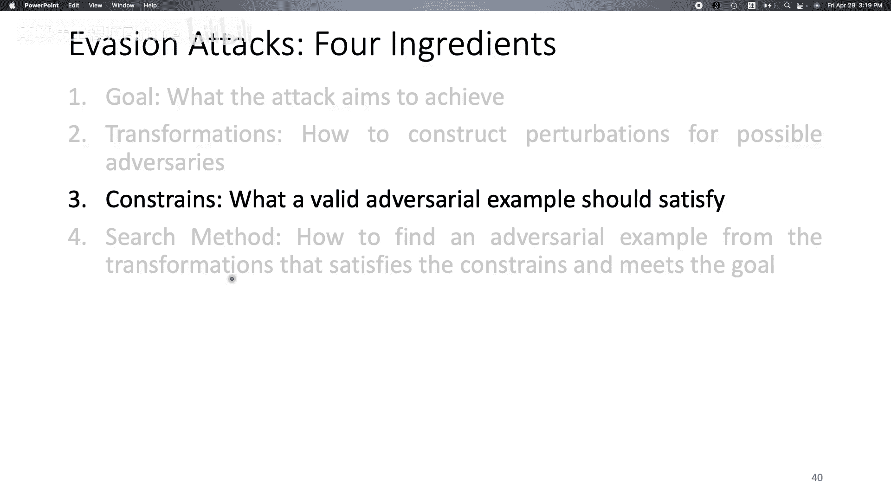