# 【官授搬运】2026年全新优化版李宏毅机器学习系统课程，这才是真正的初学者体系课程！—人工智能／深度学习／神经网络 - P69：【第十讲】1-來自人類的惡意攻擊 (Adversarial Attack) (上) – 基本概念 - AI算法工程师Future - BV1ruqABeEFX

好诶我们来讲一下那个下一个主题，我们来讲那个adversarial的attack，好，adversal attack要讲这个主题要讲的是什么呢，我们这边要讲的是我们在作业里面呢。

我们已经训练了非常多各式各样的类神经网络，那我们当然期待说，我们可以把这些技术用在真正的应用上，但是光是把这些network用在真正的应用上，要把这些network用在真正的应用上。

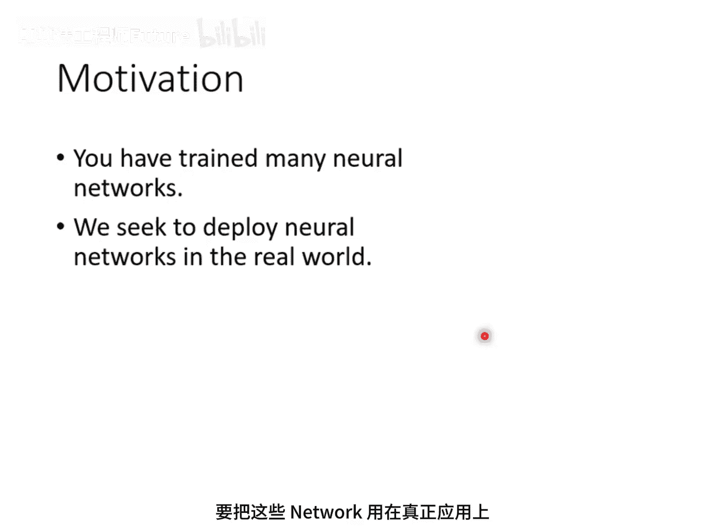

光是他们正确率高是不够的，他们需还需要什么能力呢，他们需要能够应付来自人类的恶意。

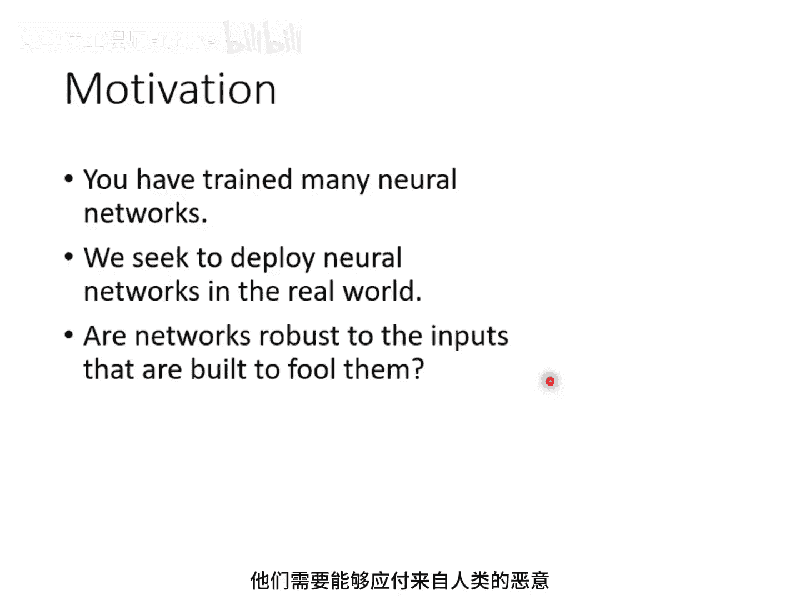

什么叫做来自人类的恶意呢，有时候你的network，他的工作是为了要侦测一些有恶意的行为，如果今天他要他的工作是要侦测有恶意的行为，这些他要侦测的对象会去想办法骗过雷，我，Network。

在一般的情况下都可以得到高的正确率，是不够的，还要在有人试图想要欺骗他的情况下，也得到高的正确率。

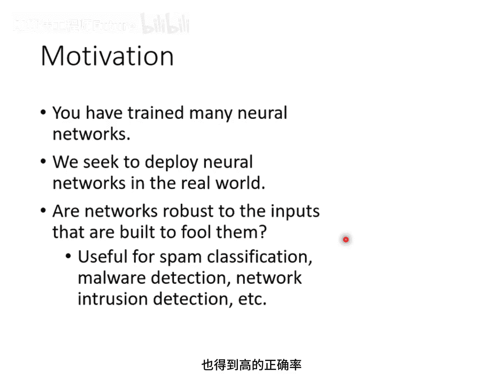

举例来说，我们今天都会用network来做email的filtering，你会用network呢来做侦测一封邮件，他是不是乐色邮件，那今天对于一个乐色邮件的发信者而言，他也会想尽办法。

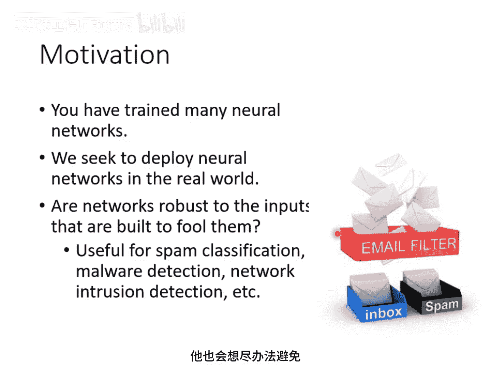

避免他的邮件被分类为垃圾邮件，如果今天有人他想办法去更改邮件的内容，想要去批欺骗或network的话，那network到底能不能不要被欺骗呢，所以今天我们希望我们的类神经网络，它光是正确率高还不够。

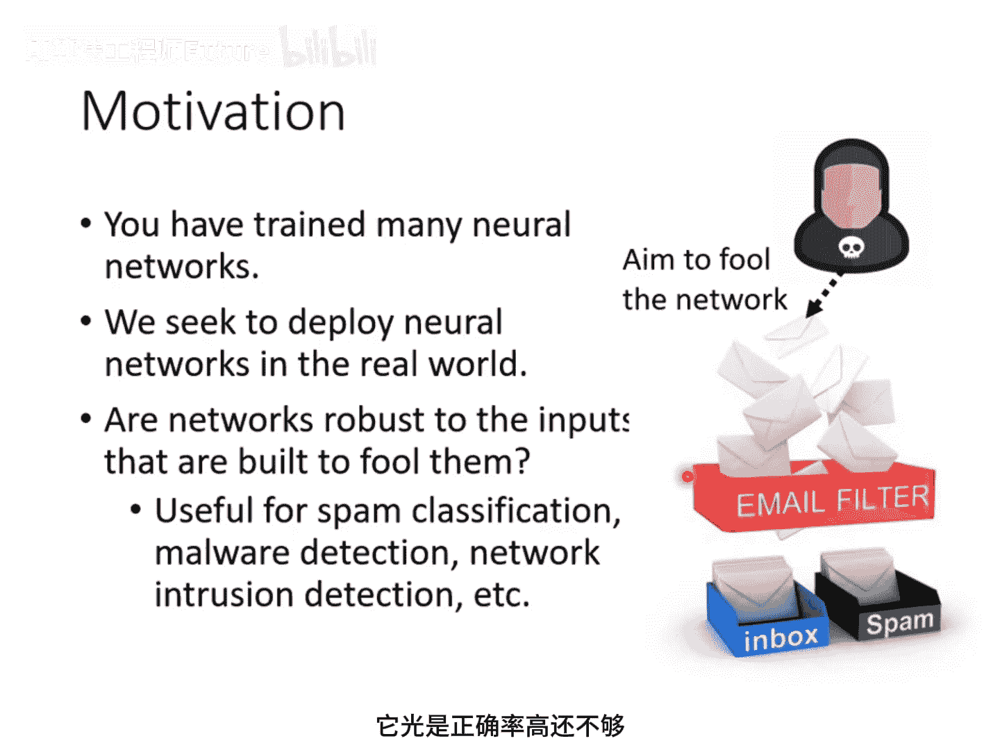

我们希望它可以应付来自人类的恶意，举例来说，这个是蚁王，知道吗，它叫做梅露艾姆，他是站在生物顶点，它是生物顶点的一个存在，它非常的强，他人类没有办法打赢它，那它会消灭掉所有的人类，但是人类并没有跟他打。

人类是不讲武德的，人类就直接放一个核弹就把他炸死，然后故事就结束了，就这样好，所以这告诉我们什么，这告诉我们说network光是正确率高是不够的，他必须要能够应付来自人类的恶意，好，接下来我们将要讲。

人类的恶意可能是什么样子的，我们先来看一个真正的例子。

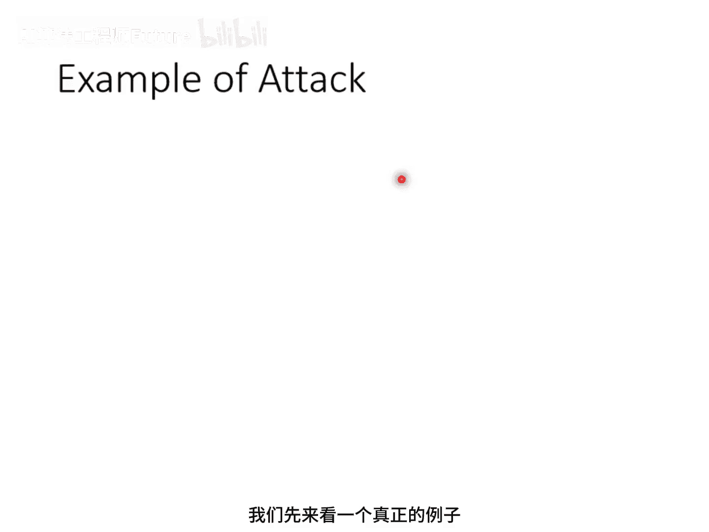

我们今天在好多的作业里面，我们都已经训练了影像辨识的模型。

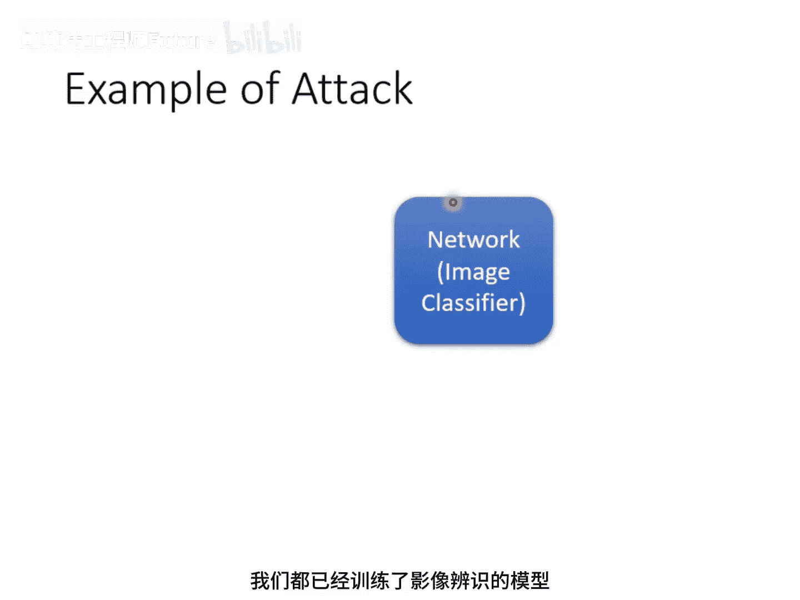

也就是说你有个影像辨识的系统，给他一张照片，他可以告诉我们说这张照片属于什么样的类别，那今天我们要做的事情是，在这张照片上面加入一个非常小的杂讯，一张照片可以被看作是一个非常长的向量。

我们在这个非常长的向量上加入每一个维度。

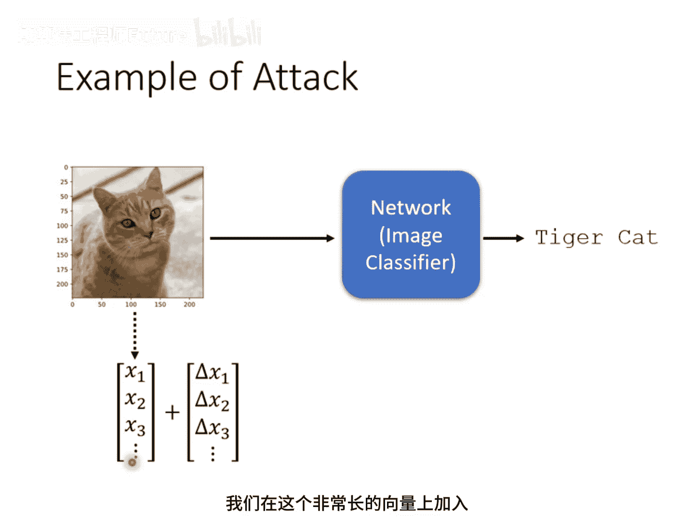

都加入一个小小的杂讯啊，这个有加入杂讯以后的照片丢到network，看看会发生什么样的事情，呃，那一般呢这个杂讯都非常非常的小，小到什么地步呢，最好小到人肉眼没有办法看出来哦。

所以这个例子里面加的杂讯其实太大了，一般这个杂讯是小到人肉眼看不出来的，有被加杂讯的照片叫做attack image，有被攻击的照片，那还没有被加杂讯的照片呢，我们一般就叫做比night的image。

它是好的image，它是还没有被攻击的图片，比night的image丢到network里面，它的输出是猫，那我们期待说attack the image，就我们现在是攻击方，我们是坏人哦。

我们希望attack image丢到network里面，它的输出不可以是猫，要变成其他的东西，那攻击呢大致上可以分成两种类型，一种是没有目标的攻击，没有目标的攻击是原来的答案是猫。

只要你能够让network的输出不是猫，你就算是成功了，但是还有另外一种更困难的攻击，是有目标的攻击，也就是说我们希望network不止它输出，不能是猫，还要输出别的东西。

比如说我们希望加了一个杂讯以后，NEAL输出呢是海星，他把猫错误判断成一只海星才算是供给成功好，那这样子的供给真的有可能做到吗，我们真的可以加入一个人肉眼看不到的杂讯，去改变network的输出吗。

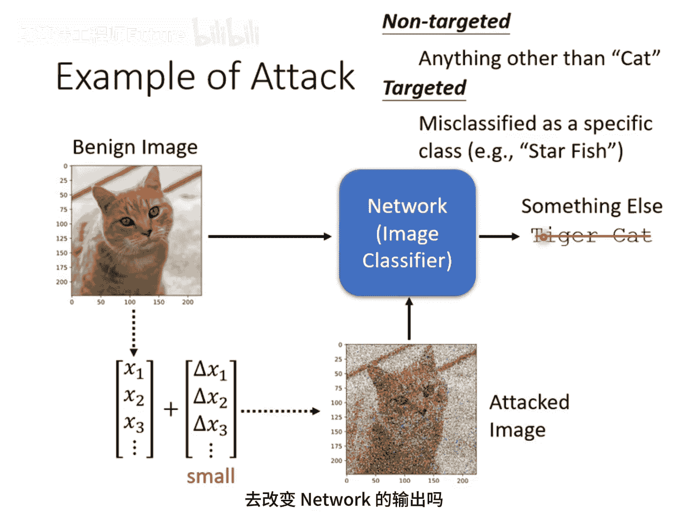

实际上是可以的，这边用的network并不是一个很弱的network，它是50层的RESNE，当我们把一个BENNN的image，没有被攻击的图片丢到50层的RESNET的时候。

他的输出是tiger cat，你知道今天这种影像辨识的系统啊，他的输出都不只会告诉你它是什么动物，还会告诉你它是哪一个品种的动物，所以他给他这只猫，它不止说它是cat，还说它是tiger cat。

不过据说这个答案其实是错的，据说这个猫不是tiger can，不过没有关系，反正他都认得出这个是一只猫就对了，至少知道是一个猫科的动物好，那它还有一个信心的分数，信息的分数是0。64。

这个信息的分数是什么呢，这个信心的分数就是做完那个soft max以后，得到那个分数，就假设你的影像分类的类别有2000类，2000个类别都会有一个分数，那这个分数呢一定介于0~1之间。

而且2000个类别的分数合起来会刚刚好是一，那既然有2000个类别那么多啊，tiger cat可以拿到0。64的分数，那其实算是挺高的，接下来呢，我们在这个BKNIFE的image上面加入一些杂讯。

我们现在希望成功攻击的目标，是把tiger can变成海星。

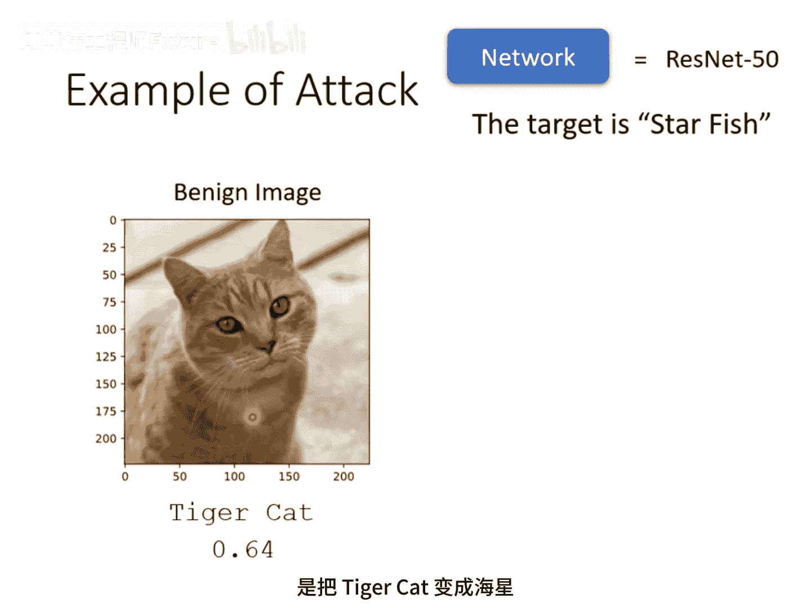

而被攻击以后的图片长得是这个样子，你可能问说杂讯加在哪里呢，杂讯已经加进去了，但它非常非常的小，小到人的肉眼根本没有办法看出来，把这张图片丢到Rest day以后会发生什么事呢。

Rest day output变成starfish，而且他的信心分数是100percent啊，本来他还没有那么确定这是不是一只猫，现在它百分之百确定它就是海信。

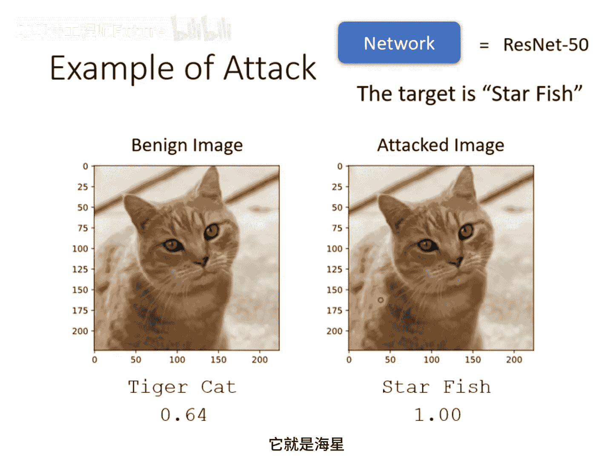

那为了要证明说，这两张照片还是有一些不一样的，我们把它做一下详减，光做相减是不够的。

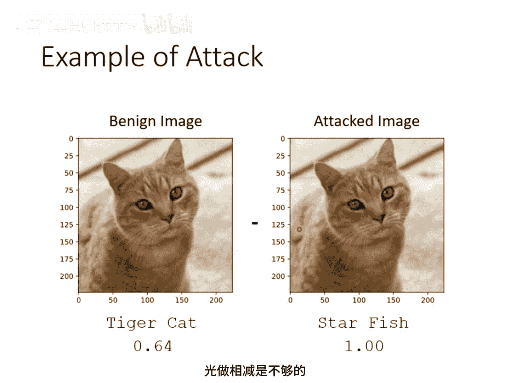

做完相减以后还要把它们的差距放大50倍，你会得到这样子的结果，所以这两张照片确实有些不一样，我并不是把同一张照片复制两次来骗你，他们是有一点不一样的，但是人根本看不出这点不一样，会造成什么样的影响。

但是对RESNET而言，它却有了天差地远的输出，那也许有人会觉得说啊，也许是因为猫跟海星有什么特别的关系，我可以把猫呢变成海星，只是一个特例，这不是一个特例，你可以把这只猫轻易的变成任何的东西。

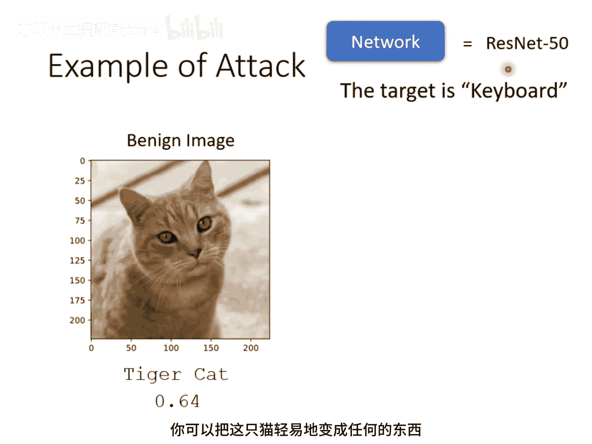

我完全可以加上另外一个杂讯，就让这只猫变成一个键盘，它一样性侵分数高达0。9帕，本来不太确定他是不是猫，现在加入另外一个杂讯以后，network 98%percent，确定它就是一个键盘。

但有人可能会觉得说，哎怎么会发生这么离谱的行为，会不会是这个network太烂，我告诉你。

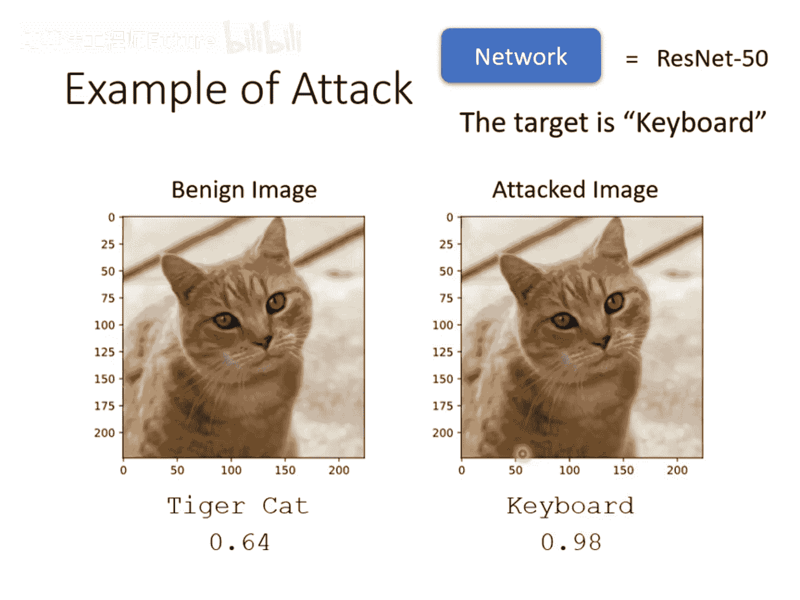

他可是有50层的哦，他可不是一个非常烂的network，如果你加入的只是一般的杂讯，它并不定会犯错，这个是原来的图片。

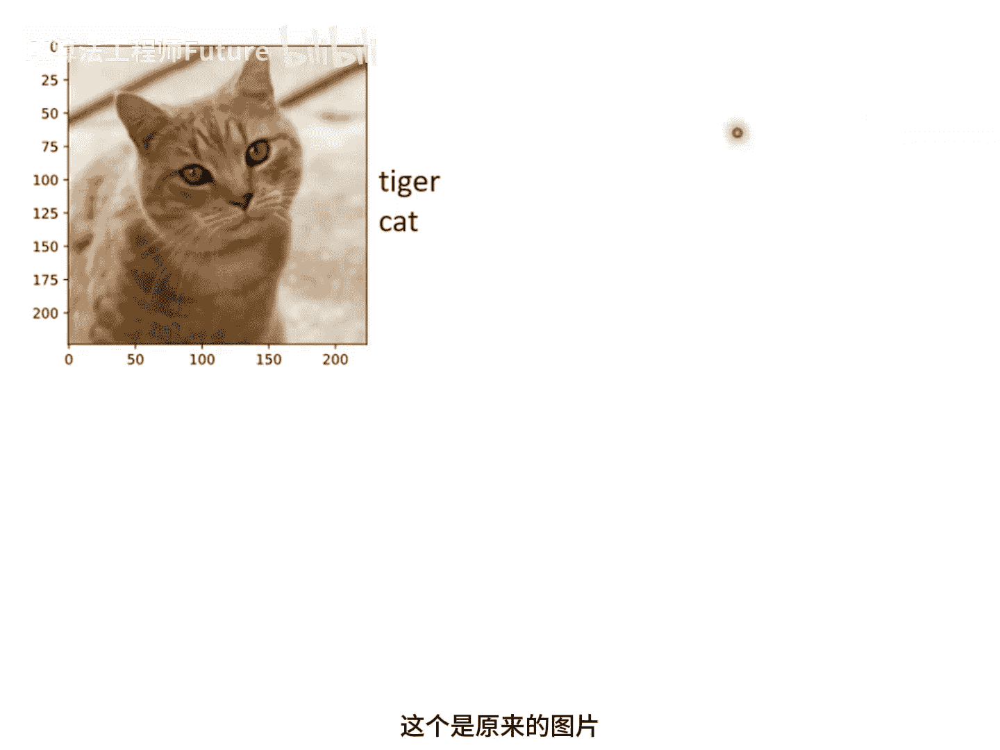

我们现在加入一个杂讯，这个杂讯是你肉眼可见的，你可以很明显的看到，这张图片里面被加入了杂讯，这个时候RESNET觉得他看到的是happy cat，这可能才是正确答案，但无论如何。

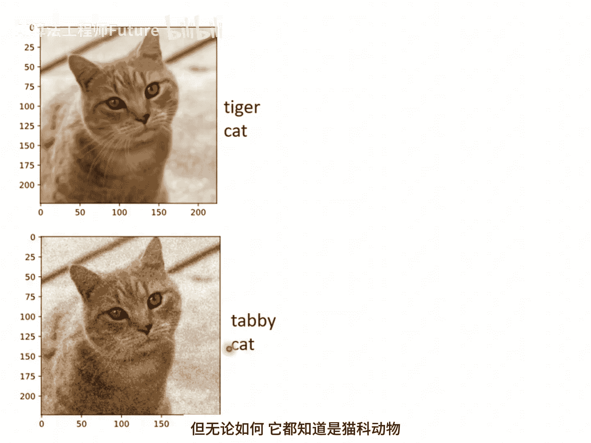

他都知道是猫科动物把杂讯加的更大一点，他说这是persian cat，这是波斯猫，可能杂讯价大一点，这个猫看起来毛茸茸的，所以RESONY觉得他看到了波斯猫，把杂讯再加更大一点。

你可能已经不知道这是什么东西了，这个时候RESNET说他看到了fire screen，fire screen是什么呢，我google了一下，发现fire screen长这个样子。

这里完全可以理解机器为什么会犯错，他觉得前面的杂讯是这个屏风，而后面这个橙色的猫就是火焰，他虽然犯错，他错的是有尊严的，他错的是有道理的，但不知道为什么加入一个人，肉眼看不到杂讯的时候。

他却产生了天差地远的结果，那接下来我们在讲为什么这件事会发生之前，我们来看看刚才所说的攻击究竟是如何做到，我们到底是怎么加入了一个非常微小的杂讯，而这个为非常微小的杂讯。

可以让network产生非常错误的结果呢，好这个是我们的network，我们它是一个function，我们叫它F这个function输入是一张图片，我们叫它X00。

它的输出是一个distribution，这个是这个分类的结果，那我们叫它Y0，那我们这边呐假设network的参数就是固定的，我们不讨论network参数的部分，network参数不是我们今天的重点。

所以它是固定的，如果是ntarget attack的话，我们要怎么找出ntarget attack的杂讯呢，我们现在要的做的目标，就是我们要找到一张新的图片，这张新的图片呢我们用X来表示。

当我们把X丢到这个network f的时候，它的输出是Y，而我们希望Y呢跟正确答案，我们正确答案叫做y hand，我们希望Y跟y hand它的差距越大越好，我们现在是ntarget attack。

没有目标的攻击，我们只要知道说正确答案是y hand，今天network的输出跟正确答案的差距越大，我们就算是供给成功了，那怎么做到这件事呢，怎么找到这个X丢到一个network里。

然后它产生的Y跟YH差距越大越好呢，我们一样要解一个optimization的问题，这个跟我们训练一个network其实是非常类似的，我们先定一个loss function。

这个loss function呢叫做RL，叫做RL，这个大L是什么呢，这个大L呢是Y跟y hat之间的差距，取一个负号，举例来说，我们一般在做这个classification的时候。

我们训练的目标Y跟YH都是看他的cross entrop，那我们这个e of y y hand啊，这一项啊，代表的就是Y跟y hand之间的cross entrop。

但是我们希望这个cross entropy越大越好，所以我们今天在cross entropy前面加一个负号，那这个负的cross entropy就是我们的loss，而我们希望这个loss越小越好。

我们希望找到一个xx可以让L的H越小越好，l of h越小就代表说Y跟y hand，他们的cross entro比越大，也就是Y跟y hand它们的距离越大，这个是没有目标的攻击。

如果是有目标的攻击的话，那我们会先设定好我们的目标，我们用y target来代表我们的目标，那one head其实是一个one hard vector啦。

y target也是一个one hot vector，那我们现在希望这个Y不止跟y hand越远越好，我们还要跟y target越近越好，所以假设你的y target是一个fish。

那你希望你输出的这个Y啊，它不止cat的几率越低越好，fish的几率还要越高越好，那你的loss function就写成这样，我们的loss function是负的，Y跟y hat之间的啊。

Cross entropy，希望这一项呢越大越好，同时你又希望Y跟y target它们越小越好，你把这两项加起来就是你的loss，你希望找一个X去minimize这个loss。

那光是找一个extreme minimize loss是不够的，因为我们其实还期待说我们加入的杂讯，越小越好，也就是我们新找到的图片可以欺骗过network的图片，跟原来的图片要越相近越好。

X跟X0要越近越好，所以我们在解这个optimization的problem的时候，我们还会多加入一个限制，这个限制是d of x等于X，它小于等于X龙，那这个d of x0。

X小于等于X0是什么意思呢，它的意思就是我们希望X跟X0之间的差距，小于某一个fresh ho小于某一个阈值，那这个阈值是根据什么什么东西来决定的呢，通常就是根据人类的感知能力来决定，我们就假设说。

如果X3X等它们的差距大于这个d of x0，X就代表他们两个之间的差距，那等下下一页图片，我会讲说怎么计算两张图片之间的差距，如果X0和X之间的差距啊大于XO，我们假设人就会看到这个杂询。

你就会发现有个杂讯存在，所以我们要让X0跟X它的差距啊，小于等于XXO，小于等于人类可以感知的极限，那我们就可以产生一张图片，人类看起来X跟X0是一模一样的。

但产生的结果对network来说是非常不一样的好。

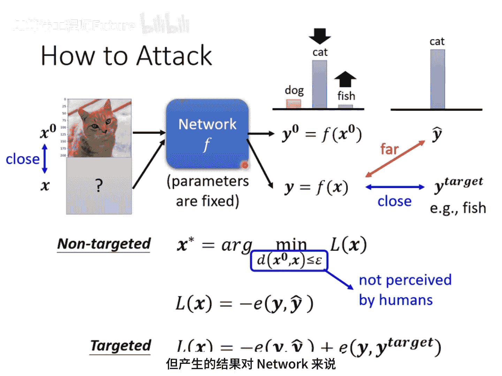

那怎么计算X跟X0之间的差距，它们之间的距离呢，DO和XA0，X就代表它们之间的距离，有各式各样不同的算法，那为了等一下符号的方便起见呢，我们假设X是一个向量，因为它是个图片上是个向量嘛。

X0是另外一张图片，它也是一个向量，这两个向量相减，我们叫它DAX，那这个距离呀，你可以定l to的NO当做他们的距离，也就是说你可以计算delta x的l to noda，X的l to弄呢。

就是把这个delta x的第一位拿出来去平方，第二位拿出来去平方，第三位拿出来去平方，在这边你其实要开根号也可以啦，就看你的L就弄的定义是怎样，你要开根号也是可以的，好那另外还有一个定义呢。

是L的infinity，L的infinity是怎么看的呢，它就是把这个delta x拿来，然后看里面哪一个维度它的绝对值最大，那这个就是l infinity，就把delta one呃，丢台x1。

丢台shift，丢台X3，也就丢他X的每一位都拿出来取绝对值，看谁最大，最大的那一个就代表X跟X0之间的距离，好像有各种不同的方法，可以计算两张图片之间的距离，但是我们在决定要使用哪一种方法。

来计算图片的距离的时候，其实我们应该把人类的感知把它考虑进来，那LT跟l infinity，到底哪一个在attack的时候是比较好的距离呢，以下我举一个例子来跟大家说明啊，这是一张图片。

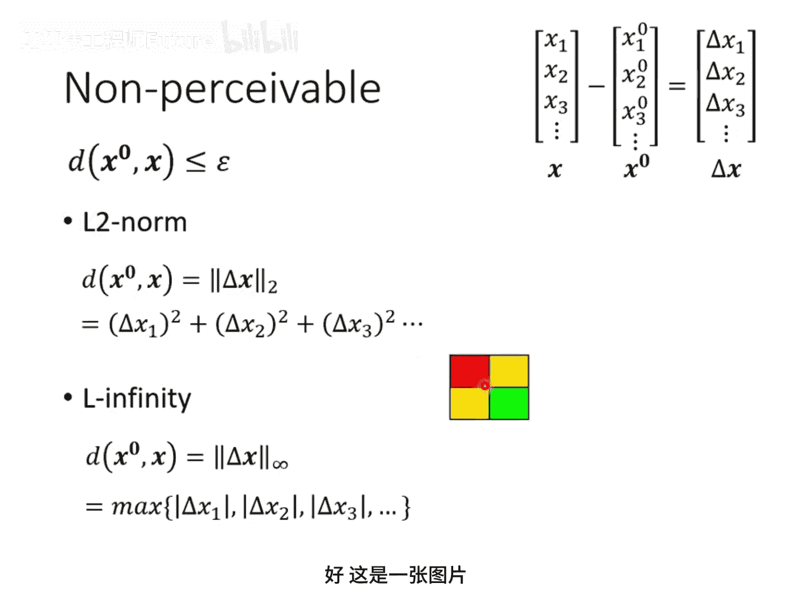

假设这个图片只有四个excel而已，现在啊我们把这张图片做两种不同的变化，第一个变化是，这四个pixel的颜色都做了非常小的改变，第二种变化是只有右下角这个pixel，它的颜色被改了。

但是改的是比较大的，如果我们今天在计算l two的弄的时候，这两张图片的l to NO，看这两张图片的l to NO是一样的。

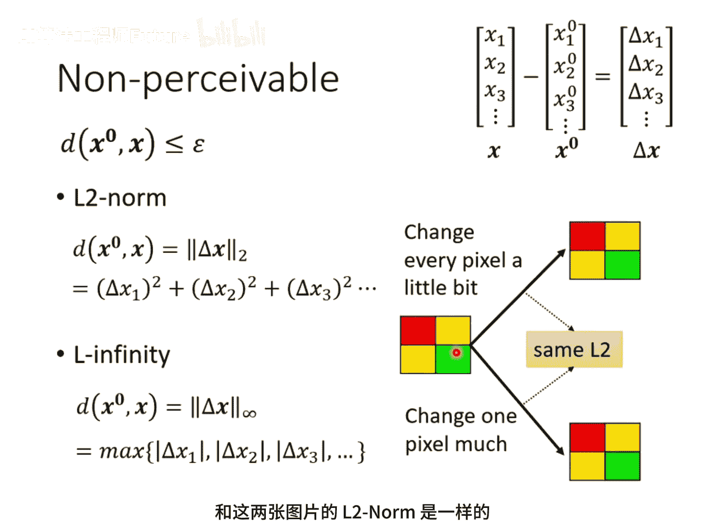

好上面这张图片是下面这张图片，四个pixel都改过以后的结果，上面这个中间这个图片是下面这个图片，就下面这个图片是中间这个图片，只有右下角的pixel改动以后的结果，但这个改动是比较大的。

这两个变化它们的l two的弄啊是一样的，而但是如果你看l infinity的话。

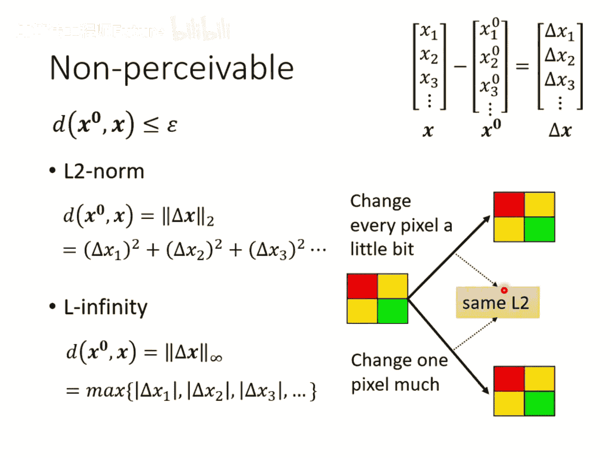

它们是不一样的，因为l infinity只在意最大的变化量，那对于l infinity而言，这个改变它的最大的变化量，跟这个改变它最大的变化量，下面这个改变它最大的变化量是比较大。

上面这个改变最大的变化量是比较小的，那如果从这个例子来看，l infinity跟l two哪一个，比较接近人类的感知能力呢，也许应该是l infinity吧，因为对你来说，其实这两张图片，我相信多数人。

你可能都看不出他们之间有什么差别，但我可以保证他们两个之间是有差别的，就他们是有非常非常微小的差别，只是它的差别是分布在每一个pixel上面，而这下面这两个改变呢，你会很明显的看到右下角这个绿色。

它的颜色变深了，虽然这另外这三个pixel的颜色是固定的，右下角的颜色一变深，你就发现有图片有变化，你就发现这个图片有做到有做了某种修改，所以看起来l in l infinity，也许更符合实际的需求。

我们要避免被人类的发，我们要避免被人类发现，光是L2小是不够的，我们要让l infinity效才是最好的，才是比较不会被发现，所以在作业里面，我们是用l infinity来当做我们的限制，来当做攻击的。

但我们作业就是要去攻击一个judge boy，上面的那个影像辨识系统啦，那产生出来的图片我们会有所限制，说新的图片跟旧的图片，跟原来be nice的图片的差距要小于某一个fresh hole。

那我们在定这个差距的时候，我们就是选择LOVFINITY。

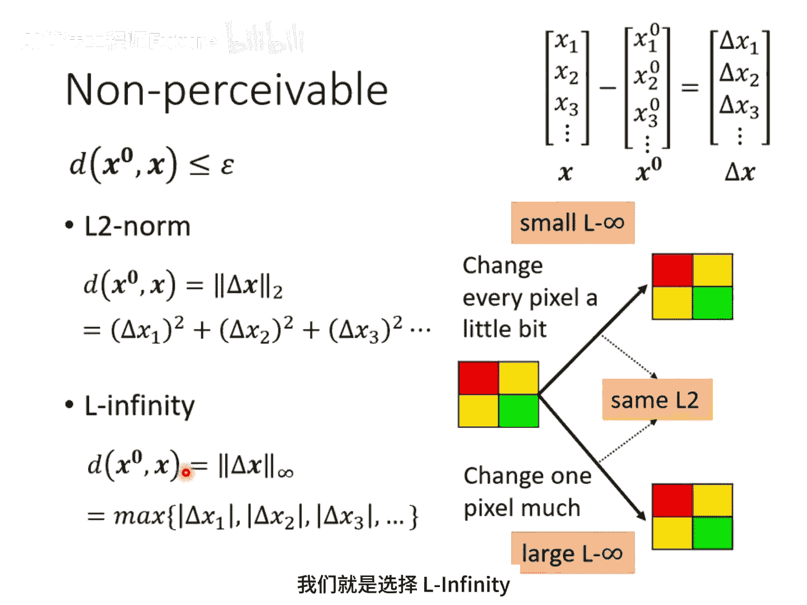

但实际上这个差距要怎么定才是比较好，这个也要p domain knowledge，我们刚才举的例子是影像上的例子，如果我们今天要攻击的对象，其实是一个跟语音相关的系统，我们的X跟X0其实都是声音讯号。

那什么样的声音讯号对人类来说听起来有差距，那就不见得是LQ跟l infinity了，你就要去研究人类的啊听觉系统，看看人类对什么频率的变化特别敏感，那根据人类的听觉系统来制定比较适合的。

X跟X0之间距离的衡量方式，那这个部分就是需要用到domain knowledge好。

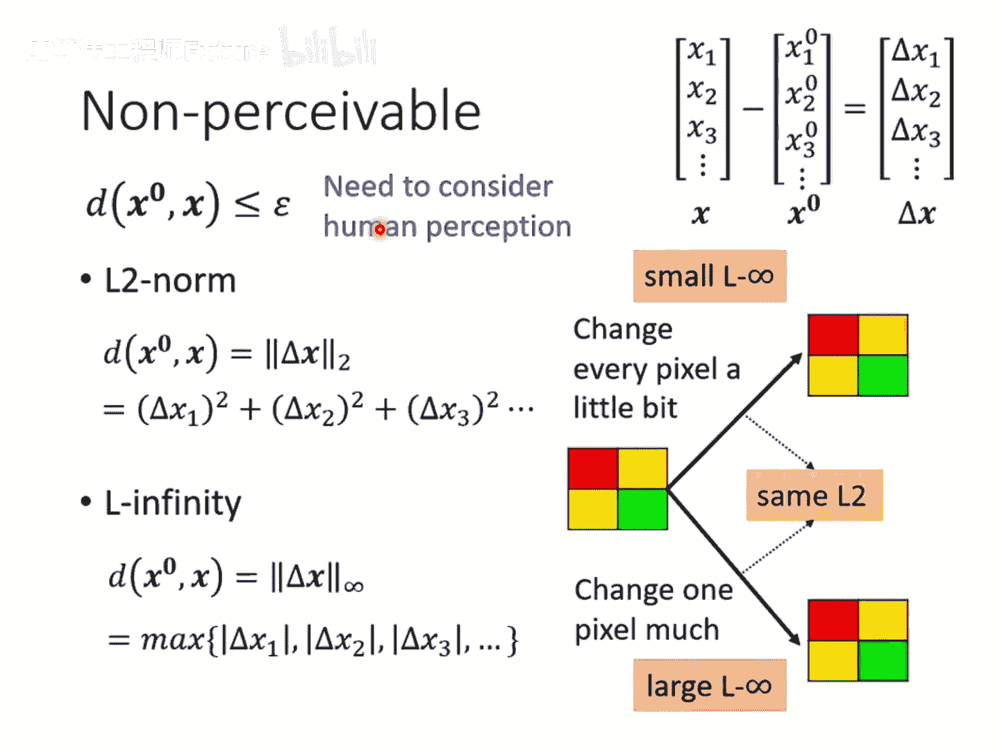

那我们现在已经有了我们的optimization的问题，我们要做的事情就是我们要去minimize一个loft，那现在我们要找一个X去minimize这个loss，但对X我们是有限制的。

X跟X等于它们的distance要小于等于X方，那这个问题到底要怎么解呢，我们先把这个限制拿掉，如果把这个限制拿掉，你会不会解这个问题呢，你其实会解这个问题，因为这跟我们圈一个模型其实没有什么差别啊。

我们在第一堂课的时候，就略过这个optimization的问题给你看，告诉你说你可以调你的network参数，去让一个loss最小，我们今天只是把参数改成network input而已，就这样。

你就把input的那一张image看作是network参数的一部分，然后minimize你的loss function就结束了，现在network的参数是固定的，我们只去调input的部分。

让input的部分去改变。

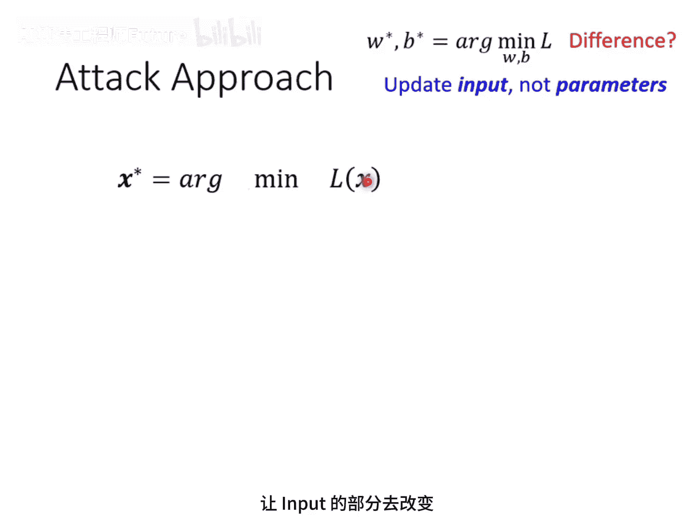

去minimize一个loss就结束了，用的一样是gradient descent好，怎么做呢，哎你就这样做了，就是你要先有个initialization嘛，我们现在找的对象不是network。

参数是X是你input image，但是它还是需要一个初始化的值，对不对，你还是需要一个做gradient descent做初始化的值，那初始化的值设什么样的数值比较少好呢。

你可能不会从随机的image开始，你可能会从X0开始，因为我们本来就希望说呃，呃我们新找到的X应该要跟X0越接近越好，那你何不就从X0开始找呢，你从X0开始找，你接下来找出来的X可能就会跟X0比较接近。

所以你初始化的X你会初始化的这个X，你就直接设X0，然后接下来就跟一般的gradient，descent是一模一样的，我们就是iterative的去update你的参数。

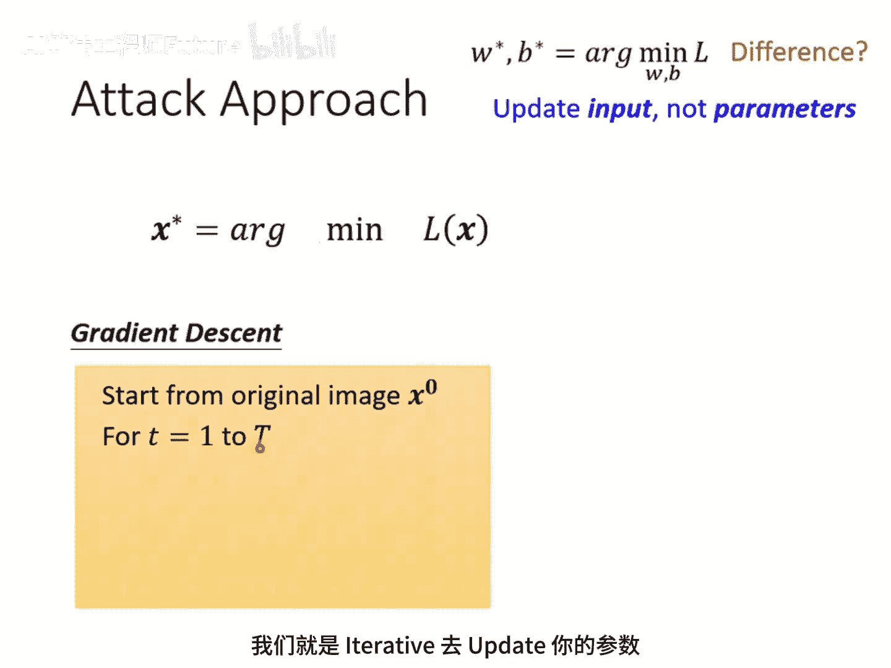

你就设一个iteration t等于一到大T，然后在每一个iteration里面，你都会计算gradient，只是这个gradient不是network参数，对loss的gradient。

我们现在已经不管network参数了，而是input的那一张image x，对于lost的gradient，那input这个X它也是一个很长的向量嘛，它里面就是有XYX6X三嘛。

你就去计算这个input，image里面每一个数值对大L的偏微分好，就h one对大L的偏微分，h two对大L的偏微分算出来，算出一个gradient。

用这个gradient去update你的image就结束了哦，所以你本来一个image actually0啊，他就减掉这个gradient，那前面你也会乘上一个learning rate。

就跟一般gradient descense1模一样的，只是要做gradient descent的对象，从参数换成input而已，其他都是一样的，你也有learning rate，那些什么东西统统都有啊。

你算一个gradient乘上learning rate，减掉原来的image，然后就得到新的image，那你可以iteration的power，就跟一般的gradient descent是一模一样的。

但是这个是在没有CTRL的前提下，接下来我们得把CTRL加进去，因为一般我们在做gradient descent的时候，我们并没有把那个gradient descent，对象做什么限制。

我们并没有设设限，说我们的参数一定要涨什么样，那现在我们是有限制的，我们限制说X跟X0，它们的差距一定要小于等于X方，那要怎么处理这个问题呢，你就在你的gradient descent里面呐。

再加一个马九好，再加个马九诶，我发现说快那个5。20了，知道今天我们需要在5。20左右就结束了，所以我们大可能会需要呃，讲到一个段落就结束它这样子诶。

这个呃我们要跑gradient descent这个演算法，但是我们要同时考虑X0和X之间的差距，怎么考虑这件事情呢，这边呢这个方法说穿了不值钱，非常的简单，如果你update完你的参数以后。

发现X0跟X我这边应该要用HT比较正确啦，我这边应该要用XT比较正确，你update完你的参数以后，发现了你的XT跟X0的差距大于XL以后，你就做一个修改，把HT做一个修改，把它改回符合限制就结束了。

举例来说，假设我们现在用的是l infinity，我们的这个X0在这个地方，那我们的X它可以存在的范围，就只有这一个方形框框的范围，对不对，因为l infinity是考虑X0跟X之间，最大的差距哦。

所以出了这个框大的差距就会超过X次头，所以今天呢你在做完这个gradient design，用gradient去update你的X以后，他一定还是得要落在这个框框里面才行。

那怎么保证update以后一定落在这个框框里面呢，你就只要update超出了框框，就把他拉回来就结束了，所以今天这个步骤如果做完，你发现你得到蓝色这个点跑出框框了，怎么办。

在框框里面找一个跟蓝色的点最近的位置，把蓝色的点拉进来就结束了就结束了，好那其实这种attack啊有非常多不同的变形，我相信你在文献上可以找到，各式各样的app的方法，但其实他们的精神都不脱。

我们今天讲的这个式子，那他们通常不一样的地方，就是要么是CTRL不一样，要么是optimization的方法不一样，但是通常都还是用gradient descent，他们的精神还是一样的。

只是这边你可能会有不同的optimizer，这边你可能会有不同的限制，它就变成不同的tag的方法，但他们精神都不脱，我们今天跟大家举的这个例子好。

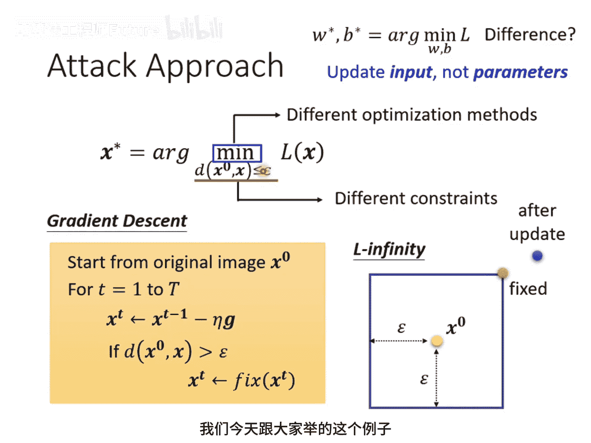

那接下来呢我们跟大家介绍一个最简单的，attack的方法，也是作业里面你要过MEDI呃，这个应该是过medium base life吧，所用的方法，而这个方法是什么呢，这个方法它叫做FGSN。

他可以过medium base赛吗，哦他不能过medium base赛，他只能过simple base赛，好这个FGSN啊，它是怎么做的呢，非常的简单啊。

它叫做fast radium smethod的缩写，他怎么做呢，他就像是一个一拳超人一样，他只用一级，本来一般你在做gradient descent的时候，你要update参数很多次。

但FGSN它厉害的地方就是。

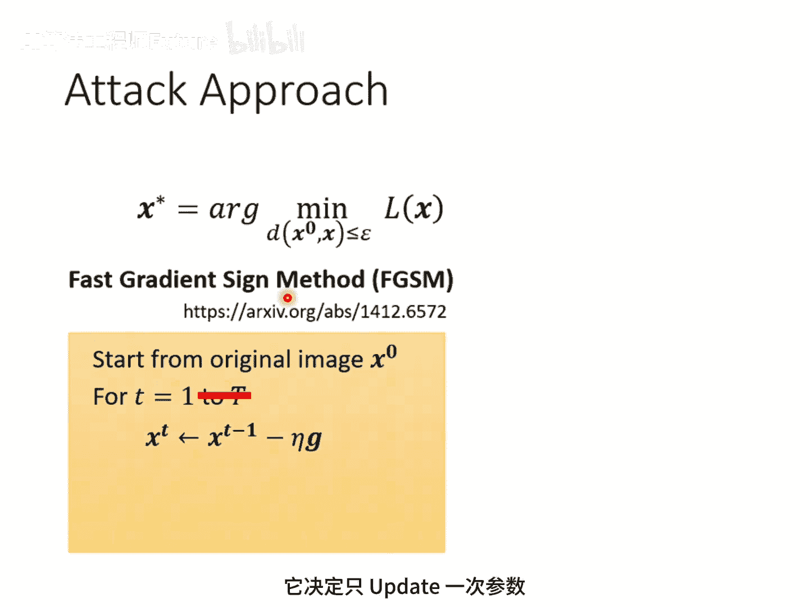

它决定只UPDATA一次参数，看看能不能够一击必杀。

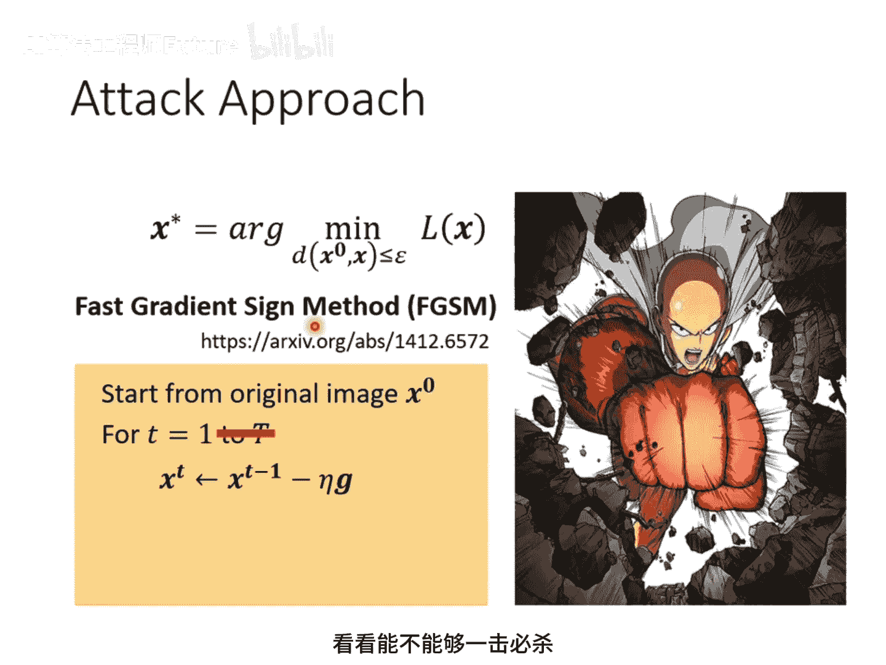

一级就找出一个可以和end成功的image，所以首先呢本来要iterative的去update参数，但是现在不用我们只做一次的供给。

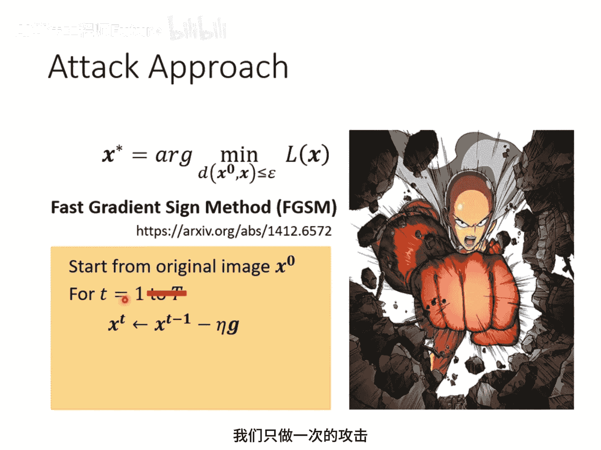

我们只做一次的安倍好，然后区这边呢他做了一个特别的设计，那至于为什么做这个特别设计，大家再去看一下原始文献，可以了解当初为什么会有这样的想法，他说啊。

我们不要直接用这个gradient descent的值，我们给它取一个sin，这个sin是什么意思，这个sin的意思是说，如果括号里面的值大于零，我们就输出一括号里面的值小于零，我们就输出一。

所以加了sin以后，这个G这个vector啊，它里面要么是正一，要么是一，本来如果你是算gradient，它的值可以是任何的real number，但现在取sin，它要么是正一，要么是一。

所以居里面哦就都是正一或者是一，然后learning ray呢，learning rate就省XIONG，就看你这边的这个X龙设多大，这边learning rate直接设一个一模一样的。

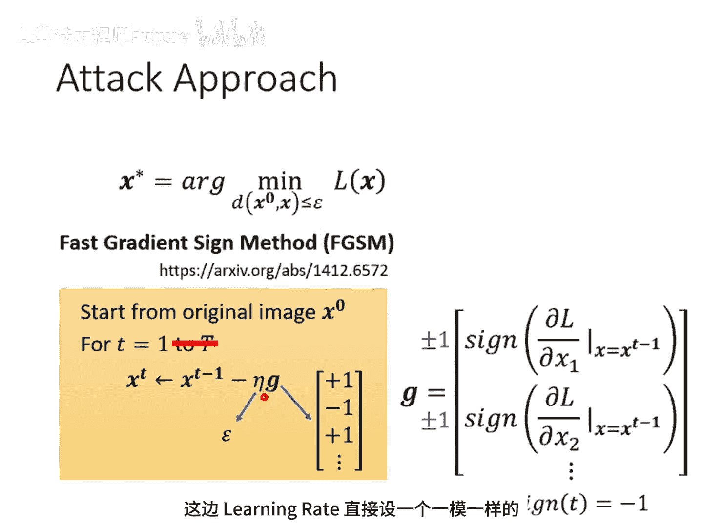

直接塞个一模一样的，会得到什么效果呢。

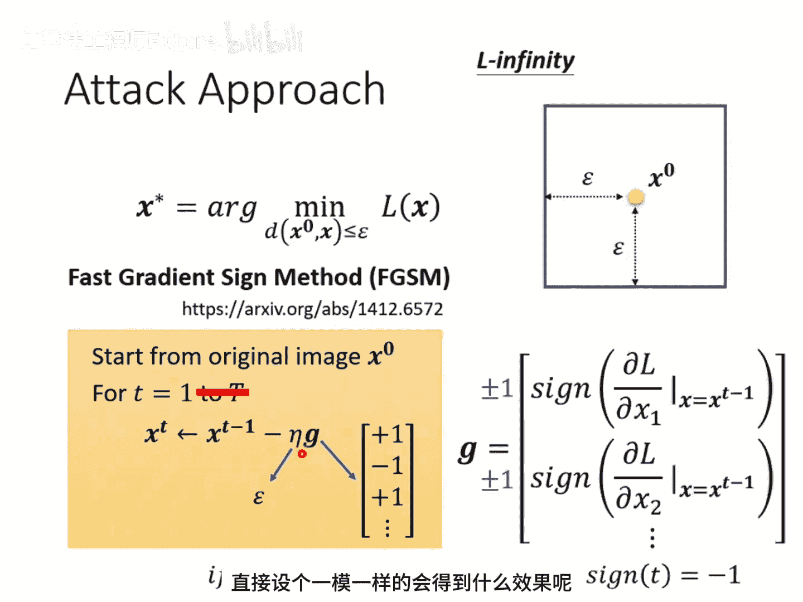

会告诉会得到的效果就是你攻击完以后，你一定落在这个蓝色框框的四个角落的地方，因为你想想看哦，这个G它要么是正一，要么是一，它每一维要么是正一，要么是一，那前面会乘上X龙，所以乘完XX龙以后。

你今天的X等要么就是往右边移X龙，要么就是往左边移X龙，要么就是往上移X龙，要么就是往下移X龙，所以今天做完一次攻击以后，你的这个S0做完一次攻击以后，他一定会挪到这个四方形的四个角落的地方。

它一定是这四个角落的其中一个，那光做这件事，光做这个一级往往就可以必杀，所以这个你可以过simple base line，那有同学就会问说呃，一级必杀有什么好呢，如果我多攻击几次。

多跑几个iteration。

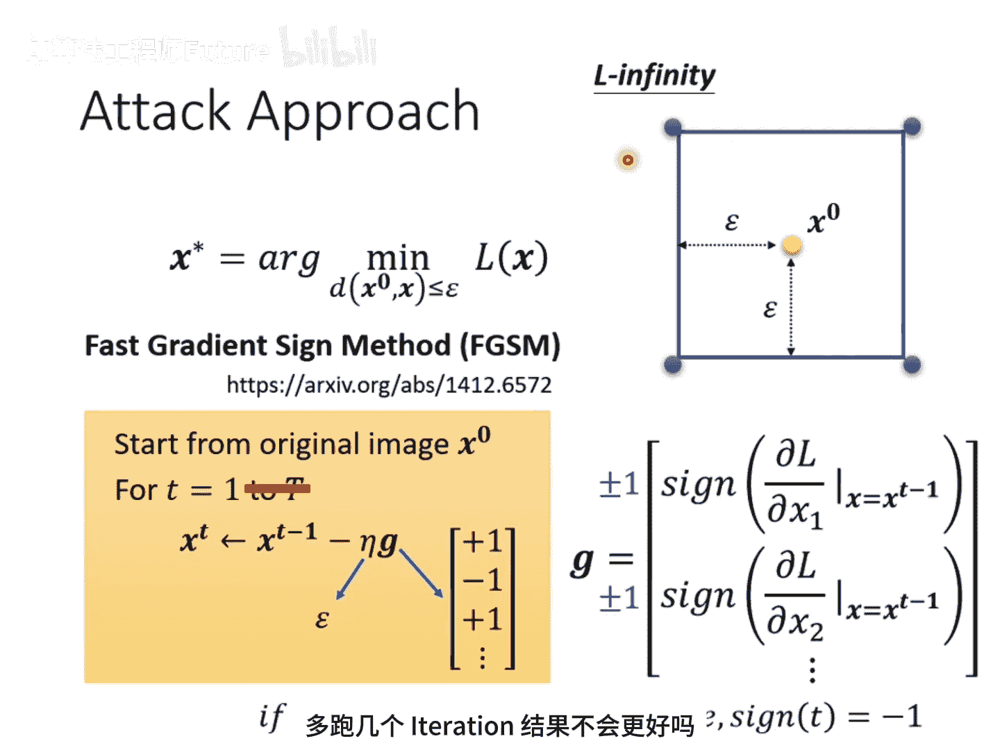

结果不会更好吗，会更好，所以多抛几个iteration就过medium baseline，就这样子哎，好，所以怎么多跑几个iteration呢，你就把本来是只跑一个integration啦。

现在就多跑几个integration啦，还几个integration，你要跑几个iteration啊，高兴就是你自己设就设个，比如说三啊五啊十啊，多跑几个iteration。

那但是多跑几个iteration的坏处是，你有可能一不小心就出解。

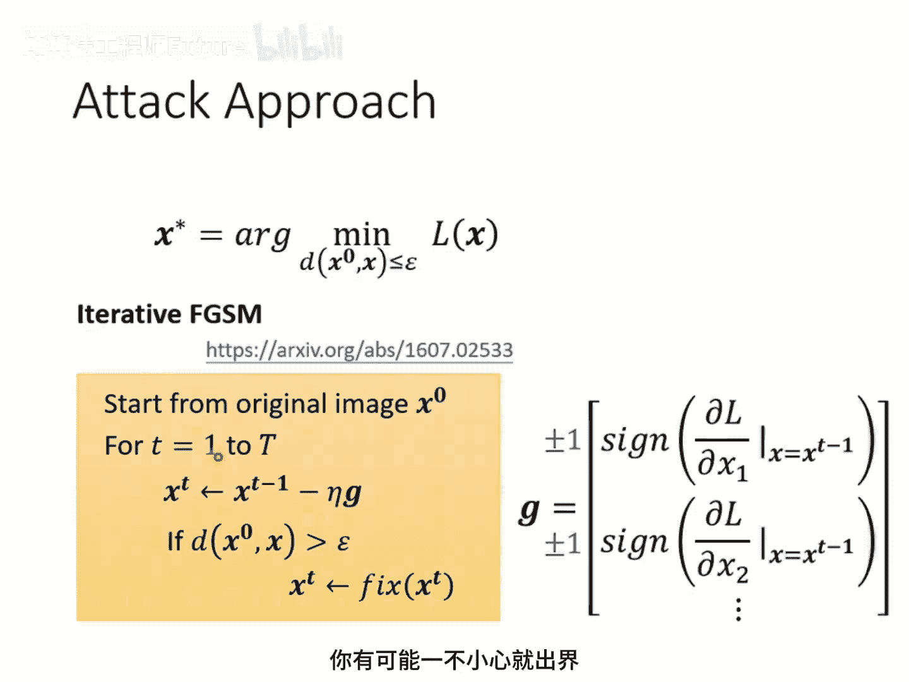

有可能一不小心就跑出了这个四方形的范围，那跑出四方形的范围以后怎么处理呢，非常简单，把它拉回来就结束了，你就看说在这，如果这个蓝色的点update以后跑出这个四方形，你就看这四个角落。

哪一个角落跟蓝色的点最近，就选那个角落就结束了，好这个就是iterative的FGSN，它可以帮你过medium的base好。

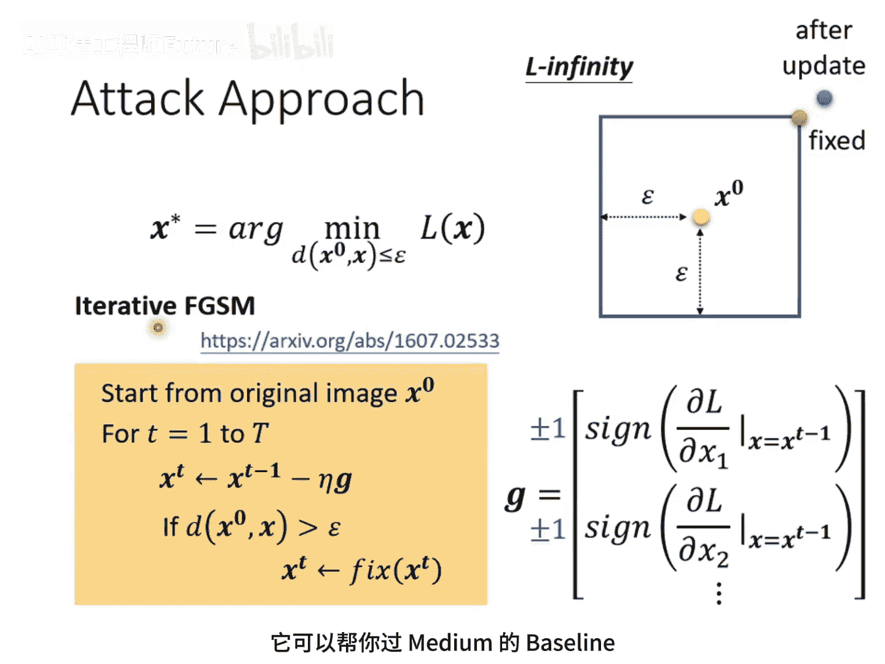

那讲到这边呢。

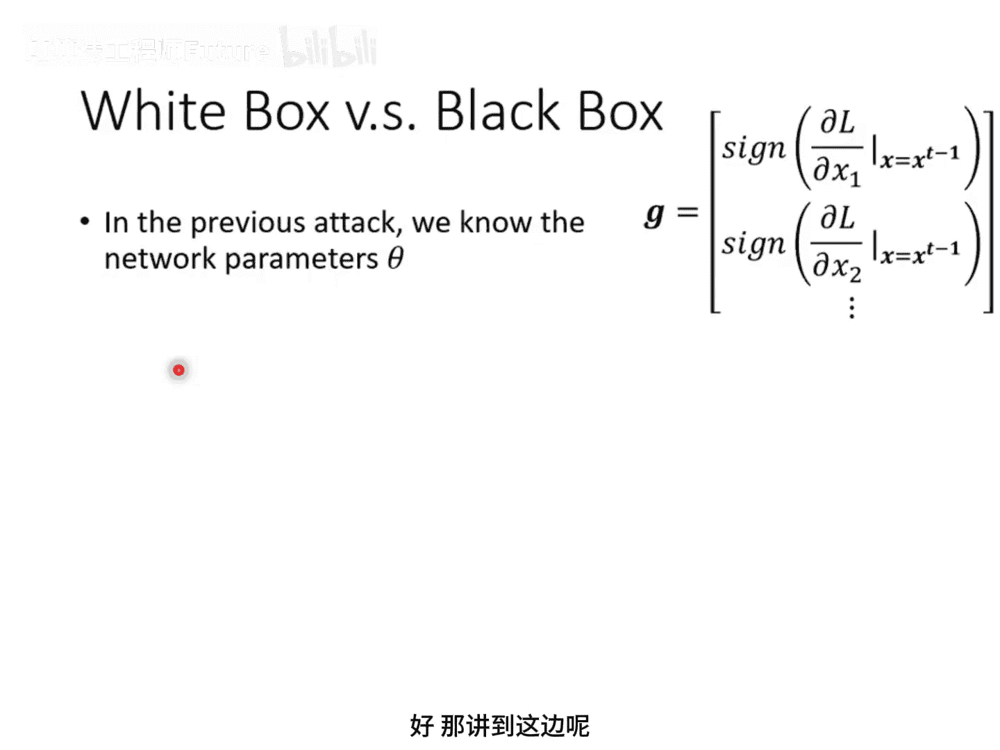

因为有05：30了，也许正好告一个段落，我们在这边呢就先下课了，那大家有问题呢，其实还是可以继续留下来问，那我们其实就到外面去讨论好。

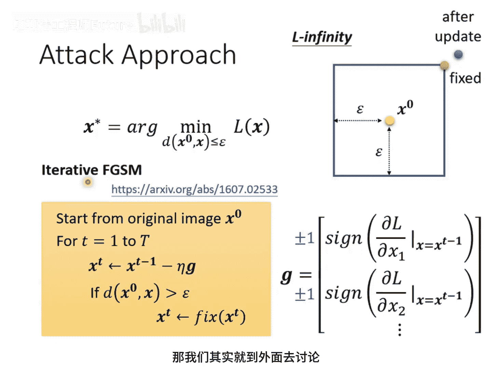