# 【官授搬运】2026年全新优化版李宏毅机器学习系统课程，这才是真正的初学者体系课程！—人工智能／深度学习／神经网络 - P70：2-來自人類的惡意攻擊 (Adversarial Attack) (下) – 類神經網路能否躲過人類深不見底的惡意？ - AI算法工程师Future - BV1ruqABeEFX

好那上周呢我们是讲到这个地方好，那到目前为止啊，我们在上课讲的内容其实都是y box的AP，什么意思呢，也就是说我们要计算这个gradient，我们做FGSN要计算这个gradient嘛。

在计算gradient的时候，我们需要知道模型的参数啊，知道模型的参数才有办法计算这个gradient，才有办法去在image上加上noise，那像这一种知道模型参数的供给呀。

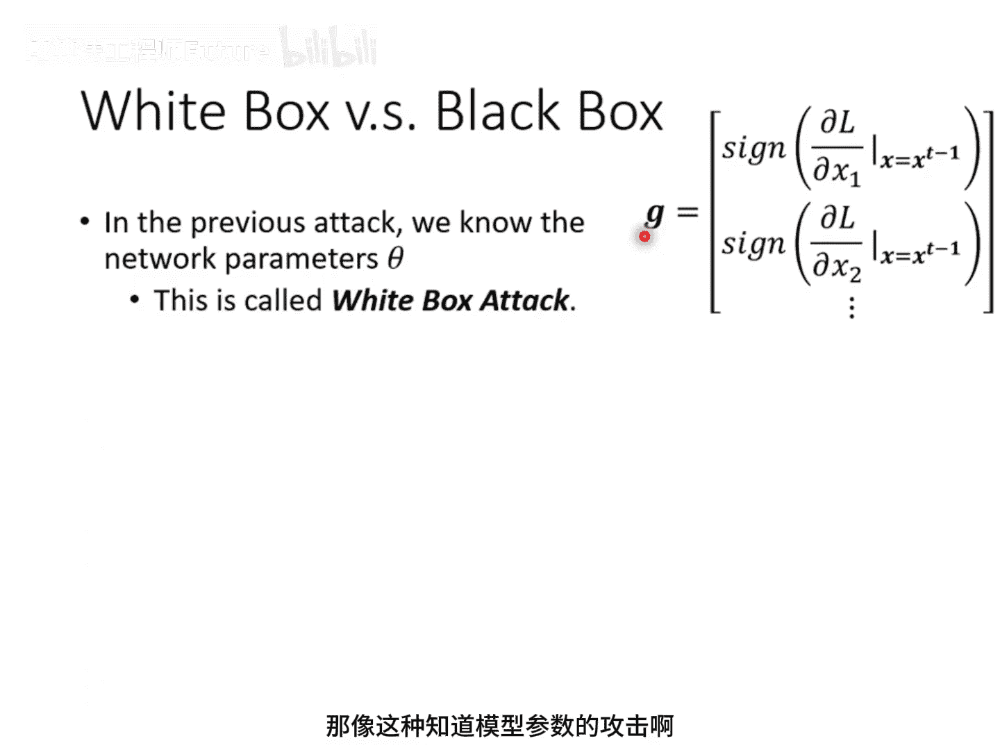

叫做y box的，OK它中文有时候就翻译成百香攻击，就白箱就是一个动画了，知道吗，这个是白箱啊，没有很重要哎没有很重要，他也不用管我哎啊，那但是你可能会觉得说哇，这个攻击需要知道network的参数。

看来这个攻击呢不是很危险，为什么呢，因为一般线上的服务你当然要攻击电视，去攻击别人的模型嘛，某一个线上的服务嘛，线上的服务它的模型你又不知道参数是什么，所以诶也许要攻击一个线上的服务，并没有那么容易。

所以其实如果我们要保护我们的模型，不被别人攻击，也许我们只要记住，不要随便把自己的模型放到网络上公开，让大家取用，也许我们的模型就会是安全的，但真的是这样吗，不知道模型参数下的供给啊。

叫做black box attack，也就是黑箱供给，黑箱攻击是有可能的吗，黑箱攻击是有可能，怎么做黑箱攻击呢，我们到目前为止讲说我们在做攻击的时候，都需要计算gradient。

计算gradient需要知道model参数，那黑箱攻击是怎么做到的呢。

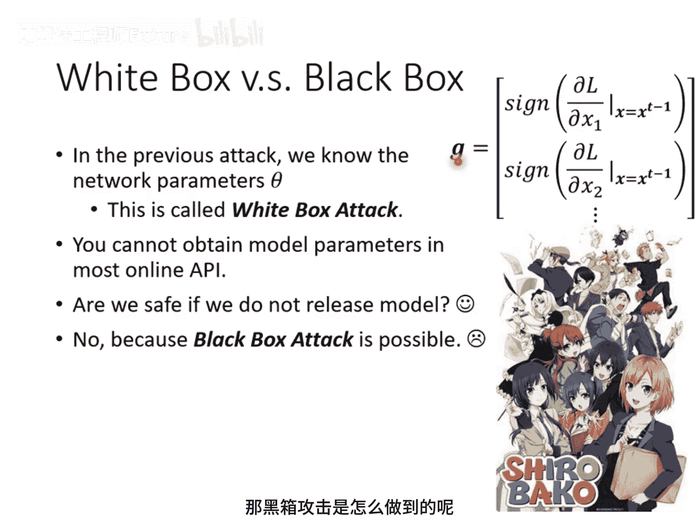

黑箱供给是这样子做，那我们的作业刚才助教授也有讲过，就是黑箱供给哦，所以网络上有一个模型，这个模型你是没有办法拿到的，你根本不知道它的参数是什么，这个其实就是judge boy上面的那一个模型。

你并不知道助教使用了哪一个模型，你并不知道它的参数是什么，那怎么办呢，假设你知道这个network是用什么样的训练资料，训练出来的话，那你可以去训练一个prosy的network。

也就是你训练一个network，让这个network来模仿我们要攻击的对象，那我们要攻击的对象跟proxy的network，如果都是用同样的训练资料训练出来的话，也许他们就会有一定程度的相似度。

如果crossing network跟要被攻击的对象有同样的呃，是有一定程度的相似程度的话，那我们只要对PY的network进行攻击，也许这一个有被攻击过的image。

拿去丢到我们不知道参数的network上，攻击也会成功，那这个其实就是在我们作业里面做的事情，所以在作业里面做的事情，是你从某一个地方找来某一个已经训练好的，像变式的模型。

这个是你的passive network，你自己在自己的机器上，你在COLAB上攻击这个自己的network，然后丢到judge boy上面，看看这个攻击能否成功，那有人可能会问说。

那如果我根本就没有训练资料，我根本不知道现在要攻击对象，是用什么样的训练资料的话，怎么办呢，在作业里面我们知道是sia ten，我们要被攻击的对象是用塞发ten训练出来的。

所以你只要用一个SAPTAN训练出来的模型，你可能就可以攻击成功，但是假设我们完全没有训练资料的话，怎么办呢，这也不是完全无解的，怎么解呢，就是你就呃假设这是你要攻击的影像辨识模型。

你就把一堆图片丢进去，然后看看它会输出什么呃，线上的service就算是他不会告诉你network参数，你总是可以丢东西进去，看它输出什么嘛，再把输入输出的成对资料拿去训练一个模型。

你就有可能可以训练出一个类似的模型，当做ping network进行攻击好，那这种黑箱攻击容易成功吗。

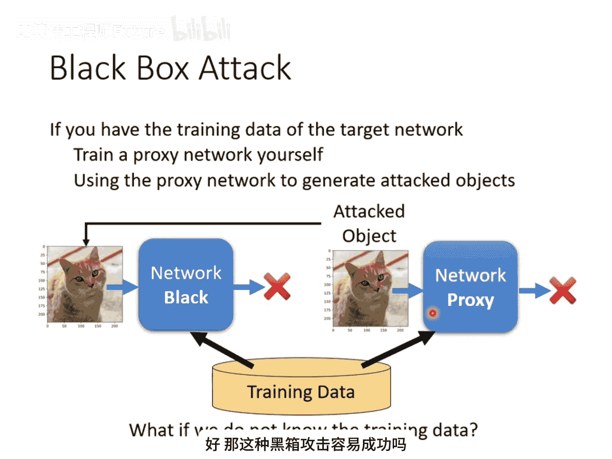

蛮容易成功的，你在作业里面就可以体会一下这个黑箱攻击，其实非常容易成功，那这个是文献上的结果，那这边有五个不同的network啊，RESNET152层，RESNET101层。

Resnet 50b gg16，还有google la net，总共有五个network好，那这个color a代表要被攻击的network，总共有五个要被攻击的network，那这个roll啊。

这代表说我们有五个quit the network，那如果是对角线的地方，代表说CROY的network跟要被攻击的network，它们是一模一样，所以这个情况就不是黑箱攻击。

对角线的地方其实是白箱攻击哦，所以如果你拿RESNET152当做发型network，攻击的时候，其实是攻击一个一模一样的network，太容易成功了哦，这边这个数字是正确率。

是要被攻击的那个模型的正确率，所以这个值呢是越低越好哦，越低的正确率代表你的供给越成功啊，你现在是站在供给方的哈，所以不是你不是负责，你不是训练模型帮的是供给方的哦，所以这个正确率越低。

而代表你的供给是越成功的，你发现对角线也就是白相攻击的部分，y box attack的部分，这个这个攻击的成功率啊是百分之百啊，也就是模型的正确率是0percent哦，你的攻击总是会成功。

但如果在非对角线的地方，也就是黑箱攻击，举例来说，你用RESNET101当plc network去攻击RESNEE52，得到的正确率是19percent。

或者是你拿RESNET152当做是pling network，去攻击RESNET50啊，你得到正确率是18percent，那这个非对角线的地方是黑相攻击，你会发现说。

黑相攻击模型的正确率是比白相攻击还要高的，但是其实这些正确率也都非常低哦，都是低于50percent哦，所以显然黑箱攻击也有一定的成功的可能性哦。

不过实际上黑箱攻击是在ntarget attack的时候，比较容易成功了，target attack就不太容易成功哦，就是假设你用buy network说，你要把一个狗变成一个兔子。

那如果你把attack image拿到你，那那个你要攻击的对象上面的话，你可能可以让他辨识错误，你可能会让机器辨识出不是狗，但你要指定它一定要变成兔子就比较难哦，所以在黑箱攻击的时候。

这个target attack比较难成功，但ntarget attack还是非常容易成功的好，那如果你要增加这个black box attack的成功率，怎么办呢。

刚才助教也讲了一个可以过strong base line的tip，就是unsembled the network好，那这个UNSELED的network怎么做呢。

啊这边的看这个这个表格的看法是这个样子的，这个COLONA代表要被供给的内work，那每一个roll是什么意思呢，你会发现这个每一个模型的名字，前面放了一个减号，它是什么意思呢。

那就代表说我们现在把这五个模型都集合起来，但拿掉RESNEE52，我们要找一个攻击的image，在RESN152以外的模型都是成功的，我们假设我们手上没有RESNET152，单手RESNET101。

Resnet 50b gg16，跟google LLA内找一张image攻击这四个network都是成功的，然后看看在152上会发生什么事哦，所以其实今天在这个图啊，这个下面这个表格。

跟上面这个表格的看法是不一样的啦，如果是下面这个表格的话，非对角线的地方是白相供给，非对角线的地方发现哦，模型正确率都变零，Percent，就像我刚才说的，百相供给非常容易成功。

对角线的地方才是黑箱攻击哦，所以这个地方是我们要攻击RESNET52，但我们没有用RESNEUL，这边是要攻击RESNET101，但没有用RESNET101，但是用了另外四个network，以此类推。

所以对角线的地方才是黑箱攻击，那你发现说当你有做UNSAMPLE的时候，当你同时用多个network的时候，当你找一个attack image，可以成功骗过多个network的时候。

骗过一个你不知道参数的黑箱的network，也非常容易成功，你看对角线上的正确率基本上都是十分以下好。

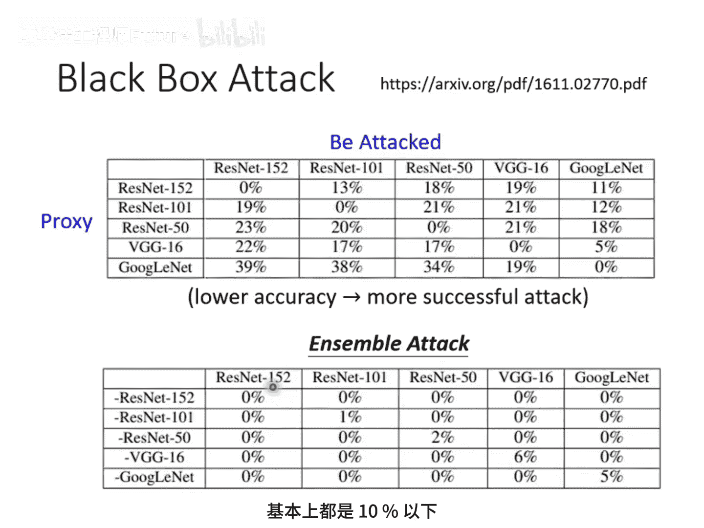

那这个是黑箱供给好，你会发现说这个攻击这件事啊非常容易成功，到底是怎么回事呢，为什么连黑箱攻击你在a network上攻击，在BNEWORK上都会成功的，事实上这仍然是一个可以说是未解之谜啦。

还有很多呃可以研究的空间，那以下只是讲一个呃很多人相信的结论哦。

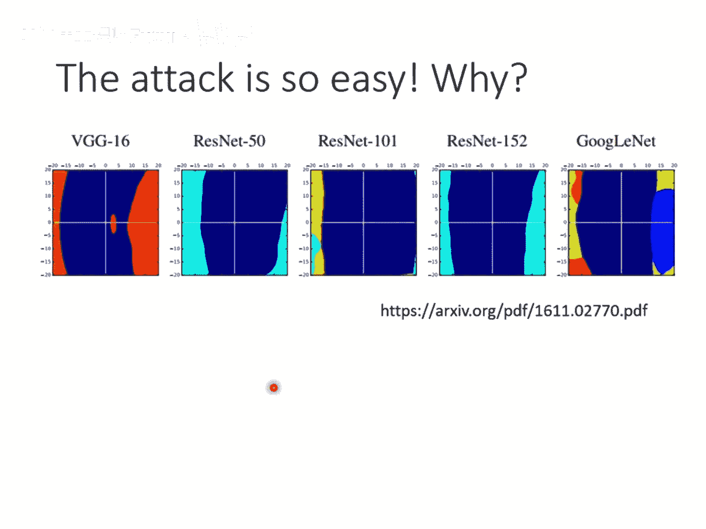

这边有一个实验是这个样子的哦，这个这个图上面的原点呐，代表一张小丑鱼的图片啊，就是这只啊就是尼莫啊，就是这个小丑鱼就是尼莫啊啊就是尼莫的图片，好啊，在这边，然后这个横轴和纵轴分别是什么呢。

分别是把这张图片往两个不同的方向移动，我觉得一张图片是一个非常高维的向量，把这个高维的向量往一个某一个方向移动，是横轴，往另外一个方向移动是纵轴，那这边的横轴和纵轴分别是什么样的方向呢。

这边横轴啊是在BGG16上面，可以攻击成功的方向，而纵轴就是一个随机的方向，那你会发现说呢，虽然这个横轴啊是让VGG16可以攻击成功，但是在其他的network上面，Resnet50。

Resnet101152，google net上面呃，你看这个图的话，会发现他们有很大的类似之处，它们中间这个深蓝色的区域都还蛮相近的，这个深蓝色的区域是什么呢，这个深蓝色的区域呀。

这个深蓝色的区域是会被电视成小丑鱼的图片，的范围哦，也就是说，如果你把这个小丑鱼的图片加上一个noise，你把这个高维的向量，在高维的空间中往这个方向移动。

基本上network还是会觉得他是小丑鱼的图片，不管对每一个network来说，只要往这个方向移动，它是一个随机的方向，基本上都会被认为是小丑鱼，但是如果你是往可以攻击成功，VGG16的方向来移动的话。

那基本上其他内work诶，好像也是有蛮高的几率可以攻击成功的，你发现这个小丑鱼这一个类别，他在这个呃攻击的方向上，他就是特别窄，只要你把这个高维的向量，这张图片稍微移动一下，它就掉出。

会被电视成小丑鱼的区域范围之外了啊，它就掉出会被辨识成小丑鱼的区域范围之外，会被辨识成其他的类别，而对每一个network来说，看起来这个攻击的方向，对不同的network影响都是蛮类似的好嘞。

所以呀有还不止一篇论文，他们对于供给这件事，他们的认知是这个样子的，你从这篇文章的开头就可以看出来，他说这个adversal example，are not box lai feature好。

所以一个呃有一个呃有一群人是主张说呢，这个攻击这件事情会成功，他最主要的问题来自于你的贝塔，而不是来自于模型，不同的模型训练出来的结果，看起来是还蛮相近的，而攻击会成功。

这件事情不是只有对deep learning有一样的问题，对the linear的network，对SDM也都有类似的问题，所以也许攻击会这么容易成功，这件事情并不主不对，这个主因未必出现在模型上面。

可能是出现在资料上，为什么machine会把这些非常小的杂讯，误判为另外一个物件，那可能是因为在资料上面，本身它的特征就是这样，在有限的资料上，机器学到的就是这样子的结论哦。

所以也许adversal attack会成功的，原因是来自于资料上的问题，当我们有足够的资料，也许就有机会避免adversal attack，不过这个其实只是这个某一个呃，并他并不是所有人都同意这样啊。

同意这个观点啊，这只是某一群人的想法而已，也许啊过几年以后你再来修同一堂课哦，我讲的结论又会不太一样，那这边只是告诉你说有一群人，他们的认知和观点是认为。

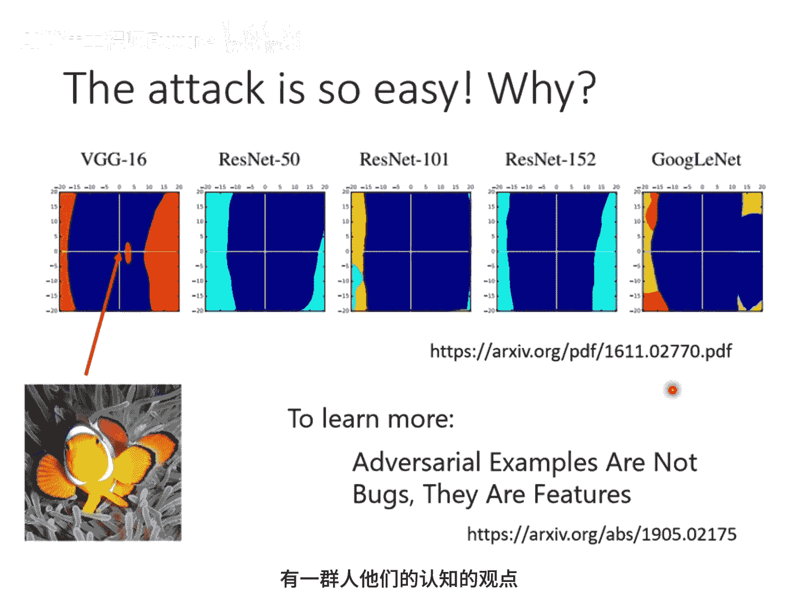

data是造成attack会成功的元凶好，那attack the signal，我们希望它越小越好，到底可以小到什么样的程度呢，啊在文献上有人成功的做出one pixel attack。

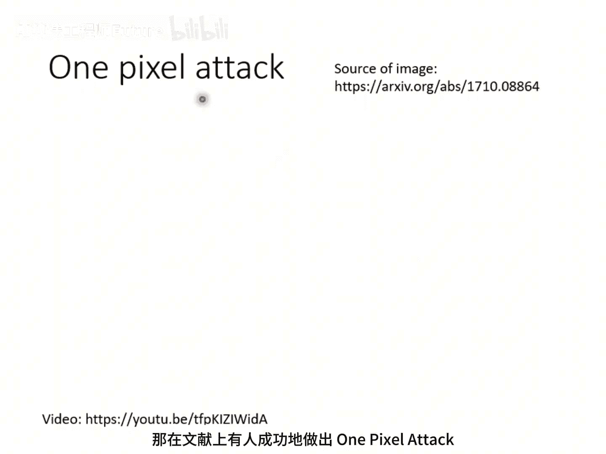

所以one pixel attack的意思是说，你只能动图片里面的一个pixel而已，好举例来说，在这张图片里面，他们动了一个pixel，他会特别把用pixel有改变的地方，把它框起来，把它框起来。

把它框起来，把它框起来，希望说动了图片中的一个pixel，影像辨识系统的判断就必须要有错误，波比奇，如果从这个图片的这个在这个图片上，这个黑色的部分，那代表的是正确的，攻击前的这个影像辨识的结果。

蓝色代表是攻击后的影像辨识结果，那你会发现说one pixel attack，看起来还是有一些局限的啦，它的攻击并没有说真的非常非常成功，怎么说呢，举例来说，这是一个hip hop啊。

他是个茶壶做one pixel attack，在这个地方某一个pixel的颜色被改变了，机器呢把t pop变成joystick，joystick是什么呢，joystick是摇杆，诶。

你会发现说诶这个错误其实还错的，是有点道理的，不像我们一开始举的什么猫变成海星，猫，变成键盘那么荒谬啊，这个错还有点道理哦，所以呃感觉这个攻击呢并没有啊。

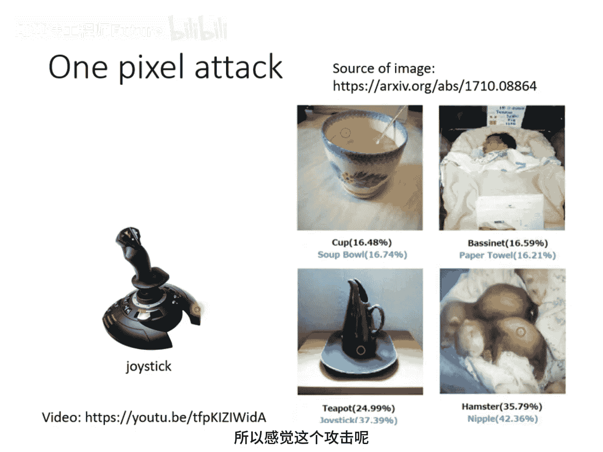

非常的powerful，这个是one pixel attack，那其实还有更狂的攻击方式，叫universal adversal attack，universal的attack是什么意思呢。

我们在到目前为止，每一张图片你的啊这个都是客制化的哦，你有200作业里面有200张图片，200张图片你会分别找出不同的a taxi，那有人就问说，有没有可能用一个signal，就成功攻击所有的图片呢。

因为如果你说每一张图片都要有不同的signal，那如果你今天要hack某一个这个监视系统，你要让某个监视系统它的辨识是错的，那你可能需要真的heck进去那个编制，编那个监视系统。

然后每次进来不同的影像的时候，你都要克制化，找出一个attack the signal，那这个运算量可能会非常的大，如果universal attack可以成功的话，你其实只要把这个讯号。

贴在这个监视器的摄像头上，如果这个讯号这个attack的signal非常强，只要加上这个tt signal，不管什么样的影像都可以攻击成功的话，你只要把这个signal直接放在摄像头上，贴在摄像头上。

那这个摄像头它就直接坏掉了，不然看到什么东西他都会变质错误，那universal的attack有可能成功吗，你可以看看这篇论文，universal attack是有可能成功的，在这篇论文里面。

他们找了一个noise，找了一个attack signal，这个attack the signal加在非常多不同的图片上，都可以让影像辨识系统辨识错误好。

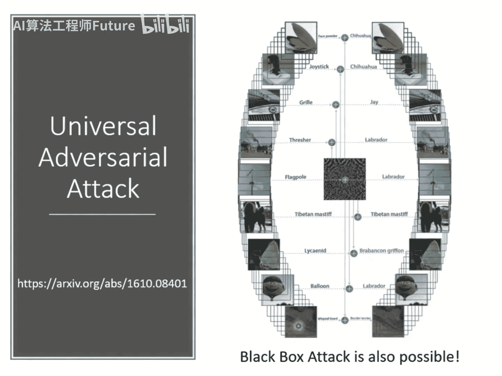

到目前为止啊，我们举的例子通通都是影像的例子，那有人可能会觉得说，会不会是影像才有这种会被攻击的问题，会不会其他的类型的资料，就比较不会有这种问题呢，其实不是其他类型的资料也有类似的问题，以语音为例。

大家都知道说现在会做DEFAKE，那有人会啊，模拟出那用这个用语音合成的技术，或用语音转换的技术去模拟出某些人的声音，借以达到诈骗的效果，那为了侦测这种defect的状况，于是有另外一系列的研究。

在研究说怎么侦测一段声音，是不是被合成出来的，今天虽然语音合成的系统往往都可以合出，以假乱真的声音，但是这些以假乱真的声音，还是有非常大的可能性，可以用机器抓出来的好。

这些合成出来的讯号它还是有固定的pattern，跟真正的声音讯号还是有一定程度的差异，人耳听不出来，但机器可以抓出来，但是这些可以侦测语音合成的系统，可以侦测一段声音讯号。

是不是合成的系统也会被轻易的攻击，那以下是真实的例子，这是一段合成的声音，任何人都听得出合适的一段合成的声音，这段声音是故意和坏的，就如果今天语音合成的系统都可以合出，人听不出来是真是假。

以假乱真的声音哦，所以刚才那一段显然合的很差，所以你用这个侦测是否是语音合成的系统，它可以正确的告诉你说，这段声音讯号显然是合成的好，但是如果我们在刚才那段声音讯号里面，加入一点点杂讯。

它听起来是这个样子，He will be back st，but sometimes哦，你可能问说，这个新的声音加入杂讯的声音，跟原来有什么不同呢，人耳完全听不出他之间的差异，那个查询非常非常的小。

没有任何人可以听出这两段声音讯号，有什么样的差异，而这段声音讯号加上这个微小杂讯以后，它听起来也没有合成的更好，但是同一个侦测合成的系统，会觉得刚才那段声音是真实的声音，而不是合成的声音。

好刚才举的是语音的例子，那文字上也会被attack吗，文字也会被attack，那我们在作业里面有一个作业是做question，answering啊，就是给机器读一篇文章，问他一个问题。

看看他可不可以给你正确的答案啊，那有一篇论文就发现说，他发现在所有文章末尾贴上外号，Because to kill american people，接下来不管你问他什么问题。

他的答案都是to kill american people好，所以你可以在文字上进行ADIVERA，Diversal attack，直接让这个QA的系统怎么回答。

都是to kill american people好，所以不管是什么样的MODELITY，今天都有可能被攻击成功。

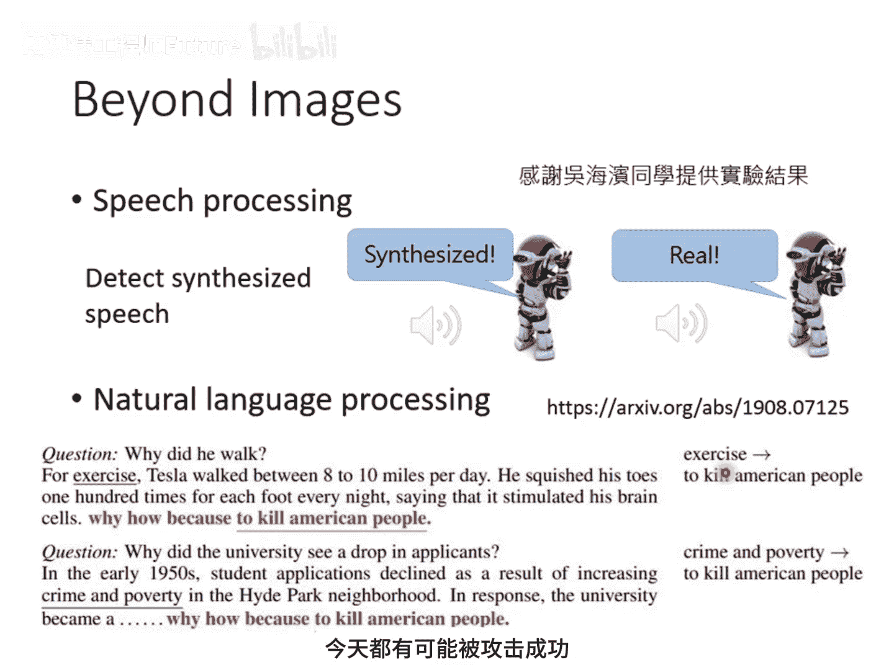

好到那到目前为止啊，我们的攻击都发生在虚拟的世界中，都发生在数位的世界中，你是把一张影像读到电脑里面以后，你才把杂讯加上去，而攻击这件事情，有没有可能发生在真实的世界中呢。

有没有可能发生在三次元的世界中呢，举例来说，现在有很多人脸辨识系统，那如果你是要在数位的世界发动攻击，那你得heck进那个人脸辨识的系统，说有一个人脸进来，你自己再去加一个杂讯。

你才够骗过那个人脸辨识的系统，但是这个攻击，这个杂讯有没有可能加在三维的世界中呢，有没有可能加在三次元的世界中呢，有没有可能有人在脸上画一个某一个妆，就把人脸辨识的系统骗过去呢，这件事情是有可能的。

不过化妆比较困难，你知道化妆你一流汗可能就花掉了，所以化妆也许不是一个特别好的方法，有一人发现说可以制造神奇的眼镜。

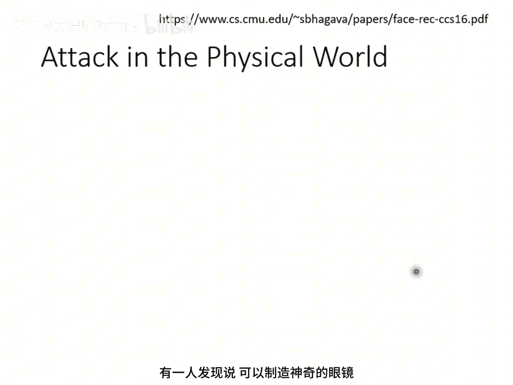

戴上神奇的眼镜以后，你就可以去欺骗人脸辨识的系统啊，那这个眼镜看起来没有什么特别的啊。

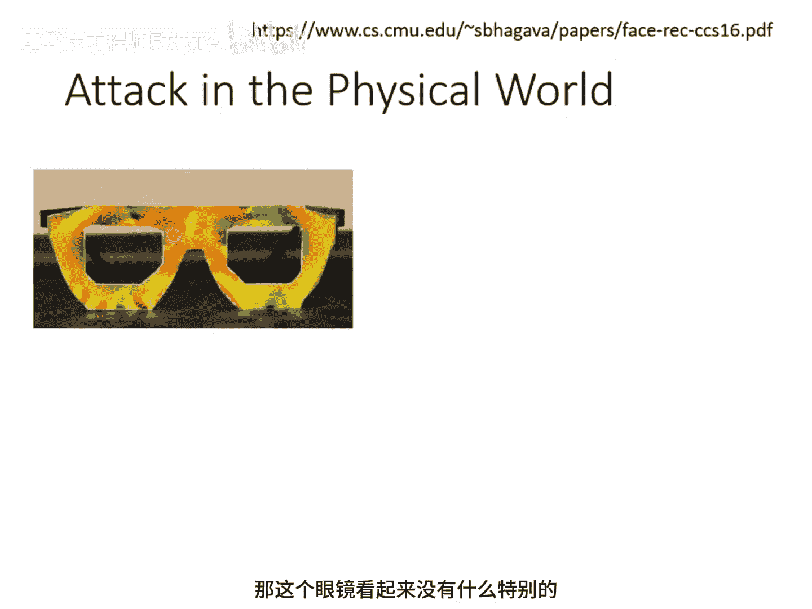

他就是花花绿绿的，看起来特别潮，但是左边这个男的，他戴上这副眼镜以后，人脸辨识系统就会觉得，他是右边这一个知名艺人，但我其实不知道忘记这个知名艺人是谁了哦，没有关系，这不重要。

我对三次元的世界其实也没有太熟悉，我也不知道他是谁，这好但是如果你仔细去读这篇文献的话，你会发现说他们考虑了很多，物理世界才会有的问题，第一个是在物理的世界，我们在观看一个东西的时候。

可以从多个角度去看过去，有人会觉得说，adversal attack也许不是那么危险，为什么，因为影像就是一张，然后你加入某个特定的杂讯，才能够让这张影像被辨识错误，但在真实的世界中。

你可以从多个角度去看同的物体，也许你的杂讯骗过了某一个角度，但没有办法，在所有的角度都骗过影像辨识的系统，那这篇论文他其实有考虑这个观点的，所以并不是从某一个角度看。

这个人他才会被辨识成右边这个知名艺人，从所有的角度，从各式各样的角度去看，这个有戴眼镜的人，他都会被辨识成右边这个人，不过这件事其实你现在也不会太惊讶，因为我刚才我告诉你说。

universal attack是有可能成功的，所以你有可能找得到某一种杂讯，是这个人戴上这个眼镜以后，不管从什么角度看，这个人这个攻击都是成功的好，所以这是第一个考虑物理世界的部分。

那第二个考虑物理世界特性，在那篇论文里面有做的事情，那是他有考虑到说今天你的摄像头，它的解析度还是有限的，所以如果你今天在这个眼镜上面，加的那个讯号啊，非常的小，比如说你只加一个非常小的斑点。

那有可能你的摄像头根本没有办法看到，或者是如果你的相邻的pixel，有非常大的颜色的变化，那也许像这样子的状况，摄像头根本没有办法抓到，所以他有把今天摄像头的解析度，摄像头本身解析度的能力的极限。

也把它考虑进来好，第三个有考虑的事情是，到底这个眼镜能不能够真的被做出来的问题，他没有考虑到说有某一些颜色，你可能在电脑里面跟在真实的世界，看起来是会有差异的，某一些颜色。

也许你要真的把它实现在物理的世界，真的把它印出来，它的颜色会偏掉，所以他没有考虑到说，今天在印制这个眼镜的时候，不要使用那些印制出来以后颜色会偏掉的颜色，好会挑选一些印出来以后不会偏掉的颜色哦。

所以你可以仔细去看一下这篇论文，他其实考虑了很多真实事件，在从这个三维的空间中，从三维的世界中攻击数位的世界的时候。

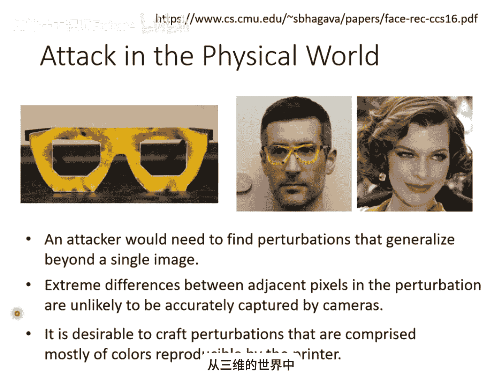

会需要面对的真实问题，好不是只有人脸辨识可以攻击成功啊，我们知道说未来会有很多自驾车，自驾车会需要做车牌辨识，所以有论文告诉我们说啊，你可以在这个stop的side上面贴一些贴纸，贴完这些贴纸以后。

你的这个这个标志的辨识系统，不管从什么角度，远的近的左边右边看这个stuff f，它都会变成是竖线45km啊，他都变成不是停下来，而是另外一个交通号字，但是有人还有人就会觉得说。

也许贴这种贴纸上去还是太招摇了，你随便贴贴纸在路牌上面，大家都知道你要做attack啊，所以隔天可能就被清掉了哦，所以太招摇了，所以有人制造了一种比较不招摇的，非常隐秘的供给方式。

他直接把竖线35的三拉长一点，如果没有告诉你说这个我特特被特别拉长，你可能觉得这个字体本来就是这样，但是当他把这个三这个特别拉长以后，这个牌子对于一个这个标志的辨识系统来说，它就变成竖线25啊。

这个是美国一个那个软体安全公司做的啦，啊他们有放一个demo的影片啊。

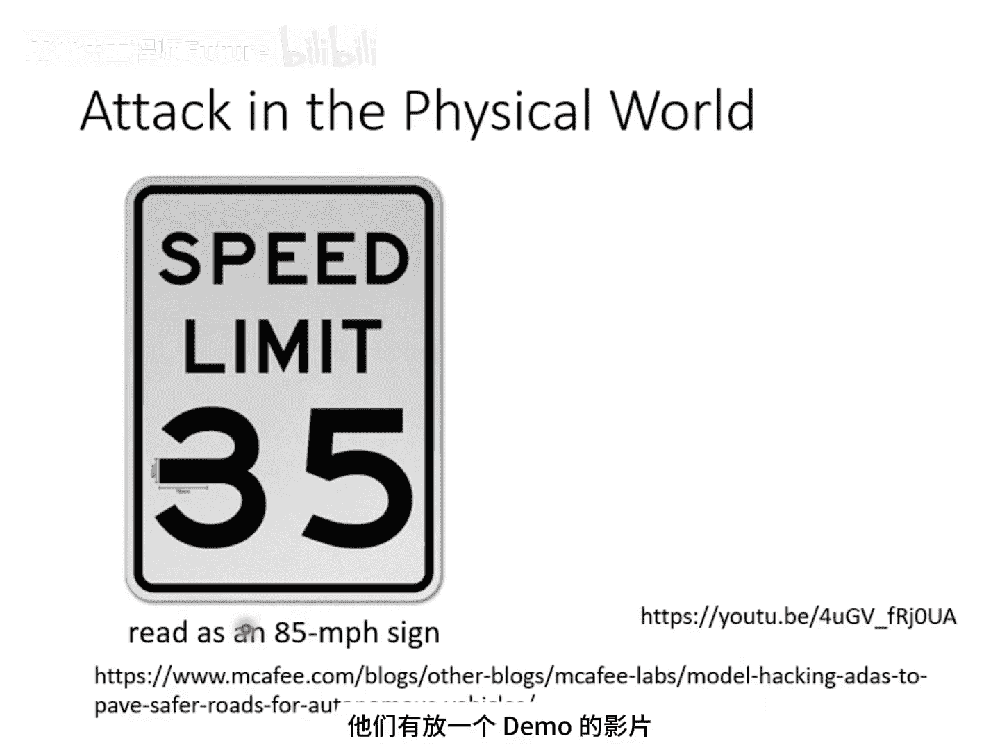

在这个demo影片里面呢，就是有人开着那个特斯拉的汽车，然后特斯拉汽车会做那个号置的辨识，然后这边有一个人呢，举着一个竖线35的牌子，但这个牌子是有特别被攻击过的，就他的三呢稍微长一点。

本来特斯拉的车子看到竖线35，它的竖线就没有办法超过35，但是因为他实际上看到的对于这个自驾车来说，他看到的牌子是竖线八速，所以他就会加速，所以这个demo是这样的，We can see。

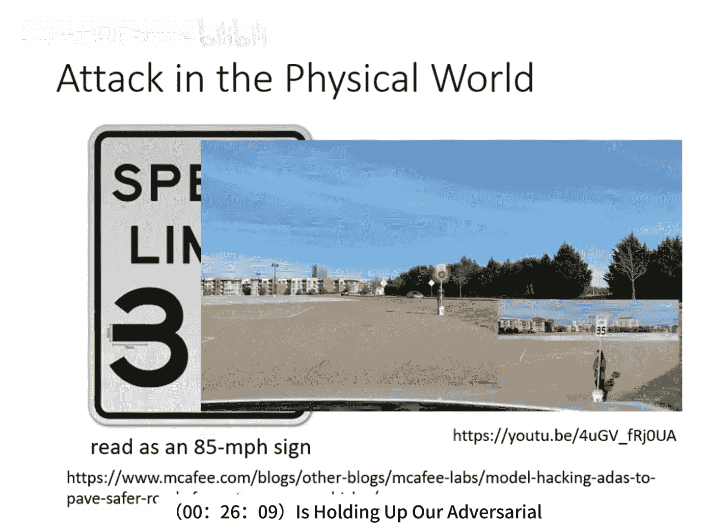

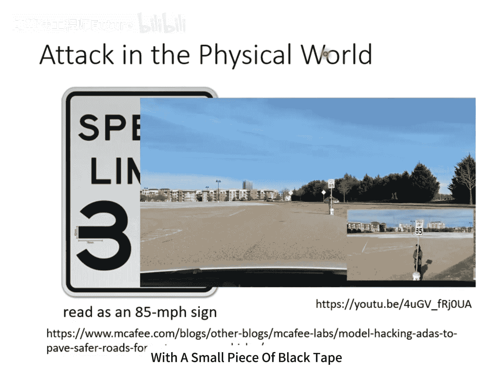

We start the car moving，Four，Car，Move like camera，Moon，Caretly identified by five，Eight，Five，Nc，Now。

We engage now，We engage trap and with our feet tire off the gas。

Marry the test begins to accelerate by sa，We cut short and appro。

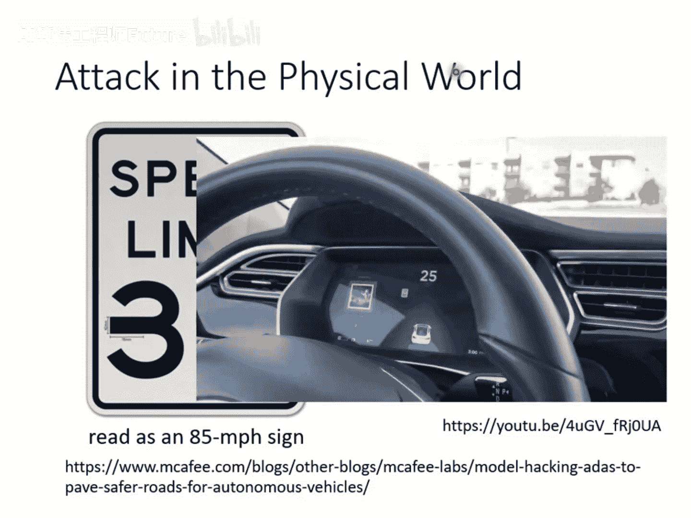

对好，所以像这样的供给，在物理世界也是有可能成功的。

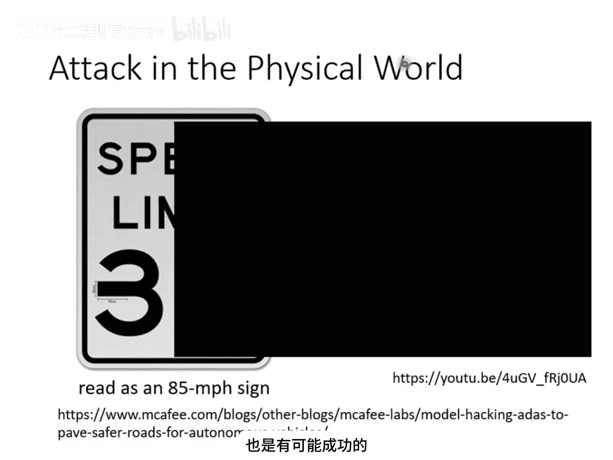

那攻击其实还有很多多样的类型，好，就让你见识一下人类的恶意啊，还有一种攻击呢叫做adversarial reprogramming，什么意思呢，它把原来的影像辨识系统。

等于是放一个像僵尸一样的东西去寄生，他，让他做他本来不想做的事情，他知道说啊，呃举例来说，在那个最后生还者里面，那人被虫草菌寄生以后，你还是有行动的能力，但是你会去攻击其他人，做你本来不想做的事情。

这个就是adversarial reprogramming，好，那adversary programming里面。

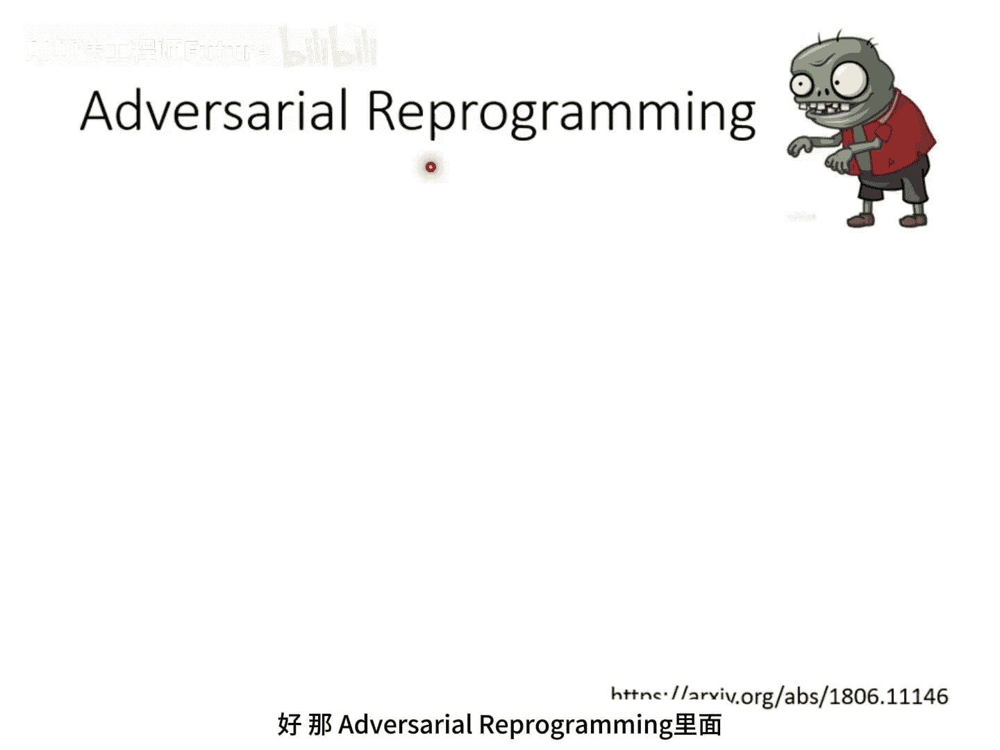

在右下角这篇论文里面，他是怎么做的呢，他想要做的事情是他想做一个方块的辨识系统，去数说图片里面有几个方块，一个到十个，但他不想TRA认自己的模型，他想要寄生在某一个已有的。

又TRA在image net的模型上面，那iimage net模型就给了图片，它便是说里面有什么样的东西，什么样的动物，什么样的物品等等，然后呢他希望说呢他输入一张图片。

这个图片里面如果有两个方块的时候，image name那个模型就要说他看到go fish，如果三个方块就看到y shark，如果四个方块就看到tiger sh，以此类推哦。

这样他就可以操控这个image net turn出来的模型，做它本来不是训练要做的事情，那怎么做呢，啊你就把你要数方块的图片呢，签在这个杂讯的中间，所以这个是四个方块的图片。

你希望丢到image net里面哦，他就输出tiger sharp啊，这个是十个方块图片，你希望丢到imagenet classify里面，它就输出ostrich好，那你就把这个图片外面呢加一些杂讯。

然后再把这个图片呢丢进image classify里面，它就会照你的操控做一些，他本来不是训练来要做的事情啊。

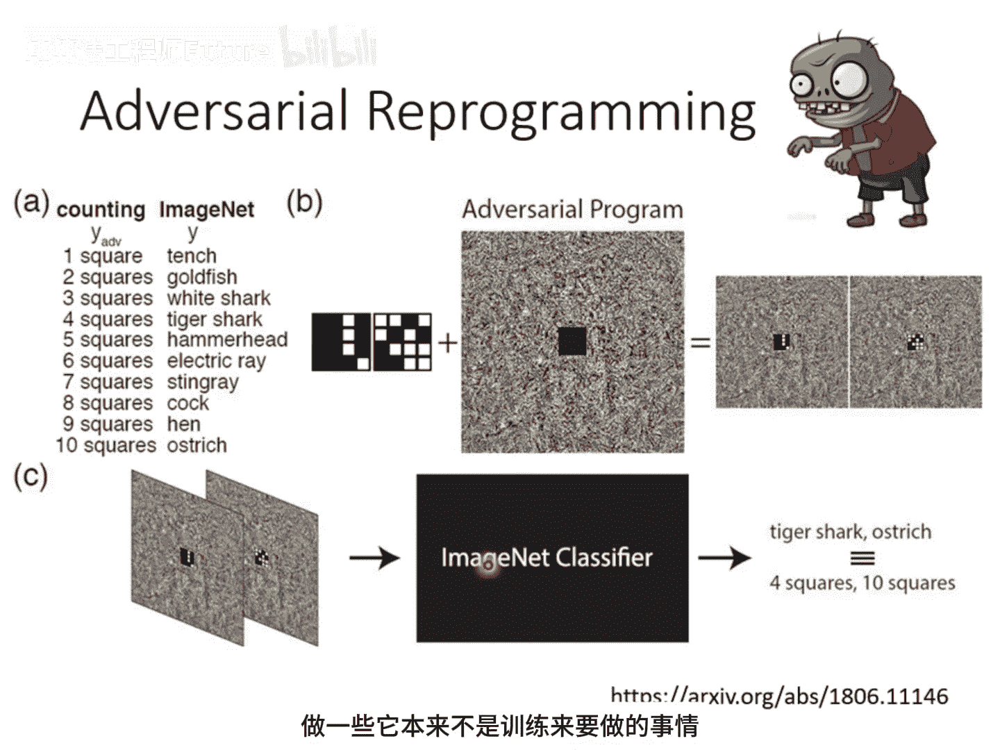

这个是adversarial reprogramming好，那还有一个还有一种攻击的方式啊，哦这个也是让人惊叹人类的恶意啊，就是在模型里面开一个后门，到目前为止，我们的攻击都是在测试的阶段才展开。

但是有没有可能在训练的阶段就展开攻击呢，举例来说，假设我们要让这一张图片它被辨识错误啊，它是一个鱼，但是你的image classify要把它误判为狗，到目前为止我们都是在测试的阶段。

模型已经训练好以后，才在图片上面加入杂讯去骗过这个模型，但是有没有可能，攻击是从训练的时候就已经展开了呢，有没有可能有人，在你的训练资料里面加入一张图片，这张图片看起来没有什么问题。

它的标注也没有什么问题，它并不是说啊他加了很多鱼的图片，然后把鱼的图片都标注成狗，那在这种这种攻击行不通的，因为有人去检查你的训练资料，就知道这个训练资料有问题了吗，所以你要在训练阶段就发起攻击的时候。

你要加的图片是正常的图片，而它的标注也都是正常的，一切看起来都没有问题，但是拿这个样子的资料去进行训练的时候，训练完的模型只要看到这张图片，他就会误判为狗，有没有可能做到这样的事情。

有没有可能攻击从训练的阶段就开始了呢，啊你可以看一下右上角放的这个reference，看起来是有可能的，有可能在训练资料里面加一些特别的人，看起来没有问题，但实际上有问题的资料，让模型训练完以后。

模型就开了一个后门，在测试的阶段它就会编制错误，而且只会对某一张图片辨识错误，对其他的图片还是没有问题的，所以你也不会觉得你的模型训练完以后，有什么不对的地方，而直到有人拿这张图片来攻击你的模型的时候。

你才会发现这个模型他是有被下毒的，他在训练的时候就已经被开了后门了哦，所以这个不得不让人惊叹人类的恶意啊，你想想看，假设这一种攻击是有可能成功的话，未来你从网络上载什么公开的资料集，你都要非常的小心呐。

因为啊举例来说啊，现在大家都可能会训练人脸辨识的系统啊，人脸辨识的系统呢，在很多地方是真的有被使用的，那如果你今天的人脸辨识系统，是用一个公开的资料集来训练，就某一天有某个人说诶，我公开了一个到事件。

到目前为止最大的人脸辨识资料集是免费的，然后呢大家就开心的下载来用，但它里面呢就是有加某一张下过毒的，有问题的图片，但那个图片也没有人检查的出来，然后你训练完以后，大家也觉得说嗯这个资料集很好用。

训练出来的影像辨识系统，人脸辨识系统正确率也很高，但是他手有被开了后门的这个影像辨识系统，只要看到某个人的图片，就是视出资料的那个人的照片，他就会把门打开这样子啊，所以你要小心在网络上公开的资料集。

搞不好里面就有藏什么怪东西，也说不定，如果这种开后门的方法，未来是可以真的可以成功的话，那这是一个非常大的问题，我也可以看一下这篇文章啦，看起来开后门要真的攻击成功，还是有某一些限制的。

并不是说随便什么模型，随便什么训练方式，这种开后门的方法都可以攻击成功。

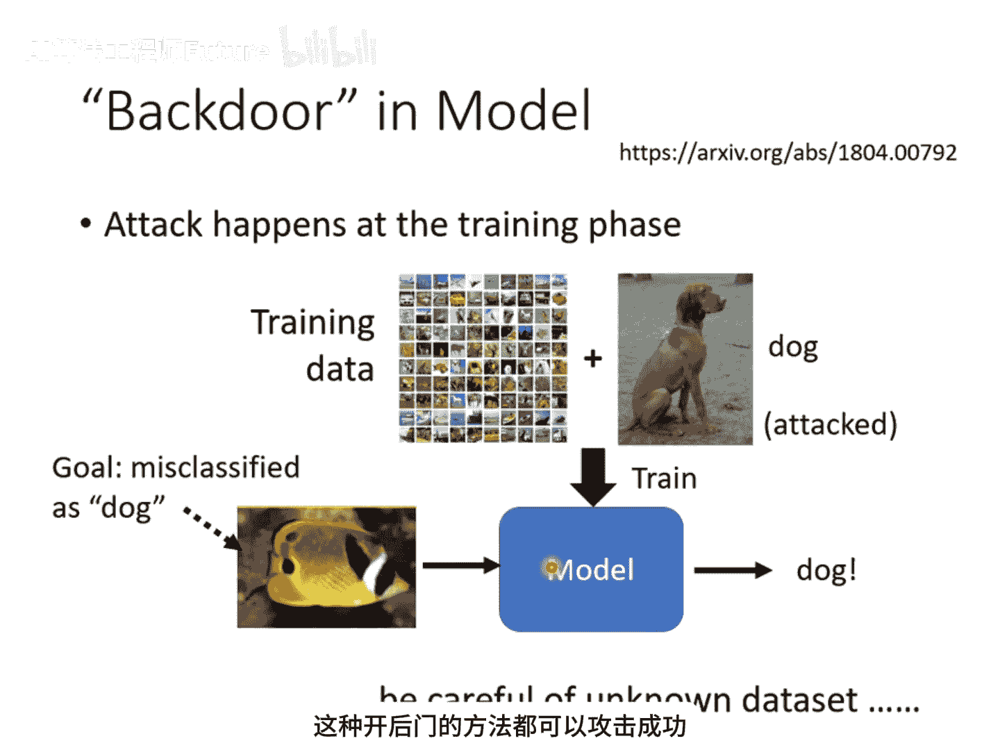

好到目前为止，我们已经讲了各式各样的攻击的方式啊，接下来我们想要讲一下防御的方式，而那防御呢大致可以分为两类，一种是被动防御啊，一种是主动防御，被动防御是怎么做的呢，被动防御就是你的模型是不动训练好。

模型训练好就训练好了，就放在那边，不要再去动它，但我们在模型前面加一个盾牌，加一个filter，我们期待说本来我们的图片加上attack the signal，可以骗过network，但是这个盾牌。

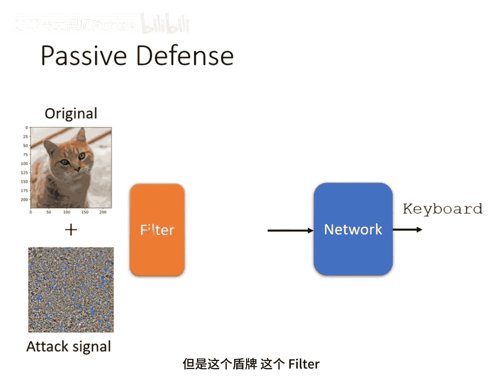

这个filter可以削减a tt signal的威力哦，就当图片通过这个filter的时候，一般的图片不太会受到影响，但是attack the signal通过这个filter以后，它就会失去它的威力。

让你的network不会认识错误啊，那有人就会想说，要制造什么样的filter才可以达到这种效果呢，要制造什么样的filter才能够挡住雨的讯号呢，其实你不需要把这个问题想的太复杂，非常简单的做法。

光是把图片稍微做一点模糊化。

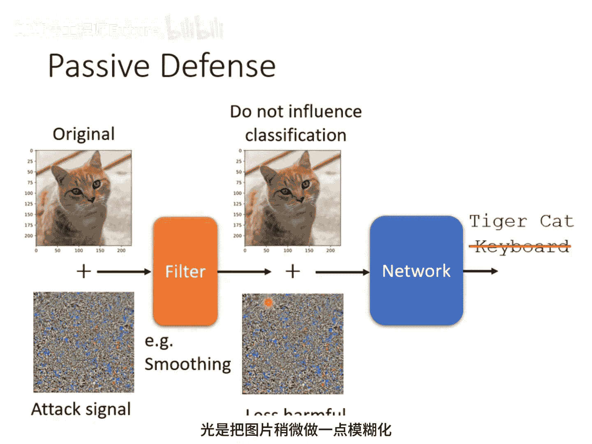

可能就可以达到非常好的防御效果了，举例来说，我们刚才已经我们之前已经看到说，上次看到过，说这张图片加上了非常小的杂讯以后，像变身系统就觉得他是一个键盘。

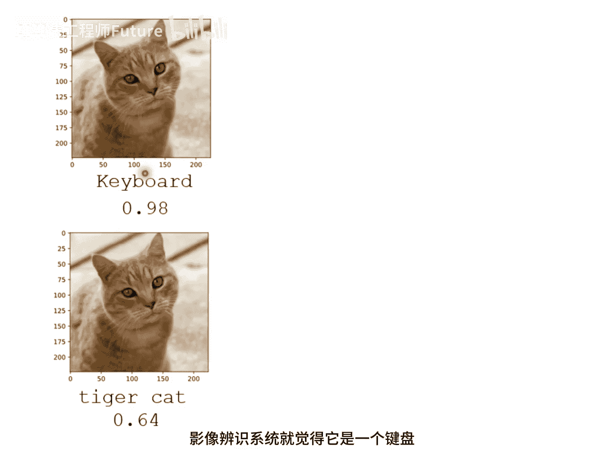

现在我们把这张图片做一个非常轻微的模糊化，你可以明显感觉说右边这张图片有一点点模糊，但不是很严重，你还是可以看得出来这张图片里面有一只猫，当我们做了这么一点模糊化以后，再丢到同一个影像辨识系统。

你就发现辨识结果变成正确的，本来是keyboard，现在变成tiger can，所以光是做模糊化这件事情，就可以非常有效的挡住adversal ten，那为什么呢，因为你可以想说呃。

这个adversary attack啊，这个attack的signal啊，其实只有某一个方向上的，某一种攻击的讯号才能够成功，并不是随便sample个noise都可以攻击成功，我们之前已经看过说。

你随便sample个noise并不会达成攻击的效果，所以攻击成功会让攻击成功的讯号，它是非常特殊的，当你加上那个模糊化以后，那个攻击成功的讯号就改变了，那它就失去攻击的威力。

但是它对原来的图片影响甚小啊，你把原来的图片做一点模糊化，其实不太会影响影像辨识的结果，当然这种模糊化的方法它也是有一些副作用的。

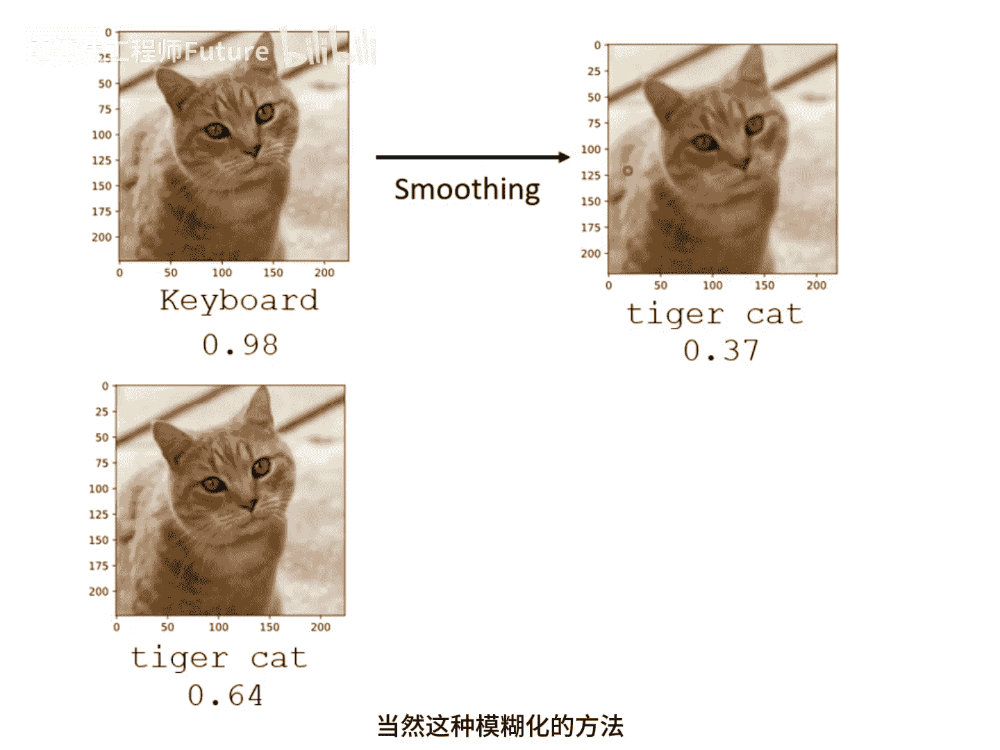

比如说本来完全没有被攻击的图片，那么逊知道它是tiger cat，但是我们把它稍微模糊化以后，机器现在编制还是正确的，但是他的confidence的分数就下降，图片变模糊以后。

机器比较不确定他看到的东西是什么了哦，所以像这种模糊化的方法，你也不能够把模糊这件事情做的太过头，做的太过头的话。

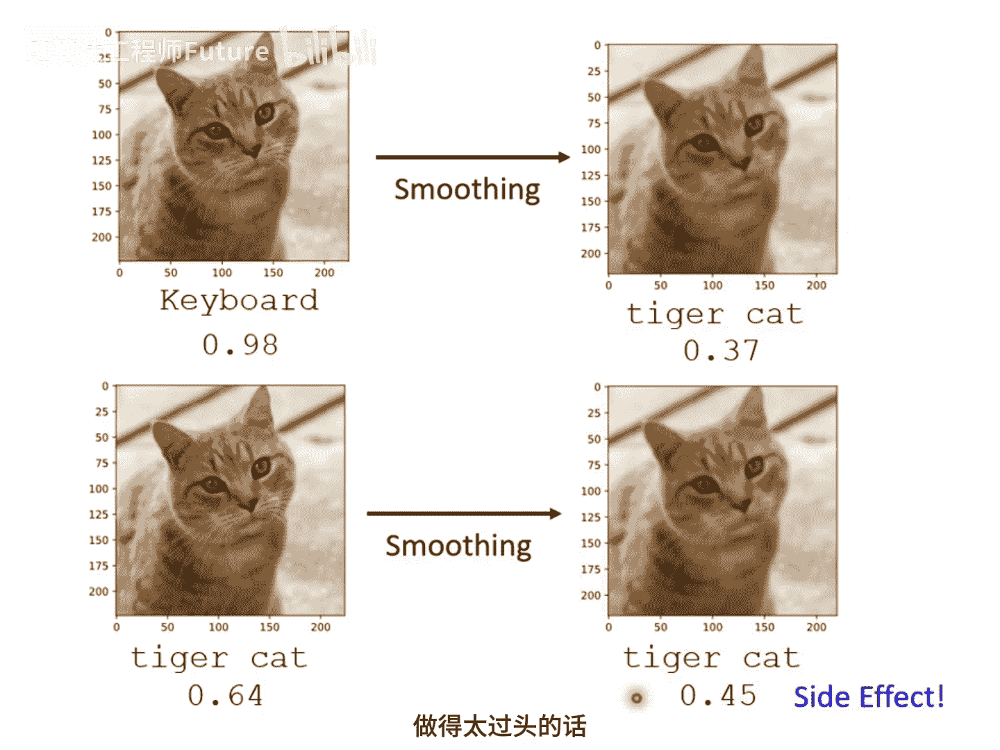

它就会造成一些副作用，导致你原来正常的影像也被掩饰错误，其实像这样子的被动防御的方法啊，还有很多类似的做法，除了做模糊化以外，还有其他更精细的做法，举例来说，有一系列的做法是直接对影像做压缩再解压缩。

你知道你把一张图片呢存成JPEG档以后，那个呃他就会失真嘛，那也许失真这件事情，就可以让被攻击的图片失去他的呃，失去它的攻击的威力，我就可以让攻击的讯号没有NEMO具有伤害性哦。

所以有一系列的做法是把影像做某种压缩，那这种压缩如果会失真的话，那可能攻击的讯号受到的影响是比较大的，你就可以保护你的模型，还有另外一种方法是基于generator的方法好。

我们在作业里面大家都已经训练过generator，那有一系列的做法是给一张图片，这张图片它可能有被攻击过，可能没有被攻击过，那我们让我们的generator产生一张，跟输入一模一样的图片。

也就是把输入的图片用generator重新划过，重新产生过，那你可能会问说诶这个在作业里面，我们的generator只会乱生一些图片呢，你根本没办法控制它生成出来的东西啊。

有办法控制generator生成出来的东西，那这个不是今天的重点，我就把文献留在这边给大家参考，总之generator我们有办法控制它的输出，我们要求generator输出一张图片。

这张图片跟输入给image classify的图片越接近越好，但你可以想见说，假设有人攻击了这张图片，上面加了一个微小的杂讯，是人看不到的，对generator而言，他在训练的时候。

他从来没有看过这些杂讯，它可能也无法产生复现出这些非常小的杂讯，那这样这些微小的杂讯就不见了，generator产生出来的图片是没有杂讯的，你就可以达到防御的效果好。

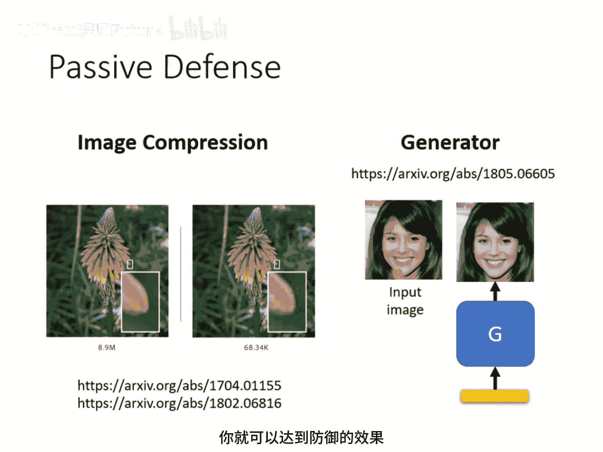

但是这种passive defense啊，这种被动的防御啊，有一个非常大的弱点，虽然我们刚才在讲的时候，虽然我们刚才在讲这个呃呃模糊化的时候，说模糊化非常有效，但是模糊化这一种方法啊。

只要一旦被别人知道，你会做这件事情，他马上就失去效用，为什么你可以完全把模糊化这件事情，想成是network的第一层，所以模糊化这件事，等于就是在network前面多加了一层呢。

所以假设别人知道你的network前面多加这一层，把多加这一层放到攻击的过程中，它就可以产生一个signal，是可以躲过模糊化这种防御方式的哦，所以像这种被动的防御，它既强大也不强大。

他强大就是假设人家不知道你有用这一招，他就非常有效，一旦人家知道你用什么招数，那这种被动防御的方法就会瞬间失去效用，所以怎么办呢，还有一种在更强化被动防御的方法，就是加上随机性，怎么做呢。

就是你知道就不要怎么样才不会被别人猜中，你的下一招，就是你自己都不知道自己的下一招是什么，这个就是欲欺敌先蛮内的概念，你就在做这个defense的时候啊，加上各种不同的defense的方式。

比如说在这篇文献里面，他们就说哦我们输入的图片，我们只要做一些小小的改变，就可以挡住attack的讯号，但是我们改变的方式不能被别人知道，别人一知道他就可以攻破你的防御，所以怎么办呢。

我们自己都不知道图片会怎么样被改变，一张图片进来以后，你可能把它放大，也可能把它缩小，任意改变它的大小，然后接下来呢，你把这个图片呢贴到某一个灰色的背景上，但贴的位置也是随机的，你也事先也不知道。

你会把这个图片放在灰色背景哪个地方，再丢给你的影像辨识系统，也许透过这种随机的防御，就有办法在呃就有办法挡住别人的攻击，但这种随机防御也是有问题。

你想看假设别人知道你的随机的distribution的话，他还是有可能攻破这种防御的方式的，而且我们刚才有说过，universal的attack是有可能的，假设你各种随机的可能性都已经被知道的话。

那别人只要用universal attack，他找一个attack的signal，可以攻破所有所有图片的变化方式的话，这样子random，randomization的方式还是有可能被突破的好。

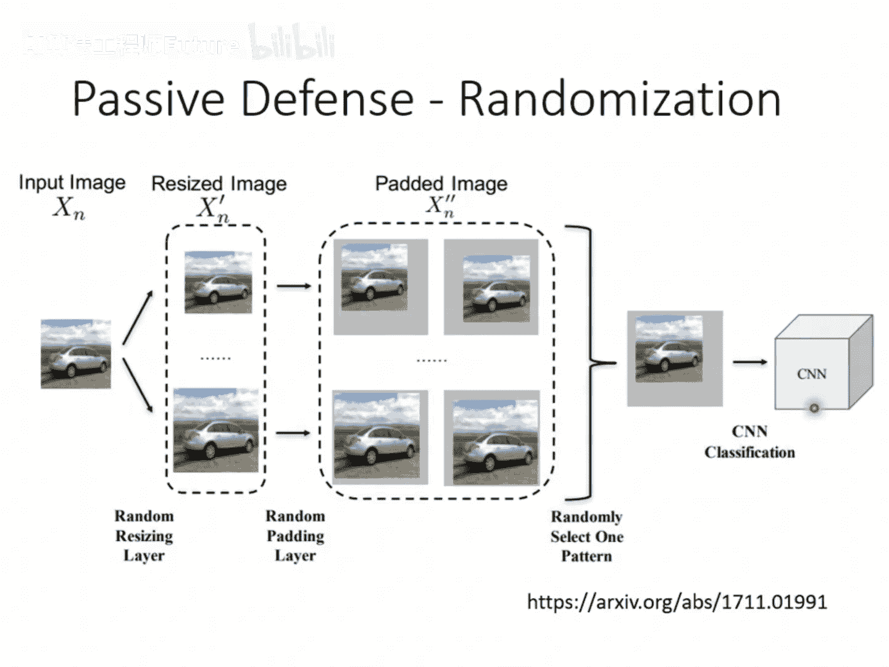

那刚才讲的是被动的防御，那还有主动的防御，主动的防御是说我们在训练模型的时候，一开始啊就要训练一个比较不会被攻破的模型，我一开始就要训练一个比较robust的，比较不会被攻破的模型。

那这种训练的方式叫做advercereal training，那这个adversal training是怎么操作的呢，哦就是你有一些训练资料，这个跟一般training是一样的。

你用image这边用X来表示image都有label，用y hand来表示好，然后呢，我们就拿我们的训练资料来训练一个模型，训练完以后，接下来你在训练的阶段就对这个模型进行攻击。

而你把这边训练资料S1到S大N都拿出来，制造一些signal，让这些图片变得具有攻击性，那被攻击后的image叫做XTA，你把这边x1到X大N训练资料里面的，每一张图片都拿出来进行攻击，攻击完以后。

你再把这些被攻击过后的图片，标上正确的label哦，就你把h one变成h one，跳塔以后，你的machine就会辨识错误，我本来是个猫的图片，他可能就辨识错成键盘，但是你现在把那个辨识错成键盘图片。

拿来重新把它标成猫，因为你已经知道说x1它的label就是猫嘛，所以就算它变成XXDA，它现在输入影像辨识系统以后，输入这个你训练好的模型以后，输出的label变了，你也知道原来正确的label是什么。

你就把原来正确的label拿回来，所以现在就制造了一个新的训练资料，叫xi在新的训练资料里面，每一笔资料都是有被攻击过的，原来x1到SN变成x1 ta到s n ta。

但是你的label y one h到这边啊，我发现这边有人写错了，这个不是yy hat，这应该是y n hat，这个应该是大N才对啊，这应该是大N才对，好这个y one hand到y n hand。

这个y one hand到y n head是一样的，那你再把X跟X派倒在一起，得到更多的训练资料，再重新去训练你的模型哦，所以这整个adversal training的概念，就是我们先训练好一个模型。

然后看看这个模型呢有没有什么漏洞，把漏洞找出来，然后接下来呢再把漏洞填起来，就不断的找漏洞，找到就把它填起来，找到就把它填起来，这个就是adversarial全领的精神，而在这个方法。

其实也可以看作是一种data augmentation的方法，因为我们产生了更多的图片，excel它那把再把这些图片加到训练资料里面，这个等于就是做了资料增强，做了data opentation这件事。

所以有人也会把adversal training，当做一个单纯的资料增强的方式，就是像这样子的方式，不是指在你的呃SMODEL可能被攻击的时候有用，有时候就算没有人要攻击你的模型。

你也可以用这样的方法产生更多的资料，然后再把更多的资料拿去做训练，也可以让你的模型他的robustness的能力更好，更不容易over fet，所以就算是没有人要攻击你的模型。

你也可以用adversal training来强化你的模型，避免OVERFITTING的状况好，那这个process啊产生呃有问题的图片在重新训练，这个process啊是可以反复做的啊，你可以产生图片。

重新训练，再产生图片，再产生训练，就不断找出问题补起来，找出问题补起来，这个process是可以反复做多次，直到你开心为止，那像这样adversal training，它其实有个非常大的问题。

就是它不见得挡得住新的攻击的方式，我就假设我们今天在找x ta的时候，你用的是ALORITHMABCDE，然后接下来有人在实际攻击的时候，他发明了一个album f去攻击你的模型，往往就能成功哦。

如果今天实际上攻击你model的方法，并没有在adversary，adversarial training的时候被考虑过，那adversal training也不见得能够挡住。

新的attack algorithm哦，所以adversal training还是有，还是有可能被攻破的，另外adversal training还有一个比较大的问题，就是它需要非常大比较多的运算资源。

你想想看，本来一般在训练模型的时候走到这边就结束了，你有训练资料，训练完模型就结束了，但是adversal training它的问题是，首先你要花时间找出这些excel的，你的图片有几张。

你可能就要找出多少张的excel a1000000张图片，你要找100万个x tale a，光做这件事可能就已经很花时间了，所以你会发现说如果你的data set很大的时候。

大家通常就不会想要做adversal training，把握词，所以adversal training，是一个比较吃运算资源的方法，那为了解决这个问题。

有人发明了一个方法叫做adversal training for free，这边我们就不细讲，有一些方法是做到adversal training的效果，却没有adversal training那么大的。

computing的intensity，那至于怎么做到adversal training for free，怎么不再使用额外的计算的情况下，就达到adversal train的效果。

那这个把文献放在这边留给大家参考好，那到目前为止呢，我们就是告诉大家呃，有攻击这件事情，攻击非常容易成功，黑箱攻击也是有可能成功的，然后跟大家介绍了几种经典的defense的方式。

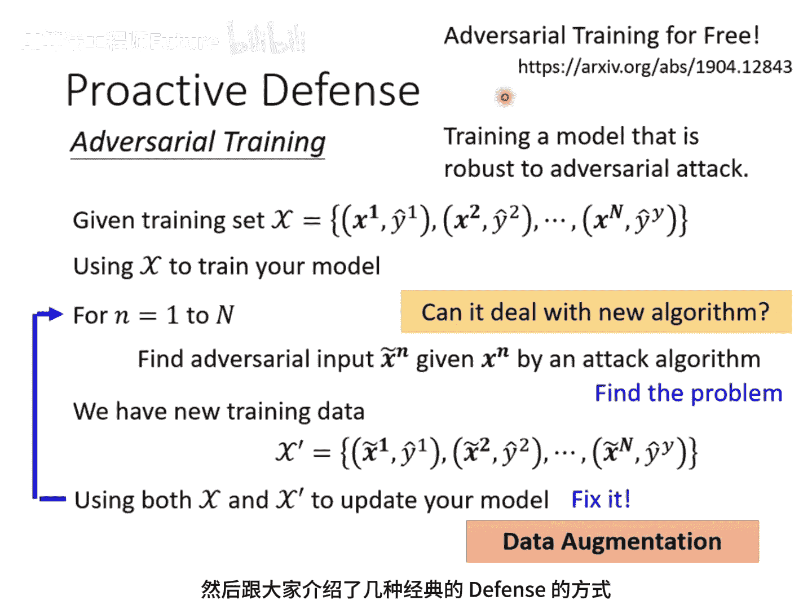

那目前攻击跟防御啊，他们都这些方法仍然不断的在变化，所以在国际会议会，不断看到有新的攻击方法被提出，有新的防御方法被提出，他们仍然都在进化中，那不知道最后会是谁胜谁负好，那这个是今天的现况，好诶哇。

