# 【官授搬运】2026年全新优化版李宏毅机器学习系统课程，这才是真正的初学者体系课程！—人工智能／深度学习／神经网络 - P71：3-自然語言處理上的對抗式攻擊 (由姜成翰助教講授) - Part 2 - AI算法工程师Future - BV1ruqABeEFX

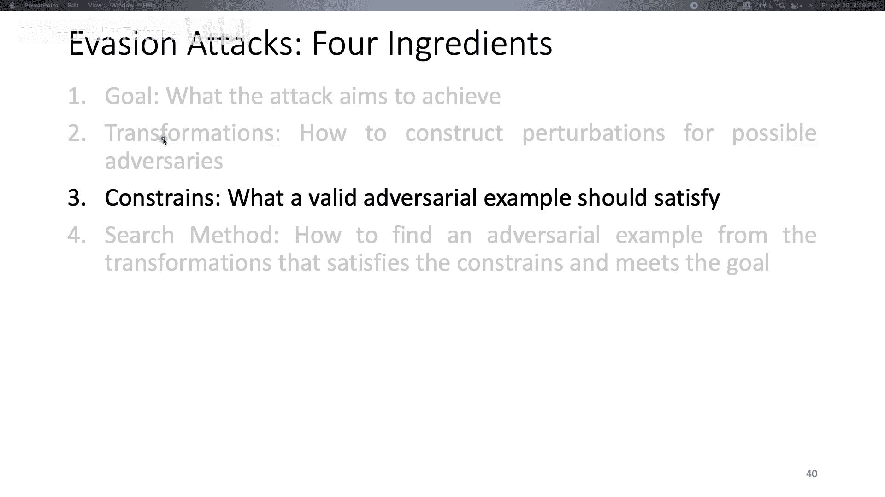

下constraint，也就是所谓的限制，那这个constrain呢就是告诉我们说一个合理value，As eral sample，他应该要满足什么样的条件。

那这个and the seal example，它的限制啊，他其实跟你的这个任务的go是非常有关的，假设今天你的任务是一个应该要保持，semantic的任务，那这个control就会要求说呃。

你attack产生出来的东西，必须要保留这个语义上面的鱼，它原本的语义，那假设今天嗯，嗯这个假设今天文法是一个很重要的contra呃，文法是一个很重要的东西的时候。

那你可能就会把这个文法加到这个control里面，那也有可能我们希望说这个更动之后的sample，跟原本的sample它不可以差的太多。

那我们就会限制说这个overlap return original，还有perturn sample，要足够的高好，那我们首先来看这个overlapping的衡量方式，我们会用什么样的衡量方式。

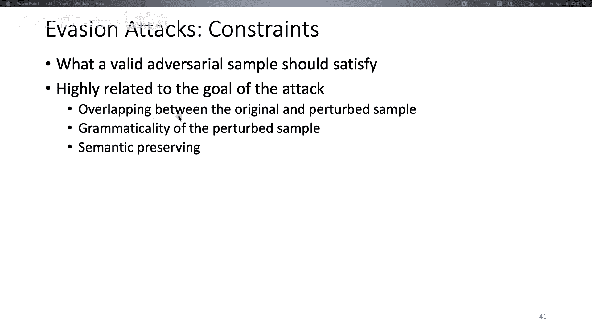

那首先第一个我们来介绍一下这个LEVENTION，Stand at the distance，它这它计算的是呃，原本的sample跟更动过后的sample，他们的edit distance有多少。

那这个东西比较长，是拿来衡量corrector label的选错，就是当我们在做correct level transform的时候呢，我们可能会做substitution，我们可能会做swap。

我们可能会做deletion跟insertion，那我们当然会希望说原本的这个这个字，跟它经过correct level传送的这个字，它长的不可以差太多，不然一看就知道他是个有问题的东西。

那我们就会用我们的人生edit distance来衡量，那levant at the distance，它计算的是A跟B这两个字串的edit distance，那他是用一个递回的方式来定义的。

那他的式子写在这边，那我们用一个实际的例子，这个例子是我在VPP加上面看的，那来介绍一下，解释一下这个这个递回式子，是怎么算出两个字串的，Benchant distance。

那首先呢这个假设我们原本的AA0是kitten，然后B0是city，那我们要算A跟A0和B0这两个字串的lent，distance的时候呢，你就看看他满足哪个条件嘛，第一个条件是B0。

这个字串他要是长度是零，那很明显不是A0的字串，长度是零，很明显不是，那第三个条件告诉我们说呢，这个A0和B0是一样，A0A的第一个的corrector，跟B的第一个corrector是一样。

很明显也不是，所以最后我们要来看这个，这个呢就是你要去找一加上minimum的这三个，那反正我已经找出来了，就minim就可是这个就是A0的tail，tail就是去掉头的，剩下部分叫tail。

还有B0的tail，所以现在我们的the resident distance，就是一加上这个东西，也是这两个东西，它的the same distance，那这两个东西recent distance呢。

我们就看这个这边的这个这个if else condition，那我们就看到说这两个东西呀，它其实是符合这边的这个condition，就是A的第一个corrector，跟B的第一个correct是一样的。

都是I嘛，所以呢这时候我们就继续往下看，我们把这个东西这边的I拿掉，然后继续看这两个字上的tell，他们的ten distance是多少，那拿掉以后呢，我们又发现说A这个字串跟B这个字串。

它们开头还是一样，那这件事情会再做好几次，然后做到这个时候呢，把你把这两个T都拿掉之后，A剩下EN，然后B剩下ING，那个时候呢这个前面这三个条件都不满足，所以就是要看第四个条件。

那结果最后反正哎我算出来mini们是这个啊，所以这时候呢当你要把一跟I这个东西拿掉，然后算N跟NG这个这两个tell的人身distance，之后，这个原本的人生生distance就要再加这个。

这个这里先distance再加一，然后我们来看N跟NG这两个SUBSTRING，它的坏掉，Residistance，那再看这两个retain distance的时候呢。

我们就发现说这两个这个string它的开头都是N，所以他就符合这个条件，所以我们就把N拿掉之后，来看剩下的tell他们的人生就损失多少，那最后拿到最后啊，这个N被拿掉之后，这个变成一个空字串。

然后这边剩下一个G，所以当这个A是空字串的时候呢，他的连线DIANCE这两东西的人是现distance，就是这个B的长度，那现在B的长度是在一，所以这个RETURDISTANCE再加一。

所以总共号里的retain distance，这两个这个string它的连胜，这三就是三好，那实实际上我们在算的时候，不是不是用第一回算的，实际上有其他的比较快的算法，可以不用用D回算。

那大家如果有兴趣的话，再去看我DPD，我这边有个小问题哦，这边举的例子是character level的levin distance，那一般我们在做NLP的universal attack的时候。

算的是character level的吧，还是我们其实应该是会算word level或者是token level的，At level and distance，诶。

如果是correct level传送的话，我们会用就是character level的the stdistance，然后如果是这个word label的话。

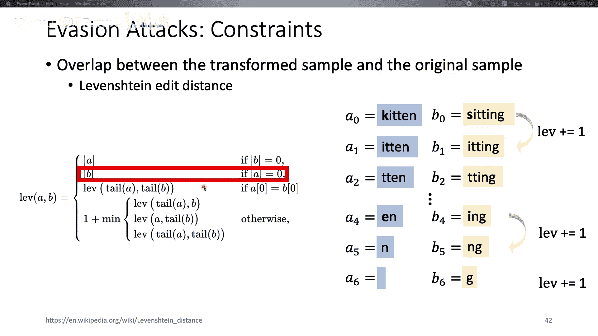

我们就应该直接看出它就是preservation的，字的比例有多少，就不会，要就哦了解我不确定我不确定诶，我不确定word label的van distance要怎么定义，我有点不确定，其实还是可以啊。

我们就把每一个word当做一个单位，就本来算在character上的，就改成算在word上的，就是感觉算在两个word习惯上对，感觉是可以嘛，就像是ASR的LOV，那对对对对对对对，应该可以。

不过不过好像比较不会这样算，就是好，谢谢陈翰好，哎，这还有个问题，就是因为现在蛮多对标model其实都是用呃，傻不word就是organization，那有针对sab word这种算法或者是做法之类的。

就是那个就是first NO cognizer诶，额不会，因为我们在做PREDATION的时候，其实应该是以四为单位做prod bation吧，所以额你哎我我先确定一下你的问题，你的问题是说。

我们要当我们的prohibition单位是少数的时候，我们要怎么算他们的overlap吗，啊对对对对对哦，就是我们不太会在呃，我们不太会在SAPOLEO做回飞侠，因为假设有一个字就有一个word。

它被token ized成两个词好了，那如果你只有PERTURN其中一个，其中一个这个东西的话，那他可能会是，它可能会是一个完全不max sense的PREDATION。

所以我们一般而言应该是就是以word，以以字为单位做准备，所以不会有需要算sword level的，其实主要还是在上，就是要以合理为为主，这样对就是要以合理为主，这对要以合理为主，OK谢谢。

好好感谢感谢好，然后另外一个overland的算法，就是算这个更改更改的字的比例有多高啊，就是算percentage，那这个percentage就是很简单的假设，就是看你有改变多少percent的字。

那像是这个假设你换了一个字，那总共有四个字，那它就是改了20%字，那一般而言，这个我们要衡量一个a tag的好坏的时候，我们会拿，当然会拿他的SUCCESSORY来衡量。

然后我们也会希望说他prepared的这个字的比例，应该越低越好，所以这个比例我们希望是越低越好的好，那，下一个东西下一个CTRL我们来看的是文法的。

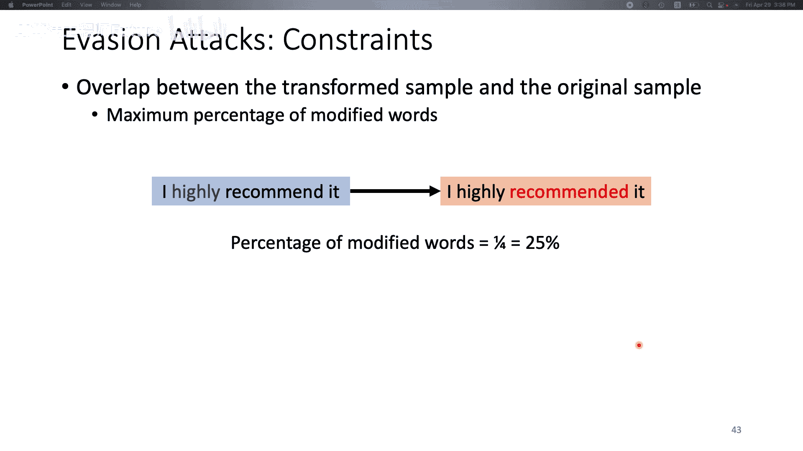

有没有合文法，那第一个这个CTRL的方式呢，就是POS的consistency，POS就是products，就是磁性，那这个东西关心的是当某个字它被替换掉之后，它被替换的字跟原本的字。

它的词性是不是一样的，所以以这个还是刚才一直出现那个例子为例，I highly recommend it，那这边我们假设我们要把recommend，这个字做替换，那recommend这个字。

它的POS你是用那个NOTK的p o s takers，之后会得到他是verb，然后他是present tense，Not serve present singer，就是他不是第三人称，但它是现代词哦。

那假设说你用了某一个transformation的方式，然后得到一个prohibition，叫做i highly allocated，那advocate这个字呢，它的POS也同样是这个第三人称现在时啊。

非第三人称现在时，所以这个东西它就有符合我们的PSCONSESSION，这个限制好，那也有可能啊，这个你的transformation得到的结果是，I highly recommendation。

那这个这个句子很明显是不合文法的嘛，然后这个recommendation这个字呢，你用NOTK的p s tag会得到的，这个POS是名词，所以当他把一个动词换成名词的时候。

它就不符合我们的这个POS的consistency，所以这个一定是一个violation，那一个比较尴尬的例子是这个，就是也有可能它产生的这个provision。

是i highly recommended的，那这个字呢，如果你把recommended recommended拿去做pos tag，它得到的结果是verb，它也是动词，但是它是一个过去式动词。

那这个时候啊呃它虽然一样是动词，但是它的时态被改变了，这个就有点难去定义，说他到底是不是一个合法的准备选，这个就要看你的control有下了多远，你可能会要求说他的时态一定百分之百要死掉。

也就是他如果是第三人称，非第三人称，然后是现在时，那它改出来的结果就一定要是非第三人称，现在时，那为什么这个POS的这个consistency是重要呢，因为假设呃你没有下这个这个control的话。

它可能就会产生一些不合符合文法的句子，那即使呢它把一个动词可只经过provision之后，产生另外一个动词，那即使他都是动词啊，它的时态只要不一样，假设它把它改成动词ING的话，那这样还是不符合的话。

所以p o s consistency，可以帮助我们确保这个文法的这个正确性。

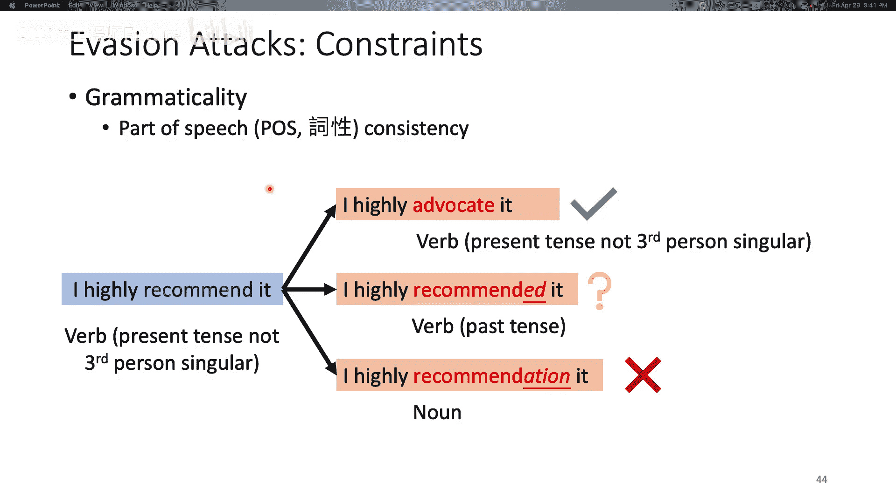

那另外一个确保无法正确性的方式呢，就是我们拿一个现成的toolkit，然后来衡量说我们经过preservation的这个句子。

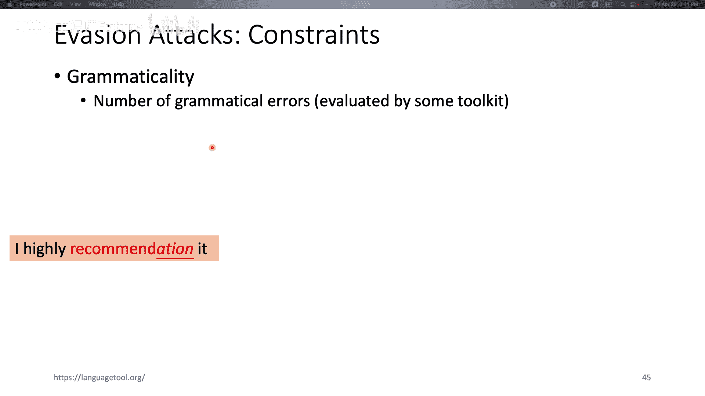

它到底有没有文法错误，那有一个tool可以叫做language tool，然后他会告诉你说，你的这个input的句子有多少错误，所以像是我们刚才展示的这个i highly realization。

它就会被language to这个TOGET标出来，说这个这文法是错的，这个就是一个跟GRAMDY差不多的东西啊，只是它是open source，好。

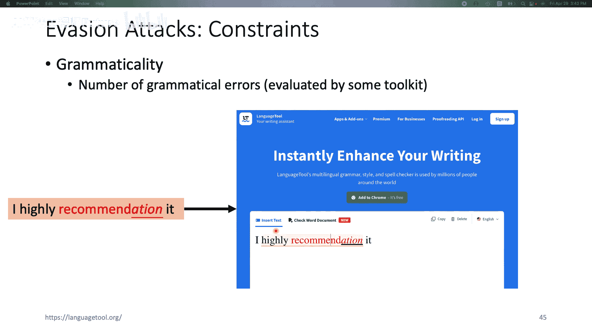

那另外一个衡量这个文法的合理性的方式呢，是用return language model所计算出来的complexity，那这个东西呢就是哦，这个这个东西就是仰赖主持人UST model啊。

看过了很多很多不同的corpse，很多不同的句子，那我们就会认为说这个比方language model，他应该要学到人类的语言的某些distribution。

那我们假设说呢这些人类语言的DETRIBUTION啊，应该都是就是他看过的，应该是和文化的TRIBUTION，所以呢他就会给这个比较合文法的句子，比较高的几率，它就会给比较不符合文法的句子比较低的几率。

那这个就是我们使用language model，然后看从perplexity，可以得到文法和语境的一个方式，那实际上的做法呢就是我们把不同的PRESTATION啊。

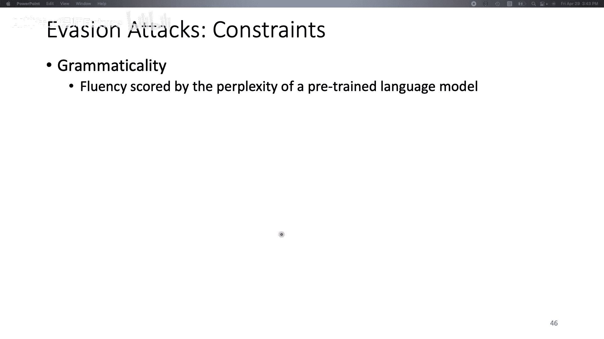

丢到PRECH过的g p t two这个model里面，那这个模型呢就会凹凸出一个，叫做perplexity的东西，那complexity这个数值呢，代表说这个句子出现的可能性有多低。

所以说这个PERFEXY越大，表示说这个句子出现几率越D，complexity越小，表示这个句子出现的几率越高，所以我们在用这个g p t two，然后当做是这个呃文法的concern的时候。

我们可能会设一个stretch hold，然后说假设说这个perfect超过多少的时候，我们就要认为说他是一个不合法的这个confession，那这个GB two假设说话凹凸出来。

说这个PROTEG底是200，那这个比较合稳保的，他就会凹凸出一个相对低很多的PROTECD，那假设你说呃perfect超过59个了，把它全部当做是呃不合文法的话，那这个句子他就会被你的CTRL拿掉。

只剩下这个句子好，那看完这个overlap跟呃文法的ctr之后呢，我们最后看最常见的一个ctr，就是semantic similarity的这个CTRL。

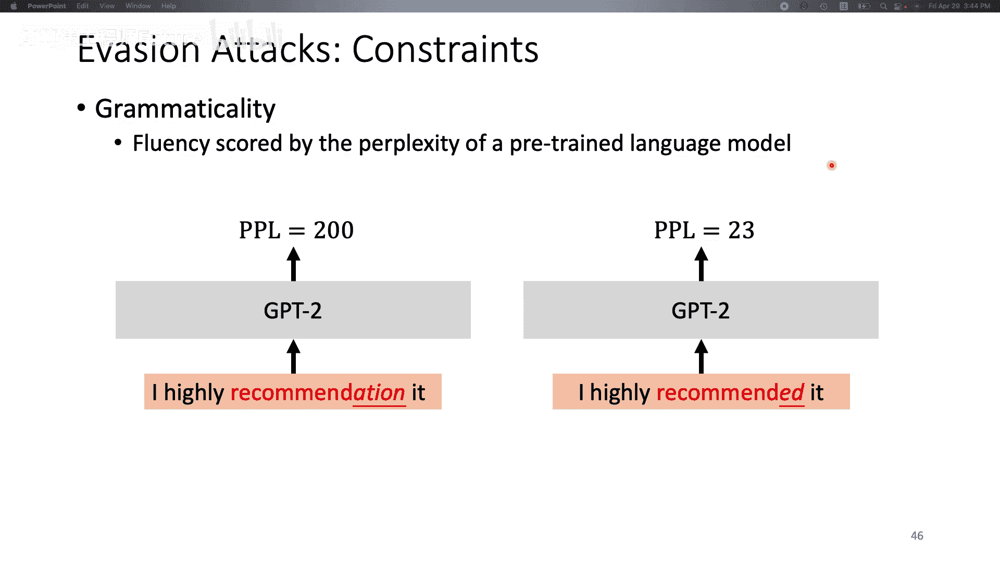

那在很多的任务上面，像是这个前面看到的呃，电影评论的分类，或者是这个news title application，那就很多跟语义相关的test，我们都会希望说perturb之前的句子。

也是原本的句子跟perturb之后过的句子，他应该要相当程度的在语义上有很高的相似性，那这个要怎么去做CTRL呢，那有很多不同不同的方式，那首先我们第一个来介绍的是替换这个字。

跟字在win的in space上面的距离，那假设这是一个warning bein space，那原本的字就是刚才那个例子啊，还有remit，那我们就把recommend这个字呢。

找到它在wein bedding space里面的这个位置，然后我们这个潜在的PREDATION，我们把它换成command跟AFK这两个字，那我们就去看说这两个这两个word embedding。

它的cos sierrge有多高，那绝对言这两个字我们可能会算出来，cos sarge是它的cos c塔是0。85，然后这recommend跟advocate这两个字算出来的。

这个cos sierrt是0。63，那假设我们有一个CONTRAIN告诉我们说，这个cos security要高于0。82，它才算是一个合理的，CONTRAIN的话，它它才是一个合理的准备选的话。

那ever k这个字就会被去掉，然后只剩下command这个字，那这个地方你要用什么样的呃，距离来当做衡量的标准，当然是就是看个人的选择，你当然可以用这边用size怎么2T。

你也可以用l two的incredient distance，或者alone的eclient distance都可以，不过这边其实重要的可能不是你选的是哪一，哪一种mesh。

而是你的control的这个虽然效果要怎么顶啊，因为这个怎么定会影响到你，最后产生出来的品质呢，那很多人做的方式呢，就是他就选一个他觉得合理的数字，那直接选一个他觉得合理的数字，到底有多合理呢。

那等一下会看一些实际的例子，大家就知道说这个for real的选选择，是非常非常重要的，而且会大大的影响最后产生出来的，eero sample的品质好。

那我们看下一个来这个衡量两个PRETIVISION的啊。

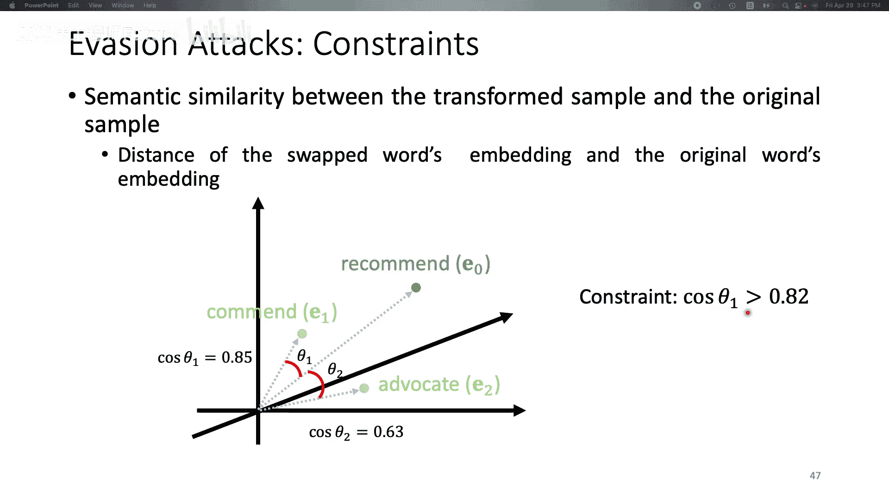

衡量preservation跟原本的句子的这个，similarity的方式，那我们用的是一个叫做universal sentence，encoder的这种模型。

那所谓的universal sentence encoder呢，它就是一个很universal的模型，就是丢给对他就是一个sentence encoder。

那sentences encoder做的事情呢，就是丢进去一个句子，然后呢他会output出一个sentence embedding，这个sentences embedding就是一个向量。

然后这个向量呢代表了这个原本的句子，那当我们要算这个原本的句子跟呃。

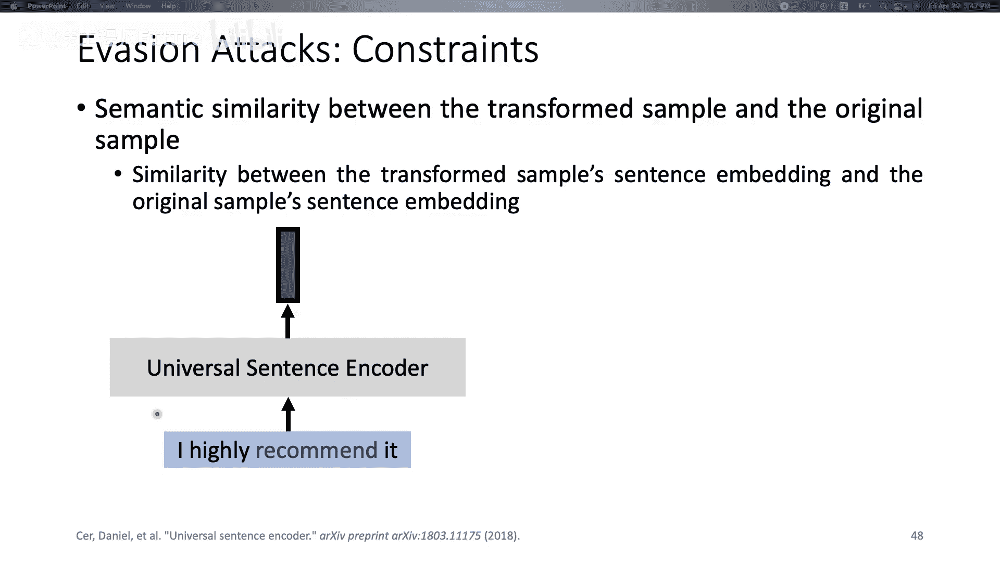

经过prevision之后的句子有多像的时候呢，我们就把这两个句子同时丢到，就各自丢到universal sentence encoder里面。

然后得到他们各自对应的这个sentence embedding，然后呢我们再去算这两个sentence embean，它们之间的cos sylity有多高，那同同样的这边。

你还是一样要去定一个threshold，说cos siri高于多少时候，我们就把它当成是一个合法的captivation，那30没问题，低于多少的话，我们就认为它是不合法的VERTIVATION。

所以这个缺hold也是一样，会大大的影响到最终产生的结果。

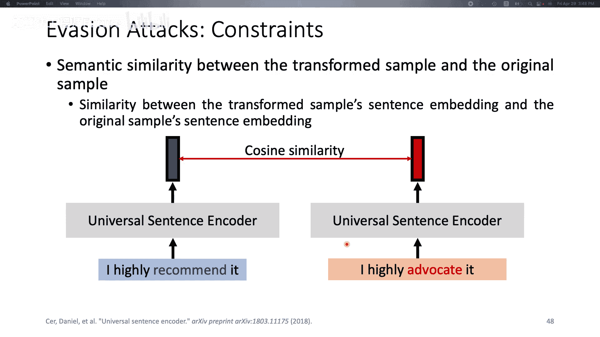

好最后呢讲完了前面三个最重要的一个方式，就是我们要怎么结合conformation，然后找到一个满足所有CTRL，又可以达到我们的目标任务的，这个adverscereal sample。

那这个事这件事情呢就是search method。

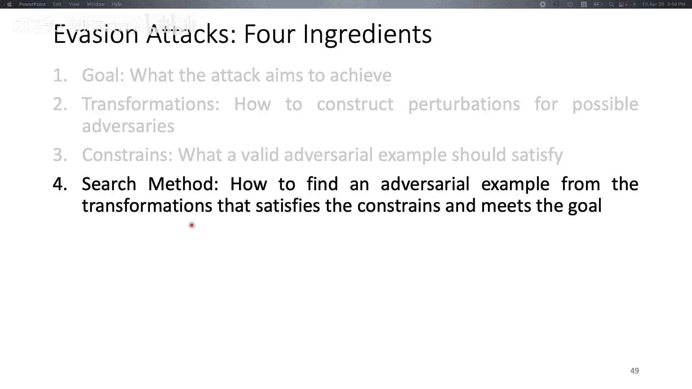

他要来做的，那我们这边简单的讲三个最常用最常用的方式，第一种是grady search，然后第二种也是greedy search，但是他在做grady search的时候，会考虑不同的字的重要性。

那第三个就是基因演算法，那最常用的其实是第二个，然后，青眼算法比较少人在用，那主要是因为青眼算法非常非常慢，然后，还有另外一种更慢的。

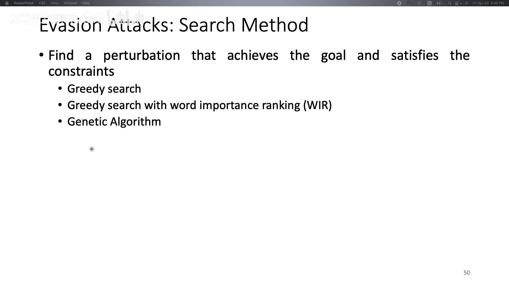

但是但更慢的我就不讲了哦，首首先我们来看那个grad search，那grad search呢他做的方式啊，就是呢它有很多不同的这个for the bation嘛。

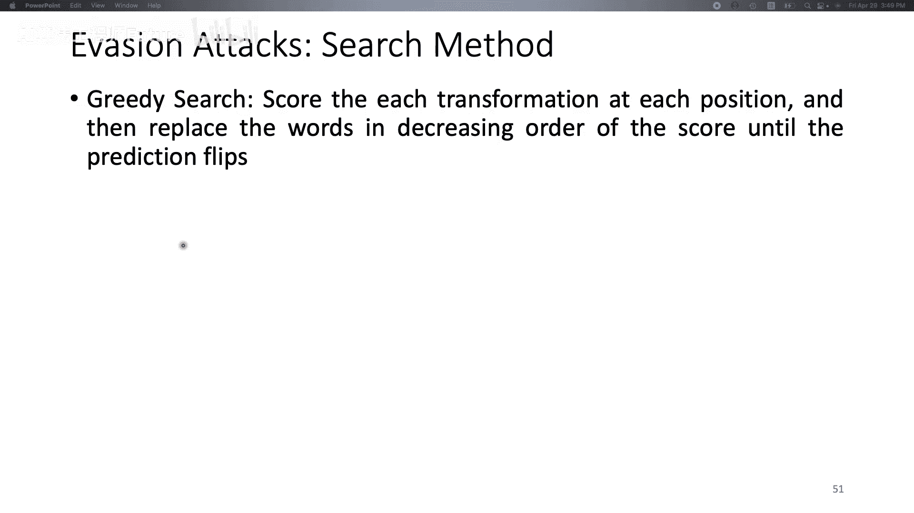

那我们就去看书呢，在每一个位置的perfection，哪一个PERTIATION可以让model最终的output变化最多，所以举例而言呢。

在i highly recommended这个原本正常的句子上面，我们就会这个我们就产生了五个潜在的颓废数，那前面两个presentation呢。

我们是把high力这个字换成strongly跟INORDALLY，后面这三个例子呢，我们是在第三个词的位置，把recommend换成URTFK跟command。

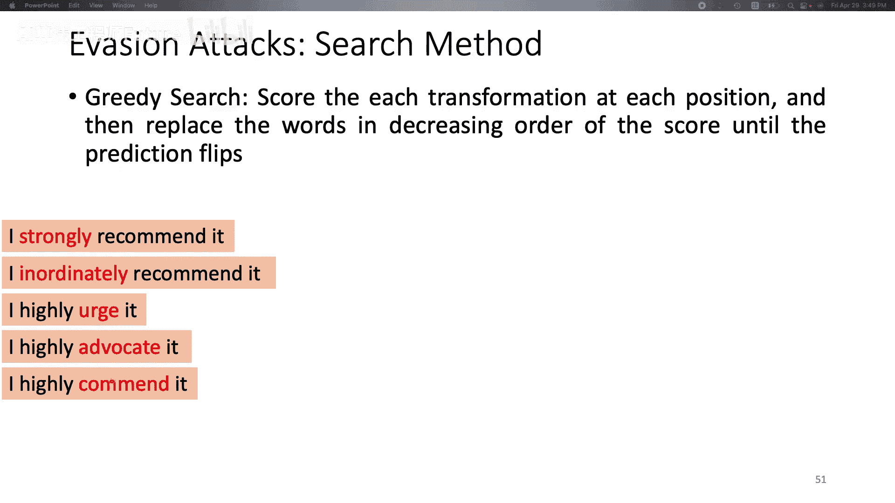

那我们就把这五个不同的句子呢，丢到这个test press fire里面，然后我们就得到了这个这个模型的output，还有它相对应的boss，那他就会告诉我们说，这个当你把呃HIII换成CHY的时候。

这个模型还是有很高的几率，觉得他是一个正面的评论，但是当你把happy换成inordinate时候，模型就会有他他对他觉得他是正面评论的，这个几率就会大幅的降低好，那这时候我们做的事情呢。

就是我们会去看说，在这所有不同的captivation里面，哪哪一个东西它是最强的PERTIVATION，所谓最强的PERTIVATION，就是当它原本是PC的时候。

我就希望我找一个最强provision。

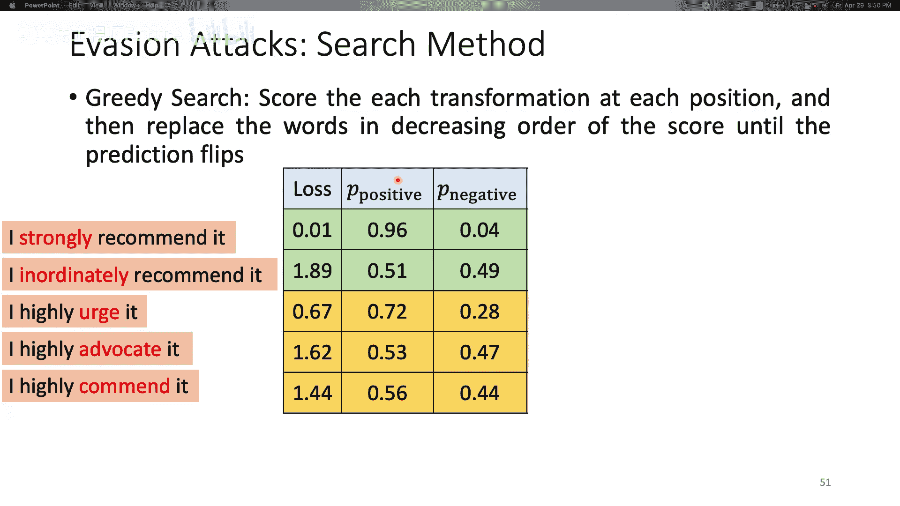

就是可以让positive几率降到最低的，这个provision就称为是最强provision，所以在这边的例子里面，在这五个东西，在这五个潜在的profession里面呢。

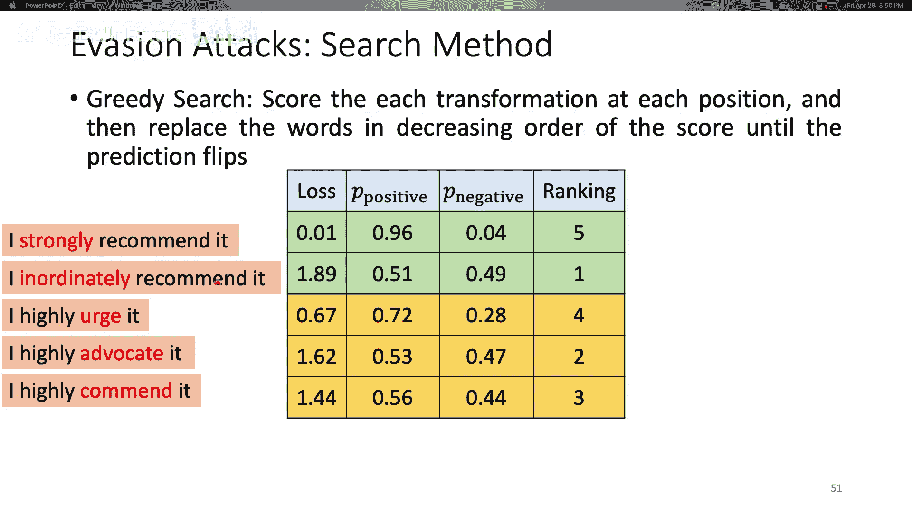

I inordinary recommended part of，正面的几率是0。51，所以我们就把它当做是最强的一个回归数，然后呢第二强的是谁呢，是正面基于0。53的。

I highly advocated，他的rank是二，然后以此类推就是三四，然后还有五好，那做完这件事情之后呢，我们就开始换，我们就原本的这个字呢，原本的句子i had recommend it。

它是一个正面的句子嘛，那我们就根据这个ranking来GRADY的把字换掉，那draining最高的是这个，所以我们就把HII换成INORDINARY，变成这个样子，那已经换过的字呢。

我们就不会再换第二次了，那ranking的下一个字呢是第二高的，是当我把high advocated换成啊，Highly recommended，换成high alcor，所以第二个我们做的事情。

就是我们再把这个i in ordinly recommend it，换成i am ordinary，OK然后做完这件事情呢，我们再把它丢到模型里面，那duo模型里面这个模型就告诉我们说。

他觉得这是一个负面的评论，那我们的attack就成功了，那这个过程就结束了，那要是没有的话，我们就会看下一个下一个ranking最高，而且还没有被换过的自己，那因为他是只关心这个ranking的高低。

所以我们把它称为是reading search哦，诶那我在想说，既然有人做greedy search，一定也有类似做big search的方法吧，对有人在这个地方做been search吗。

有有有做been search哦，了解了解我，我没有做been search，同片是因为哇我不想做动画而已，嘿嘿对，好哇好哇好哇，音做够多，动画太强了，没有没有好吧对，就有冰sir。

然后那个就是有有编制人。

然后in search的问题。

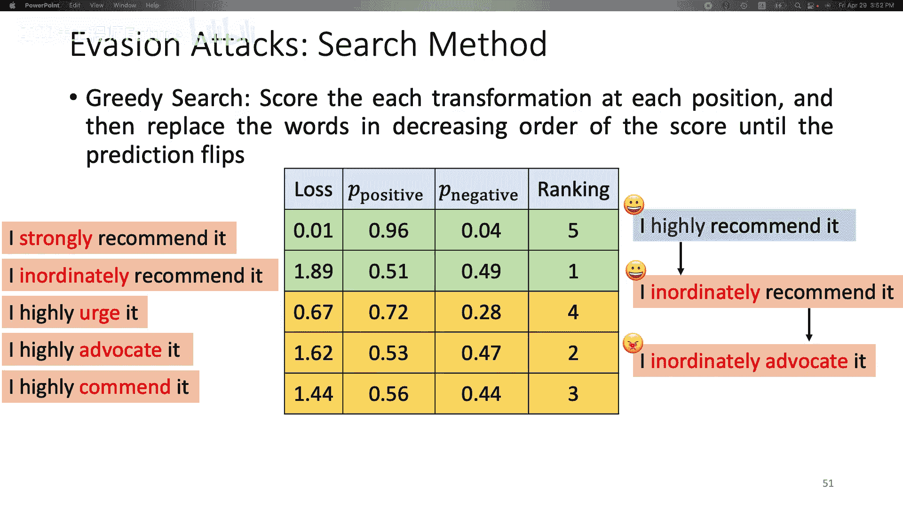

就是你要这个你你的病态越多的话，他的那个机体就要越大。

所以其实那个用用下面这个方法，就可以达到很不错的这个attack结果，所以这个方法是最常用，那边search也是有人在用，好好的，那这个第二个方法叫做greedy search with work。

Importance ranking，那首先第一个步骤，这个这个这个跟grad search的差别是，它多了一个微important ance ranking，所以他第一个步骤就是。

我们要去找出每一个这个input，句子里面的每一个字，它的重要性有多高，那重要性有多高。

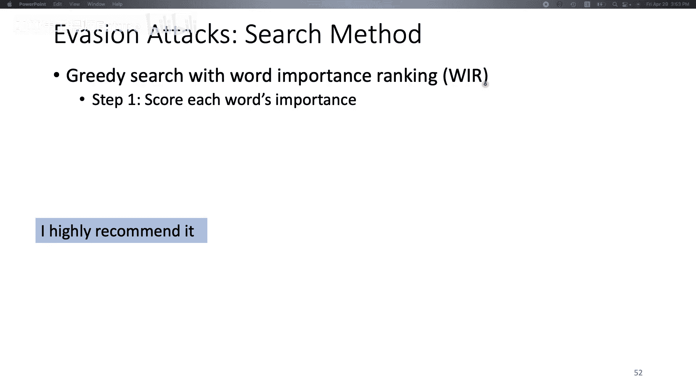

这个要怎么找呢，这个等一下我们再来讲，总而言之，假设我们用了某一个方法，这个word important importance ranking的方式，找到了每一个字的ranking，长这个样子。

他就告诉我说呢，对于这个word potion ranking的方法，他觉得这个原本的句子，最重要的这个字是REMEN这个字，第二重要的字是HAII这个字，那it跟I是两个比较不重要的字好。

那当我们知道这件事情的时候呢。

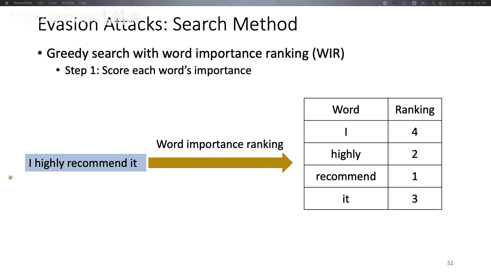

下一个步骤就是我们按照这个顺序来，从最重要的字换到最不重要的字。

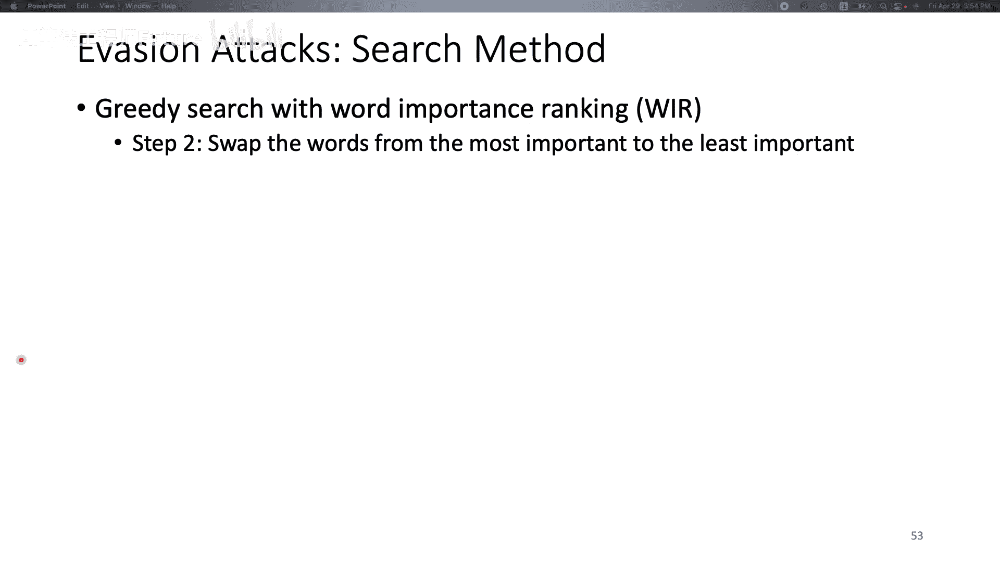

所以咳我们来看一下这个表格，这个它跟green search是很像的，所以我们会列一个类似的表格，那原本这个HEII这个字呢，我们可能根据某一个transformation的结果得到。

它可以被换成双离跟omen力，recommend这个位置的字呢，我们根据某一个CONTROLNATION得到的结果，我们知道它可以换成urge ak跟command。

那刚刚的这个这个word importance ranking的结果，告诉我们说，recommend这个字是最重要的，所以我们会先换一个plan，然后HEIDI这个字是这个第二重要。

所以我们会第二个才会去换这个海里这个字，所以呢原本这个句子啊，它是i highly recommended，那模型觉得他是一个正面的电评论，那接下来呢我们做事情，就是我们先从最重要的自己还得换。

那这个最重要的衡量标准是我们用word important，cy ranking得到的这个rank，那他觉得最重要的是recommend，所以我们就把REFIN换掉。

那我们要从canaddate set里面换成哪一个呢，我们就挑可以让模型对于正面的这个几率，降到最低的，那在urge allocate，还有comment这三个字里面。

我们来看这三个字的p positive就是正面的几率，那最低的就是advocate这个字，所以我们就会先把advocate这个字换掉，那得到的结果就是这个i highly advocate好。

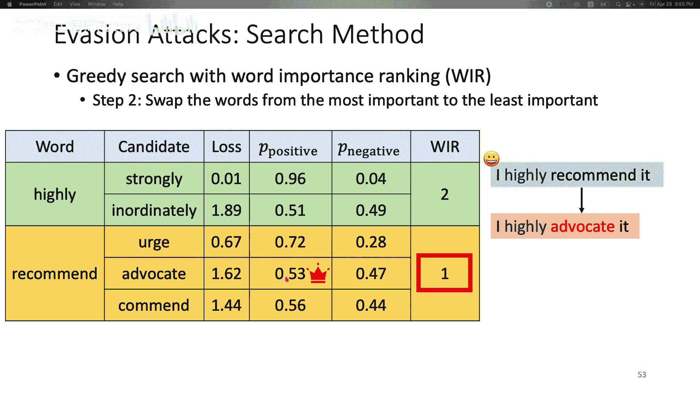

那这个东西呢我们再把它丢到模型里面，那要是他已经可以让模型觉得，他是负面的评论的话，那他就会是我们就会停下来，不过很可惜到这个地方，模型还是觉得他是一个正面的评论，所以我们就要继续做下去。

那接下来呢我们需要去移到more importance，Cy ranking，第二重要的这个字，所以我们现在target是海里这个字，我们想要把海里这个字换掉，那我们要换HII的时候呢。

我们一样去看说在海里所有的candidate set里面，哪一个字可以让正面的几率降的最多，所以呢在STRY跟inordinate这两个字里面比较，你们发现说inordinate这个字。

它可以让p passive明显下降到0。51而已，所以我们就会把这个原本这个i highly advocated，里面的这个highly换成i in originally advocated好。

那得到这个结果之后呢，我们再把它丢到模型里面看看，说呢模型觉得他是一个正面还是负面的点评论，那结果很幸运的，这个模型觉得他是一个负面的电影评论，那所以就在这边就停下来了，好那这个好。

那个宇翔宇翔有问题想问你为什么想，因为我我觉得就是因为我听听起来之后，我就有点疑惑，那不会六，因为感觉就是这样子点逐步代换的感觉，那那会不会就是说我我我我换了A。

然后按换B反而又变成又是这就是又没有tt down，这样哦当然有可能，但但但但是但但但你很难说你换了一个字，然后就全部全部再重新做一次SPE，这样会用用太浪费时间，OK所以所以呃所以这样子的。

就是选择逐步这样选选选，然后要是选了一步，然后发现呃它而attack效果没有好话，就是再选另外一个，这样就不会再从退到起点再重新开始选。

而是会就是比如说把这个比较效果比较差的。

先踢掉，然后再把它把根据去选定，其他的肯定点降诶。

其实其实有些方法是就是呃，我觉得你刚才讲的那个可能会比较像是game search啊，就是就是呃我会诶有点不太像平，这就是诶我想知道怎么讲，你刚才讲的意思应该是说呃，假设我们把第一个字换掉之后。

我们发现说可能第一个字换掉之后，其他不后面不管换什么，他都没有办法达到take，结果是这样吗，对对对对对，那你这个时候有可能是，因为我们第一个字换的不好，就是第一个字你原本换成AK嘛。

那你也可能可以换成二，所以在bm search里面的话，你可能会开三个不同的病，然后三个不同的病，就是把第一个字换成这三个不同的字，然后就比较有可能可以达到好的结果，这样嗯对这样回答到没问题的呃。

一一定有一部分，可我可我还是蛮好奇，就是嗯就是因为感觉就是这个情况，感觉会蛮常发生的，还是就经验上来讲是这样，就是这种逐步代换的这种方式，其实并不并没有到那么容易，就是attack失败。

这样他其实真的没有那么容易失败，我真的对蛮意外，就是诶因为因为它换成的字，其实都是很不合理的字啊，所以所以那个字哦，我所谓不合理，就是模型可能根本就没有看过那个字，所以他一看到那个字，它就直接烂掉了哦。

所以这个模哦，所以有可能是因为模型没有看过这个剧，然后他怎翻掉这那那假设，所以例如说假设我都是用六轴模型，有看过是去做呃，类似的，这个就是这个排版是要从前面的选挑，选到现在的search这样子。

那其实就相对来说没那么容易成功吗，哎对对对，就是这是对的哦，OK好谢谢，好好好谢谢陈翰，那就我们继续吧，好然后那个这个grad search with more importantly ranking。

Or importance ranking，跟刚才的grad search最大的差别就是，假设我们刚才是用，我们只有用grad search的话，那我们光看这个表格啊，最先会被换掉的是海里这个字。

我们会先把它换成order，然后但是如果我们考虑war importance ranking的时候，我们就会知道我们要最近换掉的是这个字，所以在这边就是考虑word import rank的时候。

这个recommend这个词好，也可以先换掉，那这个只是因为我这边的举的例子，这个句子很短啊，所以最后结果好像这两个差差不多的，不过在某些状况下，其实这个有用。

more importance ranking会比没有用，warning importance ranking快非常非常多好。

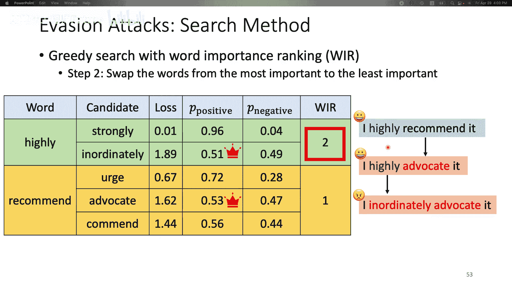

那接下来就讲一下这个warning important ring，要怎么得到，那第一个最简单的方式就是leave one out，就是这就是live one out，那什么叫live one out呢。

就是原本的这个句子啊，叫做IHIERROMANTIC，那我就把每个字每句子里面的每一个字一次，你要拿掉各一次，只拿掉一个，所以这个我拿掉I的话就会变成highly remanded。

我拿掉higher的话就变成i remanded，然后我拿掉it的话呢，哦我拿到recommend就会变成i high rate，然后我拿到it就是变成i high recommend。

然后我们再把这些东西呢拿掉一个字的，叫做live one out的句子丢到模型里面。

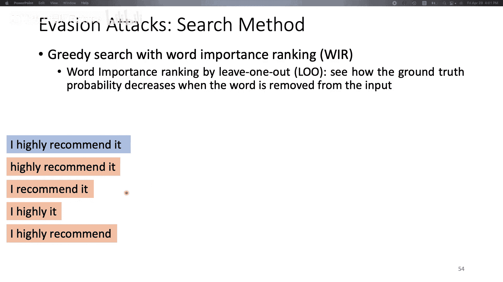

那这个模型凹凸出来的结果呢，他告诉我说当我把I这个字拿掉的时候。

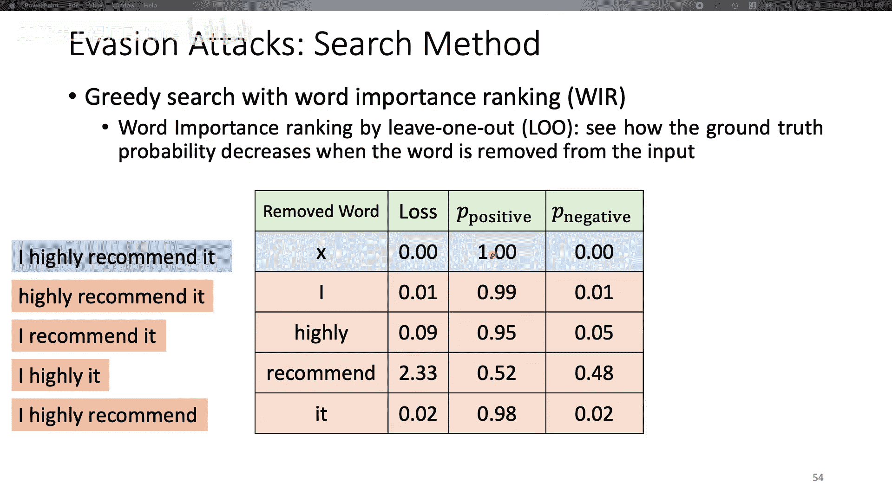

我还是觉得他非常正面，但是当我把recommend这个字拿掉的时候呢，诶模型就觉得他好像非常非常不正面。

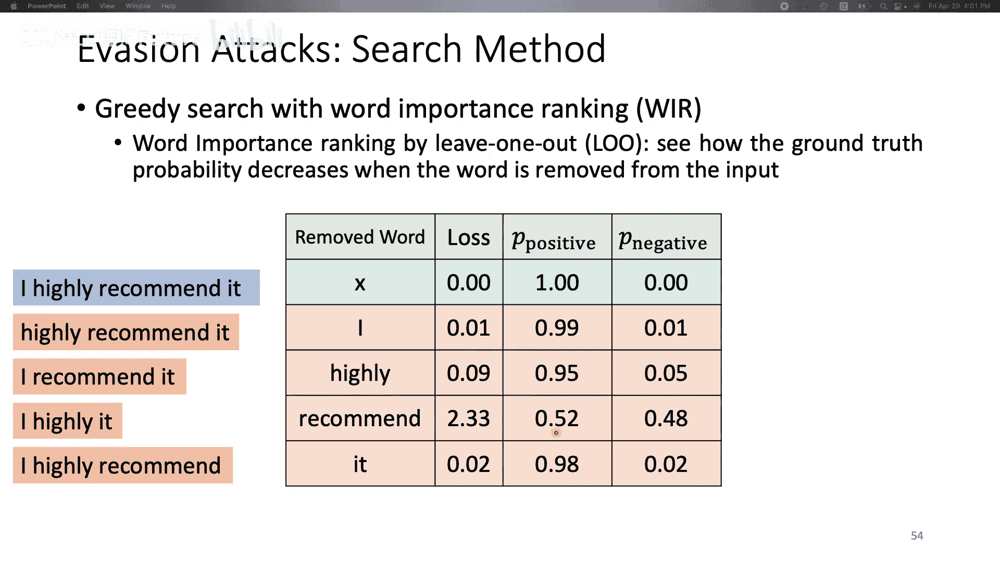

只有0。52的几率是正面的，那我们就看说呢他这个正面的几率减。

跟原本的东西相比额差了多少。

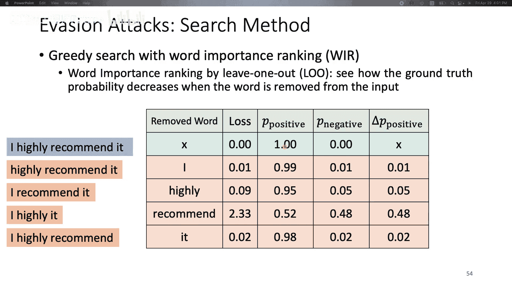

那在I这个例子呢，1-0。99是0。01嘛，在recommend这个例子里面，1-0。52是0。48，那我们就用这个p positive的这个变化量，来做ranking。

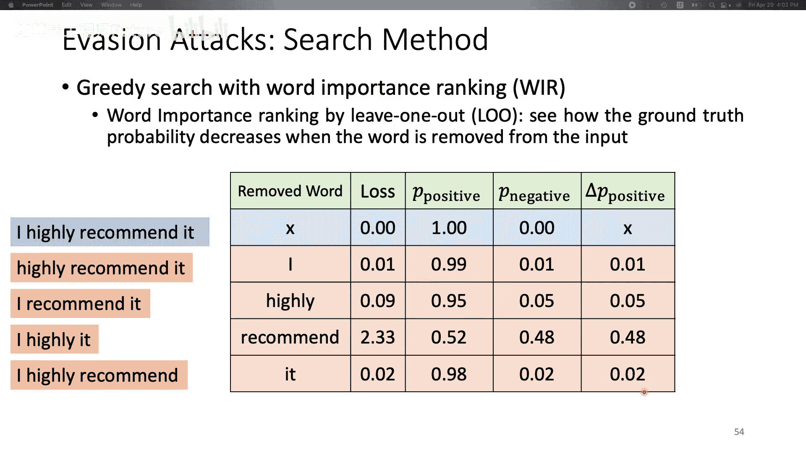

所以就会得到说变化最多的应该是最重要的字，变化第二多的是第二重要的字好，那以此类推，那这个是呃，当我们没有办法X到model里面的，内部的资讯的时候，我们只能从它output出来的结果来推测。

说这个模型你觉得哪个字是最重要的，那其实呃要找说input的哪个东西最重要的。

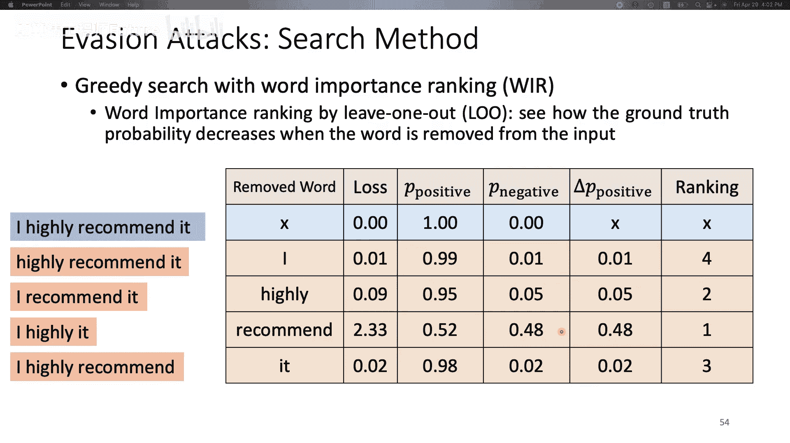

这个东西就是EXTERABLEAI在做的事情。

所以TMMAI里面可以用的东西，你都可以拿来用。

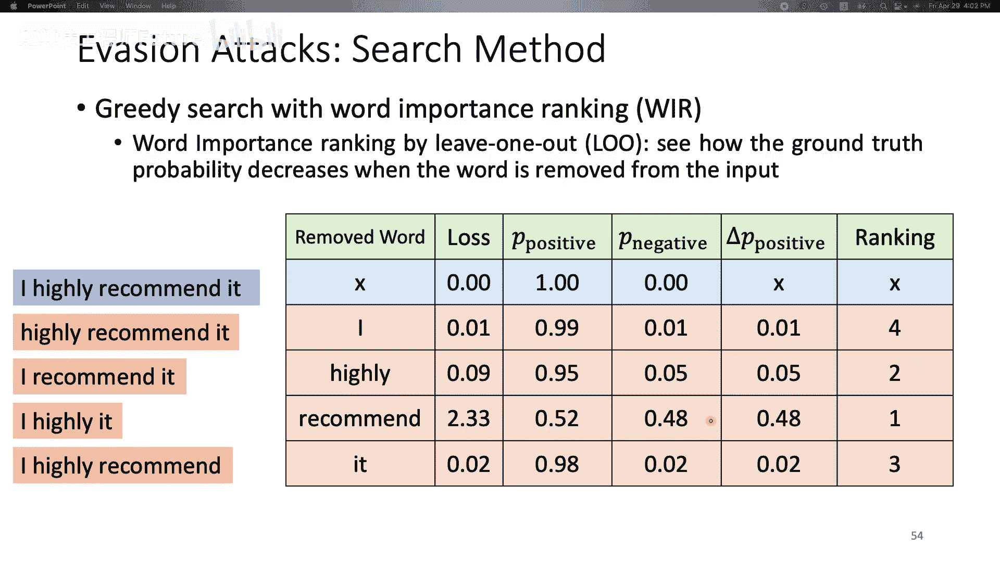

那我就讲一个最简单的东西，叫做就是用gradient，那做法很简单。

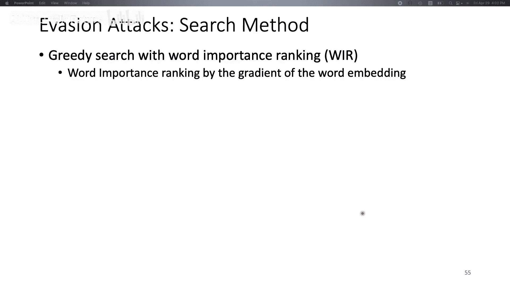

就是你今天有一个句子，然后你把它丢到text这个classifier里面。

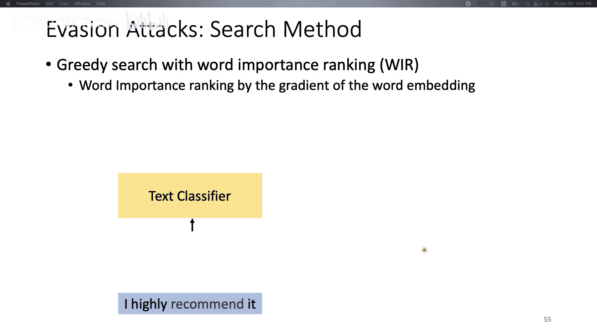

然后forward之后呢，你会得到一个模型和prediction，那假设模型对于这个句子的prediction，正面的几率是1。0，负面的几率是0。0，那我们就把这个output呢对input做微分。

就是我们在work那BO的时候，我们是用什么对什么做微分呢，我们微分的对象是我们用这个ground，fruits的label，就是positive这个class的机遇。

y one对每一个warning bein做微分，那我们就可以得到每个字。

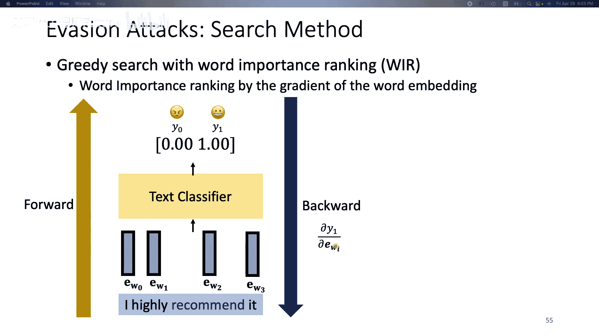

它的这个prediction对于war in bedding的微分，那我们就取这个WARMBEDDING的呃，NO就可以来当做这个uh word importance，cy ranking的基准。

那举例而言，在刚才这个例子里面，你会发现说recommend这个词，output对这个remain这个字的warning背景，它得到的微分之后的这个note是最大的，所以我们就觉得他是一个最重要的字。

那相反的这个it这个字它是最不重要的，因为他的这个弄是最低的，那其实这个方法就是这个EXTERRIBLEAI里面，我们用我们在看CNN的那个salience net，就是用output对应或做的对吗。

那这个其实也是同样的概念，那这个用gradient看不一定是啊，这只是只单纯用gradient can，并不一定会是最好的方法，那其实还有很多不同的用gradient can的方法。

像是smooth gradient，Integrated，gradient之类的东西都可以拿来试试看，不过因为这个这个方法呢，是你必须要有办法去算这个模型的微分嘛。

所以他是一个y box的scenario，那一般而言呢，我们其实不会假设说我们有一个，我们有XX到模型，所以这个这样子的一个warning post ranking，其实是比较少用的。

我们大部分还是用前面刚才讲到的这个live one out，好下面我们来讲这个呃，最后一个search method叫做基因演算法，然后我发现夏彦的那个动画好像有点做错。

不过大家就大家就大家就多多包涵哦。

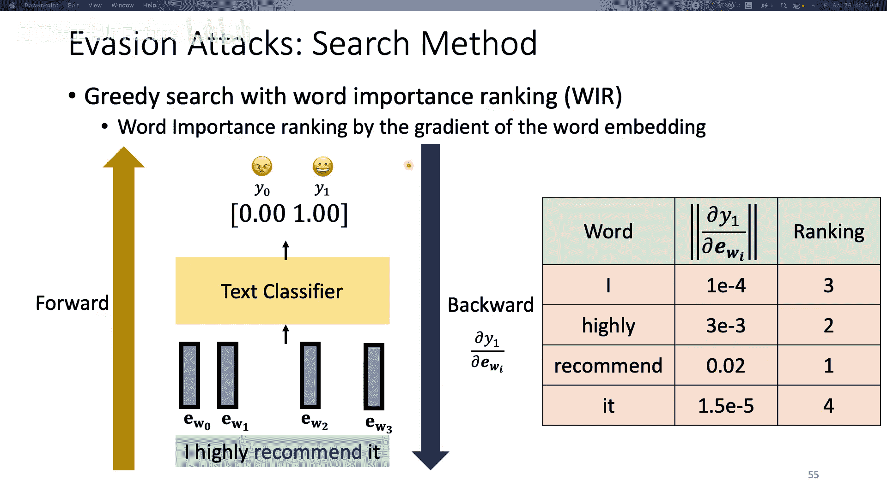

那个经典战法呢，这个它的核心概念就是那个演化嘛，然后还有天泽，那天泽的选择方式就是看这个就是适者生存嘛，就是看哪一个个体，他有他的遗传变异，是能够让它是呃适应这个环境的压力，然后可以让他活到最后。

这个就是呃演演化的一个核心概念，所以经演算法也就是用这个适者生存的概念，然后挑出最后我们要的这个东西哦，那直接看一个例子，就是我们现在要PROTEL的对象是i hii remanded，这个句子。

然后呢我们用基因演算法产生最终的eero sample，那怎么做呢，好首先第一个步骤啊，第一个步骤就是要产生D0子弹，就是generation zero。

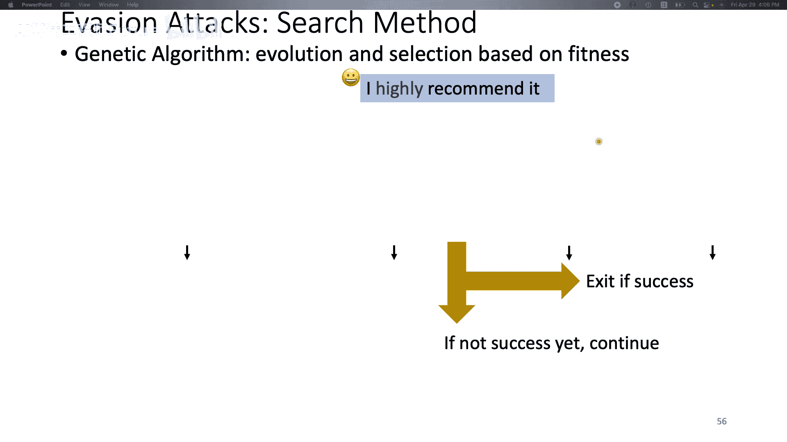

那产生的方式就是我做一个perfection，那我们把precision产生的这些东西，叫做这个GENER呃，Generation zero，那这些position啊，可能会就是它它的position。

就是在句子里面的每个不同的制作provision，然后组成generation zero，然后我们就把这个generation zero，generation zero的所有的这个个体呢。

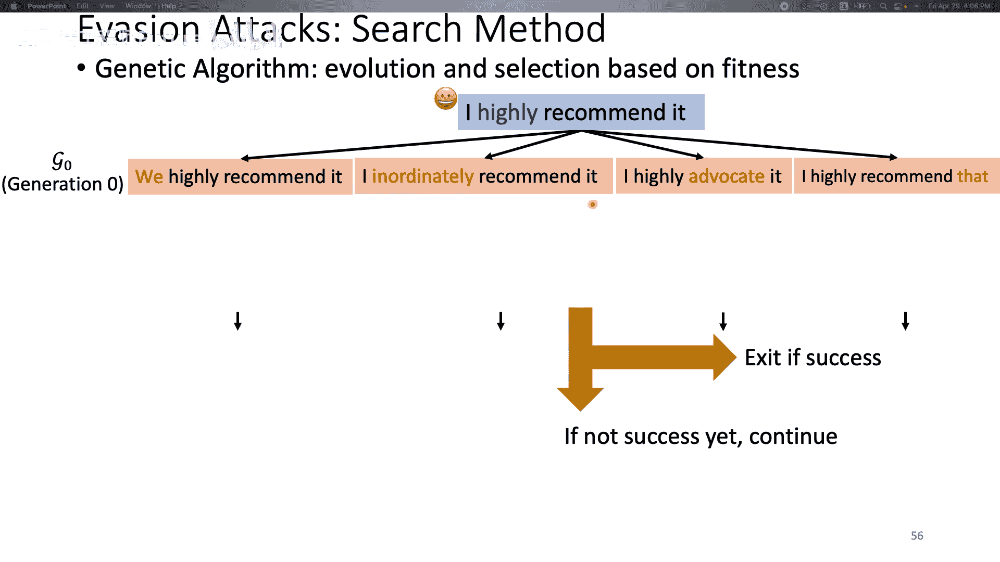

丢到text classifier里面，然后看text这个classifier凹不出来的，这个p negative是多少，那为什么要看p net呢，因为我们是原本这个这个例子啊。

这个movie review它是一个正面的movie view，那我们现在目标是要把它改成一个负面的movie review，所以呢衡量一个个体他是是不是一个好的，Adversarial sample。

就是看说它的负面的这个REVIE，它是模型，认为它是负面review的几率有多高，也就是PANNEX有多高，所以我们就把PANNEX当成是一个FINIX，也就是他的finish的中文是我。

我不信你为什么就是适适适合的程度吧，就是适应的程度哪个比较好，那我们就把它当做其他的famous，那如果说到这个步骤，已经有某一个这个generation zero的某一个子代哦，对某一个个体。

他已经可以让test quera产生错误的判断，那这个就结束这个基因演算法，不然呢我们就继续做相应的事情，好下面的事情是什么呢，下面的事情是，我们会把这个finish做一个normalization。

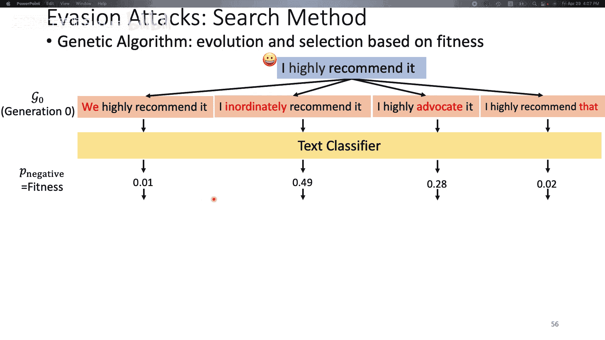

然后把他normalize成一个就是0~1的数字，那这个数字呢代表了某一个叫做p parent的，这个这个几率，那这个p parent是做什么呢，这个p parent做的事情是这样的，我们下一个步骤啊。

就是要产生子额子代，那这个子弹呢是由清代交配而产生的，所以这个p parent就是代表说，这个在这些generation zero的清代里面，就是清代，就是parrot。

就是在generation zero里面呢，它成为清代的几率有多高，然后我们就在这里面做sample，然后sample的几率是用p parent这些几率，所以我们sample出两个parent之后呢。

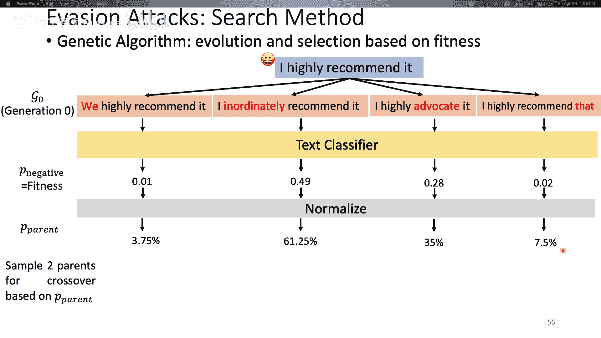

下一个步骤就是要做crossover，crossover的中文叫做互换，那crossover这个动作呢，做的事情其实就只是对于每一个位置啊，我就在这清这两个清单里面。

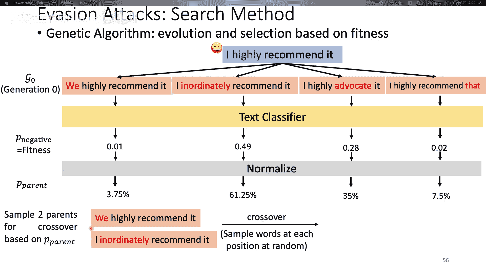

任意的选一个字出来，所以在第一个位置我就选择位移这个字，在第二个位置我就选了ordinary这个字，那第三个位置跟第三四个位置没有差，因为他们没有做回飞选嘛，所以总而言之，我们在做完互换之后。

我们得到了一个这样子的结果好，但是这个还没有结束，在做完互换之后呢，我们还要做mutation。

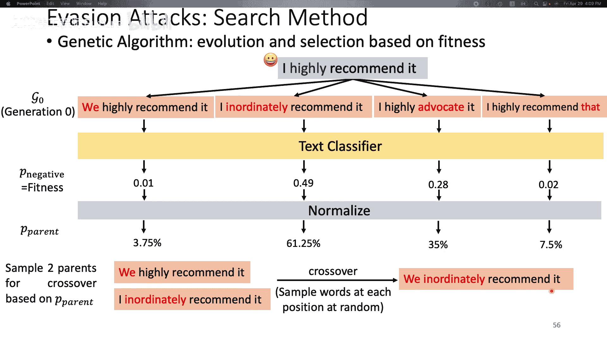

mutation的中文是图片，那mutation做的事情就是我们再做一次选择。

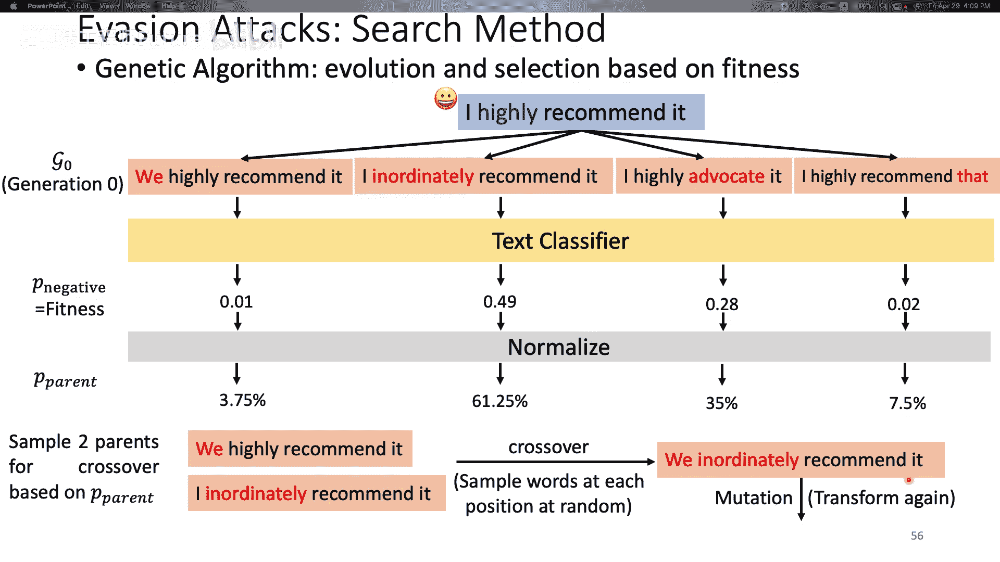

Nation，把原本的这个东西再做一个卷送，那这个做选送的时候啊，我们会要求说已经被return之过的。

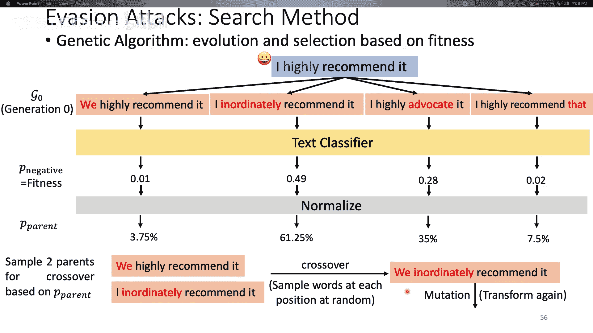

这个词不能再被换一次，所以它现在可以换的就只剩下这两个。

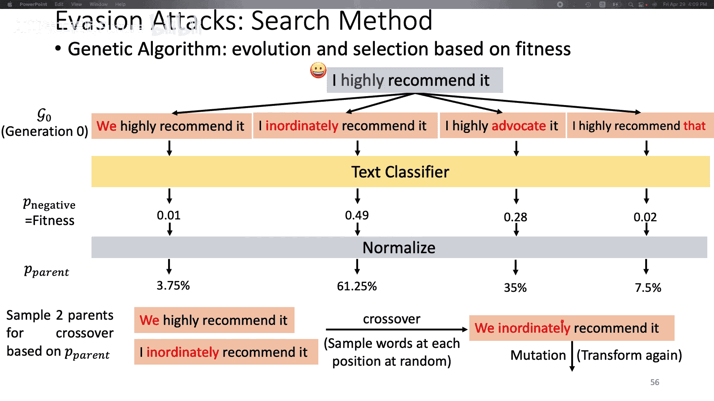

所以他可能就会把它换成，I are we in orinly recommend that。

这样子好，那到这个时候呢，一个一个generation的演化吗，遗传或是就是一个generation就产生，就产生一个新的generation，那这个generation叫做局外。

所以一个卷轴热线要怎么产生呢，他要先透过这个crossover，还有mutation之后才会产生一个新的子弹，那这边原本有四个这个个体。

所以在下一个generation generation one的时候。

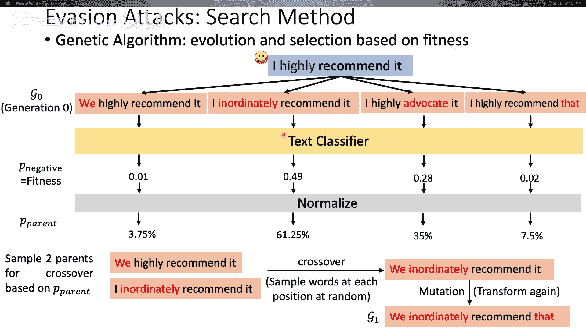

一样也要产生四个个体哦，那假设我们最后产生了这四个不同个体，他这个没有空间，所以我就没有画。

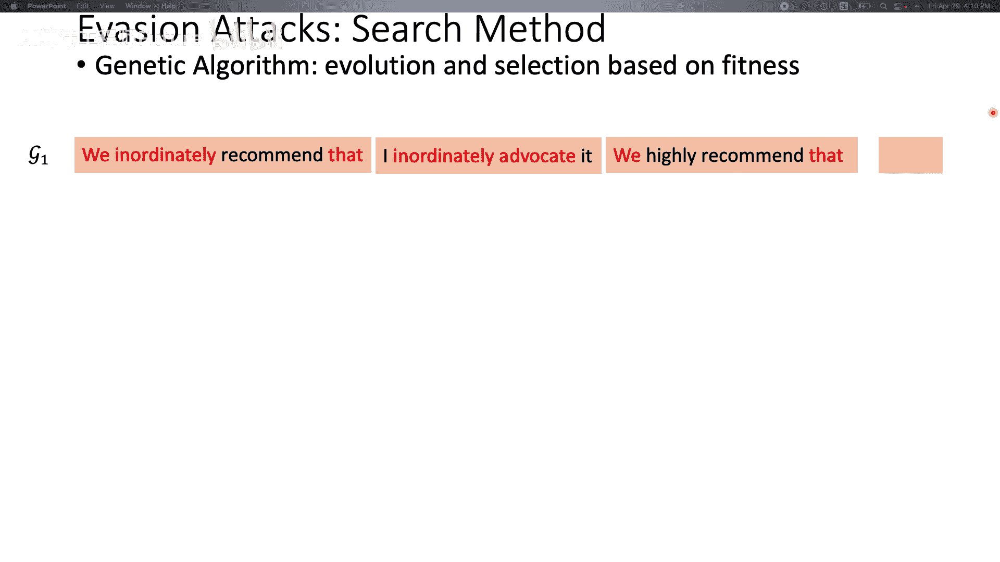

所以我们一样呢，把这个四个个体丢到test classifier里面，也就是我们的VICTIMODEL，然后看看这个victor model凹凸出来的connected是多少。

那第一个句子它的p net是0。42，第二个句子0。76，第三个是0。01，第四个假设是0。02mm好，那这个时候呢我们就发现说啊，第二个字它是已经可以让crossfire的output是改变。

那这个时候我attack就是成功的，我们就结束了整个流程，那要是很不幸的，这时候没有成功的话，那就是再继续做这个crossover，还有notation，然后做到成功，或是超过某一个原本既定的限制为止。

好那这个就是基因演算法哦。

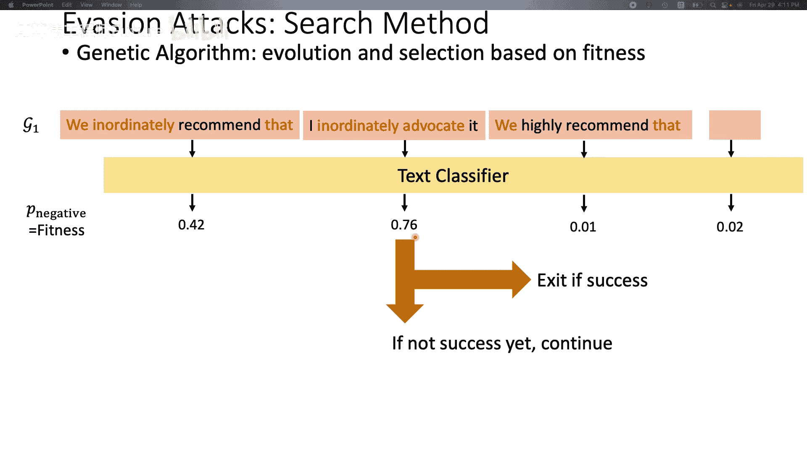

所以到这边我们就已经讲完，上面所有这个这个EMASION的tag里面的四个要素，到这边有没有问题好，到这边大家有问题要问吗，哎陈翰，你刚才说还有比基因演算法更耗费运算资源的，这边是指什么方法啊。

诶有一个叫做，好像有一个叫做particle swarm，Particle，swarm optimization的东西，然后那个东西那个东西有点复杂，然后看起来也是很慢或是差不多慢，就是我不喜。

我有点不太确定到底是经演上有较慢，还是那个particle song of my对，是较慢，总而言之两个都很慢，这好啊好啊对，然后大大大家有兴趣的话，就是我其实在前面的地方有放一篇。

这就是我投影片下面都有放reference啊，然后有兴趣大家可以去看。

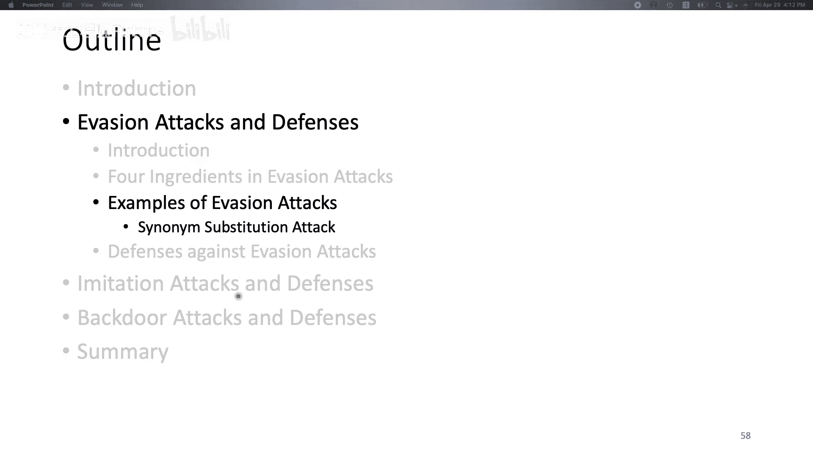

然后诶这边有放一页。

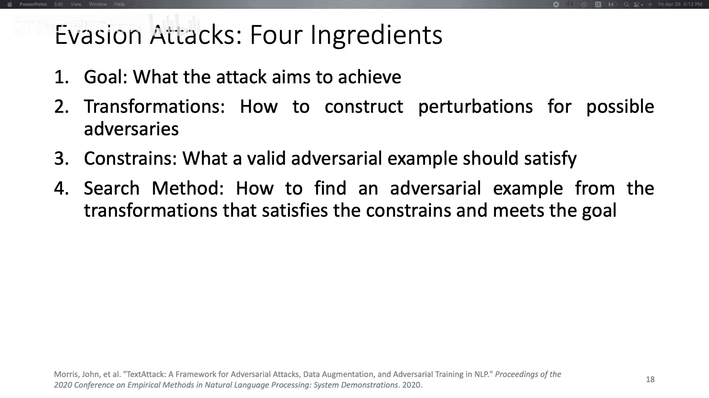

reference是这个text attack，然后它是一个它是一个toolkit，然后它可以拿来做那种B上面的tag，然后我今天讲的这些这个架构，然后还有这个架构里面每个东西它都有input的。

然后它里面就有提到，就是刚才我讲的那个particle，SWAMYZATION是怎么做的，然后大家有兴趣的话，可以再去就是看一下那个reference是怎么做的，对，然后大家要用那个NP的tag时候。

也可以用这个toolkit，不过对对，可以试试看，可以试试看，好那就继续讲诶。

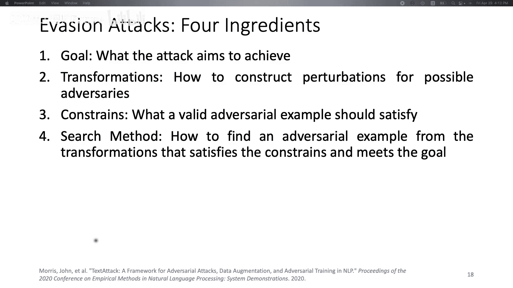

那我再问一下诶，有人会用RL系列的做法来解，这边的search problem嘛，因为呃这个NLP跟以前不一样的地方，就是现在我们的问题呀，我们在做attack的时候。

我们要optimization的问题其实是不可为的，那他们遇到不可为的问题，可以用LLE做啊，其实其实有诶，其实有只是我我没有放进来一个对，就是有RO的，不然我我其实可以加在下一代的都可以，如果诶好啊。

如果有有趣的做法的话，好也也还蛮值得提一下的对，那，好就是刚刚老师有几个问题就是不可为的问题，然后在NP里面要解决不可为的问题，第一个当然是那当然你可以用RINTR啊，那其实还有另外一个很有趣的做法。

是用就是把不可为的东西变成可以为的东西，那这个这个监可能最后会讲不会讲，我觉得我觉得这个可能是比RA还要更有趣的，对好哇，好啊对好，那讲完这么多这个不同的ingredient。

然后我们就来看这些ingredient要怎么凑在一起，然后产生一个实际的attack，那我们先介绍一个最重要的一个类型，叫做同义词替换攻击，这个同义词替换攻击，那我介绍四个诶，四个吗。

哦四个不同的同义词替换公子，然后这四个同义词替换公子，是最常在paper上面拿来当baseline的这个方法，那首先第一个叫做text啊。

Text flow，然后这个是呃2020年，2019年2020年的paper，然后我等下讲的这这几个思维方，我们就看它不同的其他的go，它的control，还有他那些，还有他写平台所用系统。

那text word呢，他用的这个concern的是warembedding space的distance，就是这两个BOBOSS就是限制SMEARGY，semantic meargy的CONTR。

然后还有限制文保的pos consistency，那它的transformation是用GRP的ebedding space来做的，那就是用co品跟in space可以达到同时替换攻击的，原因。

就是因为我们有做CONFE抗，有做过CONTRFETY嘛，所以同义词会落在一个比较接近的空间里面，所以他可以拿来做这个同义词替换同义词，那它的search mango是greedy。

Search is very important rection，那前面配合上面放了一个例子，就是这边是一个，这应该也是这应该也是movie revie的例子。

然后他原本的input test长这个样子，然后呢他就把control然后换成engineering，然后situations换成circumstances，然后totally以换成folly。

然后这个模型呢他们用的模型就是first of simple，CNN的CN的那个模型，然后就让这个模型觉得这是一个正面的redo，然后这其实看起来还蛮厉害的。

因为这这个situation跟circumstances啊，两个词看起来都是一是差不多的，而且我们也不会觉得，这可能stances这个字是一个频率很低的字，fully也应该是一个频率很高的字啊。

对那大家有兴趣的话，可以再自己去看一下，如果你真的用text water这个toolkit，然后去攻击一个GILC或CN，然后产生出来的结果，大家可以看一下是不是真的这么漂亮好。

那这个我们实际来看一下他的algorithm。

我不会详细讲algorithm的细节。

我只要让大家看出我们刚才讲的这四个要素，它是怎么出现在一个attack algorithm里面好，首先呢这个第二行到第四行的地方啊，它是for each work in xx，就是原本的这个input。

他要compute important score，然后用某个方法就是用important ranking来COMPU，所以这个地方就是我们要做search之前呢。

我们要先去这个得到每一个字的win potensrk，然后在第七行的时候呢，它会filter掉stop word，所谓的stop tware就是呃很常出现的那些字，像是呃代名词i it类之类的。

或者是冠词了呃这些东西，那这些东西因为它很常出现在句子里面，然后我们会觉得说当你把它替换的时候，它可能会影响到句子的文法或是语义，就像你把I换成序之类的，它可能会变得有点奇怪，那你把R换成了可能会把。

对不对，所以他在这边就下了一个control，然后接下来呢就是他要做search的。

所以就是for each word in，原本啊for each word in这个candidate set。

还要开始做search，那他做search的方式呢是他首先要做transformation，Transformation，就是他刚才我们刚才有看到说他的选择，A选用的是呃。

这个warning bedding space和nearest neighbor，所以他现在用的是这个warning bedding space，原本的字跟潜在的prevision的头发什么2D。

然后来做替换，然后这边就是他会他有说还要top n嘛，所以这个就是一个那个SPERITY的contract，然后另外他也有要求说，替换的掉的字跟原本替换的字，被替换的字，它的POS要是一样的。

所以这边又是另外一个不同的CONTR，那再来呢接下来就是开始替换的过程，那在替换的过程，他也会要求说替换完之后的句子跟原本的句子，它的这个SPERITY要高于某一个这个search al episoe。

它才会算是一个合法的合规性，那剩下就是挤压过程，所以总而言之呢就是一个完整的tag worm，是它大概会长这个样子，就是你要先做importer ranking，然后再做search。

然后search的过程，就是你要去把不同的选型类型折合起来，那在摄取过程，还有在选择没选的过程呢，你都需要把一些不合法的这个东西处理掉。

好那接下来讲第二个不同的invasion attack额，第二个不同的同义词替换工具叫做PWWWS，那PWWS的全名叫做probability，Waited versaliency。

那这个probably这个这个PWLS，它的重点呢就是它的呃，importance ranking跟别人有点不太一样。

他除了要考虑原本我们刚才讲的这个leave，one out的这个这种要性。

他还会同时会考虑说当你把它拿掉之后，拿掉这个字，它所有替换的可能里面，哪一个可以让这个PPC降的最多，所以他在替换的时候，会同时把这个lion out的这个重要性。

跟这个替换之后的变化的重要性同时考虑进去，那这边有一个很有趣的东西啊，就是它没有下任何的CTRL，然后如果没有下任何的CTRL的话，产生出来的东西其实还蛮危险的啦，就是品质可能不会，品质可能会有点问题。

那下面我们再看一个例子，叫做bird tag，bird tag也是很新的，也没有很新啊，2020的一个tag方式，那他的CTRL呢，它就是用universal sentence。

encoder的sentence meergy来要求说，protect之后的结果跟原本的这个东西，他要找构像，另外他也有要求说最后这个next one number of modify works。

它必须要小于某一个固定的比例好。

那它的选重vision他就是用这个MM那用MM做，刚才有讲说，他可能会产生一些奇怪的substitution嘛，所以你就要用用veral sentence encoder，来确保说你替换之后的这个字。

他的这个这个语义还是有被保留住的好。

那另外一个就是genetic orithm，那genetic orion，其实这是我们刚才他的重点，就是他的search method，是用我们刚才讲的简METICOBLION。

也就是做crossover跟做mutation之后，来产生可能的这个这个adversarial sample，那他用了control包含了说产生的这种这个东西呢。

它必须要有足够低的人用model flexity，然后它是它改更改的字不能太多，然后替换的时候就win the war，in bed states的距离也不会太大好。

那这边放了一个这个实际的结果，那这个是从brother tag这边开始拿出来的，那我们就看INDB这个结果了，好按基这个data set呢，它用了三个不同的tag方法来做。

那原本呢训练在bird这个model上面，按dB可以达到90。9的ax c，那但是经过了tag之后呢，用这三个不同的tag version，得到的accuracy变成只有11。43。6，45。7。

那这个attack accuracy当然是越低越好嘛，所以从这边看起来，birther tax是个最强的attack，那我们也会希望说这个在prevision的结果，这个更改的字应该要越低越好。

那所以就就这三个这个方法来比的话，4。4帕的这个应该是最好的，那另外一个很重要的衡量因素是query number，因为我们在前面讲说我们要选怎么替换的时候，我们每次替换之后。

我们都要丢到model里面，看出这个结果有没有让model的结果烂掉，所以说query number如果越小的话，就表示说我用了比较少的这个呃transformation。

就是呃我对我用的比较少的transmission，就可以达到一个成功的ten，所以这个东西是越小越好，那genetic arex呢它非常非常慢，它的QUERNUMBER他慢。

就是因为他的query number搞完好，然后另外一个衡量的因素是这个similarity，就是我希望我经过perfection之后，跟perfection之前的这个sentence。

embedding sierri要够够高，那所以这个东西要越高越好，这是一个简单的例子好。

那即使啊我们下了这么多的control，那这个adversal sample，他可能还是一个人一眼就看得出来的，举例而言呢，这个句子是是某一个DATASET里面拿出来的，它原本长这个样子，然后。

难这个左边的这个是原本的句子，后面这个右边这个是经过perfect的句子，那蓝色的是原本的字，红色的是经过粉，所以选之后的字，那首先我们来看第一个第一个句子啊。

第一个句子它把romantic ride改成cp motorbike，就是red跟moto bike，这个你要是只看他的字，好像的确是同义词，没有错，或者他的意思是节俭，可是如果你直接把这个字。

这个句子里面的right换成model y，看起来的确是非常非常的奇怪哦，所以这就是一个感觉，是已经违反了semantic的一个一个句子，但是呢即使这个句子的semantic，已经明显跟这个是不一样的。

在这个呃，因为他text服的这个text word这个方式，它是没有限制那个unreal sentence，encoder什么的，所以它不会被滤掉，那第二个是这个文法的这个，他把一个动词的POS。

从动词按区改成了第三人称单数现代词，所以这个就已经，这个违反了他的那个文法的正确性了，所以对人来说，你也会觉得看到这个剧的时候感觉有点怪怪的，那第三个字，第三个句子。

它把great这个词改成了这个我连看都没看过的词，所以对人来说这也是一个很奇怪的东西啊，所以对人来说，其实这些也有所有sample，都是都是人一眼就看得出来的。

就是你你就算不觉得他是m m c o simple，你也觉得他是一个奇怪的数字哦，那这个是为什么呢，这可能就是因为我们的CTRL下的不够强。

所以就有人把CTRL这个加了更强，就是有有人就把这个text flow的confirm呢，从原本的可能是0。82的co3省AI，加强到0。97的co3SYRD。

然后这些cos sierrity是怎么得到的，他们是请就是工人去标注的，也就是说我可能用cos sin elity等于0。9，然后产生一些有attack结果，然后产生出来的结果，我就问这个工人说。

诶这些东西你觉得是不是合理的，and real sample啊，如果觉得不合理的话，那我就把这个cos x20再调到0。92，然后调成0。92之后再拿去attack，然后attack出来。

结果再给工人看，然后弄到工人觉得这个这个什么样的体，是足够像，之后你就把这个当成一个好的cos s a t的，所以后好，那经过这个过程之后啊，他们就发现说呢cos srt提高之后。

它可以让工人觉得这个呃主要还是较比较像的，那这个衡量方式是一个1~5分的skill啊，就是一就是觉得一点都不像，二是觉得有点像，三就觉得是neutral，就是既不像也没有很也没有既既没有不像，也没有像。

然后五当然是最高的嘛，所以原本的text cooler这个模型呢，它得到了整个日期大概是这个样子，他们把这个CONTR加强之后，就可以得到比较高的质量值，那因为刚才有看到text flow这个模式。

这个这个tag方式啊，它产生出来的possession，他的文法其实是有问题的，所以他们就是用language tool把这个。

当初他是当他们就用language store当成是一个他的control，然后他们要求说这个产生的profession，他用language tool得到的gramatic error要是零。

所以他最后这个他的方法叫做tt word adjusted，他的grammatical error的比例都是零好，那但是做完这件事情呢，就发生一个有趣的结果，就是原本的text word。

它的texas is re是非常非常高的，但是这个经过刚才那一串操作之后，把这个COSC2级的呃threshold调高，然后把language model。

不是不是把那个language for的grammatical control加回来之后，他的text as rates就暴跌到只剩下十几趴而已，所以这个就可以让大家想一下。

说就是目前产生的zero sample，他可能其实是仰赖着一些不合理的gradation，所以才会让模型根本就看不出来，所以谁set rate才会这么高，那要是你的CTRL下的强一点。

然后产生的东西是比较合理的，这个CALIVATION的话，那对model而言，可能他就根本不会觉得他是一个server sample，所以你的tag也就会失败好。

所以这个是这个目前同一时期上，供给的一些信号。

那接下来我们介绍一个有趣的这个tag方式，叫做MORPHIES，那MMORPHIES呢，它的最大的特点就是，它的transformation是用这个呃inflectional。

more fame的替换来做，那这个东西为什么可以算是一个合理的攻击呢，好其实因为这样讲就是大家如果不是母语的，就大家母语如果不是英文的话，其实我们自己在使用英文的时候。

也常常会把这个动词的时态不小心弄错，那这个时态弄错，它其实是一个很实际发生的状况，如果说模型看到时态是错误的句子，它的这个output就会烂掉的话，那表示这个模型其实是非常不如bus。

所以就有人用了一个叫做morgan attack的方式，就是把这个动词副词，还有形容词的这个infectional form更改之后，当做是一个attack。

然后去看看model它的这个这个performance，会不会因此而降低，然后结果发现模型的确会因为这个文法错误，或者说infectional form是错的，然后就让他的肯定选完全是烂掉的好。

所以这个就是一个attack，在实际生活中会发生的例子好。

那今天最后一个主题呀，大概就是universal trigger，那我们把universal trigger讲完之后就就下课好，那reveral trigger呢它是一个还蛮有名的tag。

所以我把它拿进来讲什么是universal trigger，一个universal trigger就是一个trigger，string trigger就是触发的东西。

那这个string呢它是跟原本的test是没有关系的，但是呢只要加上这个string之后，它就可以达到targeted test好，那假设说我们原本的这个任务是呃。

sentiment analice is少，那原本的句子是黑色的这些字，那我们就加上了一个trigger，就是红色的这个东西，那只要只要只要input这个句子呢，加上这个区别之后。

他就可以让原本模型判断是PASTIC的，这个这个这个这个句子，变成是一个negative的句子，然后这个trigger string它是universal，所以universal就是不管是哪一个句子。

你只要加上这个东西，它都可以让positive变成native哦。

那这个东西你要怎么去找他呢，好这个东西分要找它分为几个步步骤，第一个步骤，你要先决定说你要让这个key跟string它有多少个字，然后再再来做引子来ZG，那在配置里面呢，他们的例子是说。

我们就用三个三个字当做是这个trigger string，然后trigger the exization，就用了这个字来当做EXTRALIZATION，所以我们就把连续三个的放到这个贝塔里面。

然后就是加在这个这个句子的前面嘛，所以原本是aamazing to，然后我们就会把这三个的prep到他前面，然后丢到模型里面，然后看他的PANNEX是多少，那我们看PANNET的原因是。

因为我们现在要做target hit tag，所以我们的目标是要让PANNEX越大越好，那接下来我们做的事情呢，就是我们去算。

这个背word然后得到合理的替换，而是我们要不是合理的替换，就是可能的替换是什么好，那这个做法是这样子，我们就把这些加上这个trigger string的example，丢到模型里面。

然后forward forward之后，我们会得到一个loss，然后我们再backward。

那bg word到哪里呢，一样是背word到这个invadding space，那invadded space里面呢，就会有很多不同的word invading嘛，那原本的这个trigger是乐。

他也没点在这里，然后其他散布着各种不同的这个warning bein，那我们算的就是我们要背锅的时候，我们是用谁对谁背word呢，我们是用这个loss function的loss。

对原本fire的这个embedding做额偏微分好，偏微分之后的结果呢，我们要乘上某一个东西，这个东西是我们刚才讲到的这个这个呃，一换到一零的向量，这边写错了，应该是11万-10。

一度减一零跟13-10好。

那我们得到这个东西之后呢，我们就去找这个lost的偏微分，跟EI减一零的dub product，哪一个东西是可以让这个东西是最小的，那为什么这边是找最小的。

因为这边我们做的是targeted attack，所以他那个我们是要让这这个lost，会是GRSHLABEL等于negative的时候的那个loss。

所以我们要让grshoes label等于native，这时候的漏是越小越好，所以这边要取啊，没的，然后这个东西为什么要是呃这个点这个，然后再加PARRAW，这个这个前面有讲啊。

就是我们要找说用一阶微分来近似的话，这个在它附近，当它往这边移的时候，这个loft会变化多少，那我们先要找LOS可以降最低的，然后找到可以降最低的，我就把它挑出来。

挑出来挑出来，然后当做是下一轮的trigger，所以我就把TUGGER呢update，这三个可以让loss降最低等。

那这个步骤呢就一直持续一直持续一直持续，然后持续到最后啊。

等到它convert为止，你就会找到你要的这个SL。

这个trigger好，那他的实验结果呢就是。

这个今天这个时间结果有点。

就是可能会让人觉得offensive，就是他加了某一个figure，然后他就把原本这个squad，squad是一个亏损安全的最大set，然后他的亏损是怀一点提货。

然后呢他的context就是呃文章是这个，然后他在文章的后面呢，加上了一个adversero trigger，然后结果他就让模型原本的output是exercise。

变成to q q o n2n people，所以这个就是这就是一个有点危险的发言，就是如果模型凹不出来的东西长这个样子的话，那你把DEP离在现实生活中，大家可能会觉得很有问题，所以这个就是有朋友出个。

为什么很危险的地方好，那universal trigger，它其实有点像是这个我们在前几集在讲的，这个讲的那个CRITTANY在做的事情，就是当model固定的时候，想要找到一个prefix。

然后这个prefix可以让模型凹凸出一个，我想要的东西，那在PhysX tune里面呢，我们做事情是我们要加上一个prefix，让它产生出来的东西是跟这个test有关。

然后它可以正确判断这个test的的一个prefix嘛，那现在在这个universal and ero trigger里面，我们要做的事情是我们要找到一个prefix，然后让它可以让模型产生一个我们想要。

但是不太好的output。

所以这个就是有的时pier好，那剩下的部分呢我们就下课再讲，那今天就讲到这个地方，有人有问题了，好诶，谢谢陈汉，谢谢，好看大家有没有什么问题要问呢，哎好请说啊，不好意思。

就是因为是感觉那个attack这个自然语言，attack这个东西好像蛮多人在研究的，就是这个东西主要拿来都是，就只是拿来真的是拿来攻击一个语言的模型吗，还是它的主要的目的，实用的目的是在做什，使用目的。

第一个当然就是有一个模型，我们想要去攻击他嘛，就是我们想要让他模型烂掉呃，呃这这是一个功能，没有错，那另外一个很重要的功能，就是当你当你开发出一个新的模型的时候，你要你必须要先知道说。

他有可能在他有可能有什么failure mode，那有什么failure mode，我们才有办法去让它更强健，所以这个是这个应该是excel sample，最重要的功能就是excel sample。

它功能并不是让模型，他当然可以让模型烂掉，但是对我们就是模型的DEPLOYER来说，它的功能是它可以identify出，一些模型的一些问题，那举例而言就是呃有些人的zero sample它会发它。

它可能会帮助我们发现说，模型会依赖某些特定的spirit correlation，所以我们在创造出这些的server sample的时候，我们就是利用这个模型。

会有spirit会仰赖spirits creation，这件事情才创造出来，那当我们这些设计出模型的人，去看这些ADSLSL的时候，我们就会发现说啊，原来这个模型他有这样的弱点。

那其实刚刚有同学问到说呃，我attack攻击的时候是不是只会攻击那些，这会是不是都会替换成这个呃，比较不常见的字啊，那这个肯定是对的，所以我们会发现说啊，我觉透过同一时间换公式。

发现说原来模型其实是对于他没有看过的字，非常非常的不容boss，所以这也是这应该才是这个tag最重要的功能对，所以就是要知道怎么攻击，才知道怎么防御，这样对就是比较政治正确的讲法是这样子。

那那那个就是有常常就有什么情况下，真的是要去攻击别人的诶，好，这个因为只是让一个一可能让一个电影的评价，从从好变坏，这样其实也没有什么用，好我我讲个实际的例子啊，就是这个实际的例子是这个诶。

我找一下投影片，这个实际的例子是，是是呃，Fake news detection。

Fake news detection，就是你要侦测那个这个，这个假新闻嘛，那你真正假新闻的时候呃，你当然是一个对对于一个模型的DEPLOYER来说，你当然是希望说它可以正确的判断出一个新闻。

是真真的还是假的。

那如果说你今天在做，你你要去attack这个model的时候。

就是你要想办法让一个明明是假新闻的东西，然后让模型判断出他，他觉得他是一个真的，他不是假新闻吧，那这个东西就是一个很实际的问题啊，就是如果这个如果有一个恶意的攻击者，他可以透过某一个恶意攻击的方式。

把一个fake news经过PREDATION之后，产生一个就是让模型觉得他是一个真的新闻的，这个news话，那这个模型就反正就这样就会有问题嘛，所以这个就是一个实际的例子啊，这样的回答会有问题吗。

有谢谢，谢谢好，那再来宇翔，嗯那个我想问一下，就是呃现今天讲的这些整整篇的这个talk啊，里面的模型，大家都指的是是，像CNN这种稍微规模比较小的模型吗，还是其实像BT这种模型比较大的。

然后有经过大量cos train的模型，它其实很容易被这种attack攻击到，就是我还蛮好奇，我其实其实呃不管是CNNCM还是BD，都刚才讲的那些功底，全部都会对他们来说都是有效的，对哦。

OK然后下一个问题会就是说，嗯我们现在就是追求这样。

就是这种比较呃不容易被攻击，可换句话说是一些比较裸bus的模型，那它这个模型它那表现相对来说会比较好嘛，就是如果说一个经过这个，的模型，他的他的表现对你来说，其实attack的防御是一回事。

然后模型本身的训练，其实就表现性没有另外一回事，嗯就这样这样子会不会有些关联之类的，基本上我们是当然是希望说，就是他在正常的data a上面要总共也是够好。

就是queen queen accuracy要够高，然后在经过我TT时候，他的robust accury也要够好，那目前看起来结果就是呃就是我们的防御，就是下一代要讲防御的方向，那经过防御之后的模型。

它其实都还是可以保持很高的ca个性，然后反而是robots accuracy不会提高太多，这样这样回答到你的问题，所以你意思是说经经得起防御的模型，他的表现呃，应该说经过防御的这些训练的模型。

他的表现而不会有所不会有有有有别这样，但只是可能也没有到相应的有更多的提高，是这样的对，就是要要看方法，然后有些方法是就是它会让这个，有些方法是它可以提升queen accuracy。

有些方法是会稍微牺牲quan accuracy，然后但是这个牺牲的比例其实就是不会不会很，幅度不会很大哦，OKOK好对哦，呃最后一个问题是，因为刚在谈就是这个就是concern的时候有提到。

就是上面这个usa sentence sierrity，那我我自己其实对这件事情还蛮好奇，就是呃因为这这个这个就是有点差，出来问，就是也顺便问老师就这样，因为就是感觉给一个句子，每个句意。

然后你就给他一个呃向量的点，然后代表说呃他的意思，然后你可能期待说他有一些好的性质，但这件事情感觉蛮多人在做，但我其实一直这件事情有点不太能信，我就感觉好像哦就是你丢进一个模型里面，然后他出来这个向量。

然后就是感觉没有一个很好的方式去鉴定，说那确实是比如说FLASSIMDY比较高的，那代表他语确比较接近之类，所以我还蛮好奇，就是呃就是助教跟老师对这这个问题的看法，其实这个问题是终究是有解的吗。

还是我们现在就只是有点感觉，像是有什么训练好的模型就拿来用一用，然后就是看一下那个在这个模型底下，这个口袋平面底下相对高相对低，我们就可以接受，这诶这是我觉得这是个很棒的问题。

哎我猜陈汉之后会讲到类似的议题，对不对，如果我们只是用这种sentence embedded，来衡量句子和句子之间的相似度，那毕竟我们不能够保证说sentence embedding output。

接近的句子，它一定就是已接近的，所以呃这会让这些attack的方法，其实是有问题的，诶，陈海之后还会继续讲这方面的议题吗，这个应该是只是跟我现在在做做的研究比较关，我应该我应该是不会再cover。

那个就相关的这个讨论嘛，不过呃我觉得同学问你，我诶我想一下应该应该这样讲，就是这个要看你怎么去，这个334coder是怎么训练的，然后现在SENTENCODER，就是像是有的时候三天encoder。

他的训练方式就是呃有一种DATASET叫做paraphrase，data加set，然后所谓的paraphrase就是就是就是对我忘记，Parraid，中文翻改写改写改写改写嘛，就是同学他的意思是一样的。

然后嗯你你就可以用类似什么CONFESSIVE，或是或者是那个诶就类似confessing，那些页的训练方式，然后训练出来就是结果，理理理想上，结果就是你应该要让这个呃句意相近的句子，很接近。

它的cos成本就是高的，然后句意不相近的口三角形也是低的，然后渐近要怎么衡量呢，这渐近的衡量方式就是我们有一些data set，它是有人标注说人觉得两个句子的什么，二是多高。

然后这个有点像是一个呃regression test，然后你就可以去看说这model衡量出来的这个cos，SRT的高低，跟人衡量出来的可算SRT，把人人衡量出来的这个感觉有多correlation。

correlation有多高，这是SSTS那个benchmark的做法，对，所以所以现在因为就是就是NOP，有一个很大的问题，就是应该说不管不管是哪一个，我在那里都会有一个很大的问题。

就是就是这些东西终究是要拿来给人用的，所以你要拿一个人用的话，就是人就是要进来，可是你的模型当然要拿一个人衡量的时候，就会很很困难，就是当然你没有钱买，你也没有时间嘛，而且每个人的标准都不一样。

所以这个是一个很大的问题，对因为我昨天刚好在看那个什么def cs，cs1那边论文，然后就又想又想到这个问题，然后刚好今天你又讲到，我有我有跟永松讨论过这个问题，我那时候问他，我那时候跟他说，就是呃。

我那时候刚刚讲的是说我们在有tag时候呢，我们是一次换一个字，然后我们去换那个cos x2T，可是因为我们在训练，那个有人说3ENENCODER时候，我们是是拿两个完全不一样的句子来给他看。

所以当他在训练的时候，他只有看过两个不同的句子，然后不同的句子要这个语义不同，他要觉得他是不像的，那嗯如果你给他看过两，你你在testing的时候，就是我们我们现在scenario。

就是我们在testing的时候，我们给他看一个原本的句子跟一个原本的句子，但是经过某些这个替换掉的字而已，那其他两个句子长得非常像，那我们根本就不知道，他这个时候会有怎样的黑标。

所以有可能这个这我现在在研究，就是我们现在在attack的东西，到底是我们在ATTEX是VERO33encoder，还是我们实际上是attack这个word model。

因为我们有可能只是在利用这些这个SPARITY的model，他的一些弱点，然后才能产生出一些不合理的结果，然后我们就以这些不合理的结果攻击这个模型，然后最后我们就觉得说啊，这个模型是很不ROBUX。

但其实有可能只是因为我们产生的这些东西，它是一个不合理的培培训，然后不合理gradation，当然对于模型来说，他当然没有必要要是正确的判断，那这个不合理的东西的来源。

就是因为我们用了一个不合理的检验标准，这有可能是这个样子，对对对好啊，谢谢你的详细的回答，感谢啊，陈汉讲的很好，也就是今天我们说attack成功，也许不见得是attack成功。

我们目标那个模型我们只是成功骗过了，我们用模型计算CTRL的时候来计算CTRL的那个模型，谢谢助教跟老师好，接下来呃群茂呃，那个我想要请问一下，就是呃刚刚提到那些attire方式。

它反向的就是产生一些呃比较特别的data，然后去进行攻击嘛，那是不是可以就使用这些data来进行，我们data romentation之类的调性，变了可以可以可以可以，就是其实有一个就就是哎。

就是第一份子有个方法就是做做这个。

就是做data当网培训的，然后下一个会讲，下一个会讲哦，那是所以说现在论文其实也有一部分，是在是利用这种方式去进行augmentation吗，还是比较少，其实蛮多，其实基本上他们只要提出一个tag方式。

然后他们就会说啊，如果你们这个配方式要怎么defense，然后做defense一定就是那个我们培训工作，我们培训对哦，了解了解，那嗯就这样子，谢谢哦，好谢谢好，接下来静置，好意思，那个我想请问一下。

就是像我们今天谈到的就是关于verse和attack，大部分都是在讲，就是NLP的一些语义分析之类的攻击吧，那像是BIGBT的助教，你们有没有看到一些，可能是针对一些跟资讯安全相关的，可能恶意城市啊。

或是恶意风暴之类的分析的一些应用上面，也可能像目前有一些啊防火防火，防火墙或是IPSIDS之类的设备，他们也都会使用一些机器学习的模型来判断说，他是是不是这个ADUA。

dumatic detection之类的一些片段，这样子，那是不是也会有这些相关的研究在做，有分析说，那是不是这些相关工具也可以去应用上，在这上面啊，应用这这是在这上面的话，通常会是可能是比较偏向于。

像是类似一开始处理image的那些攻击，还是会是比较偏向于N，更有P的话来的方式来处理的，我对对，我对这上面完全没有涉猎，所以可能没办法回答这个问题嗯，OK好了解谢谢，我也完全没有涉猎。

如果你正好在研究这方面的话，我觉得这搞不好是一个挺好的题目啊，就任何想要侦测恶意行为的模型，都有可能遭到恶意攻击的反制，所以这些要侦测恶意行为的模型呃，我们都可以想想呃。

他有可能怎么样被attack或者怎么defense，谢好谢谢老师好，然后这边有一个这个油盐区的问题啦，OSIA问说拿辞海去PRETRAIN，是不是可以使模型更强健，或我稍微refresh一下这个问题。

我们今天都做training pretraining，有没有让模型更不容易被attack呢，有没有让模型更容bust的呢，我觉得应该是没有吧，因为因为如果如果这样子会比较ROBUX的话。

那照来说bird或者GB two这种就是bird，或是我不知道这种MOL他应该要非常非常boss，因为他看过非常非常多资料嘛，对对，可是实际上就是他并没有叫REBOSS，那我想同学的意思可能是说。

因为我刚才有说有些字就是在cover书上出现嘛，可是它理论上他应该要出现在字典里面，然后懂这个意思，懂懂懂，我觉得应该是这个意思，然后然后我我觉得可能会有一个小问题，是说培训的时候用过。

可是他翻译的时候没有用过，他还是不会知道说他是什么样，就是因为因为所谓的翻译ting的时候没有看过，是说他没有出现在FQ的贝塔这里面，所以他不会知道说假设有一个很罕见的字，就像我刚才前面有一个例子。

有一个这是inordinate，就是他不会知道说INORGARY这个字，这个罕见的字，当它出现在翻译出的data里面，我要把它怎么处理，所以如果他在翻译篇文时候没有看过，他可能还是会有这个不好的功能。

然后还有另外一个可能的原因啊，就是就是token ization也是一个影响很大，就是因为像是in order那个这个字啊，他可能就会被无后面的东西，我不确定他是不是这样做。

但是他可能会被token男神in这个physics，跟ORDERLINE这个physics，所以这个时候模型会把它当成是其实恶意，可能是因为他觉得orange是一个正面的词，in是一个负面的词。

所以in是一个ENGAGATION的词嘛，所以他就觉得in order也就是一个负面的组合，那这个时候就算你用这个，就算他有看过这个字，他还是会觉得他是一个负面的词，这是我的猜测。

所以我觉得重点应该是他在fighting的时候，有没有频繁的使用过这个字，对，好哦，谢谢陈汉，我刚才看那个宇翔好像还有问题哦，对我刚刚被人按到断线，就是呃应该说接续前前位同学问题，就是感还蛮好奇。

例如说像老师可能产权经验比较丰富，就例如说用这种模型deployment的时候，会把attack当成就是q a process的其中一个环节，你的意思是说一般在DEPY模型的时候，会不会把ta考虑进去。

对啊，就是就是说先检测用attack这个流，在业界的时候啊，会不会用attack这个流程，然后去，就是看人家说这个模型有没有强健之类的，你要不我爸死没，这是个很好的问题。

诶诶你下次可以去问问陈尚泽这个问题啊哈哈，他其实有跟我讲过他的答案呢，他跟我说哎他说，哎我这样讲，会不会让大家觉得今天有点浪费时间，attack不一定是真正很危险的问题，为什么呢，因为在真实的应用情景。

有更多的机会可以破坏你的系统，不见得需要用attack这个技术哦，你想别人如果可以对你的影像系统做ADVERSAL，Attack，他是不是都已经截取到，输入你的那个影像系统的那张image了。

嗯他可以截取这个他有更多的事情可以做，所以嗯不一定真的威胁性那么大，OK好，谢谢老师，我先补充一下，就是那个就是诶有一个东西叫checklist，然后check list这个东西它有一点就是在检查。

说你是那个产生出来model，然后它他的就是它有多ROBOX，但他不太算是用averzal ta，但他也是要检查这个ROBOS，所以其实大家在deploy模型的时候，业界应该还是会希望说。

就是以做那种批人的角度来说，我们还是会希望说我们弄出来的model，他是对于一些异常的资料是有保值，这样应该还是会做公司对，所以我刚才答案不要让大家误会，觉得说adversal attack不重要。

它仍然是一个重要的议题，只是除了adverse al attack外，可能还有其他的议题，而今天呃大家能够做的事情有限，所以也许不是所有的模型都会把universal attack，纳入考虑。

但是在未来，尤其是今天AI的模型DEPD越来越多以后，这是我们在未来都需要额考虑的问题，OK好，谢谢老师跟助教的补充，好and大家还有问题想问吗，好如果没有的话，我们就谢谢陈翰今天的演讲非常精彩。

谢谢谢谢感谢老师，感谢老师，好那其实还有助教讲作业啦，那个凡你要讲作业，那我们就是休息5分钟，我们5分钟后再回来，谢谢大家，谢谢谢谢陈汉。

