# 【官授搬运】2026年全新优化版李宏毅机器学习系统课程，这才是真正的初学者体系课程！—人工智能／深度学习／神经网络 - P73：【第十一讲】1-概述領域自適應 (Domain Adaptation) - AI算法工程师Future - BV1ruqABeEFX

好那个讲完懂漫APTATION以后啊，我们就稍微休息一下，然后下一堂课就会播放助教的录影，而其实助教在讲DMD的TATION，这一段啊讲的非常的清楚了，所以呃我们这边就会比较快的带过。

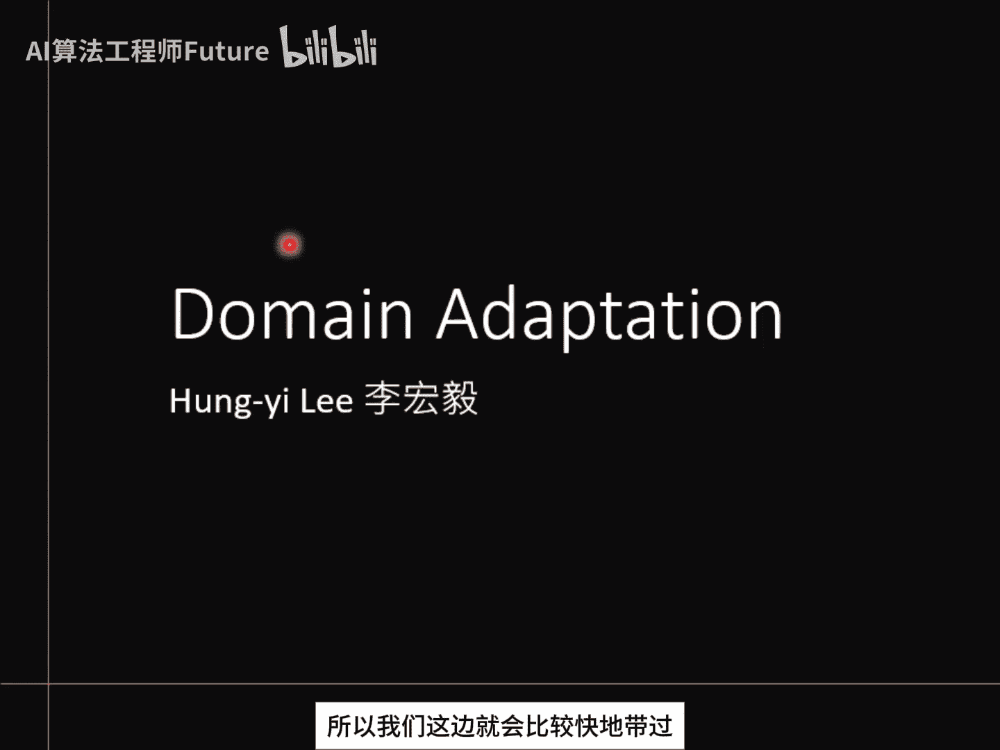

那等一下如果你有听不清楚的地方，其实等一下助教的录影。

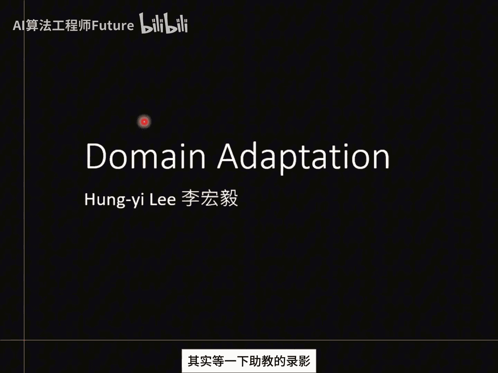

你还有机会再听一次啊，如果等一下讲的东西，虽然我讲的有点快，但你已经听得非常懂了，那等一下播主要录影的时候，你就休息一下，去做其他事情好，那我们呢。

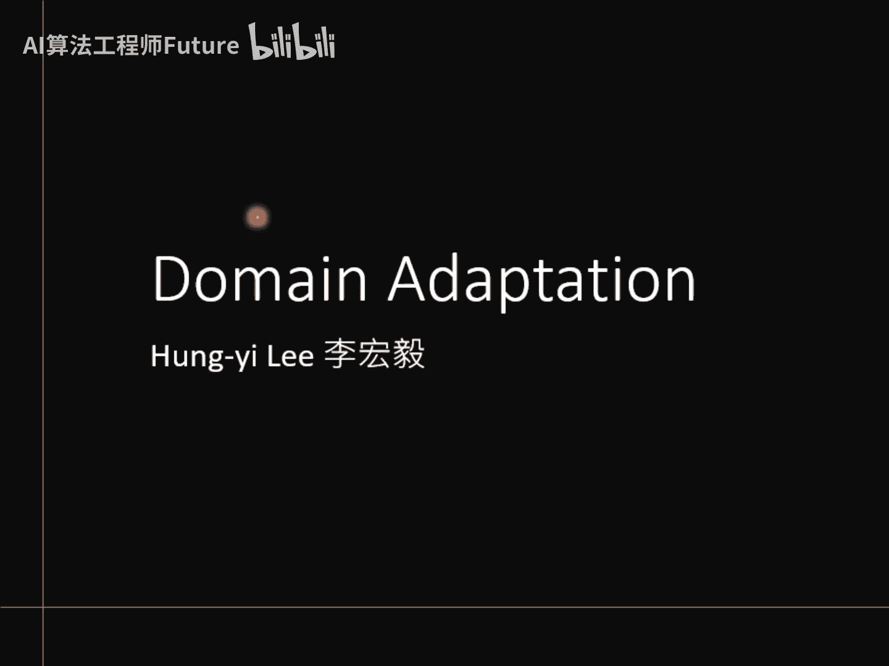

就开始来讲懂main adaptation的部分吧，而到目前为止啊，我们已经训练了很多machine learning的model，所以对大家来说，训练一个classify完全不是一个问题哦。

所以假设要你数字训练一个数字的classify，你只要有给你训练资料，你训练好一个模型，然后apply在用在测试资料上就结束了，那像数字辨识这么简单的问题，你在benchmark copus。

在ANNON这个benchmark copper上随便做一做，可能都会做到99。5percent的正确率，但是假设今天测试资料跟训练资料的分布，不一样，怎么办呢，我们举一个简单的例子。

假设训练的时候你的数字是黑白的，但测试的时候你的数字是彩色的，会发生什么样的事情呢，你可能觉得说呃一边是黑白的，一边是虽然一边是黑白的，一边是彩色的，但是对model来说，数字的形状是一样的。

它能够在黑白的图片上认出数字来，在彩色的图片上，会不会应该也可以认出数字来呢，但实际上不是，如果你今天在这样子，黑白的数字上面训练一个模型，直接用到彩色的数字上，你得到的正确率会非常的低。

会低到只有57percent哦，不能算是一个及格的分数哦，所以我们今天知道说，一旦训练资料跟测试资料，它中间有一些差异，它们中间的分布是不一样的，你在训练资料上训练出来的模型。

在测试资料上面可能就会坏掉，那这种问题啊叫做dman ship，也就是当你的训练资料跟测试资料，它的分布有些不同的时候，这种状况叫做OMANSHIP，在多数的这种作业里面。

或者是benchmark copus里面，我们都假设无视DMANSHIP这个问题，我们的训练资料跟测试资料，往往有着一样的分布，那这样都会给大家一个错误的印象，就是哇这个今天的什么人工智慧。

真的是很厉害呀，都超越人类啦，在很多任务上面都有极高的正确率啊，但是实际上用在真实的应用上，当你的训练资料跟测试资料，中间有一点差异的时候，机器能不能够做得好，就是一个未知数了，那我们今天就是要来讲说。

假设训练资料跟测试资料有一点差异的时候，有没有什么方法可以让我们能够做得，比什么都不做，结果还要好好，那今天就是要讲dommain adaptation的技术。

那dman the patient的技术啊，也可以看作是transfer learning的一种，怎么说呢，transfer learning就是你在A任务上学到的技能，可以被用在逼任务上。

那对于DMAN的patient来说，你的训练资料是一个DMAN，你的测试资料是另外一个DMAN，你在训练资料上面某一个抖面上学到的资讯，你要把它用到另外一个斗man，用到测试资料上面。

所以你是把一个斗man学到的知识，用在另外一个D面上，所以它可以看作是transfer learning的其中一个环节，那在过去上课的录音里面，有完整的讲了transfer learning相关的技术。

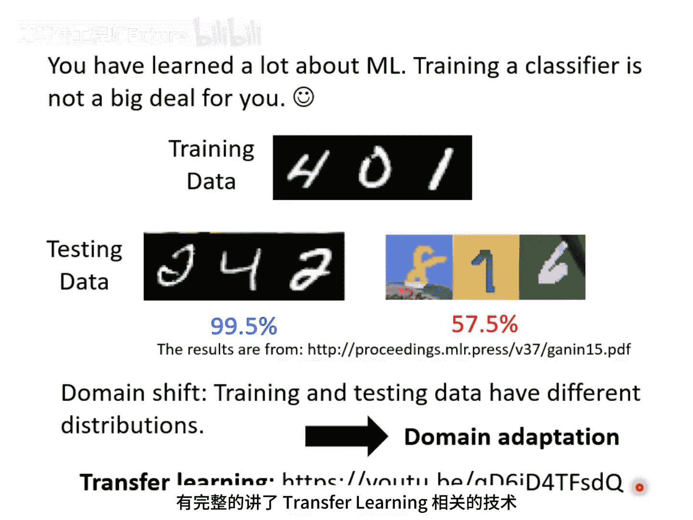

那因为今天时间有限，我们就只focus在抖man选的部分就好，如果你有兴趣的话，你可以再看一下过去上课的录影好，那抖man shift啊，其实有很多种不同的类型，我们刚才看到的只是斗MANSHIP的。

其中一种，可能是模型输入的资料的分布有变化的状况，那输入分布有变化是一种可能性，其实还有另外一种可能性，是输出的分布也可能有变化，举例来说，在你的训练资料上面，可能某每一个数字它出现的几率都是一样的。

但是在测试资料上面，可能每一个输出的几率是不一样的，有可能某一个数字它输出的几率特别大，有没有可能有这种事情发生呢，这也是有可能的，那这也是一种dman shift，还有一种更罕比较罕见。

但也不是完全不可能发生的状况，是输入跟输出虽然分布可能是一样的，但它们之间的关系变了，也许在你的训练资料里面，这种东西叫做零，但是在你的测试资料里面，这种东西叫做一，这也不是不可能的。

也是有可能发生这种状况嘛，也是有可能发生，说输入跟输出他们的关系不一样，在训练跟测试资料不一样的状况，那这又是另外一种懂MANSHIP，那我们今天呢只专注在输入资料，不同的DMANSHIP的上面哦。

那在等一下的课程里面呢，这个测试的资料，我们说它来自target dman训练的资料，我们说他来自source stman哦。

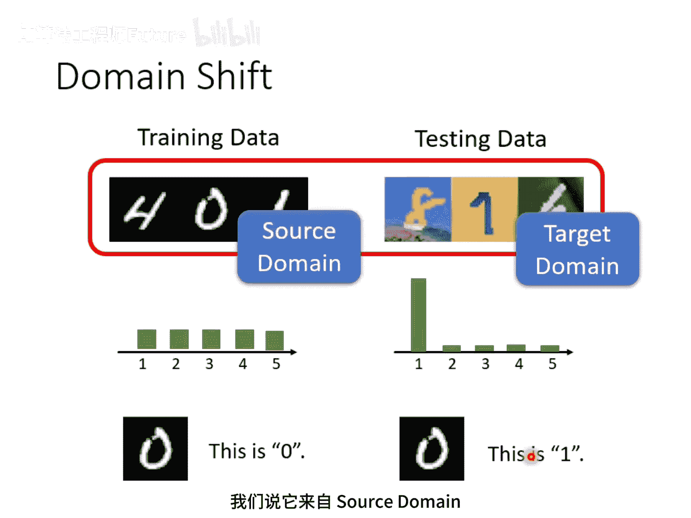

所以source stman是我们的训练资料，target on man是我们的测试资料好，那在domain aptation里面呢，我们的这个情境是这个样子的，我们有一堆训练资料。

那这边我们就直接拿手写数字辨识，来当做我们的例子啦，我们有一对训练资料，那这些资料来自social man，而且这些训练资料是有标注的，我们知道每张图片对应的数字是什么。

我但是我们希望在用这些资料训练出一个模型，这个模型可以用在不一样的抖面上，但要把这个模型用在不一样的DOMMAN上，在训练的时候，我们就必须要对另外一个DMAN。

也就是现在测试资料所在的target domma有一些了解，那随着了解的程度不同，我们就有不同的domain adaptation的方法，那了解最多的是，假设我们在target dman上。

我们有一点资料，而且这些资料居然还有label，那这是一种情况，那还有另外一种更更更好的状况是，也许你根本在咖啡董面上就有一大堆的资料，那些资料也都有label。

那你其实就不需要做DOMIN的patient了，你直接拿target domman的资料来训练就好了，所以如果你在target domain上已经有一大堆的资料，而且他们还有标注。

那你不需要做domain depatient，那要做domain depatient的情境，可能是你有他给董man的资料也有标注，但是量非常的少，那在这种状况下怎么办呢。

那这种状况还算是在domain的tension里面，比较容易处理的状况，如果你今天遇到的是有标注资料，只是资料量很少的情况下，你可以用这些有标注的资料来微调，你在soon man上训练出来的模型。

那这边所谓的微调啊，就跟你在做BT的时候的做行为很像哦，就是你已经有一个，所以source domain上训练好的model，那你拿ti dom的data，只稍微跑个两三个EPOD就足够了，好。

那在这种情境下，你需要注意的问题，就是因为你的HOIDMAN的资料量非常少，所以你要小心，不要overfeed，也就是说，你不要在target d面上的资料上跑太多的iteration。

那如果你跑太多iteration，可能会over fe到target的这些少量的资料上，然后呢你在你真正的taxi se上就做不好，这是有可能的，那为了避免OVERFITTING的情况。

过去就有很多的solution，比如说把learning rate调小一点呢，举例来说，你要让fight to前跟fight to后的模型的参数，不要差很多啊，或者是让翻译two前跟翻译to后的模型。

它的输入和输出的关系不要差很多啊等等，那有很多不同的方法，那这边呢我们就不细讲啊，那今天主要想要跟大家分享的情境，也是我们作业要处理的情境，是我们在target dman上有大量的资料。

但是这些资料是没有标注的，你的target dman是有颜色的数字，你收集到了一大堆有颜色的数字的图片，但是没有人标注说，每一张图片里面的数字是什么，那我们在座位里面要处理的，就是遇到这种状况的时候。

到底应该要怎么解呢，啊到底应该要怎么解呢，那像这种情境呐，其实是蛮符合你在真实的系统上，有可能会发生的情景，举例来说，你在实验室里面训练了一个模型，你想要把它用在真实的场域里面，你就把你的模型上限。

那确实有一些人来用，但是你发现哦，你得到FEB很差，大家都嫌弃你的系统正确率很低，那怎么办，但是你你这个时候，你也许就可以用DMA等TATION的技术，那因为你的系统已经上线，有真的有人使用。

所以你可以收集到一大堆的资料，只是这些资料他们是没有标注的，那现在问的问题是，怎么用这些没有标注的资料，帮助我们在source抖面上训练出一个模型。

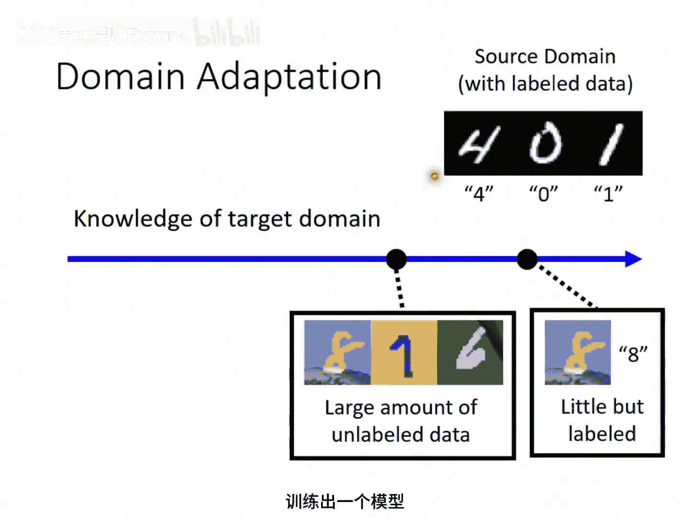

它可以用在target d面上呢，好那这边最basic的想法是这个样子的，我这边基本的概念是这个样子，我们想要找一个feature extractor。

这个feature attractor它其实也是一个network，这个network呢是一张图片作为输入，它吐出一个vector，吐出一个feature。

虽然source stman跟target to man，他们的image表面上看起来不一样，但是feature extractor会把它们不一样的部分拿掉，只抽取出它们共同的部分。

所以虽然从图片上看起来，这两组图片一个有颜色，一个不没有颜色，它本来就很不一样，但是我们期待说这个feature tractor可以学到，就无视颜色这件事情，把颜色的资讯滤掉。

那今天不管是来自source stomman的图片，还是来自target tman的图片，只要通过这个feature tractor以后，他得到的feature看起来是没有差异的。

它们看起来有一样的分布，那这样你就可以用这些feature训练一个模型，在SODMAN上训练一个模型直接用在target dman上。

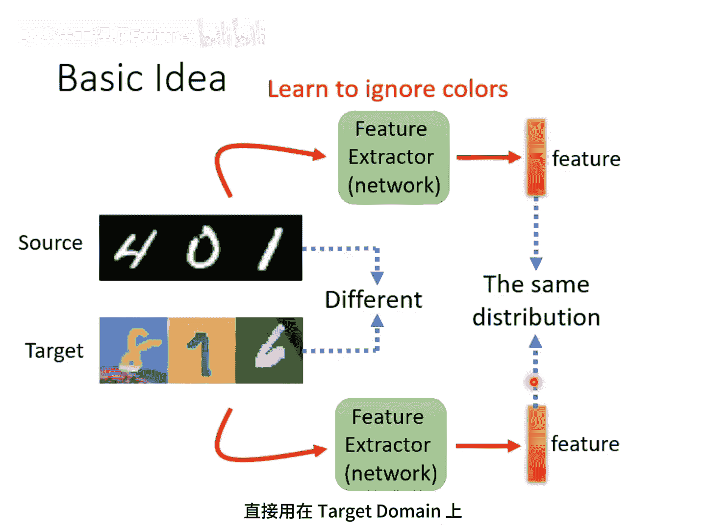

那接下来的问题就是，怎么找出这样一个feature的extractor好，怎么找出这样的一个feature attractor呢，那其实我们可以把一个一般的classify。

就分成feature extractor跟label predictor两个部分，我们知道一个image classify就是输入一张image output，就是分类的结果。

那假设这个image classify有十层，那我们就说前五层算是feature tractor，后五层算是label predictor，因为前五层你你一个image通过前五层。

它输出就是一个vector吧，看那如果你是用CNN的话，他输出其实是feature map啦，但feature map拉直也可以看作是一个vector嘛。

那这个vector在丢到label predictor后面五层，它会产生class，那所以我们可以把前五层看作是feature tractor，那你可能会问说，那为什么是前五层呢，为什么不是前四层。

前三层，前两层，前一层呢可以是前四前三前二前一，这个是你自己决定的，一个classify里面哪些部分算feature tractor，哪些部分算是label predictor啊，这个是你自己决定的。

那这个也算是一个hyper parameter啦，就跟network架构调一下呀，要调一样，那如果你今天呢用domain depatient的方法。

那这边等一下用的方法叫domain adversal training，用domain adversal training，你要把classify里面的哪个部分。

哪几层当做feature attractor，哎这个也要问你自己啊，这个也是你自己要决定的好，那我们现在要怎么怎么呃，怎么来训练这个feature attractor跟label predictor呢。

今天对于source dom面上的资料，source domain上的资料是有标注的，我们就期待把source dom的资料丢进去，那就去跟训练一个一般的分类器一样。

它通过feature tractor，再通过label predictor可以产生正确的答案，但不一样的地方是target的OMMAN的这些资料，我们有一堆target dman的资料。

但这些资料是没有任何的标注的啊，这些资料是没有任何的标注的，所以我们不能说啊，把这些资料丢进进去以后，期待label predictor会output什么数字。

因为我们根本不知道label predictor，要output什么数字才是对的，但是这些资料可以怎么被使用呢，哦这些资料使用方式就是，我们把这些图片丢到这个image。

丢进这个image classify，然后我们把feature attractor的output拿出来看，拿出来看以后，我们希望source抖man的图片丢进去的feature。

跟target dmail图片丢进去的feature，他们看起来要分不出差异哦，就是这个呃这个source dman的图片，我们用它的feature，我们用蓝色的点来表示target om的图片。

他的feature我们用红色的点来表示，我们要这些蓝色的点跟这些红色的点，分不出差异，那怎么让蓝色的点跟红色的点分不出差异呢。

那这个就要借由dommen in universal training的技术，那等一下，如果你觉得这一段讲的有点快，也没有关系，等一下助教会再更详细的讲过一次好，那我们现在要做的事情。

就是训练一个抖man的classify，这个抖面的classify啊，它就是一个二元的分类器，他吃这个vector当做输入，他要做的事情，就是判断说这个vector是来自于source domain。

还是来自于target domman，然后判断这个vector是来自source domain还是来自target domman，而feature attractor。

他学习的目标就是要去想办法骗过这个，抖man classify，那听到骗过这件事情诶，是不是让你脑中就浮现了game这个东西，是不是就浮现了generative adversarial network。

这个东西呢没错，抖man adversal training就非常像是get，你可以把feature tractor想成是generator，把抖main classify想成是。

那其实domain adversal training最早的paper啊，我记得是发表在2015年的ICNL上面，比那个呃game还要稍微晚一点点啦，不过他们几乎可以说是同时期的作品。

在domain adversal train，那篇paper里面是有引用到game那篇paper，但那时候game那篇paper还没有上NEURIX，所以他只说诶有一篇有另外一篇paper。

他提了个叫gain的想法，然后他是technical report放在网络上的，哎跟我的想法有点像，好像他们算是一个同时期的作品好，但是讲到这边呢。

这个董man in a versal training，跟game还是有一点不一样的，那在这个游戏里面，对generator好像优势太大了，那对generator来说。

他要骗过discriminator，完全不需要花什么力气，有一个非常无脑的做法，就是你的feature extractor，也就是你的generator，不管看到什么输入，永远都输出零就好了。

看到什么输入，我都输出一个zero vector，那对domain classifier来说，他完全不知道input image是什么，他永远都看到zero vector。

他就完全无法分辨这个vector来自于哪一个抖妹，但是这显然不是我们要的状况，如果feature tractor只会输出zero vector，那这样子等于根本就什么事都没有做，是一样的。

那这件事情会发生吗，其实这件事情是不会发生的，为什么，因为label predictor他也需要这个feature，Label predictor，他也需要这个feature，让他可以去判断呃。

输入的图片属于哪一个类别，所以假设generator他就直接放个大觉，说今天不管输入什么样的image，我输出都是zero vector，那对于label predictor来说。

他就没有办法判断是哪一张图片，那在这个情况下，因为feature tractor他还是需要产生这个vector，让label predictor可以产生正确的图片。

所以feature extractor他就不能放大觉，他就不能看到什么东西永远都输出zero vector好，那这边呢我们用符号，再稍微把我们刚才讲过的事情再重新说一，说的更清楚一点。

假设level predictor的参数我们就叫它CAP，dman classify参数叫做CAD，然后feature extractor参数叫做CAF，然后呢这个source抖面上的这些image。

它的classification的这个cross entropy，就source domin，这些image它是有label的，所以你可以算他们的cross entropy。

你根据他们的cross entropy定出一个loss，而CAP它的呃哦这边还没有讲CAP哦，这边是有个LL是这个抖man的呃，这个这个source手面上的那些image，他有label。

你可以算出cos entrob，然后对于这个董man的classify而言，他要去想办法分辨source跟target dom的差距，他要去做一个binary的classification的问题。

他要去做一个二元分类的问题，这个分类的问题有一个loss叫做LD，那我们现在要去找一个C大P，它可以让这个L越小越好，我们要去找一个SETAD，它可以让这个LD越小越好。

也就label predictor，他要做的事情就是让这个source domain的image，分类越正确越好，domin classify要做的事情，就是让DMAN的分类越正确越好。

而feature attractor呢，Feature attractor，他要做的事情是他站在label predictor这边，然后呢他要去捅抖man classify1刀。

他要去做跟抖man classify相反的事情，所以这个feature extractor，它的loss是label predictor的loss。

L减掉抖main classify的loss叫做LD哦，所以feature attractor它的loss啊就是大L减掉LD，你要去找一个参数，找一组参数，C大F它可以让大L减LD的值越小越好好。

这个是最原始的domain adversal training做法，但这真的是最好的做法吗，你可以想想看哦，那这个呃详情我们就不细讲，这个留给大家自己思考，自己发掘，你想想看哦。

假设dman classify，他的工作是要把source domman跟target domman分开，只要看到这种图片，他知道他的feature来自source stman，看到这种图片。

他知道他的feature来自target domm，他要把这两组feature分开，而feature attractor，如果他的loss是抖man classify，直接加一个负号，那意味着什么。

意味着说他要做的事情就是跟dman classify相反，本来dman classify看到这张图片的feature，他说是source。

那现在feature extractor是要让dman classify，看到这个图片以后，他说是target，看到这个图片反过来要说是source，如果你这么做，不是也把两组feature分开来了吗。

我们说我们现在要做的事情是要让抖man跟抖，这个source跟target demain没有差别，但是你今天不管是用LD还是负的LD，其实都是要把source和target domman分开呀。

你去让LD的值，本来domman in classify是要让LD的值越小越好，你现在是负的l d feature tractor，要让LD的值越大越好，其实也是把source跟它给DMAN分开。

所以这未必是最好的做法，至于怎么做，但这招是有用的啊，这招是有用的啊，啊那但是怎么做可以做的更好诶。

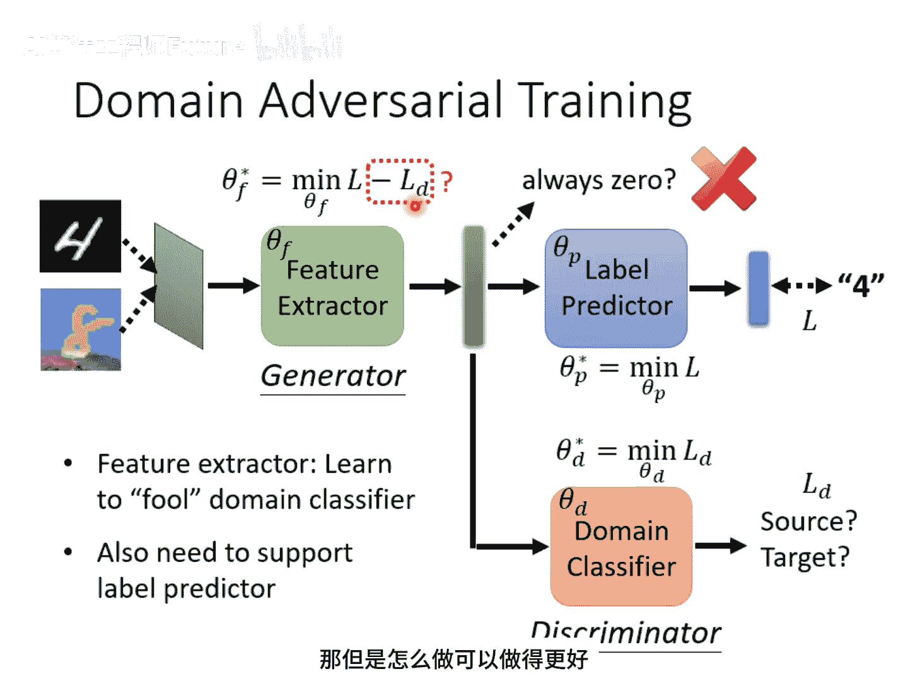

这个留给大家慢慢思考好，那我们来看一下董man adversal training，最原始的paper，他做的结果怎么样呢，当年看到这个paper的时候，真的觉觉得结果非常的惊人好。

那这边呢他做了四个任务，那上半部啊是source domain的图片，那这边其实都是数字辨识啦，那下半部呢都是target domman的图片，好如果今天呢我们是拿target domma的图片来做。

training target domman的图片来做testing哦，那结果像是这个样子，每一个任务正确率都是90percent以上。

但如果说我们今天是source domman training target domain testing券，在黑白的数字上测试，在彩色的数字上，结果直接铲掉哇，这直接铲掉，没办法做了，结果直接铲掉。

那如果加上dman adversal training的话，结果怎么样呢，你会发现说，本来如果只TRA在黑白的图片上测试，在彩色的图片上，正确率57。5。

那如果今天有做domain adversal training，正确率就飙升到81，percent在很多其他任务上进步量都挺明显的，59~71啊，74到88。7啊，呃这个进步量都是挺明显的啊。

这个就是抖man in adversal training，好到这边我们停一秒钟，看看有没有同学有问题哦，好我看一下好，有一个同学问说dommain classify。

这里是类似k means的classy吗，哎不是它就是一个二元的分类器，董man那个classify，它它它它就是一个network，它也可以有很多层，那还有几层也是你自己决定的。

所以他不是一个这个k means的CLUSTERY，他就是一个classify，他要去训练，说看到一个input，一个feature的vector。

那output就是他是属于source domain还是target dman哦，有同学帮我回答了哦，是助教好，助教助教帮我回答了好。

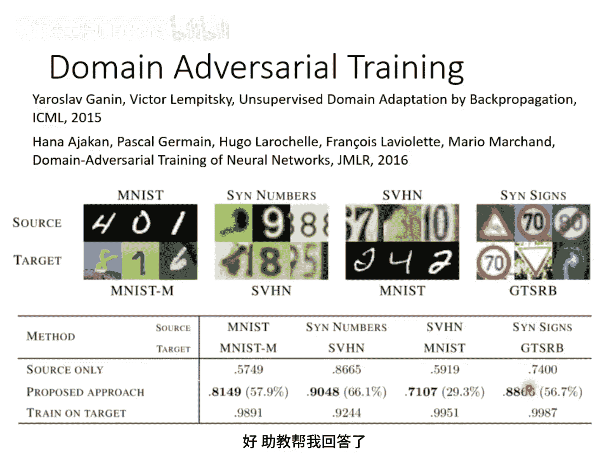

好那我们就继续讲了啊，那刚才这整套想法还是有一个限制，有一个小小的问题，什么样小小的问题呢，我们来看看咯，今天那呃蓝色的圈圈跟蓝色的三角形，代表source dman上的两个class。

那我们当然可以找一个boundary，去把这两组class把它分开来，对于target domain上的data，我们没有任何的class label，我们就只能说说target dom上data。

我们都用这个正方形来表示它，那我们今天训练的目标就是要让这些正方形，它的分布跟这个圈圈，三角形合起来的分布越接近越好，但是什么叫做越接近越好呢，左边这个case红色的点跟蓝色的点。

他们也算是蛮呃line在一起的啊，也算是分布蛮接近的啊，右边这个case红色的点跟蓝色的点，他们也算是分布蛮接近的，但是你觉得左边比较好还是右边比较好呢，好我们试试看这边有没有可能进行互动诶。

左边觉得左边比较好的同学，你就输入在聊天室输入个一诶，右边觉得右边比较好的同学，你就在聊天室输入一个二哎，好我们看看有没有办法做互动好，那我顺便回答一下同学的问题。

propose approach后面括号的百分比是什么意思，那个百分比啊就是进步量了，就是进步量，那个没有什么特别的的意思，好然后呢，有同学问说训练资料只有source data的状况哦。

他在艾特别人哦，他在回答别人的问题，好好大家都选二，大家都选二，有同学选一，好好选二的超级多好好，我看选大多数的同学呢都觉得是右边啊，没错啊，很多人也觉得是右边，所以我们是不是应该要让右边的状况发生。

而避免让左边的状况发生呢，好怎么做呢，怎么让右边的状况发生，左边的状况不要发生了，也许一个可能的想法是，我们既然知道蓝色的圈圈跟蓝色的三角形，它们的分界点在哪里，而这个分界点我们是知道的。

那我们应该要让这些方形，虽然我们不知道它是哪一个类别，但我们让这些方形远离这个分界点。

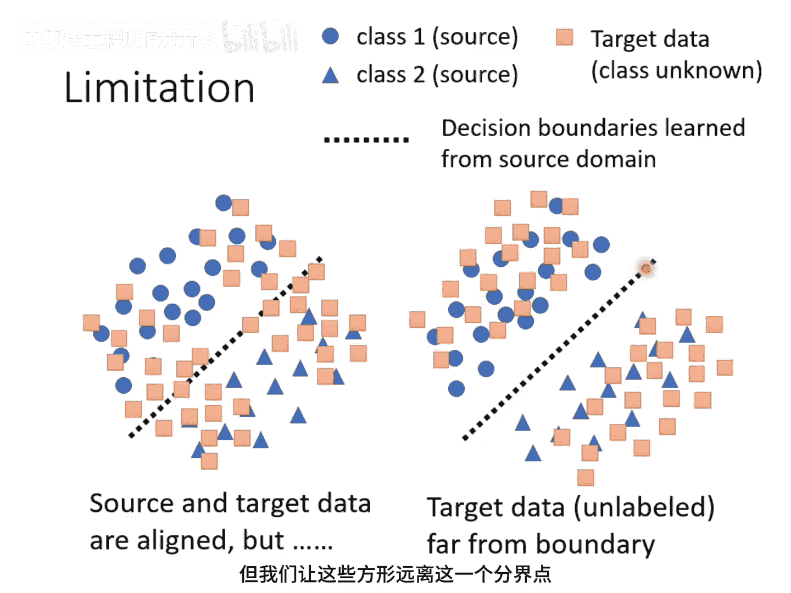

怎么让方形远离这个分界点呢，那在文献上就有很多不同的做法啦，你可以参考一下文献，看看你觉得怎么做比较好，举例来说，一个最简单的做法是说呃，今天我有很多unlabeled的图片丢到feature。

Tractor，在丢到label predictor以后，我不知道他是哪一个类别，但是我希望他离boundary越远越好，那什么叫做离boundary越远越好呢，如果今天输出的结果非常的集中啊。

叫做REBOUNDER语言，如果今天输出的结果每一个类别都非常的接近，叫做离boundary近，所以我希望说把unlabeled的image丢进feature，Tractor。

再丢进label predictor，输出的结果，他离boundary越远越好，也就是说这集中在某一个类别上，我们虽然不知道他应该算是哪一个类别，但至少应该集中在某一个类别上啊，那这只是一种招数啊。

并不是呃全部，那也可以参考一下文献，比如说有个知名的方法叫做，但是dirt t啊，dirt t这个dirt dirt t啊，它其实它它paper里面还特别告诉你说，这个要念dirty。

还要念dirty啊，这个大家都是这个模型命名大师啊，都会命名一些很有创意的名字，而这个这个dirty是一个招数，还有另外一个招数叫这个maximum，Classified discrepancy。

那如果你要在这个DOMINATTENTION作为里面，得到最好的结果的话，那这些招数是不可或缺的，那实际上这些招数怎么进行还挺复杂，这个就留给大家自己研究。

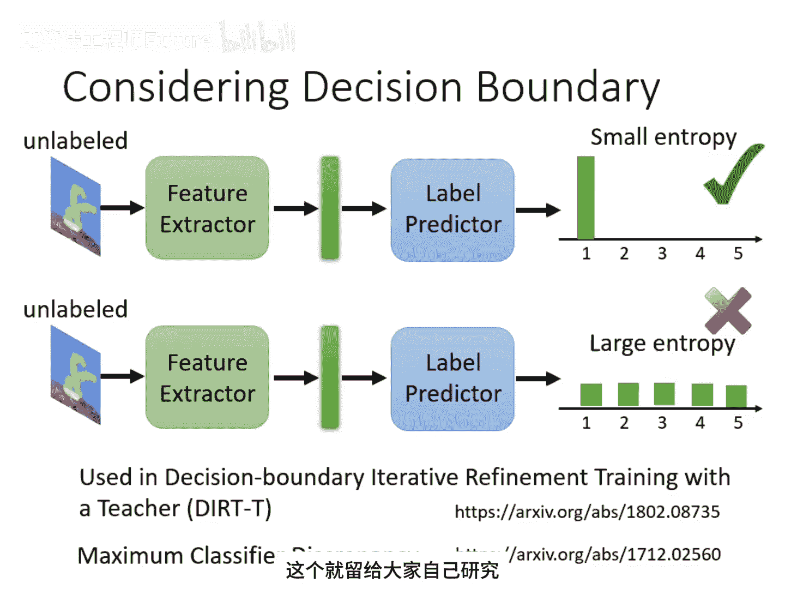

那这边还有一个问题，什么样的什么样的问题呢，我们到目前为止啊，好像都假设说source domain跟target domain，他的类别都要是一模一样的哦。

source domman假设是影像分类的问题，south stman有老虎狮子跟狗，他给董man也应该要有老虎狮子跟狗，但是真的一定会这样吗，target domain是没有label的啊。

我们根本不知道target domain里面有什么样的类别，而在这个图示里面呐，这个实心的实实现的圈圈，代表source domman里面有的东西，这个虚实线的圈圈，那代表他给DMAN里面有的东西啊。

所以呢有没有可能是呃这个SOUCE，抖man里面的东西比较多，他给抖man里面的东西比较少呢，有没有可能是呃target source董man里面的东西比较少，他给懂面的东西比较多呢。

有没有可能两者虽然有交集，但是各自都有独特的类别呢，这都是有可能发生的，所以在这个前提之下，你说SODMAN跟target dman，你硬要把他们完全align在一起，听起来有点问题呀，因为举例来说。

在这个case里面哦，你你说你要让source domman的data跟target domain的data，他们的feature完全match在一起，那意味着说你硬是要让老虎去变得跟狗像。

或者是老虎硬是要变得跟狮子相，到时候你就分不出老虎这个类别了，听起来就是有问题的方法，那怎么解决这个问题，怎么解决source domain跟target domain。

它可能有不一样的label的问题，那你可以参见这个universal domain adaptation这篇文章好，那我们来看看有没有同学有问题要问的好，有同学问说哦。

如果feature extractor是CNN，而不是linear layer，那董main classify input，就是feature map拉直的later embedding。

这样latent space学到的东西，把两个DMAN分布米平会不会有影响，因为feature map本来就有space的关系，现在却硬是被拉直，你说的非常对，真的你说的非常对。

就是feature attractor，他是一个复杂的内work，然后我们硬是要把两个抖面的东西拉在一起，会不会变成他只是为了拉在一起而拉在一起，他根本就没有学到。

我们本来希望这个feature space学到的东西呢，呃简单的回答就是会啊，会，所以DOMINTETATION没有大家想象的那么容易串起来，虽然好像刚才讲的都非常的顺利，在作业里面可以自己体验一下啦。

这个DOMINTEMPTATION算是偏难做的一个作业啊，所以呃这个你知道我们在train的时候啊，我们有两件事情，有两有两件事情互相拮抗，一个是要去骗过懂man classify。

另外一个是要让分类变正确，那我们期待说这两件事情都可以同时做好，也就是说一方面既骗过DOMCLASSIFY，一方面又分类分的好，那就同时把两个DMAN呃，呃ALI在一起，同时latent space。

我们又希望它的分布是正确的，比如说我们觉得一跟七比较像，那他们为为了让classify做好，那今天你的feature tractor就会让一跟七比较像我，然后一跟比如说一跟四比较不像。

那就让一跟四拉的比较远一点，我们期待说呃，借由需要把label predictor的performer冲高，这件事情，latent representation里面的这个space。

仍然是保留一个比较好的latent space，但是不一定这件事不一定总是会成功了，如果你今天你给抖man classify，就是要骗过抖man classify这件事情的权重太大。

你的model就会学到说他都只想骗过domman classify，他就不会产生好的latent space，所以刚才呃，同学问的问题确实是有可能会发生的，所以大家在实做的时候呃。

这个也是有些参数要调的好好，希望能这样我回答到同学的问题好。

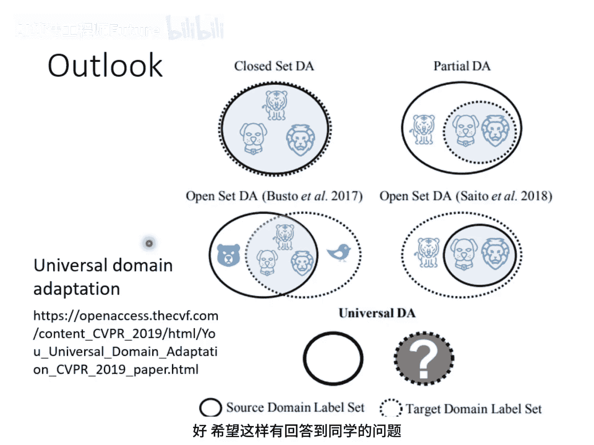

那接下来啊还有一个更严峻的状况，刚才我们是假设说没有label data，但至少有一大堆，这个时候你还可以说我要把两个space呢，把它拉在一起，但是有一个可能是假设不止没有label。

而且data还很少，比如说我就只有一张而已，这个时候你只有一张一，你你的这个target dman只有一张，只有只有一个一个一个点，你根本没有办法跟抖那个SOSDMAN，把它ALI在一起嘛。

这个时候怎么办呢，假设target domain data非常少的时候怎么办呢，也不是没有方法了啊，有一个方法叫做testing time training，它的缩写是TTT。

这个把这个我我们就把链接附在这边，给大家参考，testing time training就是想要处理，假设我的target domman只有没有label，而且还只有一张的时候，到底应该要怎么办。

但其实还有一个更严峻的状况，这个状况是如果我什么都不知道怎么办呢，如果我们对target抖man1无所知的话。

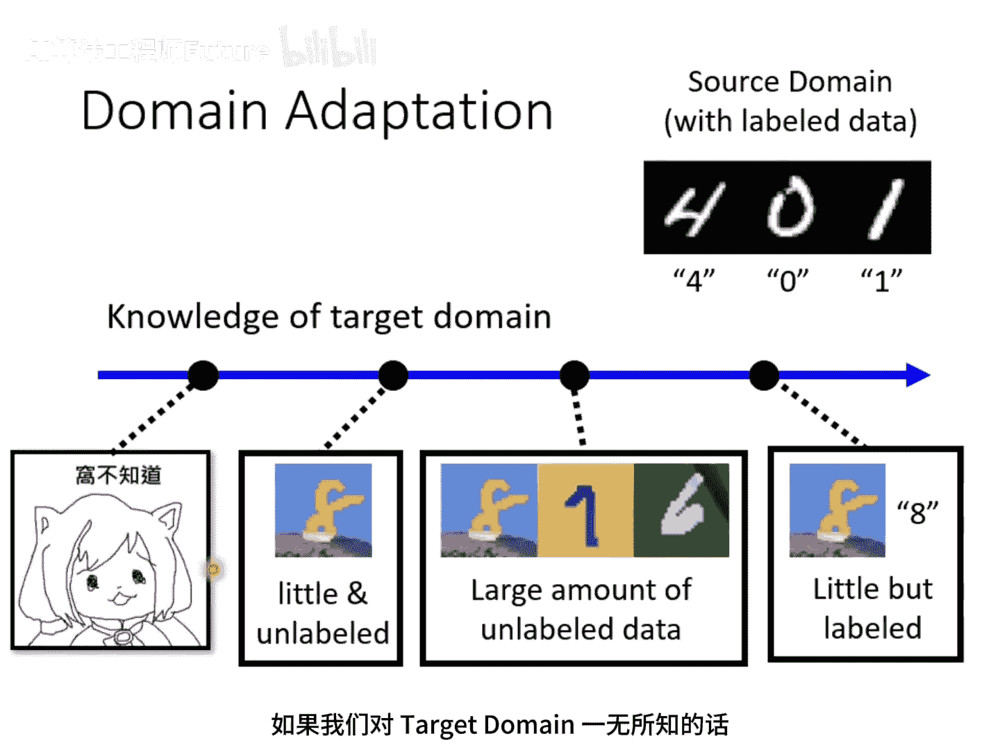

怎么办呢，这个时候又分成两种情形，对target dommin1无所知的这种问题呀，这个时候我们就不叫DOMM的ADADAPTATION，通常就叫domain generalization。

因为我们并不是要adapt到某一个特定的domain上，我们对那个特定的斗man已经一无所知了，我们是期待今天机器学到抖man generalization，在testing的时候。

不管来什么神奇的抖man，他都可以处理，那dman in generalization又分成两种状况，一种状况是我的训练资料非常的丰富，本来就包含了各式各样不同的抖类，假设你要做猫狗的分类器。

那你现在呢在训练资料里面有呃，真实的猫跟狗的照片，有素描的猫跟狗的照片，然后有一呃这个水彩画的猫跟狗的照片，期待因为训练资料有多个抖man模型，可以学到如何米平抖M间的差异。

今天有测试资料是卡通的猫跟狗，他也可以处理，这是一种状况，那这种状况你还比较能够想象要怎么处理，那我们这边就不细讲，我们都只各放一些有代表性的论文给大家参考，但还有另外一种你会觉得不知道。

真的不知如何下手的状况是，假设训练资料只有一个抖man呢，假设你的训练资料只有一个抖man。

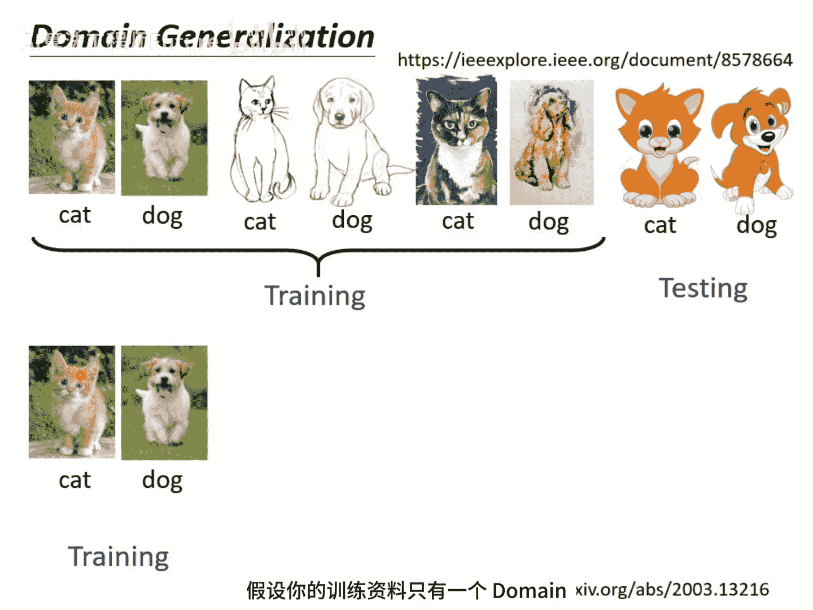

而测试资料有多种不同的抖man的话怎么处理呢，在文件上也不是没有人试着，也是有人试着去解过这种问题的，那还怎么做呢，他在这细节我就不讲了，在概念上就是哦有点像是data augmentation。

虽然你做一个DMAN的资料，想个data augmentation的方法去产生多个DOMMAIN的资料，然后你就可以套上面这个scenario来做做，看看能不能够在测试的时候，新的抖man都可以做好好。

这个是domain generalization，好，那这个部分就是很简短的跟大家带过，这个domain adaptation的种种技术，更多的细节在下一堂课助教的说明里面，都还会跟大家仔细的说明。

我们在这边呢就先休息5分钟啊，休息一下。

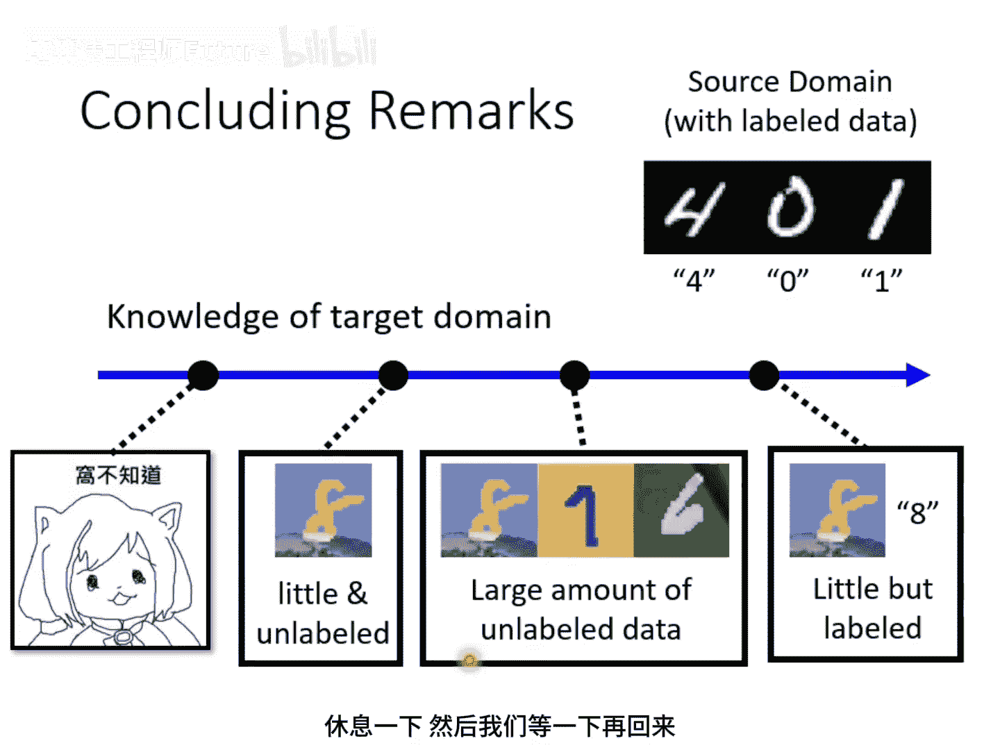