# 【官授搬运】2026年全新优化版李宏毅机器学习系统课程，这才是真正的初学者体系课程！—人工智能／深度学习／神经网络 - P74：2-惡搞自督導式學習模型 BERT 的三個故事 - AI算法工程师Future - BV1ruqABeEFX

好那大家好啊，这堂课呢想跟大家讲的是，自督导式学习有多么的无所不能。

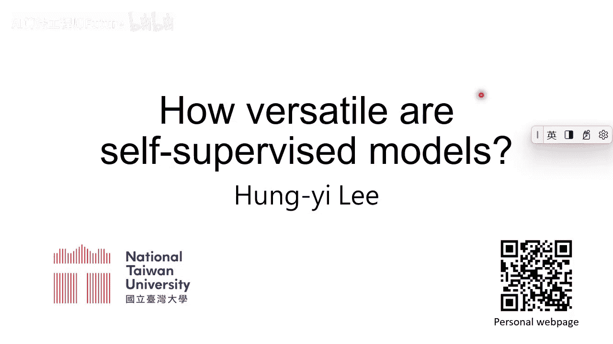

那今天呢我会跟大家分享三个故事，那这三个故事呢，第一个跟第二个，其实在之前的上课录影中有提过了啦，但是今天呢会补充更多的内容，那第三个故事是全新的，那很高兴呢，今天可以跟大家分享这三个故事。

好第一个故事啊是自督导式学习的模型，他有话语言的能力。

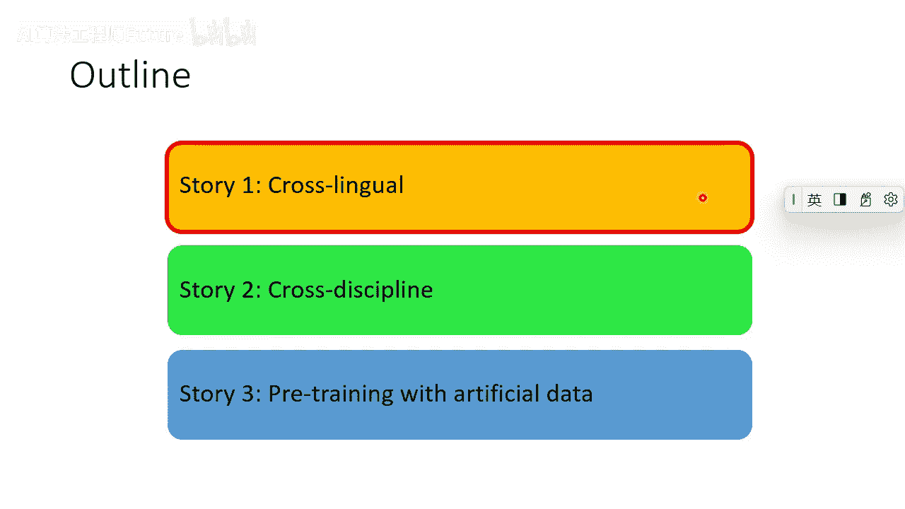

什么意思呢，这个我们在训练这个BT的时候，不是只能用一种语言，我们都知道BERT的训练就是做填空题，你可以拿一堆英文的句子叫机器去学做填空题，但是我们在训练bird的时候，不是只能用一种语言。

你可以把各种语言的资料都喂给BERT，让他做多种语言的填空题练习，那如果BT这个模型在做了，做了多种语言的填空题练习以后，它会有什么样不可思议的效果呢，以下我们就来看看这种多语言的bird。

他有什么样神奇的能力。

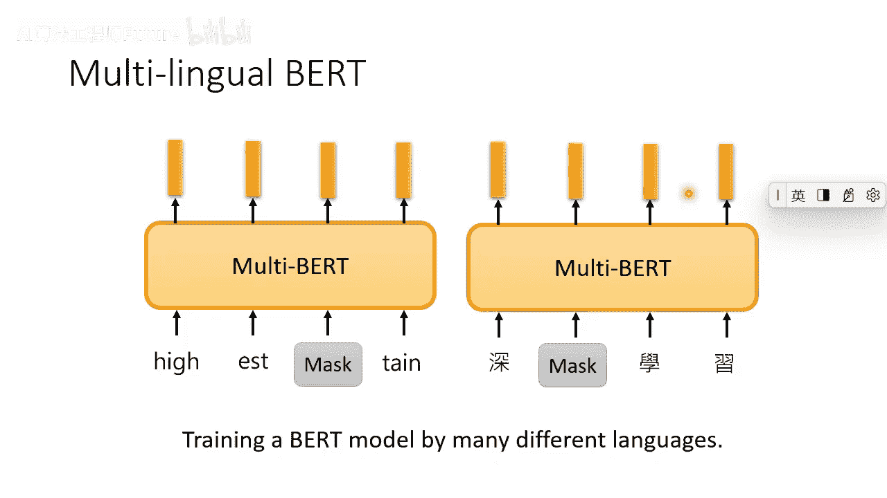

多元的bird可以做到什么样的事情呢，我们知道在sales supervised learning里面，我们就是要先return，然后把PRETRAIN好的模型针对某一个任务进行，Fight you。

然后再测试在你感兴趣的任务上，那今天假设我们感兴趣的，我们想要解决的任务是中文的QA啊，就是你问机器一个中文的问题，机器读一篇中文的文章，给你一个中文的答案，那一般而言呢一般的想法。

如果你要解决的问题是要做中文的QA，那你当然需要提供一些中文QA的训练资料，让机器去翻Q去微调return的模型，但是有了这种MOTILINGUAL的bird。

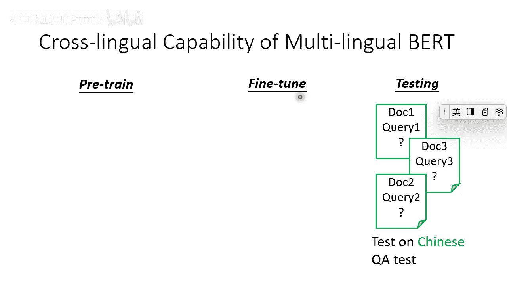

当bird看过多种语言以后，神奇的地方来了，如果今天你要叫机器解的是中文的QA问题，你不需要提供给他中文QA的训练资料，你可以只给他英文QA的训练资料就好，你可以只给他英文的文章，英文的问题。

英文的答案，你可以只给他英文的QA的训练资料，让机器学习它自动可以举一反三，自动可以做中文的问题哦，这个就好像说你今天要去考一个语言能力检定，你明明要去考的是中文的阅读测验，但是不知道怎么回事。

你拿到的是英文的考古题，但是你做了英文的考古题，你也会做中文的阅读测验啊，就这么神奇哦，BERT呢在中文的QA上是可以裸考的，他完全不需要看过中文QA的问题，他只要看过英文QA的问题。

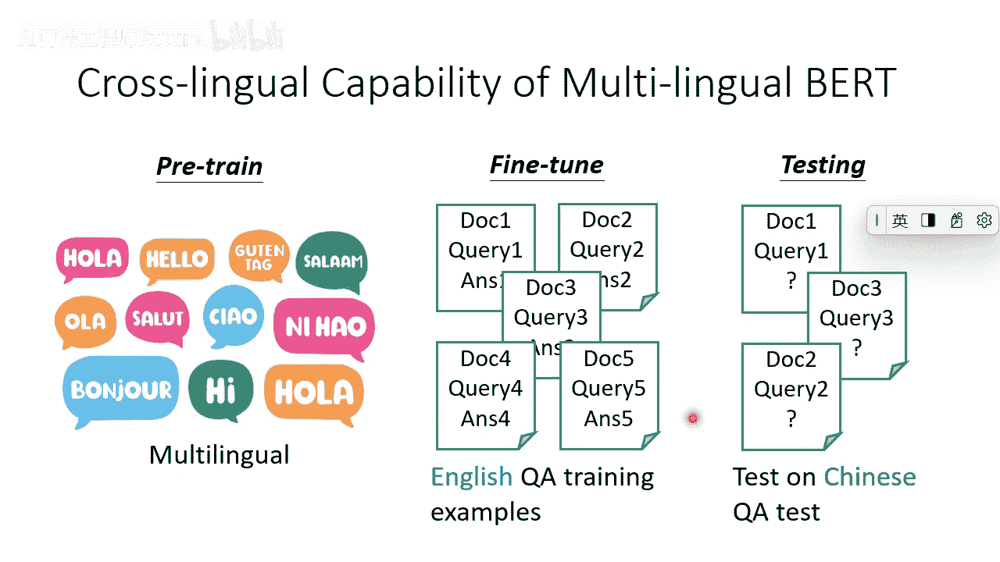

就可以解中文UV的问题好，那这个发现呢是这个许中元同学跟刘继良同学，发表在2019年的ENNLP的结果，那这边呢是截入paper里面的一个表格，那这个实验呢我们的测试资料是中文的。

QA用的是一个叫做DRCD的data set，那如果英文的QA，我们用的是大家都耳熟能详的squad，这个data set，那我们来看一下实验结果，那假设呢你没有用bird好。

如果你没有做PRETRAIN的话，那你用的是q a net，如果没有做PRETRAIN，只有拿中文的资料进行fight to测试，在中文上，那你的f one score是78。1。

那大家可以把f one score呢就当做是正确率好，今天呢如果你用bird，你PRETRAIN在中文上，再让bird在中文上做过填空题，翻译to在中文的QA上，接下来测试在中文的QA上。

你可以得到89percent的f one score，当然比没有PRETRAIN，只有78percent的f one score，结果好很多，但真正神奇的地方是。

假设你PRETRAIN的时候是用了104种语言，PRETRAIN的，茅台邻国bird，茅台邻国bird在104种语言上做错填空题，翻译to的时候，给它英文的q a data进行翻译to。

接下来直接测试在中文上会发生什么事情呢，他也得到78。8percent的f one score，跟训练在中文上的结果几乎是一样好，甚至还更好一点，神奇的事情是，他只看过英文的q a data。

直接去测试，在中文的qa data上，居然也有78percent的f one score，这个结果并不是什么巧合。

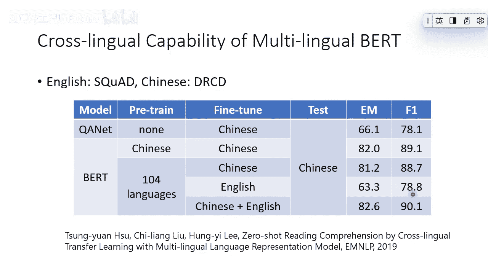

那在同一年，很多团队也都发现了类似的结果，不止在QA上，在很多不同的任务，不同的语言上都有类似的现象，都观察到茅台ligo bird有跨语言举一反三的能力。

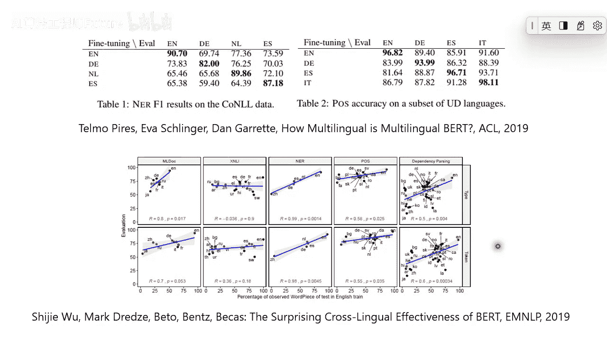

而今天这种motlego bird快语言的能力啊，他甚至一点都不稀奇了，这个今天在自然语言处理的领域，根本就是一个common sense，因为在自然语言处理的领域呢。

有一个这个基准的资料集叫做extreme extra，要做的事情就是要测验你的motlego bird，它有没有跨语言的能力，在extreme里面有这个九个不同的任务。

然后呢你的目标啊是要在这九个任务上，你只有英文的训练资料，你只有英文的训练资料，可以去翻Q微调你的摩台灵国bird，然后要测试在剩下其他30几种语言上哦，所以今天BERT有跨语言的能力。

一点都不令人意外，大家都已经知道，motlego bird就是有这种跨语言的能力，但是虽然大家都知道MORTA。

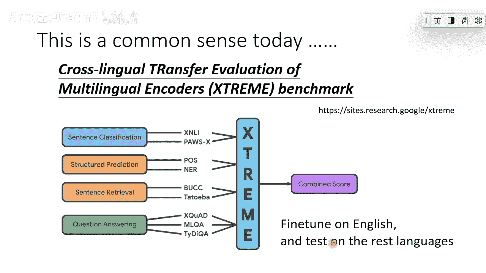

英国BIRT有跨语言的能力，但是这个跨语言的能力是怎么来的呢，呃一个常见的猜想是这样子的。

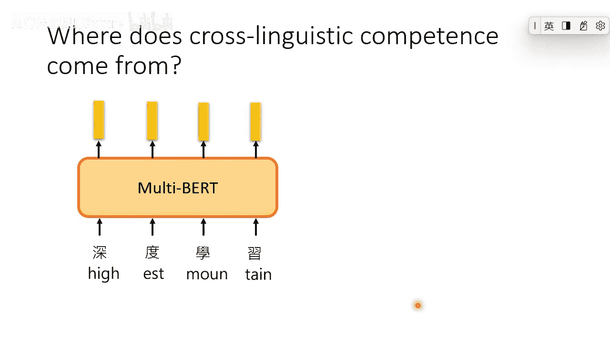

就是MORTILEWORKBT啊，它可以无视语言的差异，对他来说不同语言的符号只是一个表象好，它可以无视语言的差异，把不同语言同样意思的符号给他，一样的representation。

所以对MOTLEBBIRD来说，你给它鱼跟fish，它看起来是差不多的，你给它too跟rabbit，它看起来是差不多的，它可以无视不同语言符号的差异，只了解这个符号背后本身所代表的语义。

那所以这可以解释说，为什么mortallego bird靠有跨语言的能力，因为对他来说，不同语言是没有差别的。

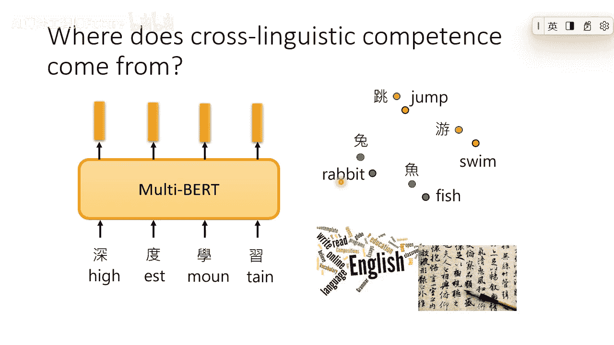

那真的是这样吗，我们这边呢做了一个简单的实验来验证，More heading bobird，是不是可以把不同语言同样意思的符号，把它对应在一起啊，那这个实验是这样的哦，首先你先准备一个这个字典啊。

那这个字典呢是一个中英对照的字典哦，所以你有一些英文的词汇呃，你有一些中文的字，然后你知道哪些中文的字跟哪些英文的词汇，它们有一样的语义好，所以你有一个英文词汇的list，有一个中文字的list好。

那接下来呢我们给每一个英文的词汇，或者是每一个中文的字呢，都给他一个代表的embedded，那怎么找这个代表的embedding呢，因为大家都知道说这个bird啊。

它是一个contextualized的representation model，所以同的词汇在不同的上下文中，他的representation都是不一样的，不过没有关系，我们这边就是把同样的词汇。

出现在整个COPUS里面，所有的representation统统找出来，直接做平均，那把这个平均的结果当做代表那个词汇的，representation好。

所以这边呢每一个中文的字都有个representation，每一个英文的词汇都有一个representation，接下来就可以计算中文的某一个字，跟英文的某一个词汇。

它们中间representation的相似度好，所以这边呢就把中文的词汇跟英文的词汇，它们的相似度呢都计算出来好，那接下来我们怎么知道中文跟英文的词汇，如果它们意思一样。

他们的这个representation就越接近呢，好那因为呢我们已经有这个词典的关系，所以你知道哪一个英文的词汇，是对应到哪一个中文的词汇，接下来就计算看看，说比如说我们知道这个year呢就对应到年。

那就计算year跟年之间，它们的representation的相似度，然后再看看说ear跟其他中文词汇的相似度，那如果year跟年的相似度呢是最大的哦，那你就给他ranking是一好。

然后呢比如说举另外一个例子，month跟月的意思是一样的，那再看说month跟其他的这个中文的字的相似度，然后发现说月的相似度是只有排第三，那这边rank呢就给它三，以此类推好。

所以每一个英文的词汇都会得到一个rank，那这个越rank的值越小，就代表说英文的词汇跟它对应的中一样意思的，中文字，它们的这个相似度呢是越高的，那接算下来呢计算一下这个rank的导数对吧。

计算出来的结果平均可以得到一个分数，叫做mean reciproco的react nrr，那这个NR就是分数越高，就代表中文跟英文它的alignment它的对应关系。

这个multileo bird呢学的越好啊，那如果刚才这个步骤也听不太懂的话，就是记得说NRR的值越大，就代表说呢今天这一个motlego bird，它越有把英文跟中文这两种不同语言，同样意思的词汇。

把它们这个对应的越好啊，对应的越好，NRR的分数就越高好。

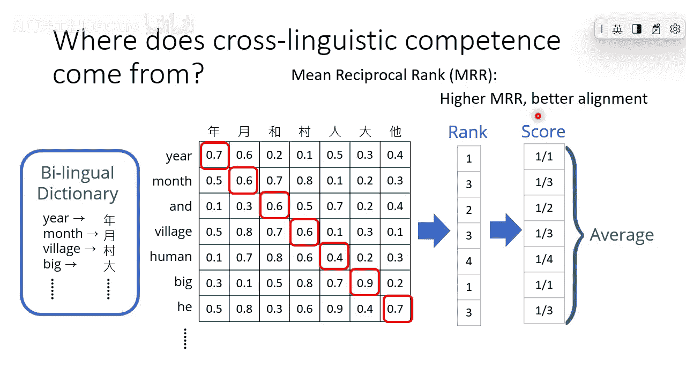

那这边呢是一些实验结果了，我们分析了这个BT呢跟这个英文，这这个给bird的英文跟另外十种语言，它们的对应关系好，那我们先来看最右边的这个bug啊，最右边这个蓝色的bug呢。

它是google的茅台0BBIRD，用100多种语言训练出来的，那这个纵轴呢就是我们刚才看到的NR，这个值越大，代表说这个BT呢越可以无视两种语言的差异，越可以无视符号的差异，只把语义的资讯抽出来。

那你会发现说呢啊这个呃google所训练的这个BT呢，他其实非常的强哦，在不同语言上呢，他的NR的分数都蛮高的哦，那这个右边数来第二个bar啊，这个是我们自己训练的motleball bird。

我们只用了十种语言，每一种语言用了1000K个句子啊，那我们发现说其实就算我们只用十种语言，也可以达到不同语言间alignment的效果哦，它跟这个最右边数来，第二个bug，跟最右边这个bug。

其实在不同的语言上只有差一点点，但是如果我们今天只用十种语言，但是把训练资料量从每种语言1000K，降到每周元元200K，也就是啊把资料变少了，那我们得到的是什么，我们得到的是粉红色的这个bug。

你会发现说粉红色的bar，跟右边最右边这两条bar比起来，都有非常显著的差异，这告诉我们什么，这告诉我们训练资料很重要，你训练资料一扫哇，这个跨语言的能力就不见了，训练资料够多。

我们才能观察到跨语言的能力好，那这剩下四个，剩下四条，这个呃bug的是什么东西呢，他们是过去在还没有BT的时代的，word representation的模型，有globe啊。

还有water vector啊，然后用不同的训练资料训练出来，那为什么要做这个实验呢，因为我就在想说，把不同语言的资料倒在一起过去啊，在还没有BT的年代，其实也不是没有人试过。

但过去从来没有人说把不同语言倒在一起哦，你的模型就自动可以把同样意思，不同语言的词汇把它对应起来，是一直到有BT以后才有人观察到这个现象，那到底是过去的模型不行，还是只是过去的人没有做这样的观察呢。

所以我们就把传统的，在还没有BT年代的那些word embedding的模型，拿来跑一下，然后也给他不同的资料量，那我们发现说传统的这些模型呢，在不同的资料量下。

就算他的资料跟mortaino bird用的一样多，诶，它不同语言间对应的关系，也赶不上茅台LINUBIRD的结果哦，这显示说模型也是重要的哦，所以资料是重要的，模型也是重要的，有一个大的模型。

有足够的资料，我们才能观察到，今天mo台灵波bird有跨语言的能力。

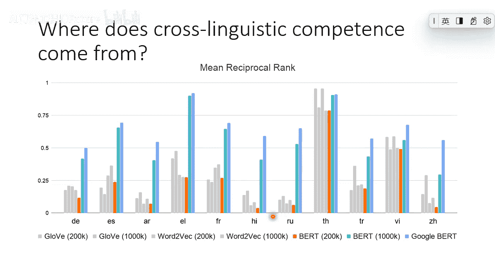

但是啊，虽然大家都说MORTA灵波BT跨语言的能力，他可以无视不同语言符号间的差异，但是如果他真的做到这件事情的话，你有没有觉得哪里怪怪的呢，想想看哦，假设MORTA邻国bird。

他真的完全无视语言间的差异，那我们今天叫他做填空题的时候，给他一个英文的句子，他怎么会知道最后能够填入英文的词汇，给他中文的句子，他怎么能够填入把空，把这个mask的地方填入中文的词汇呢。

我们实际上在训练mortallego bird的时候，也会观察到说有一个中文的句子，那填空的地方它就是填中文，英文的句子，填空的地方就是填英文，它不会弄错的。

所以对more time linubird来说，他应该还是知道输入的句子的符号，代表哪一个语言，它应该还是没有完全去掉所有语言间的差异，他应该还是没有完全无视语言间的资讯，对他来说，语言间的资讯。

语言间的差异仍然是存在的，只是这个资讯他被藏在哪里呢。

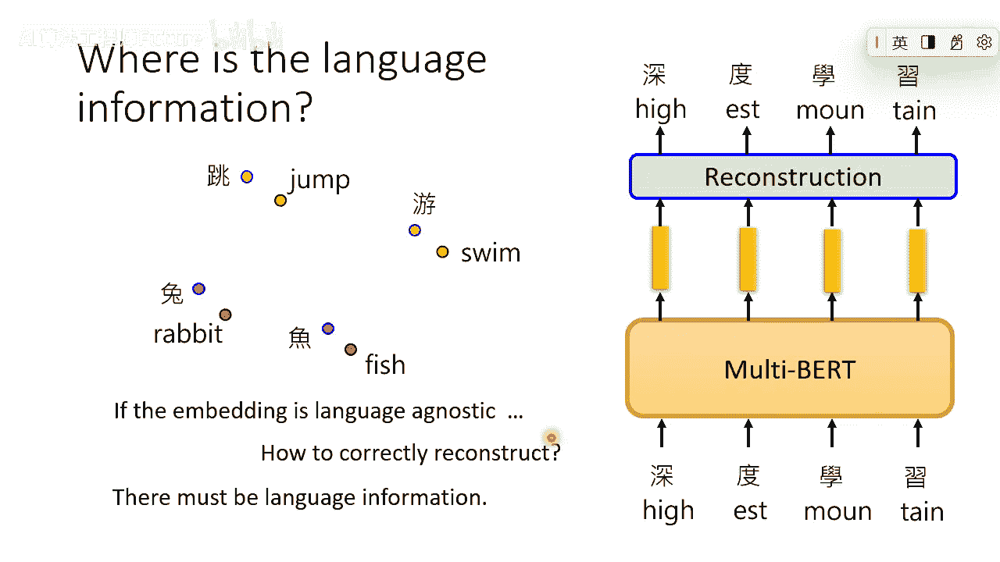

那后来啊我们发现这个语言的资讯，其实有可能可以用很简单的方法，就把语言的资讯抽取出来，怎么说呢，我们这边有个实验哦，就假设你把英文的embedding，平均得到一个所有英文embedding平均的向量。

那你再把所有中文的这些字呢，所有的中文的这些符号呢，它的embedded也拿来做，平均得到一个所有中文符号的embedding，而现在有所有英文的符号的embedding。

所有中文的符号的embedding，接下来计算它们的差距，你得到了英文的差，英文跟中文之间的差距，得到这个差距以后，你可以做到什么事情呢，神奇的地方是，你可以把英文的这些词汇加上这个差距以后。

他就会得到中文的同样意思的词汇，当然这个对应的关系没有非常非常的精确，但是你可以大致观察到说，如果你把fish加上这个英文跟中文件的差距，那你得到的结果可能就跟中文的鱼的embedding，很接近。

rabbit加上这个差距可能就跟中文的to很接近，那甚至你还可以做到一个神奇的事情，是这样，你给mortaingo bird一个英文的句子来，本来你给它英文的句子，正常的状况就是他会做英文的填空题。

他会把英文单字填到你mask起来的地方好，但是呢如果你把英文丢进去以后，在mortai lingual bird里面，把英文跟中文的差异。

加到mortainal bird的representation上面，我们刚还说，你可以算出英文跟中文之间的差异吗，所以你把英文的句子丢到mortalingo bird里面。

让MORTALINGOBIRT得到英文句子里面，每一个token的embedding，接下来你再把这些embedding通通加上，英文跟中文的差异，把这些embedding通通往某一个方向移动一下。

那这些embedding，就会从原来像是英文的embedding，变成对MOHINOBIRT来说像是中文的embedding，你再把这些东西叫motlego bird还原回来。

你会发现你会得到一个中文的句子，举个更具体的例子。

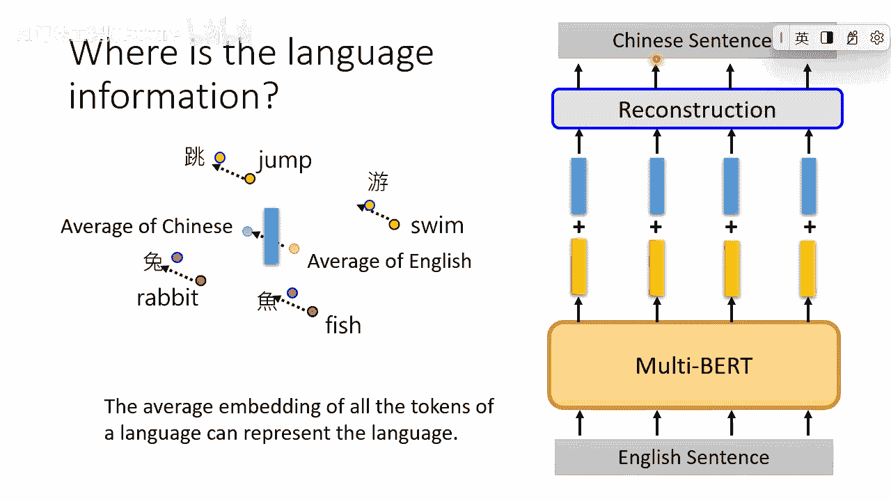

以下这个例子不是凭空想象的例子，它是真实的实验，结果好，我们输入一句，There is no one，Who can help me，我们输入一个英文的句子。

给MORTA林或bird motlegal birt，得到一堆representation，接下来把这些representation往同一个方向平移，让这些representation看起来像是中文。

然后呢进行还原以后得到的句子是there是无人人，can help我，但这不是一个非常精确的翻译，但是你发现motlego bird，它确实可以把me就对应到我，把is就对应到市。

把NO one就对应到无人好。

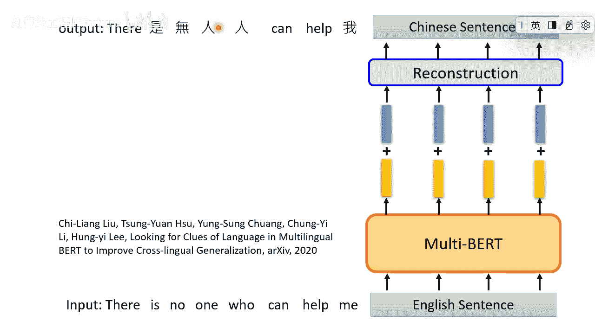

那这边只是举一个例子了，那我们也有更完整的结果啊，在这篇文章里面，我们试了，这个把英文呢转成另外六种不同的语言，还要把另外六种不同的语言转成英文，然后呢我们把英文转成另外一个语言。

比如说把英文转成法文以后，我们去看看那个法文的句子，真正的翻译结果之间的LUCISC哦，这个blue sce越高，就代表说透过这个方法，透过加这个呃不同语言间差异的向量，这个方法。

我们确实可以把某个语言，转成另外一个语言的翻译，那你发现这边blue score啊，虽然说没有真的很高啦，这个时尚下的blue sce啊，他这是NTRIVIAL了。

它代表说今天这个montingboard birds，确实可以用加上这些向量的方法，达到部分翻译的成果。

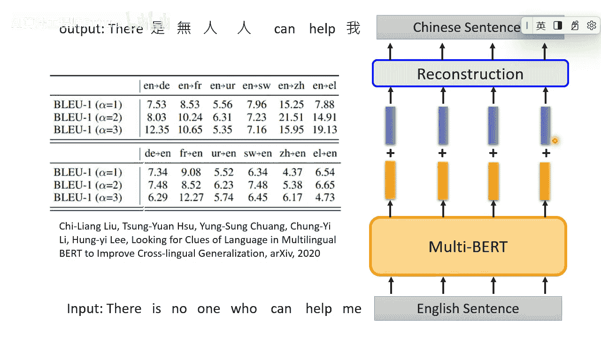

好那其实呢在差不多同样的时间，也有另外两篇论文有非常类似的发现，发现说MOTLEBBT不只是把不同语言，同样意思的词汇对应在一起，他其实也有存有语言的资讯。

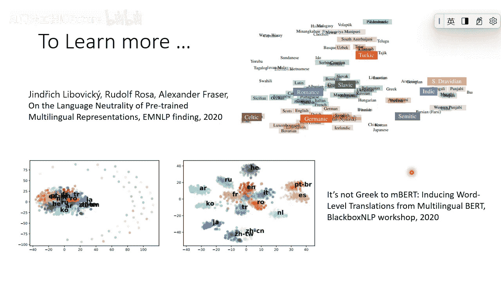

那发现mortalingo bird存有语言的资讯，有什么样的作用呢，这个发现可以带来什么样的好处呢，这些发现我想还是有一些应用的，举例来说，我们都会说今天摸他灵波BIRT，他有跨语言的能力。

你可以给他训练的时候训练在英文上，接下来测试的时候直接测试在中文上，但是问题是，如果他训练的时候是训练在英文的训练资料上，测试的时候是测试在中文的资料上，我们知道英文跟中文。

对MORTLEOBIRT来说还是有一些差异的，因为我们说motlego bird存有语言的资讯，所以对他来说，英文的embedding跟中文的embedding，还是略有差异的。

所以这种跨语言的转换虽然可以做到一定程度，但是他没有办法跟同样语言的结果，做的一样好哦，所以训练英文在英文上测试在英文上，他结果很有可能就是比训练在英文上测试，在中文上结果还要好。

因为英文跟中文毕竟看起来是不太一样的。

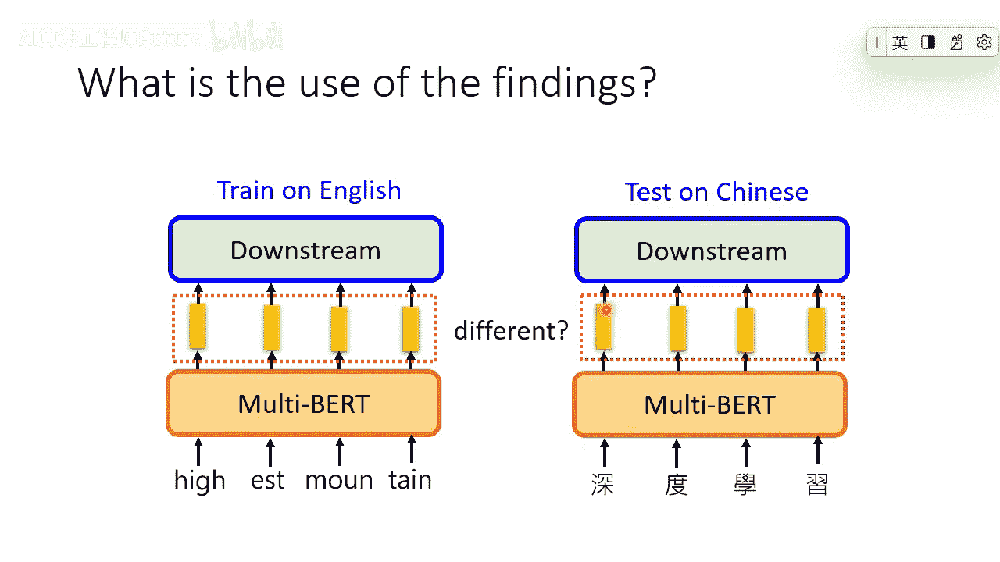

所以怎么办呢，有一个方法可以去修正mortallino bird的output哦，假设呢我们现在训练的时候是训练在英文上，保持你的doch model，他看得懂英文的representation。

如果给他中文的句子抽出中文的representation，算当睡model好像也看得懂，但是它毕竟跟英文的representation，还是有一些差异的，怎么办呢。

我们能不能把这一个中文的representation减掉，英文跟中文之间的差异，把它做一下修正，让这些representation看起来比较像是英文，然后呢。

这个当选model就比较有机会得到好的结果好，那这个结果如何呢，我把论文呢放在右上角这边给大家参考好。

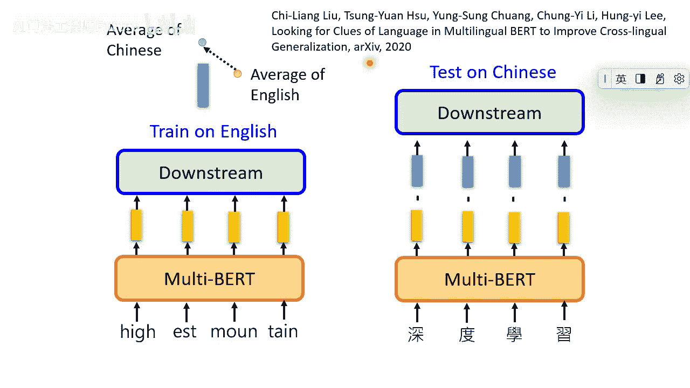

所以第一个故事呢是BERT有跨语言的能力，那接下来要讲一个更离奇的故事是，BERT不只有跨语言的能力，cell supervise model不只有跨语言的能力，它还有跨学科的能力。

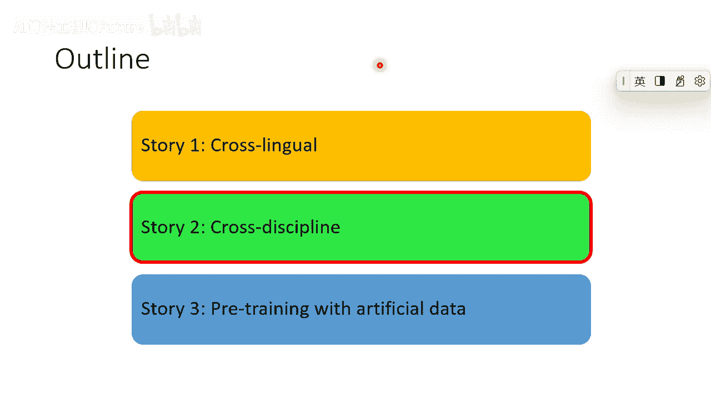

什么叫跨学科的能力呢，这边我们要做的事情是，假设我们把model pretrain在人类的语言上，接下来我们能不能够让他去做一些跟人类语言，完全无关的任务，比如说DNA的分类或蛋白质的分类。

如果我们让这些模型去做一些跟人类语言，完全没有关系的任务，它会有帮助吗，哦那等一下要讲的啊，是高伟聪同学在ENNLP，2021发表的论文呢，啊等一下只是摘要部分的实验结果，那如果你想要更知道论文的这个。

详细的实验结果的话，可以参见放在右下角的论文好，那这一些的训练在人类语言上的，在人类语言上做PRETRAIN的bird，它把它用在跟人类语言无关的任务上，到底有没有帮助呢。

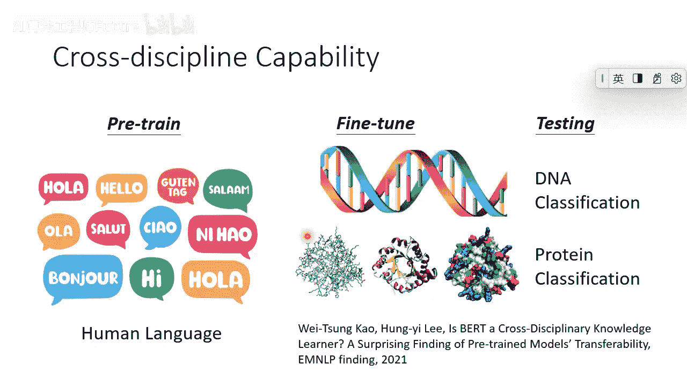

那你第一个也许会想要问的问题是，PRETRAIN在人类语言上的模型，它只会在人类语言上做填空题，他只看得懂人类语言，他只会拿人类语言当做输入，那怎么把它用在DNA或蛋白质上呢。

DNA就是由四种去氧核糖核酸所构成的哦，DNA是由ATCG4种去氧核糖核酸所构成的，所以如果给你一个DNA的序列，那它其实呢是用AT，CG等一连串的符号所表示的，那接下来呢我们就建一个表格。

这个表格里面把ATCG4种去氧核糖核酸，分别对应到英文的四个词汇，而且我们发现这个对应的关系并不重要，等一下虽然没有讲这方面的实验，但是这个对应的关系啊，我们有做过大量的尝试，发现对应的关系并不重要。

这个表格随机生成，就好好，那我们呢假设把A对应到VT，对应到UC，对应到he g对应到许，那给你一个DNA sequence，它是AGAC那A就对到we g就对到she a，再对到WC。

再对到E这个DNA sequence就变成一串英文，未戌未易好，这一段不知所云的英文。

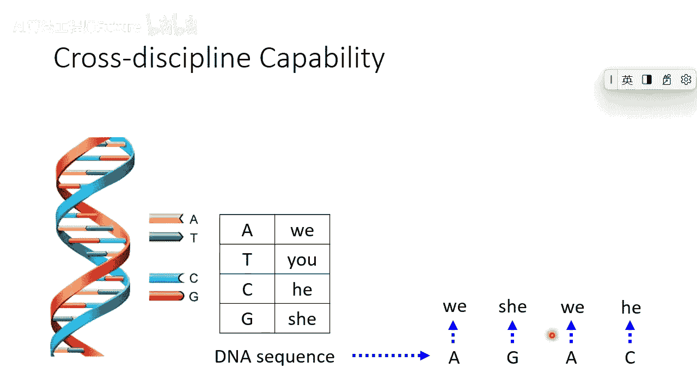

把它丢到BT里面去，然后呢用这个BT的模型来做DNA的分类，那一样呢，呃如果你要做分类的话呢，你需要在bird后面多加一个linear的model，那linear的model是需要transform。

scratch是要从头训练的，但是我们的BT的本体不需要从头训练，它已经有PRETRAIN过了，我们会用个PRETRAIN的BT来做initialization，那我这边要特别强调的事情是。

我知道已经有很多研究，在DNA在蛋白质的sequence上面做PRETRAINING，我这边要做的研究，跟那些在DNA蛋白质上做PRETRAINING的研究，是完全不一样的。

我们这边要做的事情是这个bird，他是在英文上做填空题，它是PRETRAIN，在英文上，但我们把它用在蛋白质上面，用在DNA的分类上面，看看会发生什么样的事情好。

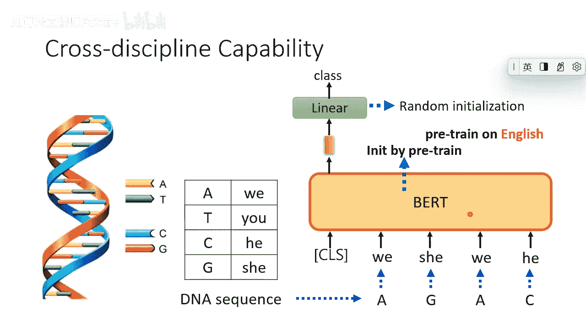

那以下呢就是实验结果哦，我们试了三个不同的蛋白质分类任务，我们试了四个不同的DNA分类任务，我们还试了一个音乐的分类任务，那这边这个音乐的任务啊，并没有真的用到声音讯号。

它是根据音符来判断一首歌的风格好，那这边我们就做了一大堆，跟人类语言无关的任务，好，那这个蓝色的框框里面的结果啊，是假设你没有用PRETRAIN在英文上的模型，这是你在这些不同的任务上可以得到的正确率。

这边的数值是正确率，所以越大越好，如果我们用PRETRAIN在英文上的bird，来做这三个蛋白质的任务，这四个DNA的任务，还有这个音乐的任务，会发生什么事呢，红色框框里面得到的是有使用BT的正确率。

你会发现如果比较有用BERT的结果，跟没有用BT的结果，在所有我们尝试的任务里面，有用BT正确率都有显著的提升，最神奇的事情是BERT，他明明就是用英文的填空题来做PRETRAINING。

但是神秘的事情是，在跟人类语言完全无关的任务上也有帮助，所以这显示什么，这显示说这些PRETRAIN的model，它不只只是学到人类语言的语义而已，因为他不止会解人类语言相关的问题。

它还可以解跟人类语言无关的问题，这显示说他不只是学到语义，他还学到了一些更通用的能力，而这些更通用的能力，是可以让他解一些跟语言无关的任务的，这些更通用的能力可以让他把所有的分类任务。

所有的其他机器学习的任务都做得更好好。

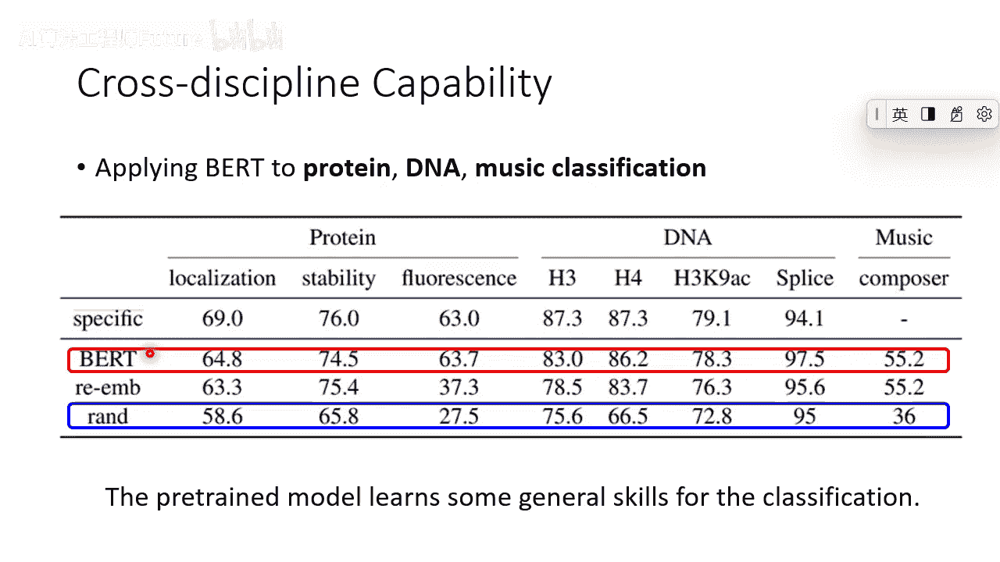

那有人可能会想说，你才试了一个PRETRAIN的model，会不会这只是巧合，那我告诉你说这个不是巧合，不是劝在英文上的那个BT有什么特别的地方，我们这边试了四种不同的PRETRA的model。

我们试了bird，试了ROBERTA是ALBERT，还试了bird c bc呢就是PRETRAIN在中文上的那个bird，那这边呢我们显示了，在我们放了在DNA的分类上的结果，在蛋白质分类上的结果。

还有在音乐分类上的结果，蓝色的这些bar啊，蓝色的这些bar代表有用PRETRA，在人类语言模型上的结果，那橙色的这个B代表没有普圈的结果，你会发现很明显的各种不同，普圈在人类语言上的模型都有帮助。

各种不同体现在人类语言上的模型，都对DNA的分类，蛋白质的分类等等，跟人类语言无关的任务有帮助。

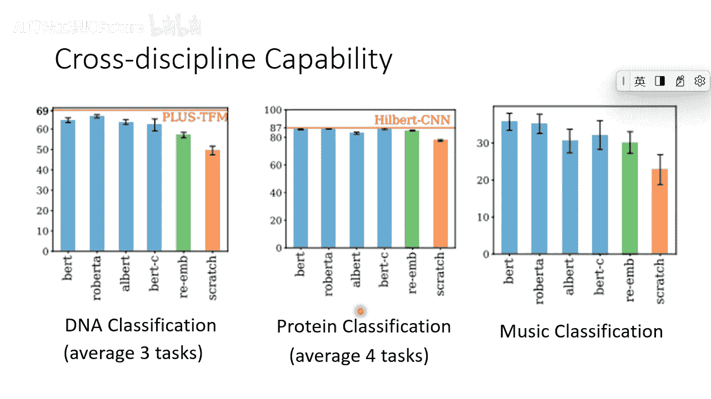

那接下来你可能会问说既然有帮助，那是在哪一个面向上带来帮助呢，是让这个在人类语言上PRETRA，是让DNA的任务在optimization的时候更容易，还是让这些模型generalization。

也就是举一反三的能力变得更好呢，好那到底是哪一个呢，我们先来看optimization的能力，要知道说一个模optimization做得如何，就是观察training的过程中。

你的loss function的变化好，所以这个图是某一个任务，那其实其他任务做起来这个结果也差不多了，这边只是举个例子而已哦，某一个任务在训练的过程中loss的变化。

那scratch就是代表没有用PRETRAIN的模型，没有PRETRAIN的模型，loss很快就没有办法下降了，很快就卡住了，如果有用PRETRAIN的模型，有用BT的话，你发现这个loss的下降呢。

是可以比train from scratch，橙色的这条线下降的更多了，这个实验告诉我们什么，这个实验告诉我们说，这些PRETRA的模型它有强化optimization的能力，那这些普确的模型。

有没有强化generalization的能力呢，那这边就是举两个例子，我们就看左边这个图就好，而这边呢这两条橙色跟蓝色的curve啊，是训练的过程中lost的变化。

橙色的线是train from scratch，蓝色的线是PRETRAINING好，那我们已经在左边这个图看到说啊，Train from scratch loss，下降的比较慢哦。

这个PRETRAINING也loss，这边呢是下降的比较快的，那但是呢我们故意让他劝久一点，劝到说今天不管是train from scratch还是PRETRAINING。

在training data上都得到非常低的loft，都得到接近零的loft，那今天PRETRAINING跟train from scrh，他们在training set上都做的一样好了。

接下来我们在development says上，他们举一反三的能力如何，那development在这边秀的是accuracy啦，哦所以值是越大越好，那你会发现说会training的accuracy。

是比train from scratch，accuracy还要高的，所以在training的时候可以压到差不多的loss，但是PRETRAINING的模型，它的举一反三能力是比较强的，在训练资料上。

PRETRAINING跟train from scratch的结果，有办法做到一样好，就算你在训练资料上把PRETRAINING跟train，FUNQUCH做到一样好。

在development set上，当你要测验你的模型举一反三的能力的时候，你会发现return的模型，他举一反三的能力也是比较强的哦，所以神奇的事情就是。

这些普遍的模型是帮助了optimization，还是帮助了generalization呢，它是两者都有帮助到他，让optimization做得更好，也让generalization做得更好好。

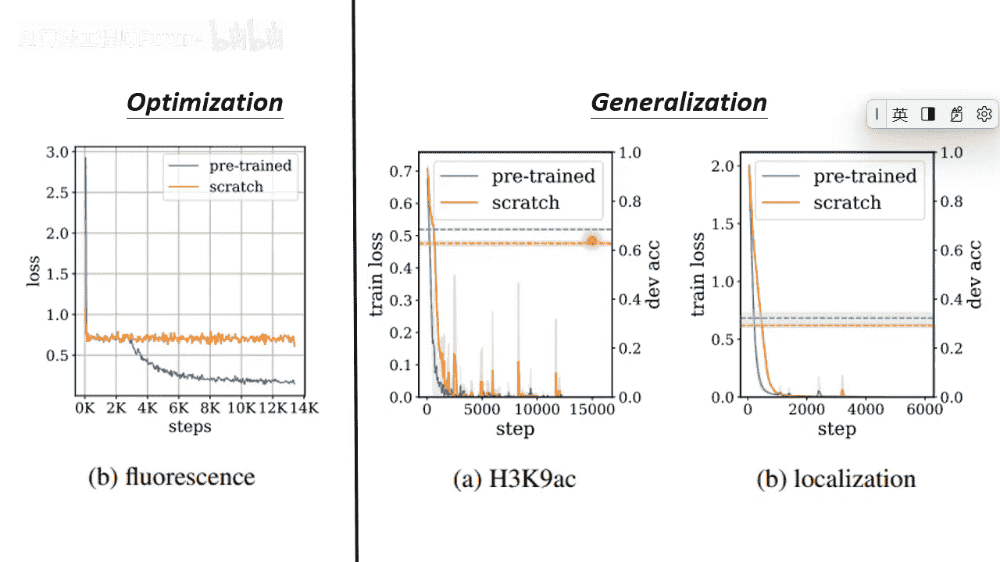

那接下来你要问的问题是，嗯啊发现这个BERT有cross discipline的能力，有跨学科的能力是很神奇的，但是呃呃这个发现能干嘛呢，接下来呢我要跟你讲一个刚才所讲的，跨学科的这个能力的应用。

那这个呢我们可以把这个跨学科的能力呢，用在speech的question answering上面好。

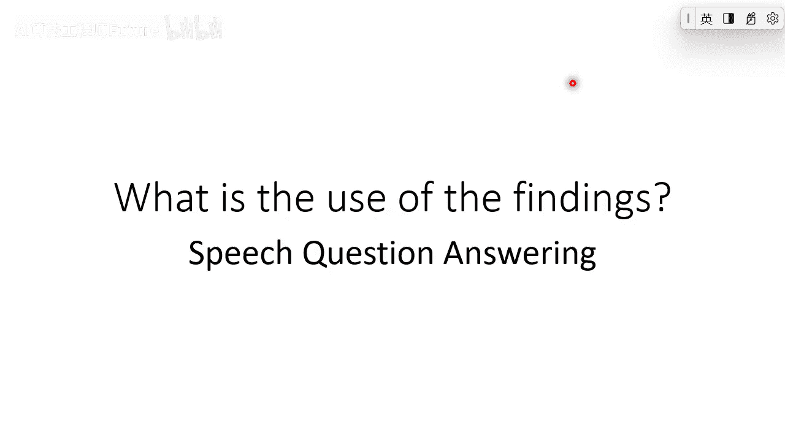

那这个台大语音处理实验室，其实很早呢就开始研究speech question answer，这个问题，我们在2016年之前呢，就尝试想要让机器去做托福的听力测验，也就是让机器呢听一段声音啊。

就跟人去考托福的时候考的考题是一样的啊，让人让机器呢去听一段人考的托福的试题，然后呢给他听一个问题，然后看他能不能从四个选项里面，选出正确的答案，那托福听力测验毕竟是选择题。

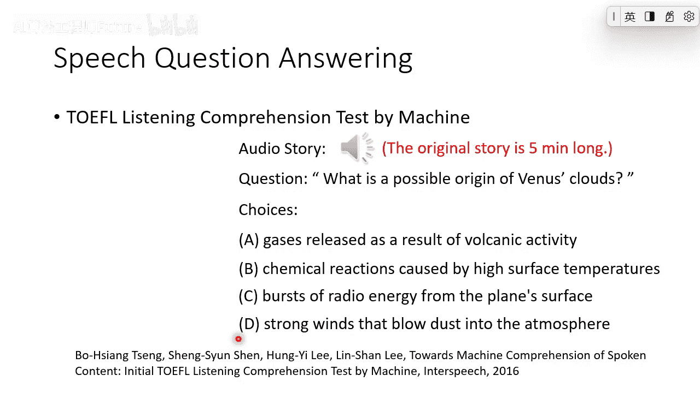

所以还是比较简单的，后来我们又尝试让机器做了真正的question，Answering，所谓真正的question answering，就是说你给他一个问题，给他一篇语音的文章，好。

告诉你说正确的答案出现在这个语音文章的，这个声音档的第几秒到第几秒啊，那这个是发表在这个inter speech，2018的文章了，那当时我们做了一个可以拿来做speech。

question answer的benchmark，POPUS叫做spoken squad，那顾名思义它就是squad的语音版好，那但是当时是怎么解的呢。

当时要解speech question answer的问题啊，都是用一个cascade的model，也就是我们先把声音讯号，透过语音辨识辨识成文字，然后呢在语音辨识的结果上面去做理解。

套用一个文字处理的模型，在语音辨识结果上面进行理解。

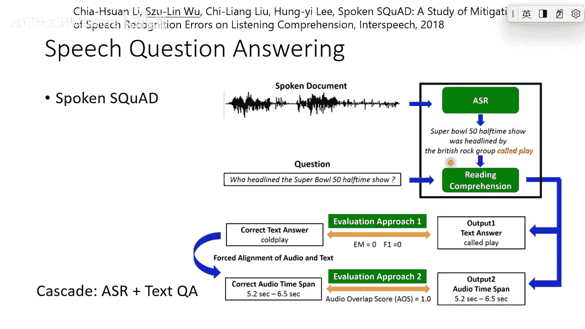

后来啊有一个很厉害的模型叫做speech bird，这个speech bird呢它是一个，这个是庄永松同学做的啊，这个speech bird呢它是一个ENTUN的模型，它确实可以给他语音档。

给他问题就输出，这个在语音档的哪些哪一个位置有出现答案，但是他在训练的时候啊，他还是需要语音跟文字成对的资料，才有办法训练这个speech bird哦。

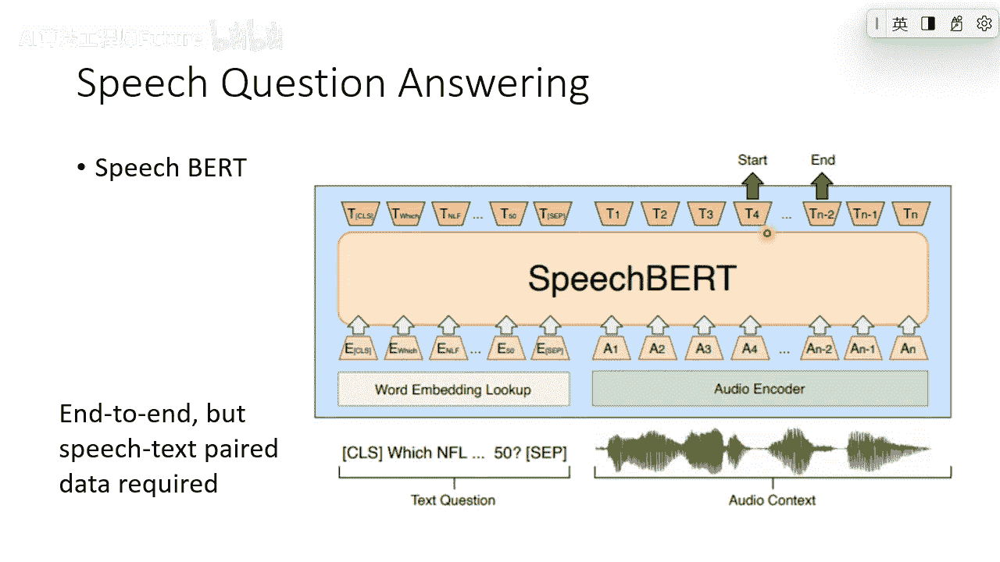

所以这个speech bird离我的梦想还差一步，我对于speech selection answer的期待是，我们有没有可能，我们的训练资料是完全没有文字的，transcription的。

我们只有语音的问题，语音的文章还有标注答案，出现在语音文章里面的哪一个片段，我们没有任何文字的transcription，在这种情况下，我们有没有可能训练一个QA的模型。

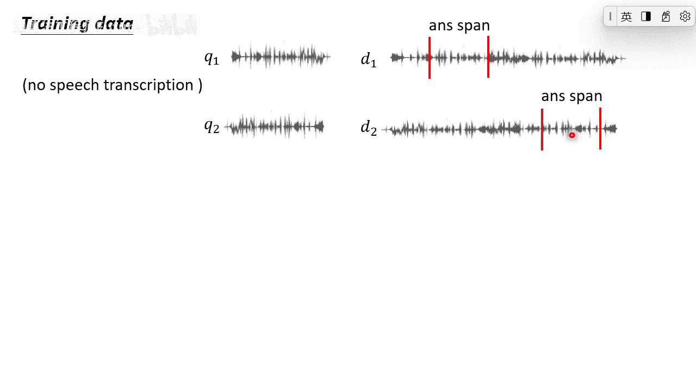

这个QA的模型不做语音辨识，它可以做到听一个问题，听一段声音档，然后根据这个问题的内容，他就可以找出在声音档的哪里，到哪里有出现问题的答案呢，我们有没有可能在完全不做语音辨识。

在完全没有任何语音跟文字成对资料的情况下，就学一个NTN的模型，读声音档。

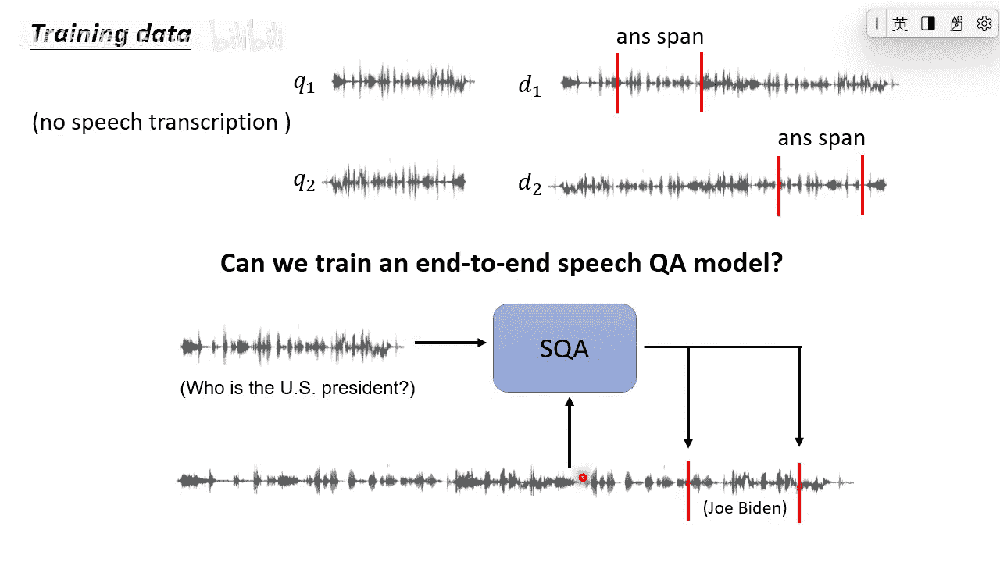

直接告诉我们，答案出现在声音档的哪一个位置呢，过去啊这一直是一个很有挑战性的问题，然后训练一个模型，他读语音的问题，读一段语音档，告诉你说正确答案落在声音档的哪里，那直接劝显然难度非常的高。

但是今天呢我们有了PRETRAIN的语音的模型，比如说HUA，所以我会觉得说有了这些PRETRA的模型，也许我们有机会再来挑战一次，End to end speech question answer。

但是我们用语音的bird，我用这个HUBIRD呢来initialize这个模型，语音QA的模型发现哇，语音的QA还是做不起来，我仔细想想，这个结果好像也是可以预期的，为什么呢。

因为如果你分析这些语音的pretrain model，比如说hubert representation，你会发现其实他们没有学到太多语义的资讯，而如果你要解speech pression。

Answer the model，你的模型不只是要能够抽出声音讯号的内容，他还必须要理解这些内容背后所代表的意思。

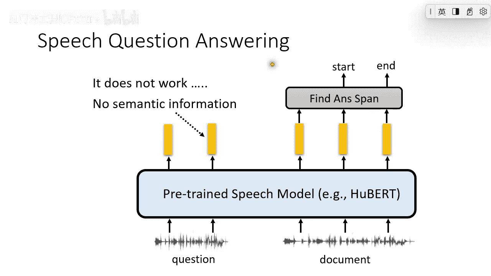

所以也许光用HUBER是不够的，那我们的想法是说，我们把HUBER的输出呢做TOGANIZATION，把它离散化变成discrete token。

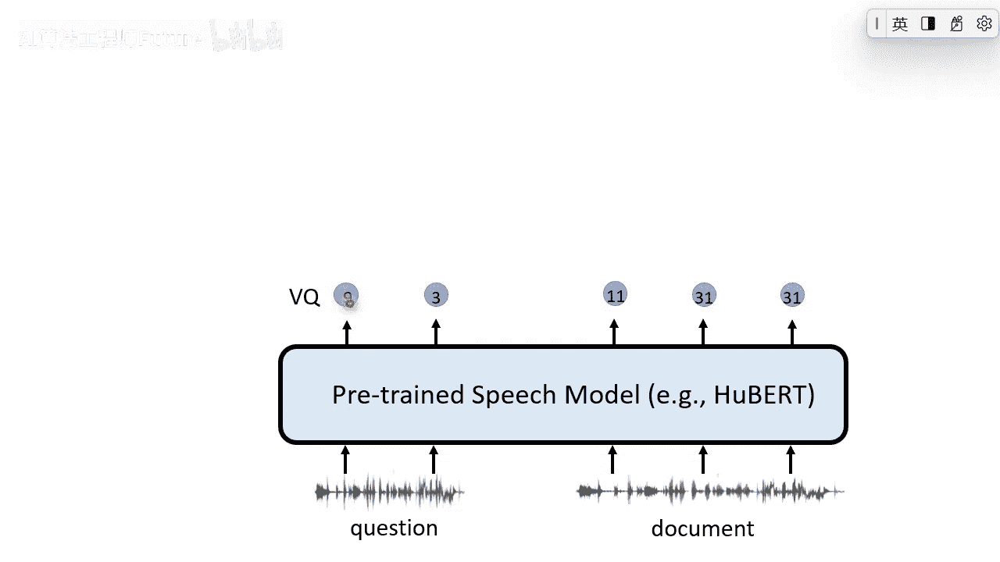

接下来在discrete open后面再叠几层，self attention的layer，那我们期待说也许hub只抽出content的咨询，他是告诉我们声音的内容是什么，但他还没有办法做到理解。

我们期待透过后面多加几层neural network，多加几层self attention，可以让整个模型具有理解的能力，那再多加几个self attention layer以后。

有没有办法让整个模型可以做语音的，speech的question answering呢，答案是不行，还是做不起来好，那怎么办呢，那我就突发奇想想说，会不会我们应该也要PRETRAIN后面这一个模型呢。

嗯我这个接在语音的模型后面的这个模型，这个这些layer是不是应该要用PRETRA，在文字上的bird来做initialization呢，讲到这边，有人可能会觉得说老师你是不是头脑坏掉啦。

你早上是不是吃了什么脏东西啊，这个想清楚啊，这个文字的bird是训练在人类的语言上，所以它的输入是什么，它的输入是文字，那他有办法看得懂语音上面PRETRAIN的模型，它的输出吗。

语音上的PRETRA模型，它的输出的这些符号，输出的这些token，输出的这些id跟文字是没有什么关系的，这边这个9号，我们根本不知道对应到哪一个词汇，对应到哪一个文字的词汇。

那我们直接把这样的东西丢给文字上面，PRETRA的bird，那会有好的结果吗，呃我如果之前没有做过，把BT用在DNA上面的实验，我可能会觉得这个实验呢根本就是在瞎搞，但是你想想看。

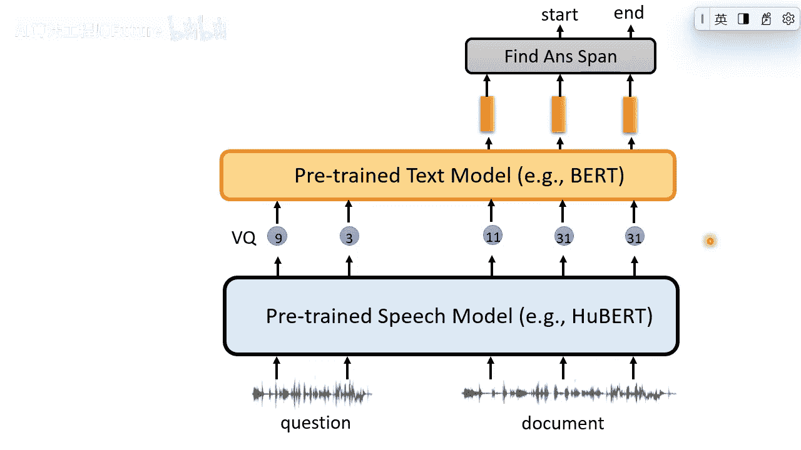

我们刚才已经看到训练在文字上的bird，可以用在DNAR蛋白质的分类任务上，所以其实我们也可以做一样的事情。

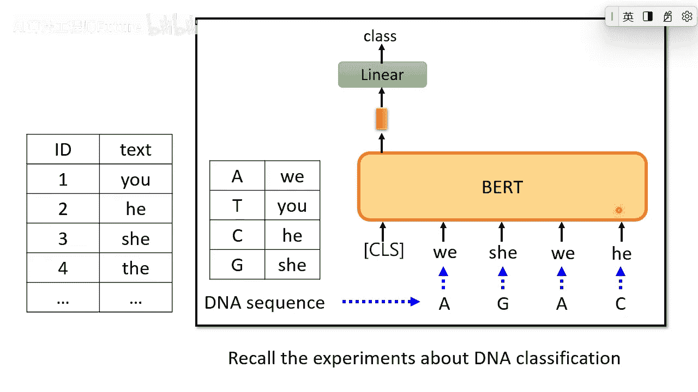

我们可以把这一个HUBER呢，它output的这些id就随机对应到英文的文字啊，比如说id编号一就对应到U2，就变对应到he，以此类推，然后呢把这些id转成文字以后，丢给文字的BERT。

让他来做question answering，然后呢他会可以，然后我们翻to这个文字的bird，看看能不能够把speech的question。

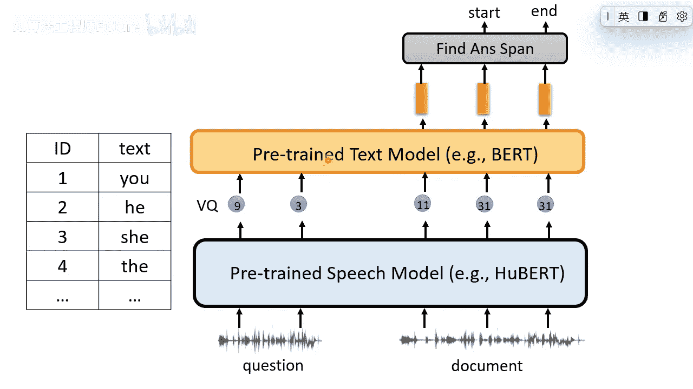

answering做起来，结果是如何呢，结果是有PRETRAIN以后，神奇的事情是就起飞了，如果没有拿文字的bird来PRETRAIN这个黄色的module。

那你的f one score是6percent，那基本上就是没做起来，但是如果用语文字的模型来PRETRAIN，这个黄色的model哦，那你可以得到54percent的af one score。

也就是说你现在有语音上PRETRA的模型，也有文字上PRETRA的模型，把它们两个接起来以后，达到了不可思议的效果，可以真的把speech recreation and then做起来。

可以得到54percent的f one for。

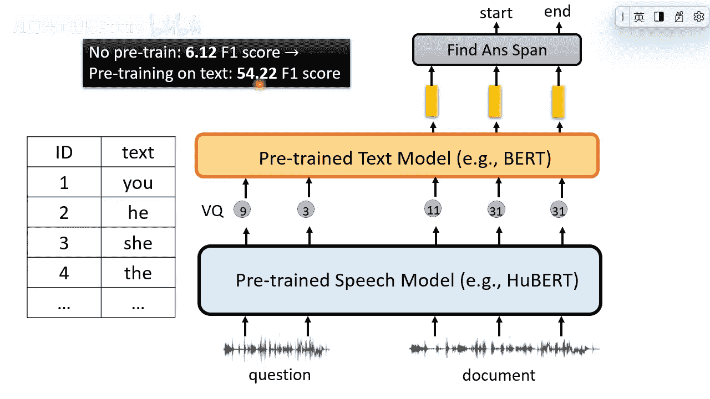

那这个54percent的f one score，它的表现到底是多好呢，那这边呢就只列一个图表了，那如果大家有兴趣的话，这个是林冠婷同学做的，可以参见林冠婷同学的论文哦，那这个绿色的这一条线呐。

它是cask的模型的表现，也就是你先把声音讯号做语音辨识，把它转成文字，在这些文字上面再去做question answer，那因为有做语音辨识，所以显然你的模型受到语音辨识的错误率，影响非常的大。

所以我们这边的横轴是什么，横轴是语音辨识的错误率，纵轴是QA的正确率，那我们发现随着语音辨识的错误率越来越大，QA的模型，它的这个错误率呢会越来越高，答对的题目会越来越少，那这是很直觉的。

如果语音辨识辨识错了，后面再接一个QA的模型，显然他也没有办法得到正确的答案，蓝色的这一条线呢是n to n，完全没有做语音辨识的模型，蓝色这条线就是我刚才讲的，把一个语音上普圈的模型。

后面再接一个文字上普片的模型所得到的结果，那你会发现蓝色这一条线呢，基本上不受语音辨识错误的影响，那当语音辨识错误的，这个语音辨识错误率大概超过25，percent的时候，这个蓝色的这个NTN的模型。

它的正确率居然可以超过，有做语音辨识的模型哦，所以神奇的地方是，把语音的PRETRAIN模型加上文字的PRETRAIN模型，合起来，得到不可思议的效果。

我们可以真的有机会把speech question。

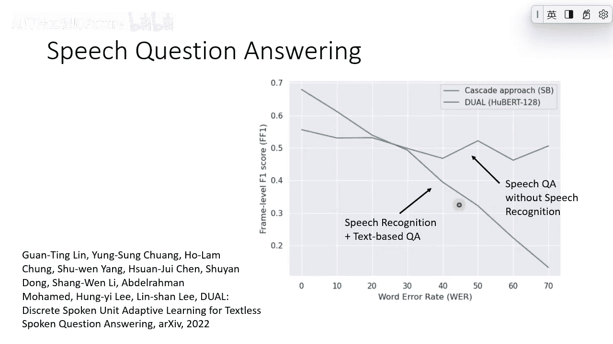

Answering，end to end的训练出来，好，这是第二个故事，那第三个故事啊，我想跟大家分享的是，我们甚至可以在人造的资料上训练出bird好。

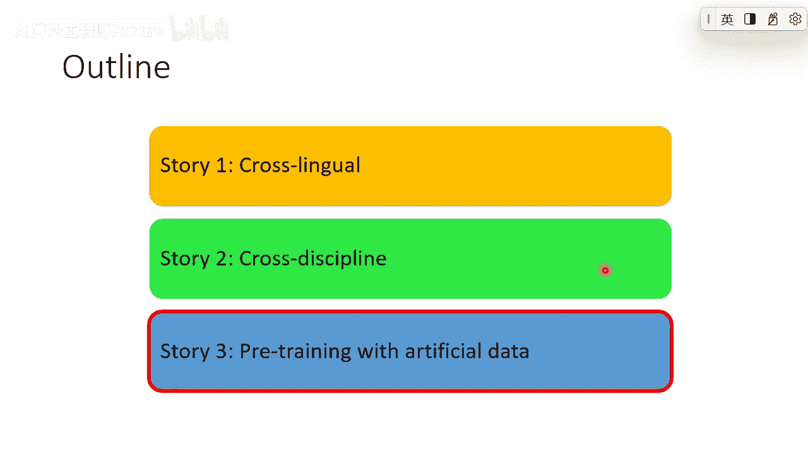

那我们知道说一般而言，那BT呢就是训练在人类的语言上，然后呢你会在这个NLP的任务上面呢做，Thank you，然后做测试，那在NLP的任务上呢，最知名的就是group。

这个data set里面有好几个NLP的任务，那通常会用group的data set来解释bird模型，它trad的好不好，这个PRETRAIN有没有学到东西，但是我们刚才已经有看到说。

今天这些PRETRAININGA，他有很厉害的跨语言的能力训练，在人类语言上的模型都可以去解DNA的分类，那如果我们要解人类语言相关的NLP任务，我们真的需要拿人类的文字来做PRETRAINING吗。

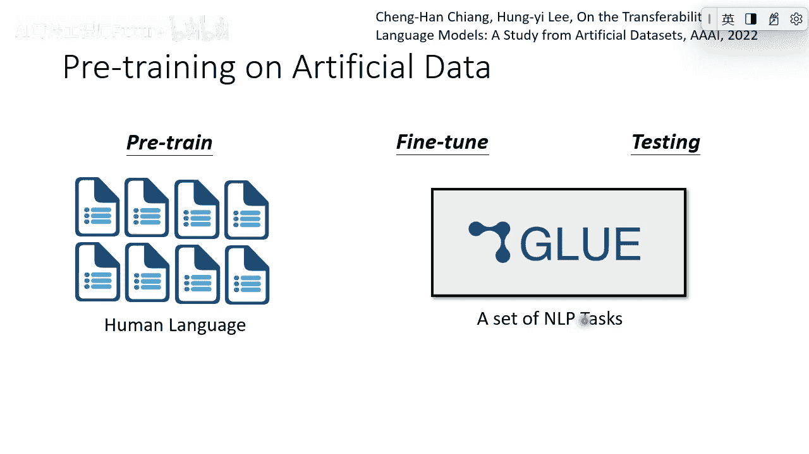

我们能不能不用人类的文字来做PRETRAINING，那我们这边又做了一个尝试，我们呢用一些简单的规则，产生一些token的sequence，我们用一些简单的规则制造出假的资料。

在这些假的资料上面做PRETRAINING，但BERT呢在这些假的资料上面学习做填空题，然后看看他在group上面会有什么样的表现，那你可能会问说做这个实验有什么意义呢，做这个实验的意义是。

我们可以透过使用不同的规则，产生不同的人造的资料，那有不同的人造资料，我们就可以让BERT具备不同的能力，然后我们可以借由让BERT具备不同的能力，知道说如果我们要让一个普圈的模型。

在人类语言相关的任务上，在group上面有好的表现，那什么样的能力是重要的，什么样的能力是必须的，而这个研究成果呢是帮大家上过很多次课的。

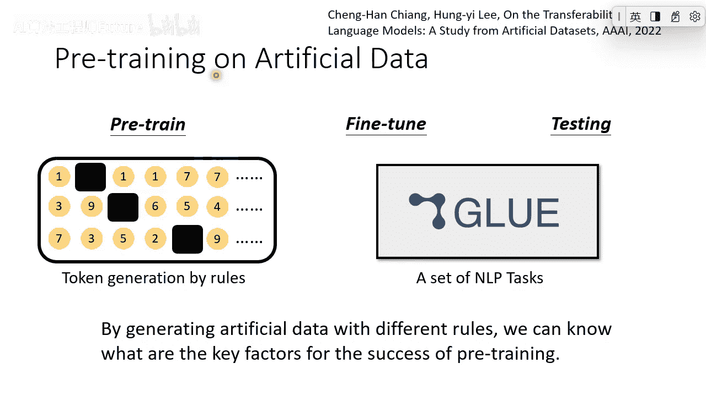

江澄汉同学的研究成果，那我们把实验流程讲的更具体一点好，所以我们就是有人造的资料，拿这些人造的资料呢来训练一个bird啊，这个bird不是一般用人类语言训练的bird。

他是用人造的资料训练出来的bird，所以他只能够读这种id，他读不懂人类的语言好，那你怎么拿这样子的BT，来做人类语言相关的任务呢，啊你就是有一个人类语言的句子输进来，你需要有一个表格告诉我们说。

人类的语言的每一个词汇对应到这个啊，这个人造资料里面的哪一个id，那这个id跟这个人类语言之间间的对应关系，随机生成，就好好，所以那个D呢就对应到编号一。

movie呢就对应到编号101意思就对应到编号三，good就对应到编号四，以此类推好，所以一个人类的句子，它会被转成一个token sequence丢到BIRT里面。

然后呢你就把这个token sequence输入到BT里面，接下来你就做举例来说，假设你现在要做的是sentiment classification，要决定说输的这个句子是正面的句子，还是负面的句子。

那你就会去train这个linear的model，然后这个BT呢有他是用这个token id pretrain过，但是你也可以find to呢这个bird的模型好。

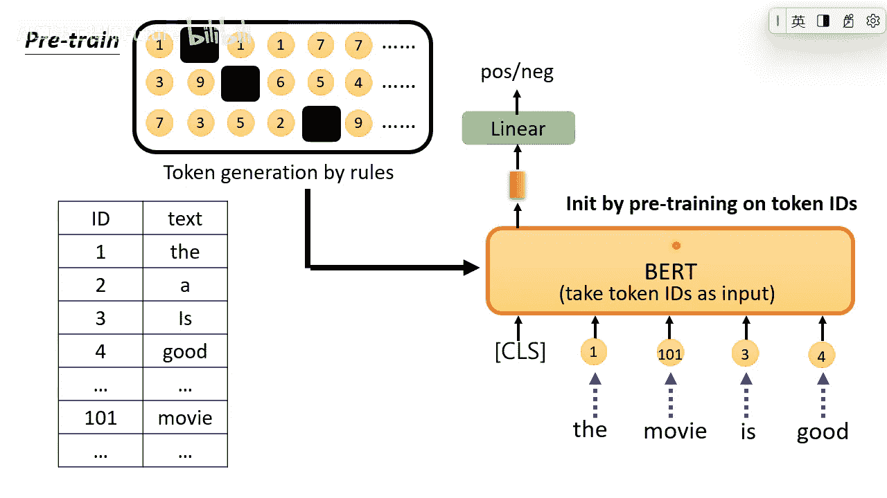

那接下来呢我们就来看看实验结果怎样好，那这个图表上的纵轴啊，代表的是，如果我们比较有PRETRAIN的模型跟没有PRETRAIN，也就是train from scratch的模型。

他们在入的那些任务上平均表现的差异，那个值这个值越大，就代表说PRETRAIN这件事情越有效，那我们先来看看拿英文资料PRETRAIN的结果，如果拿英文资料。

PRETRAIN相较于train from scratch，你有20percent的进步哦，所以这可以看作是upper b了，如果你今天要解英文相关的任务，当然是拿英文的PRETRAIN的资料。

结果会是最好的，拿英文的PRETRAIN的资料，在英文的相关任务上，相较于没有PRETRAIN啊，有20percent的进步，那今天如果我们的这个token啊，我们的这个人造的资料啊，是随机生成的。

那会发生什么事呢，我们发现如果是用随机生成的资料诶，那PRETRAINING完全就没有帮助。

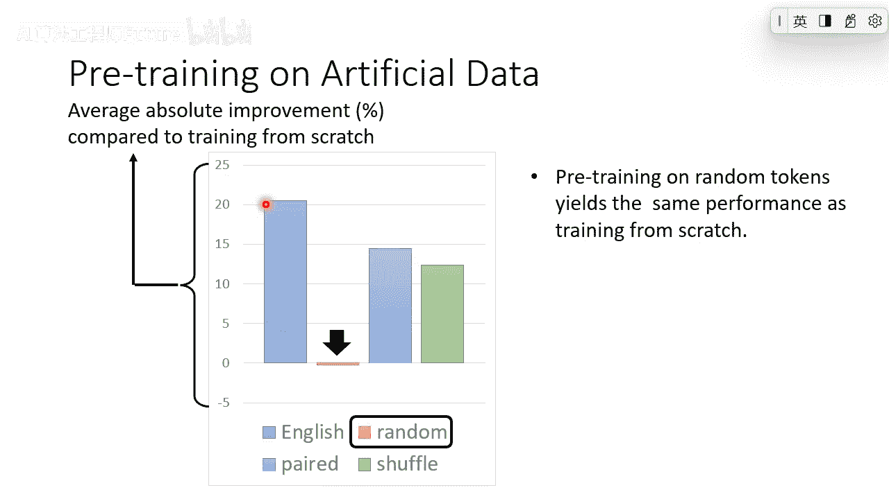

所以这告诉我们什么事情，这告诉我们说资料还是重要，因为我们刚才前面看到说，BERT有神奇的这个跨学科的能力，怎么训练在呃人类语言上，在DNA上也有用，那这会让人不禁怀疑说，会不会资料本身在什么资料上面。

PRETRAIN根本不重要，重要的也许是PRETRAIN这个动作只要有做PRETRAIN，在什么资料上都会好，但是呢我们现在这个实验就是破解，刚才那个假设资料还是重要的，如果你今天的资料是随机生成的。

没有什么规律，那拿这些没有规律的资料做PRETRAIN，那也是没有帮助好。

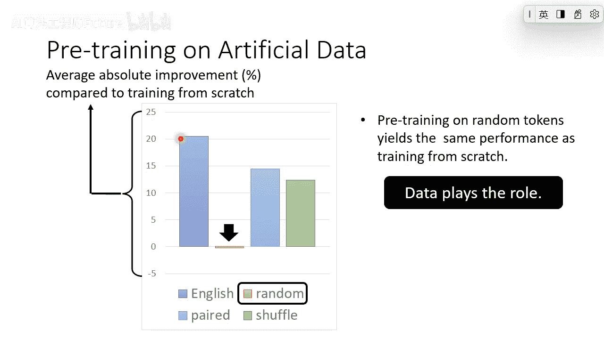

那接下来呢我们发现有某一种人造的资料，非常有用，他可以得到几乎15percent的进步量哦，跟训练在英文上其实只差了一点点，那什么样人造的资料非常有用呢，我们发现假设你生出来的这一些token呢。

它是成对的，也就是你产生出来的sequence里面，如果出现一个五，那等一下一定要出现一个五哦，出现个三，等一下一定要出现个三，出现个零，等一下一定要出现个零，如果你产生出来的sequence是成对的。

拿这种成对的资料来训练bird，在人类语言上面诶，神奇的事情是非常有效，跟英文只差了一点点，大概可以做到英文的3/4，那么好好，那为什么会这样呢，过去也有一篇论文有做过很类似的事情啊。

他也有拿人造的资料来训练一个模型，只是那个时候做的不是今天的bird啦，所以那个实验的setting是非常不一样的，不过去呢这篇dangerous sky的paper呢。

他说learning music helps you read，所以他也发现说券在一些人造的资料上面，会对自然语言处理有帮助，那他也发现说这种成对的资料呢是蛮有帮助的，这种在成对的资料上做训练。

是对自然语言处理是有帮助的，那也许是因为啊在人类的语言里面，有时候也会有这种成对的结构，你提到某一个词汇的时候，接下来接另外一个词汇的几率就会非常大，你提到I的时候，后面比较可能会接an。

你提到I的时候，后面不会接R等等，人类语言好像也有这种成对的资讯，也许这可以解释，为什么在这种人造资料上面做PRETRAINING，是有用的好。

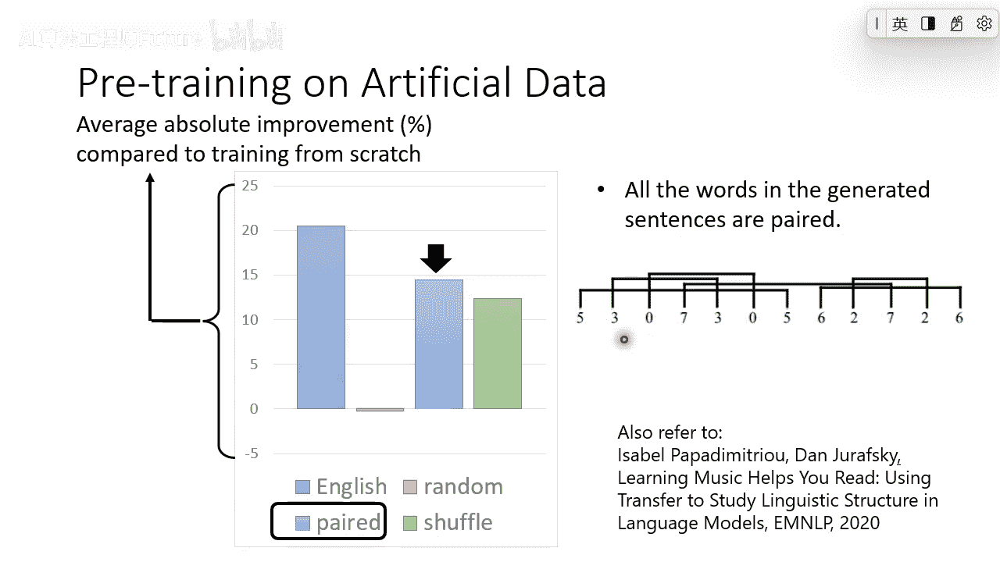

那接下来更离奇的事情发生了，我们有另外一种方法叫做shuffle啊，这个shuffle呢，它可以达到跟刚才那个成对的资料，也是差不多的，PRETRAINING的进步量，那这种shuffle是怎么做的呢。

这种shuffle的做法是你先给一个你先产生呢，嗯你先产生一些连续编号的token sequence，比如说1~64，接下来把它随机的shuffle，把它的顺序呢打乱。

然后在这个打乱顺序的这个sequence上面呢，去做mask，去做填空题，那你会发现说你的模型训练，在这种打乱的sequence上面，它也非常好，这种打乱的sequence。

对于PRETRAINING来说非常有帮助，那这个就非常难以解释啊，你就很难解释说这样子的sequence，跟人类的语言有什么关系，那神奇的事情就是诶这样子的sequence啧。

对retraining用在人类的语言上，居然是有帮助的好，那到底是由什么样的原因，造成这一些人造的资料有用或没有用呢，我们刚才一开始说，我们想要透过不同的人造的资料，让模型具备不同的能力。

看看说什么样的能力，对于解NLP的任务是重要的，那到底什么样的能力，对于解NLV的任务是重要的呢。

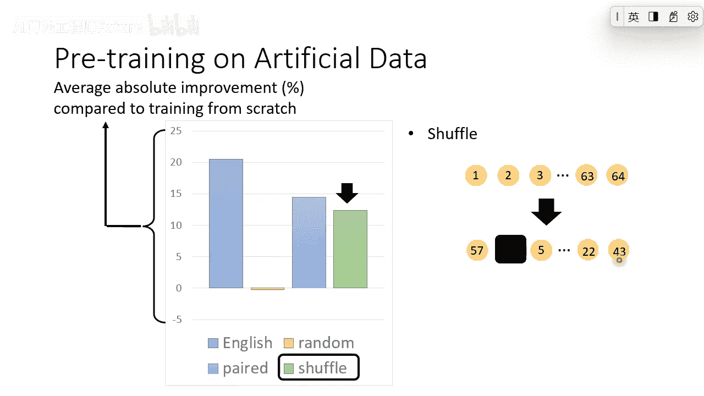

我们没有非常精确的答案，但是这边我们有一个发现给大家参考哦，这个发现是什么呢，左边这个图啊，它的纵轴仍然是PRETRAINING，跟没有PRETRAINING相相的。

这个PRETRAINING跟没有PRETRAINING相减后的差异哦，所以值越大代表training越有效好，那这边46846，32的数字代表什么意思呢，这个数字代表说。

我们一样都是用刚才shuffle的方法，但是如果我们今天选的是数字四的话，就代表我们一次只产生四个数字连续的token，比如说我们先产生1~4，然后接下来呢就要重新产生四个数字，连续的token。

比如说3~6，然后接下来呢我们以四个四个为单位，把四个token做打乱，四个token做打乱，那在这个及sequence上面去做PRETRAINING，那我们发现说呢，如果你今天只用四个四个一数。

你每次只产生四个连续的sequence啊，那你的这个进步量呢其实没有很大，但如果你是产生64个连续的sequence，诶，这个进步量就很可观了，这告诉我们什么。

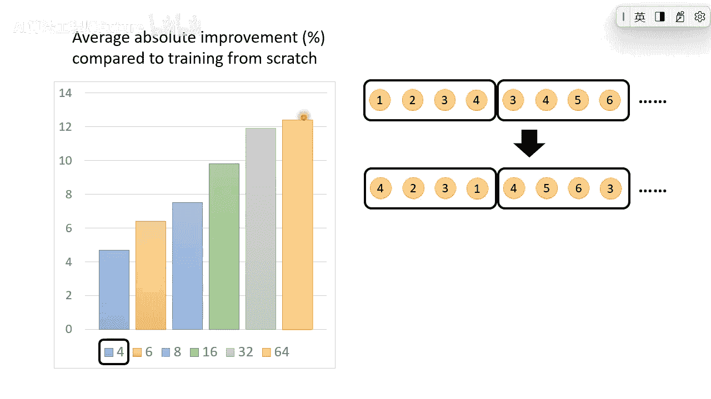

这告诉我们说，假设你给你的pretrain model，这个产生比较长的连续数字的sequence，那只要解这样子的问题的填空题，那你的模型必须要学会看一个比较长的范围，那有可能看一个比较长的范围。

对于PRETRAIN重要的，如果今天模型在PRETRAIN的时候可以学，看一个sequence里面比较长的范围，可以让他在NLP的当选任务上面做的比较好，但这只是一一个发现了。

有没有其他的因素影响这些模型呢，有没有其他的因素也对NLPLPRETRAINING，很重要呢，这个是尚待研究的问题，我们这边只提供个发现，发现说，如果你强迫让你的sequence在prepare的时候。

可以看到比较大的范围，强迫他要看比较大的范围，三个解填空题的话，那他可能可以做的比较好。

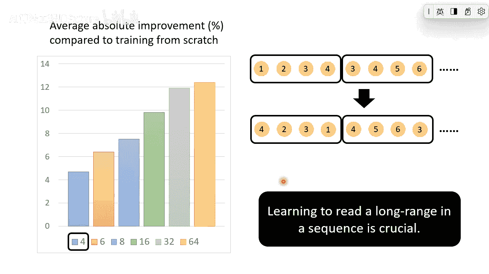

那有没有其他的factor目前还在研究中好，那以上呢就是跟大家分享三个有趣的，跟self supervised learning有关的故事，然后呢。

这个self supervised learning还有很多未解之谜，等着大家来发现，然后这个就是今天想跟大家分享的内容。

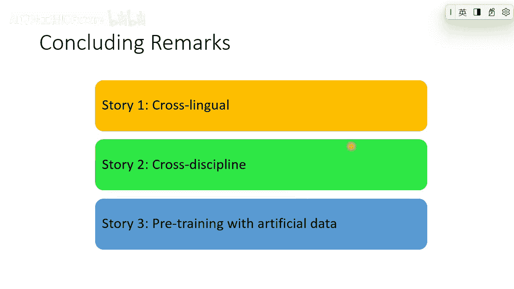

谢谢大家。