# 【官授搬运】2026年全新优化版李宏毅机器学习系统课程，这才是真正的初学者体系课程！—人工智能／深度学习／神经网络 - P76：【第十二讲】1-概述增強式學習 (Reinforcement Learning, RL) (一) – 增強式學習跟機器學習一樣都是三個步驟 - AI算法工程师Future - BV1ruqABeEFX

好那我们来上课吧，啊那这一堂课啊，我们要讲的是deep reinforcement learning，也就是RL，然后像这个RL啊，reinforcement learning呐，大家一定一点都不陌生。

因为你知道很多很很潮的应用，阿尔法狗等等啊，他背后呢用的就是RL的技术，那I有可以讲的技术啊，非常非常的多，他不是在一堂课里面可以讲得完的，我甚至觉得说，如果有人要把它开成一整个学期的课。

可能也是有这么多东西可以讲的，所以今天呢这堂课的目的，并不是要告诉你有关RL的一切，而是啊让大家有一个基本的认识，大概知道RL是什么样的东西，那IO相关的课程，你其实在网络上可以找到。

非常非常多的参考的资料，那IO如果要讲的非常的艰涩，其实也是可以讲的非常的艰涩的，但是今天这堂课啊，我们尽量避开太过理论的部分，我期待这堂课可以让你做到的，并不是让你听着觉得哇哎呦很困难啊。

搞不清楚在做什么，而是期待让你觉得说啊，哎呦原来就只是这样而已，我自己应该也做得起来，好希望这堂课可以达到这个目的好，那什么是reinforcement learning呢。

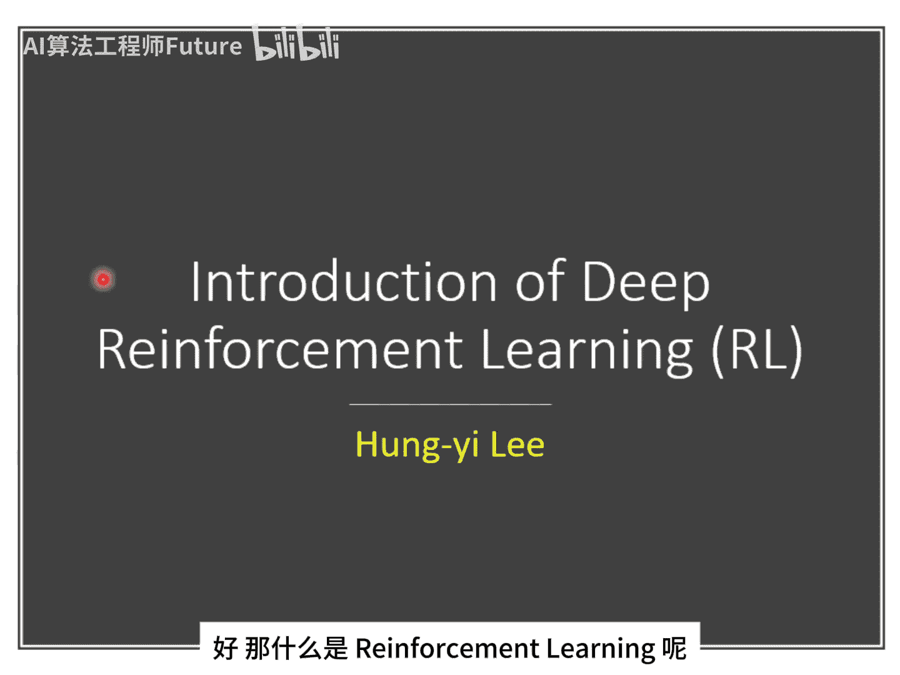

到目前为止啊，我们讲的几乎都是supervised learning，假设你要做一个image的classify，你不止要告诉机器它的input是什么，你还要告诉机器它应该输出什么样的output。

然后接下来呢你就可以train一个image的classify，那在多数这门课讲到目前为止的技术，基本上都是基于supervised learning的方法。

就算是我们在讲sales supervised learning的时候，我们其实也是很类似supervised learning的方法，只是我们的label不需要特别雇用人力去标记，它可以自动产生。

或者是我们在讲auto encoder的时候，我们虽然说它是一个unsupervised的方法，我们没有用到人类的标记，但事实上我们还是有一个label，只是这个label。

不需要耗费人类的力量来产生而已好，但是IL就是另外一个面向的问题了，在RL里面我们遇到的问题是这样子的，我们机器当我们给它一个输入的时候，我们不知道最佳的输出应该是什么，举例来说。

假设你要叫机器学习下围棋，用supervised learning的方法好像也可以做，你就是告诉机器说，下一步应该落子的位置在哪里，但是问题是，下一步应该落子的位置到底应该在哪里呢。

哪一个是最好的下一步呢，哪一部是神之一手呢，可能人类根本就不知道，当然你可以说啊，让机器阅读很多职业骑士的棋谱，让机器阅读很多高段棋士的棋谱，也许这些棋谱里面的答案。

也许这些棋谱里面给某一个盘是人类下的，下一步就是一个很好的答案，但它是不是最好的答案呢，我们不知道，在这个你不知道正确答案是什么的情况下，往往就是RL可以派上用场的时候哦。

所以当你今天你发现你要收集有标注的资料，很困难的时候，正确答案人类也不知道是什么的时候，也许就是你可以考虑使用RL的时候好，但是I我在学习的时候，机器其实也不是一无所知的。

我们虽然不知道正确的答案是什么，但是机器会知道什么是好，什么是不好，机器会跟环境去做互动，得到一个叫做reward的东西，这我们等一下都还会再细讲，所以机器会知道他现在的输出是好的，还是不好的。

那借由跟环境的互动，既然知道什么样的输出是好的，什么样的输出是不好的，机器还是可以学出一个模型好。

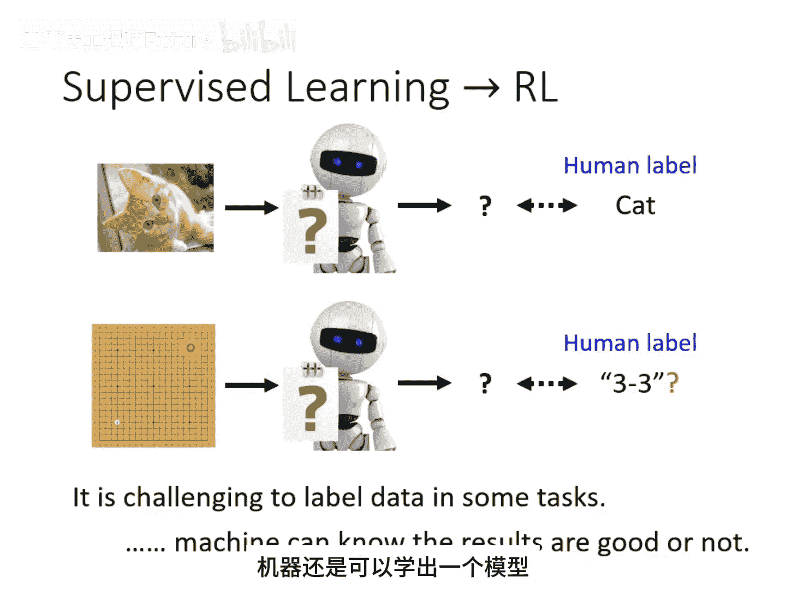

那接下来呢这是今天这份投影片的online，首先呢我们会从最基本的RL的概念开始，那在介绍这个IO概念的时候，有很多不同的切入点啦，也许你比较常听过的切入点是这样啊。

比如说从Mark of decision process开始讲起，那我们这边选择了一个比较不一样的切入点，我要告诉你说，虽然呃如果你自己读IO的文献的话，你会觉得哇IO很复杂哦。

跟一般的machine learning好像不太一样哦，但是我这边要告诉你说，RL它跟我们这门课学的machine learning是一样的框架，我们在今天这个这学期一开始的第一堂课。

就告诉你说machine learning就是三个步骤，那RL呢RL也是一模一样的，三个步骤，等一下会再跟大家说明。

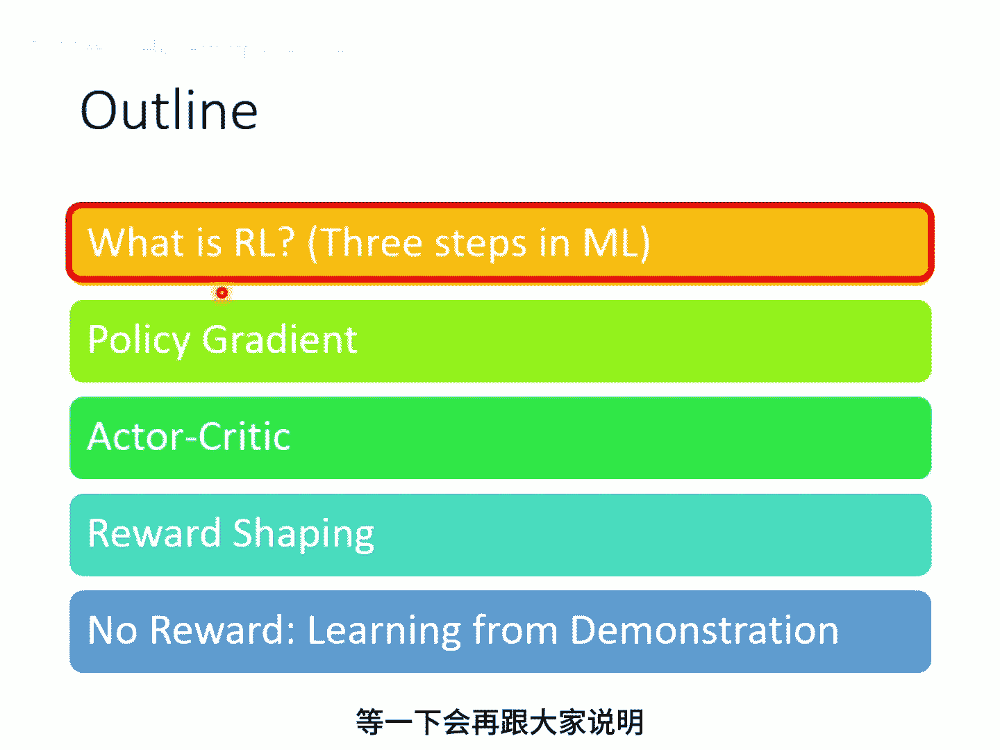

好在今天在在这个本学期这门课的第一开始，就告诉你说什么是机器学习，机器学习就是找一个function reinforcement learning，RL也是机器学习的一种。

那他也在找一个function，它在找什么样的function呢，在reinforcement learning里面呢，我们会有一个EXOR，还有一个environment。

那这个actor跟environment会进行互动啊，你的这个environment，你的这个环境呢会给actor一个observation哦，会给那这个observation呢就是actor的输入。

那actor呢看到这个up after observation以后呢，它会有一个输出啊，这个输出呢叫做action，那这个action呢会去影响environment呃。

这个actor采取action以后呢，environment就会给予新的observation，然后actor呢会给予新的action，那这个observation是actor的输入。

那这个action呢是actor的输出，所以actor本身呢它就是一个function，其实actor它就是我们要找的function啊。

这个function它的输入就是环境给他的observation输出，就是这个actor要采取的action，而今天在这个互动的过程中呢。

这个environment会不断的给这个actor1些reward，告诉他说你现在采取的这个action，它是好的还是不好的，而我们今天要找的这个actor啊，我们今天要找的这个function。

可以拿observation当做input，Actor，当做output function，这个function的目标是要去maximize，我们可以从environment获得到的reward总和哦。

我们希望呢找一个function，那用这个function去跟环境做互动，用observation当做input输出action，最终得到的reward的总和可以是最大的。

这个就是呃IO要找的function，那我知道这样讲，你可能还是觉得有些抽象。

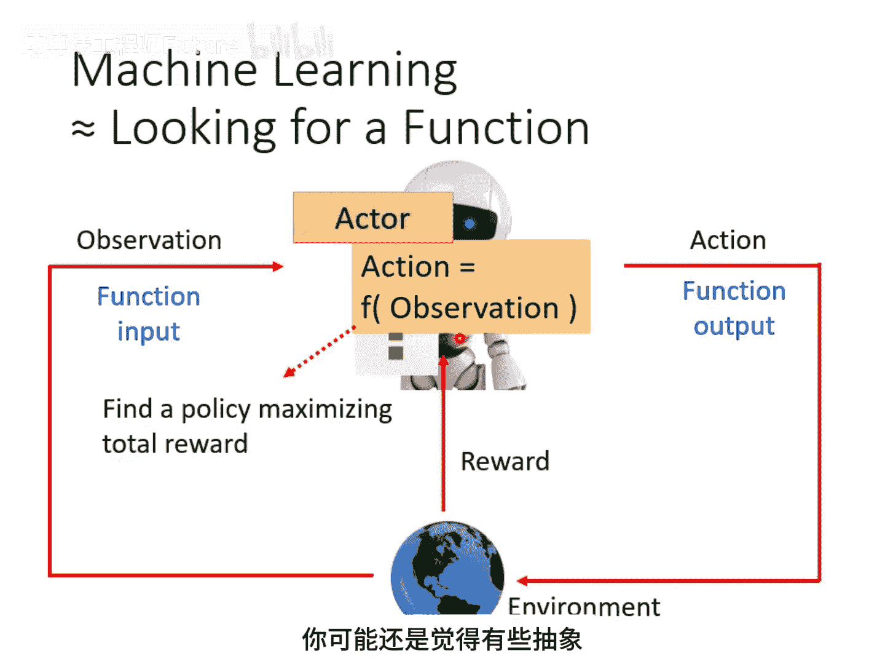

所以我们举更具体的例子，那等一下要举的例子呢，都是用space invader当做例子啦。

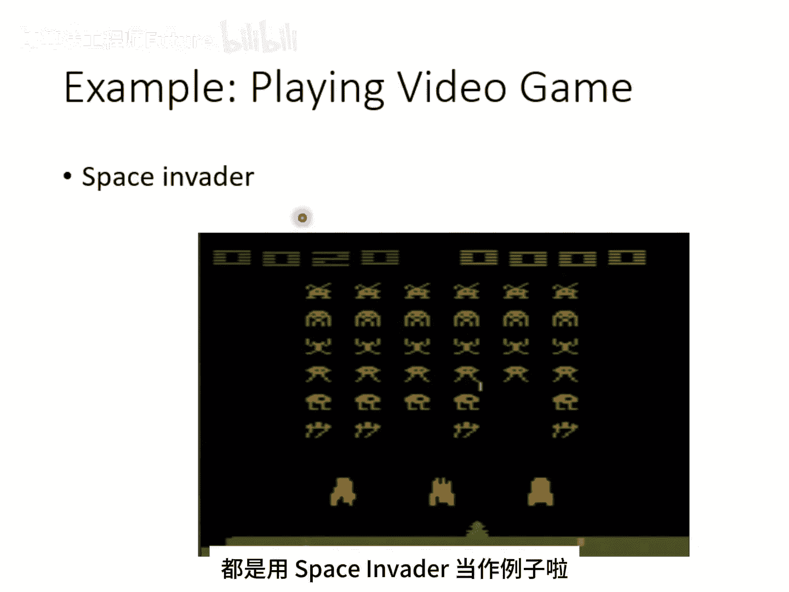

那space invader就是一个非常简单的小游戏，那呃IO呢最早的几篇论文也都是玩，让那个机器呢去玩这个space invader这个游戏，而在space invader里面呢。

你要操控的是下面这个绿色的东西啊，这个下面这个绿色的东西呢是你的太空梭，你可以采取的行为，也就是action呢有三个哦，左移右移跟开火，也就这三个行为，然后你现在要做的事情呢。

就是杀掉画面上的这些外星人啊，啊画面上这些黄色的东西诶，就是外星人啦，然后你开火啊，击中那些外星人的话。

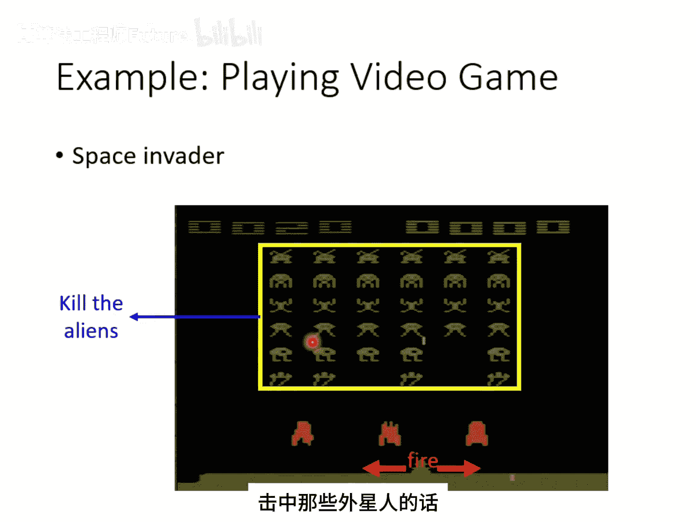

那外星人就死掉了，而前面这些东西是什么呢，那个是你的防护罩啊，如果你不小心打到自己的防护罩的话，你的防护罩呢也是会被打掉的，那你可以躲在防护罩后面，你就可以挡住外星人的攻击，然后接下来呢会有分数。

那荧幕画面上会有分数，当你杀死外星人的时候，你会得到分数，或者是在有些版本的space invador里面呢，会有一个补给包啊，从上面横过去飞过去，那打到补给包的话，会不会加一个很高的分数好。

那这个score呢就是reward，就是环境给我们的reward好。

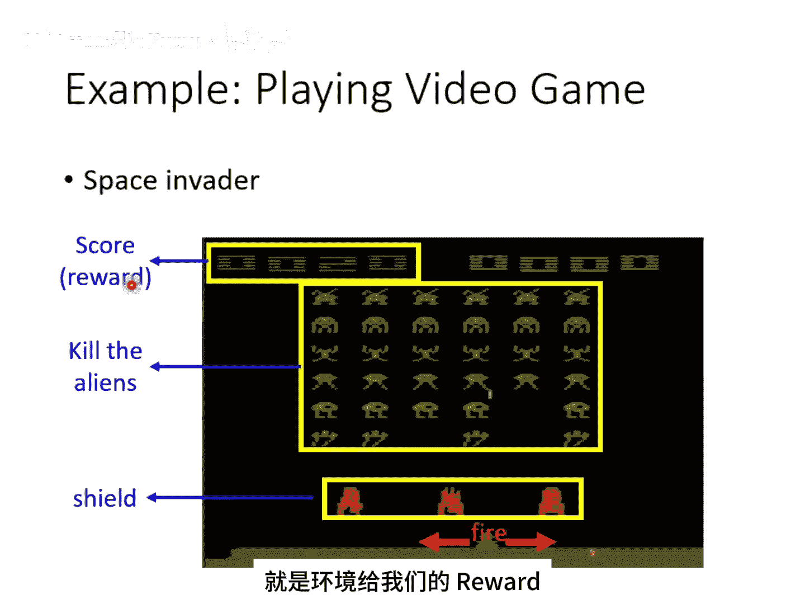

那这个游戏呢它是会终止的。

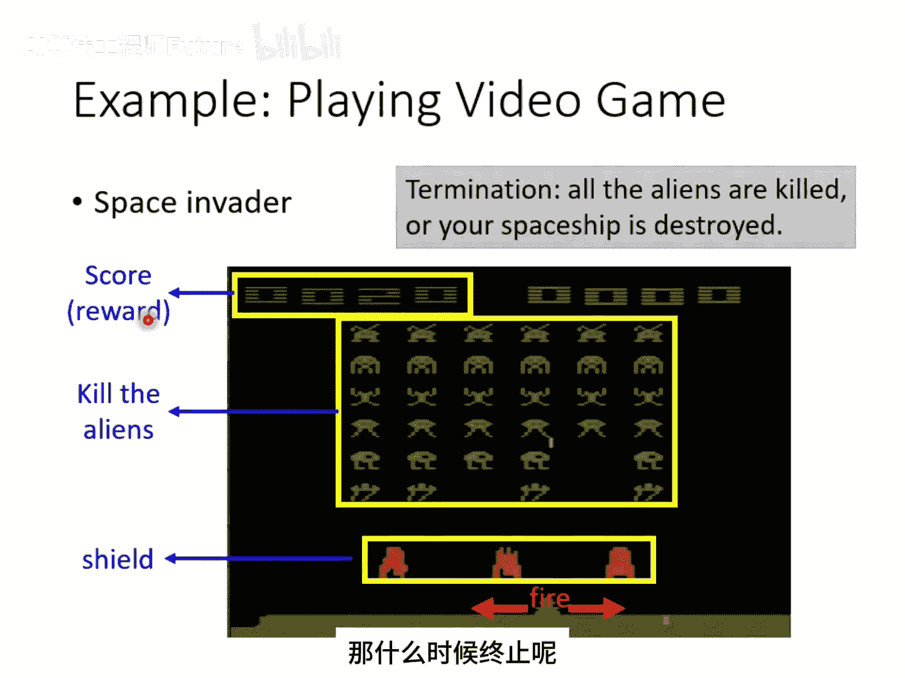

那什么时候终止呢，当所有的外星人都被杀光的时候就终止，或者是呢外星人其实也会对你的母舰开火啦，外星人击中你的母舰，你也撕毁这个你就被摧毁了，那这个游戏呢也就终止了好。

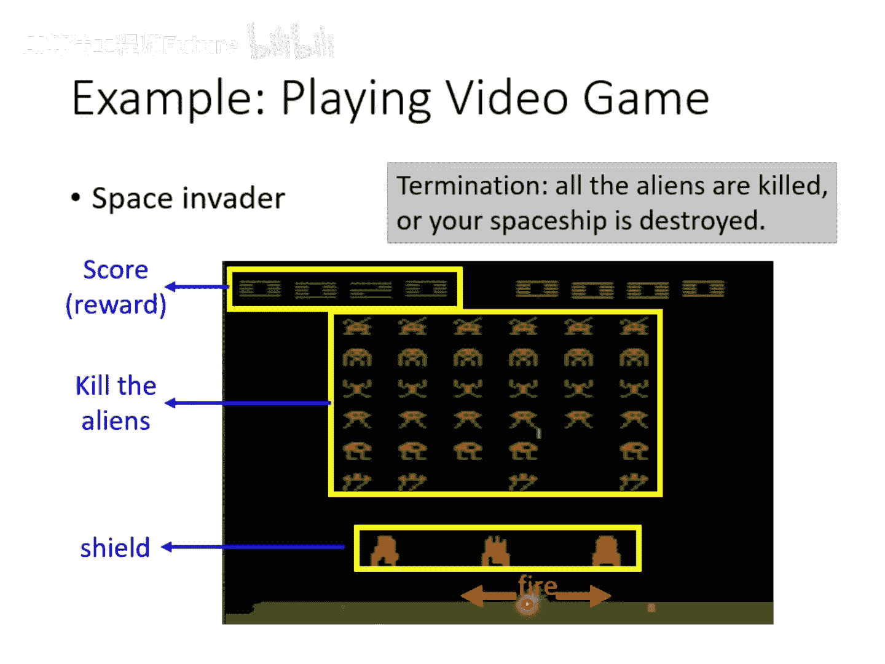

那这个是介绍一下space invader这个游戏好，那如果你今天呢要用actor去玩space invader，大概会像是什么样子呢，现在你的actor啊，actor虽然是一个机器。

但是它是坐在人的这个位置哦，他是站在人这个角度去操控摇杆，去控制那个母舰，去跟外星人对抗，而你的环境是什么，你的玩环境呢是游戏的主机啊，游戏的主机这边去操控那些外星人。

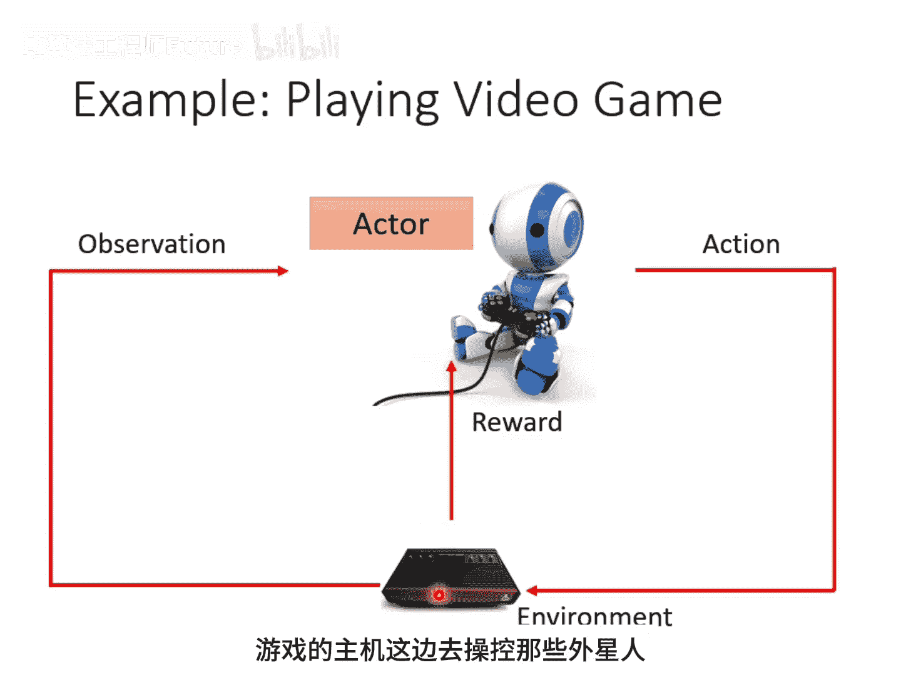

外星人去攻击你的母舰好，所以observation是游戏的画面哦，所以对actor来说，他看到的其实就跟人类在玩游戏的时候，看到的东西是一样的啊，就看到一个游戏的画面。

那输出呢就是actor可以采取的行为，那可以采取哪些行为，通常是事先定义好的，在这个游戏里面，就只有向左向右跟开火三种可能的行为而已啊，那当你的actor采取向右这个行为的时候呃，他会得到reward。

那因为在这个游戏里面，只有杀掉外星人会得到分数，而我们就是把分数定义成我们的reward，那向左向右，其实并不会是不可能杀掉任何的外星人哦，所以你得到的reward呢就是零分好。

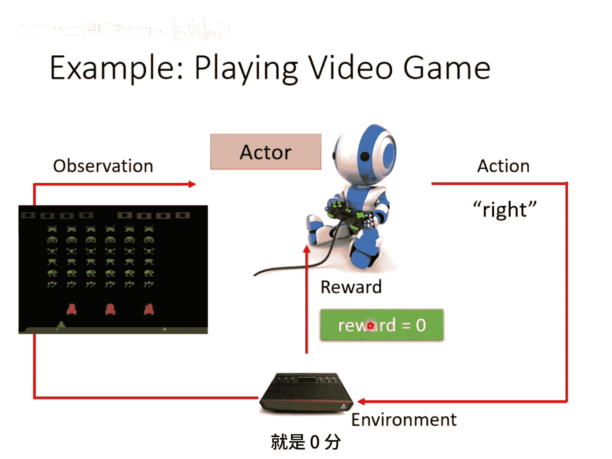

那你采取一个action以后呢，游戏的画面就变了啊，游戏的画面变的时候，就代表了有了新的observation进来，有了新的observation进来，你的actor就会决定采取新的action。

你的actor是一个function，这个function会根据through的observation输出对应的action，那新的画面进来，假设你的actor现在他采取的行为是开火。

而开火这个行为正好杀掉一只外星人的时候，你就会得到分数，那这边假设得到分数是五分，杀掉个外星人得到分数是五分，那你就得到reward等于五啊，那这个呢就是拿actor去玩，想玩这个啊。

space invader这个游戏的状况好，那这个actor呢他想要学习的是什么呢，我们在玩游戏的过程中会不断的得到reward，那在刚才的例子里面，做第一个行为的时候，向右的时候得到的是零分。

做第二个行为开火的时候得到的是五分，那接下来你采取一连串行为都有可能给你分数，而actor要做的事情，我们要呃学习的目标，我们要找的这个actor，就是我们想要认出一个actor。

这个actor这个function，我们使用它在这个游戏里面的时候，可以让我们得到的reward总和会是最大的啊，那这个就是呃拿呃actor去，这个就是IO用在玩这个小游戏里面的时候。

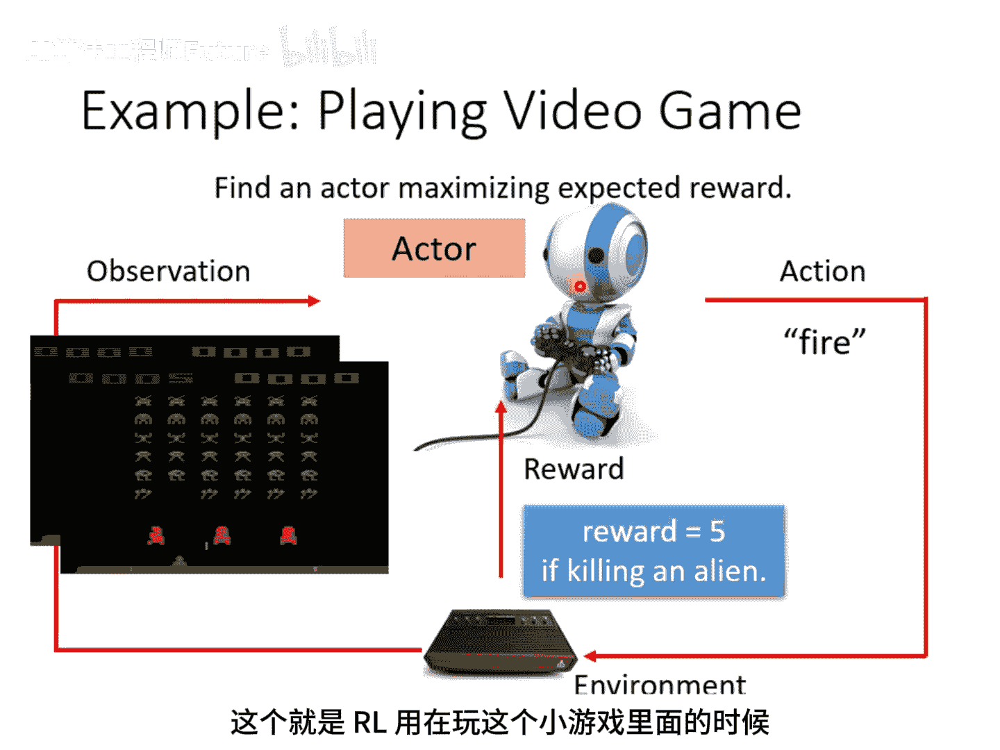

做的事情好，那其实如果把IO拿来玩围棋，拿来下围棋，其实做的事情跟呃小游戏，其实也没有那么大的差别，只是规模跟问题的复杂度不太一样而已哦，那如果今天啊你要让机器来下围棋，那你的actor呃就是阿尔法狗。

那你的环境是什么，你的环境就是阿尔法狗的人类对手好，那阿尔法狗的输入是什么，你的这个actor的输入是什么。

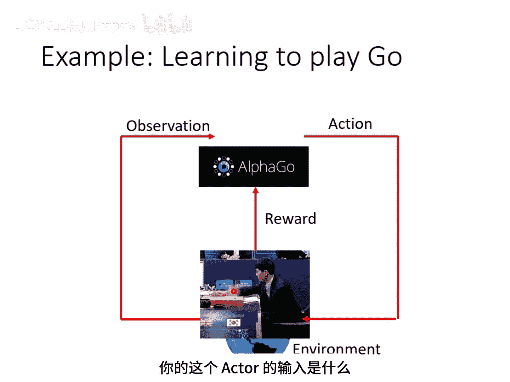

你的actor是输入就是棋盘，棋盘上黑子跟白子的位置，那如果是在游戏的一开始，棋盘上就空空的哦，空空如也上面什么都没有，没有任何黑子跟白纸好，那这个actor呢看到这个棋盘呢。

它就要产生输出，他就要决定他下一步应该落子在哪里，那如果是围棋的话，你的输出的可能性就是有19×19个可能性，那这19×19个可能性，每一个可能性就对应到棋盘上的一个位置好。

那假设现在你的actor决定要落子在这个地方，那这个结果就会输入给你的环境，那其实就是呃一个歧视，然后呢这个环境呢就会再产生新的observation。

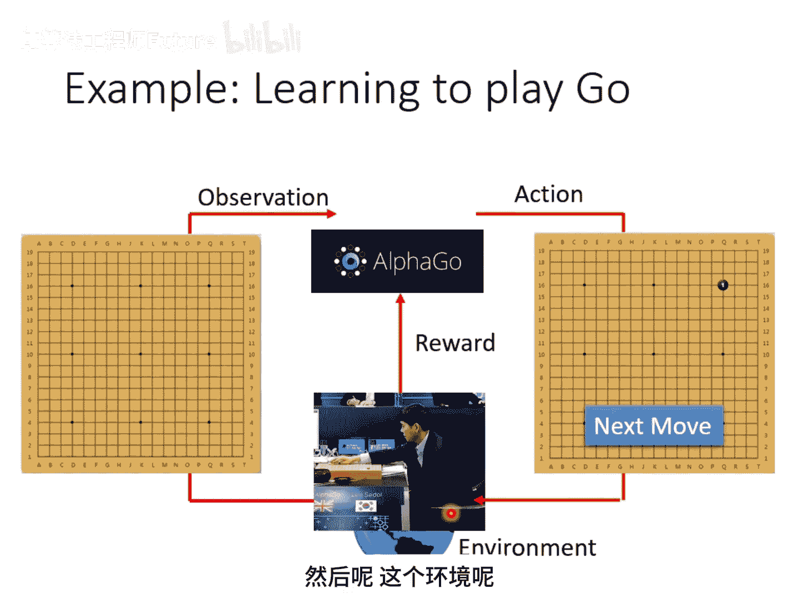

因为这个呃李世石这个歧视呢也会再落一子，那现在看到环境又不一样了。

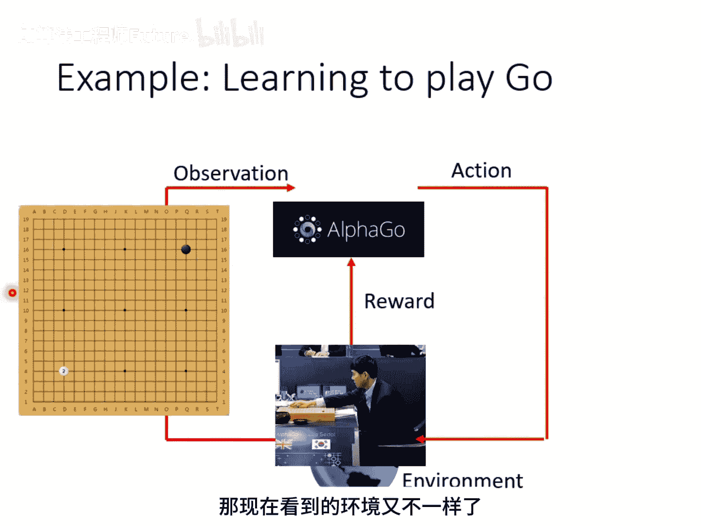

那你的actor看到这个新的observation，它就会产生新的action，然后就这样反复继续下去，你就可以让机器做下围棋这件事情哦，那在这个活在这个下围棋这件事情里面。

的reward是怎么计算的呢，在下围棋里面，你所采取的行为几乎都没有办法得到任何reward，在下围棋这个游戏里，在下围棋这件事情里面呢，你会定义说如果赢了就得到一分，如果输了就得到一分。

也就是说在下围棋，这整个呃这个呃你的actor跟环境互动的过程中，其实只有游戏结束，只有整场围棋结束的最后一子，你才能够拿到reward，就你最后最后艾特下一指下去，赢了就得到一分。

那最后他落了那一子以后，游戏结束了，他输了，那就得到一分，那在中间整个互动的过程中，的reward就都算是零分，没有任何的reward好，那这个actor学习的目标啊。

就是要去最大化他可能可以得到的reward。

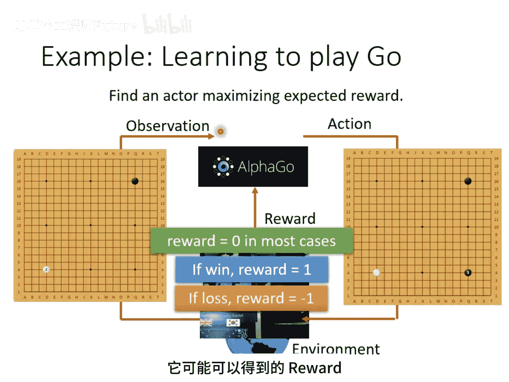

好刚才讲的也许你都已经听过了，那这个是RL最常见的一种解说方式，那接下来要告诉你说RL跟机器学习的framework，它们之间的关系是什么，开学第一堂课就告诉给。

就告诉你说machine learning就是三个步骤，第一个步骤，你有一个function，那个function里面有一些未知数，unknown的variable，这些未知数是要被找出来的。

第二步定一个loss function，第三步想办法找出未知数去最小化你的loss，第三步就是optimization，而RL其实也是一模一样的。

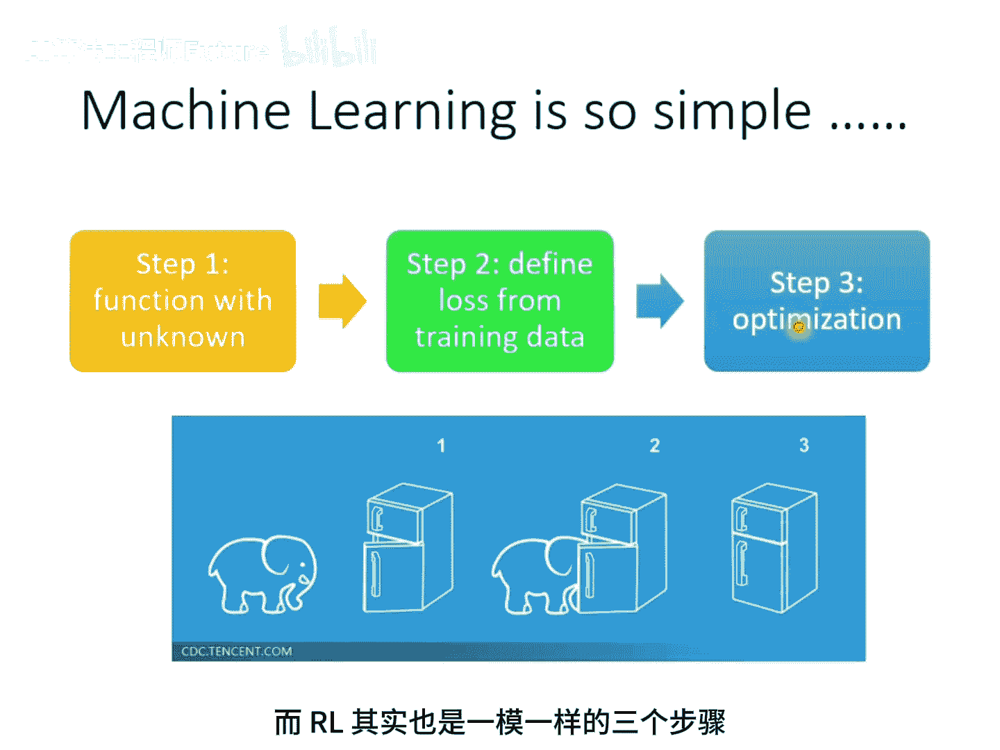

三个步骤，我们先来看第一个步骤，第一个步骤，我们现在有未知数的这个function到底是什么呢，这个有未知数的function就是我们的actor，那在IL里面，你的actor呢就是一个network。

那我们现在通常叫它policy的network，那呃呃在过去啊，在还没有把deep learning用到RL的时候，通常你的actor是比较简单的，它不是network。

他可能只是一个look up table，告诉你说看到什么样的输入，就产生什么样的输出，那今天我们都知道要用network来当做这个actor，那这个network其实就是一个很复杂的function。

这个复杂的function它的输入是什么呢，它的输入就是游戏的画面啊，就是游戏的画面，这个游戏上面这个黑子跟呃呃，这个这个这个不是下围棋啦，所以没有黑子跟白纸了啊，那这边如果是拿这个呃。

玩space invader当做例子的话呢，这个游戏画面上的pixel像素，就是这一个actor的输入，那它的输出是什么呢，它的输出就是每一个可以采取的行为，他的分数，每一个可以采取的action。

他的分数啊，举例来说，输入这样的画面给你的actor，你的actor其实就是一个network，他的输出可能就是给向左0。7分，向右0。2分开火，0。1分，那事实上啊这件事情跟分类是没有什么两样的。

你知道分类就是输入一张图片输出，就是决定这张图片是哪一个类别，那你的network会给每一个类别一个分数，你可能会通过一个soft max layer，然后每个类别都会有一个分数。

而且这些分数的总和是一，那其实在RO里面，你的actor，你的passing network跟分类的那个network其实是一模一样的，你就是输入一张图片输出。

其实最后你也会有一个soft max layer，然后呢你就会left right跟fire3个action各给一个分数啊，这些分数的总和你也会让它是一好，那至于这个network的架构呢。

那你就可以自己设计了，要设计怎么样都行，比如说呃如果输入是一张图片诶，也许你就会想要用CNN来处理，不过在助教程式里面，其实不是用CNN来处理了，因为在我们的作业里面，其实在玩游戏的时候。

不是直接让我们的没兴趣看游戏的画面，让他直接去看游戏，让他直接去看游戏的画面，比较难做了，所以我们是让呃，你只看这个跟呃现在游戏的状况有关的，一些参数而已哦，好所以呃在这个助教。

在这个作业的这个sample code里面呢，还没有用到CNN那么复杂，就只是一个简单的福利，Connected network，但是假设你要让你的actor，它的输入真的是游戏画面诶。

那你可能就会采取这个CNN，你可能就用CNN当做你的network架构，甚至你可能说，我不要只看现在这个时间点的游戏画面，我要看整场游戏到目前为止发生的所有事情，可不可以呢，可以。

那过去你可能会用RNN考虑现在的画面，跟过去所有的画面，那现在你可能会想用transformer，考虑所有发生过的事情哦，所以network的架构是你可以自己设计的，只要能够输入游戏的画面输出呃。

类似像类别这样的action就可以了，那最后机器会决定采取哪一个action，取决于每一个action取得的分数，常见的做法是直接把这个分数就当做一个几率，然后按照这个狙击的几率去simple。

去随机决定要采取哪一个action，举例来说，在这个例子里面向左得到0。7分，那就是有70percent的几率会采取向左，20percent的几率，会采取向右10percent的几率会采取开火啊。

那你可能会问说为什么不是用up max呢，为什么不是看left的分数最高就直接向左呢，你也可以这么做，你也可以这么做呃，但是在助教的城市里面，还有多数IL应用的时候，你会发现我们都是采取sample。

采取sample，有一个好处是说呃，今天就算是看到同样的游戏画面，你的机器每一次采取的行为也会略有不同，但在很多的游戏里面，这种随机性也许是重要的哦，比如说你在做剪刀石头布的时候，如果你总是会出石头。

就跟小叮当一样，那就很容易被打爆啊，如果你有一些随机性，就比较不容易被打爆，那其实之所以今天的输出是用随机sample的，还有另外一个很重要的理由，那这个我们等一下会再讲到好，所以这是第一步。

我们有一个function，这个function有unknown的variable，我们有一个network，那里面有参数，这个参数就是unknown variable。

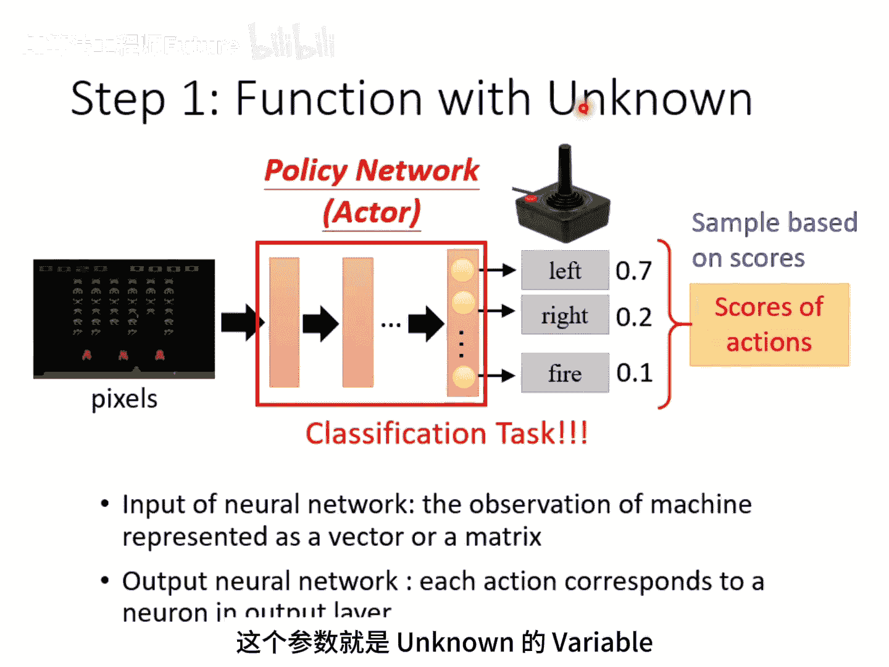

就是要被学出来的东西，这是第一步，然后接下来第二步我们要定义loss，在IO里面我们的loss长的是什么样子呢。

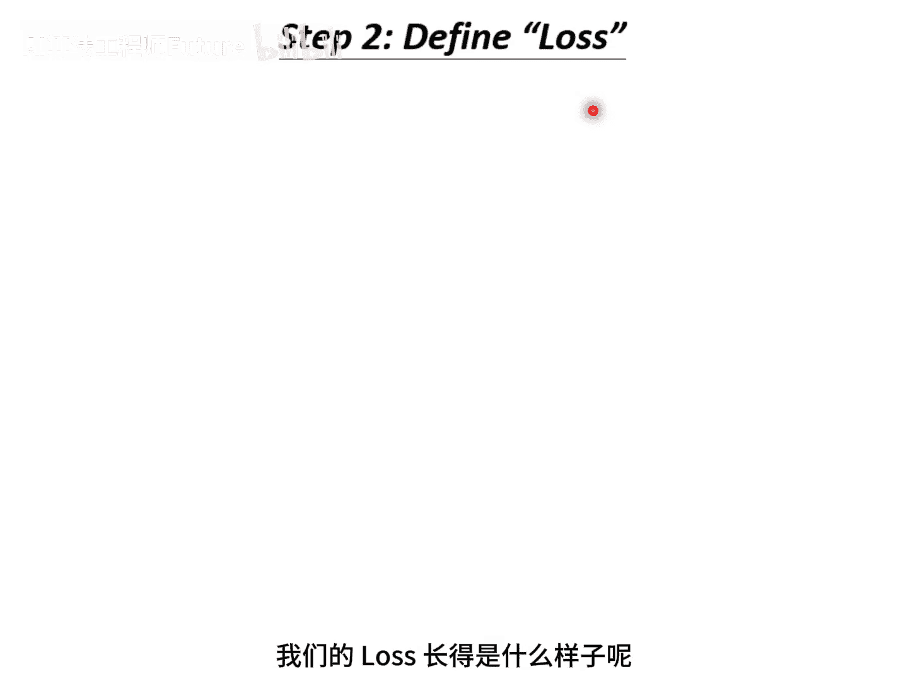

我们再重新来看一下，我们的机器跟环境互动的过程，那只是现在用不一样的方法来表示，刚才说过的事情好，首先有一个初始的游戏画面，这个初始的游戏画面被作为你的actor的输入。

你的actor就输出了一个action，比如说向右好，所有的游戏画面呢我们叫它s one，然后输出action呢我们就叫它a one，那现在会得到一个reward啊，这边因为向右没有做任何事情。

没有杀死任何的外星人。

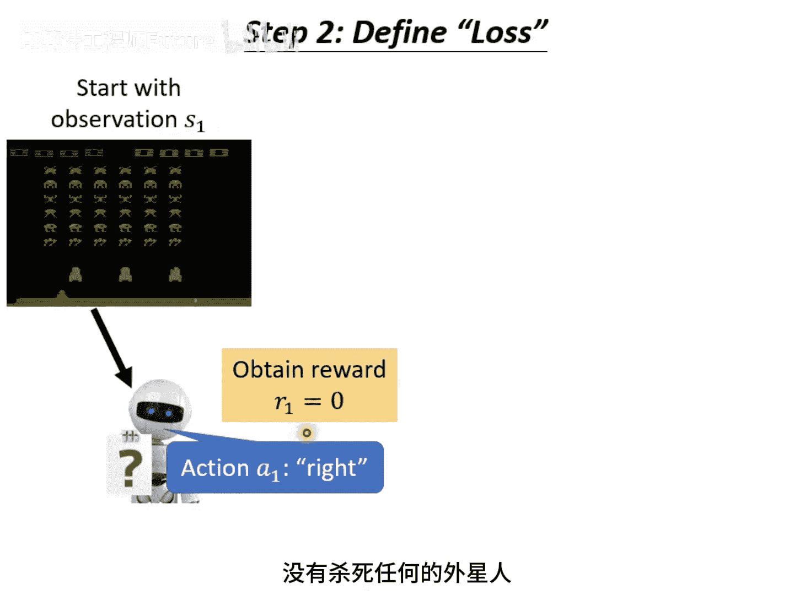

所以得到reward可能就是零分，采取向右以后会看到新的游戏画面，这个叫做s two，根据新的游戏画面，S two，你的actor会采取新的行为，比如说开火，这边用AQ来表示。

看到游戏画面s two的时候所采取的行为。

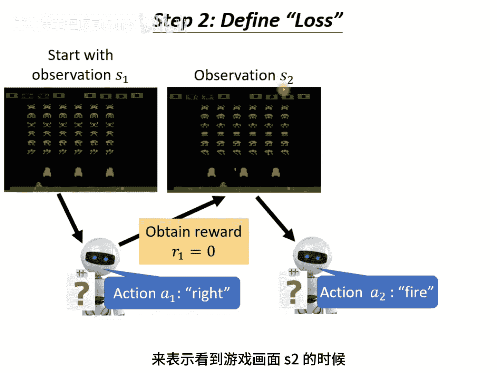

那假设开火恰好杀死一只外星人和你的actor，就得到reward啊，这个reward的分数呢是五分，然后采取开火这个行为以后，接下来你会看到新的游戏画面，那机器又会采取新的行为。

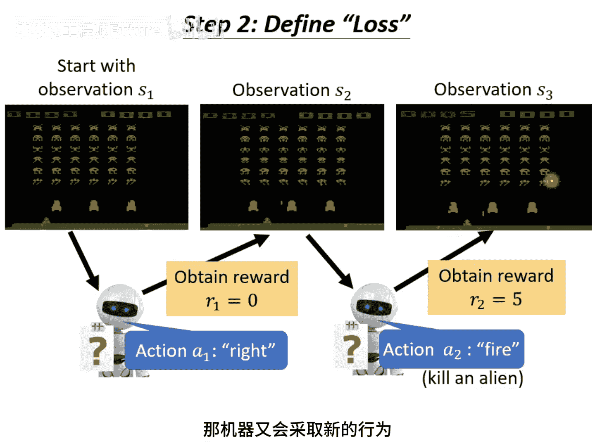

那这个互这个互动的过程呢就会反复持续下去。

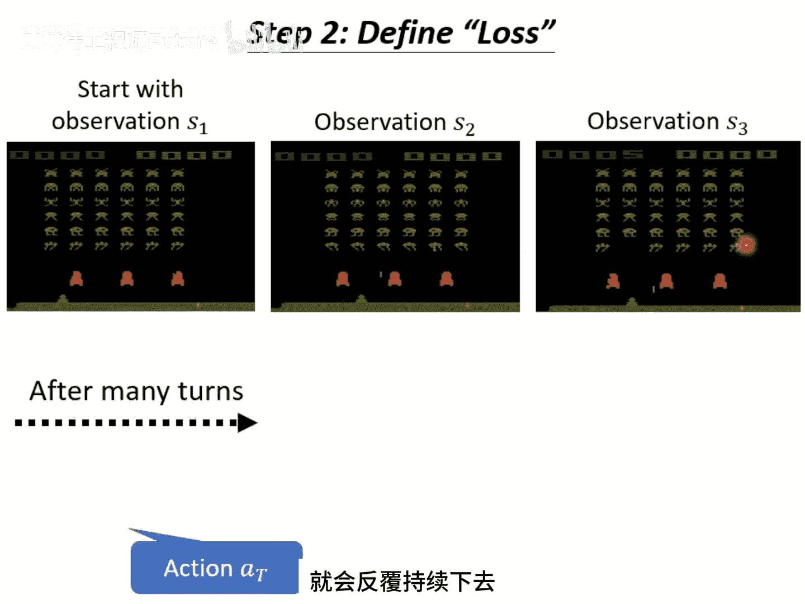

直到机器在采取某一个行为以后，游戏结束了。

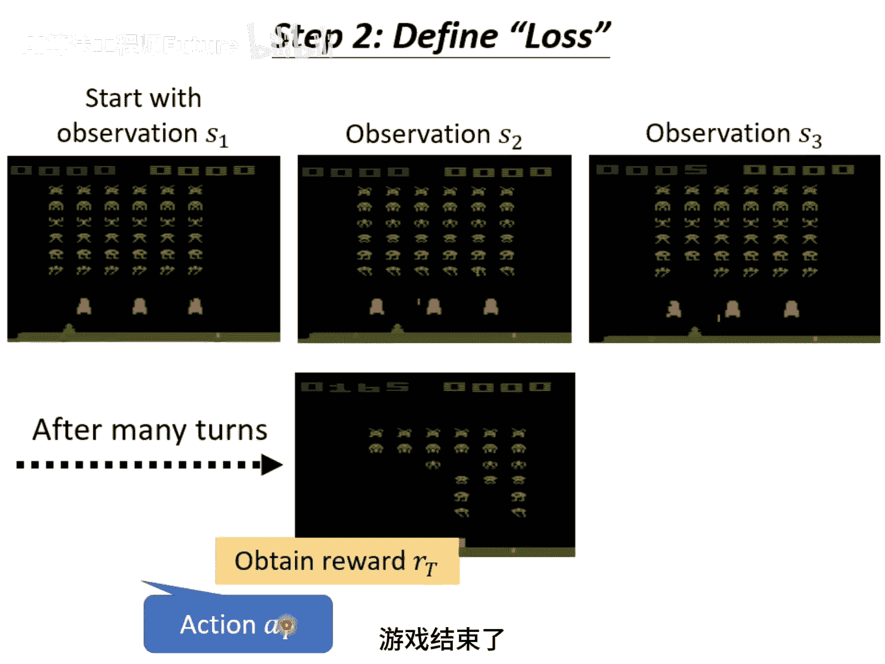

那什么时候游戏结束呢，就看你游戏结束的条件是什么嘛，举例来说，采取最后一个行为以后，比如说向右移，正好被呃外星人的子弹打中，那你的飞船就毁了，那游戏就结束了，或者是最后一个行为是开火。

把最后一只外星人杀掉，把最后一只外星人杀掉，那游戏也就结束了啊，就你执行某一个行为，满足游戏结束的条件以后，游戏就结束了，那从游戏开始到结束的这整个过程呐，被称之为一个episode。

那在整个游戏的过程中，机器会采取非常多的行为，每一个行为都可能得到reward，把所有的reward通通集合起来，我们就得到一个东西，叫做整场游戏的total reward啊。

那这个total reward呢，就是从游戏一开始得到的r one一直得一直加累，加到游戏最后结束的时候得到的RT，假设这个游戏里面会互动大梯子，那么就得到一个total reward哦。

我们这边用大R来表示total reward，其实这个total reward又有另外一个名字啊，叫做return了，你在这个IO的文献上啊，常常会同时看到reward和return这两个词汇出现。

那reward和return其实有点不一样，reward指的是你采取某一个行为的时候，立即得到的好处，这个是reward，把整场游戏里面所有的reward统统加起来，这个叫做return，但是我知道说。

很快你就会忘记reward和return的差别了，所以我们等一下就不要再用return这个词汇，我们直接告诉你说，整场游戏的reward总和就是偷偷的reward，而这个total的reward啊。

就是我们想要去最大化的东西，就是我们训练的目标，那你可能会说哎这个跟loss不一样啊，loss是要越小越好啊，这个偷偷reverse要越大越好啊，所以有点不一样吧，但是我们可以说在RL的这个情境下。

我们把那个total reward的负号，负的total reward就当做我们的loss，total reward是要越大越好，那负的total reward当然就是要它越小越好嘛。

就我们完全可以说负的total reward，就是我们的loss，就是RL里面的loss好。

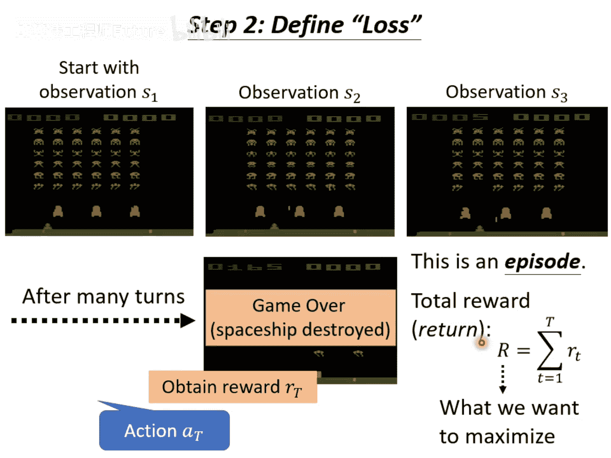

那在进入第三步之前，也许我们可以看一下怎么回答，有同学们有没有问题，那个哦有同学建议这个休息的时候可以关麦好，那个呃这个我研究一下要怎么关麦，其实我还不知道怎么关麦好，讲理论不好吗，讲理论没有不好。

那你可以看一下过去呃，有关RL这个部分的录影，那我等一下在投影片里面，其实也有附上相关的录影，那里面是有讲到比较多理论的地方，那我这今天呢我是期待说从呃更浅显的角度呢，来跟大家讲IO这件事情。

那你永远可以在过去的上课录影，找到比较偏理论的内容，好那如果大家暂时还没有其他问题的话呢，我们就继续讲有关optimization的部分好，那我们再把这个环境跟agent互动的这件事情呢。

再用不一样的图示再显示一次，好这个是你的环境啊，你的环境呢输出一个observation叫做SY，这个s one呢会变成你的actor的输入，你的actor呢接下来就输出a one。

而这个a one呢又变成环境的输入，你的环境呢看到a one以后又输出s two，然后这个与这个互动的过程呢就会继续下去，s two又输入给actor，他就输出a two。

a two又输入给environment，他就输出给它，就产生S3，他这个互动呢一直下去，直到满足游戏终止的条件好，那这个S跟A所形成的这个sequence啊。

就是s one a one s two a two s3A三，这个sequence啊又叫做trajectory，那我们用涛呢来表示trajectory好，那根据这个互动的过程呃。

machine会得到reward，你其实可以把reward也想成是一个function，我们这边用一个绿色的方块来代表这个reward，所构成的function。

那这个reward这个function呢有不同的表示方法啦，在有的游戏里面，也许你的reward，只需要看你采取哪一个action就可以决定的，不过通常我们在决定reward的时候。

光看action是不够的，你还要看现在的observation才可以，因为并不是每一次开火你都一定会得到分数嘛，开火要正好有集到外星的外线，正好在你前面，你开火才有分数啊。

所以通常reward function在定义的时候不是只看action，他还需要看observation，同时看action跟observation，才能够知道现在有没有得到分数好。

这reward是一个function呃，这个reward function呢他拿a one跟s one当做输入，然后它产生r one作为输出啊，他拿a two跟s two当做输入。

产生r two作为输出，把所有的R通通集合起来哦，把r one加r two加R3，X加到R大T全部集合起来就得到啊啊啊，这个就是total reward，也就是return。

这个是我们要最大化要去maximize的对象好，那这个optimization的问题，它长的是什么样子呢，这个optimization的问题是这个样子的，你要去找一个network。

其实是network里面的参数，你要去认出一组参数，这一组参数放在actor里面，它可以让这个R的数值越大越好，就这样结束了整个optimization的过程就是这样，你要去找一个呃network参数。

让这边产生出来的R越大越好，那乍看之下，如果这边的这个environment啊，actor啊，跟reward啊，他们都是network的话，这个问题其实也没有什么难的，这个这个搞不好你现在都可以解。

它看起来就有点像是一个recurrent network，这是一个recurrent network，然后你的loss就是这个样子，那只是这边是reward，是loss，所以你是要让它越大越好啊。

你就去learn这个参数，用gradient descent，你就可以让它越大越好，但是I有困难的地方是，这不是一个一般的optimization的问题，因为你的environment那这边有很多问题。

导致说它跟一般的network training不太一样，第一个问题是你的actor的输出是有随机性的，这个a one它是用sample产生的，给定同样的s one每次产生的a one不一定会一样。

所以假设你把environment actor跟reward合起来，当做是一个巨大的network来看待，这个network可不是一般的network，这个network里面是有随机性的。

这个network里面的某一个layer是每一次产生出来的，结果是不一样的，这个network里面某一个layer是他的输出，每次都是不一样的，另外还有一个更大的问题。

就是你的environment跟reward，他根本就不是network啊，它只是一个黑盒子而已，你根本不知道里面发生了什么事情，environment就是游戏机，那这个游戏机它里面发生什么事情。

你不知道，你只知道说你输入一个东西，会输出一个东西，你采取一个行为，他会有对应的回应，但是到底是怎么产生这个对应的回应的，我们不知道它只是一个黑盒子，而reward呢reward可能比较明确。

但它也不是一个network，它就是一条规则嘛，它就是一个规则，说看到这样子的observation，跟这样子的action会得到多少的分数，它就只是一个规则而已，所以它也不是哪五，而且更糟。

而且更麻烦的地方是，往往reward跟environment它也是有随机性的，如果是在电玩里面，通常reward能比较不会有随机性的，因为规则是定好的，但有一些IO的问题里面。

reward是有可能有随机性的，但是在environment里面，在就算是在电玩的这个应用中，它也是有随机性的，你给定同样的呃行为，到底游戏机会怎么样回应，它里面可能也是有乱数的。

他可能每次的回应也都是不一样的，如果是下围棋，你落同一个子，你落在你若只在同一个位置，你的对手会怎么样回应，每次可能也是不一样的哦，所以环境很有可能也是有随机性的。

所以这不是一个一般的optimization的问题，你可能不能够用我们这门课已经学过的，训练network的方法来找出这个actor来最大化reward哦，所以LL真正的难点就是。

我们怎么解这个optimization的问题，怎么找到一组network的参数，可以让R越大越好，其实你再仔细想一想啊，这整个问题跟GA其实有异曲同工之妙，他们有一样的地方，也有不一样的地方。

先说他们一样的地方在哪里，你记不记得在训练game的时候，在训练generator的时候，你会把JERATOR跟discriminator结合在一起，然后你希望去调generator的参数。

让discriminator的输出越大越好，今天在IO里面，我们也可以说这个actor就像是generator，environment跟reward就像是discriminator。

我们要去调generator的参数，让discriminator的输出越大越好，所以他跟game有异曲同工之妙，但什么地方不一样呢，在game里面。

你的discriminator也是一个neural network，你了解discriminator里面的每一件事情，它也是一个network。

你可以用gradient descent来train你的generator，让discriminator得到最大的输出，但是在IO的问题里面，你的reward跟environment。

你可以把他们当discriminator来看，但他们不是network，它们是一个黑盒子，所以你没有办法用一般gradient descent的方法，来调整你的参数，来得到最大的输出。

所以这是IO跟一般machine learning不一样的地方，但是我们还是可以把IO就看成三个阶段，只是在optimization的时候，在你怎么minimize loss。

也就怎么maximize reward的时候，跟一之前我们学到的方法是不太一样的。

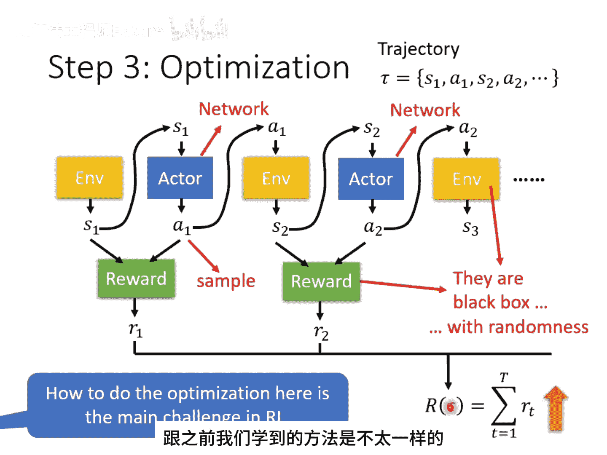

好，那这个就是有关RL的跟machine learning3个步骤的关系，好我们看一下大家有没有问题问嗯，好有一位同学问说，为什么负的total reward等于loss好。

为什么负的total reward会等于loss呢，我们在training的时候啊，在我们之前讲过的所有的deep learning training里面，我们都是定义了一个loss。

要让这个loss呢越小越好，在RL里面呢，我们是定义了一个total reward r，然后我们要让那个R越大越好，但是要让R越大越好，这件事情我们完全可以反过来说，就是我们要让负的R就R乘上一个负号。

越小越好，所以我们就可以说R乘三个负号，就是RL的loss，如果以前学的模型没有固定random or random，seed的话，也算是有随机性吗，呃这两个随机性是不一样的啊。

我们在之前的学模型的时候没有固定RENDENCY，你是training的时候有随机性啊，就是呃你没有固定RENDANCY，你可能initialize a parameter不一样啊。

所以你每次训练出来的结果不一样，但是RL啊是在testing的时候就有随机性了，也就是说不是training的时候随机性哦，是测试的时候就已经有随机性了，所以如果拿呃一般的training来比喻的话。

就是你在你network train好以后，你拿这个network在testing的时候，你想要使用它，你把你要把这个network使用在testing的状况下。

但发现说你给同样的input每次输出都不一样啊，这个才是IO的随机性哦，所以I有说你劝好一个actor actor，你认好了，actor参数都是固定的，但你拿这个actor去跟环境互动的时候。

每次的结果都是不一样的啊，因为你的环境就算是看到同样的输入，他每次给的输出也可能是不一样的哦，所以IL是一个嘶呃随机性特别大的问题啦，所以你可以想见这个作业有可能是呃，也确实是特别困难的。

不过我觉得一个作业的难度啊，呃有时候不好说，因为IO呃，如果今天你没有任何网络上参考资料的话，它可能是最难的，但另外一方面哎呦又蛮容易找到哇，各式各样的呃，d hub上的code。

所以我好像又没有那么难，但是IO的随机性是会非常非常大的，就算是同样的network，你每次测试的时候，结果都可以是不一样的，a one下方写arg max是写错了哦。

额这个我投影片后来有可能是有改了一下，可能是又改了一下，如果你有不清楚的地方，你再问我好了，就是哎这个呃投影片我刚才在上课前呃，改了一下，之后会把新的投影片呢再试出，好好大家还有问题要问一下吗。

好如果大家暂时没有问题的话，那我们就再继续，那我们就是呃在讲到一个段落呢，我们在休息好，那接下来啊我们就要讲一个拿来解RL，拿来做optimization。

那一段常用的一个演算法叫做policy gradient，那如果你真的想知道policy gradient是哪里来的，你可以参见过去上课的录音，对policy gradient有比较详尽的推导。

那今天我们是从另外一个角度来讲，policy gradient这件事情好。

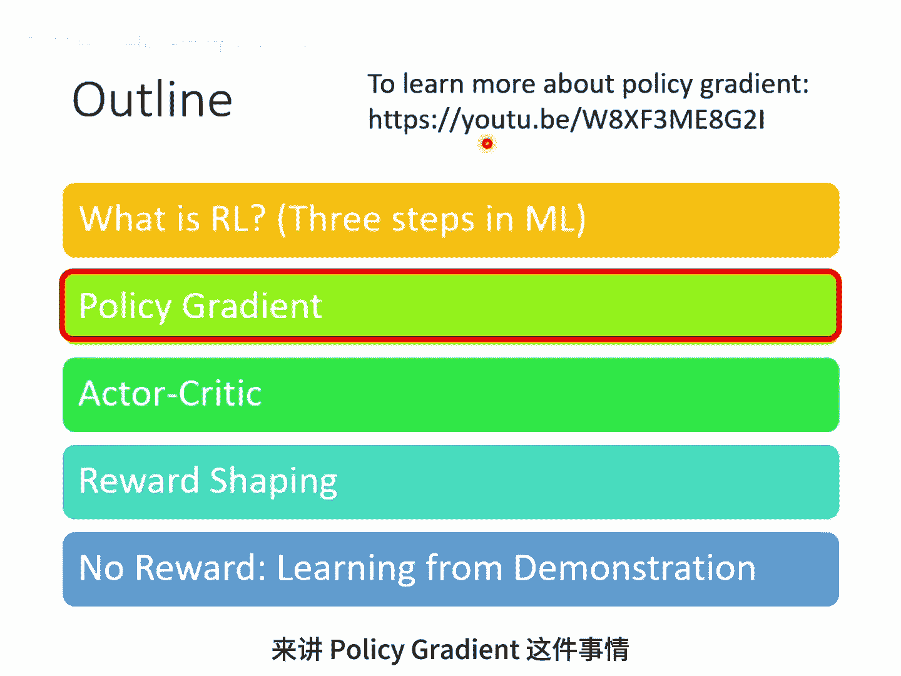

那在讲policy gradient之前呢，我们先来想想看，我们要怎么操控一个actor的输出，我们要怎么让一个actor，在看到某一个特定的observation的时候，采取某一个特定的行为呢。

我们怎么让一个actor它的输入是S的时候，他就要输出action a hat呢，那你其实完全可以把它想成一个分类的问题，也就是说假设你要让actor输入S输出，就是a hat。

假设a hat就是向左好了，假设你要让假设你已经知道，假设你就是要教你的actor，说看到这个游戏画面向左就是对的，你就是给我向左，那你要怎么让你的actor学到这件事呢，那也就说S是actor的输入。

a head就是我们的label，就是我们的光，true就是我们的正确答案好，接下来呢你就可以计算你的actor，它的输出跟光truth之间的cross entrop，那接下来就可以定义一个loss。

就假设你希望你的actor他采取ahead，这个行为的话，你就定一个loss，这个loss呢等于cross entropy，然后呢你再去learn一个sea，你再去弄一个setup。

然后这个sea呢可以让loss最小，那你就可以让这个actor的输出，跟你的光速越接近越好，你就可以让你的actor学到说，看到这个游戏画面的时候，他就是要向左哦。

这个是要让你的actor采取某一个行为的时候，你的做法，但是假设你想要让你的actor，不要采取某一个行为的话，那要怎么做呢，假设你希望做到的事情是你的actor。

看到某一个observation s的时候，我就千万不要向左的话，怎么做呢，其实很容易，你只需要把loss的定义反过来就好，你希望你的actor采取a head这个行为。

你就定义你的大L等于cross entropy，然后你要minimize cross entrop，假设你要让你的act不要采取ahead这个行为的话，那你就把你就定一个loss。

叫做负的cross entropy，Cross entropy，乘一个负号，那你去minimize这个L，你去minimize这个L就是让cross entrol比越大越好。

那也就是让A跟ahead的距离越远越好，那你就可以避免你的actor在看到S的时候，去采取ahead这个行为，所以我们有办法控制我们的actor，做我们想要做的事。

只要我们给他适当的label跟适当的loss。

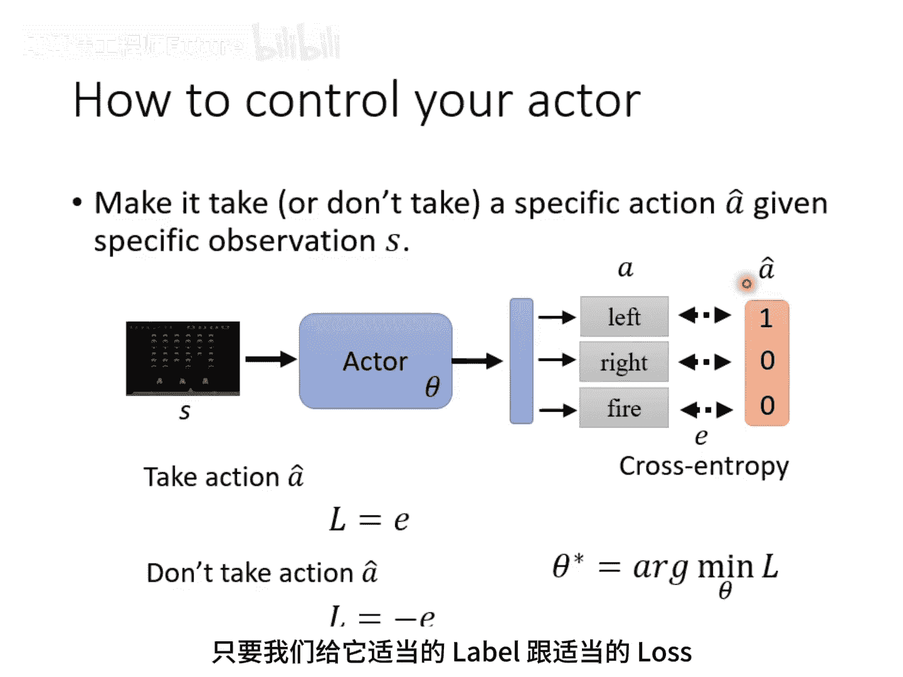

所以假设我们要让我们的actor，看到S的时候采取a hp，看到s plan的时候不要采取a had pl的话，要怎么做呢，这个时候你就会说呃。

呃given s这个observation我们的光处叫做ahead，given as play这个observation的时候，我们有个光束叫做ahead plan。

那对这两个光处我们都可以去计算cross entropy哦，我们都可以去计算cross entropie one跟e two，然后接下来呢我们就定义说我们的loss啊，就是1万减e two。

也就是说我们要让这个case，它的cos entrop越小越好，那这个case它的cos entrop越大越好，然后呢我们去找一个SETA去minimize loss，得到set a head呃。

得到set a start，那就是一个可以在S的呃，可以在看到S的时候采取ahead，看到s play的时候采取ahead play的，所以借由很像是在炫一个classifier的这种呃，呃行为。

借由很像现在trainer classify的这种data，我们可以去控制一个actor的行为，好我刚刚讲到，这边有同学要问问题，好有一个同学问了一个非常好的问题，就是如果以alien的游戏来说的话。

因为只有射中alien才会有reward，这样model不是就会一直倾向于设计吗，对这个问题我们等一下会来解决它之后，投影片就会来解决它，然后又有另外一个同学问了一个非常好的问题。

就是哇这样不就回到supervised learning的吗，这个投影片上看起来就是在训练一个classifier，而已啊，我们就是在训练classify嘛，你只告诉他说看到S的时候就要输出AH。

看到S派的时候就不要输出a h ahp pie，这不就是supervised learning吗，这是就是supervised learning，这个就是跟supervised learning。

training image classify是一模一样的，但等下我们会看到它跟一般的supervised learning不一样，在哪里好，那我们就再继续再稍微看一段。

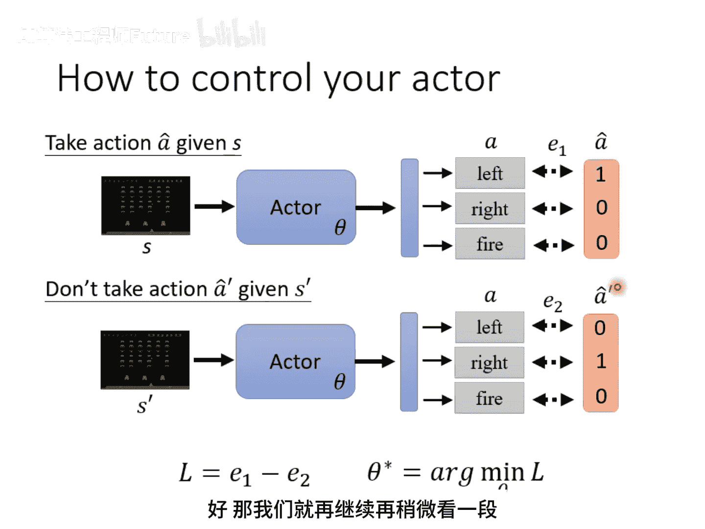

我们再休息啊，那所以呢呃如果我们要训练一个actor，我们其实就需要收集一些训练资料啊，就收集训练资料说唉，我希望在s one的时候采取ahead one。

我希望在s two的时候不要采取a head two，但可能会问说哎这个训练资料哪来的，这个我们等下再讲训练资料哪来的哦，所以你就搜集一大堆资料。

这个跟train个image的classify很很像的啊，这个S你就想成是image，这个ahead就想成是label，只是现在有的行为是想要被采取的，有的行为是不想要被采取的，你就搜集一堆这种资料。

你就可以去定义一个loss function，有了这个loss function以后，你就可以去去练你的actor，去minimize这个loss function，九结束了，你就可以去那个actor。

期待他执行我们的行为，期待他执行的行为是我们想要的，而你甚至还可以更进一步，你可以说每一个行为并不是只有好或不好，并不是有想要执行跟不想要执行而已，它是有程度的差别的，有执行的非常好的。

有nice to have的，有有点不好的，有非常差的，所以刚才啊我们是说每一个行为就是要执行，不要执行，这是一个binary的问题，这是我们就用正一来表示，但是现在啊我们改成每一个S跟A的pair。

它有对应的一个分数，这个分数代表说，我们多希望机器在看到s one的时候，执行a one head这个行为，那比如说这边第一笔资料跟第三笔资料，我们分别是订正1。5跟正0。5。

就代表说我们期待机器看到s one的时候，他可以做a one head，看到S3的时候，他可以做A3head，但是我们期待他看到s one的时候，做a one h的这个期待呢更强烈一点。

比看到S3做3head的期待更强烈一点，那我们希望他在看到s two的时候不要做it to head，我们期待他看到SN的时候不要做a n hand，而且我们非常不希望他在看到SN的时候，做ANH。

有了这些资讯，你一样可以定义一个loss function，你只是在你的原来的cross entropy前面，本来是前cos entrop，前面要么是正一，要么是一。

现在改成乘上an这一项改成乘上AN这一项，告诉他说有一些行为我们非常期待actor去执行，有一些行为我们非常不期待actor去执行，有一些行为如果执行的是比较好的，有一些行为希望呃执尽量不要执行比较好。

但就算执行了，也许伤害也没有那么大哦，所以我们透过这一个AN来控制说每一个行为，我们多希望actor去执行，然后接下来有了这个loss以后，一样train一个set a train下去。

你就找到一个sea star，你就有个actor，他的行为是符合我们期待的了，但接下来的难点就是嘶要怎么定出这一个A呢，这个就是我们接下来的难点，就是我们接下来要面对的问题。

我们还有另外一个要面对的问题，是怎么产生这个S跟A呢，怎么知道在s one的时候要执行a one，或在s two的时候不要执行a two呢，那这个也是等一下我们要处理的问题，好我们到这边呢。

呃我们先看一下有没有同学有问题要问好了，好目前没有，那现在是5。15分，那我们休息10分钟。

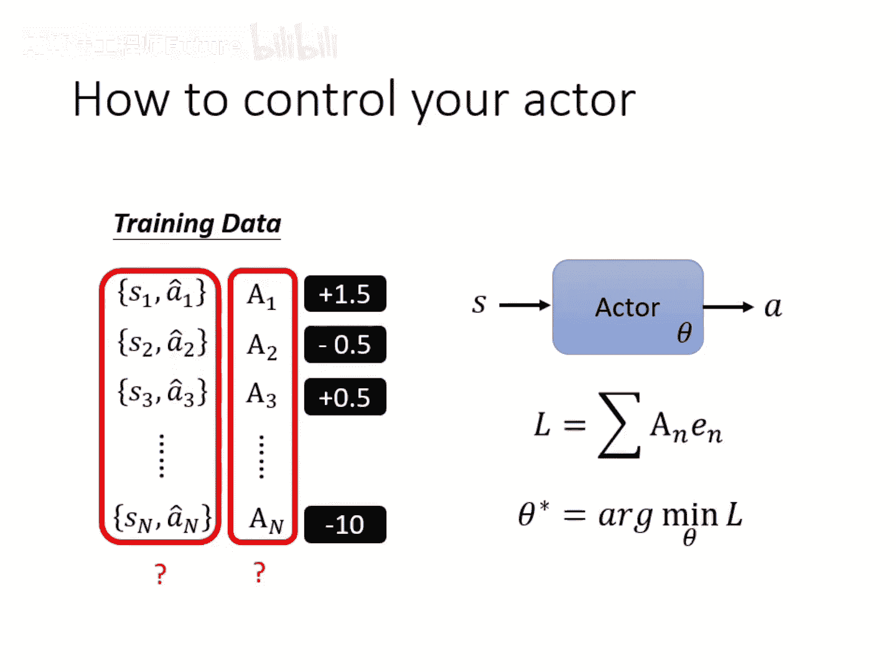