# 【官授搬运】2026年全新优化版李宏毅机器学习系统课程，这才是真正的初学者体系课程！—人工智能／深度学习／神经网络 - P7：6-选修-深度学习简介 - AI算法工程师Future - BV1ruqABeEFX

好那deep learning现在非常的热门，所以它可以用在什么地方，我觉得真的还不需要多讲，我觉得大家搞不知道都比我更多，我相信你随便用deep learning当做关键字，胡乱google一下。

你就可以找到一大堆的exciting的result，Ok，所以我就直接用这个图呢，来简单的summarize一下这个趋势，而这个图呢是google的那个JEFF定。

他在SIGMOID的一个keynote speech的一张投影片啊。

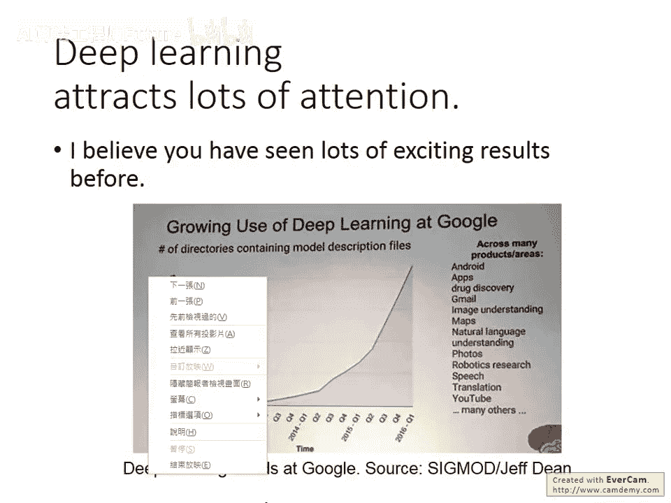

这个图想要表达的事情是这样，横轴代表时间从2012的q one到2016，而纵轴呢代表说在google内部有用到deep learning的，化学的数目，也可以发现说呢。

这个趋势是从几乎零到超过2000，所以这个使用deep learning party的数目呢，是从自成指数成长，那如果你看它的应用的话，还有各种各样的应用涵盖，几乎你所有可可以想象的，比如enjoy呀。

S啊，discovery啊，GMAIL啊，Image understanding a natural language，Understanding a speech shi。

各各种各样的应用通通有用到定learning，那这个deep learning可以做应用实在是太多了，我们这边就不要花时间来讲这些东西，如果要讲这些东西的话呢，再用两三堂课呢，其实也是讲不完。

那这个随便google就有的东西呢，我们就不要再详述，我们来稍微回顾一下这个deep learning的历史，那在历史上呢它是有经过好几次的沉沉浮浮的，首先在1958年呢。

有一个技术叫做PERCEPTRON呢被提出来，PERCEPTRON这个技术呢它也是一个linear的model，它非常非常像我们在前一堂课的讲的，Logistic regression。

他只是没有那个呃SIGMOID的部分而已，但他还是LINA的model，诶，一开始有人提出这个想法的时候，提出这个PACCEPON这个想法的时候呢，大家非常非常的兴奋哦。

这个是这个呃friend russm的，在一个海军的project里面的提出来的，一开始提出来的时候，大家觉得非常非常兴奋，但那时候要做这个perception的运算呢，如果你看那个B项的教科书里面。

有一张那个机器的图，看起来是一个有那么房间那么大的机器，那时候呢NEUROTIES据说还写了一个报道，说，从此以后呢人工智慧就要产生了，电脑可以自己学习的，就像是现在这个样子好。

可后来呢大家就发后来NIT有一个人这个呃，这个有人呢就写了一本教科书记，这本教科书的名字就叫做PERCENTTR，而在这本教科书里面呢，他就指出了linear的model是有极限的。

就像我们在上一张投影片里面讲的，linear model有很多事都办不到，就像是我们刚才学的那个那么简单的example，他都他都办不到，然后大家希望就破灭了，然后当时在1958年。

刚提出PERCEPTRON的时候呢，有各种惊人的application，就像今天deep learning一样，有人就说我用了PERCEPTRON，结果我可以分辨说给我一张照片。

那照片里面有坦克或者是一般的卡车，那它可以正确的分辨说哪些照片里面的是坦克，哪些照片里面是卡车，就让那些坦克呢被藏在丛林里面，有一半被树木盖住了，也侦测了也侦测了出来，而其他人就觉得说太厉害了。

这是人工智慧，然后那那可是后，可是我既然PERCEPTRON有这样的，后来大家就发现说，PERCEPTRON其实是很有limitation的，那怎么可能分辨的出卡车跟坦克这么复杂的。

这么复杂的option呢，所以有人就去把那个data再拿出来看了一下，就发现说，原来卡车跟坦克的照片，是在不同的日子所拍摄的，所以一天是雨天，一天是晴天，所以那个照片本身的亮度就不一样。

所以PERSSON他唯一抓到的东西就只有亮度而已，好所以大家就大家就崩溃了，这个方法名字就臭掉了，而后来就有人想说，那既然一个perception不行，我能能不能够接很接很多PERCEPTRON。

就像我刚才讲的，把LOGIREGRESSION都接在一起，它应该就很pow火，这就叫做MOTILAYER的PERCEPTR，事实上1980年代的MOTILAYER的本诶。

Motilayer percetron，它的技术呢基本上在1980年代的时候呢，就都开发的差不多了，但是那个时候已经开发完成的技术，其实就跟今天的deep learning。

是没有太significant的差别的，然后那有一个关键技术是1986年的时候呢，hter propose的back propagation。

那其实很多人同时也有propose by propagation，但大部分人把这个credit归给PTON的paper，他那篇paper呢是比较著名的，那但是在那个时候遇到的问题就是。

通常超过三个layer的neural network，你就劝不出好的结果，我通常一个还可以啊，再多也就劝不出好的结果啊，后来在1989年，有人就写，有人就发现了一个理论。

就是说一个hidden layer，其实就可以model任何可能的方向了解吗，只要一个neural network有一个hidden layer，它就可以是任何的function，它就已经够强了。

所以根本没有必要叠很多个hidden layer，所以这个MOTILIERPERCEPTR的方法，又臭又臭掉了，然后大家就都喜欢比较喜欢做SBM好，那那这个方法就臭掉了。

那据说那阵子呢这个MOTIEROPERCEPON这个方法，也就是也有人叫他neural network，这个方法他就像是一个脏话一样，写在paper里面，就是老郑paper一定会被否决。

然后后来这句后来呢有人就想到一个突破的点，这个突破点的关键的地方就是把它改个名字，这样有这方法已经臭掉了，所以只好改一个名字，就改成deep learning，整个就吵起来，然后再这个对对对对。

所以就很，所以我想说改名字其实是有很大的力量的，人家现在都没有念博士，我应该把博士改换另外一个名字，然后就想念了好我下次跟系主任建议一下嗯，好那很多人觉得说有一个关键的技术是呃。

HINGTON在06年提的，用restricted bottomachine呢做initialization，那很多人觉得说这是个突破，这那如果呃甚至有一阵子呢，大家的认知是。

到底deep learning跟1980年代的MOTILIER，PERCEPTRON有何不同呢，它的不同之处在于，如果你有用reject for zer去做initialization。

那你在做规定design时候，不知道找一个初不舍得值吗，如果你是用RBN找的叫deep learning，也没有，RVN早是传统的1980年代的motlil motor，Layer perceptr。

那后来呢大家逐渐意识，到时候你知道，因为这个restrict board machine这个方法呢非常的复杂，假设没有呃，假设你是美训练营的初学者的话，你看那个paper我相信你是看不懂。

如果我们今天要讲RETRIABLESLAMACHINE，要从从现在开始，假设用我们上课已经讲过的那些知识，要讲到你听懂，我觉得要再讲另外三要再另外多讲三周，这样他是有用到一些呃比较深的理论。

然后大家觉得说哇这个这么复杂，一定就是非常的powerful啊，而且它不是neal network face的方法，它是graphical model，他这种大家觉得说哦这个这么复杂，我一看都看不懂。

这个一定是有用的，但后来大家直播间试来试去以后，就发现说这招其实没什么用，这样子嗯，你可以发现说，如果你读deep learning的文献。

现在已经不太有人用restricted poor machine，做initialization，因为这一招带给我们的帮助呢并没有说特别大，连新团都知自己都知道这一点。

他有在某一篇paper里面提过这件事情，就大家可能都没有注意到那篇paper就是好，那额所以说呃但是他有个最强的地方，他最强的地方就是，他让大家重新再次对这个model有了兴趣，因为它很复杂。

所以大家就会开始想要研究，deep learning是什么样的东西，就花很多力气去研究，所以我其实听过有一个呃google的人呢，对receipoor machine的评论。

他说这个方法就是石头汤里面那个石头，石头汤的故事大家听过吗，有一个人说我要煮一个石头汤，诶诶有一个士兵，他在个村庄里面借宿啊，他说呃呃我要煮一碗石头汤，然后大家都说你要怎么煮一碗石头汤，我用石头就可以。

那就用石头煮一碗汤，然后如果再加点盐就更好了，就加点盐，再加点米就更好了，就加点米，再加点菜就更好了，就再加点菜，然后就煮了一锅汤，然后大家觉得哇这好好用石头可以煮汤，这但是那个时候其实没有什么作用。

所以其实哈批人就类似这种东西一样子，好，然后呢呃我觉得有一个关键的突破是，09年的时候，我们是知道要用GPU呢来加速，那这件事情还挺关键的，过去如果你做什么deep learning train。

次一周就过去了，然后结果实验失败，你就不会想要再做第二次了，呵呵其实我我我小时候啊，其实也不是小时候啊，我我多年前有跟一个学弟有试着想要做deep learning，就那个时候还不知道叠很多次。

那时候大家都叠一层，那直觉想法就知道说一定要叠很多层啊，怎么会只有叠一层，就是想说我们来把它叠很多层吧，然后我们就来开始做，然后劝一次要一周，测完以后结果没有比较好，就没有人想要再有事去把它做下去。

本来想要找专题生做专题生你都不想做，都没有人要做，就那个题目就没有人就就就没有人要做了，那时候如果把好好做出来的话，我们现在就发了，不过那时候我们不知道用GPU，所以K1次要一周。

所以我想要做出来也是很难，我现在有GPU以后，本来要这一周的东西，你可能几个小时就可以把它看到结果了，好那呃在11年的时候，这个方法呢被引入到语音辨识里面，那开始语音辨识人发现说这招回来很有用。

大家都开始疯狂的用deep learning的技术，到12年的时候呢，这个deep learning的技术赢了一个很重要的image的比赛，所以大家呢在image那边的人呢。

也疯狂的用deep learning的技术啊。

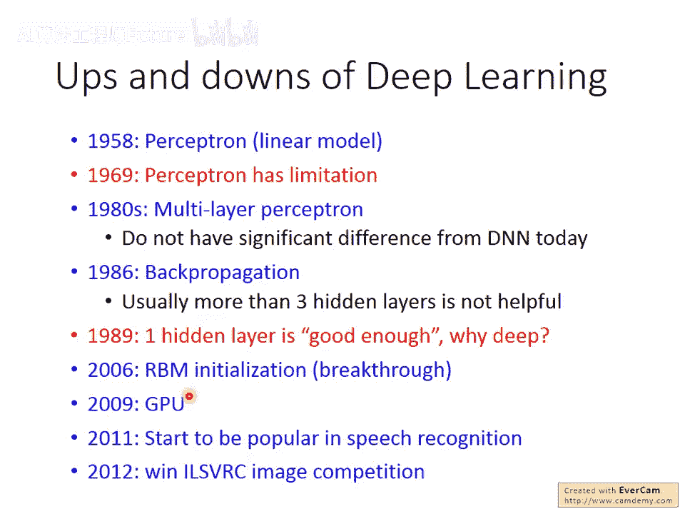

其实deep learning的技术并没有呃，真的很复杂，它其实非常简单，我们之前讲说machine learning就是三个step，那其实deep learning也一样，就是这三个step好。

所以呃这个假说deep learning就这三个是在叫好。

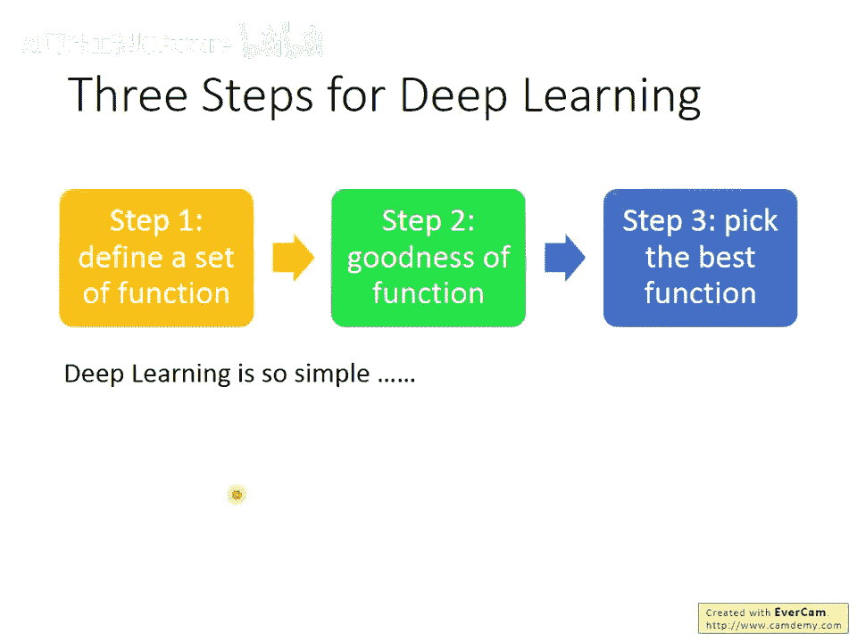

是说把那个大象放进冰箱里，大象放进冰箱，大家知道吗，把门打开，把大象赶进去，把冰箱门关起来，就把大象放进冰箱了，这三个step听起来就像是这个样子好，然后所以deep learning呢是很简单的。

你其实可以非常快的了解，其实你可以秒懂它，秒懂它啊，其实在deep learning里面呢，我们说在machine lear里面，第一个step就是要define一个function。

那这个function呢其实就是一个neural network诶。

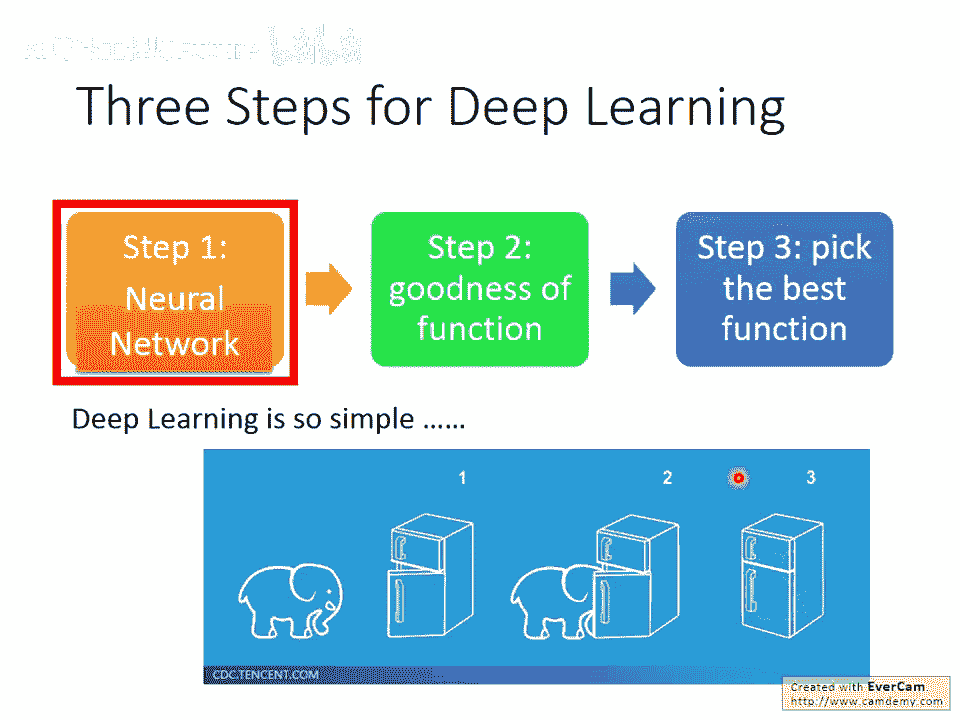

那这个neural network是是什么呢，我们刚才已经讲说呢，我们把这个restricted able，这个这个这个我们把这个logic regression呢，点前后concatenate在一起。

然后把一个logic regression称之为neural，整个称之为neural network，我们其实就得到了一个neural network。

那我们可以用不同的方法来连接这些neural network，我们用不同的方法连接这些neural network，我们就得到了不同的，而在这个neural network里面。

我们有一大堆的logistic regression，每个logistic regression它都有自己的weight，跟自己的B这些weight和bias集合起来。

就是这个network parameter，我们这边呢用SA来描述它，那这些logist regression或这些neural，我们应该怎么把它接起来呢，我们应该怎么把它接起来呢。

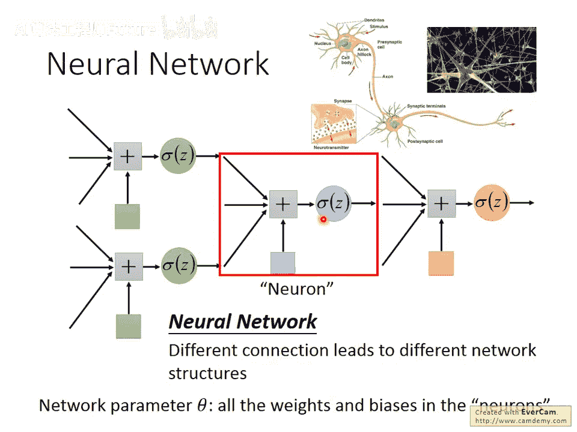

呃有各种不同的方式怎么连接，其实是你手动去设计的，而且是手动去连接的，最常见的连接方式呢叫做fully connected的，Three four one night work。

在fully connected feforward network里面呢，你就把你的neural呢排成一排一排啊，排成一排一排啊，这边有六个neural，就两个两个两个一排。

OK然后每一个neuron它都有一组weight，都有一组bias，那这个weight和bias呢，是根据training data去找出来的，假设上面这个蓝色的neuron，它的weight是一负二。

它的bias是一，下面呢它的weight是一一，它的bias是零，那假设我们现在的输入是一跟一，那这两个蓝蓝色的neuron，它的output是什么呢，这个呃做一下小学生会做的运算，你就可以得到答案。

1×1加-1×-2，再加上BS1，通过sigmoid function以后，你得到的结果呢就是0。98，那下面呢你把1×-1一乘一加零，再通过sigmoid function以后，你就得到0。12。

接下来假设这一个structure里面的每一个neural，它的weight我们都是weight和bias，我们都是知道，那我们就可以反复进行刚才的运算，一跟一通过这两个neural，变成0。98跟0。

12，在通过这两个neural变成0。86跟0。11，在通过这两个neural，得到0。62跟0。83哦，所以输入一跟一，经过一串很复杂的转换以后呢，就得到0。62跟0。83好。

那如果你输入是零跟零的话，哎输入是零跟零的话，你得到output就是呃呃经过一番一模一样的运算，你得到的是0。510。85哦，所以一个neural network。

你就可以把它看作是一个function，OK如果一个neural network里面的参数，weight和BIOS我们都知道的话，它就是一个function，它的input是一个vector。

它的output呢是另外一个factor，举例来说，我们刚才看到说input是一负一，而不是0。62，0。83，input是零跟零，output是0。5，一根0。85诶。

所以一个network如果我们把参数已经设上去的话，它就是一个function，如果我们今天还不知道参数，我只是定出了这个network structure，我只是决定好说这些neuron之间。

我们要怎么连接在一起，这样子的一个network structure，它其实就是define的一个function set，对不对，我们可以给这个network设不同的参数。

它就变成不同的function，把这些可能的function统统集合起来，我们就得到了一个function set哦，所以一个neural network你还没有认参数，你只是把它架构架起来。

你决定这些neural要怎么连接，你把这个这个连接的这个图画出来的时候，你其实就决定了一个function set，这跟我们之前做的东西都是一样的。

我们之前也是呃做logistic regression啊，做linear regression的话，我们都是也决定了一个function set。

那这边呢我们也只是换一个方式来决定function set，只是如果我们用neural network决定function set的时候，你的function set是比较大的。

它包含了很多原来你做logistic regression，做linear regression所没有办法包含的方式，好那呃刚才讲的是一个比较简单的好，在这个例子里面呢。

我们把neural分成一排一排的，然后所有neural，每一排的neural呢都两两互相连接，蓝色new我的output就都接给红色，蓝色都接给红色，红色呢就都接给绿色，红色就都接给绿色。

绿色后面没有别人可以接了，所以他就整个network的输出，蓝色前面没有其他人了，所以他就是整个network输入，那in general而言呢，我们可以把network画成这样。

你有好多好多排的neural，你有第一排，第二排到D大L排，很多排牛肉，每一排neuron，它里面的这个neuron的数目呢呃可能很多，比如说1000个啊，2000个啊，这个scale。

那这边每一个球呢代表一个neural，在layer和layer之间的，neural呢是两两互相连接的，layer one的output就是呃layer one的neural。

它的output会接给每一个layer two的neural，每一个layer two的neural，那layer two的new我的input就是所有layer one的output。

就是所有layer one的output，因为layer和layer之间所有的new room，两两间都有连接，所以它叫fully connected the network。

那因为现在传递的方向呢是从1~2，从2~3由后往前传，所以它叫做feforward network好，那整个network呢需要一组需要一个input，这个input呢就是一个vector。

那对每一个layer one的每一个neuron来说，每一个neuron，它的input就是input layer的每一个dimension啊，就是input layer的每一个dimension。

那最后D大L和layer的那些neural，它后面没有接其他东西了，所以它的output呢就是整个network output，假设大L排呢有大N个neuron的话。

它的output就是y one y two到Y大M好，这边每一个layer呢你可以他是有一些名字的，input的地方呢，我们叫做input layer，而严格说起来，input其实不是一个layer。

它跟其他layer不一样，它不是由neural呢所组成的，但是我们也把它当做一个layer来看，我所以叫它input layer，output的地方呢，我们叫它output layer。

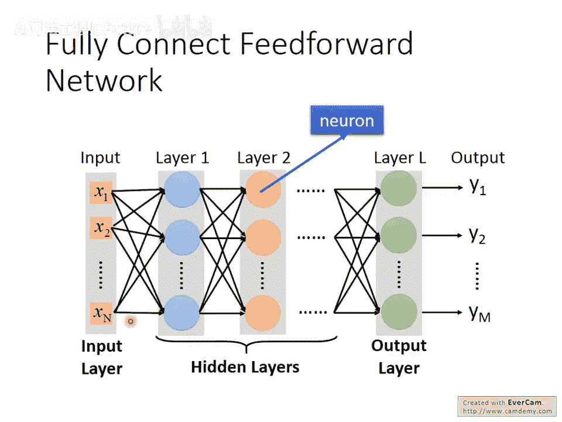

其余的部分就叫做hien layer，那所谓的deep是什么意思呢。

所谓的deep就是有很多hen layer就叫做deep，那有人就会问一个问题，说要几个hidden layer才叫做deer呢，这个就这个就很难说了，有人会告诉你说要三成以上才叫做顶。

有人会告诉你说要八成以上才叫做deer，所以就看每个人的定义呢就不一样，本来没有deep learning这个词的时候，大家都说我在做neural network，有通常都只有一层。

自从有了deep learning这个词以后，有一层的人都说他这个是deep learning，这好，所以现在基本上只要是neural network base的方法呢。

大家都会说是deep learning的方法，那呃到底可以有几层呢，在2012年的时候，参加image name那个比赛，得到冠军的alex name，还有八神，他的错误率呢46。4不胜。

那大家可能都知道说呃，它比第二名呢好了非常多哦，第二名呢的err r是30ACY，好到14年的时候，VGG有19层，它的error ray降到7percent，google net有22层。

它的error ray降到6。7percent，但是这个都还不算什么，recepu network152层，这样你把它跟google net跟VGG跟ax name比起来，就大概是长这个样子这样。

然后他的error ray呢是3。57percent，那如如果你看这个benchmark copus的话，其实他这个performance，是比人在同一个test上做的还要好，你赶快很怀疑说。

人怎么可能会在影像片子上输给机器呢，因为那个task其实还蛮难的，他给你一张图呃，那一张狗的图，你光回答狗并不是正确答案，你要回答说这个是哈士奇啊，就那个test其实还蛮难，但其实为了要公平的比较。

当时在做就在比跟这样人跟机器比较的时候，那些人是有事先看过training data，也就是说你有先让他训练辨识不同狗的种类，不同花纹，不同植物的种类，只是经过训练以后，其实他还是没有机器那么强就是了。

好那这个是跟101做一下比较的，101在这边，哎其实这个呃这我们之后再讲，那receio network呢，它不是一般的fully connected的three four one network。

如果你用一般可fully connect people for one network，搞在这个地方，其实结果呢是会有问题的，它并不是OVERFITTING，而是你劝都劝不起来。

所以你其实要特别的structure呢才能搞定这么深的network。

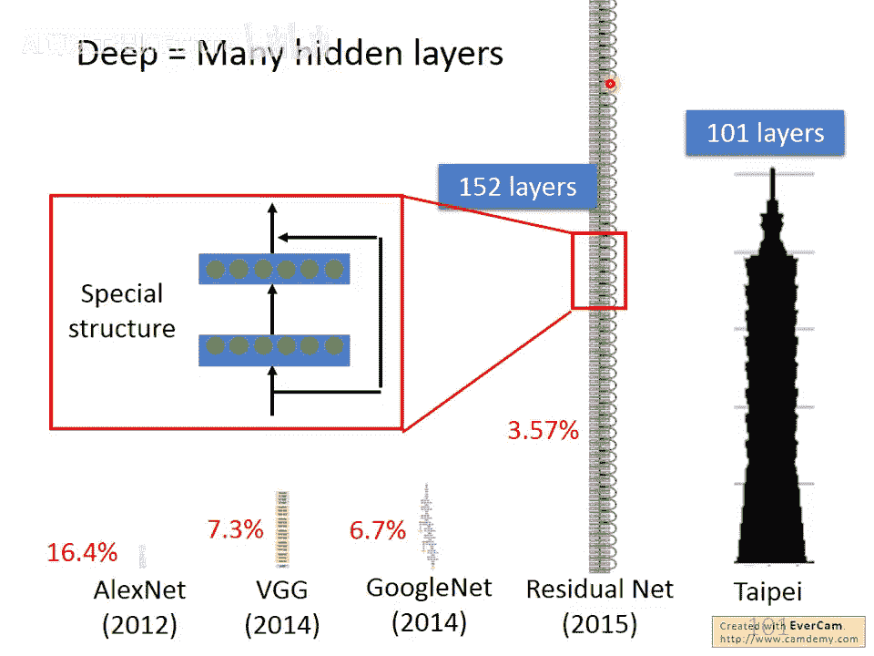

这个我们之后再讲，那network的运作呢，我们常常会把它用matrix的operation来表示，怎么说呢，我们举刚才的例子，假设第一个layer的两个neural。

它们的weight分别是一负二负一跟一，那你可以把这个一负二负一个一，把它排成一个matrix，好把这一负二负一个一就排成一个matrix，那当我们input1一要做运算的时候，我们就是把1×1。

-1×-2，1×-1一乘上一嘛，所以我们就可以把一跟一当成一个vector，把它排在这边，当我们把这个matrix跟这个vector做运算的时候，我们算1×1加-2×-1，就等于是做1×1一乘二。

当我们做1×-1，-1×1的时候，就等于是做1×-1，-1×1，这样可以，然后接下来呢有bias1跟零，所以我们要在后面呢把bias排成个vector，那再把这个vector呢再加上去。

这个结果呢算出来就是四负二，就是通过activation function的之之之前的值四跟二，然后通过这个sigmoid function，那在这个neural network文件里面呢。

我们把这个function称称之为activation function，事实上它不见不见得要是sigmoid function，那现在大家都已经把它换成别的function。

而如果你是从老GIREGRESSION那边过来，想过来的话呢，你会觉得他是一个sigmoid function，但现在已经比较少用SEMOVEFCTION啊。

假设我们这边仍然用的是sigmoid function的话呢，我们就是把四跟二丢到sigmoid function里面，那接下来算出来呢就是0。98跟0。12，所以一个neural network。

一个b forward network，他的一个layer的运算，你从一负一到0。98，0。12，你做的运算就是把input1跟一，一跟一乘个MATRI，乘个MATRI。

加上一个BIOS所成的vector，再通过一个sigmoid function得到最后的结果，所以in general来说一个neural network，假设我们说第一个layer的weight。

我们全部集合起来当做一个matrix，W one，这个w one是一个matrix，把他的bias全部集合起来，当做一个vector by one，把第二个layer的matrix呢。

把weight呢集合起来当做w two，把它的每一个news的balance集合起来，当做b two到DL和layer所有的weight集合起来，变成WL，BIOS集合起来变成bl。

那呃你今天得到你今天给他一个input x的时候，output的这个Y要怎么算出来呢，我们假设我们把XYX丢到X大N，接起来变成一个X，那这个output的Y应该要怎么把它算出来呢。

你就这样算X乘上w one再加b one，再通过activation function，然后呢你就算出第二排的这些neuron的output，我们称之为AY，你把X乘w one再加BY就得到a one。

X乘w one，再加BY，再通过activation function以后呢，就得到AY，而接下来呢你做一样的运算，把a one乘w two加b two，把a one乘w two加b two。

再通过activation function以后呢，就得到a two，然后就这样一层一层一层地做下去，到最后一层，你把AL减一乘WL加bl，通过information function以后呢。

得到整个network最终的output y哦，所以整个neural network运算呢其实就是一连串的，matrix的operation。

就是这个function x它的input output x跟Y的关系，X跟Y的关系，它们是什么样的关系呢，你把X乘上w one加b one。

通过activation function再把这个output再乘上w to加，再乘上w to加b to，再通过extivation function，再通过sigmoid function。

最后到乘上WL再加bl，再通过这个sigmoid function就得到最后的Y哦，所以呢一个neural network实际上做的事情，就是一连串的vector乘上matrix。

再加上vector就是一连串，我们在线性代数就有学过的矩阵运算，那把这件事情写成矩阵运算的好处，就是你可以用GPU加速，那实际上呢现在一般在用GPU做加速的时候呃，这个GPU加速并不是真的有。

对neural network去做什么特化，而是说但现在有一些特别基础做特化，但是你general如果你是买那种玩游戏的显卡的话，那他是没有对这个呃呃neon network做什么特化。

那你实际上拿来加速的方式是，当你需要算矩阵运算的时候，你就扣一下GPU，叫他帮你算矩阵运算啊，这会比你用GPU来用CPU来算的还要快哦，所以呢我们在做写这个neural network4则的时候。

我们习惯了把它写成metric operation的样，那里面如果有需要用到矩阵运算的时候。

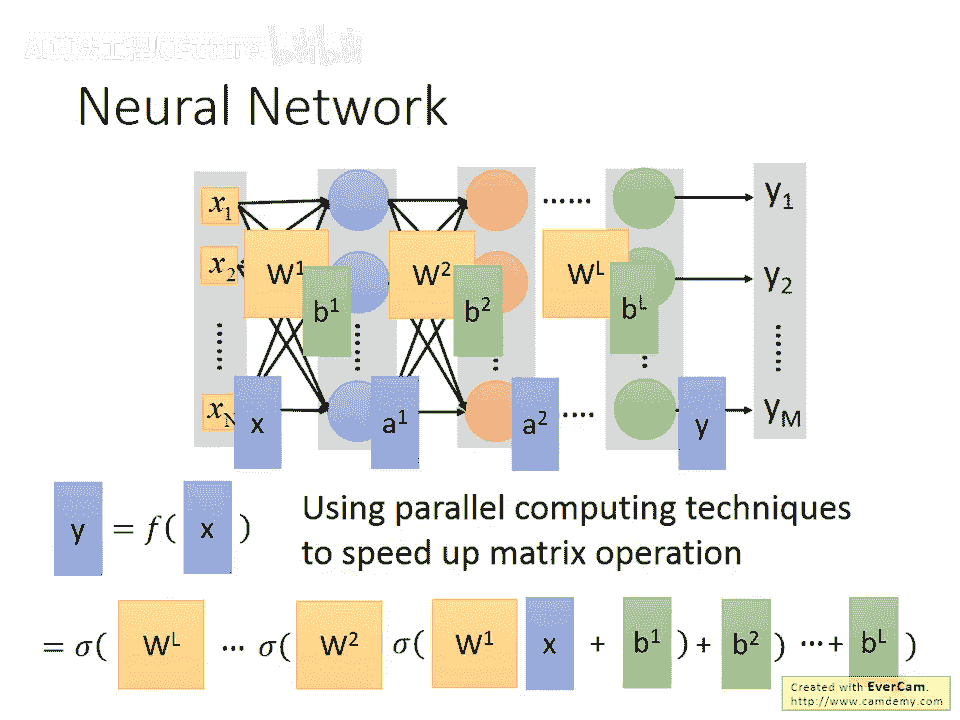

就扣GPU来做它好，那这整个network呢我们怎么看待呢，我们可以把他的这个这个到OPERLAYER，之前的部分呢，到open layer之前的部分看作是一个feature的extractor。

OK这个feature extractor就是replace，我们之前要手动做feature engineering呐，做feature transformation呐，这件事情。

OK所以你把一个x input通过很多很多hidden layer，在最后一个hidden layer的output，每一个内容的output x1 x2到X大K。

你就可以把它想成是一组新的feature，那open layer这做的事情呢，open layer就是一个MONTCLASS的classify，这个montclass classify。

它是拿前一个layer的output呢，当做feature这个mortanaor classify，他用的feature不是直接从S抽出来的，它是经过很多个hidden layer。

做了很复杂的转换以后，抽出一组特别好的feature，这组好的feature可能是能够被separable，经过这一连串的转换以后呢，他们可以被用一个简单的一个layer的。

MOTORNAIRE的classimotor class，classify呢就把它分类的好，那么刚才其实有讲过说moti class的classify，它要通过一个sigmoid function。

而不要通过一个soft max function，对不对，那通过一个soft max function，那因为我们把output layer也看作是一个motor，class的classify。

因为我们把OPERLAYER也看作是一个motor，Cast classify，所以呢我们最后一个layer也会加上soft max，一般你在做neon network的时候呢，是会这样做的。

那举一个呃不是宝可梦的例子，讲了之后，这不是宝可梦的例子，我之后会示范一下，实作这个例子就input一张image，它是一个手写的数字，然后output说这个input image它对应的数字是什么。

那在这个问题里面，你的input是一张image，但对机器来说呢，一张image它就是一个vector，假设这是一个解析度1616的image，那它有256个pixel，对mach来说呢。

他就是一个256维的vector，那在这个image里面呢，每一个pixel就对应到其中的dimension，所以右上角这个pixel就对应到XY，这个pixel就等到x2，右下角的就对应到S256啊。

如果你可以说有涂黑的地方就是一，那没有涂黑的地方，它对应的数字呢就是零，那output呢neural network output，如果你用soft max的话。

那它的output代表了一个probability的distribution，对不对，所以今天假如output是十维的话，你就可以把这个output看成是对应到每一个。

你可以把output呢看成是对应到每一个数字的，这个几率，我就YY代表了input这张image，根据这个neural network判断呢，它是属于一的几率，代表它是属于二的几率。

那它代表它是属于零的几率，那你就实际上让network帮你算一下，说每一个属于input，一张image，属于每一个数字的几率呢是多少，那假设属于数字二的几率最大是0。7。

那你的这个machine呢就会output，说这一张image它是属于数字二，那在这个application里面，假设你要解这个手写数字变式的问题。

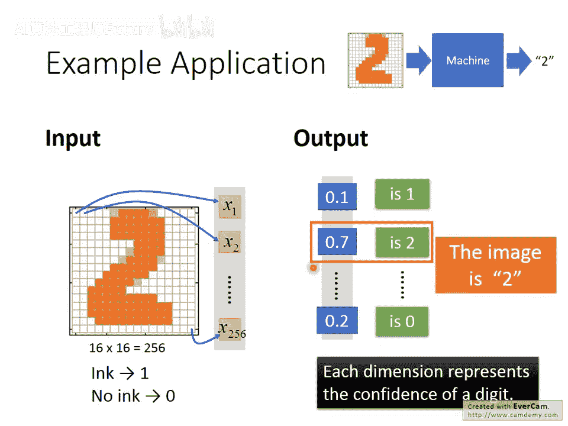

那你唯一需要的呢就是一个function，这个function input是一个256维的vector，output呢是一个十维的factor，而这个function呢就是neural network。

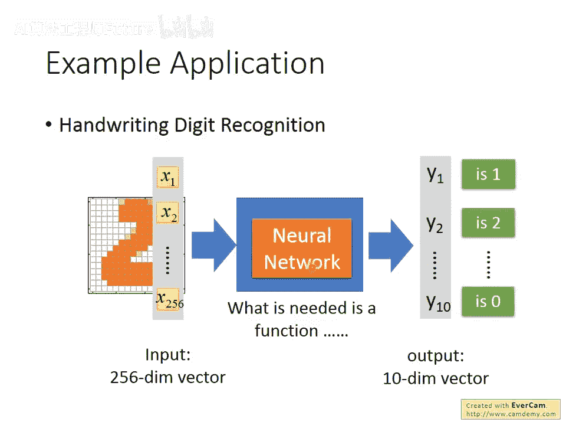

哎所以呢你只要多一个neural network，你可以用简单的v for all network就好了啊，丢一个neural network，它的input呢有256维，是一张image。

它的output呢你特别设成十维，这十维里面每一个dimension都对应到一个数字哦，如果你可以做，你做这样的设计，让input是256为output，固定式二或固定式十维的话。

那这一个network，它其实就代表了一个可以拿来做手写数字的function，这个function里面function set。

而这个function set里面呢这个network structure就def了一个function set，对方ction set里面每一个方程，你都可以拿来做手写数字变式。

只是有些做出来结果比较好啊，有些做出来结果比较差，那接下来你要做的事情就是呃，呃用gradient descent去找一组参数，去挑一个最适合拿来做手写数字链式的方学，那在这个process里面呢。

我们需要做一些design，在之前在做logistic regression，或者是linear regression的时候呃，我们对model的structure是没有什么好设计的。

但是对neural network来说，我们现在唯一的control只有input，要是256位，output要是十维，但是中间要有几个hidden layer。

每一个hen layer要有多少个neural，是没有限制的，你可以你你必须要自己去设计它，你必须要自己去决定说我要几个layer，每个layer要有多少个neural，那决定layer的数目。

看每一个layer的neon数，这件事情就等于是决定了你的function set长什么样子，那你可以想象说，如果我今天决定了一个X的方程set，那额里面没有包含任何好的方选。

那你之后再找最好的方选的时候，就好像是大海捞针，就真不在海里，这样你怎么找都找不到一个好的方式，所以决定一个好的方向，set其实是很关键的，也就决定这个network structure是很关键的。

讲到这边总是会有人问我一个问题。

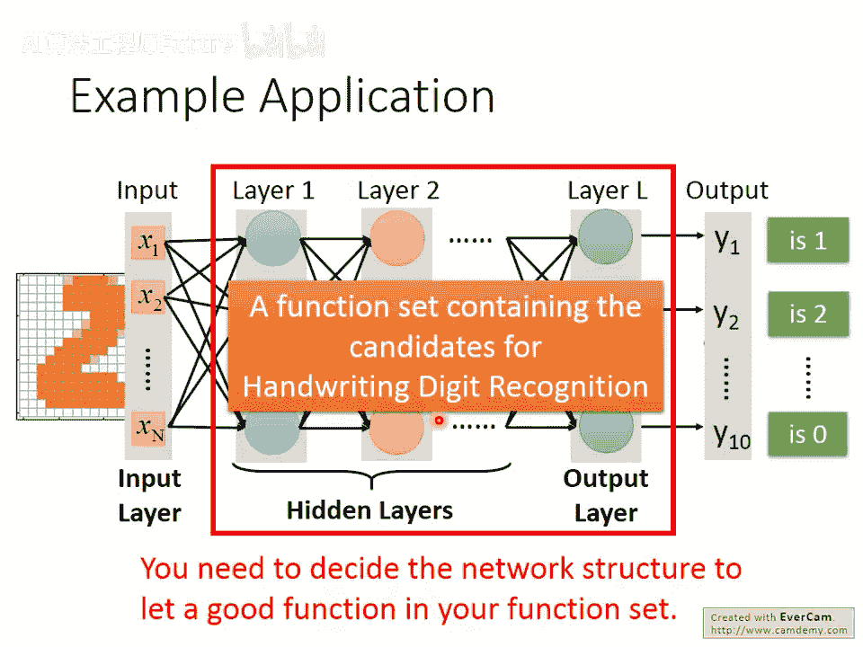

假设我们今天让我们迅来听我的talk，然后呢叫他回定之后会有什么样的问题的话，他一定可以预测接下来的问题，那我们到底应该怎么决定layer的数目，还有每一个layer的neural的数目呢。

这个答案呢就是我就我不知道这样子这个问题，这个问题很难让人问，知道怎么成为神奇宝可梦大师一样嗯，就这只能够凭着经验和直觉，这样就是这个network structure长什么样子，你就是凭着呃直觉啊。

还有多方的尝试啊，然后去想办法找一个最好的network structure，那其实找network structure这件事情呢并没有那么容易，它有时候是蛮困难的，有时候甚至需要一些dman NO。

所以我觉得从非deep learning的方法到deep learning的方法呃，我并不认为machine learning真的变得比较简单，而是我们把一个问题转化成另外一个问题。

这本来不是deep的model，我们要得到好的结果，你往往需要做feature engineering，也就是做feature transform，你要找一组好的feature。

但是如果今天是做deep learning的时候，你往往不需要找一个好的feature，比如说做影像辨识的时候，你可以直接把pixel就丢进去过去，做影像辨识的时候，你需要对影像抽一些feature。

抽一些人定的feature，这些这件事情就是feature选form，但是有了deep learning以后，你可以直接丢pixel硬做这样，但是今天deep learning制造了一个新的问题。

它所制造的新的问题是你需要去design这个network structure，所以你的问题变成本来如何抽feature，转化成怎么抽，怎么design network structure。

那我觉得deep learning是不是真的好用，这depend呢，你觉得哪一个问题比较容易，如果是我个人是觉得，如果是语音辨识或者是影像辨识的话。

design network structure可能比的确engineering容易，因为呃虽然说我们人都会砍会停，我们自己都做了下下焦，但是这件事情他太过潜意识了，它它离我们的意识和层次太远。

我们其实不知道，我们无法意识到，我们到底是怎么做语音辨识这件事情的，所以对人来说，你要抽一组好的feature，这样机器可以很方便的，用LINI的方法叫做语音辨识，这件事对人来说很难。

因为根本不知道好的feature长什么样，所以还不如design一个network structure，或是尝试各种network structure，那么去自己去找出好的feature。

这件事情反而变得比较容易，那我觉得对影像来说也是一样，那对其他test来说，我觉得就是case by case，比如说你有没有听过一个说法，是这个呃。

deep learning在NLP上面觉得performance没有那么好，你有没有听过这个，有有听过说这个说法的同学举手一下，好的may好，没关系，好手放下好，大家好像没有太多人听过这个这个说法啊。

这个这件事情是这样，就是如果你在语音辨，如果开语音辨识跟影像辨识的文献，语音辨识和影像辨识，这两个community的人是最早开始用deep learning，那一用下去进步量就非常惊人，比如说呃。

电视的错误率相对下降了20percent以上，那如果是NLP的话，你就会觉得说他的进步量似乎没有那么惊人，但甚至很多很牛逼的，现在仍然认为说deep learning不见得那么work。

那我觉得这个呃我自己的猜想是这个原因，就是呃人在做对做对NLP这一件事情，对文字处理来说，人是比较强的，你比如说叫你说呃，叫你设计一个rule detect，说一篇document。

他是正面的情绪还是负面的情绪，你可以说我就列表列一些正面情绪的词汇，负面情绪的词汇，然后看这个搭配里面，正面情绪的词汇出现百分之多少，你可能就可以得到一个不错的结果。

所以NLV这个task对人来说你比较容易设计我，所以你设计的那些a ho的，如果往往可以给你一个还不错的结果，这就是为什么deep learning相较于NLV传统的方法，觉得进步没有那么的显著。

但他其实还是有一些进步的，只是觉得没有呃，呃其他的领域就没有语音和文字处理，也没有语音和影像处理看起来那么的显著，但还是有进步的，那我觉得就长久而言呢，因为文字处理其实也是很困难的。

问题里面有很多优维的资讯，可能是人自己也不知道，所以就长久而言呢，呃deep learning让我们去自己去学这一件事情呢，还是可以占到一些优势，只是呢呃一下子眼下看起来几乎没有那么显著。

它跟传统方法比起来的差异呢就没有那么惊人，但是还是有进步的啊，这是我的一些想法，那再来就有人会问说能不能够自动学network structure，其实可以的，你就去问那个于天利老师。

这样也在这个经典算法那边，有很多的肯定是可以让我们去自动的去找出，Network structure，不过这些方法目前还没有非常的普及，你看到的那些非常惊人的应用，比如说阿法狗什么的。

都不是用这些方法所做出来的，那谈一个常问的问题，就是那我们能不能自己去设计network structure，我可不可以不要fully connected，我可不可以说第一个连到第三个。

第二个连到第四个，会不会自己乱接，可以一个特殊的接法，就是convolutional neural network，这个我们下一堂课呢再讲。

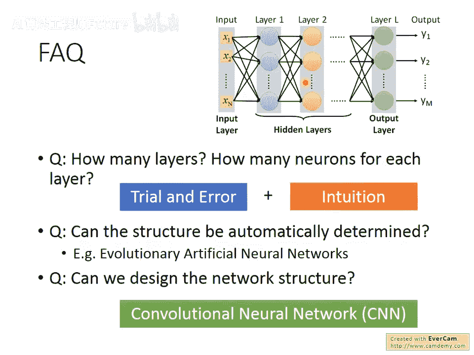

那呃接下来第二步，第二步和第三步真的很快，我们等下就秒讲，这第二步是什么呢。

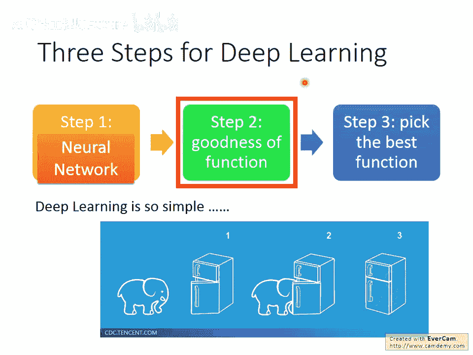

要定义一个方形的好坏，在neural network里面怎么决定一组参数它的好坏呢，就假设给定一组参数，我要做手写数字辨识，所以我有一张image跟它的label。

然后把这张image呢呃这个label告诉我们说，你因为现在是一个motor class classification的问题，所以今天这个label1告诉我们说。

你现在的target呢是一个vector，你的target是一个十维的vector，只有在第一维对应到数字一的地方，它的值是一，其他的都是零，那你就input这一张image的pixel。

然后呢通过这一个neural network以后呢，你会得到一个output，那这个output呢我们称之为Y，然后我们把我们的target呢称之为YH，接下来你要做的事情就是计算这个Y跟y hand。

它们之间的cos ental比，就跟我们在做montclass classification的时候是一模一样，我们就计算Y跟YH的cross entropy，然后接下来我们就是要调整network参数。

去让这个cross entrop呢越小越好。

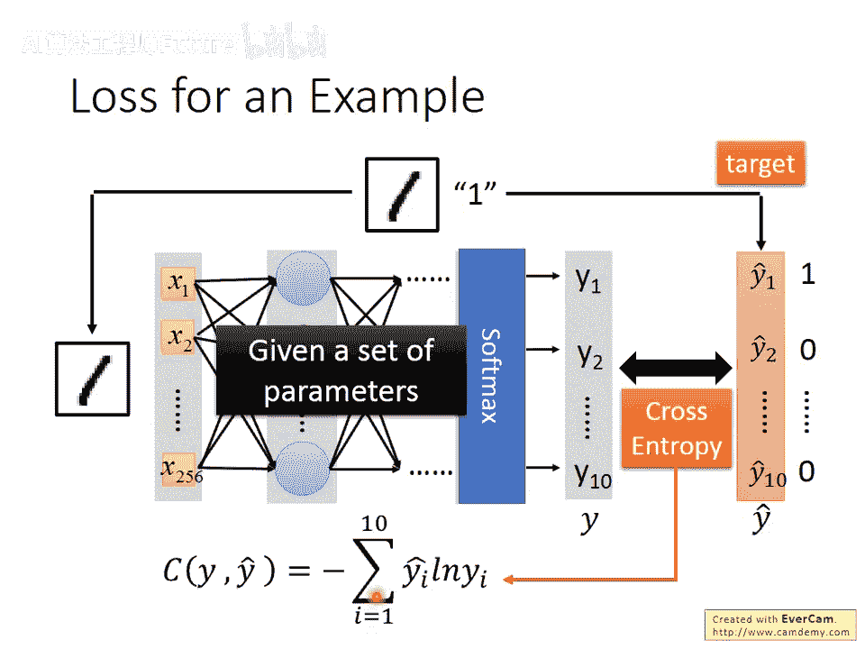

当然整个training data里面不会只有一笔data，你有一大堆的data哦，你有第一笔data，那他速算算出来cos co，别是c one，比DA算出来C大N。

那你会把所有的data的pose entroy偷偷上起来，得到一个偷偷lost style，然后呢，你接下来要做的事情就是在function set里面找一个function。

它可以minimize这个total loss，或者是找一组network parameter，现在写成sea star，它可以minimize这个total loss好，怎么解决这个问题。

怎么找一个set a star mini买这个total loss呢。

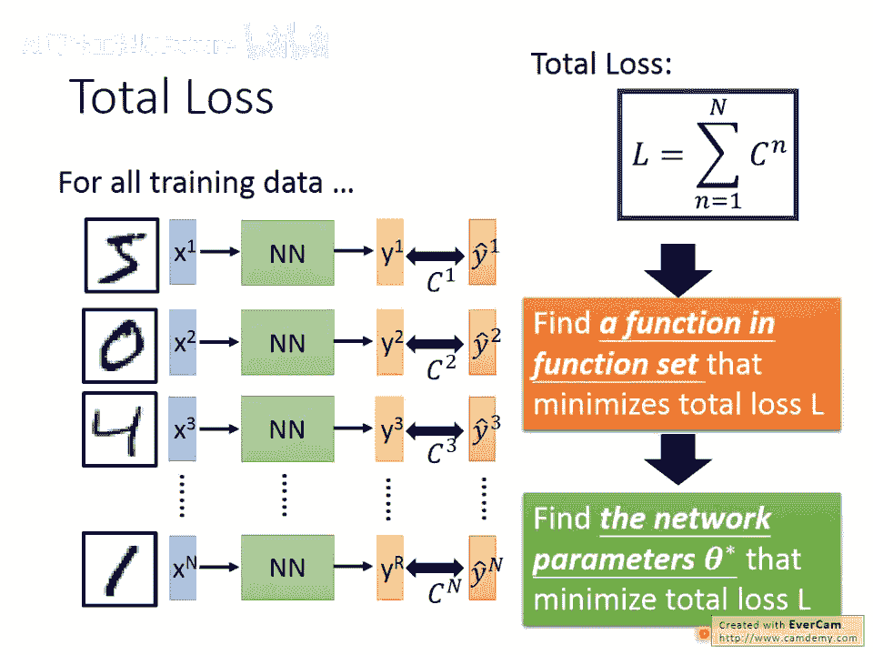

你用的方法就是gradient descent，gradient descent大家已经太熟了，没有什么好讲的，实际上在deep learning面，用gradient descent。

跟linear regression那边什么都没有什么差别，就一模一样，所以你要做的事情只是方向变复杂而已，其他的东西都是都是一样，也就是说你的sea里面是一大堆的参数。

一大堆的weight跟一大堆的by，你先找一个random，找个初始值random，给每个数数字一个初始值，接下来呢计计算一下它的GRA点，要计算每一个参数对你total loss的偏微分。

那把这一篇文章全部集合起来呢，叫做GRA点啊，有了这些偏微分以后呢，你就可以更新你的参数，你就把所有的参数都减掉一个这个learning rate，这边写成缪乘上呢这个偏微分的值。

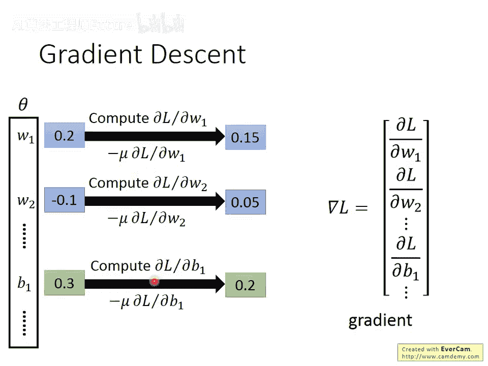

你又得到一组新的参数，这个pass就反复继续下去，你有了新的参数。

再计算一下它的gradient，然后呢再根据你的gradient再更新你的参数，你就得到一组新的参数，哎就按照这个process呢继续下去，这个都是我们讲过的东西，你就可以找到一组好的参数。

你就做完neural network training了，所以其实就这样子啦，基本能念成品就这样啊，就算是最潮的阿尔法狗，也是用gradient design train的啦，所以你可能会有人。

大家大家可能会想象说，如果是deep learning的话。

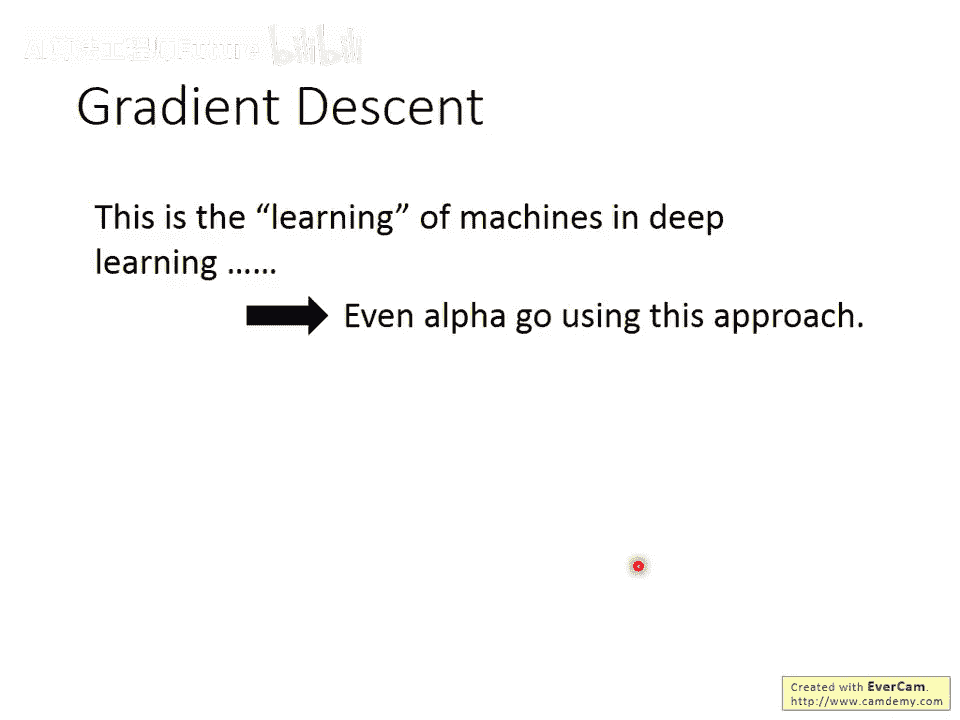

machine learning应该是这个样子，其实像我们知道说gradient design就是玩世纪帝国，所以其实是这个样子啊，希望你不要觉得太失望，然后你可能会问说。

那这个规ent design的function4子长什么样子，之前我们都手把手的把那个算式算出来，给大家看，但是在neural network里面。

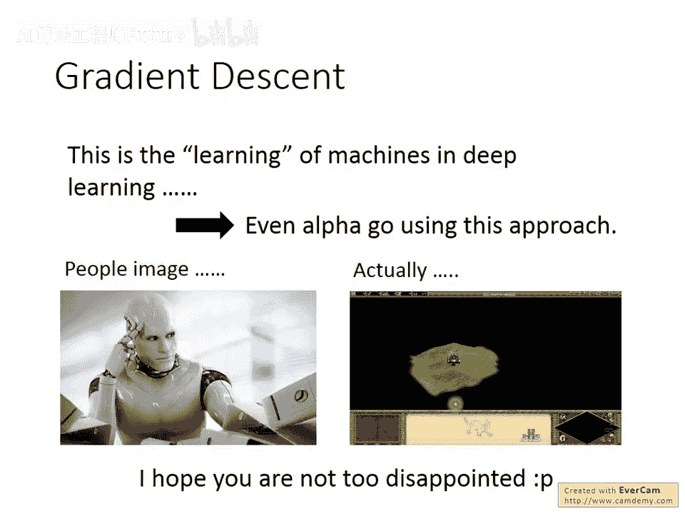

因为function比较复杂，所以我们如果手把手的上下给大家看，是许比较难。

要花一些时间，呃，其实在现在这个时代啊，我还记得几年前你这个在做deep learning很痛苦，因为你要自己implement背POCATION，那现在呢你应该已经没有人在自己implement。

BPVACATION的，因为有太多太多太多的token，可以帮你算VPAGATION，而在作业三我们要做deep learning，那我也容许你用这些token，所以你就算不会算这个微分。

Papagation，就是算这个微分的一个比较有效的方式，因为参数非常多嘛，你有million的参数，你没有办法为每一个media参数都算微分，这太花时间了，那FPAGATION是一个比较有效率的。

算这个微分的方式，那如果你想要更知道详情的话，我之前的deep learning课呢内容是有录音的，你可以听一下这个上课的内容，那如果你不想知道的话呢，其实也没有什么关系，我听过一个传闻是说呃。

现只有说有某个公司呢他在应征deep learning的人，我就问他说你们要应征deep learning的，人类会问他什么问题，他说我问他如何算唯粉。

他说75%的号称是deep learning专家的，其实不会算微分的，对大家已经太习惯用脱皮就不太会上微分了，这个图片很多啊，这边就列一些出来呢给大家参考。

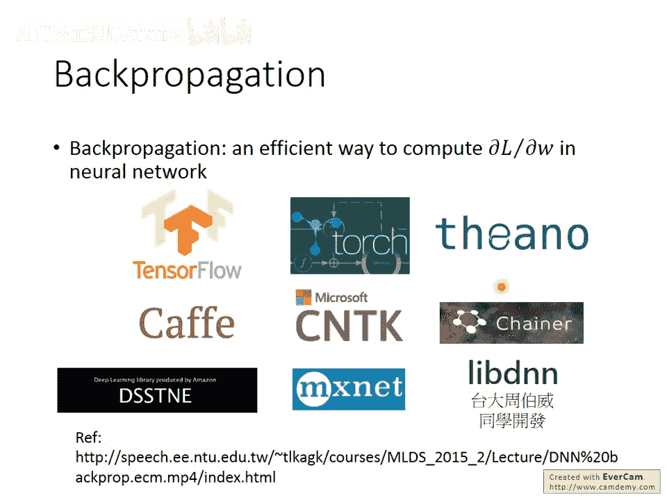

好那最后最后在公告做，再请助教讲作业二之前我们有一个最后的问题。

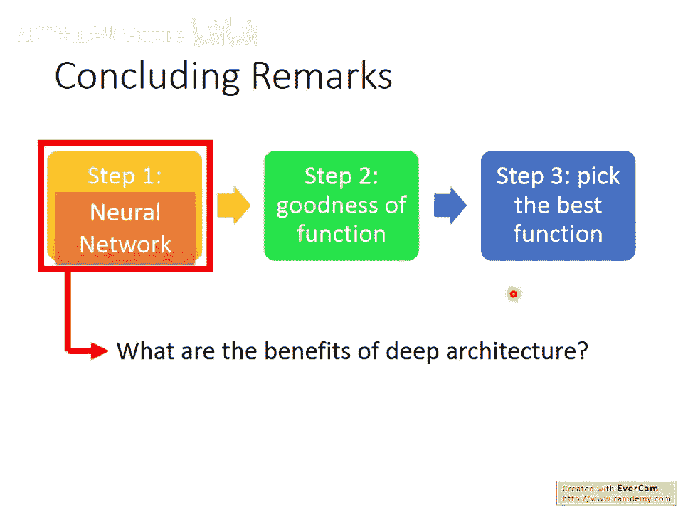

为什么我们要deep learning，一个很直觉，应该说这个答案很简单啊，因为越deep performance就越好，这个是一个很早年的实验的啊。

这个是2011年的inter speech里面的某篇paper，他做的是wherror ray，也就wherror rate是越小越好，你会发现一个hidden layer。

每个hidden layer2K的neal worl race，24。2，那越来越deep以后，他的performance err rate就越来越低。

但是如果你稍微有点machine learning的尝试的话，这个结果并没有让你太surprise啊，因为本来有model的越多，Parameter，他cover的function set就越大。

它的bias就越小，对不对，那你今天如果有越多的training data，你有够多的training data去控制它的variance，一个比较复杂的model，一个参数比较多的model。

它performance比较好是很正常的啊，那变deep有什么特别了不起的地方，甚至有一个fr。

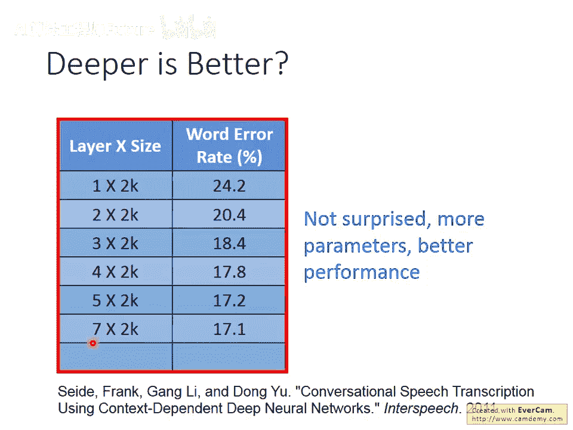

有一个理论是这样告诉我，这个理论是这样说的，任何连续的function，假设你要任何连续的方向，它input是一个N维的vector，它input是一个N维的vector。

他都可以用一个hidden layer的neural network来表示，只要你这个hidden layer的NEUR够多，它可以表示成任何的function。

那既然一个hidden there的neural network，它可以表示成任何function，而我们在做machine learning的时候，我们需要的东西就只是一个function而已。

那一个hidden name就可以表示任何方向，那做deep的意义何在呢，就没有什么特别的意义啊，啊所以有人说deep learning就只是一个噱头而已，因为做deep的感觉比较吵，如果你只把它变宽。

就变成fat neal network，那感觉太虚弱了，所以他没有没有办法引起大家的注意，所以我们要做deep learning，真的是这样吗，这个我们在往后的lecture呢再来告诉大家。

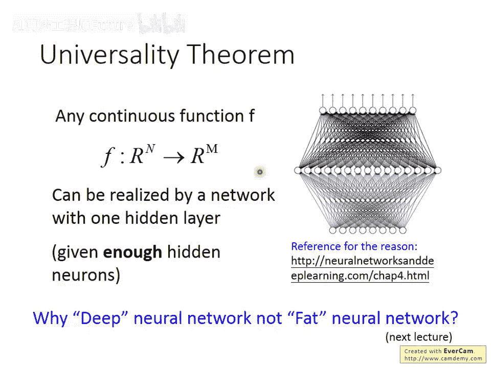

最后就是列一些reference啊，如果你对deep learning很有兴趣的话，你可以先先看一下，那还有我上学期讲deep learning的录影呢，在这边也找得到，那另外呢我有一个六小时的呃。

tutorial的slide，那在这个连接上呢也可以找到，那那个tutorial，我11月还会呃在新竹再讲一次，这或许是我人生中的最后最后一次，讲这个tutorial，那千万不要来听，因为为什么呢。

因为在tutorial讲的东西，在未来课程里面都会涵盖，它就只是一个SUC而已，好好那接下来我们先停五，暂时休息5分钟。

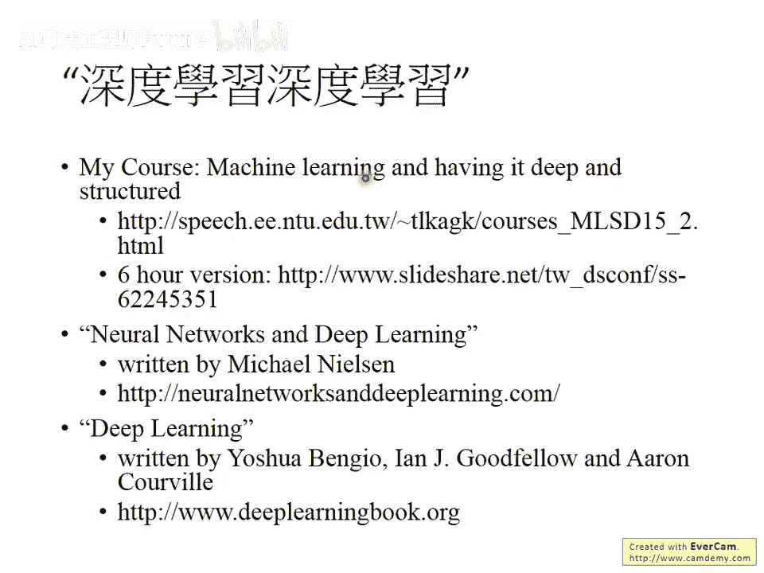