# 【官授搬运】2026年全新优化版李宏毅机器学习系统课程，这才是真正的初学者体系课程！—人工智能／深度学习／神经网络 - P81：作业说明 Homework12 - AI算法工程师Future - BV1ruqABeEFX

大家好，这是机器学习作业的教程，本次作业内容为健康相关。

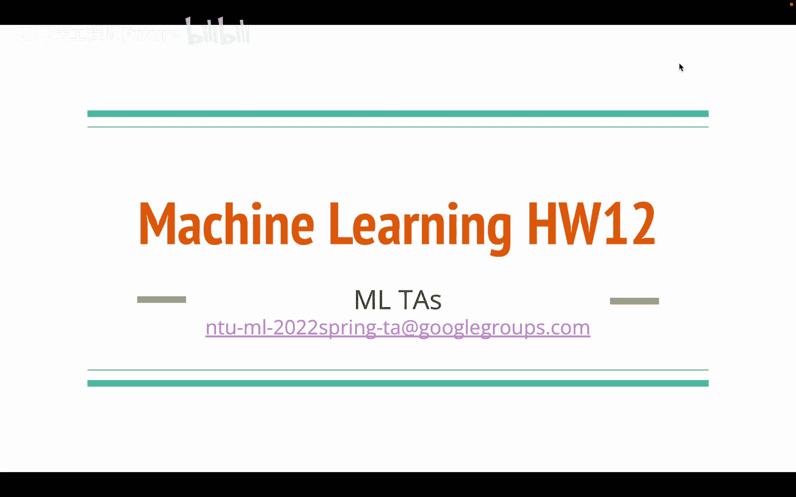

你可以自行实现一些深度强化学习方法，包括策略梯度，演员，评论员和审计员等任何其他强化学习算法，本次作业的环境是OpenAI的lander，关于环境的详细信息将。

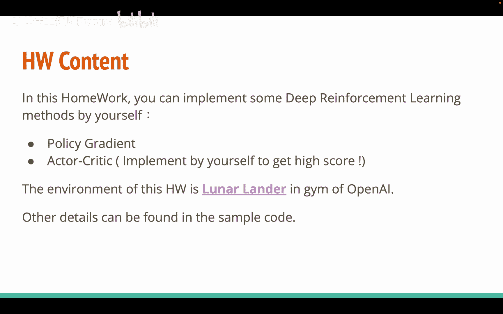

呃，解释符号代码，这里我们将看看本次作业的具体内容，可以看到有一个紫色飞船我将尝试在月球着陆，是的，我们的目标是，训练我们的智能体，也就是这个紫色飞船，嗯是的，并且，成功着陆在地面，在两个黄色标志之间。

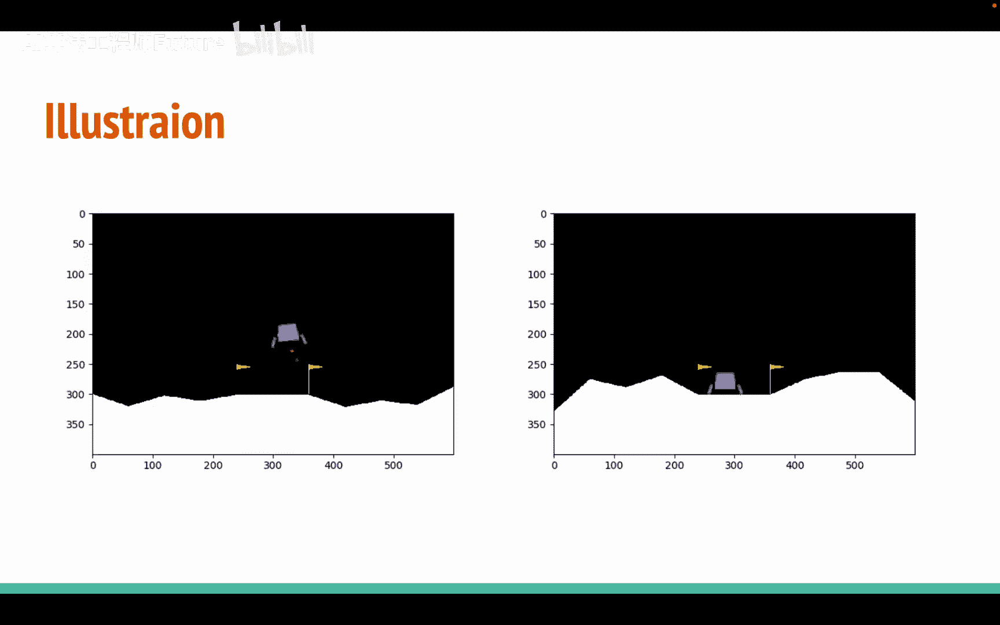

接下来我们将讨论策略梯度的伪代码，首先我们需要初始化，策略参数，我们称之为θ，并在每个包含t个状态的episode中，在每个时间步t，每个时间步有一个状态，一个动作和一个奖励。

对于每个episode及其每个时间步，我们将计算折扣奖励，公式如图所示，然后只需自行实现，这个折扣奖励，我们将使用状态和奖励更新策略参数，此处的，这一项是学习率和梯度，该动作的低概率，是的，这种操作。

是的，我们将使用这一项更新策略模型。

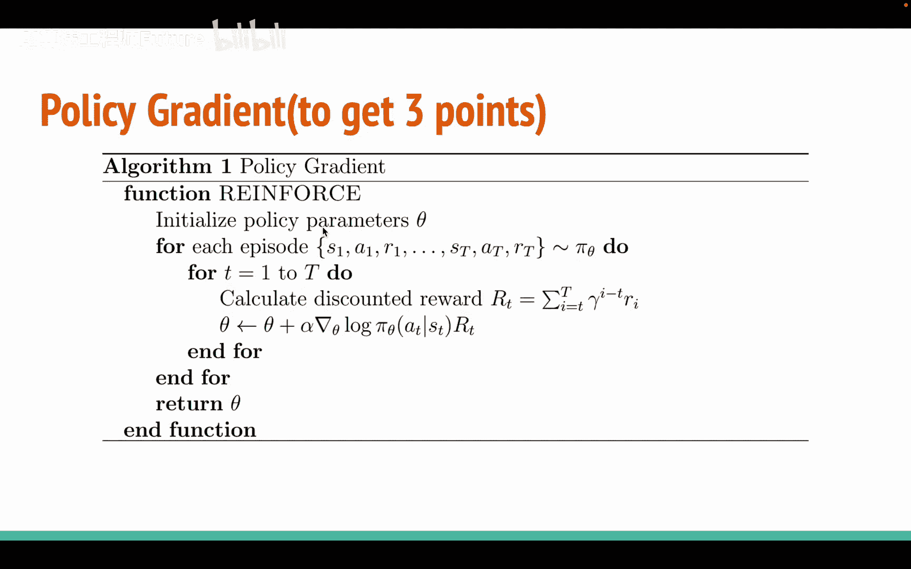

接下来要介绍的算法是演员-评论家，嗯，可以看到，该算法与之前非常相似，不同之处是我们需要另一个基线函数称为，我们可以称其为更好的，是的，在边缘所以，在每个episode的每个时间步。

因此我们也需要计算此类奖励，然而，嗯，在这里我们需要，呃，进行进一步计算，也就是说，我们需要估计这个优势，并将其表示为a，八十等于折扣奖励减去参数为的贝塔，呃，状态，是的，这意味着，呃，贝塔是一个函数。

呃，以当前状态作为其参数，我们如何如何如何定义，呃，贝塔，贝塔的函数，我们希望贝塔尽可能接近，尽可能接近折扣奖励，因此我们需要最小化两者之间的距离，贝塔与该国家奖励之间的差距并找到，并且这个。

最后我们需要用之前计算的优势更新模型。

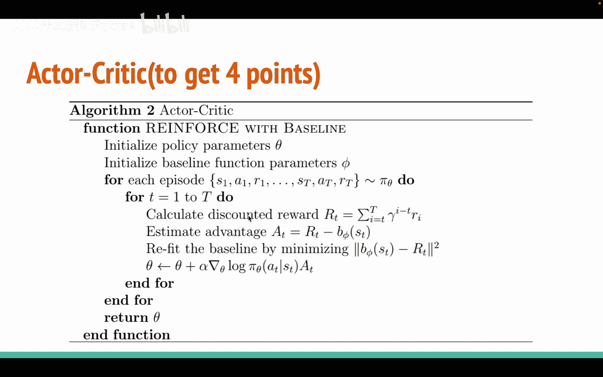

是的，是的，这里，这里是训练的简单结果，呃，这两张图会在训练过程中自动生成，所以呃，或者无需额外操作即可获取这些图片，左边的是总奖励，即各回合的奖励之和，每个回合的奖励，右边的是最终奖励。

即从环境中获得的最后一个奖励，如果是这样的话呃，主要反映我们的飞船是否成功。

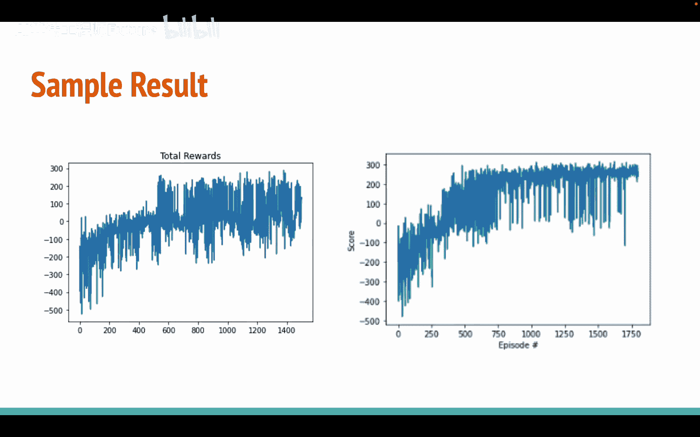

好的，你需要提交什么，然后这份作业首先是Python文件，你需要获得两点，如果你正确提交到新调用，第二个是动作列表，这个稍后会解释，呃，如果你如果，并且呃，最多可以获得四分，呃，如果你获得最高排名。

在judge boy中取得最高基准分，而在本次作业中没有隐私座位，所以呃，最高提交将自动入选，第三你需要提交的是报告，问题将基于地面范围。

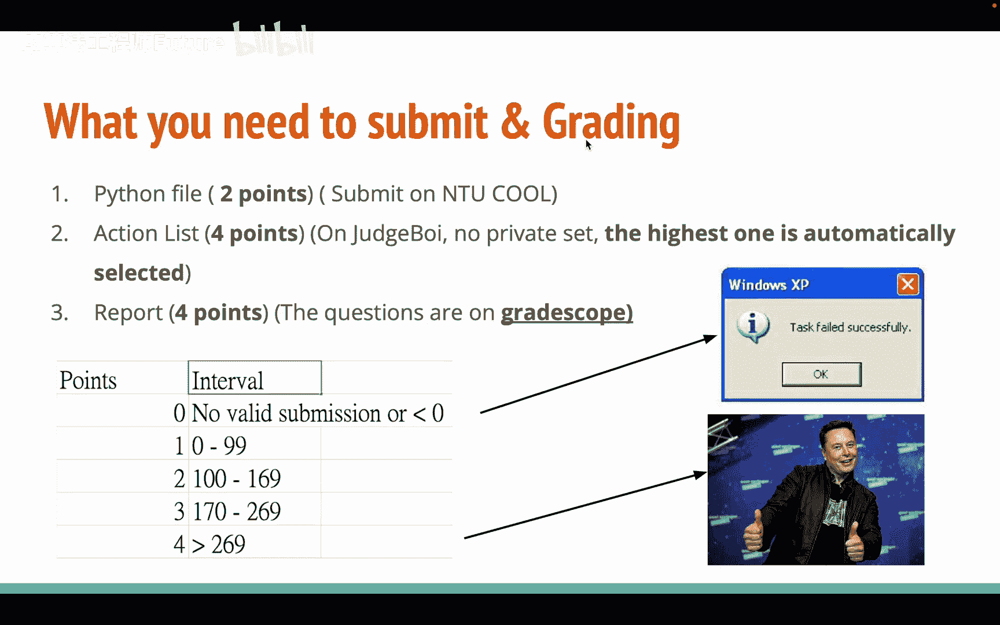

好的，让我们谈谈什么是，呃，呃，动作列表，呃，实际上确实是，呃，你代理与环境交互的一系列动作，与环境进行交互，你可以看到这里，实际上看起来像这样的一系列动作无需担心，这将自动生成，呃。

由我们的示例代码生成，所以呃，无需自行完成，但请注意不要手动修改，动作列表因为这是禁止的，通常，呃，如果你手动修改了动作列表将被拒绝。

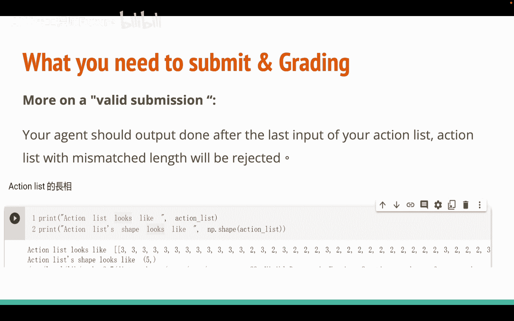

好的，动作将为你带来，呃，最终得分，是的，即平均总奖励的，平均总奖励值，这里是你获得的分数区间，如果你未提交任何有效提交，或总奖励低于负数，则得零分，然而，如果你的总奖励，平均总奖励超过209。69。

则可获得四分，即本部分四分。

好的，这里是judge boy的通用规则和，judge boy的通用规则，我认为你，你们可以自行查看一下。

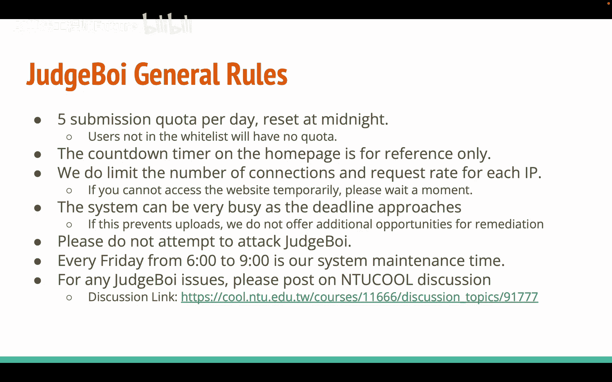

这里有一组作业十二中的压力男孩，呃，你只需要提交npy文件，文件大小需小于两兆字节，如果你，呃，但我觉得，如果你，不要手动修改文件，那么它会是，呃，这就是刚刚说的正确做法，在一组，他们成功地。

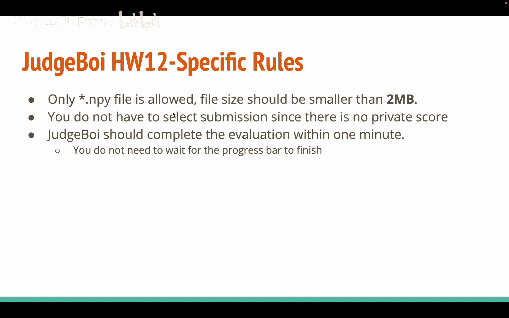

好的，而这里我们需要，我们将讨论关于，报告中的问题，第一个问题就是，呃，你需要实现一个高级强化学习算法，你可以选择基于基线的Q强化，演员，评论家，A2C、A3C或其他你想要的高级强化学习算法。

如果你不确定所选算法是否合适，是否可行，可以邮件联系助教，助教会尽快回复，呃，此外在本部分需解释你的实现与策略梯度的区别，最后，请明确描述你的实现过程，是的，如果KA能理解你的描述。

我们将直接检查你的代码，如果我们发现这种情况，你可能会被扣分。

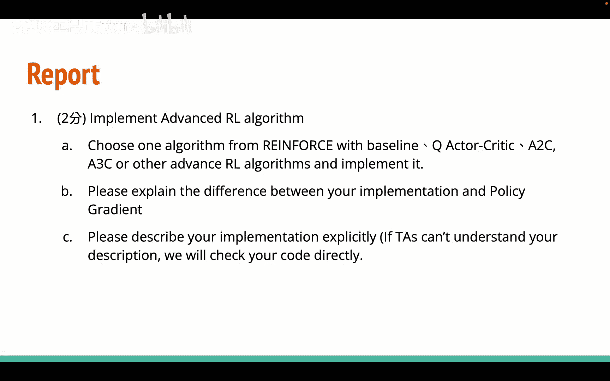

在本部分第二个，呃，第二个问题是多选题，关于MuZero的描述，以及MuZero的链接，MuZero论文的链接已提供，我们要求学生前往，呃，阅读这篇论文，然后自行作答问题，是的。

这个问题旨在选择错误选项，错误的那个，所以请开始小心注意这个问题。

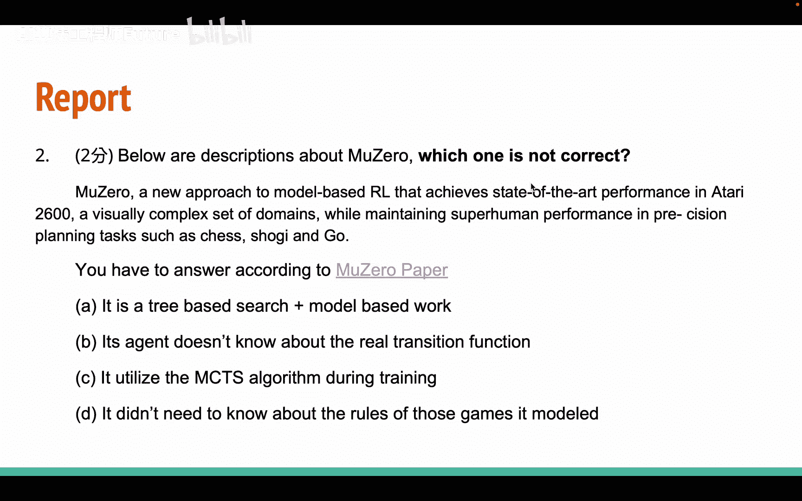

好的，这里还有一些，这里有一些需要注意的，呃，这份作业默认不会使用GPU，我们建议学生使用Collab完成此作业，如果你想使用其他，除了Collab以外的环境，则需要自行解决重复出现的问题。

这意味着如果你的提交能在Judge Boy上复现，你可以使用自己的环境完全没问题，是的，但如果你无法复现就需要自行解决问题，Ta不会帮你处理环境相关的问题，好的。

而Homer's Twelve的训练应该要，控制在三十分钟以内，所以啊，你无需担心，需要等待太久才能得到结果。

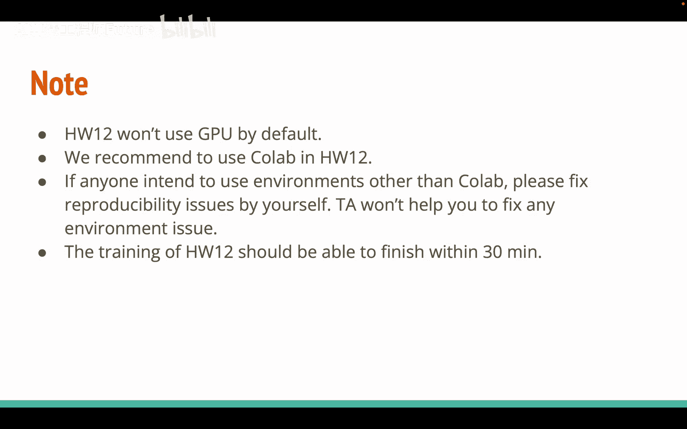

还有啊，你需要将代码提交到你的Collab，我们只能看到你的最后一次提交和最后，并记住不要提交模型检查点或数据集，如果代码在Judge Boy上无法复现结果，你的最终成绩将，以多倍计算，呃，零九，是的。

你需要将文件压缩成单个文件，格式如下，如果你的手机，如果提交了错误格式的文件。

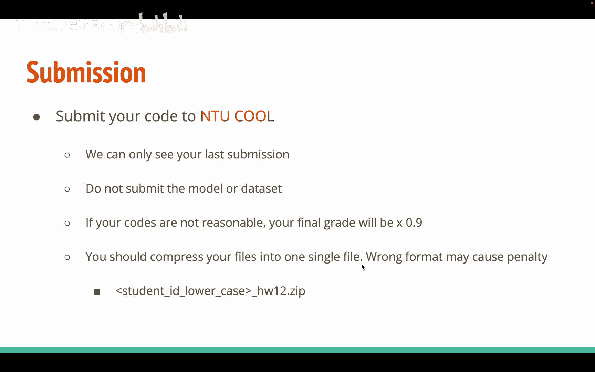

可能会被扣分，此外在本次作业中，我们还有一个加分项，即，呃，这与其他作业相同，我觉得大家应该已经，非常熟悉这个加分项了，所以无需多讲。

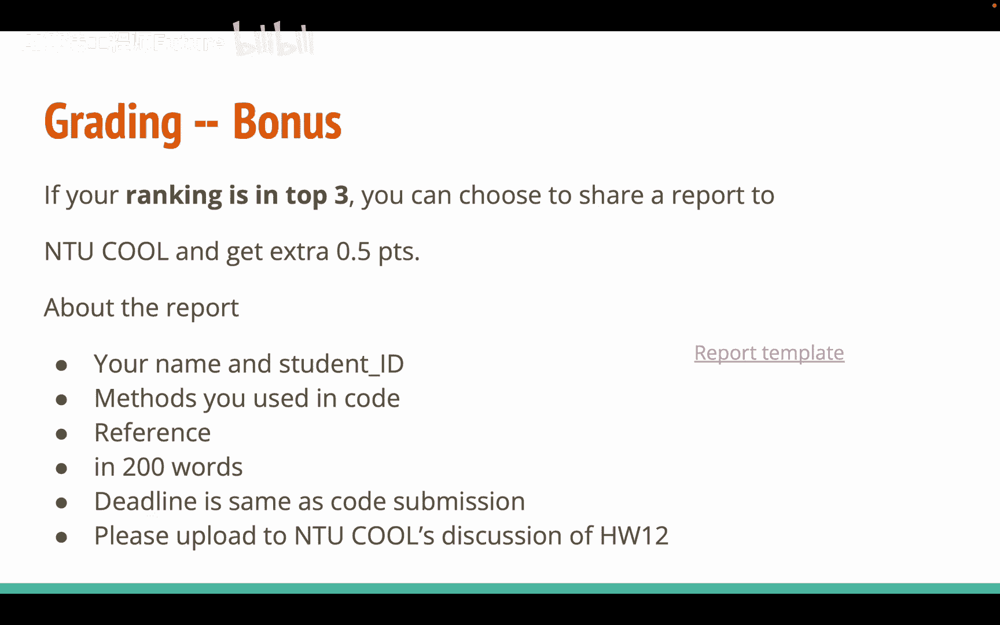

如果有任何问题，你可以，呃联系助教或发送邮件至该地址，记得标题设为Homework Twelve或可在线提问，可以直接在课堂上向助教提问。

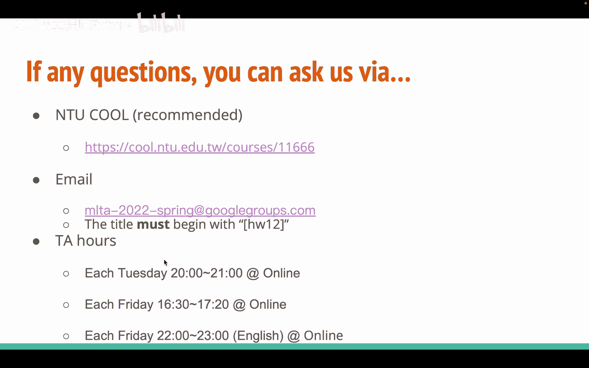

这里有一个公告，你可以自行查看确认。

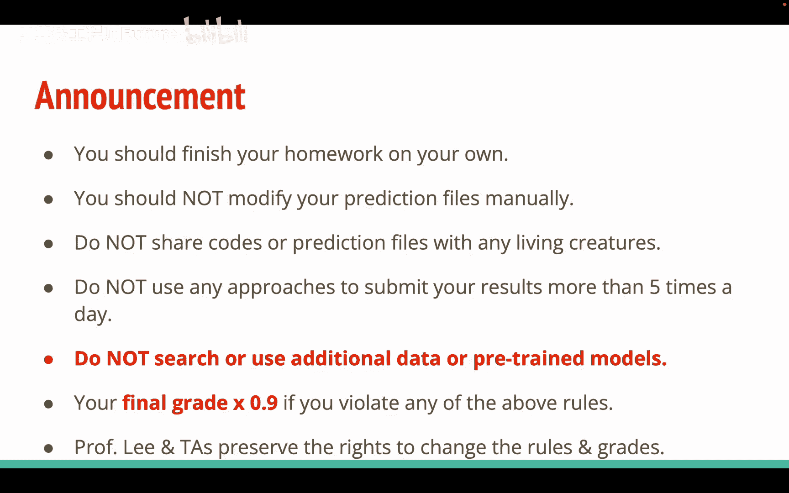

这次作业的开放时间从本周开始，将持续到，是的，所以啊。

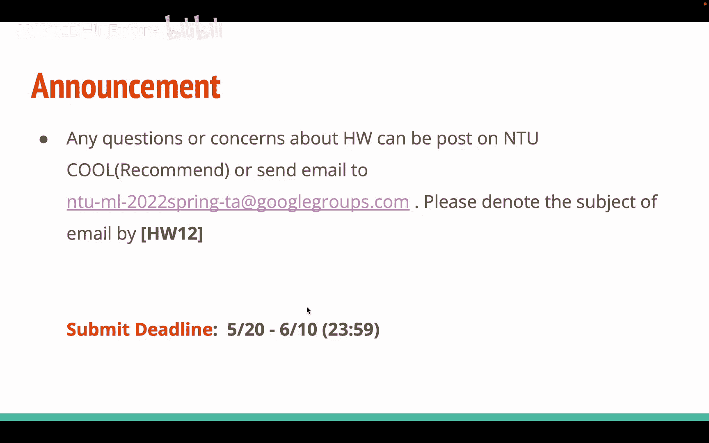