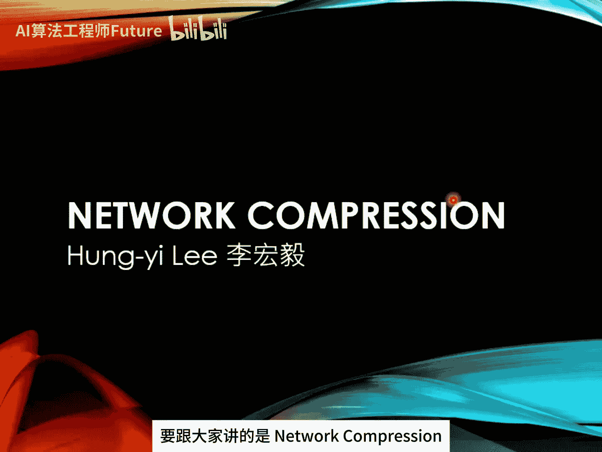
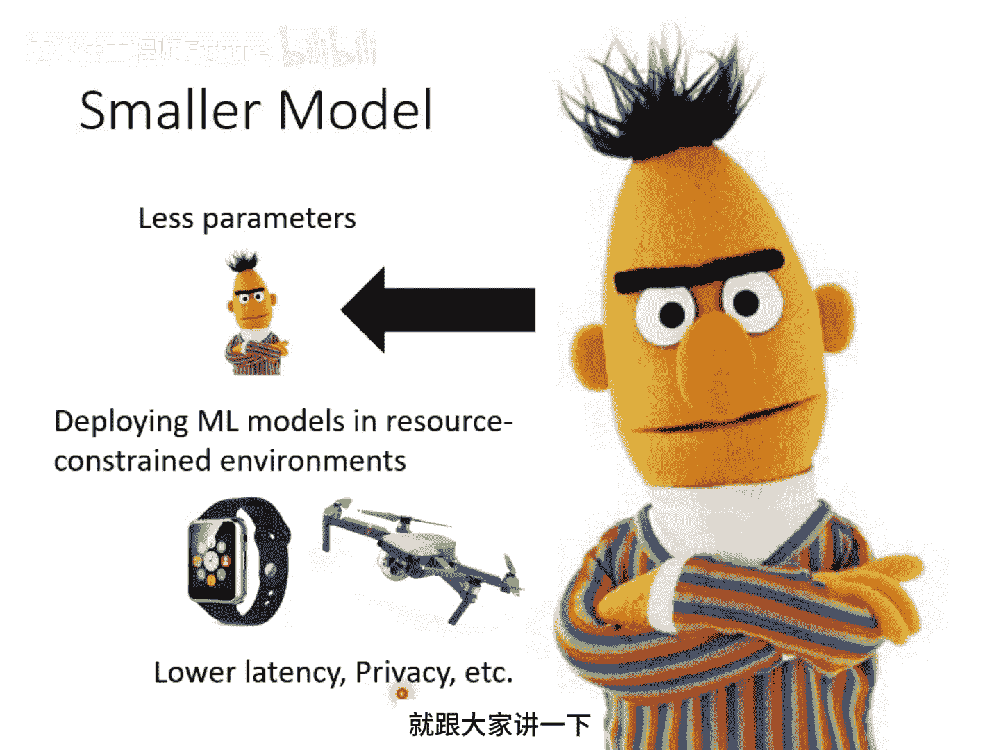
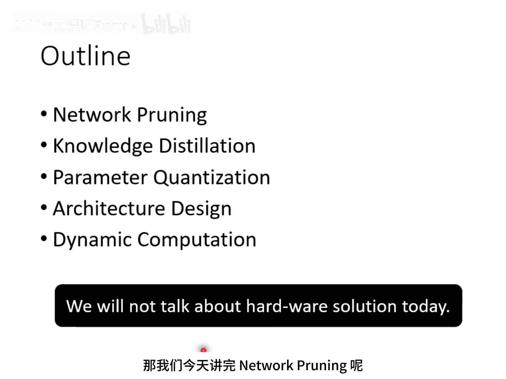
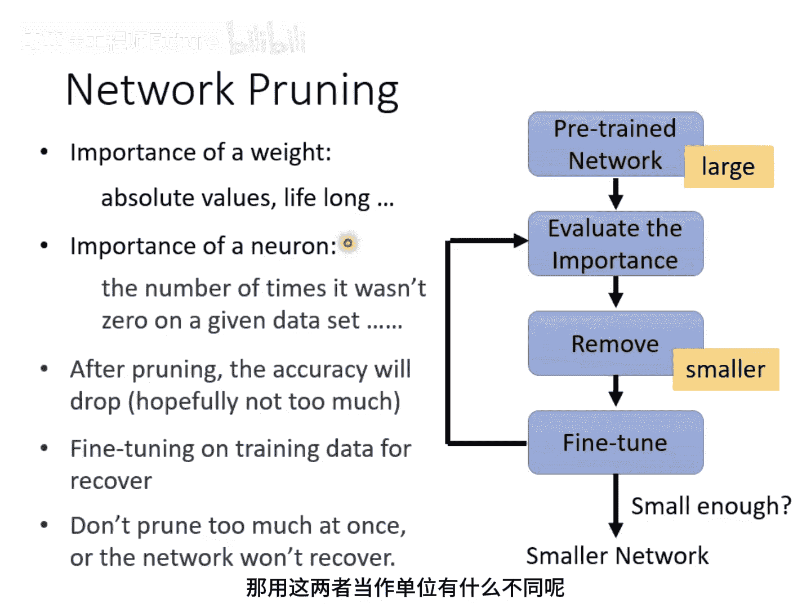
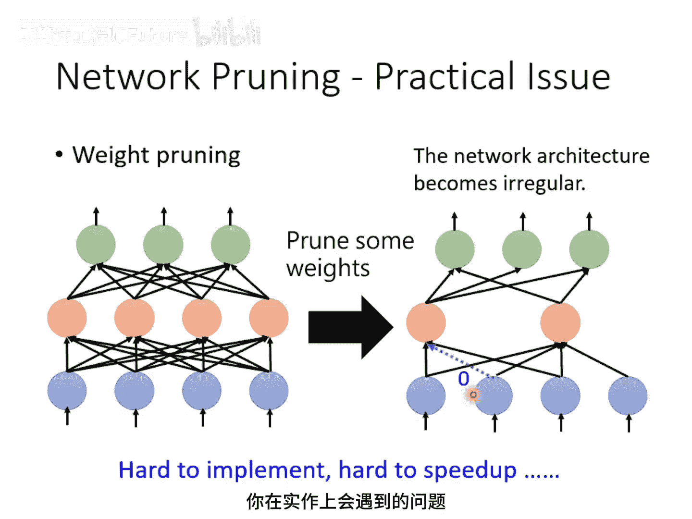
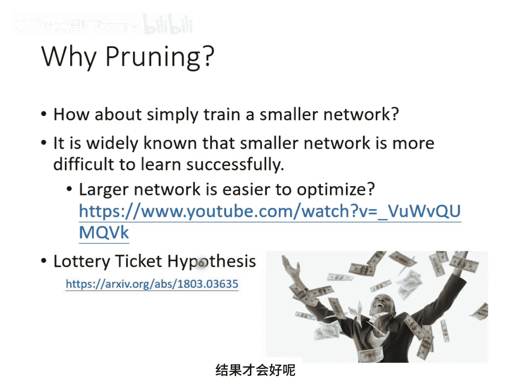
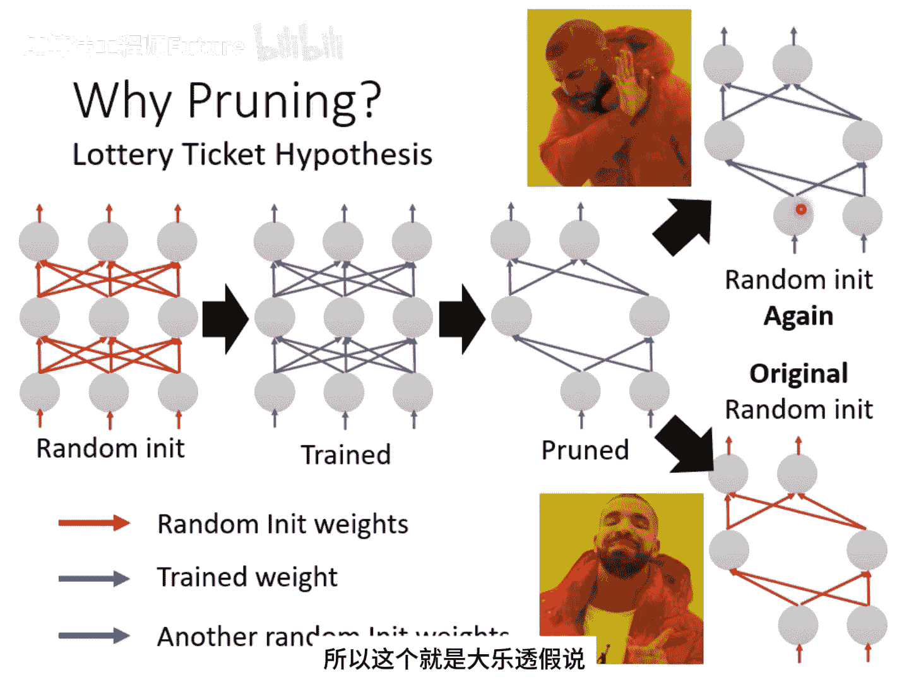
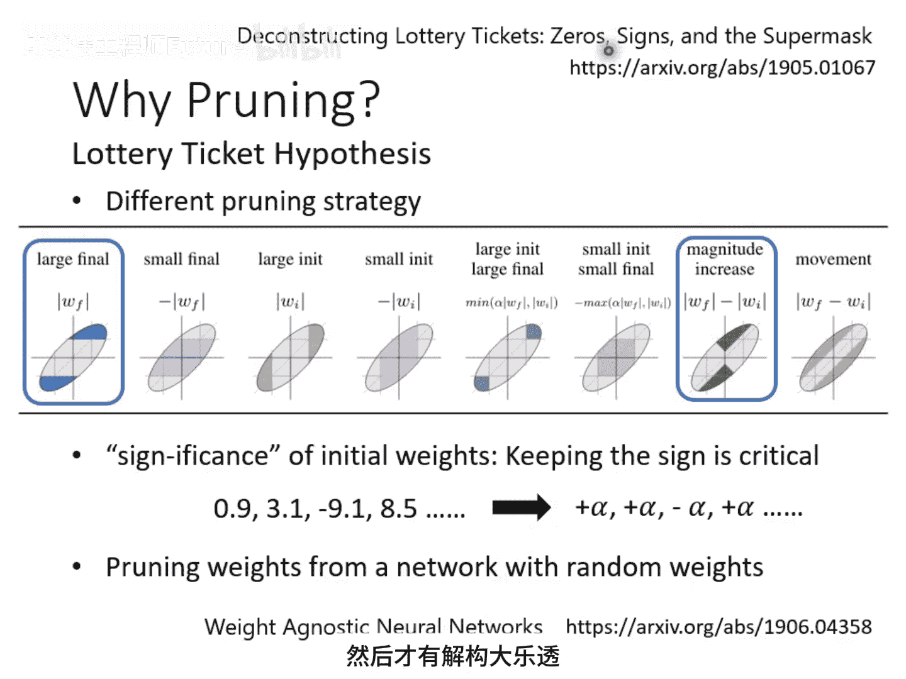
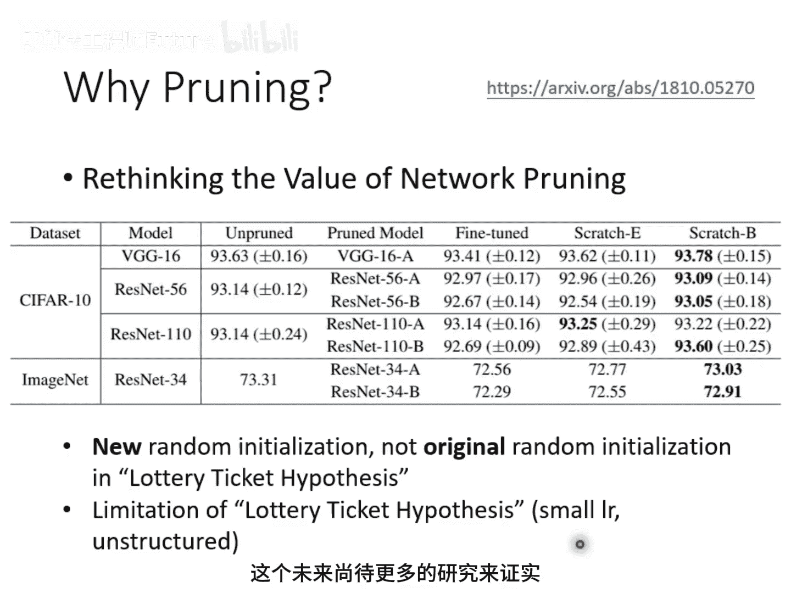

# 【官授搬运】2026年全新优化版李宏毅机器学习系统课程，这才是真正的初学者体系课程！—人工智能／深度学习／神经网络 - P82：【第十三讲】1-神經網路壓縮 (Network Compression) (一) - 類神經網路剪枝 (Pruning) 與大樂透假說 (Lottery Tic - AI算法工程师Future - BV1ruqABeEFX

好那这堂课呢要跟大家讲的是network compression。

那在这个课堂上啊，我们已经看过了很多硕大无朋的模型，举例来说，bird或者是GPT，那在这他在这节课里面，我们要跟大家分享的事情是，我们能不能够把这些硕大无朋的模型把它缩小，我们能不能够简化这些模型。

让它有比较少量的参数，但是跟原来的效能其实是差不多的呢，这就是network compression想要做的事情，那为什么我们会在意network compression这件事呢。

因为很多时候我们会需要把这些模型用在，resource constrain的环境下，用在资源比较有限的环境下，什么样的环境是资源比较有限的呢，有时候你会需要把这些机器学习的模型，举例来说。

跑在智能手表上，举例来说跑在DM上面，那在这一些h device，在这些IOT的device上面，只有比较少的memory，只有比较少的computing的power，所以我们的模型如果太过巨大。

你的手表可能会是跑不动的，所以我们会需要比较少的模型，那讲到这边，有人就会问说，为什么我们会需要在这些age device上面跑模型呢，我们为什么不把资料传到云端，直接在云端上做运算。

再把结果传回到h device，比如说你的手表就好了呢，为什么一定要在手表上面做运算呢，那一个常见的理由是latency的问题啊，假设你今天是呃需要把资料传到云端，云端计算完再传回来。

那中间就会有一个时间差，那假设你今天的应用，你今天的h device上面，你今天的h device是自驾车的一个sensor，那也许自驾车的sensor需要做非常及时的回应。

你需要把资料传到云端再传回来，那中间的latency太长了，也许会尝到是不能接受的，那接下来有人又会问说，在未来5G的时代，会不会latency根本就可以忽略不计呢，那这个时候呢有人会给你另外一个。

我们需要在h device上面做computing的理由，这个理由就是privacy，就如果我们今天需要把资料传到云端，那这个云端的这个系统持有者，不就看到我们的资料了吗，也许我在做什么事情。

我不想让云端系统持有者知道哦，所以为了保障隐私，也许在智能手表上直接进行运算，在智能手表上直接进行决策，是一个可以保障隐私的做法，好。

那这边呢就跟大家讲一下network compression的种种理由。

那呃在这份投影片里面呢，会跟大家介绍五个network compression的技术，那这五个技术啊都是以软体为导向的，我们只是在软体上面对network进行压缩，那我们都不考虑硬体加速的部分。

当然另外一个支另外一个支线的研究，是我们想办法在硬体上加速模型的运算，让h device上面跑深度学习的模型更加有效率，不过这是另外一个研究的面向，我们这边就不讨论任何跟硬体有关系的东西。

我们只讨论跟软体有关系的东西好，那第一个要跟大家分享的是network printing，这个技术好，那我们今天讲完never printing呢。

我们就下课，而network prunning呢，顾名思义，就是我们要把network里面的一些参数把它剪掉，printing就是修剪的意思，我们把network里面的一些参数把它剪掉。

为什么我们可以把network里面的一些参数减掉呢，因为你知道俗话说得好，树大必有枯枝，一个这么大的network里面有很多很多的参数，那每一个参数不一定都有在做事啊，参数这么多的时候。

也许很多参数它就只是在划水，他是打酱油的，他什么事也没有做，那这些没有做的参数放在那边，就只是占空间而已，浪费运算资源而已，何不就把它们剪掉呢。

好所以network point的基本概念就是把一个大的network，其中没有用的那些参数把它找出来，把它扔掉，那我小时候啊在这呃，在也不算是，小时候好像高中的时候，在生物学课本上看过这个图。

诶这个跟network point in好像也有一点关系啊，这个图是告诉我们说哎人刚出生的时候，脑袋是空空的啊，这些图呢这些是脑的神经元啊，脑袋空空的神经元跟神经元间没什么连接。

在六岁的时候会长出非常多的连结，但是随着年龄渐长，有一些连结就慢慢消失了啊，这个跟我们等一下要做的never py，有异曲同工之妙，那其实network py这件事啊不是太新的概念，早在这个90年代啊。

YANA课呢就有一篇paper是讲network ping的，那篇paper的开头是optimal的，brain damage好，他把brand，他把这个network pointing。

把减掉一些weight看成是一种脑损伤，And brand damage，那optimal的意思就是，我们要找出最好的printing的方法，让一些weight被减掉之后，但是对这个脑的损伤是最小的好。

那network ping的概念大概是怎么样进行的呢，他的framework大概是这样子的，首先呢你先创一个最大的network圈，一个大的network，然后接下来呢你去量这个大的network里面。

每一个参数或者是每一个neuron的重要性，去评估一下有没有哪些参数，它是没在做事的，或有没有哪些neural他是没在做事的，怎么评估某一个参数有没有在做事呢，怎么评估某一个参数重不重要呢。

最简单的方法也许就是哎看它的绝对值，如果这个参数的绝对值越大，那它可能越越能越越对，对对整个network的影响越大啊，或如果它的绝绝对值越接近零，那也许对整个network的影响越小。

也许对我们任务的影响越小，或者是啊，其实你也可以套用lifelong learning那边的想法，诶，你记得在lifelong learning里面，我们不是也要看说哪一些参数比较重要吗。

我们不是有一大堆的方法，看哪些参数重要，哪些参数不重要，然后决定bi那个首位的值吗，也许我们也可以就把每一个参数bi算出来，那我们就可以知道那个参数重不重要，然后把不重要的参数减掉好。

那也可以评估每一个神经元的重要性，我们也可以把神经元当做修剪的单位，那怎么看一个神经元重不重要呢，啊，你就可以，比如说计算这一个神经元，输出不为零的次数等等，那总之有非常多的方法来判断。

一个参数或一个神经元是否重要，那我们在这边呢就不细讲好，那把不重要的神经元呢，就或者不重要的参数呢就减掉啊，就把它从模型里面移除，那你就得到一个比较小小的network，但是你做完这个修剪以后啊。

通常你的正确率，你的模型的效能就会掉一点，因为有一些参数被拿掉了嘛，所以这个network当然是受到一些损伤，所以正确率就掉一点，但是我们会想办法让这个正确率再回升一点，怎么让正确率再回升一点呢。

就是把这个比较小的network，把剩余没有被减掉的参数啊再重新做微调，你就把你的训练资料拿出来，把这个比较小的network呢再重新训练一下，然后训练完之后啊，其实你还可以重新再去评估一次。

每一个参数的正确性，你还可以再remove掉，再减掉更多的参数，然后再重新进行微调，那这个步骤呢可以反复进行多次，那为什么我们不一次减掉大量的参数呢，因为在实验上发现说，如果你一次减掉大量的参数。

可能对你的network的伤害太大了，可能会大到你用FTM也没有办法复原，所以一次先减掉一点参数，比如说呃只减掉10percent的参数，然后再重新训练，然后再重新减掉SUPERSET的参数。

再重新训练，反复这个过程你可以减掉比较多的参数，那当你的network够小以后，那整个过程就完成了，你就得到一个比较小的network，而且这个比较小的network。

也许它的正确率跟大的network是没有太大的差别的，那我们刚才讲到说，修剪的单位可以以参数为单位，也可以以神经元来担当作单位，那用这两者当作单位有什么不同呢。

用这两者当作单位，在实作上会是有蛮显著的差距的，如果我们现在是以参数当做单位，会发生什么事，假设我们是要评估说某一个参数要不要被去掉，某个参数对整个任务而言重不重要，能不能够被去掉。

那我们把这个不重要的参数去掉以后，我们得到的network它的形状可能会是不规则的，所谓不规则的意思是说，举例来说，我们来看红色的这个neural，它连到接下来三个绿色的牛肉，但第二个红色的牛肉。

它只连到两个绿色的牛肉或这个红色的neural，它的输入只有两个蓝色的neural，而这个红色的neural，它的输入有四个蓝色的neural，如果你是把参数当做单位来进行修剪的话。

那你修剪完以后的network它的形状会是不规则的，形状不规则会造成什么样的问题呢，最大的问题就是你不好实做啊，你想想看，你用PYTORCH要实做这种形状不规则的network，你好实做吗。

你不好实做啊，因为在PYTORCH里面，你在定一个network的时候，你的定义方法都是每一层有几个neural，对不对，你都是定义说我现在每一层要输入几个输入，几输入有几个neural。

输出了几个neural，或者输入多长的vector，输出多长的vector，这一种形状不固定的network你根本就不好写啊，你自己实做的时候，你根本就不好实做。

而且就算你硬是把这种形状不规则的network，把它实做出来，你用GPU加速也不好加速啊，GPU在加速的时候，就是把network的运算看成一个矩阵的乘法，但是当network是不规则的时候。

你就不容易用矩阵的乘法来进行加速，你不容易用GPU来进行加速，那所以实际上啊在做WEPOINTING的时候，在实作上你可能会把那些碰掉的weight直接补零，就是碰掉的weight它不是不存在。

它的值呢，只是设为零，那这样的好处就是你的实做就比较容易，你就比较容易用GPU加速，那这样的问题是什么呢，这样的问题是你根本就没有真的把network变小啊，你这边说这个network。

他的这个这个link这个weight它的值是零，你还是存了这个参数啊，你还是存了一个参数在你的memory里面呢，你并没有真的把network变小，你只是在想象中把它变小，在自嗨。

你觉得这个network变小，但实际上这个network并没有真的变小哦，所以这个是以参数为单位来做ping的时候，你在实作上会遇到的问题。

这个文献上的实验呢就是想要跟你展示说，以参数为单位做PRIN的时候，你会遇到什么样的问题，我们先来看紫色的这一条线，紫色的这条线呢他说是sparsity，这个sparsity是什么意思。

这个sparsity就是有多少百分比的参数，现在被print掉了，那你发现说诶这边呐，这个紫色的这条线它的值都很接近一，什么意思，代表有接近大概95，percent以上的参数都被碰掉了。

这个network printing的方法，其实是个非常有效率的方法，往往你可以碰到95percent以上的参数，那但是你的accuracy只掉一两趴而已哦，所以这边参数point的是point的。

非常凶的，有95个赞的参数都被丢掉了，照理说丢掉了95percent的参数，只剩下5percent的参数，这个network变得很小，它的运算应该很快吧，但实际上你发现根本就没有加速多少。

甚至可以说根本就没有加速，如果你看这些长条图，这些长条图显示的是在三种不同的，computing的resource上面，你speed up的程度，你加速的程度，那加速的程度要大过一才有加速吗。

加速程度小于一，其实是变慢的，结果你发现说在多数情况下根本就没有加速，多数情况下其实都是变慢，也就是你把一些胃碰掉，结果你的network形状变得不规则，然后你真正用GPU加速的时候。

你反而没有办法真的加速它，所以WEPRIN不见得是一个特别有效的方法，那neural ping以以神经元为单位来做，ping也许是一个比较有效的方法，如果我们用神经维做单位来put。

你丢掉一些神经元以后，你network的架构仍然是规则的，简单来说就是你用PYTORCH比较好实做了，你实做的时候，你只要改那个每一个layer input，output的那个dimension就好了。

所以你比较好实做也比较好，用GPU来加速好，这个是在network burning实作上可能会遇到的问题，好我们来看一下大家有没有问题要问，哦有我看一下减脂还好，有同学问说。

这个减脂应该是减掉的减还是减少的减，哎在我的认知里面是减掉的减了，但是如果我有说错，你再纠正我，那个有同学问说，请问CNN中做完printing减掉遮罩中一些参数，它的运算量是不是没变。

诶不是我没有非常懂这个问题耶，遮罩的参数是什么，我呃我这边没有非常了解，也许你可以重新再formula一下你的问题，那我等一下再来看，还有同学问说这个ping有没有效率，是函式库的问题。

对啦是函式库的问题，那如果你可以想办法写一个irregular的network，也很有效的，方也很有效的函式库的话，那你就可以用WAPING，但是问题是大家都没有要自己写函式库啊，你都是扣排扣去嘛。

所以你用WEPRIN就没有办法加速，好如果反过来想在处理一个任务时，把network慢慢扩大，可以比直接用大内work有更好的表现吗，还有个同学问说，如果我们先圈一个小的network，再把它慢慢变大。

会不会比较好呢，因为我们刚才讲network ping的时候，是把大的network慢慢变小，那如果我们宣称小的network再慢慢变大，会不会比较好呢，答案是不会，我们在下一页投影片就会回答你的问题。

然后我同学说可变network本来就比较难做对呀，可变network本来就比较难做，好好那接下来啊我们就要问一个问题诶，你说我们先创一个大的内work，再把它变小。

而且说小的network跟大的network，他们的正确率没有差太多，那我们怎么不直接圈一个小的network就好了呢，缺一个小的，直接圈一个小的network比较有效率吧。

还劝大的network变小干嘛，根本是舍本逐末，为什么不直接劝小的network好，那一个普遍的答案是呃，大的内work比较好劝，你会发现说如果你直接train一个小的network。

你往往没有办法得到跟大的network一样的正确率，你可以先圈一个大的network再把它变小，没有正确率没有掉太多，但直接去那个小的network，你得不到跟printing。

大的network碰完变得小的那个network一样的正确率，那至于大的network为什么比较好劝，那也可以参看以下这个影片的链接，我在过去的课程有试图解释这件事好。

但是为什么大的network比较好劝呢，那这边有一个假说叫做大乐透假说，那不过它既然叫做假说，就代表说他不算是完全被实证的一个方，不算是一个被实证的理论，如果他是被已经被证明出来的，那他就是一个理论嘛。

但他现在只是一个假说而已，那这个大乐透假说是怎么解释，为什么大的network比较容易劝，直接圈一个小的network，没有办法得到跟大的network一样的效果。

一定要大的network pr变小才会结果才会好呢。

大乐透假说是这样说的，我们知道说训练内work啊是一个看人品的事情哦，我我们现在大家都做过这么多作业了，我相信你都一定有很多的辛酸血泪，你知道train network就是看人品的。

每次圈内的结果不一定会一样，你抽到一组好的隐匿手的参数，你就会得到好的结果，抽到一组坏的引力球参数就会得到坏的结果，那像这种看，这就好像说那个乐透呢也是一个看人品的东西，但是怎么在乐透这个游戏里面。

得到比较高的中奖率呢，是不是就是包牌买比较多的彩券，就可以增加你的中奖率，所以对一个大的network来说也是一样的，大的network可以视为是很多小的sub network的组合。

我们可以想成是一个大的network，里面其实包含了很多小的network，当我们去训练这个大的network的时候，我们等于是在训练同时训练很多小的network。

那每一个小的network不一定可以成功的被训练出来，所以成功训练出来是说他不一定可以呃，透过gradient descent找到一个好的呃solution，我们不一定可以训练出一个好的结果。

我们不一定可以让他的loss变低，但是在众多的network里面，众多的sam network里面，只要其中一个人成功，就可以一人得到鸡犬升天，其中一个sam network成功。

大的network他就成功了，而今天一个大的network里面如果包含的小的network越多，那就好像是做去买乐透的时候，包牌包比较多的彩卷，买比较多的彩卷一样，彩卷越多，中奖的几率就越高。

所以一个network越大，他就越有可能成功的被训练起来，那这个大乐透假说，他在实验上是怎么被证实的呢，他在实验上的证实方式跟network的PRIN非常有关系，所以我们就直接看一下，在实证实在。

在实验上是怎么证实大乐透假说的好，你现在呢有一个大的network，在这个大的network上面，一开始的参数是随机初始化的，好把参数随机初始化以后，得到一组训练完的参数。

好训练完的参数我们用紫色来表示，接下来你用network pointing的技术，把一些紫色的参数丢掉，而得到一个比较小的network，如果你现在直接把这个小的network里面的参数。

再重新随机的去initialize，也就你重称一个一样大小的小的network哦，就你把这个network复制一次，一样大小，但是参数完全不一样，重新再训练一次，重新再训练一次，你会发现训练不起来。

直接训练这个小的network训练不起来，训练一个大的，再把它变小没问题，但是直接训练小的训练不起来，但是假设这一个小的network，我们再重新initialize参数的时候。

我们用的跟这组红色的参数是一模一样的，就训练了起来，诶，大家可以了解这两者的差别吗，就是这两组参数虽然都是random initialized的，但是这组绿色的参数，跟这组红色的参数是没有关系的。

而这边这些random initialized的参数，是直接从这边的红色参数里面，选出对应的参数哦，就是这边有四个参数，我们就是把这边对应到的这四个参数，直接把它复制过来，这边有四个参数。

我们就把这里面对应到的四个参数，直接复制过来，把这里面的参数直接复制过来，就训练了起来，那如果用大乐透假说来解释的话，就是这里面有很多SA内work，而这一组initialized的参数。

就是幸运的那一组可以串的起来的sab network，所以当我们今天用把这些内，把这个大的network train完再pr掉的时候，你留下来的就是幸运的那些参数，可以训练得起来的那些参数。

所以这一组初始化的参数，它是可以训练得起来的一个嗓内work，但是如果你再重新随机初始化的话，那你如果运气比较不好，你就抽不到可以成功训练起来的参数好。

所以这个就是大乐透假说好，那大2号假说非常的知名啦，他在IK2019应该是2019没错，得到best paper award啊，所以他是一个非常知名的一个假说，那以后面也有很多后续的研究。

比如说有一篇有趣的研究，叫做decontracting lattery ticket，结构这个大乐透，那这个结构大乐透里面有什么有趣的结论呢，我们就直接讲他的结论。

第一个他试了不同的prunning the strategy，然后发现说呢，某两个putting the strategy是最有效的啊，这这个细节我们就不讲，他做了一个非常完整的实验。

告诉你说printing有哪些可能的strategy，然后他发现说呢，如果训练前跟训练后，它的绝对值差距越大，那PRIN掉那些内work得到的结果是越有效的，那另外一个比较有趣的结果是。

到底我们今天这一组好的initialization是，好在哪里呢，他发现说啊，如果我们我我们只要不改变参数的正负号，就可以训练起来，就小的network，只要不改变正负号就可以训练起来，什么意思呢。

就是假设你铺完以后，剩下的这个数，假设你呃碰完以后，那你再把原来render initialize的那些参数呢，拿出来，它的值是这个样子，0。93。1，负9。18。5，你可以完全不管它的数值。

直接把正的数值大于零的，通通都用正阿尔法来取代，小于零的都用负阿尔法来取代，用这组参数去initialize，你的model这样也串的起来，会跟用这组参数去initialize差不多。

所以这个实验告诉我们说，正负号是呃初始化参数能不能够训练起来的，关键它的绝对值不重要，正负号才重要，然后他在那个文章的呃，那个副标题上还在章节的标题上啊，特别取了一个是，就是他就是你乍看之下。

会以为他想要讲significance of initial weight，但他故意在这个SIGN后面加了一个dash，告诉你说是significance，就是这个负正负号是很重要的，他想要玩梗。

一语双关，不过好像没什么人注意到就是了，然后最后一个神奇的发现是呃，他发现说他就既然我们在想说一个大的network里面，有一些network，有一些some network，它是特别的好的。

初始化的参数，它训练起来会特别的顺利，那会不会一个大的network里面，甚至其实已经有一个嗓内work，他连训练都不用训练，直接拿出来就是一个好的network呢，我们完全不用训练network。

我们直接把大的network point1point，就得到一个可以拿来做分类的classifier了，有没有可能是这个样子的呢，就好像米开朗基罗说他是怎么雕出大卫像的呢，它不是雕出大卫项。

它是把大位项从石头里面释放出来，大卫象原来就是石头里面，原来就在石头里面，它只是把它把多余的地方把它雕，把多余的地方把它去掉而已，那会不会在整个大的network里面算参数都是随机的。

但其中已经有一组参数，它就已经可以做分类了，把多余的东西拿掉，直接就可以得到好的分类结果的呢，答案是是这样子啊，你可以自己去读一下那个文章，其实可以得到跟supervise其实很接近的正确率好。

但其实我看到这篇文章的时候，这个结论已经没有让我觉得非常神奇了，因为在这个结构大乐透，这篇文章发表的前几个月，就有一篇文章叫做wagnostic neural network。

他是说他弄了一个神奇的network，这个network里面呢所有的数值要么是随机的，要么统统都设1。5，这样啊，结果这个network也可以得到一定程度的结果。

所以看起来就算你的network里面参数都是随机的，或根本就给他一个constant得到的，也有也有可能可以得到好的performance，所以这个结论其实没有让人特别压抑。

因为在几个月之前就已经有同样的文章了哦，这边放了这两篇文章，archive就有类似的说法了哦，这边放了这两篇文章的archive连接了呃，这边放的连接是他们最后一个上传到archive的版本。

所以如果你看这个呃上最后一次，最后一个版本上传的月份的话，你会觉得呃vas not in network是后出来，然后结构大乐透是先出来，但如果你看第一个上传的版本的话。

是先有we as agnosing network，然后才有解构大乐透。

所以我是先读到这一篇才读到解构大乐透的好，但是大乐透假说他一定是对的吗，不一定有一篇文章呢是打脸大乐透假说啊。

这篇文章叫做rethinking the value of network planning，而且神奇的是，这篇文章跟大乐透假说是同时出来的，他们同时出现在i clear2019哦。

所以就是在IK2019里面有两篇文章，他们得到了不太一样的结论，这篇文章说的是什么呢，这篇文章说好，他试了两个data set，还有好几种不同的模型啊。

然后呢他说哎这个是没有碰过的network的正确率，然后他试着去碰了一下network，然后呢再重新去做find you呃，小的network可以跟大的network得到差不多的正确率，那他说。

而一般人的想象是，如果我们直接去劝这个小的network诶，正确率会不如大的network，pr完以后的结果，他试了第一次实验叫做SQUATCH1，SQUATCH1的意思就是，它的参数是随机初始化的。

大家注意一下，他的随机初始化，跟大乐透假说里面的随机初始化是不一样，他的随机初始化就是真的是随机初始化，大乐透假设里面，随机初始化是从原来的那一组随机的参数里面，去借来那一组随机的参数。

我知道这个很拗口，希望你知道我在说什么，好，这个呃这个scratch这边，这个scratch1的意思是说啊，我们就真的随机初始化参数训练一个小的network，跟这个有碰过的network。

它的大小是一样的，发现哎嗯果然差了一点，嗯跟大多数人的想象好像是一样的，但是接下来他说呃，如果我们在update的时候多update几个EPOD会怎样呢，之前的人设定的EPOD数目。

小的network的EPOD的训练数目都跟大的network一样，但是如果小的network的EPOD的数目，多设一点会怎样呢，诶多设一点就比PRIN过以后的结果就好了。

所以之前呢觉得大的内小的network训练不起来，要先训训练大的再做printing，这个会不会就是个illusion，就是个幻觉，是个都市传说，直接训练小的network app色多一点。

反正就是训练的起来啦，就是这样子啦，反正其实这篇文章里面呢，呃，呃这篇文章呢放在那个在i clear审查的时候啊，当然就有你不要去问说诶，你这个跟大乐透假说正好是相反的，你有没有什么common。

那其实在这篇文章里面，他也有对大乐透假说做出一些回应，他觉得大乐透假说呢是比较有呃，大乐透假说观察到的现象，也许只有在某一些特定的情况下才观察得到，那根据这篇文章的实验是说。

只有在learning rate设比较小的时候，还有on structure的时候，on structure的时候就是我们point的时候，是以weight作为单位来做point in的时候。

才能观察到大额透享受的现象，他发现说learning rate调大哦，他就观察不到大乐透假说的这个现象好，所以到底大乐透假说呃有多正确，是真是假。

