# 【官授搬运】2026年全新优化版李宏毅机器学习系统课程，这才是真正的初学者体系课程！—人工智能／深度学习／神经网络 - P83：2-神經網路壓縮 (Network Compression) (二) - 從各種不同的面向來壓縮神經網路 - AI算法工程师Future - BV1ruqABeEFX

好那我们来上课吧，那上周啊我们讲到network printing，那接下来呢我们讲下一个可以让network变小的方法，这个方法呢叫做knowledge destination。

那等一下你听完knowledge destination，会发现他的精神呐，跟network ping其实也有一些类似的地方，好，那knowledge destination是什么呢，它的概念是这样。

我们先劝一个大的network，那这个大的network啊，在knowledge destination里面叫做teacher network，他是老师，那你要劝的。

你真正想要的那个小的network叫做student network，你先吹一个大的network叫做teacher network，再根据这个大的network来制造student network。

那在network print里面，你是直接把那个大的network做一些修剪，把大的network里面其中一些参数拿掉，就把它变成小的network。

那在knowledge destination里面呢是不一样的，这个小的network，这个student network是去根据这个teacher network来学习。

因为student network是根据teacher network来学习，所以一个就叫做teacher，一个就叫做student好，那这个student是怎么根据这个teacher来学习的呢。

这个学习的方法是这个样子的，好假设我们现在要做的就是手写数字辨识啊，那你就把你的训练资料都丢到teacher里面，然后teacher呢就产生output，那因为今天是一个分类的问题。

所以teacher的输出呢其实是一个distribution，其实是一个分布啊，举例来说，teacher的输出可能是看到这张图片一的分数啊，是0。7啊，七的分数是0。29，这个数字的分数是0。1等等哦。

那接下来学生要做的事情，就是给学生一模一样的图片，但是学生呢不是去看这个图片的正确答案，来学习，他把老师的输出就当做正确答案，也就是老师输出一要0。7，七，要0。2，九，要0。1。

那学生的输出呢也就要尽量去逼近老师的输出，尽量去逼近一是0。7，七，是0。2，九，是0。1这样的答案，那你可能会问说，那如果老师犯错了怎么办呢，如果老师的答案是错的，怎么办呢，不要管他。

学生就是根据老师的答案学，就按老师的答案是错的，学生就去学一个错的东西好，那讲到这边你就会想说，那为什么不直接train一个小的network就好了呢。

为什么不直接把小的network去根据正确答案学习，而是要多加一个步骤，先让大的network学，再用小的network去跟大的network学习呢，那这边的理由跟network ping是一样的。

就记得上周我们讲network ping的时候，我们讲说为什么不直接去练个小的network呢，最直觉最直觉最简单的答案就是，因为你直接圈一个小的network。

往往结果就是没有从大的printing来的好，那notch desolation概念是一样的哦，为什么不直接劝小的内work，因为直接训练一个小的network，没有小的network。

根据大的network来学习，结果要来得好，那其实knowledge distillation这个技术啊，它也不是新的技术，Knowledge desolation。

最知名的一篇文章是这个HINTON呐，在15年的时候就已经发表了，很多人会觉得noise the saluation，算是HINTON提出来的啊，因为HINTON有呃一篇文章。

他的title呢就是knowledge destination of neural network，但是其实在HINTON提出north，destination这个概念之前呢，我其实就有看过其他文章。

使用了一模一样的概念，举例来说，在一篇文章叫做呃，他的title很fancy啊，title叫做do deep network，Really need to be deep，是一篇13年的文章里面。

他也提出了network destination的想法啊，那这个显然是一个比较早年的文章啦，在13年的时候，那个时候还不是所有人都已经被说服，说deep learning就是很棒的啊。

所以那个时候呢你还需要写一些文章，做一些研究来justify说哎deep learning是好的哦，所以这篇文章它的标题就是deep network，到底需不需要是deep，到底deep的好处在哪里好。

那为什么notch the station会有帮助呢，还有一个比较直觉的解释是说，teacher network其实会提供这个student network额外的咨询。

那如果你直接跟student network说，这个是一可能太难了，因为一可能跟其他的数字，比如一跟七也有点像，一跟九也长得有点像，所以对student network来说，你告诉他说看到这张图片。

你要输出一，然后七啊九啊，他们的分数都要是零，可能很难，他可能学不起来，所以让他直接去跟老师学，老师会告诉他说呃就算一呢，你没有办法让他是一分也没有关系，其实一跟七是有点像的，老师都分不出一跟七的差别。

老师说一是0。7740。2，学生只要学到140。7，740。2就够了，那这样反而可以让小的network学得比啊，直接trap from scratch，直接根据呃正确的答案要学来的要好。

那其实noise destination有些神奇的地方，如果你看那个HINTON的paper里面，那他甚至可以做到，光是teacher告诉student，哪些数字之间有什么样的关系。

这件事情就可以让student，在完全没有看到某些数字的训练资料下，他就可以把那个数字学会哦，假设今天训练资料里面完全没有七这个数字，但是teacher他在学的时候有看过七这个数字。

但是student从来没有看过七这个数字，但光是凭着teacher告诉student说，一跟七有点像，七跟九有点像这样子的资讯，都有机会让student可以学到七长什么样子，就算他在训练的时候。

从来没有看过七的训练资料好，这个是knowledge destination的基本概念好，那这个teacher network啊不一定要是单一一个巨大的network，它甚至可以是多个network。

On semble，ensemble是什么呢，到目前为止这门课啊，我们其实没有正式介绍过UNSEMBLE这个词汇，虽然它是deep learning里面常，尤其在机器学习的比赛里面，常常用到的一个技巧。

不过这个技巧非常的简单，所以其实也不太需要真的花太多时间介绍，它的概念，很简单，就是你就训练多个模型，然后你输出的结果就是多个模型投票的结，结果就结束了，或者是把多个模型的输出平均起来的结果。

当做是最终的答案，那这个就是ensemble，那虽然在比赛里面呢，常常会使用到ensemble的方法，今天如果在一个机器学习比赛里面，你要名列前茅，往往凭借的就是超级的ensemble啊。

就是训练个100个模型啊，1000个模型啊，把那么多的模型的结果通通平均起来，往往你要在机器学习的这种leader board上面，名列前茅，靠的就是这种ensemble的技术，但是在实用上啊。

ensembles会遇到的问题，就是你训练了1000个模型进来一笔资料，你要1000个模型都跑过，再取它的平均，这个计算量也未免太大了吧，打比赛还勉强可以，要用在实际的系统上，显然是不行的，那怎么办呢。

你可以把多个UNSEMBLE起来的network，综合起来变成一个，那这个就要用knowledge destination的做法，你就把多个on network。

UNSEMBLE起来的结果当做是teacher network的输出，然后让student network去学这个ensemble的结果，就ensemble的输出是什么样子。

就让student network去学这个UNSEMBLE的输出，那这样子你就可以让student network去逼近这个UNSE，一堆network unsemble起来，有的这个正确率啊。

那这个呢是knowledge destination，在on sample上的应用。

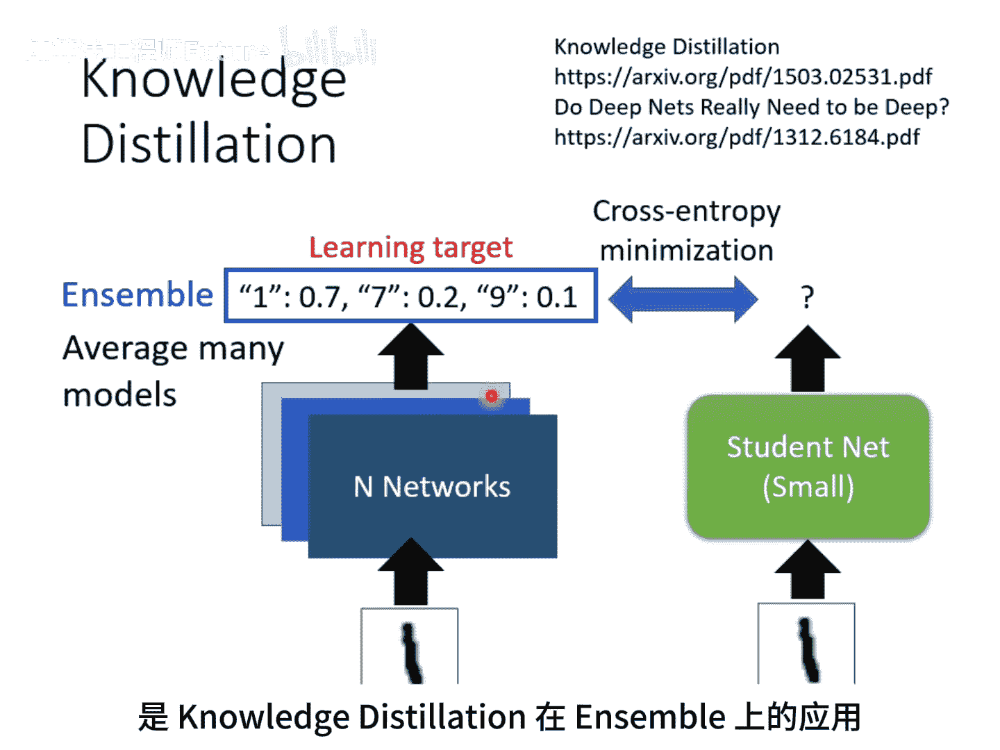

那在使用noise destation的时候有一个小技巧啦，这个小技巧是你会稍微改一下soft max的function，你会在soft max的function上面加一个temperature。

这个temperature是什么呢，我们马上就会看到好，那跟大家简单的复习一下soft ma，那我们呢在开学期初的时候，在讲这个分类的时候，就跟大家介绍过soft max，soft max要做的事情。

就是你把啊每每一个neuron的输出哦，都去exponential，然后再做normalize，得到最终network的输出，那这样可以让你的network的输出，变成一个几率的分布。

network的输出，最终的输出分值都是介于0~1之间的，好，那所谓的temperature的意思，就是在做exponential之前，那把每一个数值呢都除上一个大T。

那这个大T呢是一个hyper parameter，大T呢是一个你需要调的参数，那除这个大T有什么作用呢，假设T大于一的话，那这一个大T也就是temperature，它的作用就是把本来比较sharp。

比较集中的分布，让它变得比较平滑一点，那为什么要让集中的分布变得比较平滑一点呢，我们这边举一个例子，假设你的y one y two y3在做soft max之前，它的值分别是一百十跟一哦。

那做完soft max以后，你会发现那y one pi就是soft max的结果，y one p是1y two py3P都趋近于零，那假设这是你的输出，这个是你的teacher network的输出。

你叫你的学生，要叫你的student network去跟这个结果学，那跟直接看正确答案学完全没有不同啊，跟teacher学的一个好处，就是老师会告诉你说哪些类别其实是比较像的。

让student类在学的时候不会那么辛苦，但是假设老师的输出非常的集中，就是其中某一个class是一，其他都是零，那这样子跟正确答案学有什么不同呢，就没有不同啦，所以你要取一个temperature。

假设我们这边temperature设为100，那就是把y one y two y3都除100，就变成10。1跟0。01，那对于老师来说啊，其实加上这个temperature分类的结果是不会变的。

做完soft max以后，最高分的还是最高分，最低分的还是最低分，所有class的额，这个排序是不会变的，分类的结果是完全不会变的，但好处是每一个类别得到的分数啊会比较平滑，比较平均。

那你拿这个结果去给student学才有意义，才能够把student呢学的好，那这个是knowledge desolation的一个小技巧。

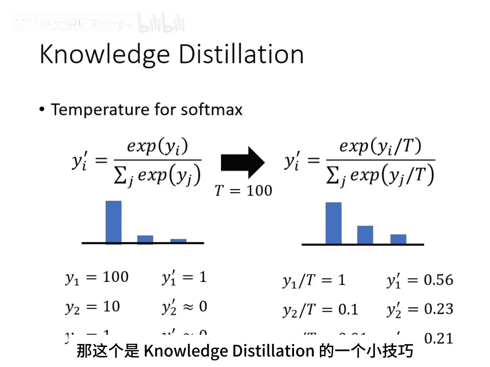

好好那我们来看一下有没有同学有问题要问的，那我刚才发现说呢，我犯了一个错误是什么呢，就是我忘了把我忘了，在手机上把大家的那个留言打开了，所以呢我现在赶快请容我打开一下好，我看一下哦。

那我刚才发现说哎呦哦他的声音，然后放出来了，问题要问的，哎讲到那个教育，刚才在聊天室里面呢，那诶我突然想到说，假设你觉得说这个台湾的机器学习课程，应该要有更多的运算资源，这样大家才能够做作业。

更顺利的话，哎，好，那个有同学问说助教有说作业九，什么时候公布吗，应该下周就可以公布了，刚才有额，其实我回答了这个问题，好我看看哦，好有同学问说。

那拿soft max钱的输出拿来train会发生什么事呢，哦你完全可以拿SOFM钱的输出拿来train，其实还会有人拿这个network的每一层都拿来劝你。

可以说哎我有一个大的teacher network，他是第一层，它有12层，小的student network6层，那我要让student network的第六层，向大的network的第12层。

Student network，第三层向大的network的第六层，可不可以呢，可以那往往你做这种比较多的限制，其实可以得到更好的结果，那这是一个常用的在noise desolation常用的小技巧。

好那有同学想问live phone learning的问题，可以你可以问lifelong learning的问题，我看你的问题是什么，上周有提到用generator产生资料让模型学习。

但这样模型只要再学一次旧的资料，有达到live phone learning的终止吗，我可以了解你的问题，你说liphone learning就是呃不要一看到旧的资料啊，那我现在再产生一些旧的资料。

加到训练资料里面，有没有违反lifelong learning的精神呢，这是一个呃见仁见智的问题了，那假设我们把iphone learning定义成，你不能去看真正的旧的资料。

但是如果你的network自己有办法去产生旧的资料，他并没有去真的把旧的资料存下来啊，那个旧的资料是他自己生出来的，那呃呃至少今天在lifelong learning的community。

在如果你要写lifelong learning的paper的话，这样子的方法是会被接受，是一个liphone learning的方法了，因为你并没有真的用到旧的资料，旧的资料是被产生出来的。

哦有一个同学问说，如果学生和老师差太多的话，可以加一个介于中间的network，让学生学那个network吗，可以就是可以，那这样子的技术啊，等一下在助教的录音里面，助教会跟大家提示有这么样的一个方法。

有同学问到说T太大的话，模型会不会改变很多，temperature太大的话会不会改变很多，会你想假设你temperature是个接近无穷大，那这样所有的class的分数就变得差不多了。

这样这样子student network也学不到东西了，所以T又是另外一个hyper parameter，它就跟learning ray一样。

这个是你在做noise destination的时候要调的参数，好有同学问说老师请问UNSEMBLE的destination，只有把logic合在一起的方式吗，我猜这位同学想要问的问题是说。

在做ensemble的时候，就我刚才在举例告诉你什么是ensemble的时候，我是举说啊，我们可以把很多的network呢呃呃它的输出平均起来，这就是一种ensemble。

那有没有其他ensemble的方式呢，其实是有的，呃这个说起来就有点话长了，呃，我之后额这个ensembles，这个这个这个这个技术啊，其实之前在其在过去的录影其实也是有提过的。

那我之后可以把这个录影呢也贴在额社团上，让大家再来研究，那其实ensemble呢是有很多，各式各样不同的变形的了，举例来说，你在做on semble的时候。

刚才讲的是在那个呃network的output上面做平均，但事实上还有其他做法，比如说你有看过，有人直接在network的参数上面做平均，那这个network参数上面做平均的方法。

在这门课里面你甚至已经有用过了，在那个translation那个作业里面，其实助教的这个城市，就是有就是已经有帮你做好ensemble，就是有把不同的参数做平均这样子的小技巧。

那这一招呢在translation上面，不知道为什么特别有用哦，所以在助教的城市里面有实做这个方法，好希望这样子有回答到大家的问题，好那如果大家没有问题的话，那我们就继续了，那剩下的这个有关呃。

那个network compression部分没有太多了，我们就赶快把它讲完，接下来就可以放一下助教的录影好了，接下来下一个要跟大家讲的小技巧啊，叫做parameter的控TIZATION。

不过这一招呢在我们的作业是用不上的，为什么在我们的作业是用不上的呢，因为我们的作业啊对大家network大小的限制，并不是看那个内word本身的大小，而是看你用了几个参数了，所以你如果不是减少参数的量。

单纯是用其他方法来压缩network的话，在这个作业里面，其实是不会得到比较好的结果的，是不会比较有利的好。

不过还是跟大家介绍一下这个parameter，quantization的做法啊，这个parameter quantization的做法是什么意思呢，他的意思，他的意思是说，我们能不能够。

只用比较少的空间来储存一个参数，举例来说，你现在存一个参数的时候，你可能是用64个bit，你可能是用32个bit，真的有必要精度这么高呢吗，会不会用16个beat就够了，会不会用八个beat就做就够了。

会不会甚至更少的beat就够了，Accept parameter qualization，最简单的做法就是本来如果你存network的时候，举例来说你是16个big beat存一个数值。

现在改成六个beat，八个八个beat除一个数值诶，那你的储存空间，你的network大小直接就砍半了，而且你的那个performance呢不会掉很多，甚至有时候你把你的这个储存，那个参数的精度变低。

结果还会稍微更好一点好，那还有一个在更进一步压缩你的参数的方法呢，叫做way cluster，RECLASSROOM的意思是什么呢，我们直接举例来跟大家说明，假设这些是你的network的参数。

然后呢你就做cluster，你就做分群，按照这个参数的数值来分群，数值接近的放在一群，那要分几群呢，你会先事先设定好，举例来说，我们这边事先设定好，说我们要分四群，那你就会发现说比较相近的数字。

就被当作是一群，那接下来每一群呐，我们都只拿一个数值来表示，它也就只要分到黄色这一群的，原来它的数值是多少，我们不管我们就说它都是-0。4，反正其他人可能其他参数也都跟-0。4的，结果可能都差不多了啊。

这个-0。4呢，可能就是这里面所有数值的平均啊，假如这里面所有数值的平均是-0。4，我们就用-0。4来代表所有黄色的参数，用0。4来代表所有蓝色的参数，用2。9来代表分到绿色这群的参数，用-4。

2来代表分到红色这群的参数，这样做有什么好处呢，这样做的好处是，你今天在储存你的参数的时候，你就只要记两个东西，一个是一个表格，这个表格是记录说每一群代表的数值是多少。

那另外一个呢你要记录的就是每一个参数，它属于哪一群，那假设你群的数目设少一点，比如说你设四群而已，那这样子你要存一个参数的时候，你就只要两个beat就可以存一个参数了，你就可以把本来你存一个参数。

你可能要16个beat，八个beat再进一步压缩到存一个参数，只需要两个beat就好哦，那你其实还可以把参数再更进一步做压缩，那假设你对通讯比较熟悉的话。

那你可能学过一个东西叫做hoffman encoding啊，hoffman encoding概念就是比较常出现的东西，就用比较少的beat来描述它，比较罕见的东西，再用比较多的beat来描述它。

这样的好处就是常出现的东西，用少的beat来描述罕见的东西，多的beat来描述，这样平均起来你需要储存你的资料，需要的beat的数目就变少了好，所以这个就是hoffman encoding好。

所以你可以用这些技巧呢来压缩你的参数，让你储存每一个参数的时候。

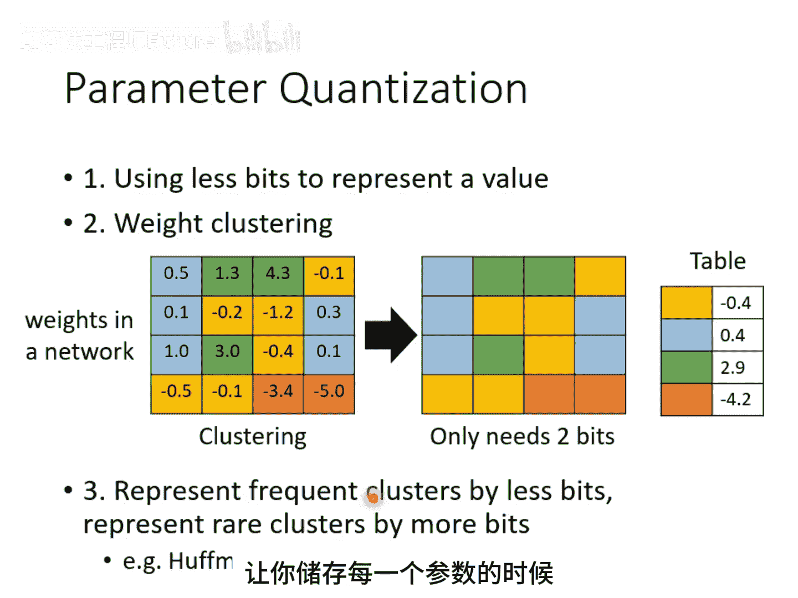

需要的空间呢是比较小的好，那到底可以压缩到什么程度呢，最终极的结果就是你可以只拿一个beat来存，每一个参数，你可以说你的network里面的weight要么就是正一，要么就是一，只有这两种。

可能没有其他的了，假设你可以做到，说你所有的weight就只有正一两种，可能，那你每一个weight就只需要一个beat，就可以存下来了，那像这样子的这种binary weights的研究啊。

其实还蛮多的，那我这边就是列了一些reference给大家参考，那至于实际上要怎么训练出这种binary的network，那这个细节我们就不讲，那一般人会对binary network有的印象。

就是哇这个一个一个参数值要么是正一，要么是一，会不会这个network的performance很差啊，这network应该很惨吧。

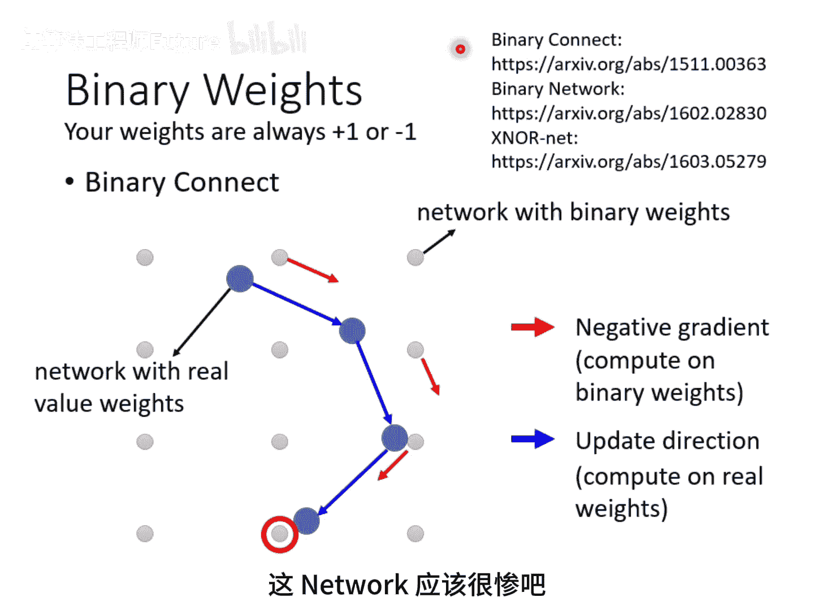

他应该做的很烂吧，这倒未必，这边呢就是取那个binary network里面的，其中一个经典的方法叫做binary connect，它的结果来跟大家分享一下。

在binary connect这篇paper里面，他跟你说，他把binary connect，这个技术用在三个影像辨识的问题上啊，从最简单的ENNICE，还有稍微难一点的SIPHTEN。

他试了几个COPUS，那他发现了什么，这个第一排是正常的network，不是binary的network，一般的network在enlist上，你的错误率是1。3，percent这边是错误率啦。

所以值越小越好，好之后在3PHTEN上是10percent，他发现用binary connect，也就是每一个参数要么是正一，要么是一，结果居然是比较好的，所以你用barry network。

结果居然还比正常的network performance好一点，那这边的理由可能是说，当我们用binary network的时候，我们给了network比较大的限制。

我们给network capacity比较大的限制，所以他比较不容易OVERFITTING，所以用binary的weight，它反而可以达到防止OVERFITTING的效果好。

所以这边是想要跟大家分享一下binary network的呃，呃厉害的地方，好我看一下啊呃，好有同学问到说，关于上周lifelong learning讲到EWC的方法，在train每个新的task之前。

为了算每个parameter的重要性，都会用之前的data去算gradient，这样是不是算跟gm一样存有部分之前的data呢，哦这边是不一样的，因为那个gradient。

那他不是看到新的任务才算的那个gradient，就是我们要算parameter的重要性，这件事情在一个任务训练完之后，你就会马上计算了，所以你并不是等要做写新的任务的时候。

才去旧的任务的data上去计算，说每个参数的重要性是旧的任务一训练完，马上就把参数性记录下来，把参数的重要性记录下来，那把参数的重要性记录下来以后，旧的任务的所有的资料就都可以被丢掉了哦。

所以它跟GEM还是不太一样的，不过我上周有提示说，你如果是用EWC这种方法，其实你也用有用到额外的储存空间了，所以呃呃虽然他没有存资料，但是他需要储存参数的重要性，那这个也是会耗用一些储存的空间的。

这边要从消息理论那边讲吧，哦我猜你是指HOFFMANCODY，好啊，也可以从消息理论那边讲，资料压缩啊等等，你知道这个就是就是因为这个为孔TEZATION，这一系列的方法。

跟这个课程的主轴比较没有关系啦，所以在作业里面也我们就没有特别强调，微孔ANIZATION这件这件事情，我只想要跟大家讲说，反正有这些技术就是了，好有同学问说way classy要怎么做update。

每次update都要重新分群吗，其实way classing有一个很简单的做法，你可能以为那个way clustering，是需要在训练的时候就考虑的，但是有一个简单的做法是。

你先把network训练完再直接做weight classy，但你这样直接做可能会导致你的这个呃呃，就是cluster后的参数跟原来的参数相差太大，所以有一个做法是什么呢。

有一个做法是我们在训练的时候啊，要求network的参数彼此之间比较接近，你可以把这个训练的criterion当做是呃，lost的其中一个环节，直接塞到你的群，军训训练的过程中，让训练的过程中达到呢。

这个参数呢有群聚的效果，那这件事情是可以做到的，好有同学问说要压到什么程度，才不会丢掉太多的资讯，那这个你就要自己算算看啦，那你就要额到底要压到什么程度，那就你做压缩的时候，难免就是会掉一些资讯嘛。

但到底掉多少资讯你能够接受，那这个就要看你的应用了，好那个way class stering里面，每个class的数字要怎么决定呢，决定好每个cluster的区间之后，取它们的平均吗。

对就是决定好每个cluster的区间之后，取它们的平均，好同学问说，binary weight加，diaper会比较好吗，不好意思，我不太确定你只diaper是指指什么。

好刚刚有一个同学问说关于刚刚EWC的问题，想请问老师那样，不同的task data对model的重要性会不会冲突，怎么把不同task的importance merge这边这个解法。

怎么把不同task的importance merge啊，在文件上的做法比你想象的要简单，就是每一个task都会计算出一个重要性，然后把所有task的重要性加起来就结束了哦。

就是每一个参数在每一个task训练完以后，都会得到一个首位的值，都会得到一个B，把每一个任务的B统统加起来就结束了，好希望将有回答到，哦哦DIER是加入noise，反而可以保留更多的资讯。

好我没有看过有人研究过diaper加binary weight，这个问题，那额所以这边我没有很好的答案，这听起来像是一个蛮有创意的方法，如果你有试出什么结果再告诉我好了，好那希望回答到大家的问题。

那我们就继续咯，而接下来啊要跟大家讲的是network架构的设计，透过network架构的设计来达到减少参数量的效果，那等一下要跟大家介绍的叫做death wise。

Separable the convolution，那这个会是这次作业的主力啦。

你要过strong baseline，就靠这个方法了，哦那是这个方法啊，呃在讲这个方法之前，我们先帮大家很快的秒复习一下CNN，那我们在开学期初的时候啊，已经跟大家讲过CNN，那我们说CNN是什么呢。

在CNN的这种convolution layer里面呢，你每一个layer的input是一个feature map，那在这个例子里面呢，我们的feature map有两个channel。

如果你的feature map有两个channel，那你的每一个这个filter啊，它的高度啊也得是二哦，所以这个filter并不是一个长方形，而是一个立方体，你的channel有多少。

你的filter就得有多厚好，然后你再把这个filter呢扫过这个feature map，你就会得到另外一个matrix，另外一个正方形啊，你有几个filter。

那output feature map就有几个channel，这边有四个filter，每一个filter都是立方体哦，那output feature map就有四个channel好。

那在这个例子里面总共有多少参数呢，我们总共有四个filter，每一个filter的参数量是33乘以二，要注意一下，每一个filter其实是立方体，所以总共的参数量是3×3乘以2×4，总共72个参数好。

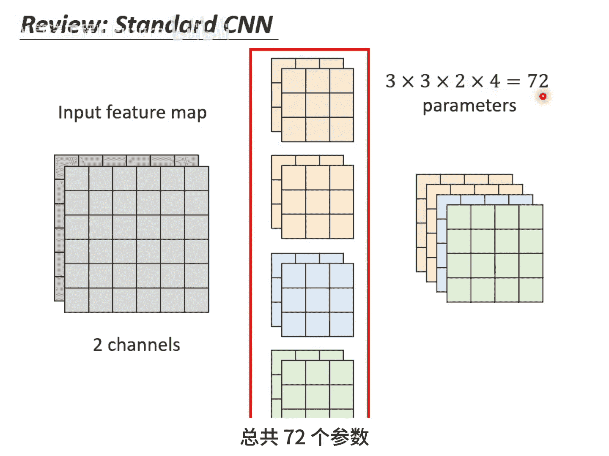

那等一下要跟大家介绍的方法，叫做death wiseparable的convolution，那这个deswiseparable convolution它为什么会好呢，这个等一下再跟大家讲它的原理。

在讲它的原理之前，我们先直接讲它的操作好，这个deswise separable的convolution，它分成两个步骤，第一个步骤呢叫做depth wise的convolution。

That's why the comthat's，that's why the convolution做的是什么呢，他要做的事情是有几个channel，我们就有几个filter。

而每一个filter只管一个channel，因为每个filter只管一个channel，所以有几个filter，有几个channel，就有几个filter，举例来说。

假设input feature map是两个channel，那在DESWISE的convolutional layer里面，我们就只放两个filter。

不像之前在一般的convolution layer里面，filter的数目跟channel数目是没有关系的，在前一个投影片的例子里面，channel只有两个，但filter可以有四个。

但在desy convolution里面几个channel，几个filter，然后每个filter就只负责一个channel而已，那其实我发我觉得啊这个desy convolution比较像。

是大家一般对CNN的这个误解啦，就假设有人对convolution不太熟悉的话，一般都会误以为convolution的算法就跟death wise，CONVUTION是一样的。

其实不是你已经学过这门课了，已经花很多时间跟大家介绍过CNN了，所以你一定知道说CNN不是这样算的，但是CNN里面一个特别的变形，减少参数量的变形，其实跟大家一般对CNN的误解蛮像的。

就是每一个filter只去管一个channel就好好，那一个filter怎么管一个channel呢，假设这个浅蓝色的filter管第一个channel。

那就浅蓝色的filter在第一个channel上面划过去，划过去划过去，然后就算出一个feature map好，然后呢深蓝色的这个filter管第二个channel。

那他就在第二个channel上面做convolution，然后也得到另外一个feature map，所以在deswise convolution里面，你input有几个channel。

你output channel的数目会是一模一样的啊，这个跟一般的convolutional layer不一样，一般convolution layer里面。

input和output channel数目可以不一样，但在deswise convolution里面，input和output channel数目是一模一样的好，但是你会发现。

如果你只做deswise the convolution，他会遇到一个问题，这个问题是channel和channel之间没有任何的互动，假设今天有某一个pattern是跨channel。

才能够看得出来的，那deswise convolution，对这种跨channel的pattern是无能为力的，所以怎么办呢，再多加一个point wise的convolution，Poiswise。

point wise convolution的意思是说呢，我们现在一样有一堆filter，这个跟一般的convolution layer是一样的，但我们这边做一个限制式，我们的filter的大小。

它的kernel的size通通都是11，在一般的convolution layer里面，你的filter大小可能开22，3×3，4×4，但是在point wise convolution里面。

我们限制大小一定是1×1，那这个11的filter它的目标，它的作用就是去考虑不同channel之间的关系哦，所以第一个这个11的filter，他做的事情就是去扫过这个呃。

def wise convolution出来的feature map，然后呢得到另外一个feature map，好，那这边有另外三个filter，他们做的事情也是一样。

每一个filter会产生一个feature map，所以point wise，Point wise，The convolution，跟一般的convolutional layer是一是一类一样的地方。

是输入跟输出的channel数目可以不一样，但是point point wise convolution有一个非常大的限制，是我们强制要求说filter的大小只准是11。

你只要考虑channel之间的关系就好了，你就不要考虑同一个channel内部的关系了，同一个channel内部的关系已经death，vice convolution做完了。

所以point wise convolution，只专注于考虑channel和channel间的关系，就好好，那我们先来计算一下这个方法的参数量，你看在deswise convolution里面。

两个filter，每一个filter大小是33，所以就3×3乘以二，总共是八个参数，那在point wise convolution里面，四个filter每个filter的大小是二。

每个filter只用了两个参数，所以总共是八个参数。

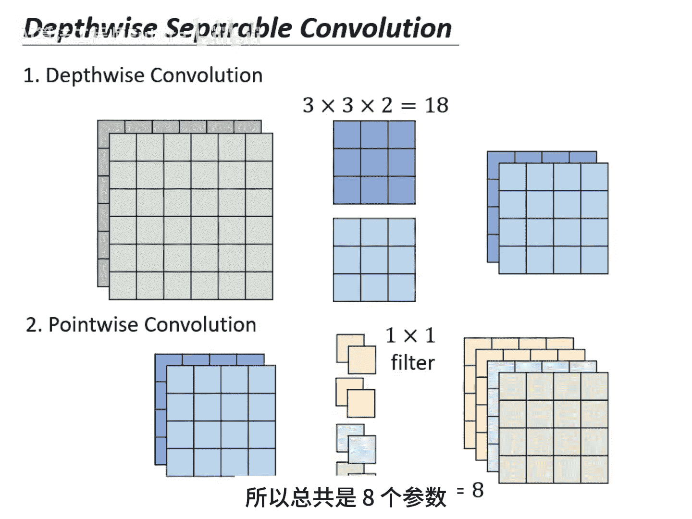

好左边这个图啊，这个是一般的convolution，右边这个图是death wise加point wise a convolution，那我们现在来比较一下这两者参数量的差异，我们现在假设我们先预设好。

说input channel数目就是挨个channel，output channel数目就是K个channel，然后呢呃这一个case跟这一个case，这边的kernel size都是K乘以K好。

那如果是一般的convolution，你要有K乘以K的kernel size，input挨个channel，Output oga channel，那你到底会需要多少参数呢。

那你得先算一下每一个filter的大小，每一个filter大小应该是K乘以K，kernel size乘上input channel的数目，也就是K乘以K乘以I，如果你要output欧个channel。

大O个channel，那你需要大O个filter，所以总参数量是K乘以K乘以I，一个这个filter参数量再乘以大O，如果是death wise加point wise convolution。

要达到input挨个channel opo o over channel，那要怎么做呢，Device convolution，他的这个呃filter啊，它的filter是没有那个厚度的。

它的filter是没有厚度的，所以你会发现说DESWISE的convolution，所有的filter加起来，它的参数量只有K乘以K乘以I而已，跟一般的convolution。

里面的一个filter的参数量是一样的，然后我们看point wise convolution这边呢是呃I乘以O，就是假设你input channel的数目是I的话。

那每一个11的convolution，它的高度呢会是I，那O是哪来的呢，假设你要output o个channel的话，那你就要有大O个11的convolution。

所以今天point wise convolution，它的总参数量是I乘以O，那你把这两者呢进行比较好，你把K乘以K乘以I加上I乘以O，去除掉K乘以K乘以I乘以O，你把这两者相除，经过一番计算。

你会发现这两者的比例是一除以O加，一除以K加K那为O通常是一个很大的值啦，你的channel数你可能开个256啊，512啊，所以我们先把这个一除以O忽略不计，那K乘以K通常是比较在这一整项里面。

它可能是比较关键的数值，这这一整项的大小可能跟一除以K乘以K，是比较有关系的，那假设你的kernel size，今天常用的kernel size可能是33，或者是2×2，假设你选2×2。

你把一般的convolution换成DESWISE，加point wise的组合的话，那network大小就变成22分之一，假设你的kernel size是33。

当你从convolution变成death wise加point wise的时候，你的network大小就变成原来的19了，好那接下来想要跟大家解释的是，为什么这招有用呢，这一招的原理是哪来的呢。

那这个啊呃这个death wise加point wise这个招数啊，它其实是奇来有之，在过去还没有这个呃death death，why separable的这个convolution之前呢。

就已经有一个方法是，用low rank approximation来减少一层network参数量，但你不知道什么是low rank approximation，没有关系。

这边就直接告诉你这个是怎么操作的，好假设呢你有某一个layer，那这个layer呢输入有N个neural，输出，有大N个牛肉，那假设N或者是N其中一者非常大，这边假设是N呢非常大。

那你的这个参数量啊就会非常的可观哦，这边的参数量W呢，仅假设你的input是N个neural，output是N个neural，那你的参数量是多少呢，这两层之间的参数量是多少呢，是N乘以N，对不对。

那只要N跟N其中一折很大，那你这个W的参数呢就很多了好，那怎么减少这个参数量呢，有一个非常简单的方法是在N跟N中间，那再擦一层，这一层呢就不用activation function，直接多擦一层。

这一层呢的neuron的数目呢是大K有，本来只有一层，现在拆成两层，那这两层里面的第一层呢我们用V来表示，第二层呢我们用大U来表示，你可能会想说这个把一层内work拆成两层内work。

这个哎呀参数量不是变多了吗，你仔细算算，看这个两层的network参数量反而是比较少的哦，怎么说呢，你看原来一层network你的参数量是大于N乘以N，现在我们拆成两层network，第一层是多少。

第一层是大N乘以K对不对，大N乘以K，第二层是多少，第二层是大K乘以N，大K乘以N，如果你今天的K呢远小于N跟N，那你就会发现说，U跟V的参数量加起来是比大W还要少得多的，大W是N乘以N吗。

那U跟B的参数量加起来是K乘上N，加N就N跟N就没有相乘了，那你只要K够小，那整体而言U加V的参数量就会变少哦，所以你常常之前过去常有的做法，就是哦N1000M1000没关系，我可以塞个20。

塞个50诶，那这个参数量呢就减少蛮多的了，好那像这样子的方法虽然可以减少参数量，当然它还是会有一些限制啦，什么样的限制，因为你会发现说，当你把W拆解成U乘上V的时候。

当你把W分成用U跟V两层来分开表示的时候，你会减少W的可能性，本来W它可以放任何的参数，但假设把W拆成U跟V的话，那这个W这个矩阵呢它的rank会小于等于K，那你不知道rank是什么也没有关系啦。

反正就是W会有一些限制啦，所以会变成说它不是所有的W都可以变成，用在呃，不是不是所有的W都可以变成当做你的参数，你的参数会变成有一些限制了，好好，那这个方法呢就是拿来减少参数的一个，非常常用的做法。

那其实刚才讲的depth wise，加points wise的convolution，其实他用的就是我们这边的概念。

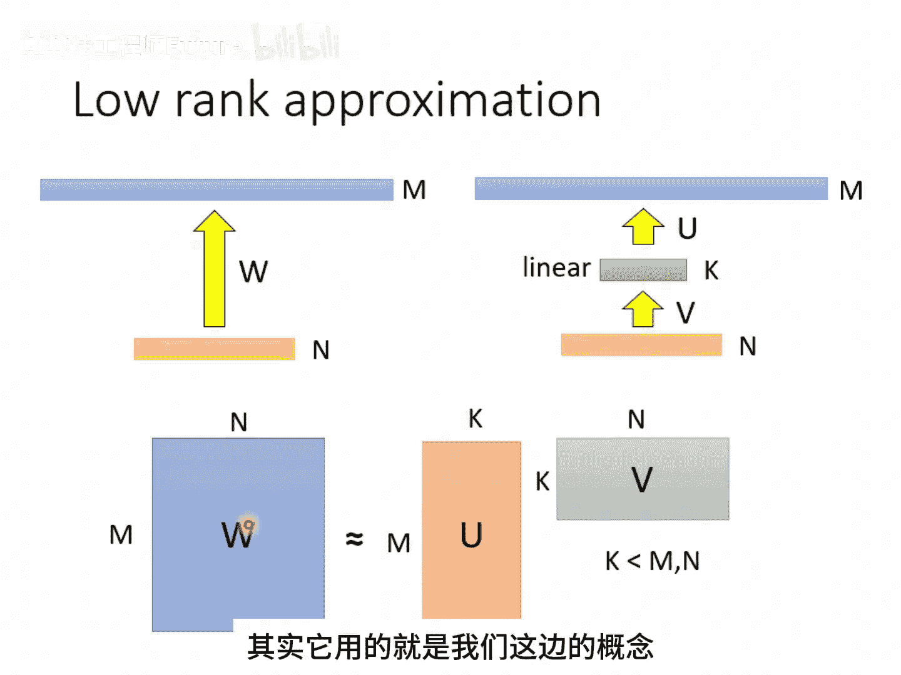

就是把一层拆成两层，这样的概念好，怎么说呢，我们先来看一下原来的convolution，在原来的convolution里面，红色的这个矩阵左上角的这个参数是怎么来的。

是不是有一个红色的这个filter放在feature input，feature map的左上角以后所得到的，那今天一个非一在这个例子里面，一个filter啊，一个filter的参数量是多少。

一个filter的参数量是33乘以二，也就是18，你把filter里面的18个参数跟input feature map，左上角的这18个数值做inner prada以后。

就会得到这边output feature map左上角这个值，所以你的每一个filter有18个参数，如果今天拆成death wise加point wise两阶的话，那会怎么样呢。

如果拆成dex wise跟point wise两接的话，左上角output feature map，左上角这个数值来自于中间的DESWISE，convolution的output哦。

所以左上角这个值来自于中间这一个DESY，convolution output的左上角的这两个值，而这两个值来自于input的feature map，第一个channel。

左上角这这九个值跟第二个channel，左上角等九个这九个值哦，所以怎么从这边变到这边呢，你可以看成是我们有两个filter，这两个filter呢它分别是九个input，然后得到输出。

然后接下来呢这两个filter的输出，再把它综合起来，得到最终的输出，所以本来是直接从这18个数值变成一个数值，现在是分两阶，18个数值变两个数值再变一个数值哦。

或者是如果我们今天看黄色的这个feature map，左下角这个参数，黄色的feature map左下角这个数值来自于哪里呢，来自于deswise convolution的output。

左下角这两个数值，而左下角这两个数值来自于这个filter，左下这来自于这个DESY，来自于input这个呃，呃feature map左下角的这是八个数值，所以其实今天你又可以再看成说呢。

是我们我们把这个当，我们把这个一般的convolution拆成这个呃death wise，加point wise的时候，我们就可以看成是把一层的network拆解成两层的network。

所以它的原理跟刚才在前一页投影片看到的，low rank的approximation是一样的，我们把一层拆成两层，这个时候才对于参数的需求反而是减少了好。

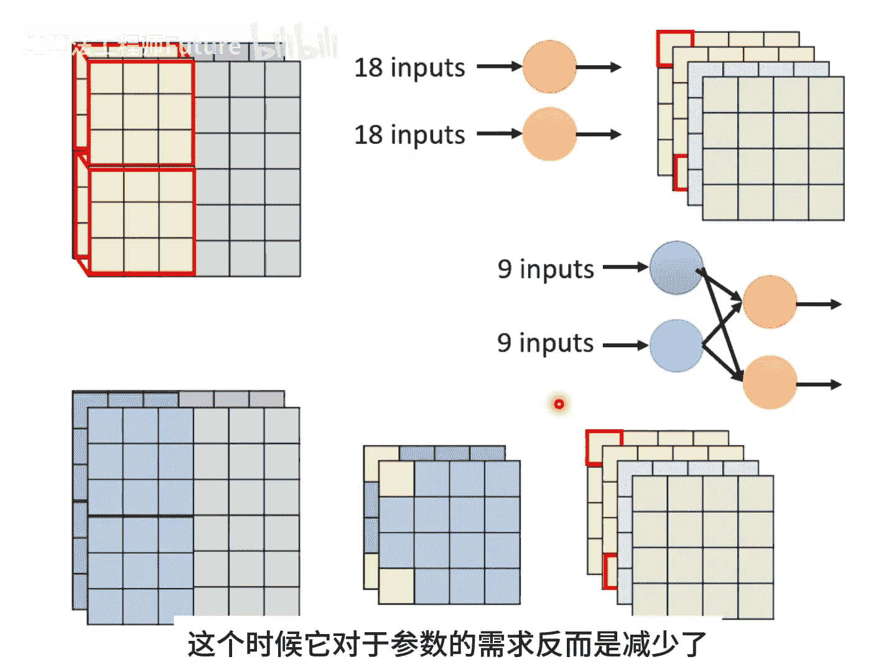

那这个是有关network architecture的设计，那其实有关network architecture的设计啊，还有非常多论文可以参考了，那这些文献其实也都有放在助教的投影片里面。

那等下助教不会细讲这些network架构了，但是在这个作业里面，如果你可以成功实做出刚才讲讲的这个啊，呃这个death wise加point wise的相叠的话，把一层CNN拆成两层CNN的话。

那你就很有机会可以过strong baseline啊，我来看看看看同学们有没有问题，好那如果同学没有问题的话呢。

那我们就继续吧，好，最后一个要跟大家分享的是dynamic的computation，那dynamic computation要做的事情，跟前几个方法想要达成的目标不太一样，在前几个方法里面想要做的事情。

就是单纯的把network变小，那在dynamic computation里面要做的事情是什么呢，在dynamic computation里面要做的事情是。

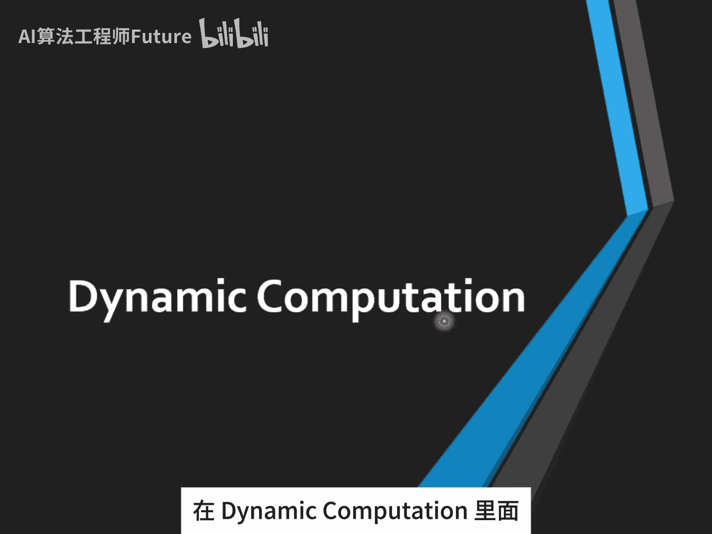

我们希望network呢可以自由地调整它需要的运算量，为什么我们期待network可以自由的调整，它需要的运算量呢，因为有时候啊，你可能同样的模型会想要跑在不同的device上面。

而不同的device上面，它有的运算资源是不太一样的，所以你期待说你训练好一个network以后，你放到新的device上面，你不需要再重建这个network，因为这个你你你训练一个神奇的模型。

这个神奇的模型本来就可以自由调整，它所需要的运算资源，所以运算资源少的时候，他就只需要少的运算资源就可以运算，运算资源大的时候，他就可以充分利用充足的运算资源。

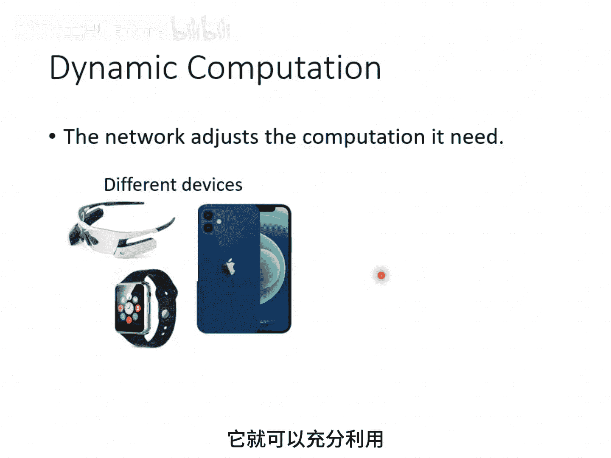

来进行运算好，那另外一个可能是就算是在同个device上面，你也会需要不同的computation，比如说你有你比举例来说，假设你的手机非常有电的时候，那你可能就会有比较多的运算资源。

假设你的手机没有电的时候，那你可能就需要把运算资源留着做其他的事情，那network可能可以分到的运算资源就比较少，所以就算是在同一个device上面。

我们也希望一个network可以根据现有的运算资源，比如说手机现在的电量还有多少，来自由地调整它对运算量的需求好，那有人可能会问说，为什么我们不直接准备一大堆的network就好了呢。

假设我们今天需要各种应付，各种不同运算资源的情况，我们为什么不训练十个network，从运算量最少的到运算量最大的，然后根据我们的运算的状况去选择不同的network呢，可是你知道。

假设今天呃呃呃假设你是在同一台手机上，你需要根据不同的状况做不同的音译，那你可能就需要训练一大堆的network，而手机上的储存空间有限呐，那你今天我们就是要减少我们的运算量。

但是如果你需要训练一大堆的network，那你需要一大堆的储存空间，那这个可能不是我们要的，所以我们其实期待可以做到说一个network。

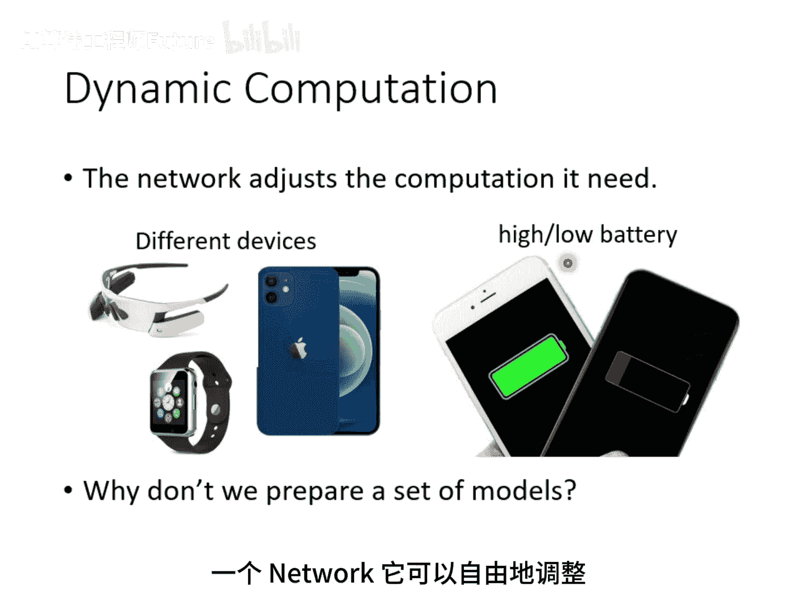

它可以自由的调整他对运算资源的需求好，那怎么让network自由的调整他对运算资源的需求呢，一个可能的方向是让network自由的调整它的深度，怎么让network自由调整它的深度呢啊你可以训练。

一般我们就是训练一个很深的network啊，然后呢他有input，比如说在做image classification的话，他就是输入一张图片，然后输出呢就是图片分类的结果。

然后呢呃你可以在这个layer和layer中间，那再加上一个额外的layer，这个额外的layer，他的工作呢是根据每一个hen layer的output，去决定现在分类的结果应该是什么。

那这样子当你的运算资源比较充足的时候，你可以让这张图片去跑过所有的layer，得到最终的分类结果，当运算资源不充足的时候，你可以让network决定说他要在哪一个layer，自行做输出。

比如说运算资源比较不充足的时候，通过第一个layer就直接丢到这个TRA的layer one，然后呢就得到最终的结果了，那怎么训练这样一个network呢，那其实概念比你想象的还要简单。

我们训练的时候都有label的资料，那一般在训练的时候，我们只需要在意最后一层network，他的output是什么，我们希望它的output跟光处越接近越好，但是我们今天呢也可以让光truth呢。

跟每一个extra layer的output越接近越好，那我们把所有的output跟光处的距离通通加起来，把所有的output跟光TRP的cross entropp通通加起来，得到大L。

然后再去minimize4个大L，然后就结束了，好那这样子最基本的方法它能够运作的好吗，这个训练方法是可以用的，你确实可以用我刚才讲的训练方法，就是每一层接出来做训练。

然后把所有接出来的结果去跟光处算距离，然后minimize所有接出来的结果跟光柱的距离，确实可以用这个方法达到dynamic的深度，但是其实它不是一个最好的方法，如果你想知道最好的方法是怎么做的啊。

可这个也不一定是现在最好的方法，但是假设你想知道比较好的方法是怎么做的。

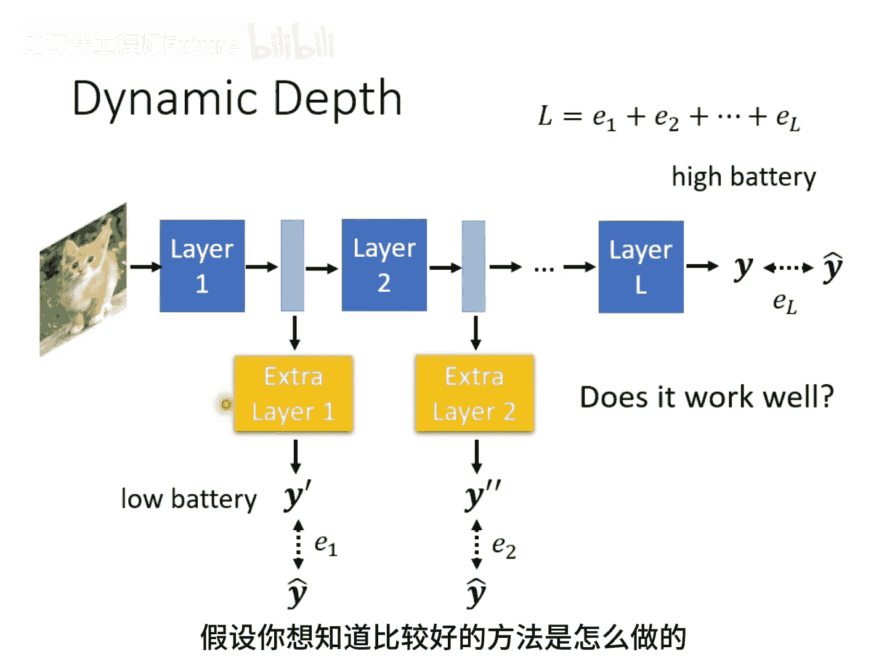

也许你可以参考nsd net这篇文章好，另外啊还可以让network自由的决定它的宽度哦，怎么让network自由决定它的宽度呢，哦你就是有设定好几个不同的宽度，然后呢你今天同一张图片丢进去。

在训练的时候，同一张图片丢进去，那每一个network呢，每个不同宽度的network呢会有不同的输出，我们在希望每一个输出都跟正确答案，越接近越好，就结束了。

我们把所有的输出跟光truth的距离加起来，得到一个loss，然后我们要去minimize这个loss就结束了，那这边要跟大家强调一下，虽然我在这个投影片上我画了三个network。

但是这并不是三个不同的network，它们是同个network，可以选择不同的宽度，也就是说这个weight就是这个weight，就是这个weight我标一样颜色的，就是同一个weight。

只是在最左边这个状况的时候，整个network所有的neural都会被用到，但是在中间这个状况的时候，你可能会决定说，有25percent的neural不会用到，但你这个就会事哪些neural不用到。

你就事先决定好，就事先决定好说某一些neural，在你选择说，只要用这个75percent的参数的时候，拿25percent neural，我们不要用它，我拿50percent的neural。

我们不要用它，然后在训练的时候就把所有的状况一起考虑，然后所有的状况都得到一个output，所有的output都去跟光处计算距离，然后让让要让所有的距离都越小越好，就结束了，那你会发。

那但是实际上你会发现这样劝也是有问题的，所以需要一些特别的想法来解决这个问题，那有关death wise呃，dynamics的宽度的network怎么训练这件事啊。

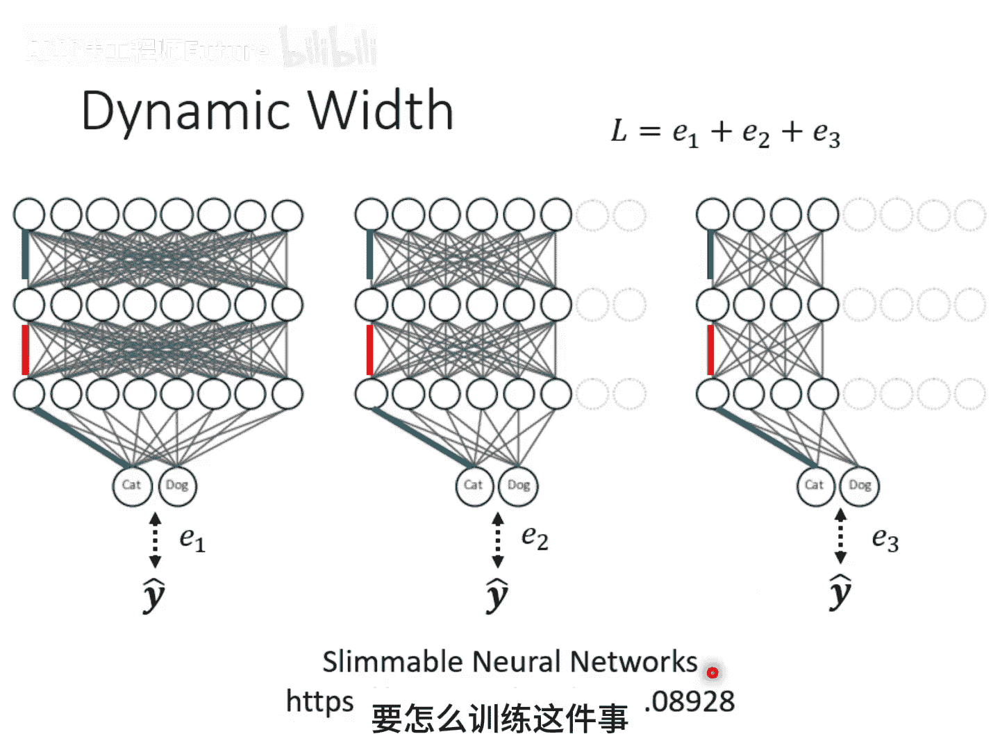

大家可以参考SLIMABLE的neal network，好那其刚才讲的是是我们可以圈一个network，我们可以自由去决定它的深度跟它的宽度，但是所谓的决定权还是在人这一边，你要自己去决定说啊。

今天电池电量少于多少的时候，我们就用多少层或者是多宽的内work，但是有没有办法让network自行决定，根据它的环境，根据我们的情境决定它的宽度或者是深度呢，这个也是有办法的。

为什么我们需要network，自己去决定它的宽度跟深度呢，那是因为有时候就算是同样是影像分类的问题，那有一些影像可能特别难，有一些影像可能特别简单，对那些比较简单的影像。

也许你只要通过一层layer ne，我就已经可以知道答案了，对于一些比较难的问题，举例来说哦，同样是猫哦，这只猫呢是被做成一个墨西哥卷饼的样子了，所以这是一个特别困难的问题。

也许这张图片只通过一个layer的时候，内，work会觉得他是一个卷饼，在通过第二个layer的时候，还是一个卷饼，要通过很多个layer的时候，network才能够判断它是一只猫。

如果是这种比较难的问题，你就不应该在中间停下来，那我们能不能让network自己决定说，这是一张简单的图片，所以通过第一层就停下来，这是一个比较困难的图片，所以要跑到最后一层才停下来呢。

我们是可以这么做的，但假设你想要知道怎么做的话，可以参考以下几篇refer哦，所以像这样子的方法，其实就不一定限制在那个呃，呃运算资源比较有限的状况啦，有时候就算是你运算资源比较很充足。

但是呃对一些简单的图片，如果你可以用比较少的layer，就可以得到你要的结果，那其实也就够了，这样你就可以省下一些运算资源，去做其他的事情，就好像说啊我可以了解说呢，在这门课里面。

因为我们今天把这个呃呃做什么事情，会得到几分都定的非常的明确，所以大家就会知道说啊，你做了哪些事情，大概就可以拿到A加，然后所以后面的作业你拿到A加以后，可能后面的作业你就不想做了好。

所以你就跟上面这个情况一样，坐到中间呢你就停下来，得到A加以后，你就output，你的结果就结束了，那这也是人之常情，我也是可以接受的啦，不过像以前那呃，以前这个呃这学期呢这个乘积是这个原始成绩。

就直接定义定，就直接对应到那个等地啦，那过去其实有一阵子，这个原始成绩是没有直接定义到等地，乘积是相对的啊，这个时候大家就会很痛苦了啊，有的同学就会诶他原始成绩拿到100多分哇，结果西减这样子啊。

以前如果是直接按照比例分配，就前14的A加以此类推的话，那就有可能有点痛苦吧，不过这学期我们就直接把原始成绩对应到等地。

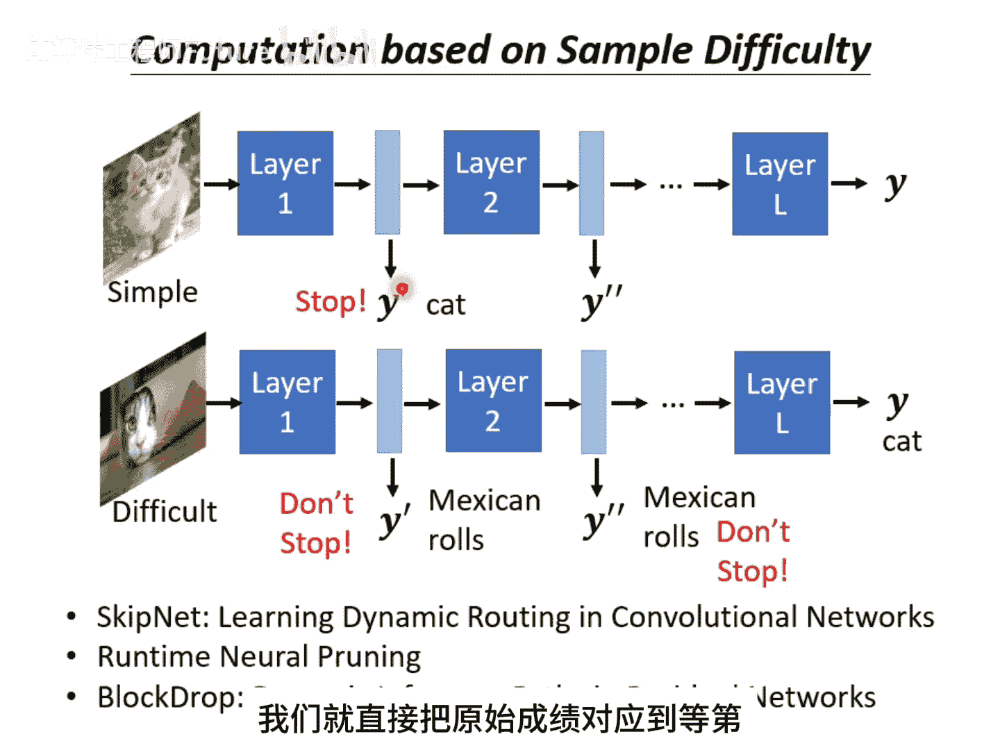

让大家日子过得比较轻松一点好，那以上呢就是跟大家介绍的五个技术，那前面四个技术啊都是让network可以变小，那这四个技术呢它们并不是互斥的，其实你今天要在做network压缩的时候。

你其实没有什么道理，只做一个技术，你可以既用network的architecture，也做knowledge destination。

你还可以在做完noise destination以后再去做network ping，你还可以在做完network ping以后，再去做parameter的PTIZATION。

如果你今天真的想要把network压缩到很小的话，这些方法并不是互斥的，他们都是可以一起被使用的好，那以上呢就是有关network compression的介绍，那我们其实在这边呢never down。

这边network compression呢就讲到一个段落。

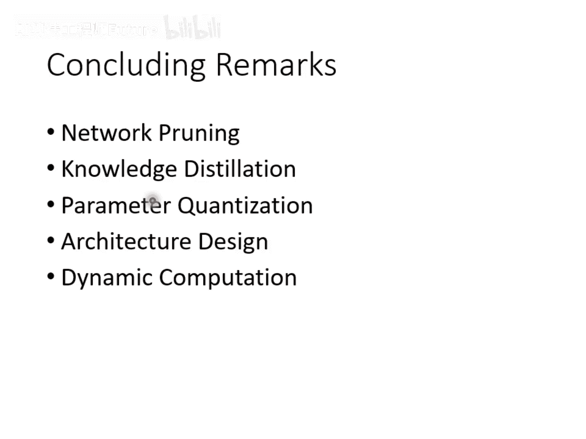