# 【官授搬运】2026年全新优化版李宏毅机器学习系统课程，这才是真正的初学者体系课程！—人工智能／深度学习／神经网络 - P86：5-DRL Lecture 4- Q-learning (Advanced Tips) - AI算法工程师Future - BV1ruqABeEFX

哪里有错，我看看哦，这里啊太厉害了太厉害了，好等一下告诉我你叫什么名字，这样子好，等下你告诉我你叫什么名字好。

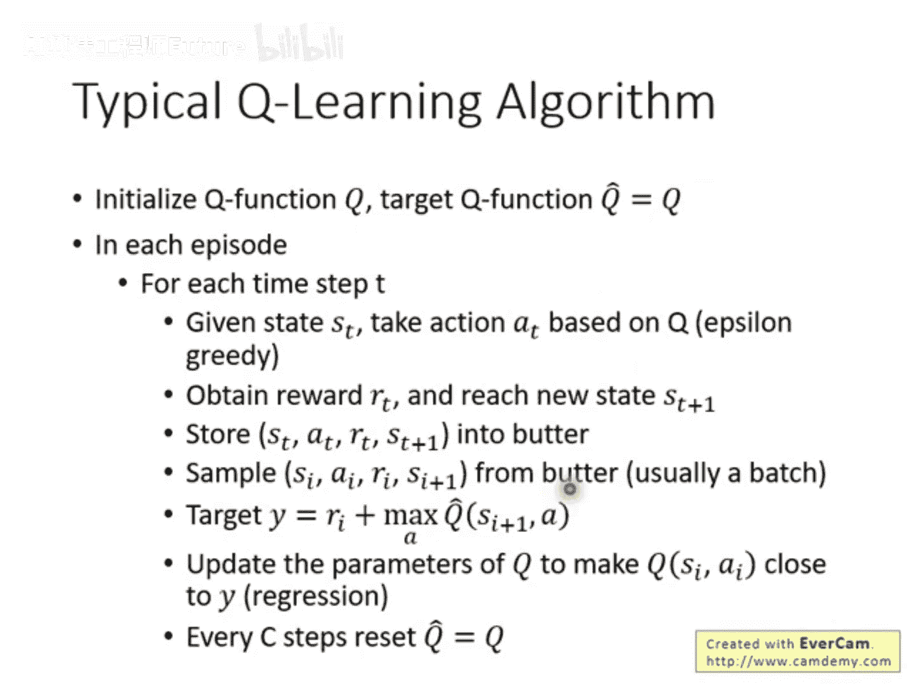

那接下来我们要讲的是train q learning的一些tip。

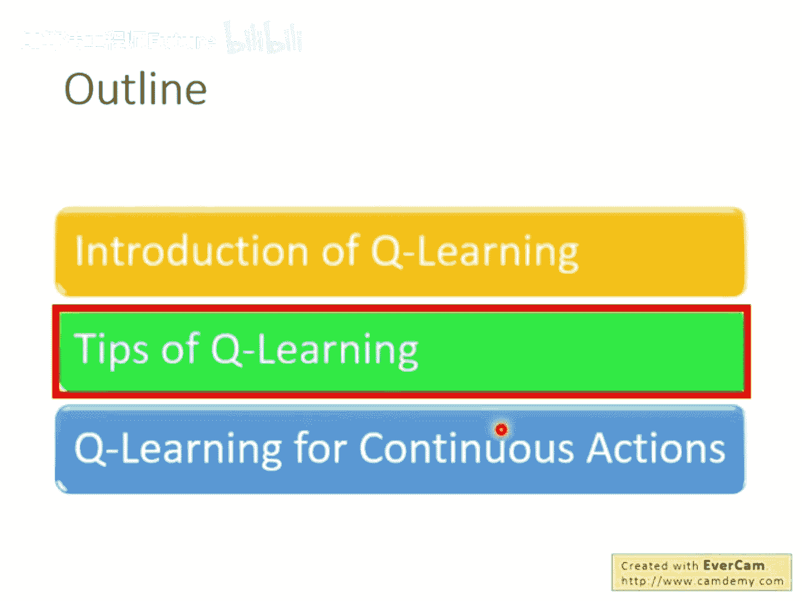

那在做作业里面，当然是会要求你implement某一个tip，那等下就看看说哪一个tip，是你觉得最简单的好，那第一个介绍tip呢叫做呃这个double d q n好。

那为什么要double d q n呢，因为在实作上啊，你会发现说q value往往是被高估的，那下面这几张图是来自于double g q n的原始的paper，那想要显示的结果就是。

这个q value往往是被高估的，那这边就是有四个不同的小游戏，那横轴呢是那个training的时间，然后这个红色的这个锯齿状一直在变的线，就是这个q function所estimate出来的。

对不同的state estimate出来的，平均的q value就有很多不同，state每个state你都sample一下，然后算他们的q value完平均起来就是红色这条线，他在圈内的过程中呢会改变。

但它是不断上升的，为什么它不断上升，因为很直觉，不要忘了Q方向是depend on你的policy的，你今天在learn的过程中，你的policy越来越强，所以你得到的Q的value会越来越大。

你得到的在某个state同个state，你得到的expected reward会越来越大，所以general而言这个值都是上升的，都是上升的好，但是他说这个是q network估测出来的值。

接下来你真的去算它，那怎么真的去算，很容易啊，你有那个policy，然后真的去玩那个游戏，你就可以估说你就可以真的去算出去玩很多次，玩个100万次，然后就真的姑说在某一个state。

你会得到的bad to value到底有多少，这样子你可得得得到说在某一个state，你接下来采取某一个action，你接下来会得到的reword，humulated reward的总和是多少。

那你会发现说呢实际的值跟估测出来的值，估测出来的值是远比实际的值大的，在每一个游戏都是这样都大很多，所以他今天要propose的这个double dequn方法。

就是它可以让估测的值跟实际的值是比较接近，但我还没有讲double d q n的方法，但我们先看它的结果，蓝色的会锯齿状的线，是double DQ n的q network所估测出来的q value。

那蓝色的是真正的q value，你会发现说他们是比较接近，那还有另外一个有趣可以观察的点是说，你会发现呃，用double d q n所估测出来的q value都比，就是说估测出来的就不用管它。

用network估测出来的就不用管它，那比较没有参考价值，但是如果是真正的trumulated reward，用double t q n得出来的，真正的QNNT的reward。

在这三个case都是比原来的DQN高的，代表double d q n认出来那个policy比较强，但实际上得到的reward是比较大，虽然说看那个d q network的话，呃。

一般的DQN的q network虚张声势，高估了自己会得到的reward，但是实际上他得到的reward是比较低的好。

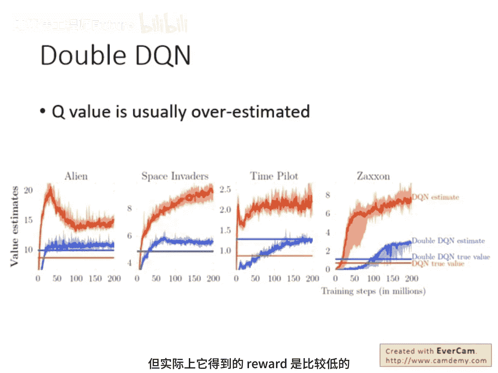

那接下来就要解讲的第一个问题，就是为什么q value总是被高估了呢，为什么q value被走势被高估了呢，这个是有道理的，那想想看，我们实际上在做的时候，我们是要让左边这个式子跟右边。

我们这个target越接近越好，那你会发现说target的值啊，很容易一不小心就被设得太高，为什么target的值很容易一不小心就被设的太高呢，因为你想想看，在算这个target的时候。

而在算这个target的时候，我们实际上在做的，我们实际上在做的事情是说看哪一个呃，A它可以得到最大的true value，就把它加上去嘛，就变成我们的target，所以今天假设有某一个action。

他得到的值是被高估的，举例来说，我们现在有有有四个action，那本来其实他们得到的值都是差不多的，他们得到的这个reward都是差不多的，但是在estimate的时候毕竟是个network。

所以estimate时候是有误差的，所以假设今天是第一个action，他被高估了，就假设绿色的东西代表是被高估的量，它被它被高估了，那这个target就会选这个action。

然后就会选这个高估的q value来加上RG，当做你的target，如果第四个action被高估了，那就会选第四个action来加上RT来当做你的target value。

所以你总是会选那个q value被高估的，你怎么会选那个reward被高估的，高估的action，当做这个max的结果去加上RT当做你的target，所以你的target总是太大，对不对。

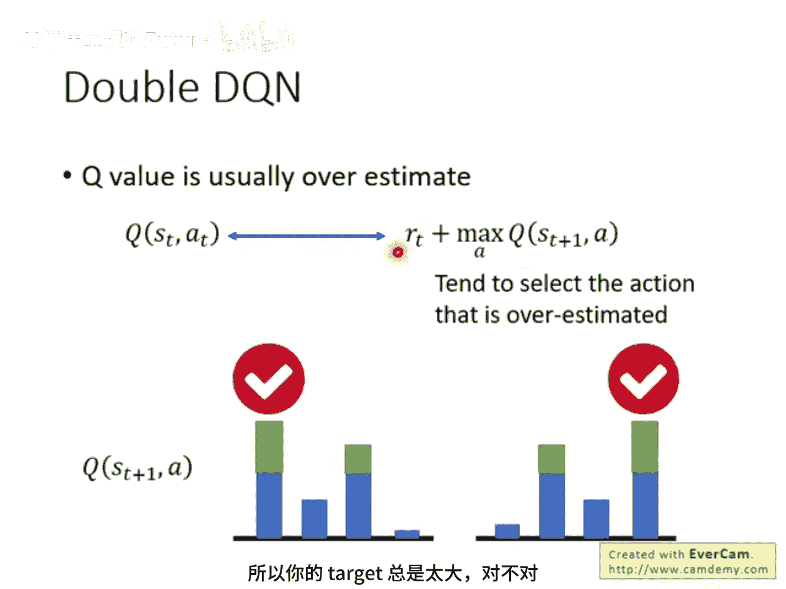

那怎么解决这个target总是太大的问题呢，那double t q n它的设计是这个样子，在double d q n里面。

选action的q function跟算value的q function不是同一个，今天在原来的DQN里面，在原来DQN里面，你穷举所有的A，把每一个A都带进去，看哪一个A可以给你的q value最高。

那你就把那个q value加上RT，但是在double dqn里面，你有两个q network，你有两个q network，第一个q network决定哪一个action的q value最大。

你用第一个qq network去带入所有的A去，看看哪一个q value最大，然后你决定你的action以后，实际上你的q value是用Q派所算出来的，而是用Q派所算出来的啊，这样子有什么好处呢。

为什么这样就可以避免overestimate的问题呢，因为今天假设我们有两个qq q function，假设第一个q function他高估了他现在选出来的HA，那没关系，只要第二个Q方向Q派。

他没有高估这个action a的值，那你算出来的就还是正常的值，那既然假设反过来是Q派高估了某一个action的值，但也没差，因为反正只要前面这个Q不要选，那个action出来就没事了。

这样这个就跟那个呃行政力，行额行政跟这个立法式分立的概念是一样的，这样大家了解吗，就是呃这一个Q它只能够提案，他不能够执行，Q负责提案，他负责选AQ派负责执行，他负责算出q value的值。

所以今天就算是前面这个Q做了不好的提案，他选的A是被高估的，只要后面Q派不要高估这个值就好了，那就算Q判会高估某一个A的值，只要前面这个Q不提，按那个A就算出来值就不会被高估了。

所以这个就是double dqn神奇的地方，然后你可能会说，那哪来两个Q跟q play呢，哪来两个network呢，其实在实作上你确实是有两个q value的，因为一个就是你真正在update q。

另外一个就是target的to network，就你其中两个q network，一个是target的q network，一个是真正你会update的q network。

所以在double d q n里面，你的实作方法会是你拿真正的q network，你会update参数那个q network去选action。

然后你拿party的network那个固定住不动的network去算value呃，那double d q n相较于原来的DQN的更动呢，是最少的，那它的他几乎没有增加任何的运算量。

但连新的network都不用用，你原来就有两个TUNETWORK，你唯一要做的事情只有，本来你在找最大的A的时候，你再决定这个A要放哪一个的时候，你是用呃two pi来算。

你是用呃freeze的那个network来来算，你用target network来算，现在改成用另外一个会update q network来算，这个应该是改一行扣的就可以解决了，就这样。

所以假设今天等一下会讲好几个tip，假如今天只只只选一个tip的话，正常人都是implement double d q n，这样哎好，所以这个就是轻易的就可以implement。

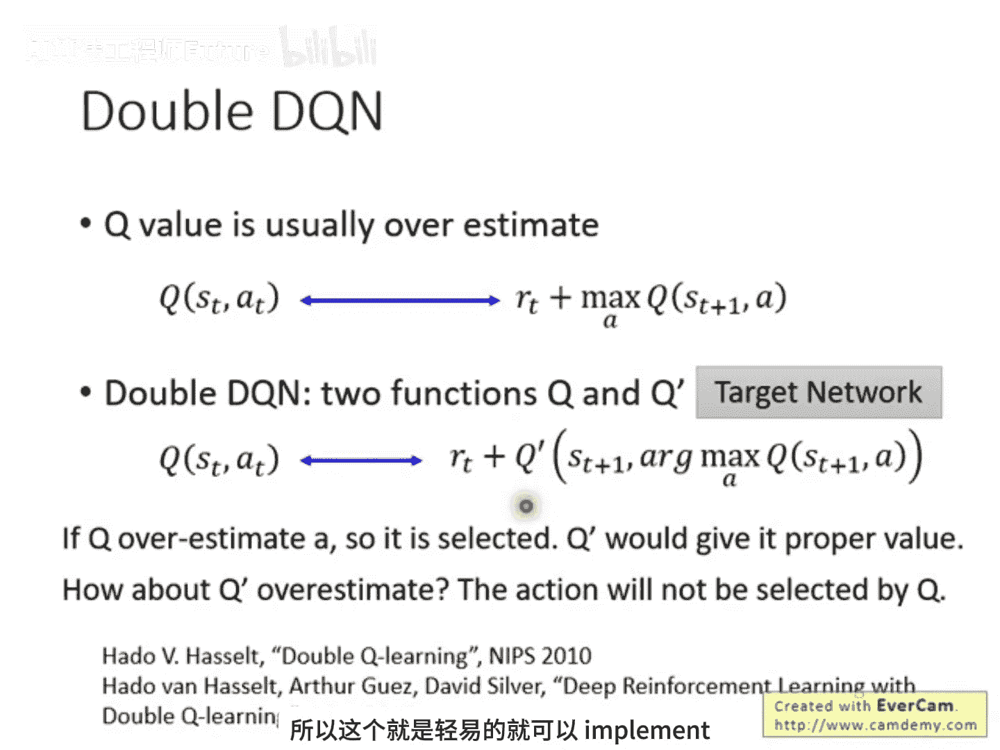

这是第一个你可以尝试的题好，那第二个tip呢叫做凋零的DQN，dun DQ n是什么呢，其实丢零的DQN也蛮好做的，相较于原来的DQN，它唯一的差别是改了network的架构，等下你听了。

如果觉得听了有点呃没有办法跟上的话，你就要记住一件事，Duing dq n，他唯一做的事情是改network的架构，也就改了那个我们说q network就是input data。

而不就是每一个action的q value，DQ大dun DQ唯一做的事情是改了network的架构，其他的演算法你都不要去动它哦，那DQADDINDQN，他是怎么改的network架构呢。

他是这样说的，现在啊本来的DQN就是直接output to value的值，现在这个DUING的DQN就是下面这个network架构，它不直接output d q value的值，它是怎么做的。

他在做的时候，它分成两条path去运算，第一个path他算出一个SCALER，那这个SCALER我们叫做DIOS好，它算，因为它跟input s是有关系哦，所以叫做DIOFS。

vo vs是一个scale，好，那下面这个呢它会output另外一个vector，这个vector呢叫做a of sa，那这个下面这个vector啊。

它是每一个action都有一个value到一个value，然后你再把这两个东西加起来，就得到你的to value，如果你觉得这样不够具体的话，你实际上做的事情就是这样。

而你有一个q network和你有一个q network input stay进来，那首先会output两个东西，一个东西叫做VOFS，它就是一个scale，我们就假设它是1。0，好了好。

然后接下来呢我们会output另外一个vector，这个vector呢它是每一个他跟那个反应式，跟你的action的数目是一样的，就是它的h a one a two a3，A3好。

那你这边就是output3个值，offer3个值，output3个值，比如说这边叫output，这边是1。0，1。0，不是十，是1。0，那这边output比如说二呃，二零好了，就随便举个举个数字好。

二负二零，然后接下来你要做的事情是把这两个值加起来，所以加起来意思就是说把1。0加到第一维，加到第二维，加到第三维加起来加起来变成这个是三负一一，这个东西就是你的Q到SA啊。

这个是a one的q value，a two的q value，A3的q value，就这样就这样好，这次大家有问题要问吗，我觉得这个很简单，这个就是改改改network的架构。

为其他的training就是一模一样的，这个就是你的q value跟跟你刚是之前，你怎么用q value，现在就怎么用用用用这个network好。

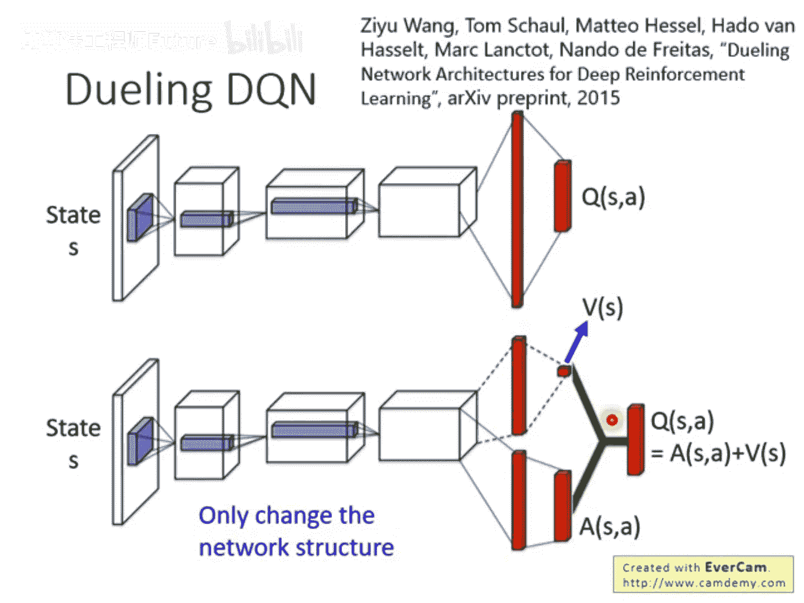

但是接下来你要问的问题就是，这么改有什么好啊，有什么好，所以接下来就是想要讲一下说啊，这么改有什么好呢，好那我们假设说原来的Q导SA，它其实就是一个table，对不对。

我们我们假设state是discrete，但实际上state不是discrete，那为了说明方便，我们假设就是只有四个不同的state，只有三个不同的action。

所以q of sa你可以看作是一个table好，那我们说q of FSA等于v of s加上A到FSA，那v of vs是对不同的state它都有一个值，a of sa它是对不同的stay。

不同的action都有一个值，那你把这个V的值加到A的每一个COLUMB的值，加上A的每一个COLUMB的值，加上每一个A的每一个colon就会得到Q的值，就是2+12加一，2+0就得到312。

以此类推，以此类推哦，所以你就把这一个东西给它加上去，加上去加上去就得到上面这个，你把V加到加上A啊，就得到Q好，那今天假设说你在train network的时候。

你现在的target是希望这个值变成四，这个值变成零，但是你实际上能跟动的并不是Q的值，你NEO跟动的是V跟A的值，V跟A的值，根据network的参数，V跟N的值，output后就直接把它们加起来。

所以其其实不是更动Q的值，然后在learn network的时候，假设你希望这边的值，这这个三增加一变成四，这个一增加一变成零，最后你在train network的时候。

network可能会选择说我们就不要动这个A的值，我们就动V的值，把V的值从零变成一，被法从零变成一，有什么好处呢，这个时候你会发现说，本来你只想动这两个东西的值，那你会发现说这个第三个值也动了。

所以有可能说你在某一个state，你明明只sample到这两个action，你没sample到第三个action，但是你其实也可以跟动到第三个action的呃，To value。

那这样的好处就是你平时你就变成，你不需要把所有的state action pair都sample过，你可以用比较efficient的方式去estimate，to value出来。

因为有时候你update的时候不一定是update下面这个table，而是指update了VOF等updvo vs的时候，只要一改所有的值就会跟着改，所以这是一个比较有效率的方法，去使用你的呃。

使用你的data诶，这个是DU50DQN可以带给我们的好处，那可是接下来有人就会问说呃，真的会这么容易吗，会不会最后认出来的结果是，反正machine就学到说，我们也不要管什么B2B就永远都是零。

然后反正A就等于Q，那你就没有得到任何DUING，DUINGDQN可以带给好处，就变成原来DQN1模一样，所以为了避免这个问题，实际上你会对下面这个A下一些CTRL，你要给A1些CTRL。

让update a其实比较麻烦，让network倾向于会想要去用V来解问题，举例来说，你就在此你可以看原始文件，它有不同的constrain了，那一个最直觉的concert是。

你必须要让这个A的每一个color的和都是零，每个color的值的和都是零，所以看我这边举个例子，我的color的和都是零，那如果这边color的和都是零，这边这个V的值啊。

你就可以想成是上面Q的每一个color的平均值，这个平均值加上这些值才会变成是Q的value，所以今天假设你发现说你在update参数的时候，你是要让整个roll一起被update。

你就不会想要update这边，因为你就不会想要update a这个MATRIC，因为A这个MATRI的每一个COLIN的和，都是要都要是都都都都都要是零，所以你没有办法说哦，让这边的值通通都加一。

这边是做不到，因为他的concern就是你不可以，你的和永远都是零，所以不可以都加一，这时候就会强迫network呢去update v的值。

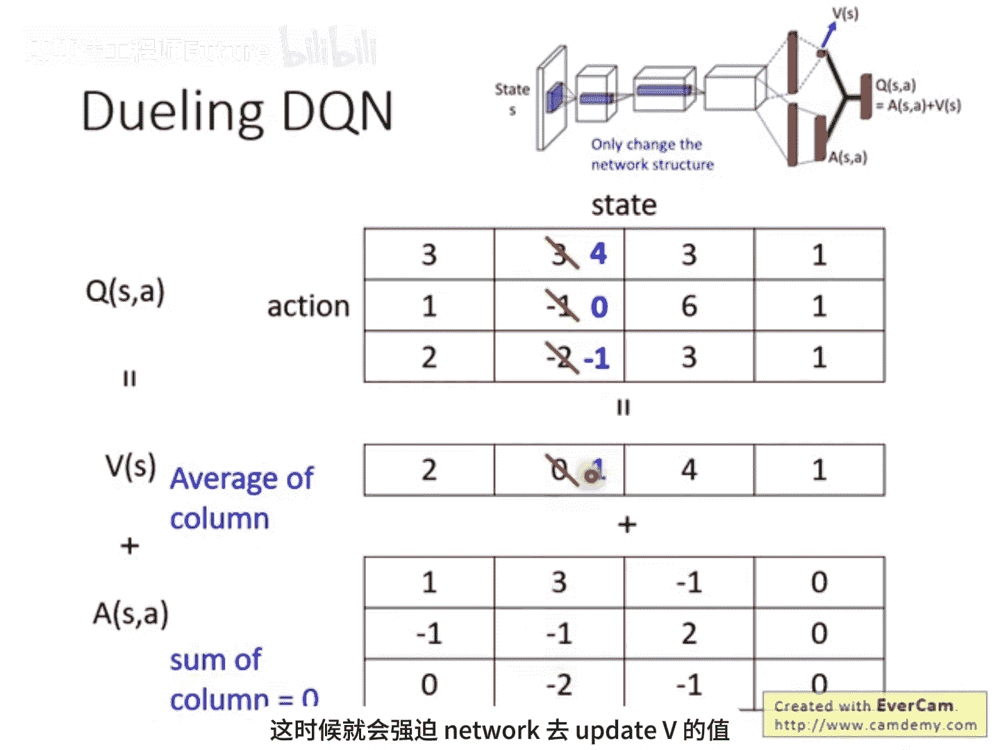

然后让你可以用比较有效率的方法，去使用你的data哦，那时座上怎么做呢，所以实作上我们刚才说你要给这个A1个control，那所以在实际input门的时候，你会这样input。

假设现在你的network output是732，好就举个例子，假设你有三个action，然后在这边output的vector是732，你再把这个A跟这个V加起来之前。

先加一个normalization，就就好像做那个layer normalization一样，加一个normalization，这个normalization做的事情，就是把7+3加二加起来等于12。

12÷3=4，然后把这边通通减掉四，变成三负一二，再把三负一二，再把三-12+1。0，得到最后的q value，然后这个东西呀就是network的一部分，这样你听得懂吗。

第一个normalization的这个step就是network其中一部分，在train的时候，你从这边也是一路被pp给回来的，只是normalization这个地方是没有参数的，它是没有参数。

它就是一个NOIZATION的operation，但它可以放到network里面，跟network的其他部分joint retrain，这样A就会有比较大的到大的control。

这样network就会给他一些benefit，倾向于去update v的值好。

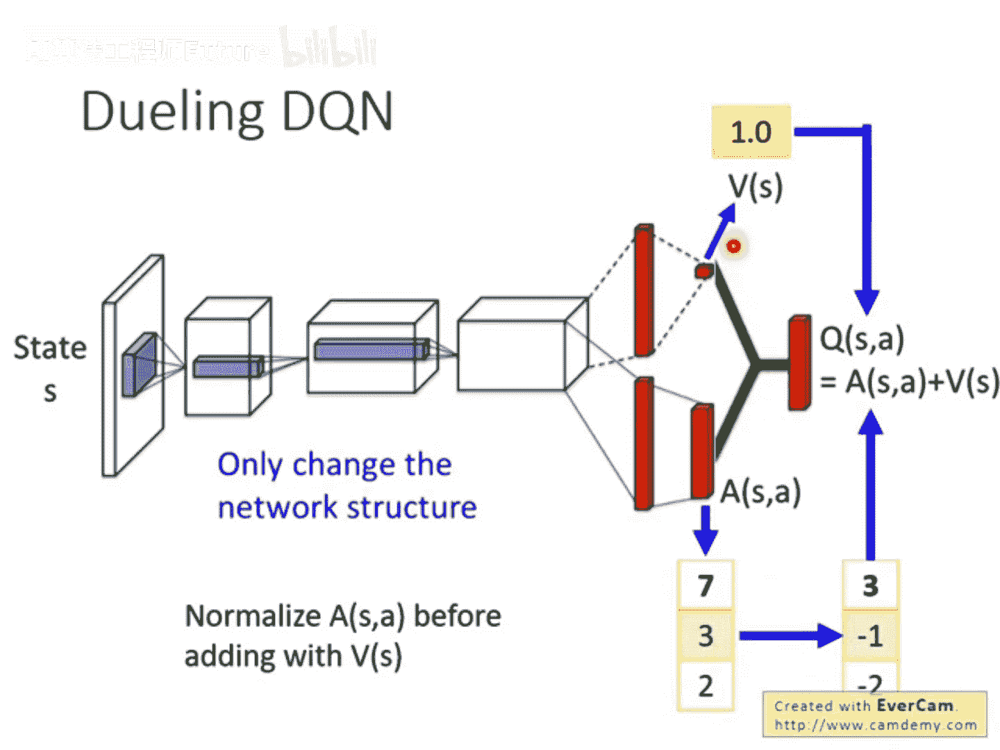

这个是DUINDQN，这个也算是容易好，那其实还有很多技巧可以用，这边我们就比较快的带过去，有一个技巧呢叫做priority的replay，priority replay是什么意思呢。

我们原来在simple data去劝你的q network的时候，你是uniform的，从experience buffer里，而且没有拼错。

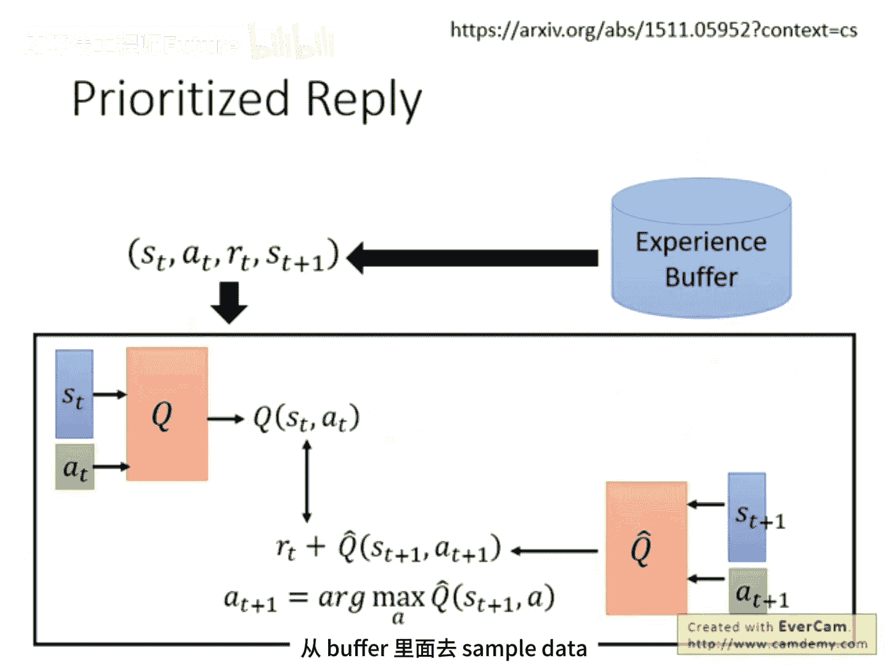

是buffer，然后从buffer里面去simple data啊，你就是呃uniform的去simple每一笔data。

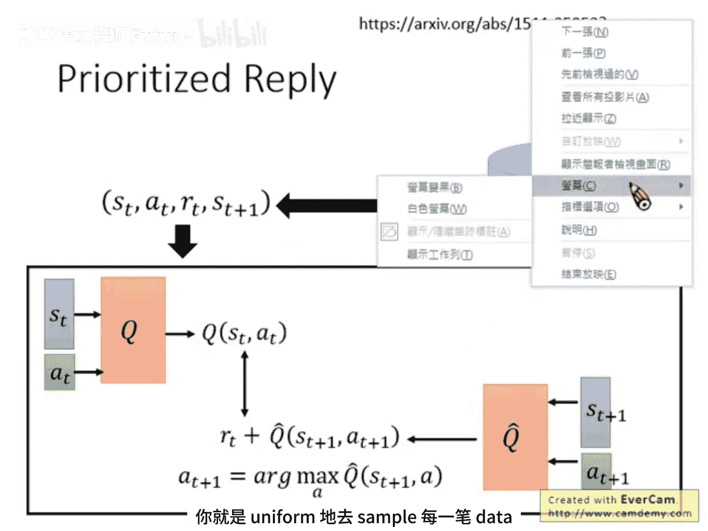

那这样不见得是最好的，因为也许有一些data比较重要呢，你做不好的那些data，就假设有一些data你之前有sample过，你发现说那一笔data的td error。

所谓td error就是你的network的output跟target之间的差距，你的td error特别大，那这些data代表说你在train network的时候，你是比较劝不好的。

那既然比较劝不好，那你就应该给他比较大的几率被sample到，所以这样在training的时候，才会考虑那些劝不好的，这个呃training data多吃一点，那这个非常的非常的直觉啊。

那详细的式子呢你再去看一下paper，那其实等一下助教在讲priority replay的时候，会讲更多东西，因为实际上在做priority replay的时候，你还不只会更改SAMPLY的bus。

你还会因为更改了sampling的process，你会更改update参数的方法，那这个呃我们就留给助教讲就好，所以replay其实并不只是改变了sample data的distribution。

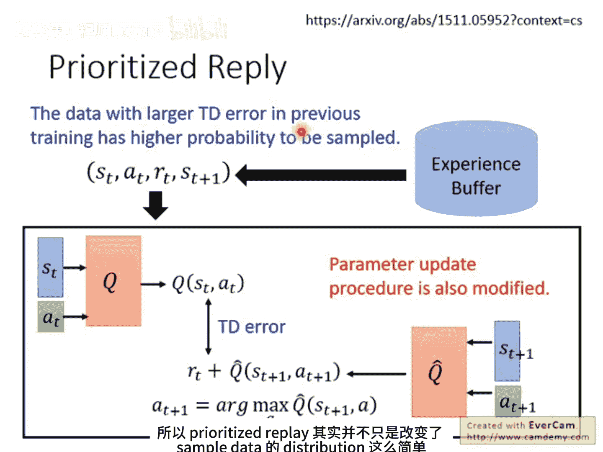

那么简单，你也会改training的process啊，这个我们就呃不细讲好，那另外一个可以做的方法呢，是你可以balance monte carlo跟pd。

我们刚才讲说MONTECARLO方法跟TD的方法，它们各自有各自的优劣，那我们怎么在MC跟TD里面取得一个平衡呢，那我们的做法是这样，在STD里面，你只需要存在某个state s t。

采取某个HMAT得到语或RT，还有接下来跳到下哪一个state s t加里，但是我们现在可以不要只存一个step的data，我们存大N个step的data，我们记录在ST采取AT得到RT。

会跳到什么样的ST，一直记录到在第N个step以后，在ST加大N采取AT加大N得到real RT，加大N得到跳到stay s t加大N加一的这个经验。

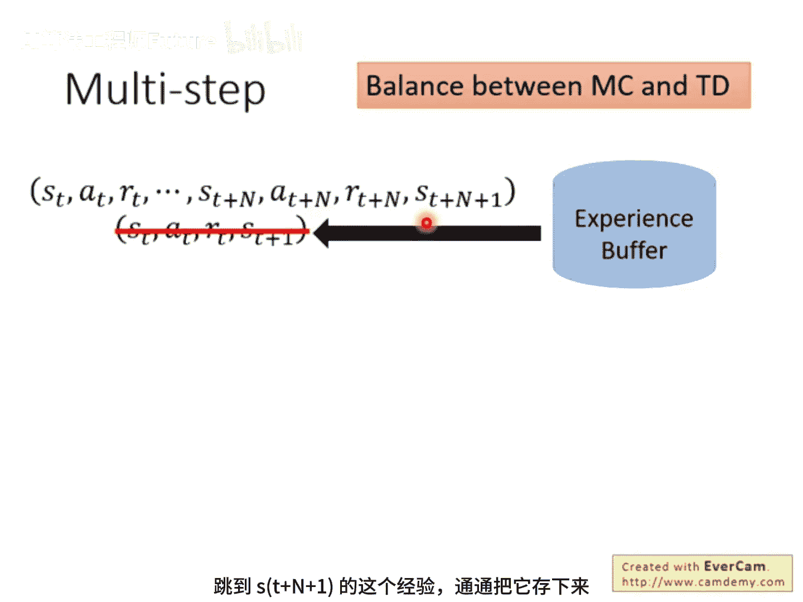

统统把它存下来，然后实际上你今天在做update的时候，在做T在做你的q network learning的时候，你的learning的方法会是这样，你learning的时候。

你是要让这个q of s t，AT跟你的target value越接近越好，而你的target value是什么呢，你的target value是会把从时间T1直到T加大N的。

N个rework通通都加起来，然后你现在的QH所计算的不是ST加一，而是ST加N加一，你会把大N个step以后的state丢进来去，计算大N个step以后你会得到的reward。

再加上multiple step的reward，然后希望你的target value跟这个motbs notable state reward，越接近越好，那你发会发现说这个方法。

它就是MC跟TD的结合，因为他们他就有MC的好处跟坏处，也有TD的好处跟坏处，那如果看呃看他的这个好处的话，因为我们现在simple了比较多的step，之前是只sample了一个step。

只有某一个state得到data是real的，接下来都是q value估测出来的，现在sample比较多，step simple大N个step才估测value，所以估测的部分所造成的影响呢就会比较轻微。

但是它的坏处就跟MC的坏处一样，因为你的R比较多项，你把大N项的R加起来，你的variance就会比较大，但是你可以去调这个N的值，去在这个various跟不精确的Q之间呢，取得一个平衡。

那这个就是一个HYPERPARADE，你要调这个大N到底是多少，你是要呃sample，多sample3步还是多sample5步，这个就跟network structure是一样。

是一个你需要自己调一下的值。

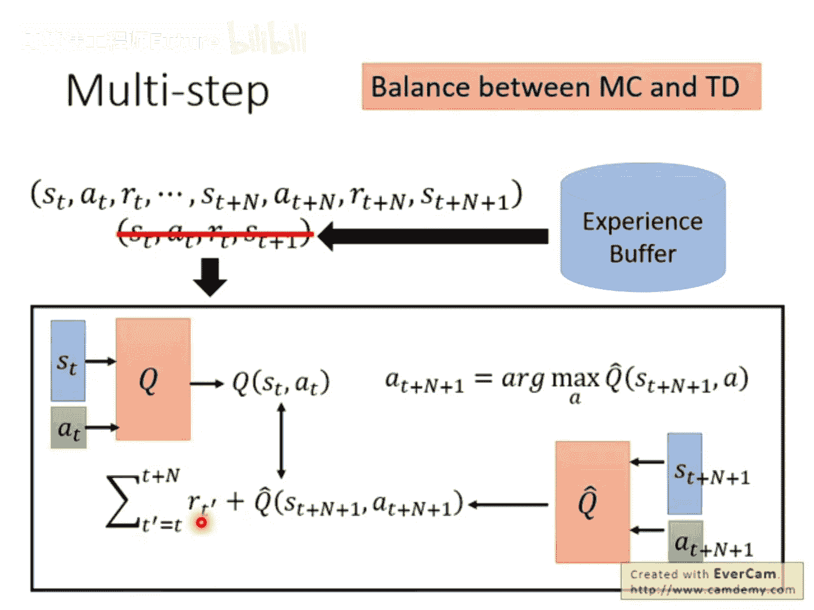

好那还有其他的其他的技术啊，有一个技术是要improve这个exploration这件事，我们之前讲的episoe greedy这样的exploration呢，它是在action的space上面加NO。

但是有另外一个更好的方法叫做noisy name，它是在参数的space上面加noise，什么意思，NOZZZ的意思是说，每一次在一个episode开始的时候，在你要跟环境互动的时候。

你就把你的q function拿出来，那q function里面其实就是一个network嘛，对不对，你把那个network拿出来，而在NEYWORD每一个参数上面加上一个高选，noise啊。

加上高选NOZE，那就把原来的q function变成q ta，因为q hand已经用过q head是那个target nework，我们用Q跳A来代表一个noisy的Q方式好。

那我们把每一个参数都可能都加上一个，高选的noise，就得到一个新的network，叫做cutie卡，那这边要注意的事情是，我们每次在simple这个Q的这个，我们每在simple noise的时候啊。

要注意在每一个CAPTIAL开始的时候，我们才sample network，这样大家了解我意思吗，在每个app store开始的时候，在跟环境互动之前，我们就simple network。

接下来你就会用这个固定住的noisier network，去玩这个游戏，直到游戏结束，你才重新再去sample新的noise，那这个方法神奇的地方就是这个呃。

OpenAI跟那个DEM要在同时间propose的，一模一样的方法，通通都publish在IQ2018，然后两篇paper的方法就是一样的，不一样的地方是他们用不同的方法去加noise。

但我记得那个OpenAI加的方法好像比较简单，它就直接加一个高选noise就结束了，就你把每一个参数，每一个weight都加一个高选noise就结束了，然后open a诶，deep麦他们做的比较复杂。

他们的noise啊是由一组参数控制的，也就是说network可以自己决定，说他那个noise要加多大，但是概念就是一样的，总之你就是把你的q function的里面的那个network。

加上一些noise，答辩的有点不一样，跟原来Q方向不一样，然后拿去跟环境做互动，那两篇paper里面都有强调说你这个参数啊，虽然会加noise，但在同一个episode里面，你的参数就是固定的。

你是在换episode玩第二场新的游戏的时候，你才会重新sample note，在同一场游戏里面，就是同一个noisy的q network在玩那一场游戏，这件事非常重要，为什么这件事非常重要呢。

因为这这是导致了为什么在network这个方法，noisy name跟原来的X种规定，或是其他在X上做sample方法本质上的差异。

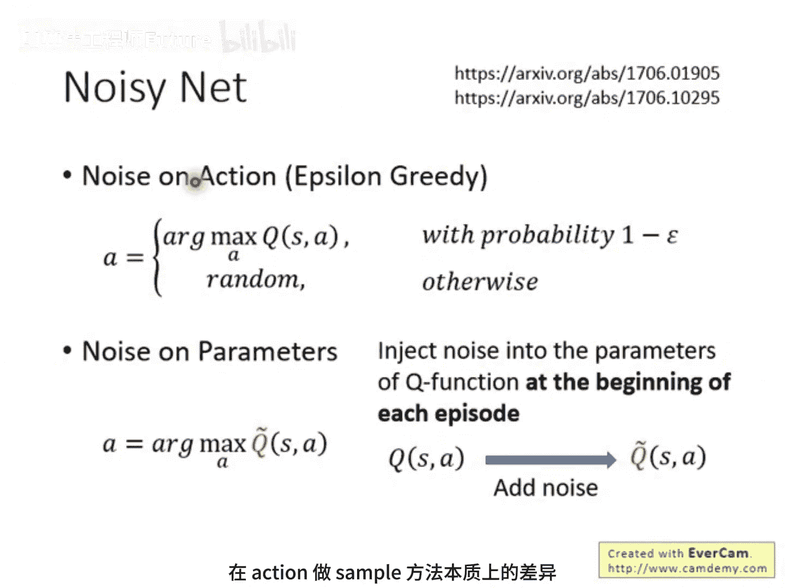

对此有什么要本质上的差异呢，原在原来的simple的方法，比如说X从规律里面就算是给同样的state，你的agent采取的action也不一定是一样的，对不对，因为你是用sample决定的啊。

基本同一个state，你如果simple到说哦，要根据Q方选的network，你会得到一个action，你sample到呃，Random，你会采取另外一个action。

所以given to the state，如果你接受X用规律的方法，他得到的action是不一样的，但是你想想看，实际上你的policy并不是这样运作的啊。

在一个真实世界的policy给同样的state，他应该会有同样的回忆，而不是给同样的state，它其实有时候是q function，然后有时候又是随机的，所以这个是一个比较奇怪的不正常的action。

是在真实的情况下不会出现的action，但是如果你是在在q function上面去加noise的话，就不会有这个情形，因为如果你今天在Q方向上加nose。

在q function的network的参数上加noise，那在整个互动的过程中，在一个同一个episode里面，它的network参数总是固定的，所以看到同样的state或是相似的state。

就会采取同样的action，就会采取同样action，那这个是比较正常的，那在paper里面有说这个叫做这个state，Dependent exploration，也就是说你虽然会做export这件事。

但你的explore是跟state有关系，看到同样的state，你就会采取同样的exploration的方式，比如说你在EXPOE你的环境的时候，你是用一个比较consistent。

一致的方式去测试这个环境，也就上面如果你是noise action，你只是随机乱试，但是如果你是在参数下这nose，但是同个p store里面里面的你的参数是固定的，那也就是有系统的在尝试，对。

每次都会试说哦，在某个stay我都会向左试试看，然后再下一次再玩这个同人游戏的时候，看到同样的state，比如说我再向右试试看，你是有系统的在做这个环境好。

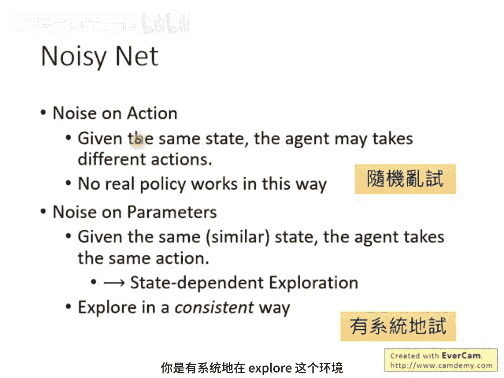

那这边这个实验我记得是OpenAI的实验。

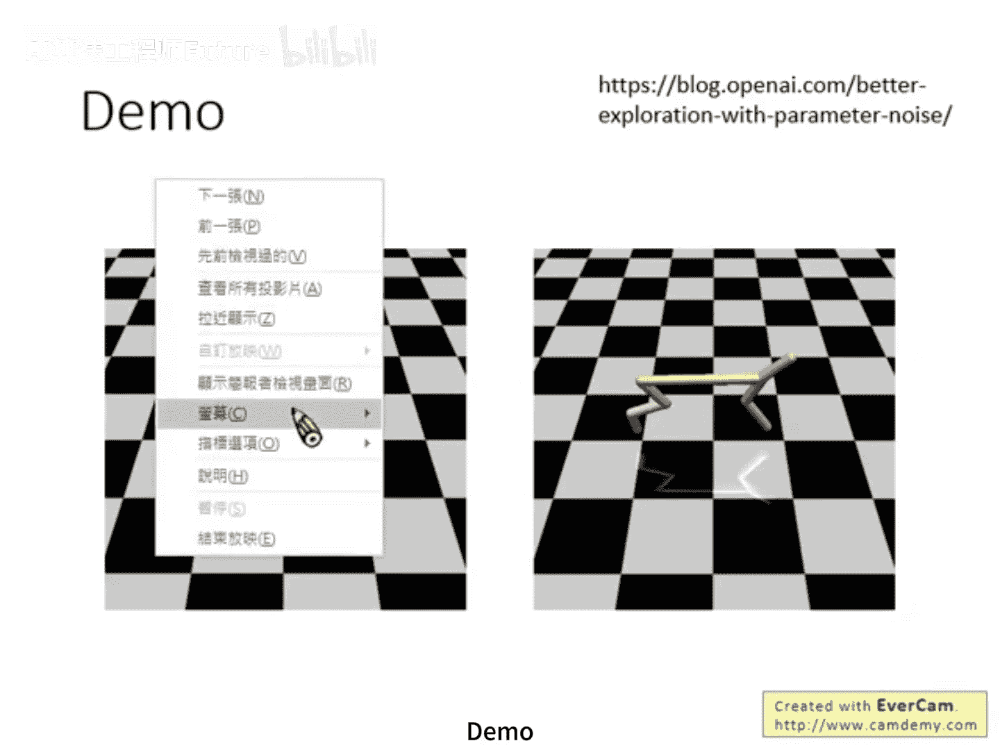

他们就是想要告诉你说这个呃，用noiz name的方法是真的好。

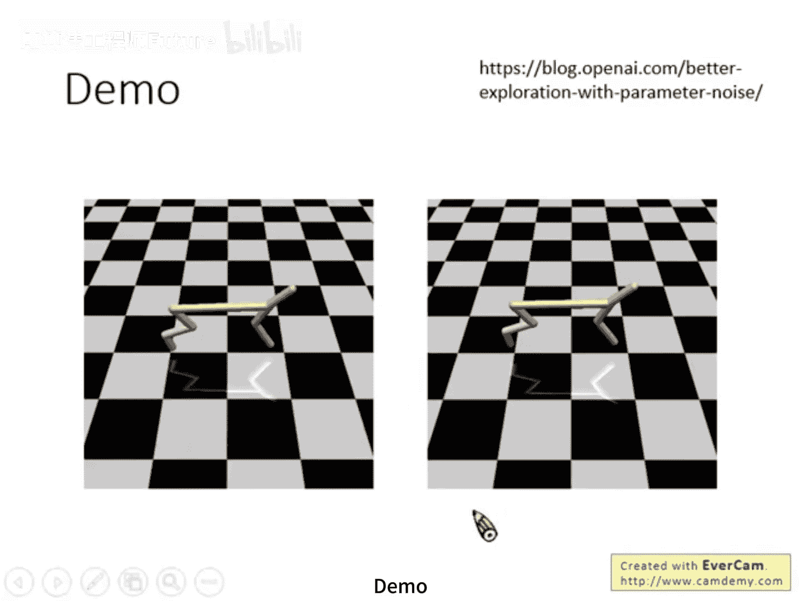

左边这个呢是piston grady的方法。

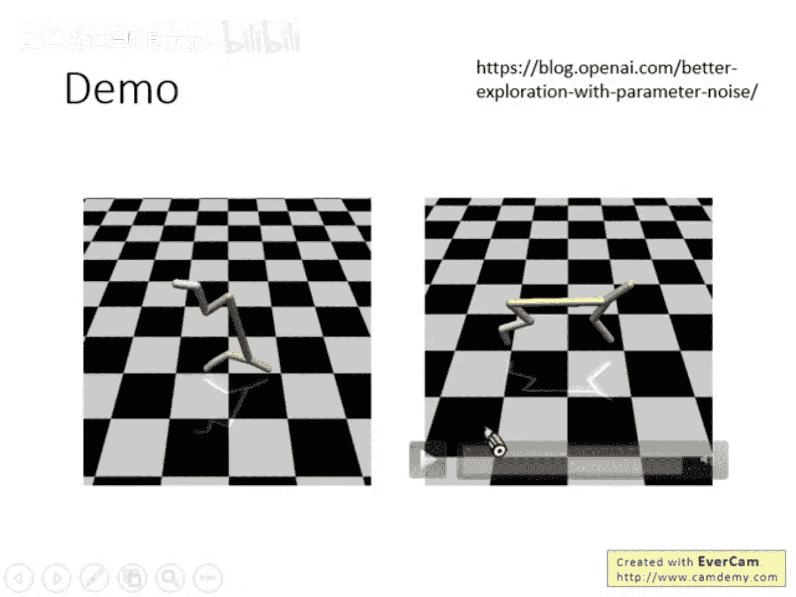

右边这个是noisy ne的方法，那希望训练这个狗开始奔跑，那左边这个方法虽然那狗最后也可以学会奔跑。

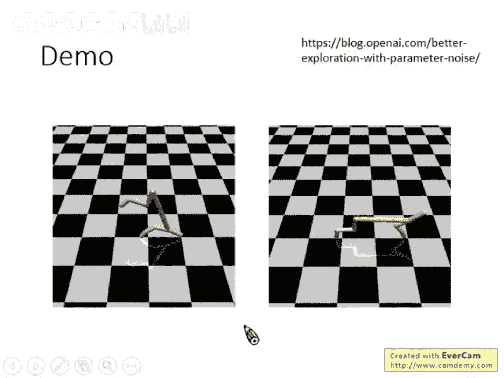

但是因为可能exploration的方法不太对。

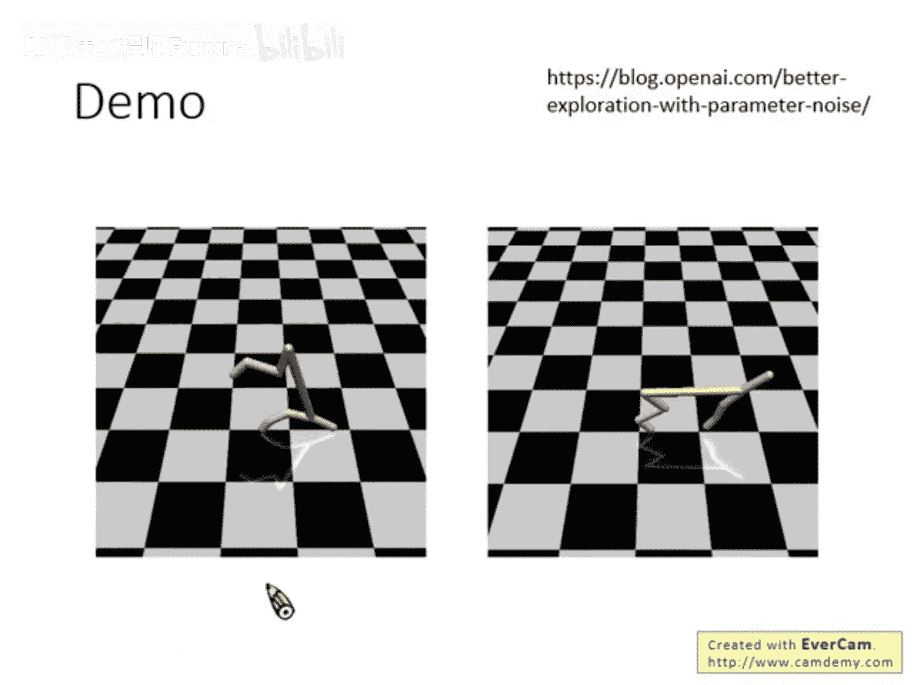

所以他没真的到学到一个好的奔跑的方式，他是用一个没有效率的方法在奔跑。

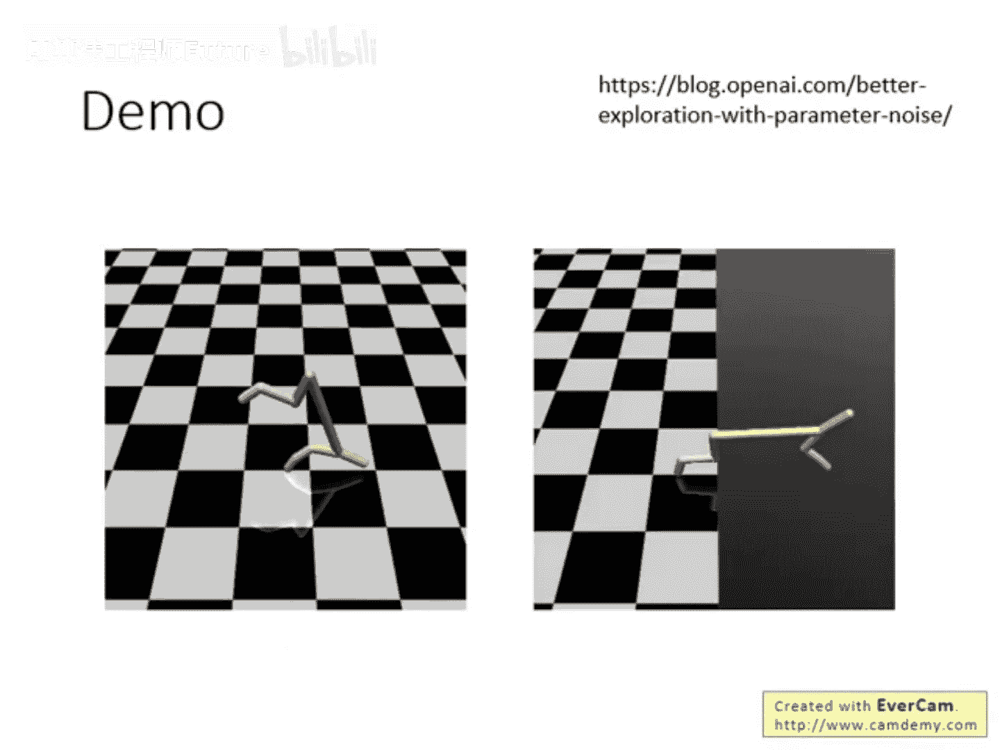

才发现右边的跑比较快，因为他已经跑到黑色的区域了，左边那个还没有跑到黑色区域。

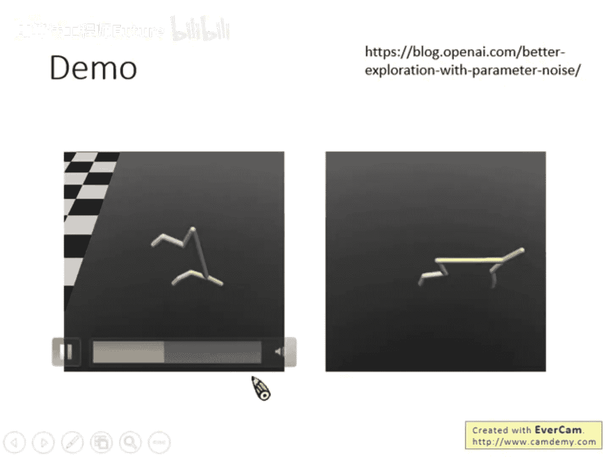

它跑的比较慢啊，右边的是用比较有效率的方法在奔跑。

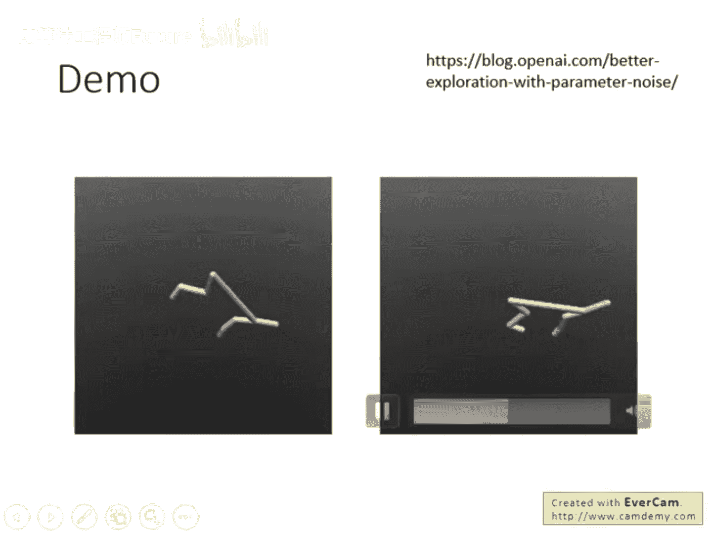

哦那这些方法综合起来呃，还好还没有讲完好还有另外一个东西，这个东西呃叫做distributional的q function，我们就不讲话，细节只告诉他的大概念。

那distributional q function我觉得还蛮有道理的，但是他没有红起来，就发现说没有太多人真的在实做的时候，用这个技术，可能一个原因就是因为它不好实做，这样他怎么实做，他的意思是什么。

他说我们说q function到底是什么意思啊，我们说q function是accumulated the reward的期望值，所以我们算出来的这个q value，它其实是一个期望值。

也就是说实际上我在某一个state，采取某一个action的时候，因为环境是有随机性，在某一个state采取某一个action的时候，实际上我们把所有的reward玩到游戏结束了之后。

所有的reward进行一个统计，你其实得到的是一个distribution，也许在呃reward得到零的几率很高啊，在复试的几率比较低，在证实的几率比较低，但是它是一个distribution。

那这个to value代表，只是说我们对这一个distribution算它的命，还是这个to value，我们算出来是expected accumulated reward。

真的accumulated reward是一个distribution。

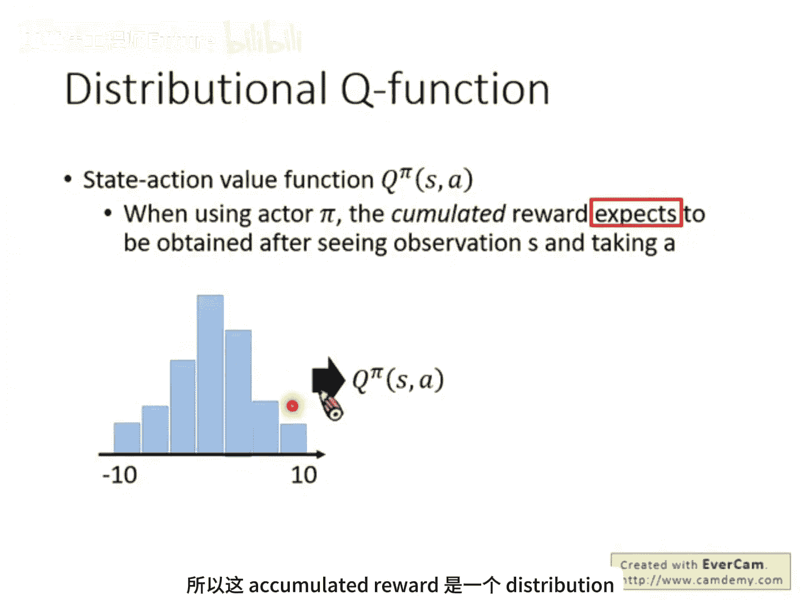

对他取expectation，对他取mean，你得到了q value，但是有趣的地方是不同的distribution，他们其实可以有同样的命，也许真正的distribution是这个样子。

那算出来的命跟这个distribution，算出来的命其实是一样的，但他们背后所代表的distribution其实是不一样，所以今天假设我们只用一个expected to value。

来代表整个reward的话，其实可能是有一些information是lost的，你没有办法model这个呃，呃你没有办法model与word distribution。

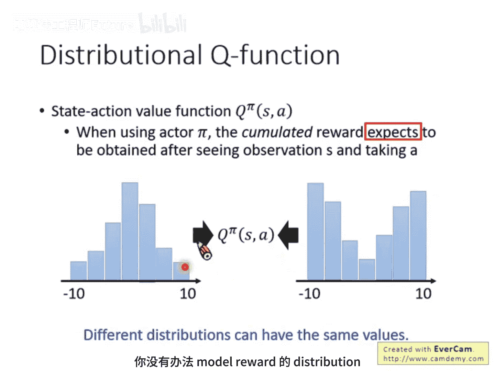

所以今天distributional的q function他想要做的事情是model distribution，所以怎么做，在原来的Q方式里面。

假设你只能够采取a one a two a33的action，那你就是input the same，output3个value，三个value分别代表三个action的q value。

但这个q value是一个distribution的期望值。

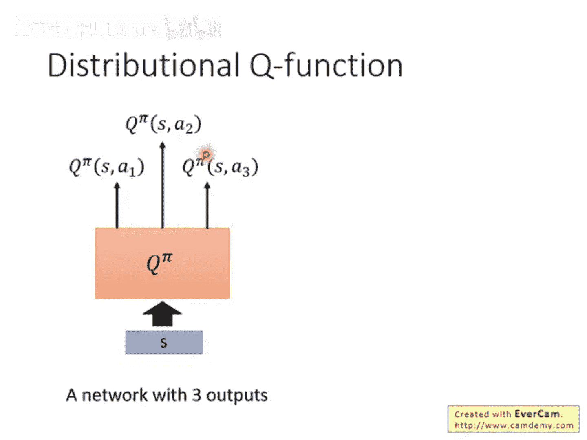

所以今天distribution of q function，它的idea就是何不直接output那个distribution，他把但是要实际operate distribution，你不知道怎么做吗。

对不对，但实际上的做法是说，假设distribution值就分布在某一个range里面，比如说-10~10，要把-10~10中间拆成一个一个的，并拆成一个一个的长条图啊，拆成一个一个bean，举例来说。

在这个例子里面，每一个action等我们把reward space呢就拆成五个bean，拆成五个B拆成五个币，然后这边的做法就是假设每一个action拆成五个may。

假设rework可以拆成五个bean的话，今天你的q function的offer是要预测说在某一个bean里面，你的这个你在某个state采取某一个action。

你得到的reward落在某一个bean里面的几率，所以其实这边的几率的和这些绿色的bug的和，应该是一，它的和应该是一，它的和应该是一它的高度，代表说在某一个state采取某一个action的时候。

它落在某一个病的几率，这边绿色的代表action one，红色代表action two，蓝色的呢代表了action3好，所以今天你就可以真的用Q方式去estimate。

a one的distribution，a two的distribution，A3的distribution，但实际上在做testing的时候，我们还是要选某一个action去执行吗。

那选哪一个action呢，实际上在做的时候，他还是选这个呃命的命最大的那个action去执行，但是假设我们今天可以ml distribution的话，除了选命最大的以外。

也许在未来你可以有更多其他的应用，举例来说，你可以考虑它的distribution长什么样子，如果distribution variance很大，代表说采取这个action算命，可能平均而言可能不错。

但也许风险很高，你可以train the network，它是可以规避风险的，就在两个action命都差不多的情况下，也许他可以选一个风险比较小的呃action来执行好。

这是distribution of q function的好处，那细节怎么train这样的q network我们就不讲，一定要记得说这个，反正q network有办法。

output the distribution就对了，我们可以不只是估测mean的值，我们不只是估测得到了期望reward命的值，我们其实是可以估测一个distribution的。

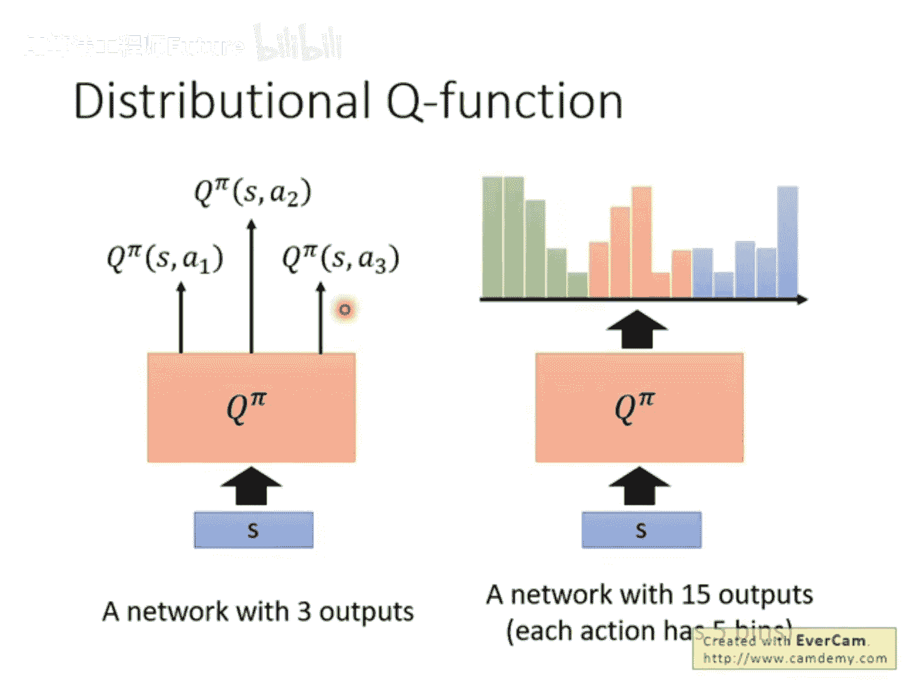

好那下一页呢这个是一个demo，就是要告诉你说用这个技术真的可以估测distribution。

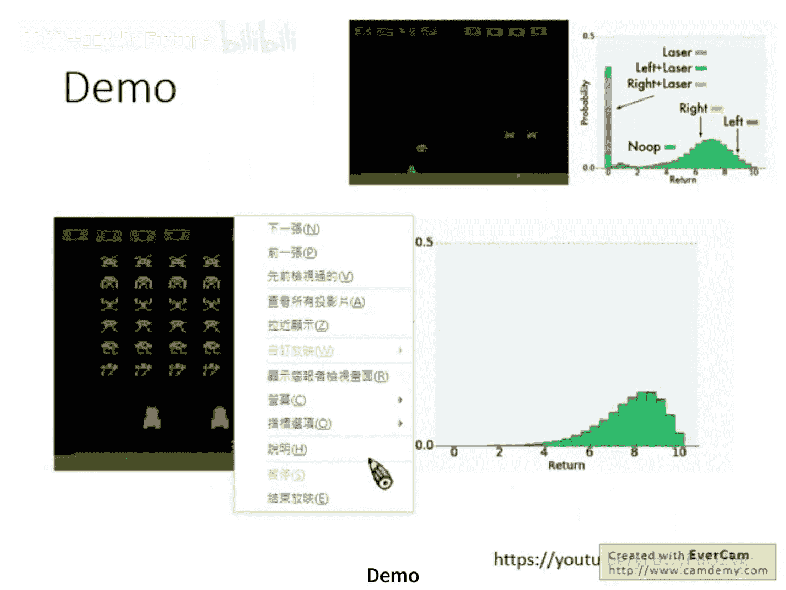

但是在文献上找到的结果啊。

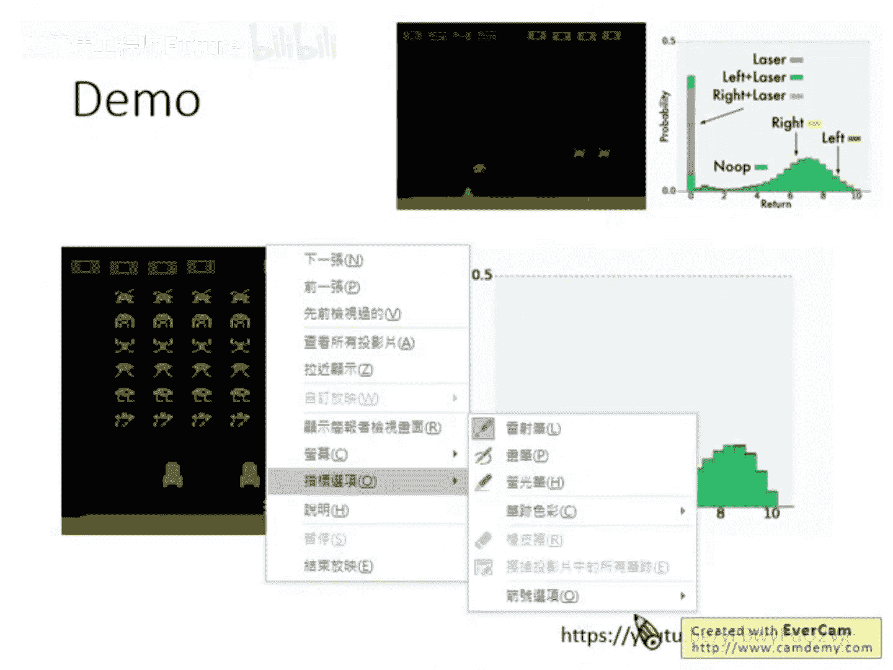

好，也就是说今天呢呃这个是这个demo，想要显示的是说左边是机器看到的。

游戏画面是stay，右边就是reward distribution。

然后注意一下，其实每一个action都有一个自己的distribution。

那只是因为现在不同的action呢，他们的distribution其实可能也没哦。

我的滑鼠一键哦，在这边不同的action它的distribution其实也没差那么多。

所以他们是盖在一起，但你还是可以看到一些不一样的颜色。

来看到一些不一样的颜色，不同的action，每一个action都有一个自己的TRIBUTION。

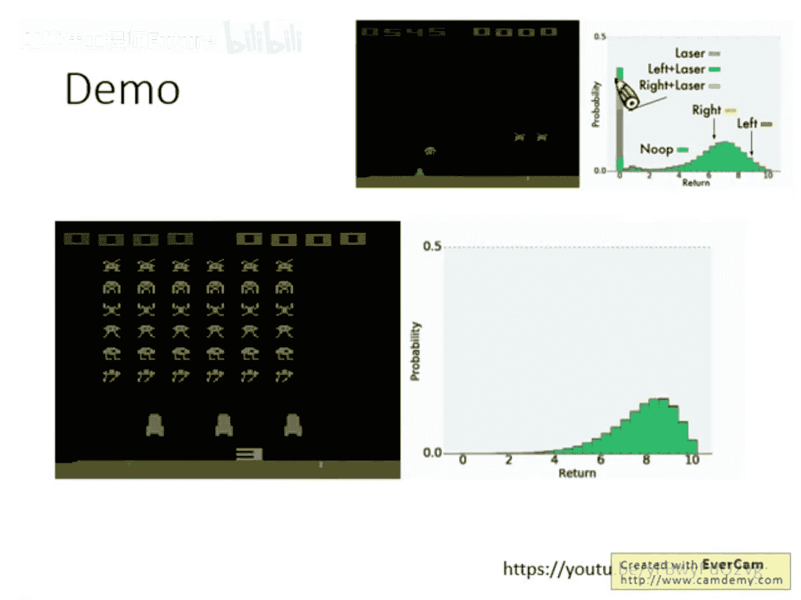

在看这个distribution就会发现说他其实也是蛮有道理的，我们来看一下看他的distribution是怎么样的状况。

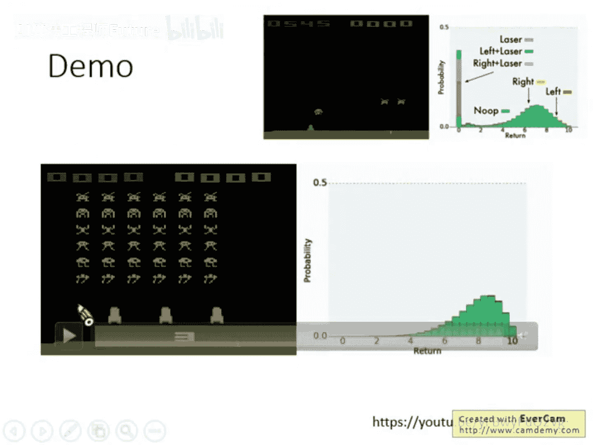

一般在游戏开始的时候啊。

通常in general而言，你的distribution是比较偏右边的，因为你得得到的reward是比较大的。

因为你接下来还有很多怪可以杀，但随着怪越杀越多。

发现几TRIBUTION逐渐向左偏，好，逐渐向左偏。

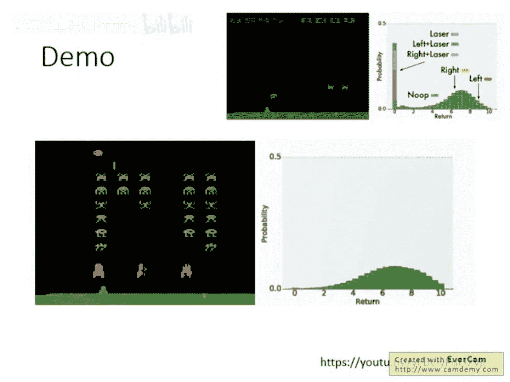

橘色，你说这个是什么东西，是不是这个是防护罩诶。

怎么怎么会突然那个还要从头开始了，是不是。

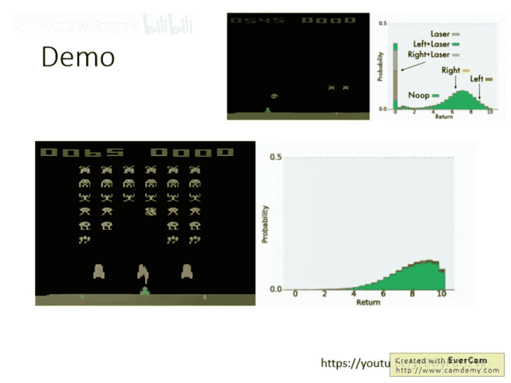

哦哎局上是防护罩。

对，他会自己设防，对他们分他设计的防护罩。

对，对啊就看看。

那你可以看到右边那个点TRIBUTION，就逐渐的往左偏，往左偏。

会发现防护罩不见了，以后会发生什么事呢，你会发现在reward是零的地方。

有时候会暴增，有时会暴增，为什么，因为他现在就是因为防护罩不见。

所以很容易就死掉，但只要一死，reward就是零。

就下一个时间点就结束，reward就是零，所以仔细观察一下，有时候在reward是零那边会出来一个爆声。

会有个pick或者pick，会个pick，对他厉害。

他都然后他他清他清怪，清完的，但可以打第二场。

太空船在上面吗。

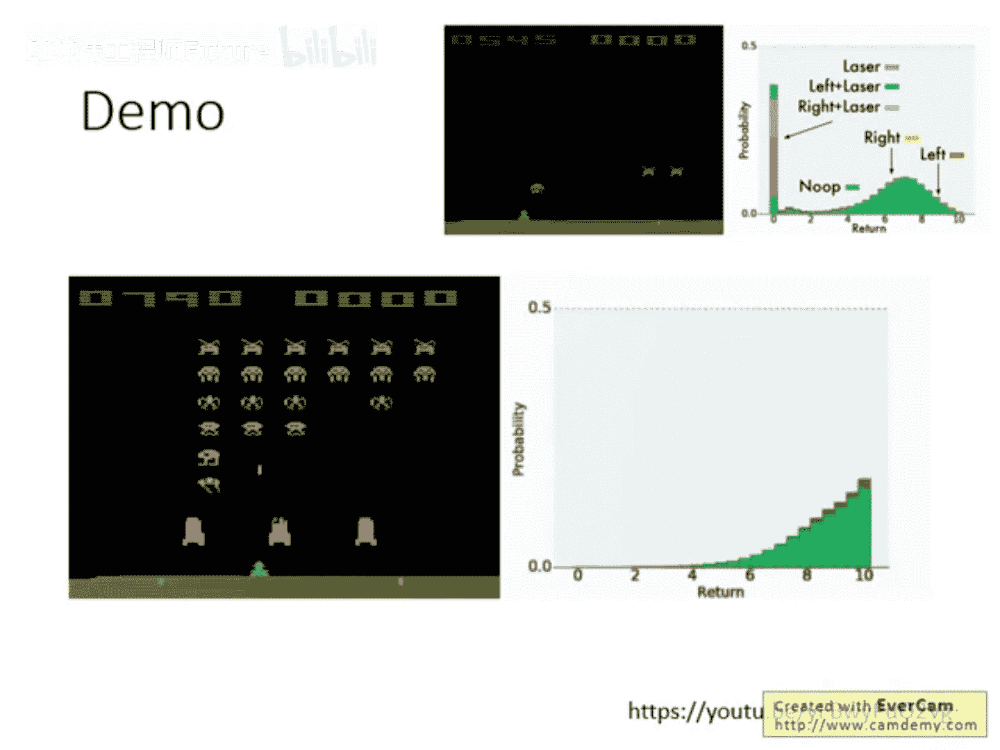

他们应该会攻击啊，都没有攻击哦，应该会攻击吧。

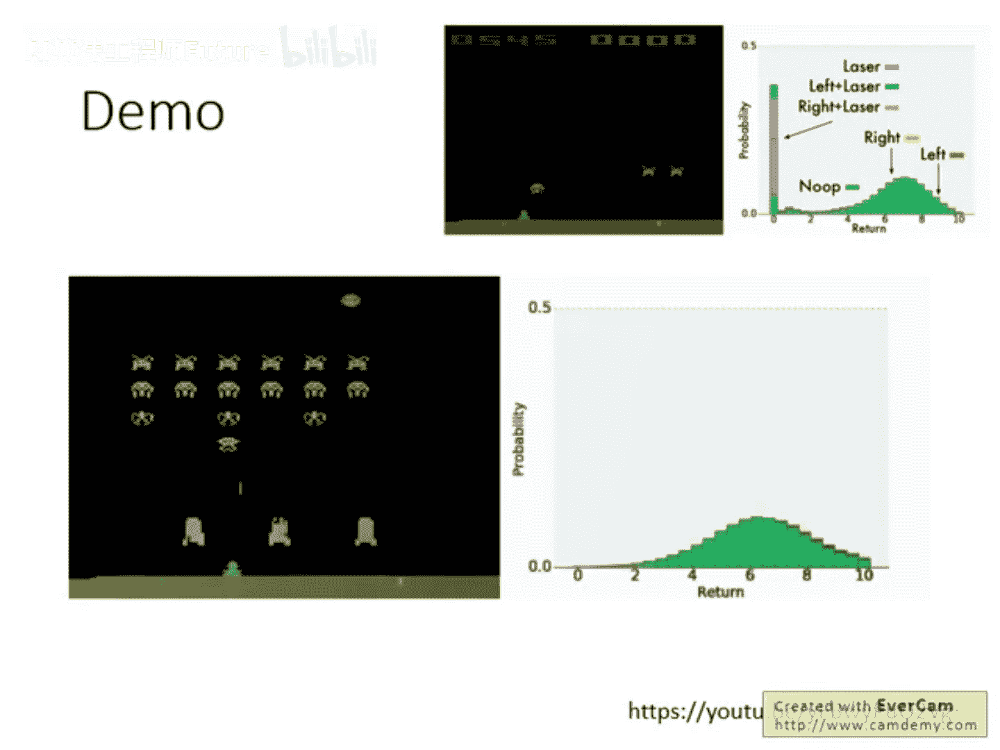

而且向左，那现在怪越来越少。

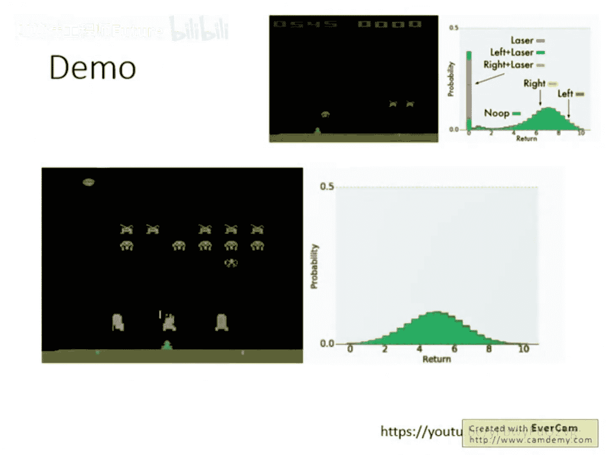

就开始distribution就向左向左。

他们也我我哎。

你说上面怎么不射子弹，那现在摸越来越下来，不会下来。

你不知道为什么他还亲自己的防护罩呢，好了，现在防护罩不见了。

就很危险，所以现在reward就都会变得向左偏，很危险，快死了快死了，然后最后就死了。

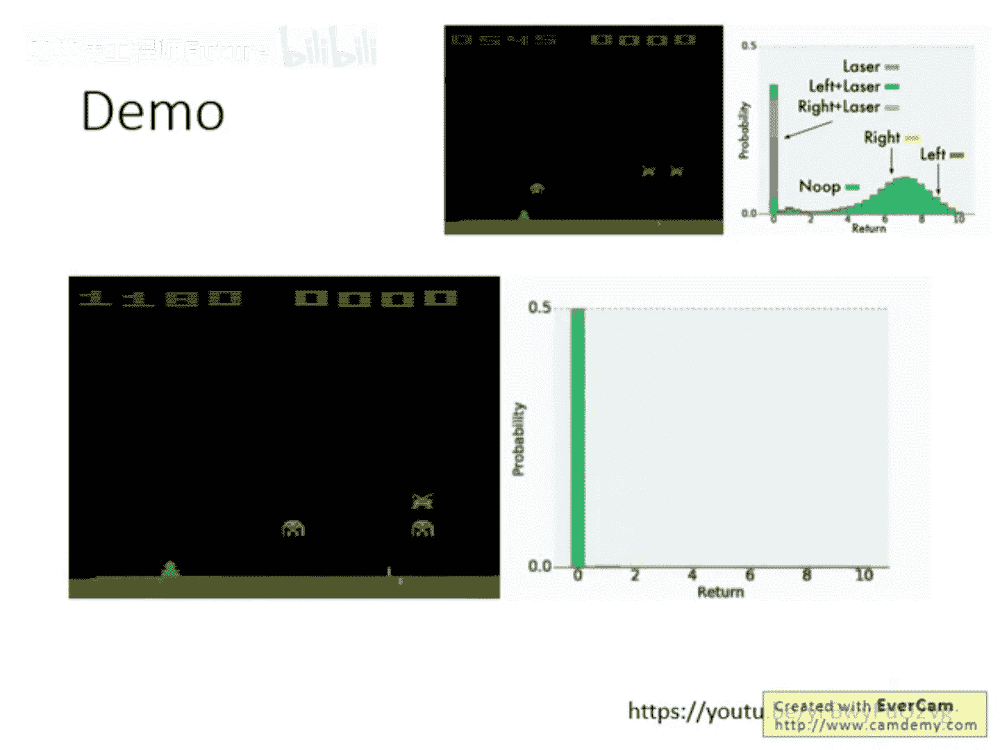

对好。

那最后跟大家讲的是一个叫做rap的技术，rap这个技术是什么呢，rap这个技术就是，把刚才所有的方法全都综合起来就变成rainbow啊，因为刚才每一个方法就是有一种自己的颜色。

把所有的颜色统统合起来就变成rainbow，我们来算算看是不是真的有所有的方法，就我仔细算一下，不是才六种方法而已嘛，为什么会你会变成是七色的，也许它本应该是TPY，也算是一种方法好。

那我们来看看这些不同的方法，这个灰色这一条它这个纵轴就是你玩你哎，这横轴是你整那个training的process，那纵轴呢，纵轴是完了十几个IPAD小游戏的平均的分数的和。

这样子大家取的是medium的分数，为什么是取medium，不是直接取平均呢，因为他说每一个小游戏的分数其实差很多，如果取平均的话，到时候某几个游戏就多么，你的结果等取media的值好。

那这个如果你是一般的DQN，就灰色这条线就没有很强，没有很强好，那如果是你换noisy的DQN哎就强很多，然后如果这边每一个单一颜色的线，那是代表说只用某一个方法。

那紫色这条线是d d q n double dqn，double d有看蛮有效，你换double DQ n就从灰色这条线跳成紫色这条线，然后prioritize d q n dun DQ n。

还有distributional DQ n都蛮强的，我都蛮强的啊，都差不多很酷很强的，那这边有个A3CA3C，其实execrate方法，这我们下周会讲，那单纯的A3C看起来是比DQN强的。

但发现这边怎么没有moti step的方法，那我们讲个moti step的方法叫balance td跟MC，我猜是，因为A3C本身内部就有做more time step的方法。

所以他可能觉得说有implement，A3C就算是有implement more time step的方法，所以可以把这个A3C的结果，想成是more time step的方法，而最后其实这些方法。

它们本身之间是没有冲突的，所以全部都用上去，就变成七彩的一个方法，就叫做rainbow，然后他很高，这样他很高啊。

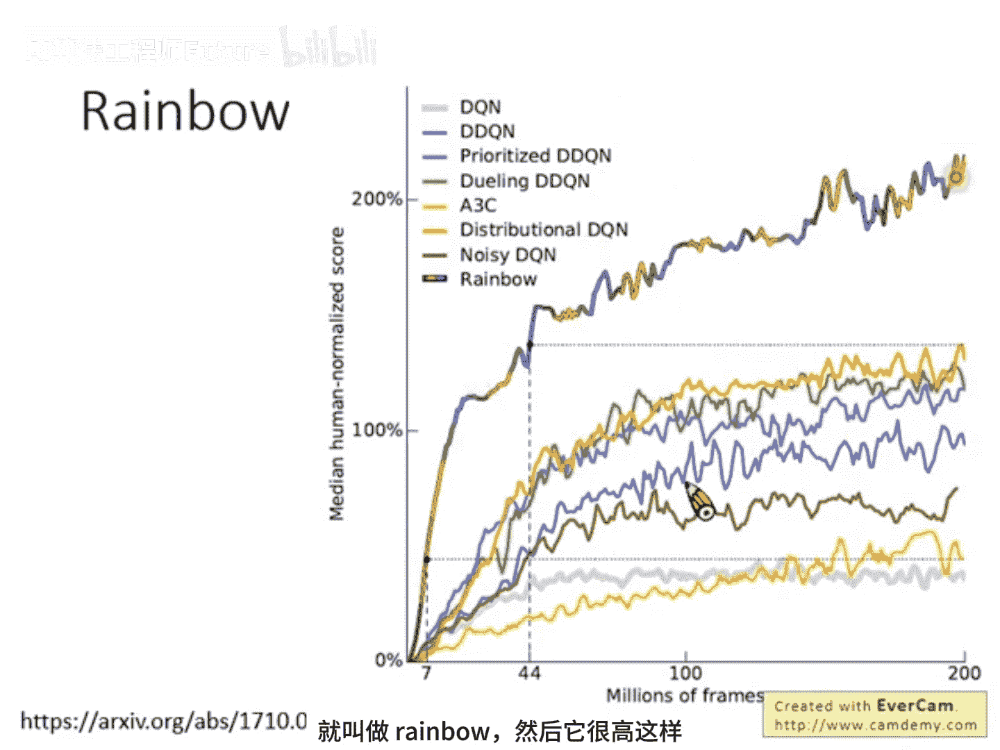

这是rainbow的第一张图，好，这是下一张图，这张图要说的是什么呢，这张图要说的事情是说在rainbow这个方法里面，如果我们每次拿掉其中一个技术到底差多少，因为现在是把所有把所有的方法通通倒在一起。

发现说进步很多，但会不会有些方法其实是没用哦，所以看看说每一个方法哪些方法特别有用，哪些方法特别没用，好像这边的虚线就是拿掉某一种方法后的结果，被发现说黄色拿掉morttime step掉很多。

rainbow是彩色，这一条拿掉moti time step马上就掉到这里标准，然后拿掉priority，replay也马上就掉下，然后就掉下，拿这个拿掉那个distribution，它也就掉下来。

而且有有趣的地方是说，在开始的时候，distribution训练的方法跟其他方法速度差不多，但是如果你拿掉distribution的时候，你的训练不会变慢。

但是最后performance最后会收敛在比较差的地方，然后拿掉noisy net performance是差一点，拿掉JING也是差一点，那反而拿掉double没什么用。

这样子就拿着double没什么差，所以看来全部加倒在一起的时候，double是比较没有影响，那其实在paper里面有给一个呃make sense的解释。

他说其实当你有用distributional的DQN的时候，本质上就不会overestimate你的reward，因为我们之所以用double理由，是因为害怕会overestimate reward嘛。

Over ester，因为避免overester re，我才加了double d提问，那在paper里面有讲说，如果有做distributional的DQN，就比较不会有overestimate的结果。

事实上他有真的算了一下，发现说他其实多数的状况是underestimate reward，所以会变成double d q n没有用，那为什么做distributional的DQN会over。

会不会over estimate reword，反馈安跟estimate reword，因为可能是说现在这个distribution or d q n。

我们不是说他output的是一个distribution的range吗，所以你output的那个range啊，不可能是无限宽的，一定是设一个range，比如说我最大哦。

我的output的这个range就是从-10~10，那假设今天得到的reward超过十怎么办，是100怎么办，就当做没没看见这件，没看到这件事，所以会变成说reward很极端的值，很大值其实会被丢掉的。

所以变成说你今天用distribution dcn的时候，你不会有overestimate的现象，反而有underestimate的倾向就是了，好那我们就讲到这边，现在是五点了。

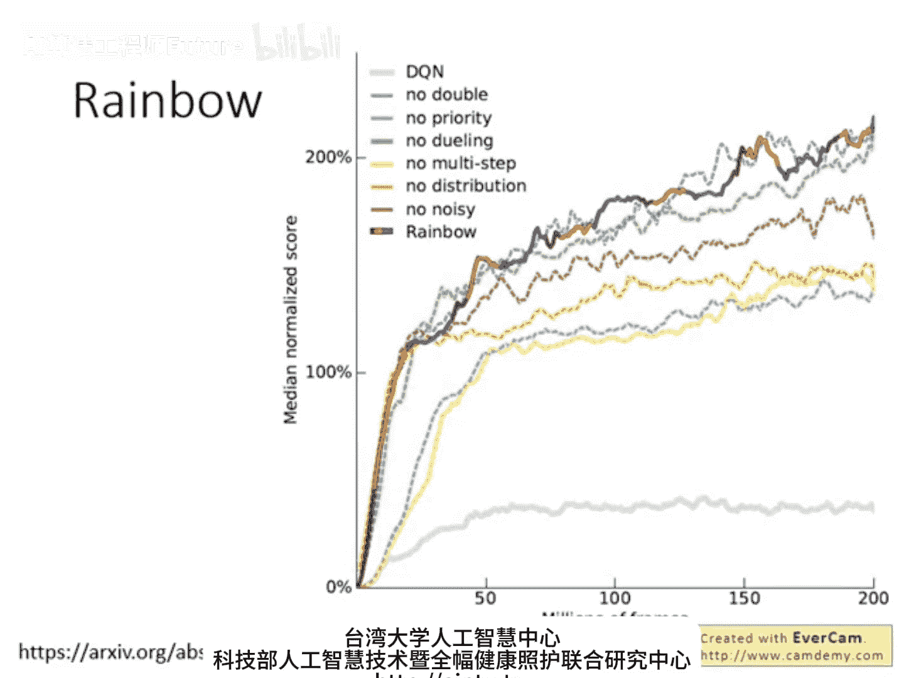