# 【官授搬运】2026年全新优化版李宏毅机器学习系统课程，这才是真正的初学者体系课程！—人工智能／深度学习／神经网络 - P88：【第十四讲】1-機器終身學習 (Life Long Learning, LL) (一) - 為什麼今日的人工智慧無法成為天網？災難性遺忘(Catastrophi - AI算法工程师Future - BV1ruqABeEFX

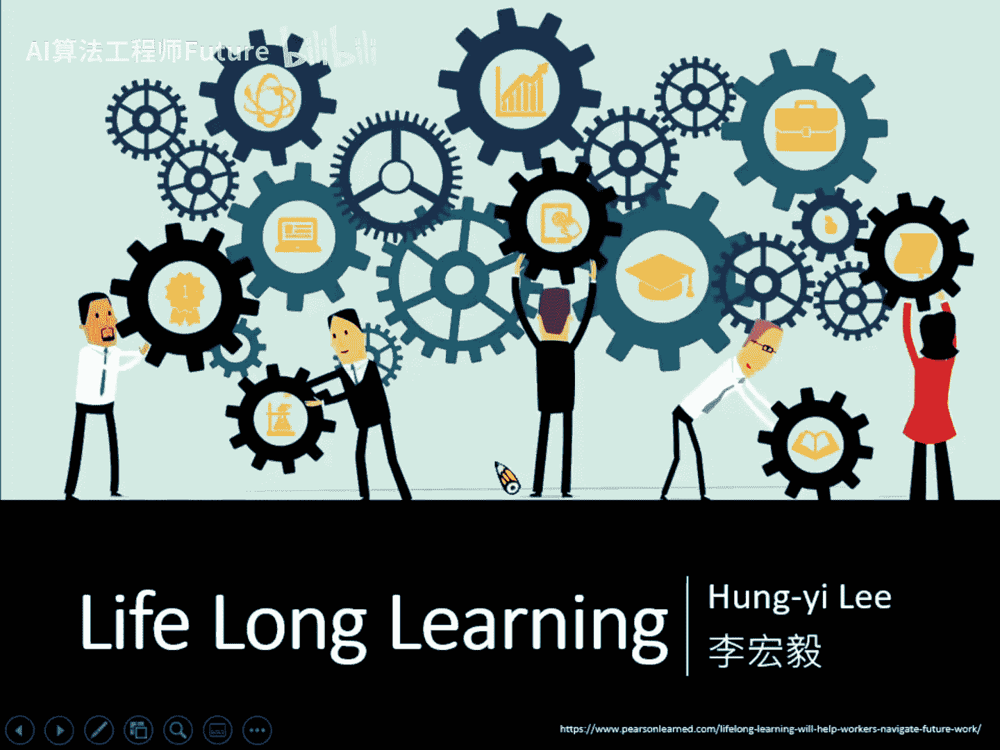

好那接下来的课程呢要跟大家讲lifelong learning。

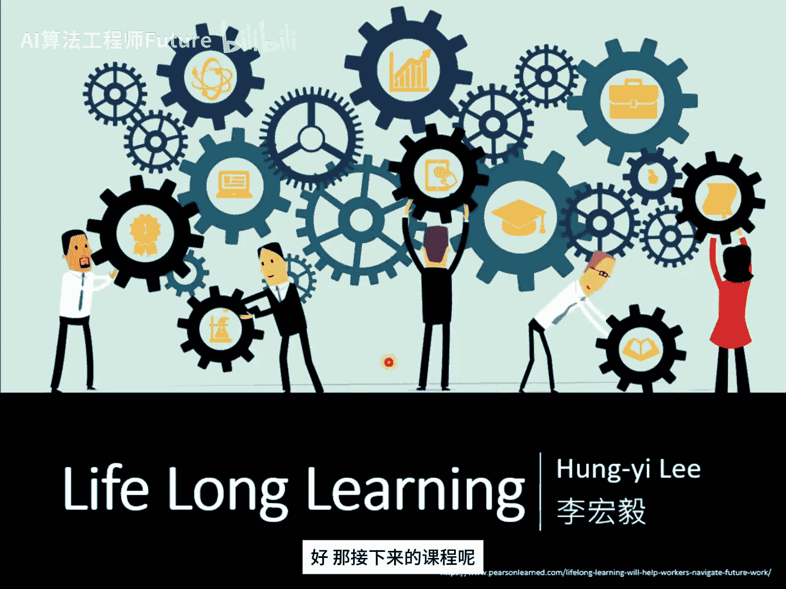

那什么是lifelong learning呢。

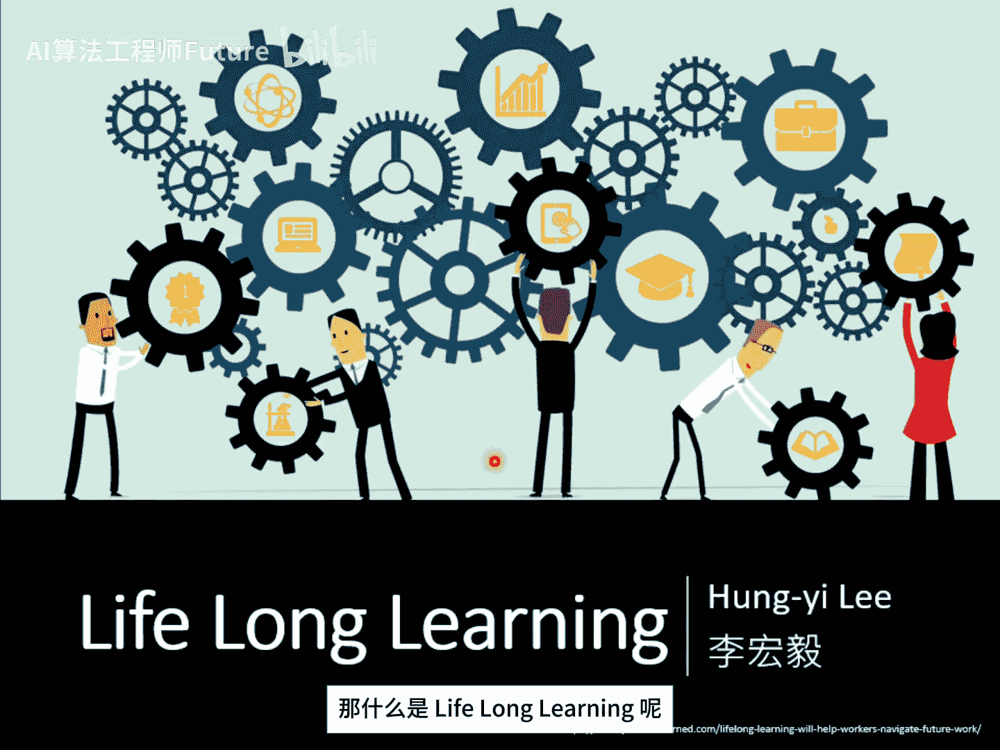

如果你google lifelong learning这个东西呀，你最有可能找到的不是跟machine learning相关的内容，Lifelong learning，从它字面上的翻译。

你可以知道lion learning指的就是终身学习，也就是活到老学到老，所以如果你用lione learning做关键字去google的话。

你通常找到的都是有关人类的live phone learning，人类怎么活到老学到老，但虽然今天大家关注的主题比较偏向人类，怎么做live phone learning。

但是其实机器也需要做live phone learning。

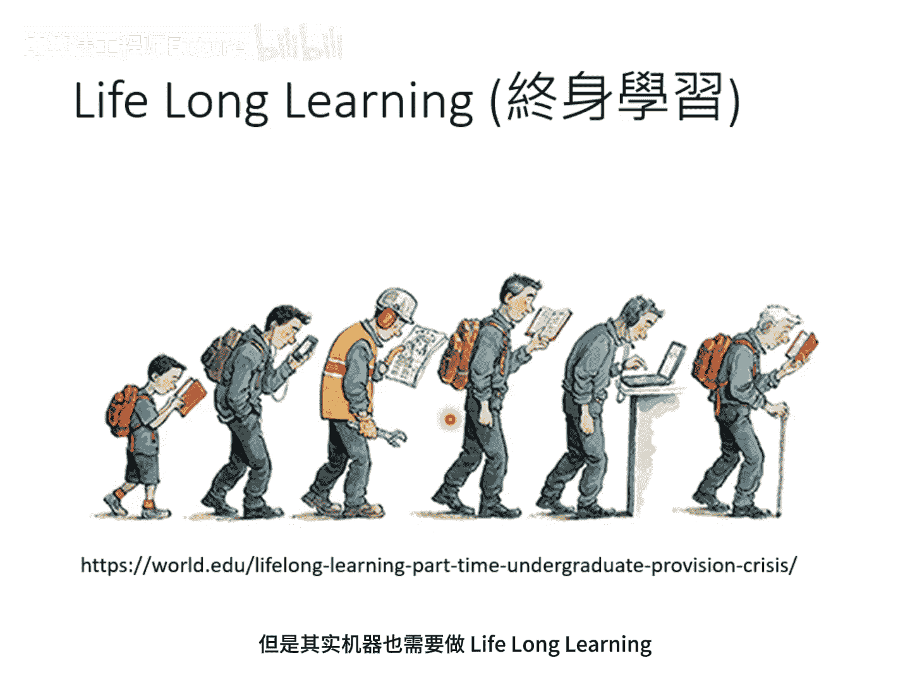

机器可以做iphone learning，这件事情呢非常接近人类对AI的想象，你知道在还没有修这门课之前，在还没有接触任何machine learning的内容之前，也许你对AI的想象是这个样子的哦。

我们先教机器做某一件事情，比如说学会做语音辨识啊，那他就会做语音辨识了，接下来你再教他第二个任务，教他做影像辨识，他就会做影像辨识了，接下来你再教他做第三个任务，也许是翻译啊。

他就会做影像辨识加语音辨识加翻译了，你不断教他新的技能，等他学会上百万上千万个技能以后，他就变成天网，然后就可以统治人类，我们一般人对AI的想象是，AI可以不断的学习新的任务，最终越来越厉害。

直到人类不能企及的程度，那这个构想这个目标就是lifelong learning，那lifelong learning呢常常缩写成三个LLLL啊，triple l不是LOL是LLL。

那live one learning呢也有很多其他很潮的名字，比如说有的人叫他continuous的continuous learning，有人叫它never ending learning。

听起来都很潮，但有个比较不潮的名字是incremental learning好，但是你可能会想说，live on learning这个目标太过远大，我今天又没有要做天网。

那lifelong learning对我有什么意义呢，在真实的application里面。

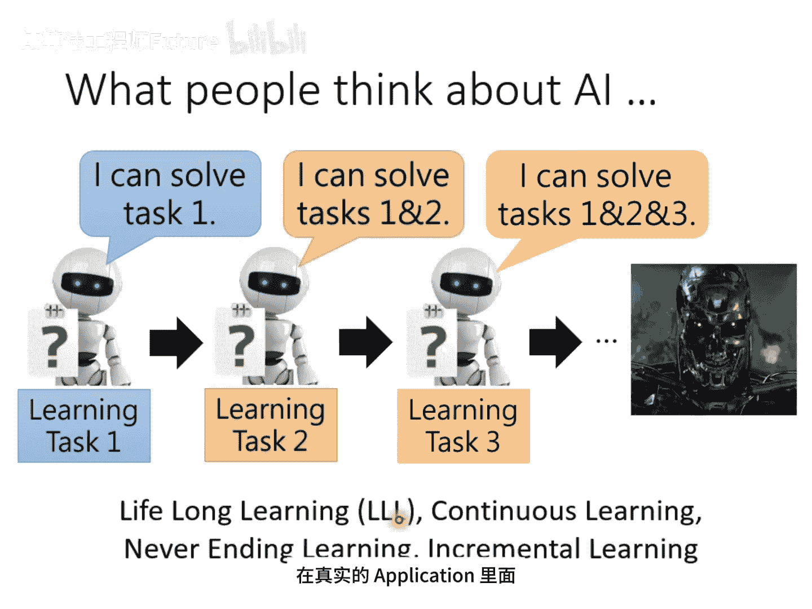

live phone learning也是派得上用场的，举例来说啊，今天你在实验室里面开发出某一个模型啊，你在实验室里面搜集一些资料，把这些资料呢进行训练，训练出一个模型，模型上线以后。

他会取得来自使用者的feedback，这时候我们都希望收集资料，这件事情可以变成一个循环，我们模型上线以后收集到新的资料，新的资料就可以让我们来更新我们模型的参数。

模型的参数更新以后又可以收集更多的资料，收集更多的资料，模型参数又可以再次更新，不断更新模型的参数，最终我们的系统就会越来越厉害，那你可以把旧有的资料想成是过去的任务，把新的资料来自于使用者。

feedback的资料想成是新的任务，所以这样子的情境也可以看作是lion learning的问题，机器不断的在线上搜集资料，用线上搜集的资料来更新模型。

这本质上就是一个lifelong learning的问题，那live one learning有什么样的难点呢，我们不就是让机器不断的看新的资料，不断的去update它的参数。

就做到live phone learning了吗，那为什么live phone learning会是一个值得研究的问题呢，那以下举一个简单的例子告诉你说。

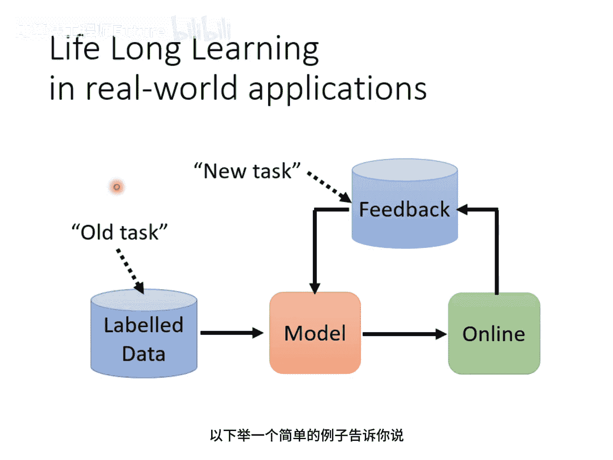

live one learning的难点出在什么样的地方，假设呢，我们现在有两个任务，那第一个任务是要做手写数字辨识，那给他一张非常noisy的image，及其要判断说哦。

这里面是图片里任务二也是手写数字辨识，那只是现在是比较简单的任务，你的图片里面是没有任何杂讯的，我们要让机器学会这两个任务，那讲到这边，有人可能会说啊，老师这不算是两个任务了。

这个算是同一个任务不同的抖man，你要这样想也没问题，你也可以想成是同一个任务不同的抖man，但其实啊在这个呃，我知道说，当我说我们要让机器学一连串的任务的时候。

在你心里的想象也许是哎机器先学个语音辨识，再学个影像辨识，再学个翻译，但其实今天lifelong learning都还没有做到那个程度，一般在lifelong learning的文献上。

所谓的不同任务指的差不多，就是我这边这种等级啊，通常比较像是不同的抖man，而不是不同的任务，只是我们在这边，我们把它当做不同的任务来看待，但就算是呃非常类似的任务。

你在做lion learning的时候也会有以下的问题，等下就是来看看有什么样的问题好，那我这边我就训练一个非常简单的network，它只有三层，每层50个neural，先在任务一上学一下。

在任务一上学完以后，我们得到的结果是这个样子的，任务一正确率90percent，就算还没有看过任务二，任务二也已经得到96percent的正确率了啊，这个transfer的结果非常的好。

能够解任务一其实就能够解任务二了，好的任务一学完之后，我们再让同一个模型继续去学任务二，所谓同一个模型继续去学任务二，的意思就是我们在学任务二的时候并不上，并不是让机器从头学起。

并不是让机器从一组random，initialize的参数学起，而是用任务一的资料更新完模型之后，同一个模型，接下来继续用任务二的资料来更新好，所以听清楚哦，是同一个模型，继续用任务二的资料来更新好。

那所以同一个已经学了，学完任务一的模型，在学任务二会发生什么事呢，这是我们得到的结果，任务二正确率变变更高了，因为之前根本没看过任务二的资料，就有96percent了，看过任务二的资料，当然更厉害。

变成97percent，但糟糕的事情是，机器忘了怎么做任务一了，它本来任务一有90percent的正确率，在他学会任务二以后，任务一变成只有80percent的正确率，他忘记了他过去已经学到的技能。

那有人看到这边可能会觉得说，哎老师这有什么好奇怪的呢，你这个network就是一个小小的network啊，那你叫他学任务二嘛，那任务一是之前学的嘛，啊那当然就呃呃他的能力有限呐，他脑脑容量有限啊。

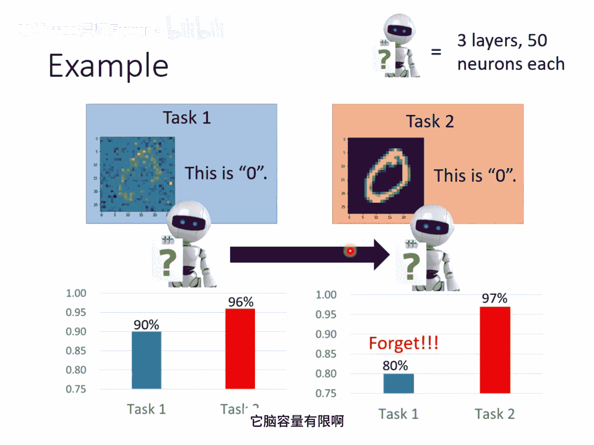

学完任务二以后当然就忘了任务一嘛，但是我接下来告诉你另外一个实验，假设我们把任务一跟任务二的资料，直接倒在一起，会发生什么事呢，假设我们把任务一和任务二的资料倒在一起，同时去训练这一个network。

我们得到的结果是这样子的，任务一可以得到89percent的正确率，任务二可以得到98percent的正确率，也就是对这个network而言，要同时学好任务一和任务二，它是办得到的。

虽然它每一层只有50个neural，但50个neural已经足以让他同时在任务一上，任务二上得到这样子的正确率，但不知道为什么，如果不是同时学任务一，任务二，而是先学任务一再学任务二的话。

他在学任务二的时候，就会忘记任务一学过的东西了，他有足够的能力把两个任务都学好，但是当你让他一去学习的时候，他没办法记住旧的任务，好那我看看有没有同学有问题要问的，诶有同学问说老师是在家里开直播吗。

答案是是我在家里开直播好，好那我们就继续，我刚才举的例子呢是影像辨识的例子。

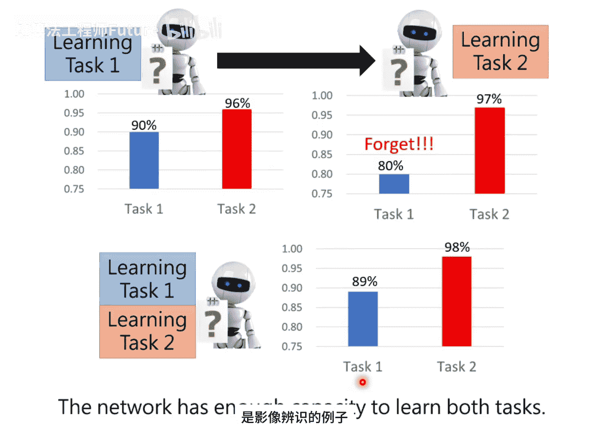

那我接下来再举一个这个自然语言处理的例子，告诉你说刚才看到的那个状况，它不是一个特例，它是一个非常一般非常常见的现象，这边要举的例子啊是q a question answering，也就是我们的作业期。

在作业期里面，你知道你可以让机器读一篇文章，问他一个问题，然后他可以回答你的问题，那我们在这边用的啊并不是作业期的资料，而是更简单的QA的任务啊，这个QA的任务呢叫做BABI哦，通常就念成baby。

那baby是一个非常早的QA的任务啊，在呃在人们刚开始研究QA，在人类刚开始想要用这个deep learning技术解QA，的问题之前的时候，一开始人们觉得QA的问题太难了。

我们要用neural network，用deep learning技术解它，感觉非常的困难哦，所以FACEBOOK呢就先定义了20个简单的QA的任务，他们叫做baby。

那这些QA的任务啊不是真实的QA的任务，你如果打开你的作业期的资料，跟baby的资料进行比较的话，你会发现你作业期的资料是远比baby难得多的，baby里面的文章都是用某种规则生成的。

用某种template固定的句型生成的问题，也是用固定的句型生成的哦，所以baby是一个非常简单的任务，它里面看起来就像这样哦，就啊MARY把蛋糕给了fed哦，fed把蛋糕给了bill。

然后bill把牛奶给了JEFF，然后问你说啊，谁把蛋糕给了fat啊，答案是MARY就这么简单，或者是第15个任务里面是呃呃羊会怕狼，猫会怕狗，然后老鼠会怕猫，然后呢呃girl true，他是一个羊。

那他怕什么啊，怕狼就这样，所以都是这么简单的讲这么简单的问题，那今天你一定会觉得说，这个问题对network来说不是问题，作业期都学得起来，这么简单的问题，没有学不起来的道理，不过在当年呐。

呃能够让机器学会这么简单的问题，人们已经觉得非常震惊了，好，那接下来我们要做的事情是，让机器依序学过这20个QA的任务，那一般baby的使用方法是，把20个任务统统倒在一起，让机器一次学20个任务。

或者是20个任务就剩20个模型，那20个模型各自有不同的技能，但我这边想要做的事情是，把20个任务一字排开，让机器从第一个任务学起，学到第20个任务，那看看他能不能够把20个任务都学会好。

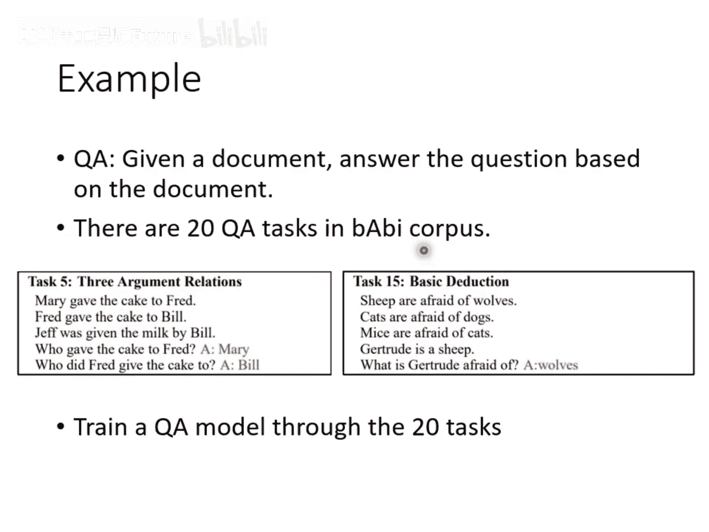

那这边的结果是这个样子，我们这边呢只看任务五的正确率好，所以这个纵轴呢是任务五的正确率，横轴呢是依序学20个任务的过程好，那呃任务五呢就是这么简单，就是我们刚才看过的那个蛋糕的例子好，先让机器学任务一。

再学任务二，再学任务三，再学任务四，把这四个任务依序学完，你发现说诶任务五都是正确率都是零哦，把任务1~4都学完，任务五正确率都是零，这件事没什么好惊讶的，因为他还没学到任务五啊。

所以他当然不知道要怎么解任务五的问题呀，不教而杀谓之虐嘛，所以他不会解任务五的问题，得到正确率0percent，不不能怪你的model好，接下来学完任务五以后会发生什么事呢，学完任务五以后。

正确率直接爆冲变成100percent，因为看过任务五的训练资料了吗，机器知道怎么解任务五，所以任务五正确率变100percent，但是当我们继续学剩下的任务的时候，会发生什么事呢。

你发现正确率一阵暴跌，当机器学完任务六之后，任务五的正确率就变0percent了，学完任务七再去测试，任务五就变0percent了，机器只要一学新的任务，旧的任务马上就忘得精光，那你可能会以为说。

会不会是因为机器就是没有能力，多学好几个任务呢，其实不是的，刚才在左边这个图是任务五的正确率，让机器依序学热20个任务，如果我们把20个任务的资料通通倒在一起，让机器同时学20个任务的话。

会发生什么事呢，右边这张图是机器同时学20个任务的结果，那这边的纵轴啊并不是某一个任务的正确率，而是这个对应到一的这个正确率，对应到一这个坐标的正确率，就代表第一个任务的正确率，第二个任务的正确率。

第三个任务的正确率，一直到第20个任务的正确率，以此类推，你发现让机器同时学20个任务的时候，当有些任务很难，比如任务19机器学不会，但是机器是可以同时学会多个任务的。

有好几个任务机器都可以得到非常高的正确率，但是这是同时学的状况，但你让机器依序学的时候，他就是学了新的东西，就忘了旧的东西，而右边这个实验告诉我们说，机器明明有能力学多个任务。

但是你让他一去学一个一个任务的时候，他就是不肯把多个任务都学会，所以他明明可以精通多个任务，却不肯做到，他是不是做不到，他是誓不为，也非不能也，所以你会发现说当机器依续学多个任务的时候。

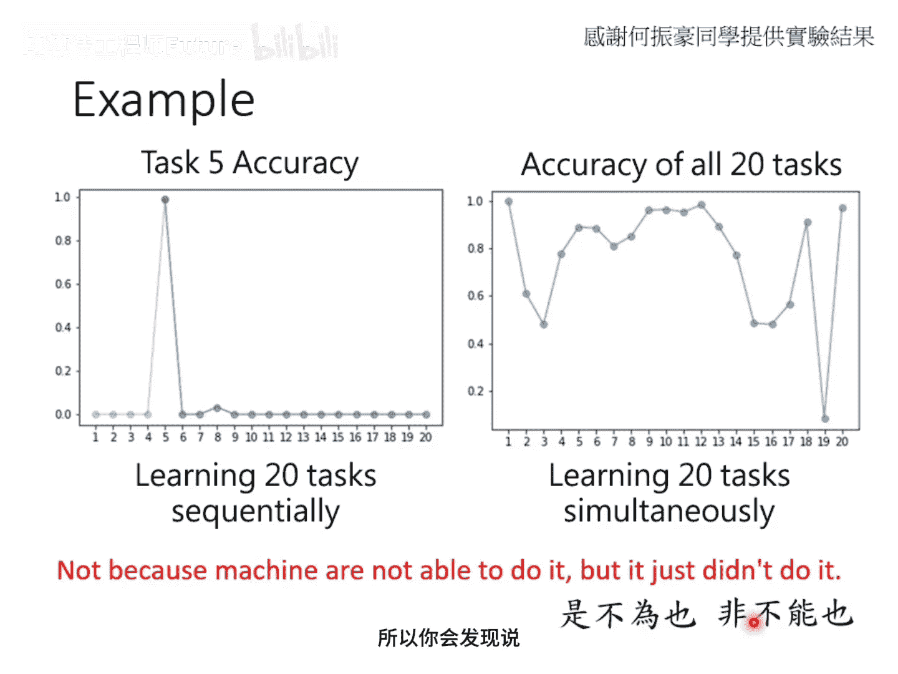

他就好像是一个脑袋有洞的人啊，他就像左边这个人一样，新的任务进来，旧的东西就掉出去了，他永远学不会多个技能，而这个状况叫做catastrophic forgetting。

在forgetting前面呢特别加上CATROPHIC这个形容词，因为forgetting遗忘可能呃人类也会遗忘啊，所以机器会遗忘也许不是什么特别惊人的事，但是机器遗忘的程度也未免太过分了。

基本上他根本就学不会新的技能，所以这种遗忘前面加上了一个形容词，叫CATROPHIC，灾难性的告诉我们说这个遗忘不是一般的遗忘。

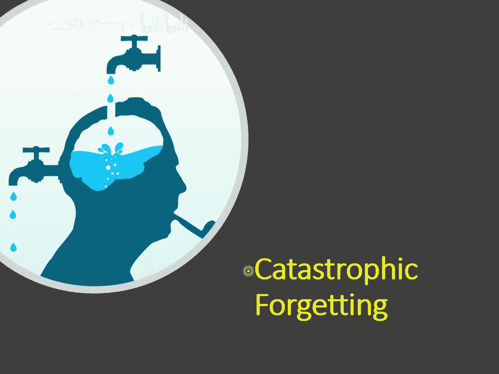

它是灾难性的遗忘，好讲到这边啦，我们等一下就会继续来看，说怎么解灾难性遗忘的问题，怎么让机器有办法依序学习多个任务，但在我们继续讨论技术之前，也许你会有一个问题，也许你会问说等一下呃。

刚才我们不是看到说，只要把多个任务的资料统统倒在一起，机器就可以学多个任务了吗，把多个任务的资料倒在一起，同时学这个叫做MORTTASK的training。

茅台task training就可以让机器学会多个任务啦，那这个liphone learning的问题有什么好研究的，但是你想想看哦，假设现在我们要让机器学第1000个任务。

你要让机器避免遗忘前面999个任务，你必须要把前面999个任务的资料，通通都拿出来，然后呢把它跟第1000个任务倒在一起，把这1000个任务所有的资料统统倒在一起，一起做训练。

机器才能同时学会同时具有999个呃，九，同时同时具有这1000个任务，我们要他学的技能，但是在实务上，这可能会是有问题的，因为如果我们要让机器学第1000个技能，需要前面999个任务的资料。

那意味着机器需要把他一辈子看过的资料，通通都背在身上，他必须要把一辈子看过的资料通通都存下来，你可能根本没有那么大的空间，可以储存所有的资料，而另外一方面呢，computation也是一个问题。

如果我们今天需要把1000个任务的资料，统统倒在一起才能进行训练，那这个训练的时间可能太长了，1000个任务的资料全部倒在一起，可能太多了，那你训练的时间可能会太长，那你就没有办法让机器学习多个任务。

所以假设今天机器一定要做morti task learning，才能够学习多个任务的话，那就好像是说有一个人，假设我们要叫他上一门新的课，他必须要把他这辈子所有学过的课，所读过的教材通通都再读一遍。

他才有办法学习新的任务，那这样显然非常有没有效率嘛，而且随着你要学的任务越来越多，你训练的时间就会越来越长，你需要储存的资料也会越来越多哦，所以morti task training。

虽然可以让机器学习多个任务，但是它不是解决liphone learning最终的solution，那在文献上啊，通常会把morttask training。

看作是liong learning的upper bb，就是如果我们把所有的资料统统倒在一起，虽然当任务多的时候，这是一个不切实际的做法，但是它可以让机器学会多个任务，所以把所有的任务倒在一起。

一次做训练，mottest learning往往视为是liong learning的，upper bb是liphone learning没有办法超越的结果。

那所以你在做live one learning研究的时候，你往往会比如说先跑个mottest training的结果，告诉我们说upper bb在哪里。

然后再看看你的iphone learning的技术，能不能够逼近这个upper bound的结果，好我们来看一下我们同学有问题，好有同学说呢，呃mottest learning等于是让机器做复习。

performance当然比较好对对，我们现在要问的就是在不准复习的前提之下，可不可以不要忘记之前看过的东西，不要每次学新的东西，都一定要复习旧的东西是好。

有同学问说会有这种catrophic forgetting的现象，是因为它的loss是根据多个task做调整的吗，可以说是，等一下我们其实会解释catrophic forgetting的现象。

是怎么来的，好有同学说分别学在做ensemble，等下我会告诉你说分下一页头，有没有告诉你说分别学会有什么样的问题，好有同学说，如果是接着学把旧的parameter改成不好的方向。

却没有用原本的loss把它校正回来，是这样吗，哎对对没错，等一下我们就会解释catrophy forgetting，为什么会发生，但跟呃呃这位同学他名字是日文的啊，讲的是蛮类似的，好我们就继续吧。

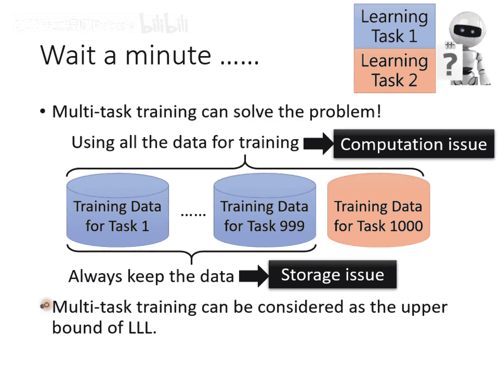

好下一页投影片就是诶，那那我们怎么布，每一个任务就学一个模型就好了呢，干嘛要那么执着于来phone learning的问题呢，为什么一定要让一个模型学多个任务呢，为什么不一个任务诶。

一个一个任务学一个模型就好了呢，如果我们只让让每一个任务都分开学一个模型，确实就没有catrophy for getting的问题，但是我们会遇到的第一个问题是，假设我们要教机器学的技能非常非常的多。

我们要学的天网，天网总是要会上亿个技能吧，我们总不能每个技能都有一个模型吧，这样子你可能没有办法把所有的模型储存下来，另外一方面呢，如果我们是不同的任务，就用不同的模型，不同任务的资料间就不能够互通。

有无他没有办法从其他的任务里面汲取，单一的任务所没有办法学到的资讯，而且你想想看呃，对人类来说，我们只有一个脑，但这个脑却可以学会多种不同的任务，不断学会新的技能，我们并不需要每一个任务都用一个呃。

独立的脑来储存，但是为什么机器不能够做到一样的事情呢，这个就是lion learning想要探讨的问题，能不能一个模型学多个任务啊。

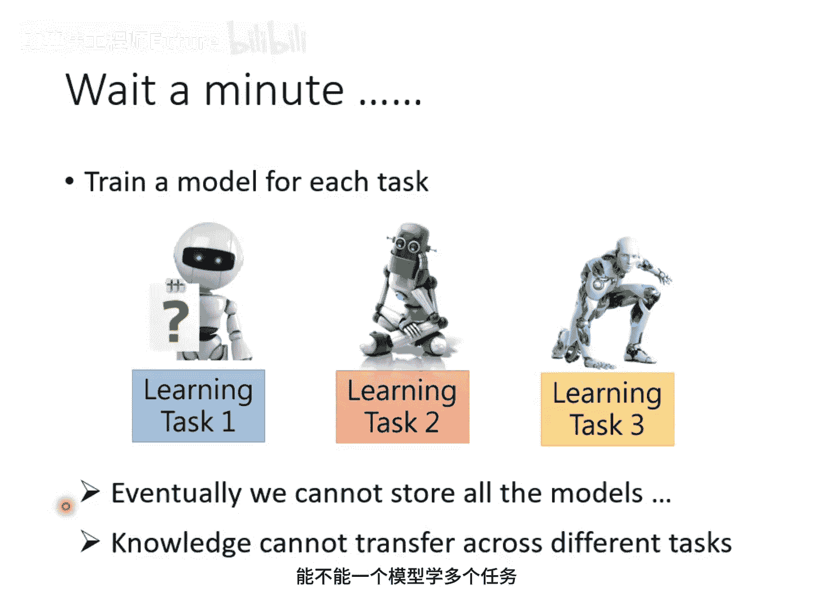

那讲到这边，有的同学可能会说，这个听起来跟transfer learning挺像的哦，transfer learning就是让机器在任务一上学习，希望任务一上学到的技能。

可以transfer到任务二上面去，但是lion learning跟transfer learning，虽然他们都是叫机器学多个任务，但他们的关注点是不一样的，在transfer learning里面。

我们在意的事情是，机器在第一个任务上面学到的技能，能不能够对第二个任务有帮助，所以我们只在意在第二个任务上，机器做得好不好，但life one learning的关注点是不一样的。

live one learning的关注点是，当机器学完第二个任务的时候，回过头去再看第一个任务，他到底还能不能够解第一个任务哦。

所以虽然live on learning跟transfer learning都会involve，两个任务都要考虑两个任务，但transfer learning在意的是新的任务做的怎么样。

而lion one learning他是在意旧的那个任务做的怎么样。

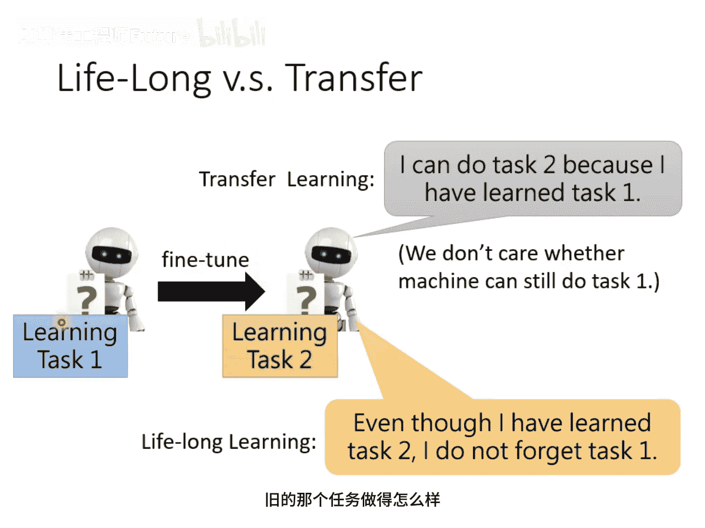

好那在讲lion one learning的技术之前呢，我们来讲一下怎么评估一个live phone learning的技术，做得好不好，当然要做lifelong learning之前。

你得先有一把任务，让机器可以依序做学习，但是其实今天呐，如果你看那些lifelong learning的文献的话，所谓这个一把任务往往都是呃，比较简单的一些任务。

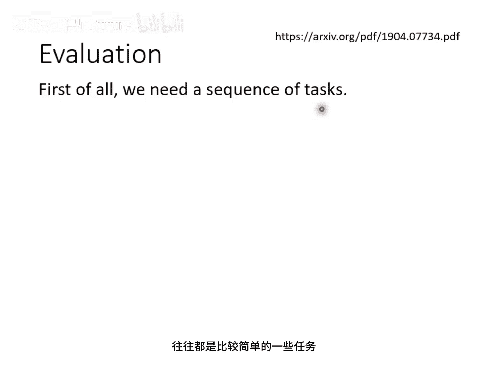

一个常见的setting是这个样子啊，你的任务一是做手写数字辨识任务。

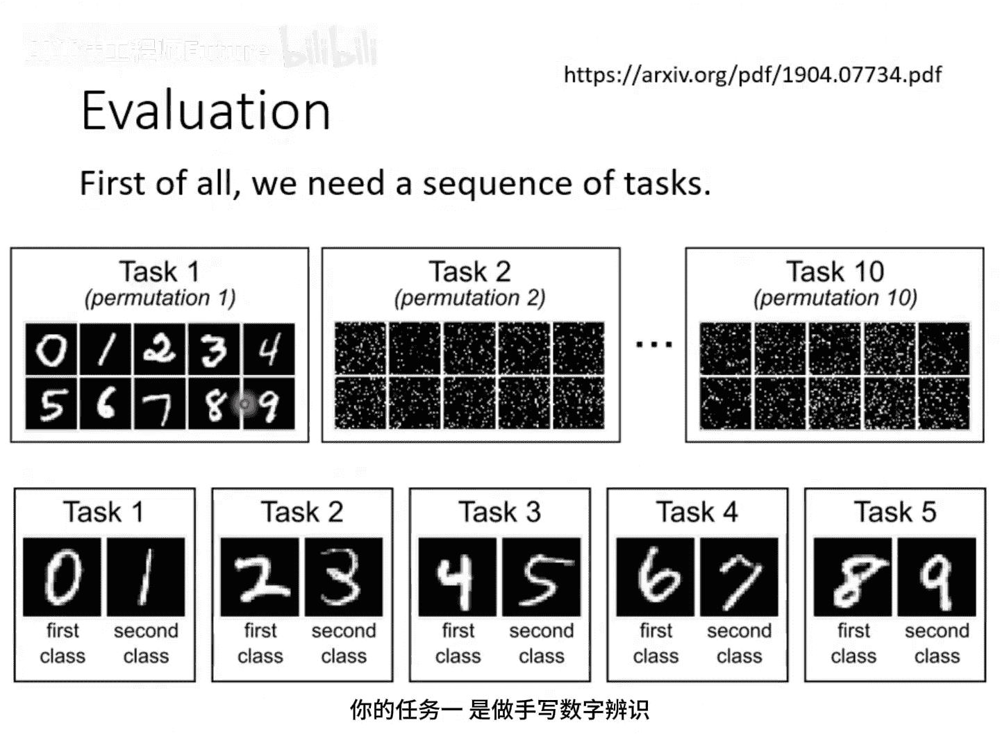

二其实还是手写数字辨识，但是这些点点这些看起来像是星，这些看起来像是呃星星的图到底是在做什么呢，这些是我们把每一个数字用某一种特殊的。

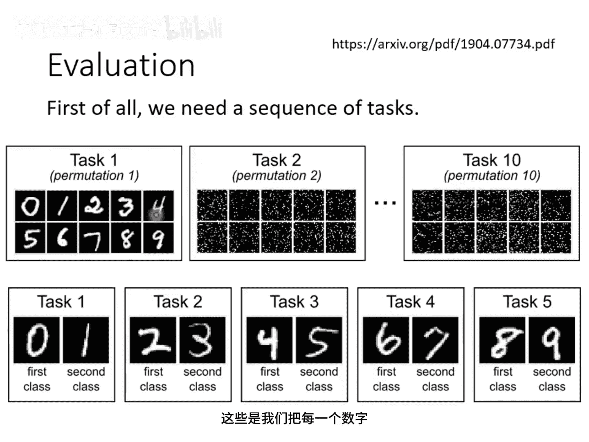

用某一种固定的规则把它打乱。

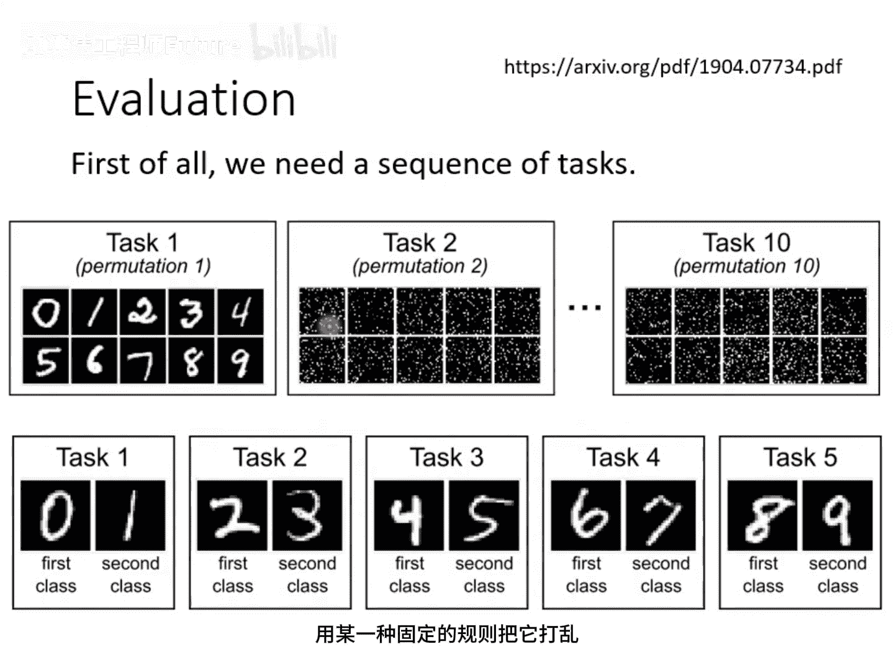

那每一个任务就是把数字做不同的打乱，就成为不同的任务，那permutation呢还算是比较难的，还有看过更简单的是，把所有的数字转往右转15度算是新的任务啊。

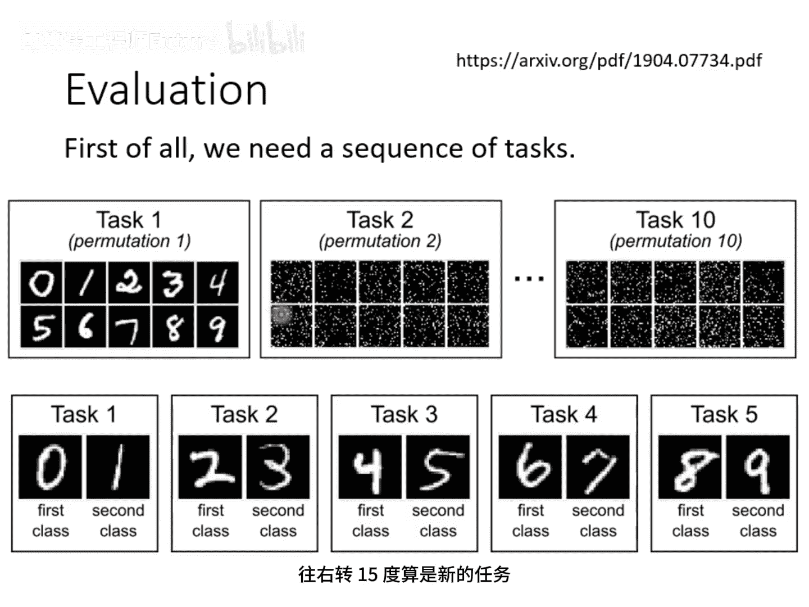

往左转15度也算是新的任务，那所以每个任务都还是数字。

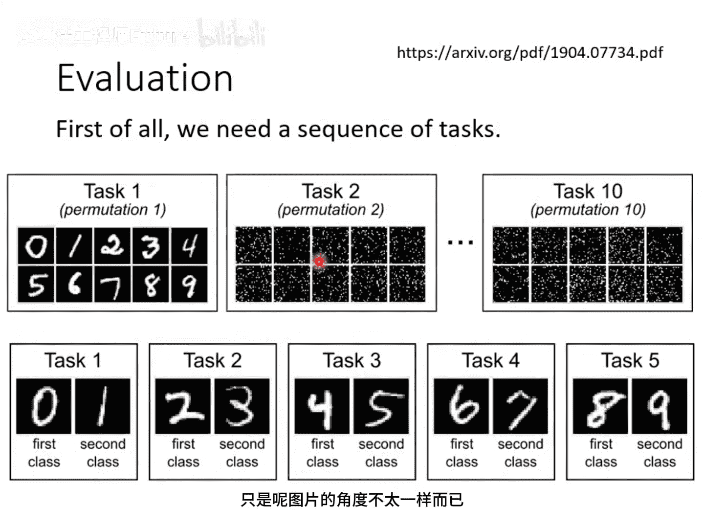

只是呢图片的角度不太一样而已，那这样你也可以来研究lifelong learning啊，或者是另外一种状况，是你的任务一是要让机器能分辨零跟一，任务二上让机器分辨二跟三，任务三上让机器分辨四跟五。

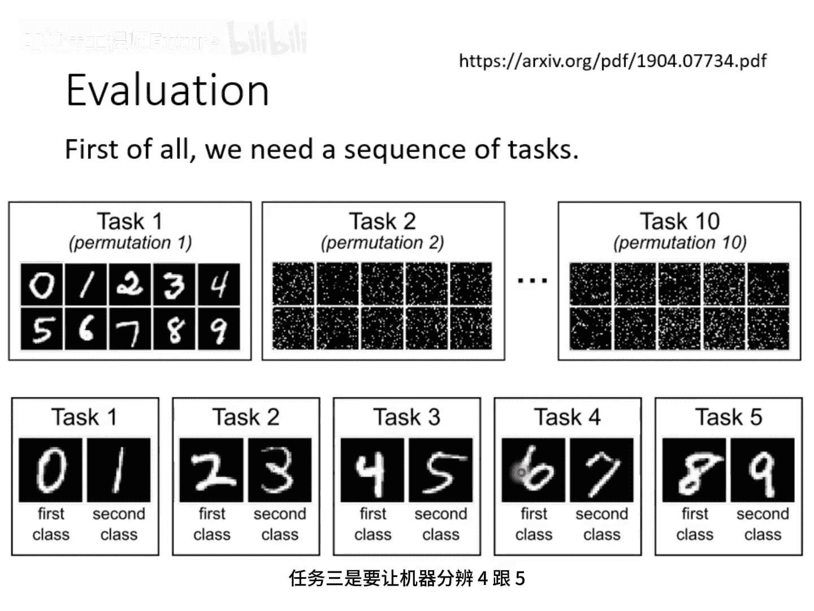

以此类推，但是对机器来说啊，零就是第一个class，一就是第一个class。

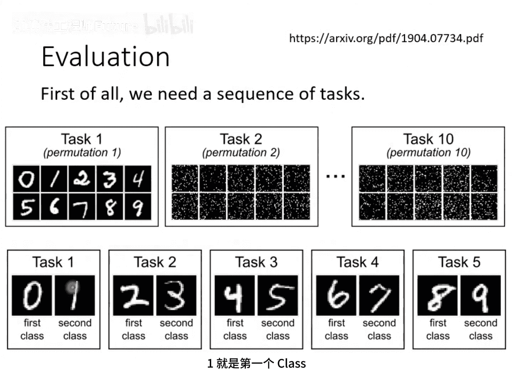

然后二就是第一个class，三就是第二个class，四就是第一个class，五就是第二个class，所以今天你给他一张五，他是第二，他是要判断五属于第二个class，判断三属于第二个class。

一属于第二个class，然后024属于第一个class，然后一序进行训练好，那这个lifelong learning这个作业是选择题啦，那助教也有提供一些城市，但是呃这些城市你能够跑过是最好。

但我们要的就不是城市的，结果是根据城市的内容问大家一些问题，那其中一个送分的问题就是会问你说哎，在助教城市里面，所谓的不同的任务是怎么样定义的，好好看到同学有一些问题，那我来回答一下。

有方法可以让NN加一些约束，让它和原本的参数不要差太多，让他记得旧的任务怎么做吗，哎太好了，其实就是这样解的，这次就是等一下lifelong learning的呃，其中一个最常用的解法算是被破梗了哈。

我们需要的是让机器只有一个使命，好，后面还可以打一个叉，好好那我们就继续吧，好那这边呢是有关任务sequence的定义，那再来要讲我们如果有一堆任务的话。

我们怎么评估一个lion learning的演算法。

做的好不好呢，啊你评估的方法是这个样子的好，你有一排任务，有一排任务，然后呢你先有一个随机初始化的参数，把这随机初始化的参数用在这大梯的任务上，得到大T个正确率。

你有这大梯个任务的testing set，把随机初始化参数用在这大T的任务上，得到大T的accuracy，大T个accuracy，然后接下来你让model先学第一个任务，学完第一个任务。

拿第一个任务的训练资料出来，学完第一个任务以后，在这七个任务上再去量一次正确率，然后学完第二个任务以后，再去这第一个任务上再量一次正确率，学到第体检一个任务以后，在这T1个任务上再学一次正确率。

学完最后一个任务以后，在这T个任务上再算一次正确率，你会得到这样一个表格，接下来呢你会用这个表格呢，来判断一个iphone learning的model做的怎么样，而在这个表格里面呢。

每一个数值指的就是某一个任务，它的测试资料的正确率，那这个表格里面的每一个数值呢，都有两个下标哦，I跟J第一个下标代表说呢，这个是训练完第I个任务以后的正确率，第二个下标指的是。

这是在第这一个任务上的正确率，比如说R21的意思，就是说现在呢你的model刚学完任务二，它在任务一的正确率上怎么样，R大T减一二的意思就是说呢，你的模型刚学完大T减一这个任务啊。

在任务二上表现的怎么样好，所以如果我们今天看的是I大于J的，那一些正确率的话，那意味着什么呢，A4比较后面的任务，J是比较前面的任务，也就我们要知道我们想要知道的事情是，今天让模型训练完任务I以后。

他在过去已经训练过的任务，J上到底表现的怎么样，他有没有忘记任务J过去学过的东西，如果今天我们看的是I小于J的那些R的话，那代表什么，代表是说我们刚学完任务I还没去学任务J，但机器会不会就无师自通。

已经会解任务J了呢，这边要看的是机器transfer的能力，在新的没有看过的任务上，transfer的能力怎么样好，那最常见的评估一个lifelong learning系统的方法。

就是把最后这个roll的正确率加起来就结束了，你就让你的模型依序学过所有的任务，到最后一个任务都学完以后，去之前所有的任务上面都算一遍，正确率。

平均起来就代表你的iphone learning的方法的好坏哦，当然这个值可能会是最高的，因为刚学完任务D大T那在任务大T上啊，当然表现最好，那在前面的任务，那你的模型就会逐渐忘记。

第一个任务可能就是忘记的很惨的，完全忘记了，可能正确率是趋近于零的，第二个任务可能稍微好一点，正确率12percent等等，那把这些所有的正确率平均起来。

就是评估一个iphone learning系统的好坏，常见的用法，那其实还有其他的评估方法，有一个擒过方法叫做backword transfer。

这个backword transfer呢是拿两个数值出来相减哦，他是拿RT减一去减掉R11，拿RT减二去减掉R22，以此类推，然后把所有的任务都加起来做平均。

那这个值呢就是backward的transfer，那这个RT one r11，我这边是拿RT one减R11，或者是rt2减R22，rt2减R22，他们到底是什么意思呢，他们的意思是说。

当你的模型先学完任务一的时候，在任务一上的正确率学到大T的任务完以后，在任务一上的正确率差多少，当学完任务一的时候，记忆犹新，这个时候正确率是最高的，那随着学的任务越来越多哦。

那你的正确率就会不断的递减，那到底会减少多少呢，所以我们把这两个R进行相减，可以评估说现在遗忘的程度有多严重，那因为呢机器每次看到新的任务以后，旧的任务就会不断遗忘，所以你可以想见说。

RT减一通常是比R11小的啦，RT减二通常是比R22小的啦，所以如果你是拿rt1减R11，rt2减R22的话，你通常得到的值是负的，所以backward transfer啊，通常算出来的值是负的。

是小于零的，如果你今天可以提出一个iphone learning的方法，他很厉害，它是它的backward transfer算出来是正的诶，那你就很厉害了。

因为通常byword transfer都是都是负的，如果你说机器学了新的任务以后，他还可以触类旁通，把原来的任务一做得更好，他学完新的任务以后，触类旁通，把原来任务二做的更好。

那你就你提出来live phone learning就很厉害了，一般live one learning做不到这件事，通常只要呃这个指标负的太严重，就已经很厉害了，好那还有一种评估方式啊。

叫做forward transfer，那forward transfer通常就比较不是live form learning的重点，forward transfer想要问的问题是说。

今天呐在看过一系列的任务，哎我这个有点卡顿，我也不知道为什么我这个滑索有点卡顿好，不过没关系，我现在看到同学有没有问题好，大家没有问题好，我们继续讲好。

今天这个forward transfer要问的问题是说呢，呃在还没有看过某个任务，只看过其他任务的时候，机器到底已经学到什么样的程度，所以你在做forward transfer的时候。

你就是拿RT减1T去减R0T，这个RT减ET去减R0T到底意思呢，他的意思是说，今天在还没有看到任务大T的时候，只看到任务T1到TT减一啊，只看到任务T1到T减一的时候。

你的模型到底可以学出什么样程度的结果，这个是forward transfer好。

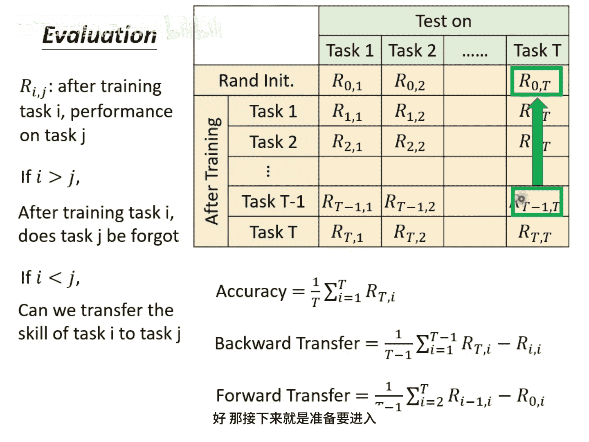