# 【官授搬运】2026年全新优化版李宏毅机器学习系统课程，这才是真正的初学者体系课程！—人工智能／深度学习／神经网络 - P89：2-機器終身學習 (Life Long Learning, LL) (二) - 災難性遺忘(Catastrophic Forgetting)的克服之道 - AI算法工程师Future - BV1ruqABeEFX

好那我们就继续讲吧，我们就继续讲吧，好，那我们接下来呢就是要讲三个iphone learning的可能解法，那第一个解法叫做selective的SIGNETIC啊，Plasticity。

那从字面上你可能一下子没有办法get到，说这个方法到底想要做什么。

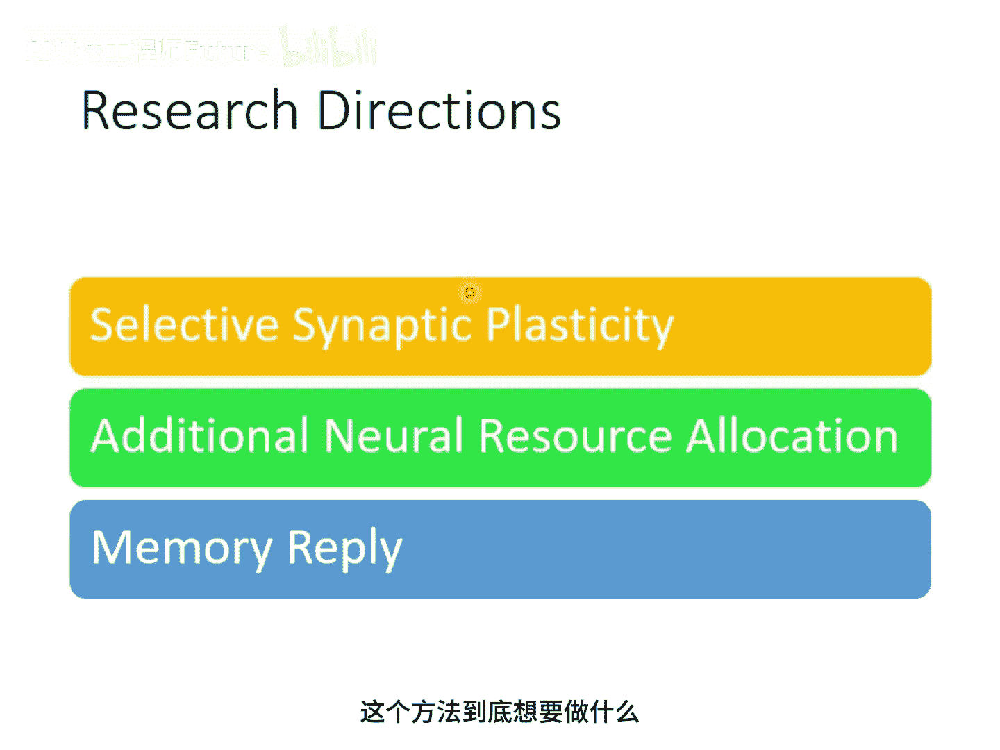

这个CINETIC是图触的意思，就是我们神脑神经中，这个神经跟神经之间的连结，哎这个叫做突触，plasticity呢是可塑性的意思，所以简单来说这个方法想要做的事情，就是我们只让我们的这个类神经网络中。

某一些神经元或某一些神经元间的连接，具有可塑性，而selected的意思就是说，只有部分的连接是有可塑性的，有一些连接必须被固化，它必须不能够在移动，不能够再改变它的数值。

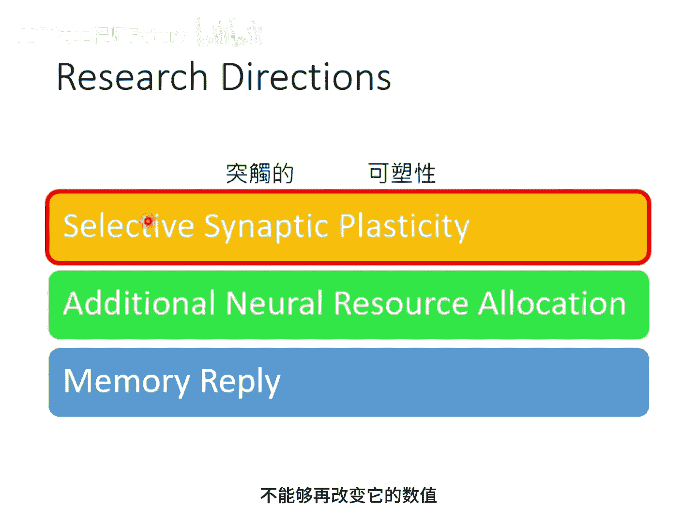

好，那像这样的方法又叫做regalization base的方法，那这个这个面相啊，这个研究的面相在live phone learning的领域里面，我觉得是发展的最完整的。

所以等一下我们会花比较多的时间来讲，Selective synaptic plasticity，那另外两个面向呢，我们都只用一两页投影片很快的带过。

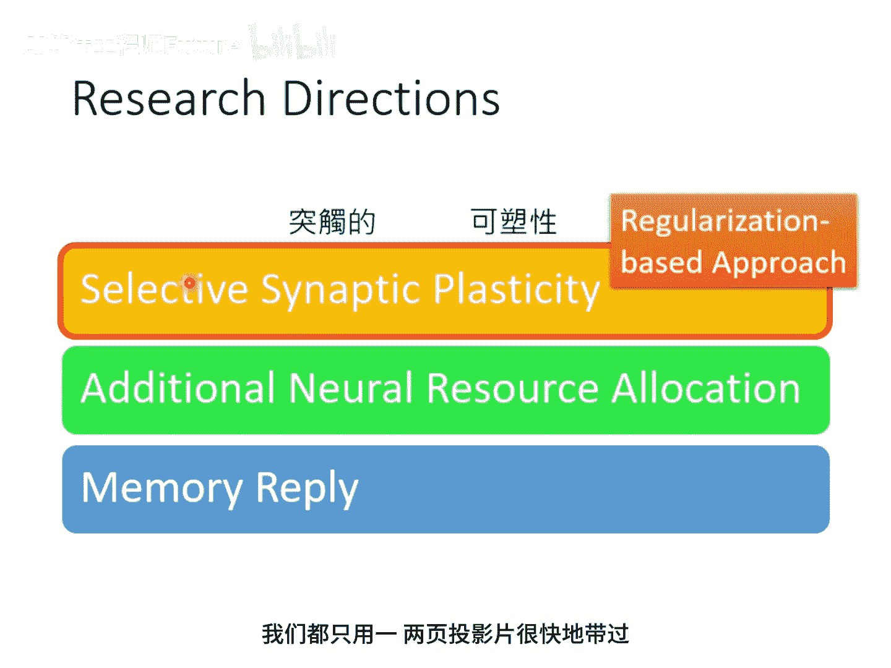

那你会发现作业里面主要的问题也都集中在，跟regalization base有关的方法上面，好，那我们先来想一下，为什么catrophy for getting这件事情会发生呢。

我们假设有任务一跟任务二这两个任务，而这两个任务呢，我们假设我们的模型只有两个参数，sa one跟sa two，那当然一个模型通常有上上百万，上亿个参数了不，我们假设只有两个参数好，那这个投影片上。

这这两张图代表的是任务一跟任务二的，loss function啊，也就是在任务一上面，如果你的赛达one跟c ta q设不一样的值，你就会有不一样的loss，那我们用颜色来代表loss的大小。

如果原颜色越偏蓝色就代表loss越大，颜色越偏白色代表啊，我说错了，不好意思，我刚才说反颜色越偏蓝色代表loss越小，颜色越偏白色代表loss越大好，所以左右两张图分别就是任务一和任务二的。

Loss function，也就是他们的error surface好，你要有一个随机初始化的参数，我们这边叫它SA0，然后我们会用gradient，descent的方法去调整C大零的参数。

那那你就按照gradient的方向呢，去update seta0的参数，得到SAB好，那假设update够多次数，你觉得loss降的够低了好，那你就等于是把任务一学完了好，那假设任务一学完后。

我们得到的参数是CAB，接下来我们得继续解任务二啊，你就把C大B同样的参数拷贝过来，拷贝到任务二的这个error surface上面啊，注意一下，虽然左右两边error surface是不一样的。

但是set a b我们这边指的是同一组参数好，set up b是用任务一训练出来的参数，我们现在把它用在任务二上，我们现在把setup b放在任务二上，继续去做训练，那在任务二上啊。

我们有另外一个不一样的error surface，根据这个任务二的error surface去再update参数，那我们可能会把set up b往右上角移，那得到sea star。

sea star是训练完任务一，接下来又训练完任务二，依序训练两个任务以后所得到的参数，现在用set up star来代表，依序训练完两个任务以后所得到的参数。

这个sea star他在任务二上是在一个error surface比较低，这是在一个这个loss比较低的位置，所以他在任务二上会得到好的表现，但如果你回头再把set up star。

拿回到任务一上去做使用，你会发现你并没有办法得到好的结果，而因为set up star只是在任务二上好，它在任务一上不见得会有D的loss，那这个就是forget这件事情产生的原因。

那要怎么解决forget这个问题呢，对于一个任务而言，也许有很多不同的地方，也许有很多组不同的参数，都可以给某一个任务D的loss，对任务二而言，也许在这一个蓝色椭圆形的范围内，结果都算是够好的。

也许在这个蓝色椭圆形椭圆形范围内，loss都算是够低的，如果我们set大B移动的方向不要往右上移，而是只往左边移，那会不会把新的参数放到任务一上，就不会有forget的情形呢。

那这个就是我们等一下要跟大家分享的做法。

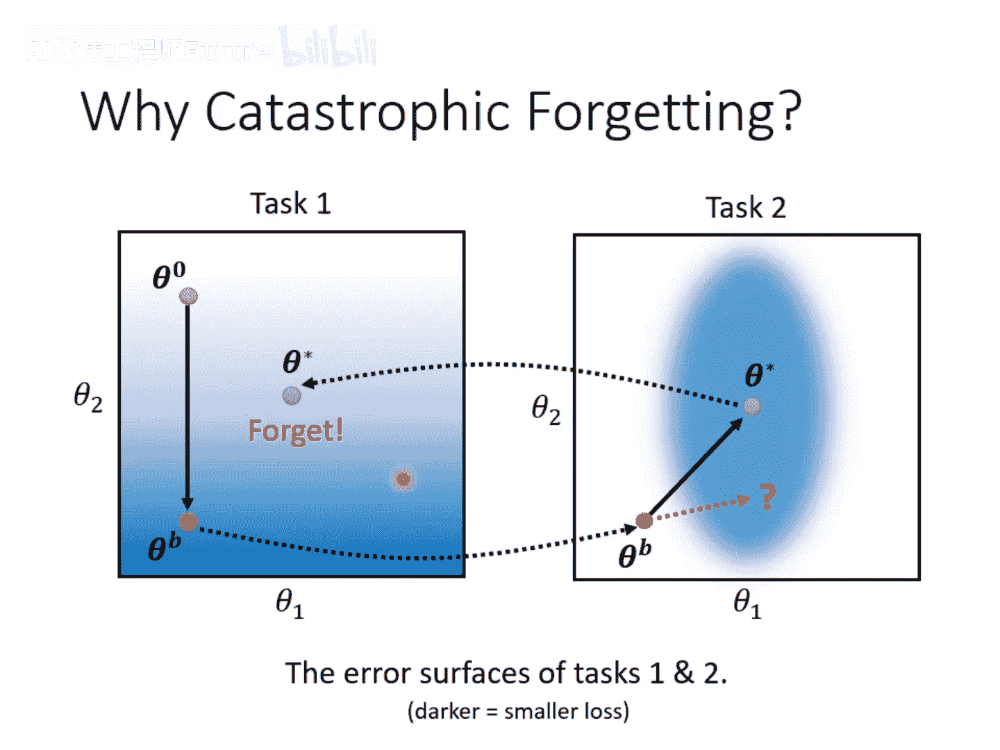

好那怎么做呢，所以这边的基本的想法是说呃，每一个参数对我们过去学过的任务，它的重要性是不一样的，有一些参数也许对我们过去看过的任务，特别重要，我们就希望在学新的参数的时候，那些旧的参数。

那些重要的参数它的值尽量不要变新的任务，只去改那些对过去的任务不重要的参数就好好，我们现在假设，CAB是在前一个任务所学出来的额参数，所以SAB在前一个任务上是好的。

那我们会让SAB在第二个任务上继续做学习，那在这个selective connected plasticity这样的做法里面呢，我们会给每一个参数一个保镖，一个首位，我们这边用BI来表示那个首位。

对每一个参数set i我们都有一个首位bi，这边所谓的每一个参数，就是neural里面的每一个wake跟他的bias啊，如果你的network有呃100万个参数的话啊，那就有100万个BI的值。

那它们每一个参数的BI都是不一样的啊，每一个参数都有一个各自的首位，这个首位代表什么，这个首位代表说这个参数对过去的任务而言，到底重不重要好，所以我们今天呢在新的任务上。

我们在update我们的参数的时候，我们会改写loss function，原来的loss function假设写成eloof sea，但我们不会直接去minimize l of sea。

如果我们直接minimize l of setup，就会发生catrophy for getting的情形，就会发生灾难性的遗忘哦，所以我们要做的事情呢是更改我们的loss function。

我们有一个新的loss function叫做LP，这LP才是我们真正要去minimize的对象，那这个L派呢是原来的loss l，后面再多加了一项，这一项是什么东西呀。

这一项是我们先submention over，这边有个some mention好，这边有个submention over，所有的i some mention over所有的参数。

那我们把我们要learn的那个参数，那个SETI代表我们要optimize，我们unknown的那个参数，要找出来的那个参数去减掉，从过去的任务认出来的参数，set up b哦，Set a bi。

set a上标B下标I是set a b，就是过去的任务认出来的那个模型，下标I就是第I个参数好，那我们要让SAI跟SA上标B下标I越接近越好，所以我们呢把SAI跟theta上标B下标I相减。

然后取它们的平方，那我们在前面呢会乘上一个数值叫做bi，这个bi就是要告诉我们，说到底我们有多强烈的希望，C大I跟sea上标B下标I越靠近越好，如果bi的值很大。

就代表说我们希望CDAI跟C达bi非常靠近，如果bi的值很小，代表我们觉得SETI没有跟set up bi很靠近。

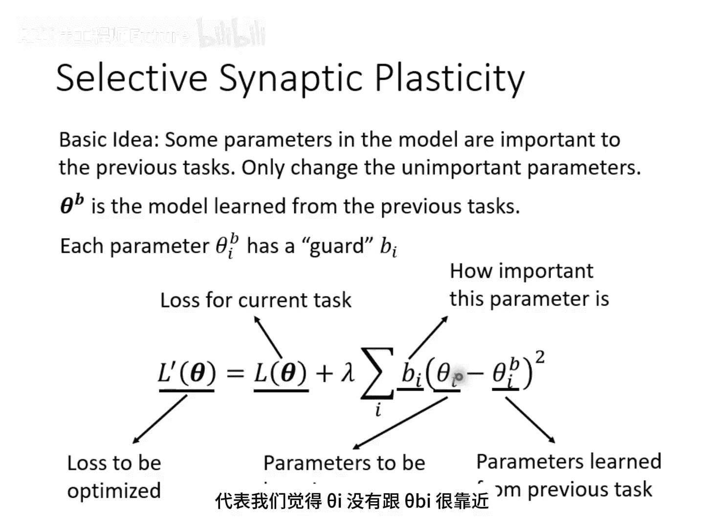

也无所谓好，那这个呢就是我们要optimize，真，这个L派呢就是我们真正要optimize的对象啊，它里面有两项，一个是原来的新的任务的loss，另外一项呢就是要让SAI跟sa bi越接近越好。

但是要注意一下，我们并不是呃平等的去看待所有的参数，要不要接近这件事，我们其实只要求theta跟sa bi，在某些参数上接近就好，并不需要所有参数都接近，只要某些参数接近就好。

那哪些参数要接近就由bi来控制，如果某一个参数I第I个参数它的bi很大，就代表我们希望第I个参数它跟旧的参数，之前的任务认出来的那个参数要非常接近，反之bi等于零，就代表我们根本不care。

新的参数跟旧的参数到底要不要接近好，所以如果今天呢bi设为零，所有的参数，它的I所有的参数，它的bi我们都设为零，那意味着什么，那意味着就是我们没有给我们的sea i任何限制。

我们完全没有要求新的认出来的参数，跟过去学出来的参数有什么样的关系，那这个时候就是一般的training，就会有catrophy forgetting的问题，但是你可能会想说，既然bi设零是不好的。

那我们就把bi给它设一个非常大的值，所有的I所有的参数都给他一个非常大的bi，那这样就不会有forgetting的问题，但是你会进入另外一个极端，这个极端叫做INTRINSIENT这个极端。

这INTRINSIENT的意思就是这个不肯妥协，不肯让步，顽固的意思好，所以INTRINSIENT的意思是说，假设你现在bi非常的非常的大，那你最后认出来的结果，C达I跟C达B就会非常的接近。

你的新的参数跟旧的参数会非常接近，那你的模型可能在旧的任务上不会遗忘，但新的任务他学不好，他没有能力去把新的任务学好，那这种状况就叫做intransigence，好，讲到这边。

我们来看一下有没有同学有问题要问的，好有同学说声音还是炸啊，希望现在有好很多，现在希希希希望现在好很多，好有同学问说bi是要人为设定，还是可以作为参数的一部分给机器训练好，那再等一下啦，在文献上啊。

这个bi啊都是人为设定的，在lifelong learning的研究里面，关键的技术就在于我们怎么设定这个bi，那如果bi用lend到底行不行呢，你可以想见说在这个任务里面，你恐怕不能让bi用L。

如果你让bi自己学，他会学出什么，对他来说，他要让loss越小越好吗，那怎么让loss最小，直接bi等于零，loss就最小了，所以如果你让bi直接用L的。

你并没有办法达到lifelong learning的效果，所以bi是人为设的，但是接下来最关键的研究问题就是。

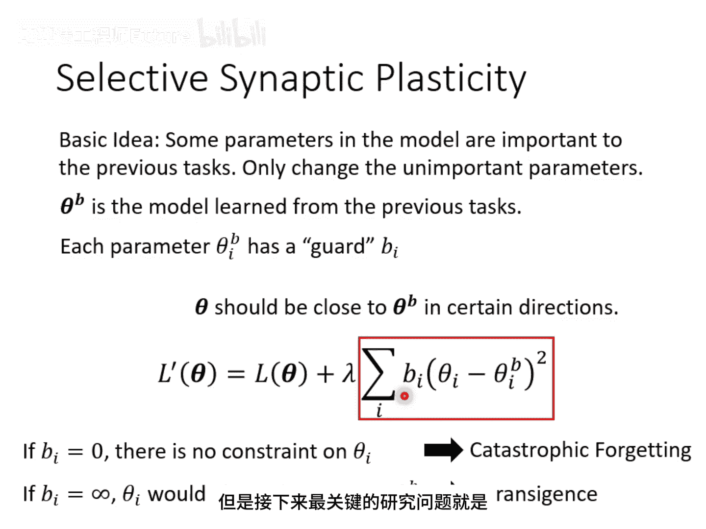

bi到底要怎么找到呢，我们怎么知道哪些参数对旧的任务是重要的，哪些参数对旧的任务是不重要的呢，这个就是研究的重点，我们这边呢只跟大家用提示的方式，简单的跟大家说bi设计的大概念是什么好。

那怎么知道某一个参数对某一个任务到底重，不重要呢，那你可以在训练完一个模型之后，我们得到CAB之后，举例来说，你把C大B在C达one这个方向做一下移动，发现说诶在sea one这个方向上做移动。

好像对loss没有什么影响，那我们就知道说唉C大一没有很重要，C大一对任务一没有很重要，可以随便给它一个值，那既然C大一对任务一没有很重要，在新的任务上，C大一就可以任意改变。

所以我们就可以给C达一比较小的bi的值，也就是b one的值就会比较小，反过来说，如果我们观察set up to这个方向，你会发现说当我们改变set up to的值的时候，对loss的影响是大的。

我们改变set tto的值的时候，对loss的影响是大的，代表说set up to是一个很重要的参数，set up to对task one是重要的参数，所以你就不要去动它。

所以你要把SETTO的B设得大一点，你要把b two设的大一点好，这个就是selective signetic plasticity的基本概念。

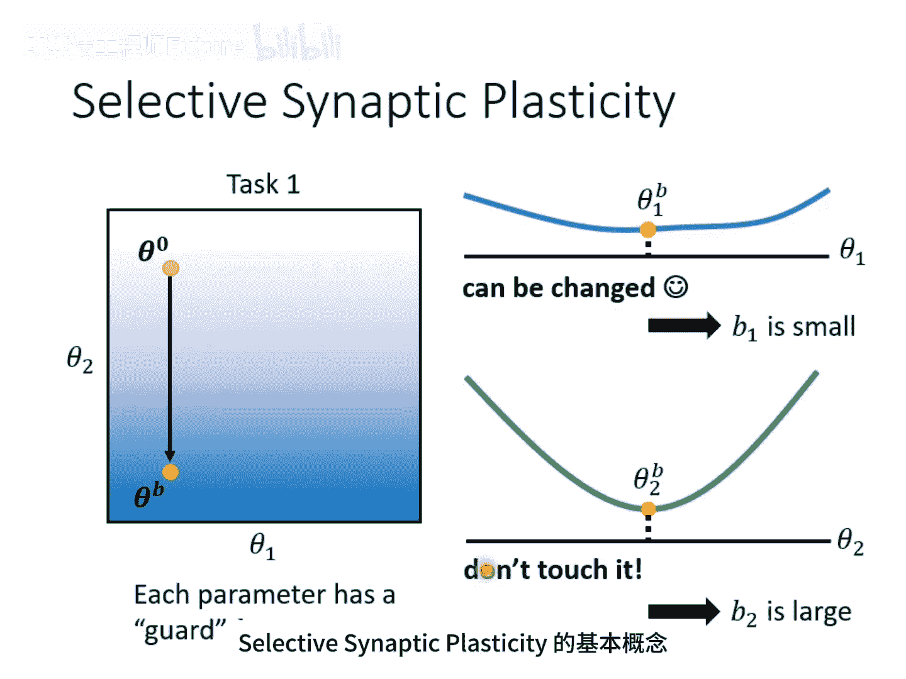

而如果我们今天把b one呢设小一点，b two设大一点，那如果在task what to训练的时候会发生什么事呢，因为b one比较小，代表说我们可以把模型在这个方向上，自由的移动。

而b two比较大，代表说在这个方向上自由的移动是没有办法的，所以如果我们把b one设小一点，b two设大一点，那你把c dab做update的时候，它就不会往这个方向走，它就会倾向于往这个方向走。

因为我们只希望模型去更新这个set a one就好，尽量不要动到sa two，那你就可能把你的这个gradient的方向呢，本来是这样update的，那就变成这样子。

update得到seta star来再把sea star拿回来，原来的任务一，那因为任务一呢在这个方向上移动，对lost的影响是小的，所以你在任务二上，假设只有在这个方向上移动。

那对任务一的loss的影响就小了，那所以新的sea star用在这个地方哦，他的对task1的伤害就不大，也许你就可以借此做到，避免catastrophic forgetting的问题。

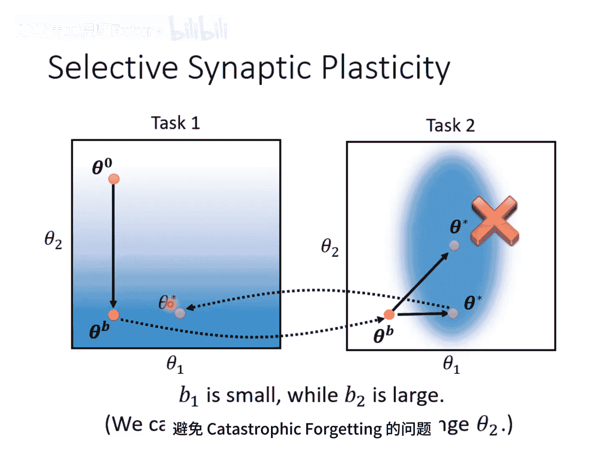

好，那接下来这个呢是一个文献上，真正的实验结果了，那这个结果呢是来自于EWC这篇paper，1wc paper的链接也有放在下一页投影片里面，如果你有兴趣的话，再自己参考好，那这个图怎么看呢。

你在看那个lion learning文献的时候啊，这种类似的图是非常常出现的啊，常常我paper几乎都会放类似这样子的图，这个横轴是什么，横轴代表依序训练的过程，在第一个虚线左边。

那纵轴呢这边有三个纵轴，第一个纵轴代表任务A的正确率，第二个纵轴是任务B的正确率，第三个纵轴是任务C的正确率，那画这样的图你就可以看出说，当我们依序学ABC3个任务的时候。

任务ABC这三个任务它的正确率会怎么样变化，我们先看任务A吧，我们先看任务A的变化情形好，我们先看蓝色这一条线，蓝色这一条线是什么呢，蓝色这条线就是我们完全不管CATROPHY。

forgetting的问题，就做一般的training，也就是bi永远都设为零，如果bi永远都设为零，会发生什么状况呢，你会发现说我们看任务A的正确率，一开始刚学任务A的时候没有问题，正确率很高。

接下来开始学任务B了，任务A的正确率就掉下来，接下来开始学任务C了，任务A的正确率又在更掉下来啊，这个就是catrophy forgetting，那l two呢。

l two这个实验那是bi不管哪个参数通通设一，如果bi不管哪个参数通通设一，你看task a确实有达到，防止catroy forgetting的效果，举例来说。

你看绿色这条线在任务B的时候没有下降很多，在任务C的时候也没有下降很多，任务A的正确率没有掉很多，任务A的正确率也没有掉很多，但是bi永远都设一，你得到一个新的问题。

这个问题呢就是我们刚才提过的INTRSIGENCE，我们来看一下任务B跟任务C学习的状况，绿色这一条线，当bi永远等于一的时候，我们在学任务B的时候，任务B的正确率确没有升的足够高哦，这边这呃。

这个第二个纵轴呢代表是任务B的正确率，然后这边代表是学任务B的时候，我们在学任务B的时候，照理说任务B的正确率就应该飙升呢，但是没有绿色这一条线，没有飙升，学不起来，任务B学不起来，任务C更惨。

更学不起来哦，纵轴是任务C的正确率，你发现任务C的正确率没有其他方法高，代表任务C学不起来，这个就是intransigent，所以如果你给所有的参数一样的限制，那这个对你的模型来说限制太大了。

会导致它新的任务学不起来好，那如果我们给不同的参数，不同的bi就是有的参数bi大，有的参数bi小，只固定某些参数，某些参数可以任意更动，那你就得到红色这条线，那红色这条线在每一个任务上。

表现都是最好的哦，看任务A的话，唉一去学三个任务正确率没有掉，看任务B的话，现在学任务B的时候，正确率跟蓝色这条线比起来只掉了一点点，然后任务C也不会再掉，那如果看任务C的话哦。

任务C的正确率其实相较蓝色这条线还是有一，还是比较低一点的，所以你有设这个bi的时候，就是会有一些影响，新的任务就是比较难学，但是没有bi都设一的时候，结果那么惨，还是学的比bi都设一的时候。

结果还要更好的好。

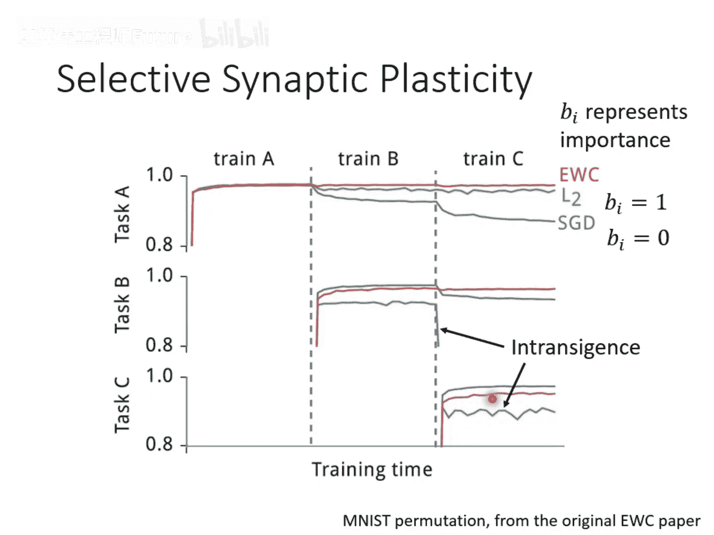

那其实在课堂上啊，我们就没有真的告诉你bi怎么算呢，我们只讲了概念，那在助教的城市里面呢，助教实做了各种不同的方法，只做了各种不同算bi的方法，那在选择题里面，你要回答的就是每一种方法。

它的bi是怎么求出来的，那你可以选择看呃文献来知道bi是怎么设的，你也可以选择直接读助教的城市，看看bi是怎么被设出来的，那我们这边呢就列了一大堆方法，有EWC有SI有NAS，有r work。

有SCP啊，这边是按照那个年代设的啦，啊这边是按照年代呃，这边是按照年代放放的，有最旧的方法到最新的方法，那每一个方法都有它自己的特色，还有他想要解决的问题，他想要考量的点，那这个就是留在作业里面。

让大家自己去发掘，那这个部分我们就不在课堂上讲，因为假设你对live phone learning没有特别有兴趣的话，那每一个方法都讲一遍，你会觉得特种特别容啊。

但是假设你对live on one learning有兴趣的话，那你把作业的选择题要好好看一下，那你其实可以学到很多东西，好我们来看一下我们的同学有问题，好看来bi可以直接用算的算出来。

对bi是直接用算的算出来的，但是bi怎么算，每一个方法都不一样，而且每一个方法用的资料不一样，有的方法只需要model的input就好，有的方法要input加output。

也就是假设是影像分类的问题的话，有的方法只要image过去任务的image就可以算出bi，有的方法是需要过去任务的image加label，才能算出bi，那助教每一个方法都会问你。

说这个方法有没有用到label，你再自己看一下助教code，看看有没有用到label，好有同学问说改变训练task的顺序，训练出来的结果会不会差很多，这个问题太棒了，简单的回答就是会。

然后等一下会举一个例子，告诉你说改变任务的顺序，结果就会差很多，所以你会发现说在这些paper里面呢，他们在做实验的时候，都不是只做一种任务的顺序，他们会穷举所有任务的顺序出来做实验。

然后再取它的平均值，也就是假设你有三个任务，你不能说你只把任务ABC跑完，得到平均，就说你的方法是得到平均是这个样子，在这些paper里面，常见的做法就是你会穷举所有的顺序。

ABCCBA呃呃BCA统统都跑过一遍，得到个平均值才能够代表说呢，你的lifelong learning的方法做的好不好，好那这个是有关regularize。

regularization base的方法。

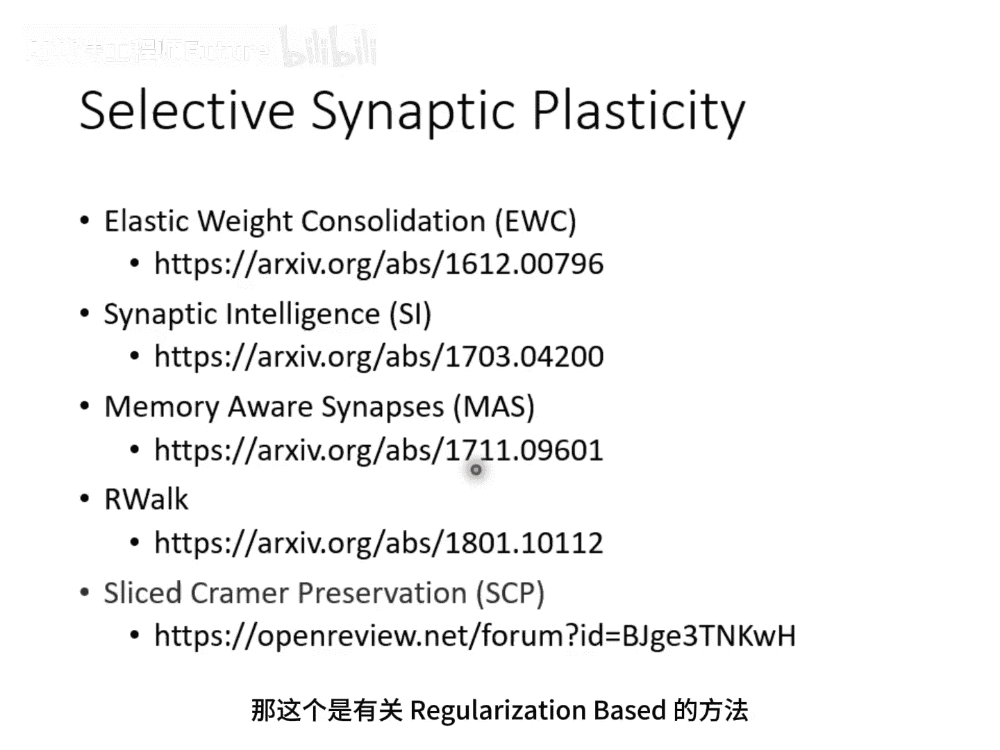

那其实在regalization base的方法，还有一个早年的做法呢，叫做g e m gradient episodic memory啊，这个方法呢也是一个挺有效的方法，但它不是在参数上做限制。

而是在gradient update的方向上所限制，那这个GN是怎么做的呢，这个GN的做法是这个样子，在任务二上我们会计算任务二的GRADI，但是我们要小心一下，我们到底要不要按照这个任务二算出来的。

gradient的方向去update我们的参数，那在update参数之前呢，我们会先回去任务一上面算一下，说这个参数如果在任务一上做update的时候，它的方向到底是哪一个方向。

我们用蓝色的箭头代表C大B这个参数，在任务一上面的时候，他update的方向，如果sea b跟G啊它们的方向不一致，那这些所谓方向不一致，就是啊他们的inner product小于零。

那这个时候怎么办呢，就修改一下你的G把它变成g plan，那这边修改的条件，修改的criterion是你希望找到一个新的GP，这个GP呢跟GB呢，他们做inner parta以后要大于等于零。

而且g pr跟G呢不能够差太多哦，所以本来你往这个方向update，可能会产生catrophy forgetting的情形，但是我们刻意去修改update方向，从G变成G派。

这样就可以减轻catrophy forgetting所造成的问题，但讲到这边，你有没有发现这个方法有一点猫腻呢，有没有一点什么奇怪的地方呢，你仔细想想GB是怎么算出来的，我们要算GB。

我们要算task one的gradient，意味着我们有存有task one的资料，如果我们没有存task one的资料，那我们根本就没有办法把GB算出来，所以gm这个方法的一个劣势。

就是他需要把过去方法的资料存下来，那这个跟live phone learning想要追求的是有点不一致的，因为我们一开始就有说live learning，就是不希望把过去的资料都存下来呀。

如果过去的资料都存下来的话，资料累积的越来越多，那呃那你最终会没有办法，把过去的资料都存下来，所以GN有点违反liphone learning的呃，呃最初的精神他是有偷偷存过去的资料的。

但是也许这个问题并没有特别严重，为什么，因为gm这个方法只需要存非常少量的资料就好，因为这个GB它最重要的工作，只是去修改一下G的方向，所以也许算GB的时候，我们不需要非常大量的资料。

只要存一点点的资料就好，所以G医院想要做的事情，是希望透过子存一点点资料，来达到避免catrophy forgetting的效果啊，所以gm比较于其他方法，比如说我们刚才看到的EWC等等，有点不公平。

因为他有偷存额外的资料，但是其实你再更仔细想一下，这个EWBC这些方法，这些regalization base的方法，他们他们需要占用额外的空间，来储存旧的模型跟储存bi。

所以刚才讲的那些regalization base的方法，它也需要占用到额外的空间，这些额外额外的空间包括一个旧的模型，还有BI这个首位的数值，所以如果GEM，他今天除虽然存了一些旧的资料。

只要他存的旧的资料所占用的呃，记忆体的量没有比多存bi还有旧的模型多的话，也许也是可以接受的哦，所以如果GEM没有存太多资料的话。

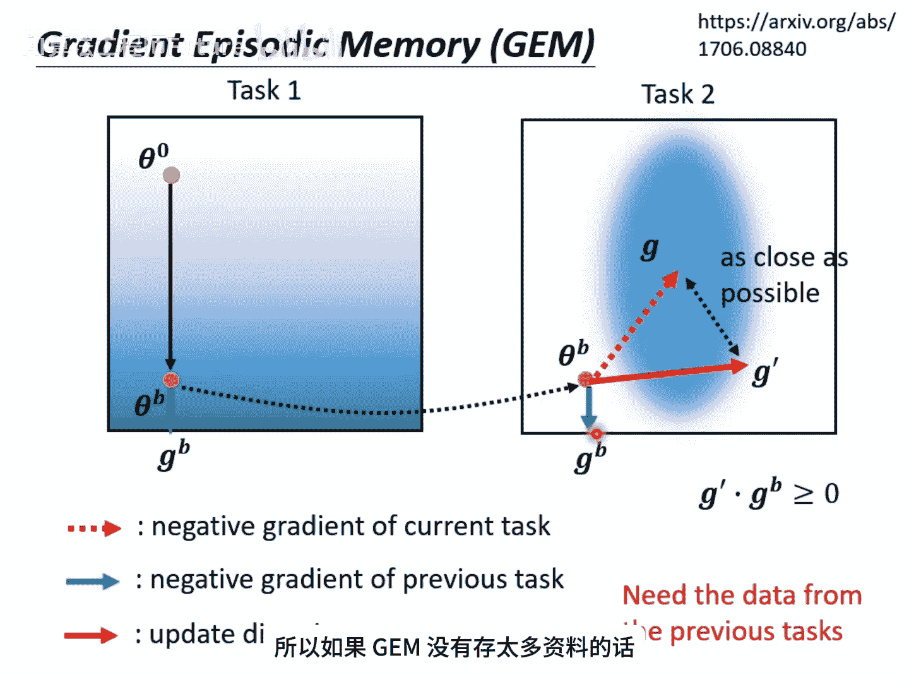

其实也是一个可以被接受的做法啊，好那接下来呢另外两个做法。

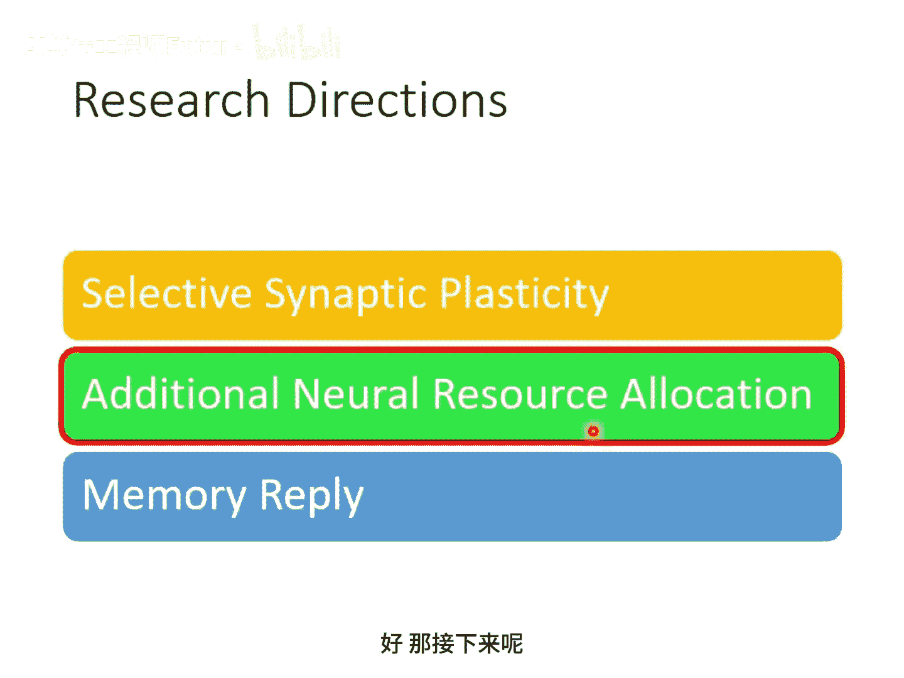

我们就是非常快的带过去好，第一个做法呢是additional neural resource allocation。

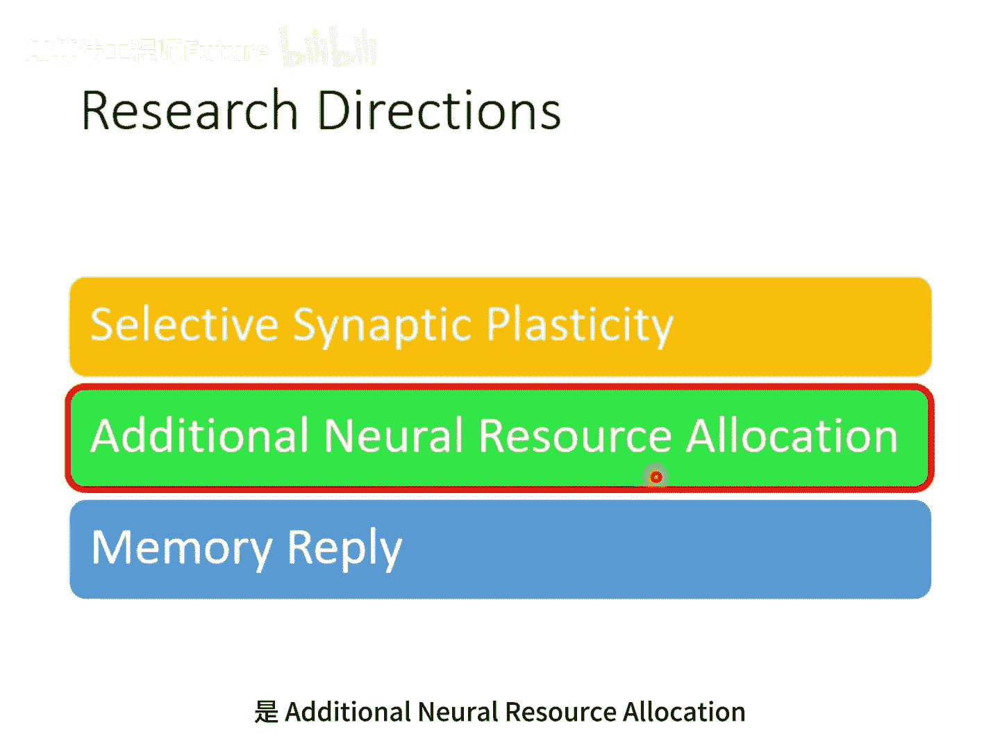

也就是我们改变一下使用在每一个任务里面的。

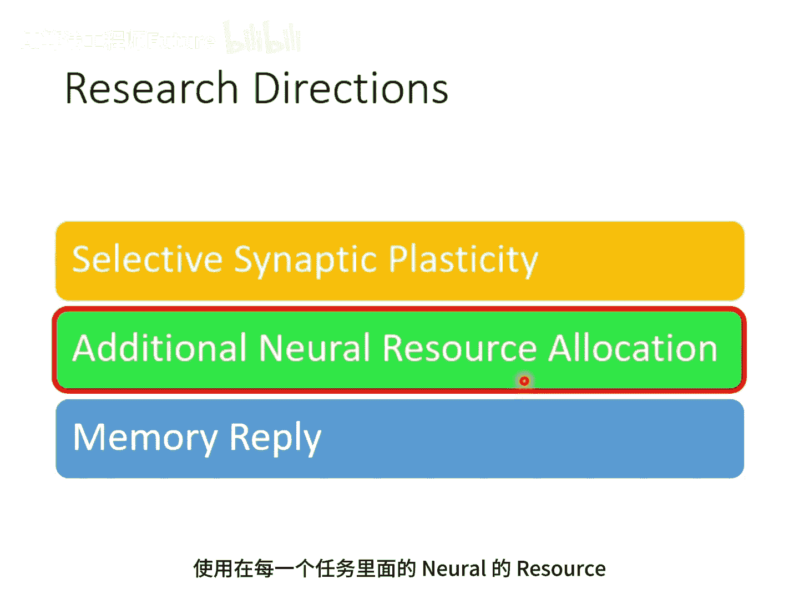

neural的resource，什么意思呢，一个最找的做法叫做progressive neural network，他的想法是这个样子的。

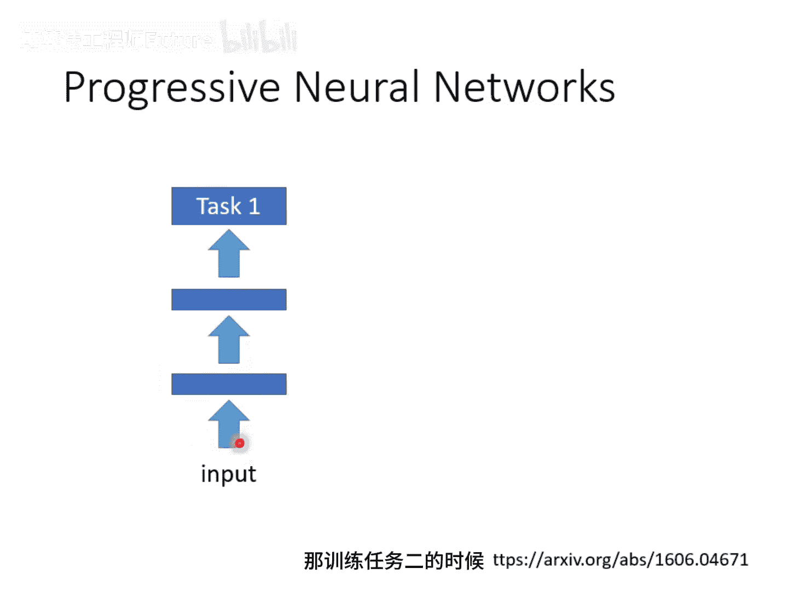

你就不要再去动任务一学到的那个模型了，你另外再多开一个network，这个network呢他会吃任务一的hidden layer的output，作为输入，所以如果任务一有学到什么有用的资讯。

任务二也是可以利用它的，但是任务一这边的参数，任务一学出来的参数都不要再去动它了，我们只多新增一些额外的参数，我们只train额外的参数。

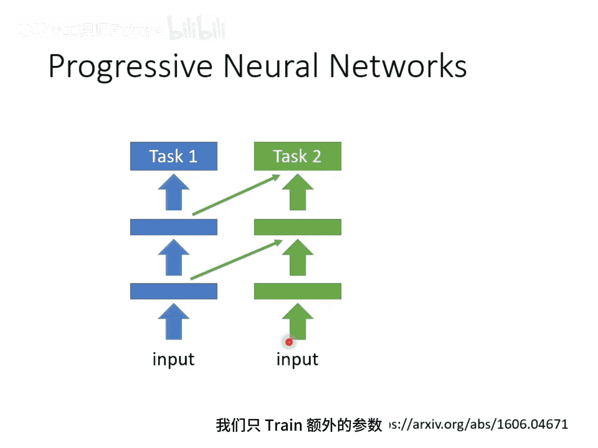

那任务三也是一样呃，我们有一组专门给任务三的参数，任务一任务二训练出来的参数就不要再动它了，那对于解决catrophy for getting而言，这当然是一个有效的做法。

你完全不会用catrophy forgetting的问题，因为旧的参数你根本完全没有动到它嘛，但是progressive neural network，它会它会造成的问题是呃。

你每一次训练一个新的任务的时候，你会需要额外的空间去产生额外的neural，你每一次参加一个新的任务，你的模型就会长大一点，如果今天你的模型长大的速率，跟新增任务是成正比的话。

那你最终你当你的任务不断的新增，增下去的时候，最终你的呃memory还是会耗尽的，你的模型终究会太大，大到你没有办法把它存下来，所以progressive network看起来并没有完全解决。

catrophy forgetting的问题，但是在任务量没有很多的时候，progressive network仍然是可以派得上用场的。

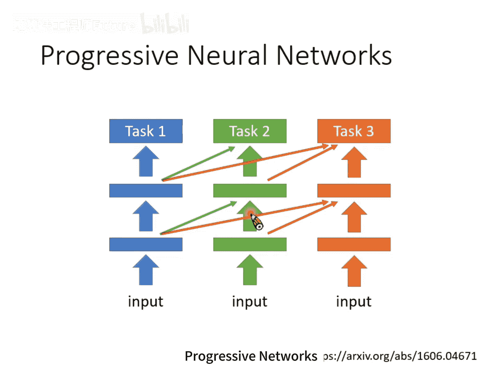

然后有另外一个方法叫做peg nec，它是progressive network的，反过来，progressive network是说哎每一次有新的任务进来，我们就多加一些牛肉。

那picnic呢正好是用另外一个想法，他说我们先开一个比较大的network，然后接下来啊每一次有新的任务进来的时候，我们只用这个大network，其中一部分好，就任务一的资料进来。

我们就这边在这在这个图示里面呢，我们就把每一个圈圈想成是network里面的一个参数，然后任务一的资料进来，只准使用这边有这个呃，黑色框框的这些圈圈的参数啊，然后任务二的资料再进来。

只准用这边橙色的参数，任务三的资料再进来，只准用这边绿色的参数，那这样的好处就是哎，你的参数量不会随着任务增多而不断增加，但是如果相较于progressive network的方法。

想想这个方法其实也只是朝三暮四而已，我们只是一开始开一个比较大的内work，然后说每一个任务不要把所有的参数都用尽，只用部分的参数，然后这样子你就不会有catrophic forgetting的问题。

但是相相较于不断增加新的参数，你只是呃提早把更更多的记忆体用完而已，那这个有点朝三暮四的感觉。

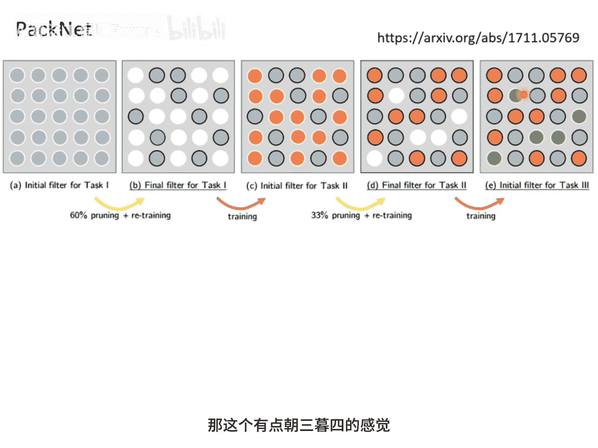

然后pack name啊，跟progressive network啊是可以结合在一起的，那这个结合的方法也是一个很知名的做法。

叫做CPG或compacting peeking and growing和CPG，它就是我们的model，既可以增加新的参数，那每一次呢又都只保留部分的参数，可以拿来做训练。

那至于这些方法细节我们就不细讲，就留给大家慢慢研究好，我看一下，到目前为止么同学有问题想问的，好我看目前大家没有问题，想问好，那我们就继续啦，我们就继续啦，好那第三个做法叫做memory replay。

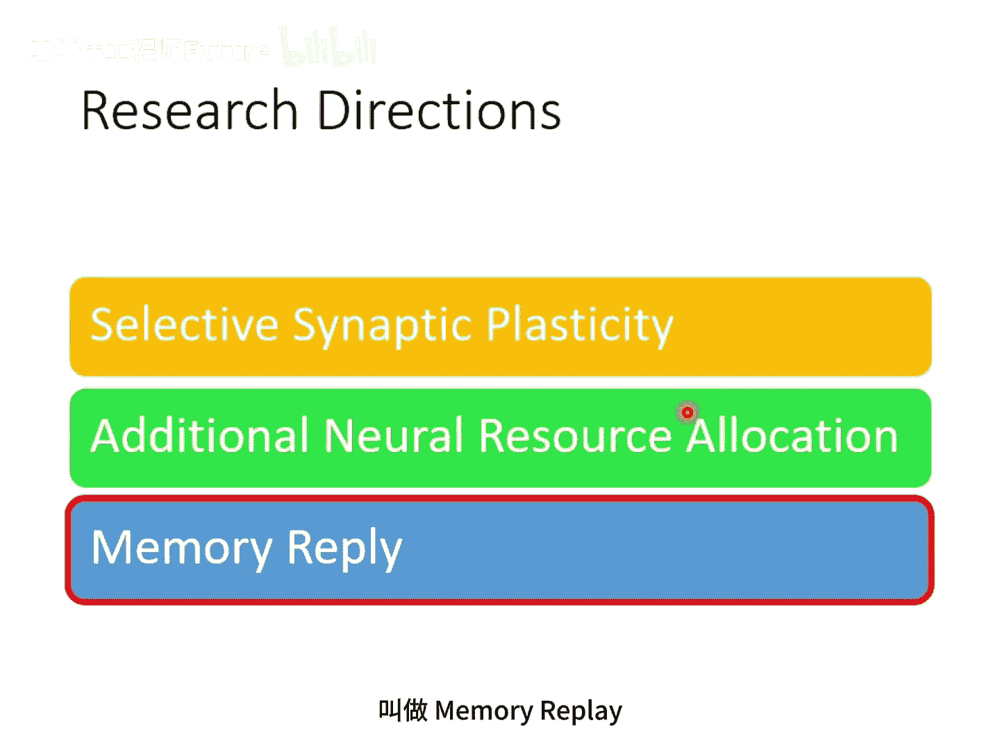

第三个做法非常直觉，我们之前有讲说，只要把所有的资料通通倒在一起，就不会有catrophy forgetting的问题，但我们又说不能够存过去的资料。

那我们干脆就训练一个generative model哦，这个generative model就是会产生sudo data哦，会产生呃，就我们不能够存过去的资料。

但是我们训练一个generative model，把过去的资料在训练的时候及时的产生出来啊。

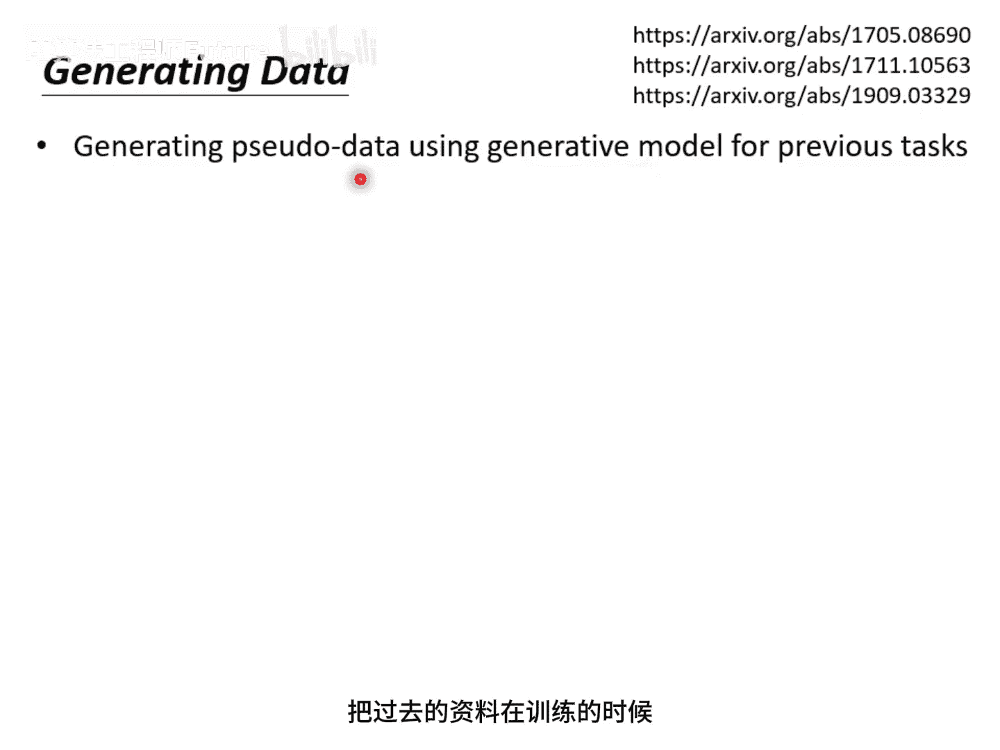

也就是说我们现在有第一个任务的训练资料。

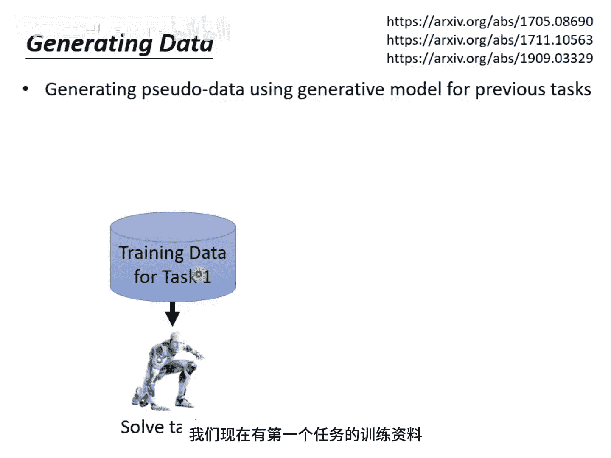

我们不止训练一个classify来解任务一，我们同时训练一个generator，它会产生任务一的资料，接下来你在训练任务二的时候，如果你只把任务二的资料倒给machine。

那他可能会有catrophy for getting的问题，但是你又不能把任务一的资料拿出来，那怎么办，用generator产生任务一的资料，你用这个generator产生任务一的资料。

给第二个任务的classify做训练，所以这个classify他在训练的时候，不是只看到任务二的资料，他还看到generator产生出来的任务一的资料，所以用这个方法就可以避免CATROPHY。

forgetting的问题，然后接下来你又有任务二的资料，那也许你就会把任务二的资料跟呃，任务一产生出来的这个苏斗的资料再倒在一起，再训练一个generator，这个generator可以同时产生。

任务一和任务二的资料，然后这个过程就反复继续下去好，那这个方法到底合不合理呢，就是见仁见智啦，因为你需要另外产生一个generator嘛，那这个generator当然也是会占用一些空间。

但是如果这个卷的ATOR占用的空间，比你储存资料来讲还要更小的话，那也许这就是一个有效的方法，那事实上呢，呃我们实验室也有做过一些lifelong learning的study，在我们的经验上。

这一种generating data的方法呢其实是非常有效的，用这种generating data的方法，往往你都可以逼近lifelong learning的upper b了。

往往你都可以做到跟morttask learning差不多的结果。

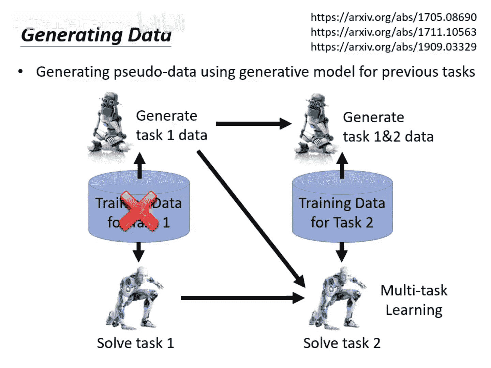

好那接下来啊，额如果你想看我们刚才讲的liphone learning的scenario，我们都假设说，每一个任务需要的模型就是一样的，我们甚至强迫限制说，每一个任务我们要训练的classifier。

他们需要的class量都是一样的，但假设不同的任务，他们的class数目不一样，有没有办法解呢，第一个任务有十个class，第二个任务有20个class，第三个任务有100个class。

你训练新的任务的时候，你同时要增加新的class，有没有办法解呢，是有办法解的，那这边就列一些文献，好比如说learning with without forgetting l w f。

还有ICARL和incremental classify，and representation learning给大家参考，那助教呢在这个呃在我们的这个这个作业。

lione learning的作业的选择题里面呢，我们也问大家一些有关这些做法的问题，如果你有兴趣，你再自己去读一下这些文献，那其实啊我们今天讲的life phone learning。

也就是continuous learning，只是整个live phone learning领域研究里面的其中一小块，其中某一个情境而已。

其实lifelong learning也就是continuous learning，还有很多不同的情景，你可以阅读一下下面这篇同整的文献，他会告诉你说liphone learning有三个情境。

我们今天讲的只是那三个情境里面，最简单的一种而已，最容易的一种，剩下两个更有挑战性的情境，要怎么解，我们留呃呃这个呃，这这个剩下另外两种更有挑战性的情境是什么，我们留在选择题里面。

让大家自己去看看另外两种情境是什么样子好。

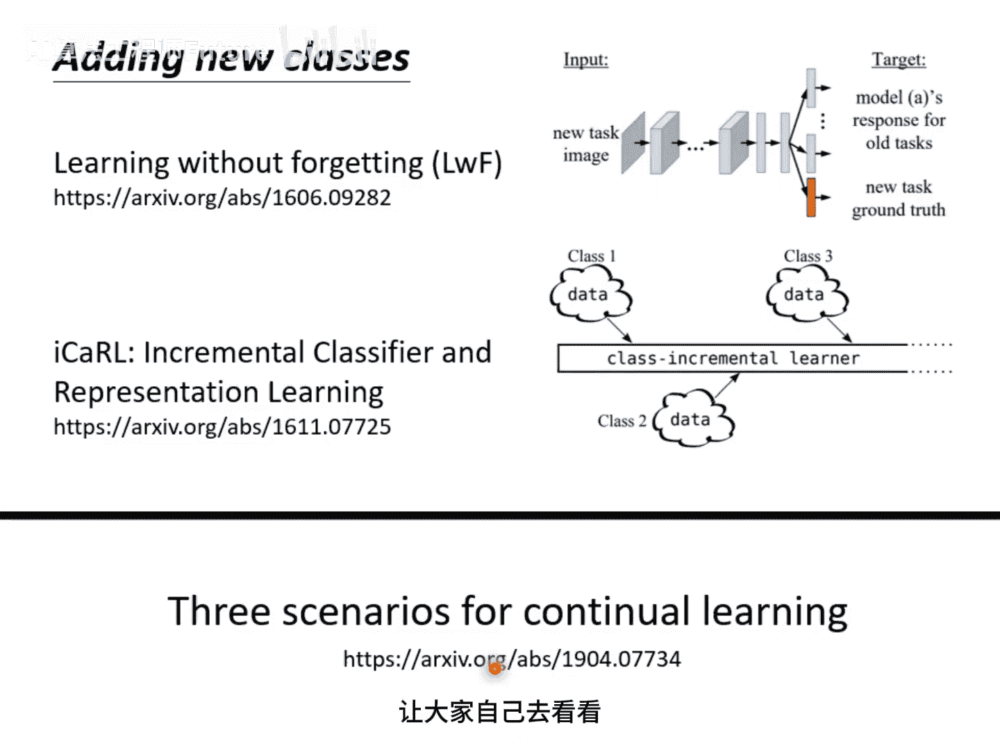

那这个呢就是有关live phone learning的三个研究方向。

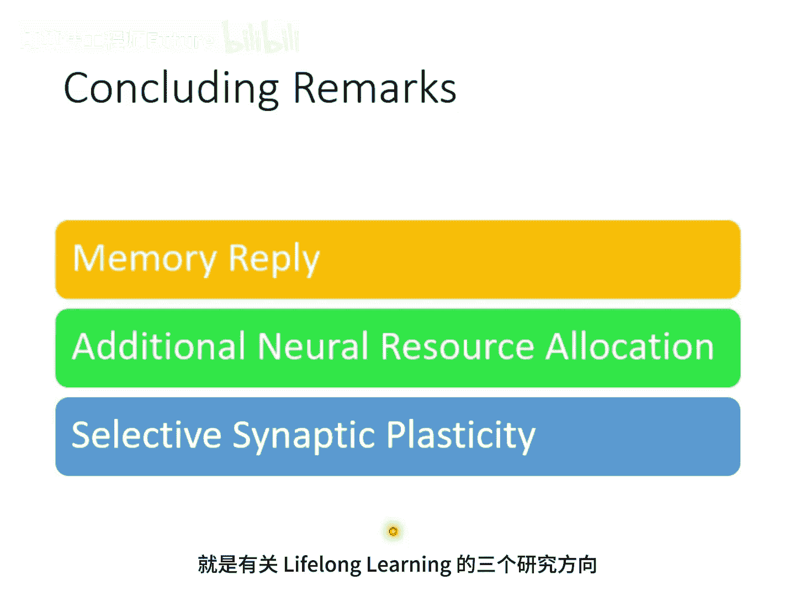

那刚才有同学问到说，如果我们调换学任务，学习的顺序，会不会有非常不一样的结果呢，确实是会有的。

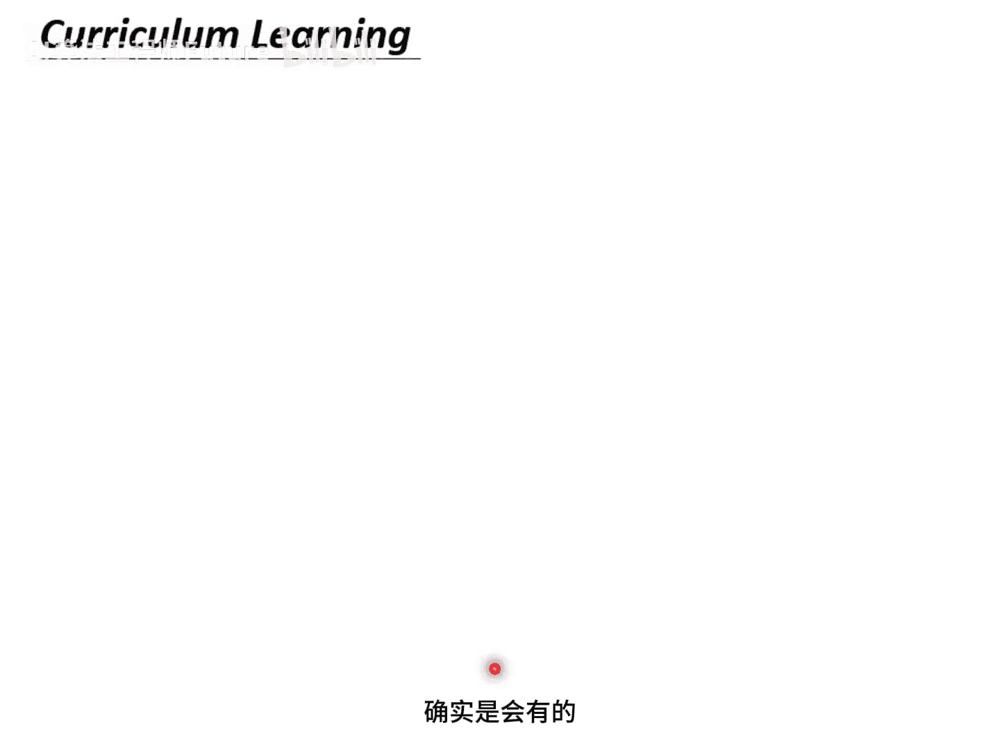

那这边就举一个具体的例子来跟大家说明，在刚才我们一开头讲的lifelong learning的例子里面，我们说先让机器先学这一种有杂讯的图片，接下来再学没有杂讯的图片。

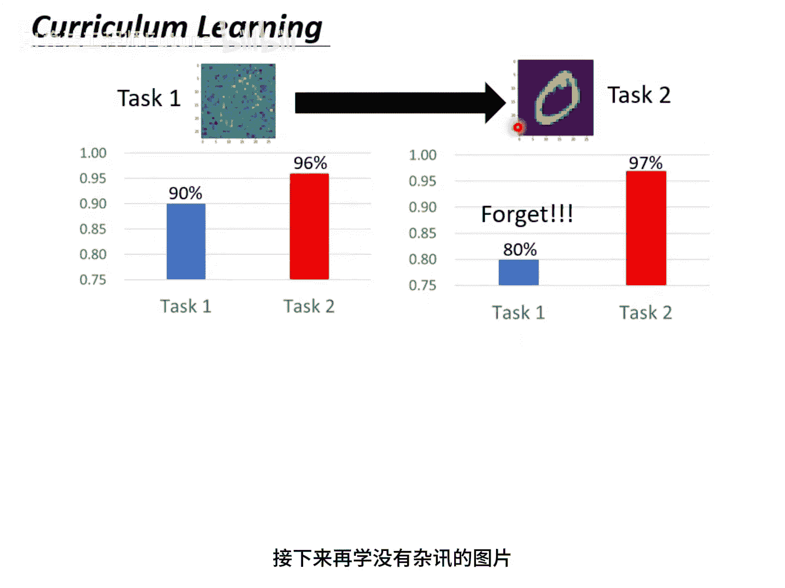

但是反过来如果先学没有杂讯的图片，再学有杂讯的图片，会发生什么样的状况呢，如果让机器先学没有杂讯的图片的话，我在任务二上正确率97，在任务一上正确率62，看起来能够解没有杂讯图片的分类。

看到有杂讯的图片还是很懂不了的。

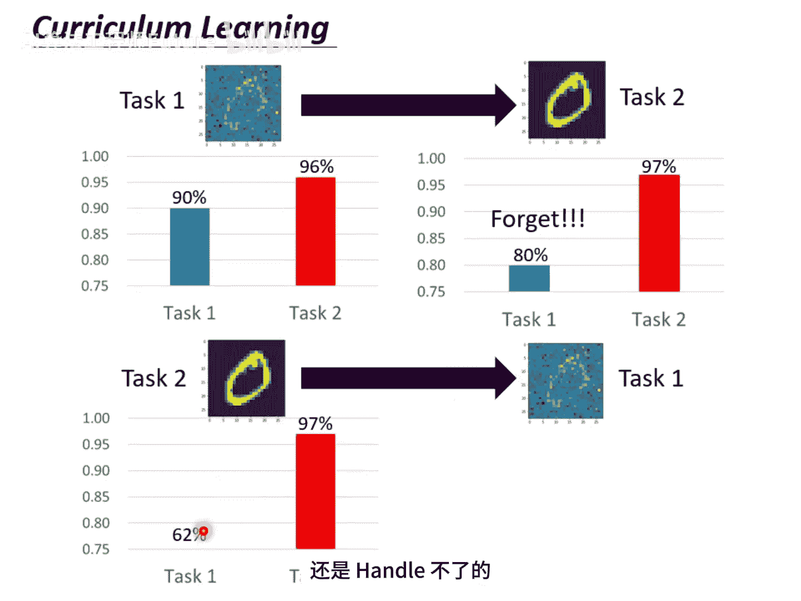

但是如果说我们更进一步让机器学任务一的话，这个时候你发现他任务一任务二都可以做好，这个时候没有catrophy forgetting的问题，所以看起来任务的顺序是重要的。

有一些顺序会有forgetting的问题，有一些顺序其实也没有forgetting的问题，而研究什么样的顺序才是好的，什么样的顺序才对学习是有效的。

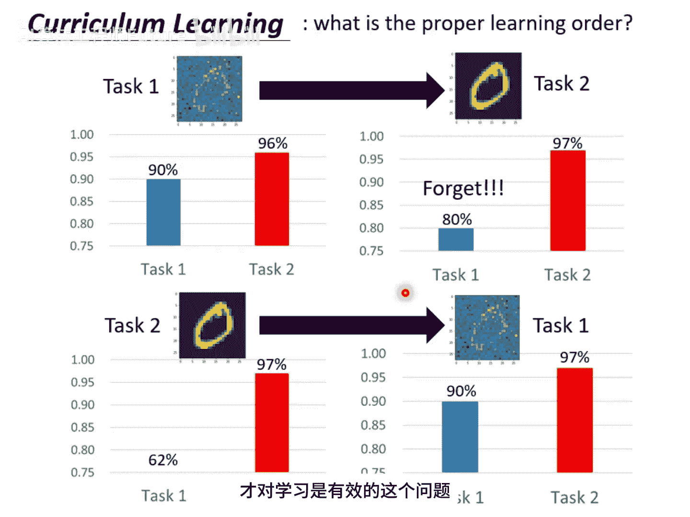