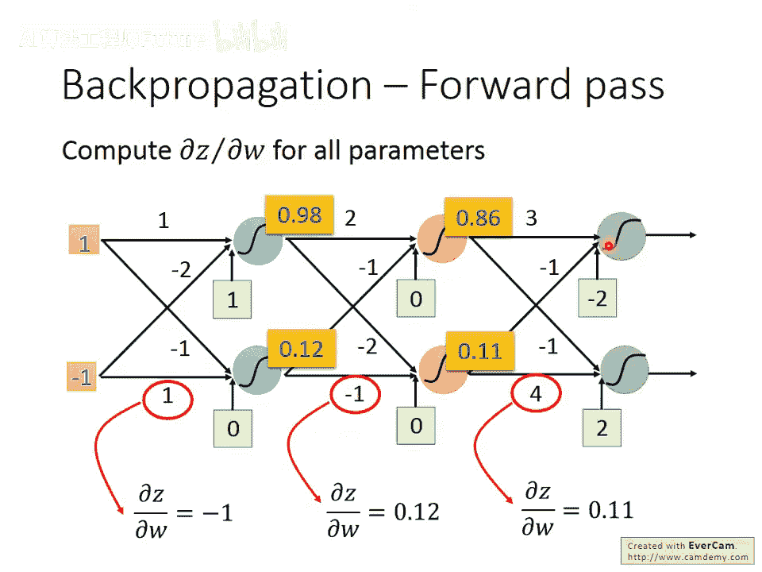
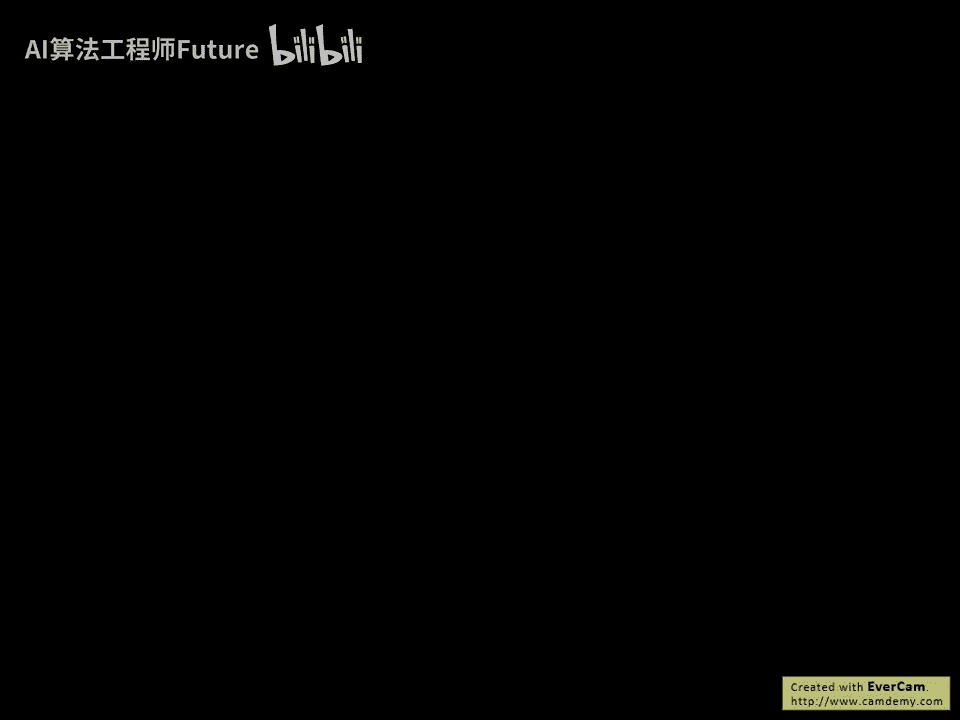
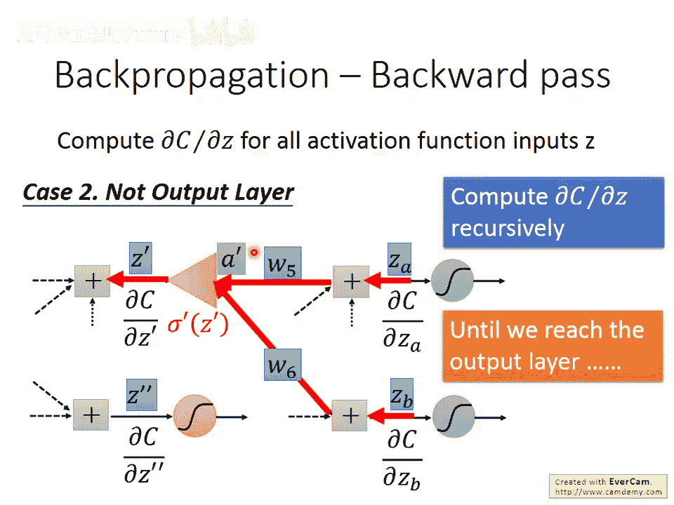
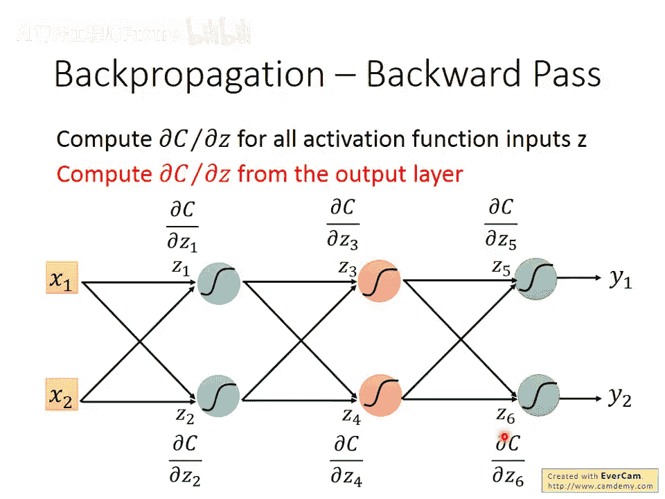
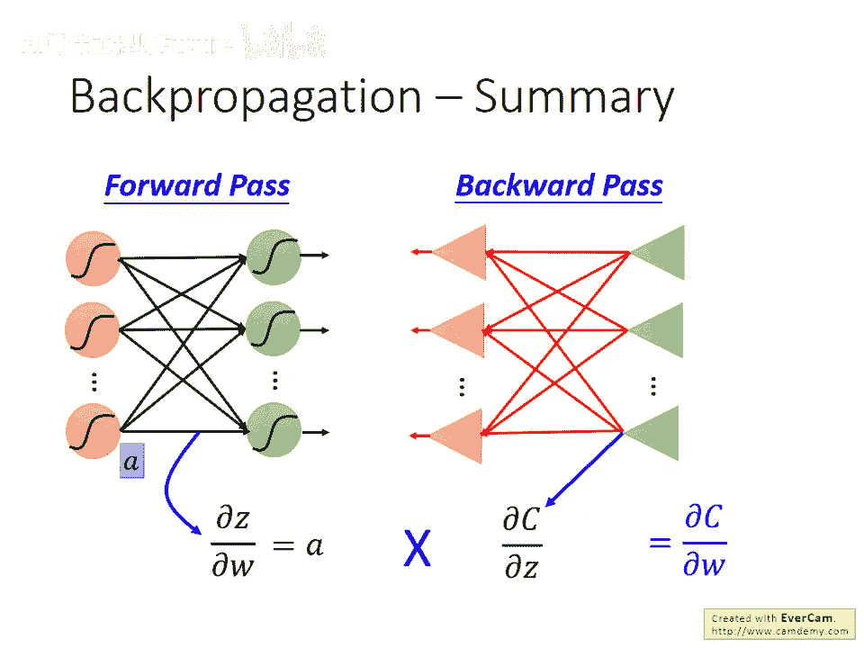

# 【官授搬运】2026年全新优化版李宏毅机器学习系统课程，这才是真正的初学者体系课程！—人工智能／深度学习／神经网络 - P8：7-选修-反向传播 - AI算法工程师Future - BV1ruqABeEFX

好，啊各位同学大家好啊，那我们今天来我们开始上课吧，那我们今天要讲的是back propagation，也就实际上如果你要用gradient descent的方法。

来确认一个neural network时候呢，你应该要怎么做，嘿好，那我们上次其实已经讲过了neural network基本架构，然后我就发现说在作业二里面，好好好多人呢都已经implement了。

这个呃neural network based approach这样，那或许你已经对这个方法非常的清楚了，那我不知道说你，但是我不知道说你是不是清楚说呃。

到底实际上在train neural network时候，back propagation这个algorithm呢是怎么运作的，我们就来讲一下这个BPAGATION。

这个algorithm是怎么让neural network，training变得比较有效率的好，那在gradient descent里面，我们知道说gradient descend方法。

就是假设呢你的内work有一大堆参数，一堆W1堆B那你先选一个初始的参数，然后计算呢你先选一个初始的参数最大零，然后计算这个theta0呢，对你的loss function的gradient。

也就是计算每一个network里面的参数，w one w two b one b two等等，对你的loss set a的片尾分啊，计算出这个东西以后，这个gradient呢其实是一个vector呃。

计算出这个vector以后呢，你就可以去更新你的参数，我就把SA0减掉呢，learning ray乘上这个GRA点好，然后得到sa one啊，那这个process呢就持续继续下去啊，你再算一遍。

再set up one的gradient，然后呢再把set tone减掉，Gradient，Update，Set up two，这个process就一直持续下去。

所以在neural network里面呢，当你用gradient descend方法的时候，跟我们在做logistic regression，还有呃linear regression等等。

是没有什么太多的差别的，但是最大的差别就是最大的问题是，在neural network里面，我们有非常非常多的参数，那现在如果你要做语音辨识系统的话呢，你的neural network通常会有。

比如说七八层，那每层呢有1000个neural，那它有上百万个参数，那所以这个vector呢它是非常非常长的，这是一个上百万维的vector，所以现在最大的困难就是你要如何有效的呢。

去把这个有百万维的vector有效的把它计算出来，那这个就是back propagation呢在做的事情哦，所以back propagation并不是一个呃看gradient descent。

不同的training的方法，OK他就是gradient descent，他只是一个比较有效率的演算法，让你在计算这个gradient这个vector的时候。

是可以比较有效率的把这个vector计算出来的好，那其实back pagation呢它里面没有特别高深的数学，你唯一需要记得的就只有圈弱，那我们用一张投影片顺迅速来帮大家复习一下，什么是圈弱。

而假设你现在有两个方程H跟GOK，然后呃g input x就得到Y呃，这个h input y就得到Z，所以如果你今天给X1个小小的变化的话，呃今天给X一X1个变化的话，它会影响到它的output y哦。

所以Y呢会跟着有变化，然后Y有变化以后呢，又会影响到Z啊，所以Z会跟着有变化，那如果我们今天要计算这个底X分之底Z的话，我们要计算X对Z的微分的话，那怎么算呢，你可以把它拆成两项，X对Z的微分。

它就等于这个Y对这个Z的微分，乘上X对Y的微分，这样那这个怎么来的，你就问一下微积分老师，等下一起你可以把这个Y就消掉哦，所以左边可以右边，但是不要让微积分老师知道这件事情。

这好那第二个case我们来看嵌入第二个case，假设现在有三个方程GH跟K哦，那G呢input x就得到XXH呢input x就得到Y，K呢input x跟Y就得到Z哦，所以今天呢呃假如你改变了S。

改变了S，改变了S，你会透过G和H这两个方向改变了X跟Y哦，改变了S就改变了X跟Y，好像改变了X跟Y以后，透过K这个方选啊，K这个方选input是X跟Y，office是Z，我改变了X跟Y以后。

你就哦改变了Z，那就改变了Z哦，所以你今天如果要计算S对Z的微分的话，那这个S呢是透过两条路径去影响Z，它可以透过X去影响Z，也透过可以透过Y去影响Z哦，所以S对Z的微分就可以写成呢就拆成两项。

拆成两项哦，根据这两条path拆成两项，而这个X对Z的微分就可以写成，X对X对Z的微分乘上X对X的微分，就上面这一条路径加上Y对Z的微分，乘上X对Y的微分，也就是下面这条路径，OK好。

所以如果你大一微积分有好好学的话呢，这个就是我们都学过的全弱，那我们等一下呢会需要用到这个东西好，那再回到这个neural network training。

那我们知道说呢我们会定一个loss function，那这个loss function是什么呢，这个loss function是some mention over所有training data的呃。

某一个呃loss值C上标N，我们说假设给定我们一组neural network参数set up，我们把一个training data xn，带到这个neural network里面。

它会output一个YN，那同时呢我们会有一个呃，我们希望这个neural network output的target yn hand，就他希望他如果发output y n hand的话，这是最正确的。

那我们会定义一个这个YN和y n head，之间的距离的方程，这边呢写作CN啊，CN代表YN跟y n head的距离，而如果CN大的话，代表YN和y n head距离很远哦。

所以这个network parameter这个parameter loss是比较大的，它是比较不好的啊，如果他们这个CN很小的话，代表这个组parameter呢是好的。

那我们some mention over所有training data的CN，而sumention over所有training data透，根据这个参数sea它的output跟它的目标。

它的output y n跟他的目标yn head之间的距离，就是得到我们的total loss l呃，那你把这个式子左右两边呢，都对某一个参数W做偏微分的话呢，你就得到右边这个式子。

你就得到partial w分之partial l等于some mention over，所有的training data，N等于一到大n partial w分之partial cn。

哦这个应该是没有什么问题，而之所以写这个式子，只是要讲说接下来呢我们就不用想说，我们要计算partial w分之PARTIL，我们就只考虑我们如何去计算对某一笔data的。

partial w分子partial cn，OK你只要能够把一笔data的par，求W分之PARTICN算出来，在some mention over所有的training data。

你就可以把total loss，对某一个参数的这个偏微分算出来了哦，所以等一下我们就只focus在怎么计算对某一笔data，它所它的cost cn对W的偏微分，我们只focus在怎么计算这一项上面好。

那怎么做呢，我们先考虑某一个neural，Ok，我们先从底下这个neural network里面，哪一个neural出来呢，考虑它，好那这个neural呢。

这个neural呢他是在第一个layer的neural，所以他前面的input就是外界给他的input，X one x two，那x1跟x2呢分别，我假就假设它只有两个in input。

ok x1跟x2分别乘上weight w one w two，再加上B会得到Z，OK我想这个大家应该都非常熟悉啊，这个Z呢就是XYWY加4WQ加上B，那得到这个Z以后。

通过activation function，在经过了非常非常多的事情以后呢，你会得到最终的offer，y one y two好，那现在的问题是这样，假设我们从这边拿一个W出来啊。

等一下我们就拿W当做例子，但是B也是一样的，我们就拿weight当做例子来记，来看怎么计算这个某一个weight对cost的，对某一类sample的cost的偏微分，那B的话呢。

想必你可以以此类推就把它算出来好，那PARROW分之PARTIC怎么算啊，怎么算这个partial w分之PARTIC啊，就按照CHROLL就可以把它拆成两项，partial w分之PARTIZ。

partial z分之PARTIZ啊，这个Z可以把它消掉，所以没有问题，这好，所以partial w6分之PARTIC，可以根据CHROLL呢拆成两项，那这两项呢我们就分别去把它计算出来。

前面这一项是很简单的，后面这一项呢是比较复杂的，那计算前面这一项计算，partial w跟这partial z的这个PROFE呢，我们称之为forward path。

那计算后面这一项partial z分之partial c的发展，我们称之为bad bad bad word path，OK那我们等下会讲说为什么它叫做bad word path好。

那我们就先看一下怎么来计算这个partial，W分之PARTIZ啊，怎么来计算partial w分之PARROZ好，那我们呃先看这个w one哎，你怎么计算partial w万分之PARTIZ呢。

就是秒算就是秒算，因为Z又长这个样子嘛，然后w one在这边哦，所以一眼就知道说哦他是x1，那partial w two分之PARTIZ呢啊，所以也一眼就可以看出说他就是x2，这个都是呃秒算这样。

那它的规律是这样，它的规律就是这个partial w分之partial z啊，就是看这个W前面接的东西是什么，那微分以后就是什么，而这个WY前面它的input是接XY哦，它的input是XY。

所以微分以后就是x y w two呢，它前面的input x2哦，所以微分以后就是x2，它规律就是这个样子哦，所以今天呢假如给你一个neural network，那它里面呢有一大堆的参数，一大堆的参数。

但是你要计算这里面每一个参数Z的偏微分，你要计算这里面每一个参数的partial，W分的partial z这件事情呢呃非常非常的容易，因为我们刚才知道它的规律，就是pal的分W分之PARTIZ。

就是看你那个W的input是什么，它就是什么，所以如果有人问你说啊，现在input是一跟一，那这个一它对它的activation function的input，Y的偏微分是什么呢，你就可以呃瞬间回答。

告诉他说就是一啊，因为这个一前面接一哦，所以它所以所以，所以这个这个参数对Z的偏微分就是一，同理呢比如这个一，他对Z的偏微分就是一这个二，它对Z的偏微分就是一，这个一他对Z的偏微分就是以以此类推好。

那接下来呢接下来假如有人问你，说这个W对他的activation function的input，Z的偏微分是什么呢，你其实也可以瞬间就回答他，你只要知道说这个W前面接的weight。

是前面接的input是什么，那这个W前面接的input是某一个neuron的output，对不对，这个W前面接的input，是第一个hidden layer的neuron的output。

那这个hen layer的内容的output怎么算呢，这个大家应该都都知道，对不对，就是把一跟一丢进去，然后根据我们熟悉的neuron的运算，然后看看它的output是什么，就是什么啊。

在这个例子里面呢，假如这个function是这个sigmoid function，那算出来就0。98跟0。12，Ok，那如果你可以算出这两个neuron的output，是0。98跟0。12的话。

那这个weight他做完偏微分以后哦，这个weight对他的activation function的input z，做完偏微分以后，显然就是0。12，因为他接到前面接的weight是0。12。

这个一也是0。1，而这个二是0。98，这个二呢是0。98，这个也很直觉，而所以常用的process你就反复的在做，你可以得到这两个红色牛勇的output，是0。86跟0。11。

那就可以秒反映说这个呃四的，它对Z的偏微分就是0。11，Ok，所以你要算出这个neural network里面的每一个weight，对他的activation function的input z的偏微分。

你就把那个input丢进去，然后呢计算每一个neuron的output就结束了好。

所以这个步骤叫做forward path，那它是非常容易理解的好。

再来我们要讲的是BACKWARPATH，也就怎么算，他求Z分之partial c啊，这个你就会觉得很困难的，因为这个这个Z呀，他要通过activation function以后得到output。

然后后面还有非常非常复杂的发展，它才得到这个这个这个C啊，根据非常复杂PC才能够得到C，所以这个这个PARTIZ1分之PARTIC呢，显然是很复杂的，不过我们可以用CHRO呢再把这一项呢做一项拆。

做一下拆解呃，假设这个这个activation function是sigmoid function，我这边就写一个这个sigma of z啊，Z通过sigmoid function得到A啊。

这个neon的output是A，那接下来会发生什么事呢，这个A会通过某一个weight，会乘上某一个weight，再加其他一大堆的value得到Z1块哦，它是下一个action。

下一个neural的activation function的input，这个A呢会乘上另外一个weight，这边写成w four哦，再加上其他一堆东西得到z double快。

OK那后面呢这个z pl跟z double plan之后，可能还会发生很多很多的事情，不过我们就先只考虑下一步会发生什么事情好，那所以呢哦我们知道说这个partial z分之PARTIC呃。

你可以写成partial z分之PARTIA，partial a分之PARTIC，OK那这个这个没有什么问题，partial a可以消掉，那partial z分之partial a是什么呢。

我们知道说A就是等于sigmoid of z，那这个这个partial z分之partial a呢，其实就是就是这个这个sigmoid function的微分。

那sigmoid function长这个样子，OK长这个样子，绿色这一条线，那它的微分呢就你就算一下啊，它长这个样子，在它长这个样子，这个我们之前已经看过很多次了。

所以PARTIZ分之PARTIA也没有问题，剩下接下来问题就是partial a分之PARTIC，应该长什么样子呢，他应该长什么样子呢，这个那那我们就接下来再看说这个AA。

partial a跟C的关系是怎样叫A它会影响ZP，然后z pl会影响CA会影响z double priz，double pl会影响C，OK所以A透过z pine跟z double派去影响C。

所以PARTIA分之PARTIC你可以写成呢，partial a分之PARTIZ派乘以partial z派分之PARTIC，加上PARTIA分之PARTIZ。

double pri除以PARTIZ大派分分之PARROC，这样我们假设说A后面A的下一，就这个蓝色的neuron的下一个layer，这个红色的neural只有两个，所以这边就只有两项。

OK就这个A只会影响Z派跟z double派啊，如果这边有1000个neuron的话，那这边这个嵌入你的你的SUBMENTION，就是SUBMENTIOVER，1000下。

这OK这样大家这样大家了解我的意思吗，好好，所以这边呢经过前面，我们就是简化这个这个这个上课的说明啊，这么假设只有两个neural哦，所以这边只有两项啊。

只有两项A只会影响z pine跟z double p好，接下来partial a分之partial z plan，这个会算吗，这个是不是秒算，对不对，这个是W3，这Z派等于AZZ派等于A乘上W3。

再加上一些呃有的没的东西，所以这个Z派对A做偏微分，Z派对A做偏微分，根据这个式子显然就是W3哦，所以同理，这个z double派对A做偏微分，得到的结果显然就是w four。

所以这两项算起来也不是个问题，而是最最后的问题，就是这个Z派对C的偏微分怎么算呢，这个z pine对C的偏微分怎么算的，这个因为因为我们不知道，z pine对C有什么关系。

我们知道z double pine对C有什么关系，这后面还有发生很多很多的事情是很复杂的，所以我们搞不清楚后面会发生什么事情，所以我们一下子不知道这两项要怎么算啊，不过没关系，我们就假设我们知道。

假设假设这两项的值，我们已经3号透过某种方法把它算出来，我们透过一个呃，等下会讲，但你还不知道怎么怎么做的方法，我们就已经把这两项算出来了，那把这两项算出来以后呢，把这两项算出来以后呢。

三我们就可以把这个这个partial z分之，partial c轻易的算出来，对不对，把额把这两项算出来以后，我们就可以算partial z分之PARTIC。

也是会算partial z派分之PARTIC，跟PARTIZW派分之PARTIC，也就会算partial z分之PARTIC，然后呢再把额这些值，这些值呢带到我们刚才看到的。

PARROZ跟这PARTIC的式子里面，就得到这样一个式子式子，尽管plan of z乘上W3，partiz pine分之par，求C加w four part，求z w pine分之PARTIZ。

也算出这样一个式子，那这个式子呃还蛮简单的，但我们可以从另外一个观点呢来看待这个式子，你可以想象说呢，你可以想象说现在有某一有另外一个neural。

OK这个neural并不在我们原来的network里面，有另外一个neural，我把它写画成这个三角形的，好把它画成三角形，那这个neuron的input就是PARTIZ派分之partial。

C跟partiz double pine分之PARTIC，那第一个input partiz派分之PARTIC，它就乘上W3，partiz double pri分之PARTIC，它就乘上w four。

再乘上activation function，sigma plan of z得到output就是partial z分之partial c，就上面这一个neural所做的运算，跟下面这个式子是一模一样。

而且我们只是把这个下面这个式子呃，这个表示是让它写成看起来画起来，像把它这个这个画出来，看起来像是一个neural一样好，那这个它这个Z派分之Z呀，这个z pine分之Z其实是一个常数，对不对。

它不是它不是一个function呃，它是一个constant，对不对，因为Z其实已经在计算forward pass的时候，就被决定好了，OKZ是一个已经固定的值，Z我们已经知道他是多少哦。

所以而在给定Z的情况下，这个sigma find of z，它就是一个常数，OK所以呢这个neural呢，其实跟我们之前看到sigmoid function是不一样。

它就它并不是把input通过一个long melia的转换，而是把input直接乘上一个constant，sigma pl z就得到一个output，这样啊，所以我把这个neuron呢画成三角形的代表。

它跟之前我们看到那个圆形的neuron，的运作方式是不一样，它是直接成开一个constant，那可能问说为什么是三角形呢，因为我是电击系的，我觉得这是一个OP m p这样子哈哈，他就乘上一个。

然后OP amp就会乘上一个constant嘛，就他是个放大器，这样好听不懂就算了，这不太重要对好，然后这样问题都都解决了吗，都解决了，对不对，我们现在最后的问题就只有怎么算这两项而已。

就假设能够算这两项问题就都解决了，那现在怎么算这两项呢，怎么算这两项呢，我们现在假设两个不同的case，第一个case是我们假设现在红色的这两个neural，就已经是output layer哦。

就这两个红色的neuron是在open layer里面，他们的output就已经是整个network的output呃，这边写成y one跟y two哦。

它的output就已经是整个network output了，所以今天呢你要算partial z pine分之partial c，那很简单，就根据偏弱算partiz plan。

Partial y one par，求y one分之PARTIC，partic pan分之par，求y one，这个没什么问题，你只要知道这个activation function的的长什么样子。

这一项就是轻而易举的算出来，partial y one分之partic y one，对cost c有什么影响，就得配上你的这个这个呃，你的这个cost function是怎么定义的。

你output跟他的target间是怎么做evaluate的，你可以用PROSENTROPY，可以用mean square error，你用不同的定义这边这一项就不一样，但总之它是一个呃比较简单的东西。

你可以把它算出来好，那partial z派par，求自己double派分之PARTIC，Partiz，double派分之PARTIC，这你也可以算啊，没有什么问题。

就是PARTIZ大块分成parroy two，partial y two分之PARTIC，这两项一样都是可以秒算，最今天假设这个绿色的呃，不那个蓝色的neuron。

后面他的下一个layer就已经是output layer了，这个蓝色的这个这个这个这个这个呃，这个蓝色的neuron，它在最后一个hidden layer里面，它后面就已经是open layer了。

那根据我们刚才所学的东西，你就结束了呃，你就已经可以把这个w one跟w two的，对C的偏微分算出来，所以这个没有什么问题，那我们真正烦恼的问题是case two，假设现在红色的neuron。

它并不是整个network output，它后面还有其他的东西的话，怎么办呢，那他后面的其他东西可能长什么样子呢，它可能长这样，就是z pl，再通过activation function得到a pl。

再乘上另外一个weight w5得到，再加上一些二费其他的东西得到ZA，然后呢呃你再把a fine乘上W6，再加上其他一大堆东西得到ZB，然后再丢丢进两个呃。

另外两个activation function里面，那现在的问题是这样，我们想要求PARTIZ派分之partial c，如果我们知道partial z a分之partial c。

跟partial z b分之PARTIC，我们就可以计算PARTIZ派分之PARTIC对吗，这个我们刚才已经有有讲过，说假假设我们知道这个z pine。

partial z pine分之PARTIC跟partiz double pri分之PARTIC，我们就可以算前面一个layer的PARTIZ分之PARTIC，所以按照一模一样的式子。

如果我知道partial z a分之PARTIC，跟PARTIZB分之PARTIC，我们就可以算PARTIZIPLINE分之partial c，按照一模一样的式子，就我们刚才看到那个OPMP的式子啊。

所以你就把他求ZA乘上W5，partial z b分之PARTIC乘上W6加起来，再通过OPMF乘上sigma po z p啊，再乘上OPMP，就得到这个PARTIZ派分之PARTIC的output。

可以，现在这个问题呀就反复的继续下去，我们刚才说知道Z派跟z double派的偏微分，就可以算Z，现在知道呃，呃这个AZA跟ZB的偏微分就可以算Z派，但是呃我们又不招ZA跟ZB的偏微分怎么算，对不对。

你你不知道这两项怎么算，如果你会这两项的话，你就把这一项就算出来，但问题就是你不知道，那怎么办呢，怎么办，我们就再往下一层去看了解吗，就是这个绿色的牛肉，如果它是output layer的话。

如果这个绿色的neuron它是output layer的话，要计算这两个东西，就是秒算就不成问题，假设他不是open layer的话，你就继续走下去，再看下一个layer。

他的activation function的input对C的偏微分，那你就可以把这一项算出来，你就可以把这一项这两项算出来，就可以再把这一项算出来诶，就你你如果没有办法算这两项。

他们不是output layer的话，你就再去推下一个layer的片尾分是什么样子，把这两个东西推推出来，然后再往前再把这两个东西推出来，那你可能就会讲说，这听这个方法听起来还普崩溃。

就是你每次要算一个微分的值，你要一路呢往后走，一直走到network的output，而如果network有时成，那你从第一层开始往后展开，感觉是应该是一个很很可怕的式子。

但是实际上并不是这个样子做的，实际上你只要换一个方向，从这output layer的partial z分之partial c开始算，你就会发现说它的运算量跟原来的neural network。

feedforward path其实是一样的，OK就假设我们现在有六个new room，每一个neural它的这个activation function input。

分别是z one z two z三一直到Z6，我们现在要计算这些Z对C的偏微分，那本来呢我们应该是想要知道z one的偏微分，你就要算ZQ跟Z3跟z four的偏微分，想要知道Z3的偏微分。

你就要算Z5跟Z6的偏微分，想要知道Z4的偏微分，你就要算Z5Z6的偏微分哦，你只要算，那你要先算Z5Z6的偏微分，你才算出Z3的偏微分，Z4的偏微分。

你才能够算出z one的偏微分跟z two的偏微分，OK那如果我们今天是从z one，z two的偏微分开始算，那就没有没有效率，但是如果你反过来，你先算Z5Z6的偏微分的话。

这个process就突然之间变得有效率起来了，我们就先算Z5跟Z5和Z6对C的偏微分，然后算出这两项以后，你就可以算得出Z3跟Z4对C的偏微分，然后你就可以算出z one和z two对C的偏微分。

这样大家懂吗，这样讲，但大家有问题吗，哦没有哈，好，那其实这整件事情跟你说，这个这两个东西怎么得到它的偏微分。

这两个东西怎么得到它的偏微分呢，那我刚才已经看过了，就是用一个OPM来算。

对不对啊，这每一个OP m p呢，它的这个呃乘他的这个放大的倍率呢，就是西格玛file z one，西格玛pile z two，西格玛file z3，西格玛pile z4，所以你算出了。

你就先很快的计算partial z5分之PARTIC，PARTIZ6分之PARTIC，然后呢再把partial再把这个微分偏微分值，跟这个偏微分的值乘上一些weight，乘上一些weight。

再通过OPM你就得到这两个偏微分的值，再乘上一些weight，再乘上一些weight，再通过一个OPM就得到一些偏微分的值，就这样就计算就计算完了就计算完了哦。

所以你在算bat propagation的时候，你在这个呃这个这个这个这个步骤呢，叫做BACKWARPATH，你在做这个better work pass的时候。

你实际上的做法就是建另外一个neural network，我们本来有一个正向的neural network，里面的function都是ACTI呃。

里面activation function可能是sigmoid function，那现在你在算battle pass的时候，你就是建一个反向的neural network。

反向的neural network，但是从右边到左边反向neo network，这个反向neural network，它的activation function呢。

你要先算完forward path以后呢，你才算得出来好，接下来呢这个反向new network，它的input就是这两项这两项，然后其他部分就跟一般neon network运算一样。

你就做一个backward pass，但是其实就是做一个neal network运算，你就可以把每一个Z对C的偏微分呢，就都算出来了啊，这个呢就是better work path啊。

所以呢我们就summarize一下，BPPUPAGATION是怎么做的，首先呢你做一个forward path啊，for在做forward path的时候呢，你可以算出。

只要你知道每一个activation function的output，那activation function open就是它所连接的weight的partial w，分之PARTIZ。

那在better work path里面呢，你要把原来的neural network的方向呢倒过来，你把原来的neural network方向倒过来，那在在在这个倒过来的neural network。

他的每一个这个三角形的output呢，就是PARTIZ分之PARTIC，然后把它们乘起来，你就知道某一个weight对W的偏微分是什么了，就结束，这样啊，想跟大家有没有什么问题呢。

啊就算你没有听懂这个东西，其实也没有什么关系啦。

