# 【官授搬运】2026年全新优化版李宏毅机器学习系统课程，这才是真正的初学者体系课程！—人工智能／深度学习／神经网络 - P90：作业说明 Homework14 - AI算法工程师Future - BV1ruqABeEFX

各位同学大家好。

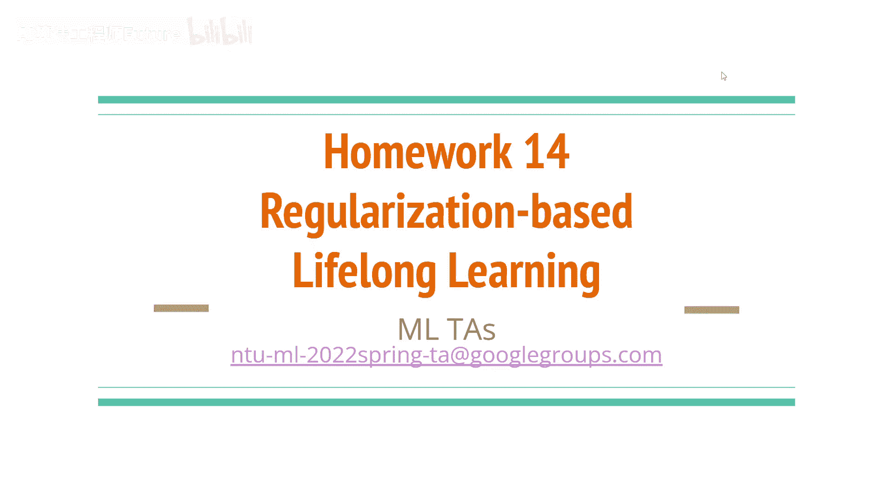

这是作业14live phone learning的投影片，那在进入作业讲解前，先请同学填写一下机器学习后侧的表单，但这份表单并不会影响你的成绩，请同学安心填写。

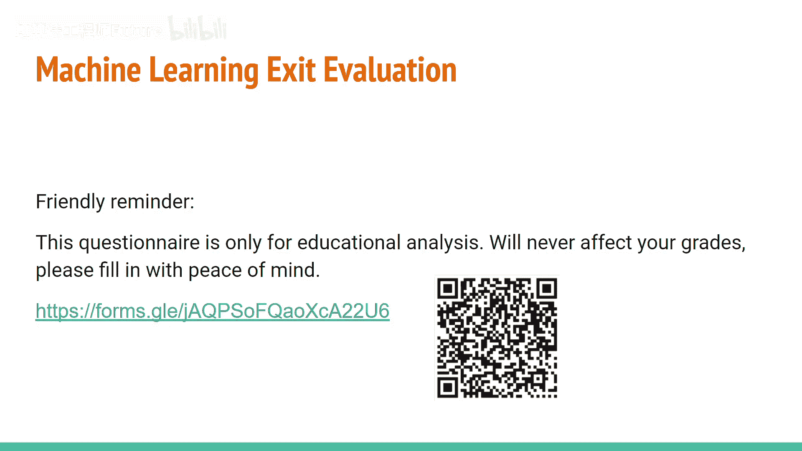

那也请同学填写一下学生课后心得问卷。

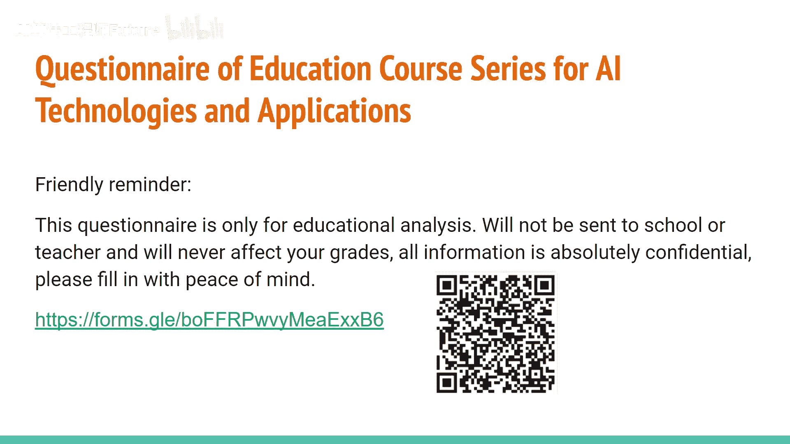

那一样，这份表单不会影响你的成绩，那这是我们这次作业的outline，我会先简介一下iphone learning，然后介绍一下我们这次作业要使用的data asset。

然后介绍一下我们这次作业要使用到的simple code，然后讲解一下评分的规定跟交交作业的方法，那我们这次作业是希望的同学了解，达到lion learning的不同做法。

然后做一下在grade school上的选择题呃，十周一点点东西跑一下simple code来完成report的部分。

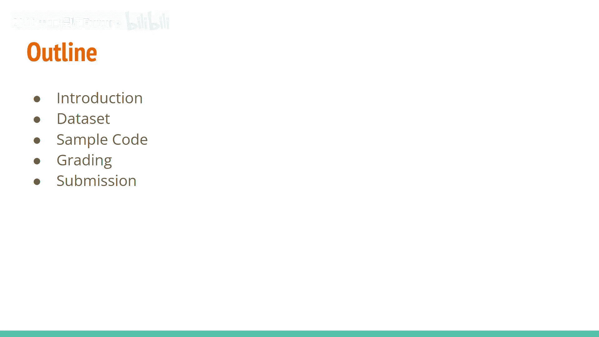

那我先来简介一下iphone learning，Liphone，learning的终极目标是，可以在所有的task上都能做的很好，但是他有一个限制，它的限制是我们要连续训练在不同的任务上呃。

像是我们可能会训练在任务一上，然后测试在任务以上，然后再训练在任务二上，测试在任务二上，然后再训练在任务三上，然后再测试在任务三上。

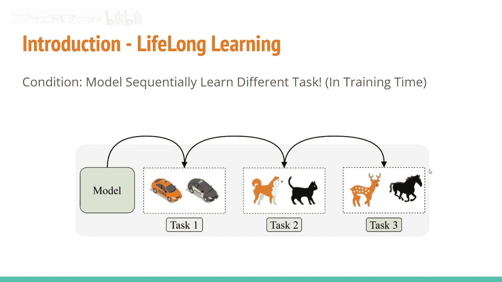

那这可能会遇到一个问题，就是呃灾难性的遗忘，那什么是战略性的遗忘呢，就是假如我们现在有个model呃，训练在任务一上，然后在训练在任务上，然后训练在任务二上之后呢，在测试在任务二上的话呃。

会有不错的效果，但是如果再把这个model测试在任务意义上的话，可能就会发现它的效果不是那么的好，那我们希望是说假如我们训练在任务一上，在训练在任务二上，那之后再测试。

在任务二三跟任务一上都能达到不错的效果。

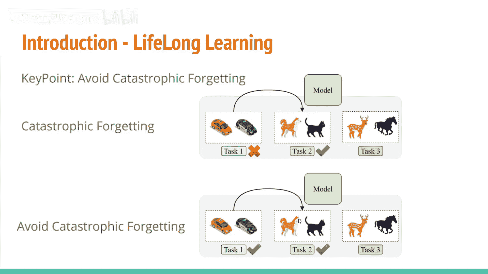

那iphone learning有很多不同的做法，那我们这次focus在regular alization base的方法上面，我们这次的sample code会有备赛。

e w CMS s i r work cp6个方法，那只有SCP不在这个红色框框内，那regular zzation base的方法，就是指说在原本的loss后面。

再加上一个regular zzation term，然后用这个方法去得到额的。

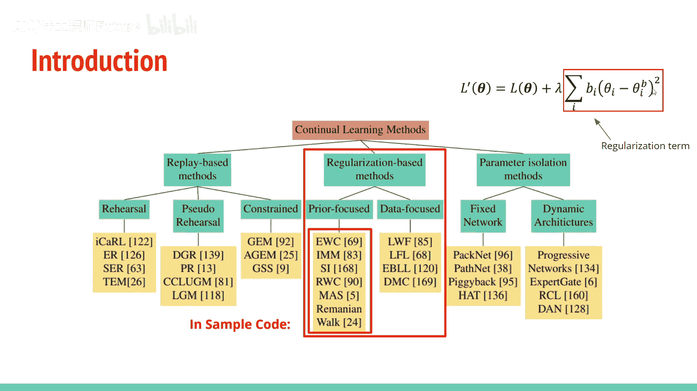

去达到liphone learning的效果。

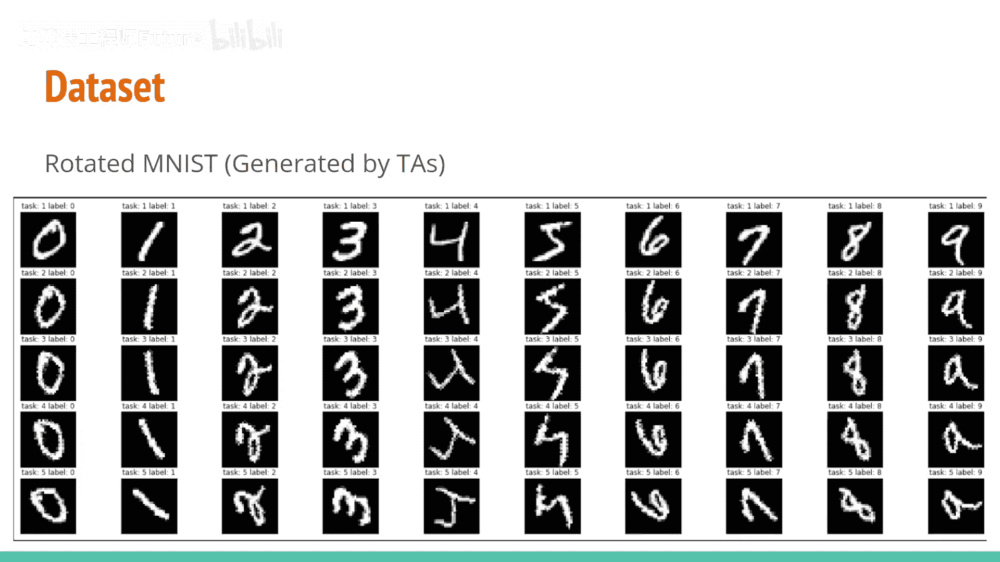

那我们这次的data set使用的是rotated and list，然后AMNEST的话就是手写数字辨识的data assets，那我们这次会透过旋转图片来获，来获得新的task。

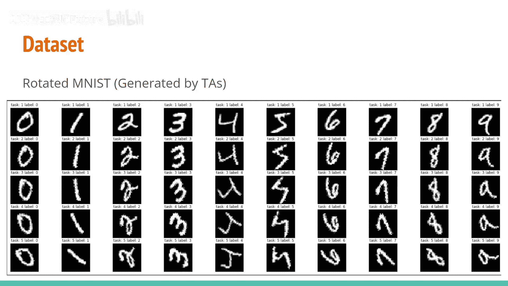

那旋转的方式是助教这里完成的呃，像是第一个task的话会是正常的m list。

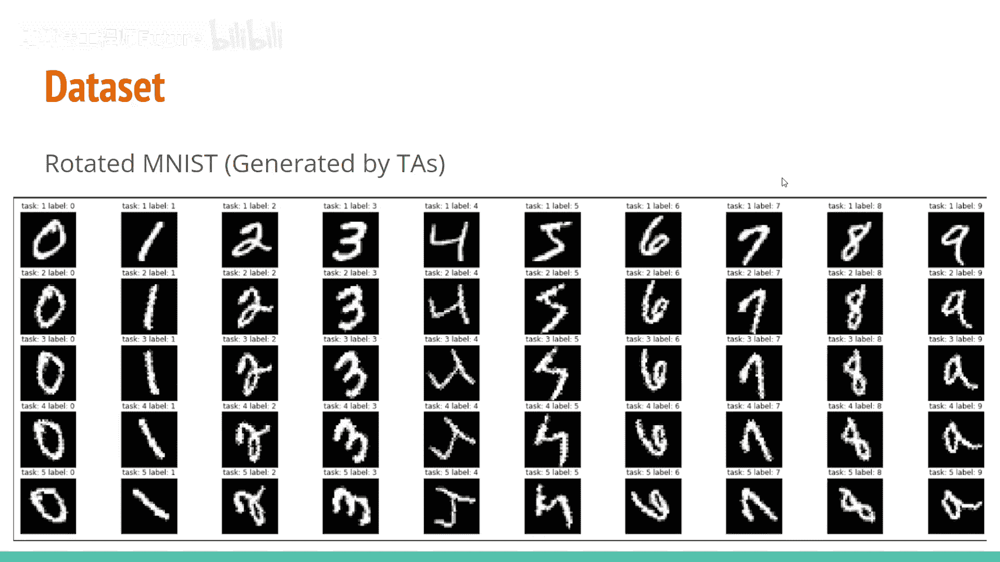

那第二个task的话会是第一个task旋转20度。

那第三个task的话会是第二个text旋转20度。

然后以此类推，再讲解一下有关training的资讯，那我们这次training会有五个task，每个task会跑十个EPOC，那假设同学是使用COLAB来做训练的话。

如果你是使用t four的GPU的话，每个方法大概会花20分钟，那总共的话可能就会花两小时，那假如你是使用K80这个GPU的话，每个方法可能会花50到60分钟，那全部TRA下来的话可能要花五小时。

那助教这边最近在测试COLAB的时候，发现t four的GPU还蛮常出现的，所以呃建议同学可以刷到t four day，开始这次的作业，那这个是simple code guiline，Uh。

Your utilities prepare data，Prepare model train and evaluate methods and lofunction，那我会挑几个比较重要的来讲。

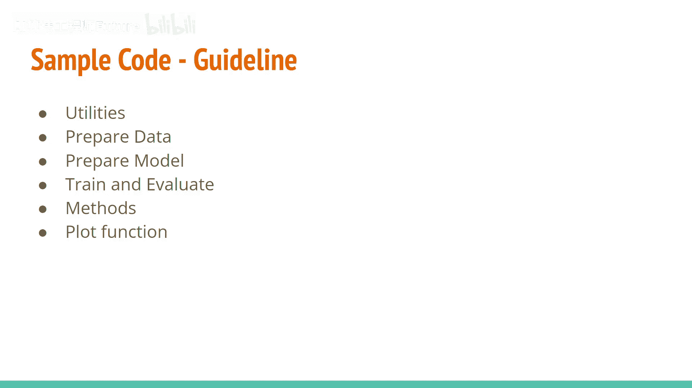

那首先是来看prepare data，那prepare data就跟我前面讲的一样，就是rotated elist，那这边就会写一些呃rotation跟transformation的方法。

然后还有一些data loaders跟data set跟arguments，那还有visualization，就是让各位看一下这个DRC大概长什么样子。

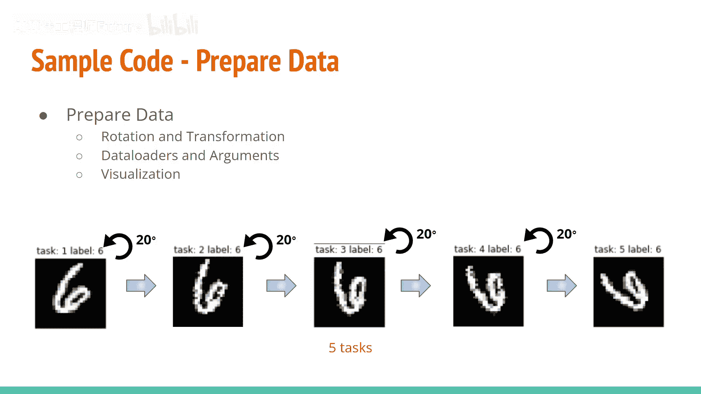

再也是prepare model的部分，那这边就是写model架构的地方，那我们这次采用的就是很简单的底层linear layer，来当做这次的model的架构。

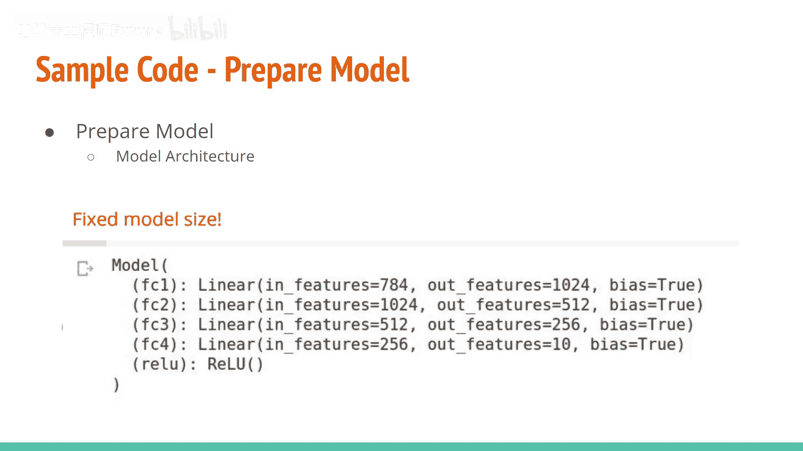

那再也就是train和evaluate的部分，那train里面的话就是写呃，train和train跟EVELLY交替做五个task。

这样然后会把lost加上所谓的regular dization term，然后再update这个loss，这样，那evaluate的部分，就是会使用到一个特别的metric呃，那我会请同学。

我们要请同学去看一下simple code，然后描述一下这个特别的matrix是什么，那请描述这个metric，然后写在你的report里面。

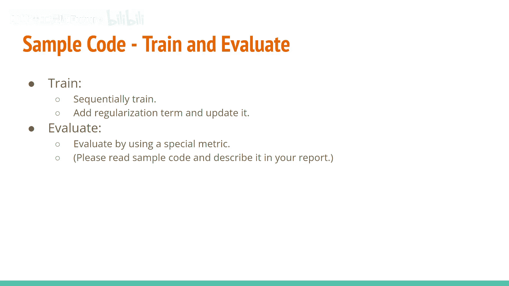

那在讲解方法之前，我们先来看一下这次训练的pipeline，那我们实做的不同的方法，都会被包在这个lion class里面，那不同的方法框架会是一样的，但是里面的操作会不太一样。

那简单来说就是一开始你会有model的参数，然后你model参数就会输入进这个liphone class里面，然后lion开始就会利用这些参数，去算出额首位参数，那第一个任务不会去计算所谓参数。

那这里就会把那model liphone class跟test data呃，输入进这个train里面去做训练，那我们就会TRA死给APARK，然后做evaluate。

那evaluate完之后就想要换新的task，那换新的test，你就会把呃，刚建好的model的参数去输入进这个iphone class里面，然后去额去算出那个所谓参数，去算出那个matrix。

然后我们再跟刚刚一样，把model iphone class跟test data去输入进这个train里面，去做训练，然后再做evaluate，然后以此类推去做完五个task。

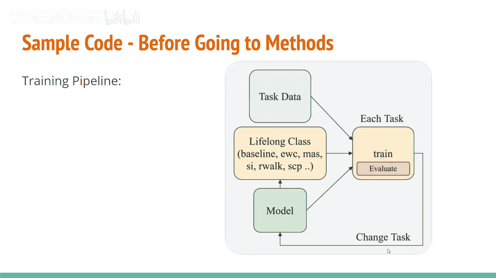

那接下来我来讲解一下这个iphone class，那你首先比较重要的就是这个calculate，importance的部分，那这里就会计算我们所谓的matrix，就是所谓的首位参数。

这里还有两个function，就是penalty跟update啊，这些都会被在train中被呼叫，那这里的panel题就是呃要加上去的那个regular，dization term的部分。

那因为这是这个是BAINE的class，所以我们这个calculate importance呃，就是把那个metric全部都设为零，这样。

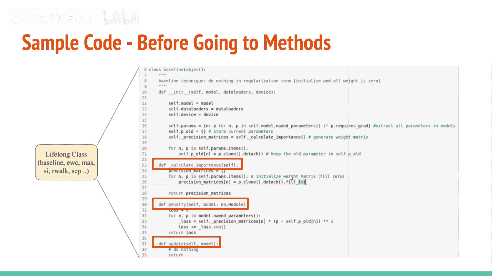

额那我们可以看到说在做的初始化的时候呃，我们这些呼叫到这个calculate importance的部分，然后他就会去计算说我们的所谓参数，计算那个matrix，对，那update部分的话就是呃。

只有SI跟r work的时候才会做事情。

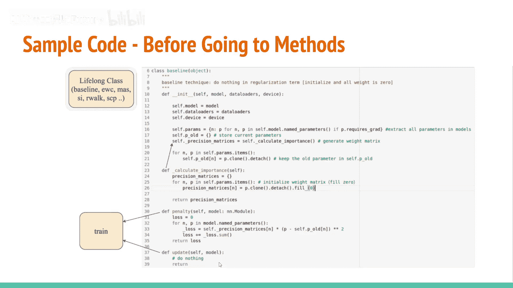

那接下来我们来看一下这六个方法，分别是bassie w CMS s i r work跟SCP。

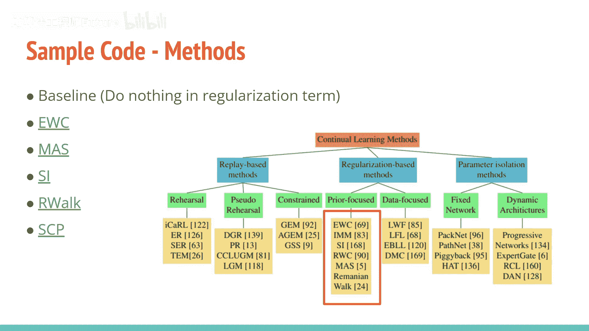

那这里就要请各位看一下paper或sample code，去了解一下EWC这个方法，以及这个首位参数是怎么被生出来的，也要请各位了解一下，是不是需要用到label的资讯，那可以。

那各位可以去看一下EWC的class和calculate，importance这个方式来了解一下，那这边只会出现在选择题的部分，那下面的话就是这个paper的link。

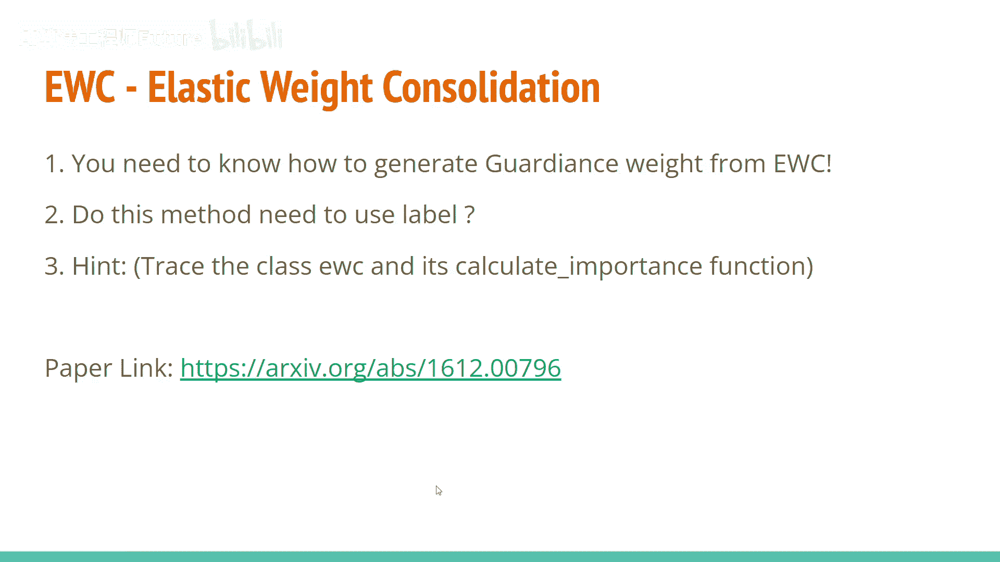

那再也就是ms s，那这里也要请各位看一下paper或simple code，去了解一下ms s的这个方法，以及这个所谓参数是怎么被生出来的，邀请各位去了解一下，是不是有要用到label的资讯。

那这里我们就要请各位去实做一下，这个所谓参数的部分，就是这边的omega matrix呃，那请同学习做完之后将你的code贴到report上面，那请记得只要改我标注标示为to do的地方就好。

不要改code的其他部分，那贴上report的部分也只要是to do的部分就好了，不要将图图以外的code贴上report，然后还有一点要注意，就是说不要改除了to do以外的sample code。

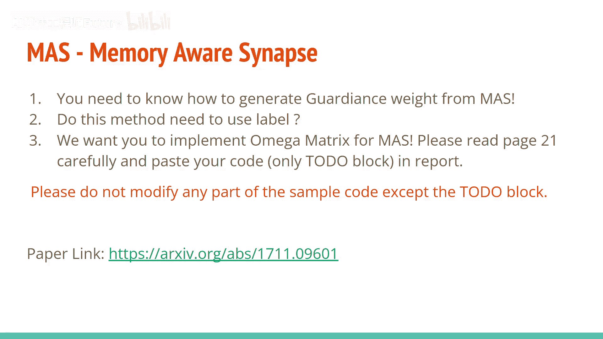

那我来详细讲解一下我们这次实做的细节，那原始的paper会有两个方法，有local版的跟global版的，那local版的话就是把呃每一层，每次把model每一层的layer拉出来的output。

做l two norm，然后再做再做平方，然后再做一些操作，但我们这次呃不想把它搞得那么麻烦，所以只要请同学实做global的版本就好了。

那google的版本就是把这个model最后一层layer的output，做一些操作，就可以获得我们这个metric，那我们来看下面这两个式子，那前面的L的话就是呃原始的loss function。

那后面这一坨的话就是所谓的regular，Alization term，那这个omega就是所谓的matrix，就是我们要制作的首位参数。

那这个matrix的话就是呃这个model最后一层的output，然后对他做l two norm，然后再加上平方，然后做backward，然后再取绝对值，你就会得到的这个首位参数呃，那有一个提示。

就是说你可以去看e w c calculate，important的部分，看那边有十做FISHERMATRIX，那除了计算metric的部分以外，其他的部分都是基本上都是一样的。

所以应该会是一个很大的帮助，那下面这个就是ms is的paper的link。

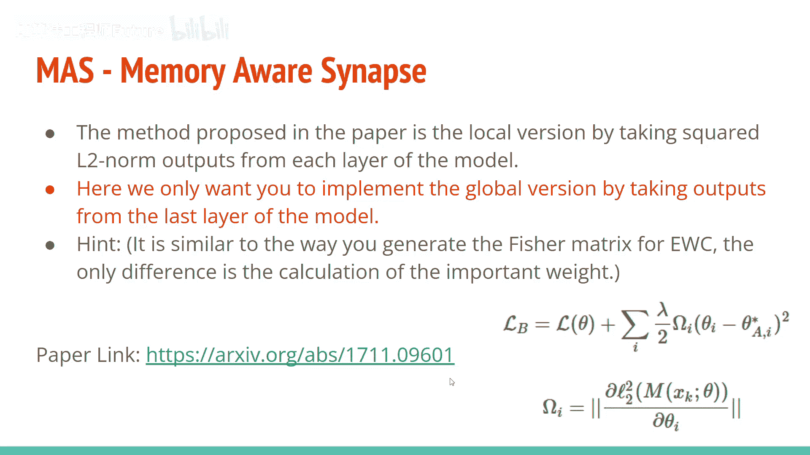

那再就是I的部分，那样，请各位看paper或sample code去了解一下SI这个方法，以及这个首位参数是怎么被生出来的，那也要请各位去了解一下，说呃是不是也要使用到label的部分。

那各位可以去看那个insider class跟calculate important，这个方式，这个方式去了解一下，那这边只会出现在选择题的部分，那有一个提示是说呃，他有个步骤是每次更新步数的时候。

会计算loss的变化量来做累加，那下面就是这个的paper的link，那还有的话就是因为当时的这篇paper是头上，I c e m l，那这是当时的TOS light。

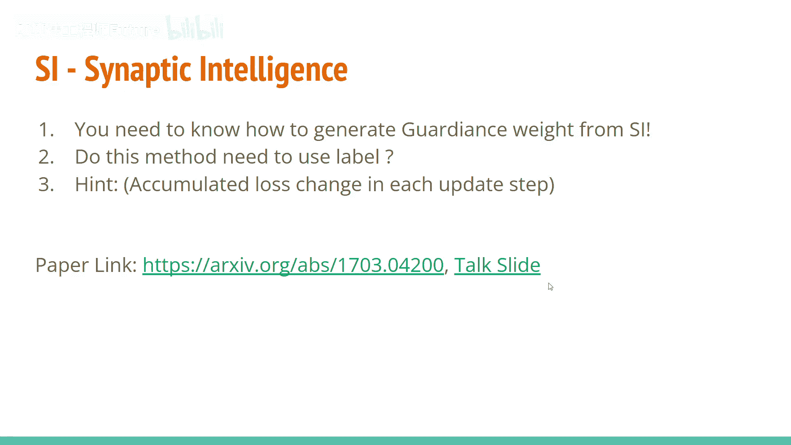

那我来稍微讲解一下SI这个方法，那前面的话就是原本lost，后面就是呃regular dization tern，然后这个omega i就是呃matrix，就是我们要计算的所谓参数。

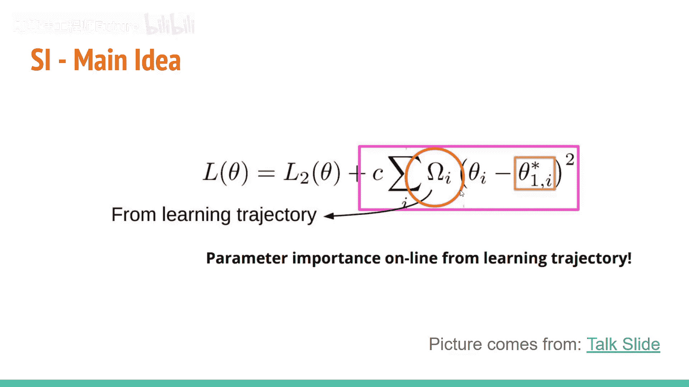

那这个所谓参数的话，就是呃在每次更新步数的时候，会计算loss的变化量来做累加，再做一些处理来获得，那我们来看下面这张图，额这个X轴的部分的话，就是C他在T1等于零的时间点，到T1等于T1的时间点啊。

到底变化了多少，然后这个WI的部分就是指说呃T等于零，到T等于大T的时候啊，这个loss到底变化了多少，这个欧米伽I的话就是呃，lost的变化量会除以这个D塔的变化量的平方，再加上f st。

那这个f on，就是就只是为了避免说这个DAI的平方太小。

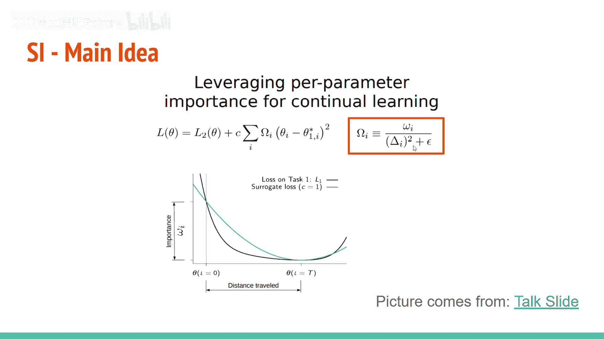

而设立的，那我们来详细看一下他到底是怎么办到的，那同学可能会有疑问，就是说如果model有很多个参数的话，那要怎么知道每一个参数影响，那个loss到底影响了多少。

那我们可以来仔细看一下这条这几这几条式子，那这个GCAT的话，你可以想成是DL除以DCA，那这个theta plt的话，你可以想成底THEA除以DT，那我们从T0积到T1的话，可以想成是额T0到T1啊。

这个loss的变化量，那因为我们这边是采用DL除以DC塔的部分，所以你就可以看成某一个sea呃，去影响到底影响那个loss到底影响了多少，这样。

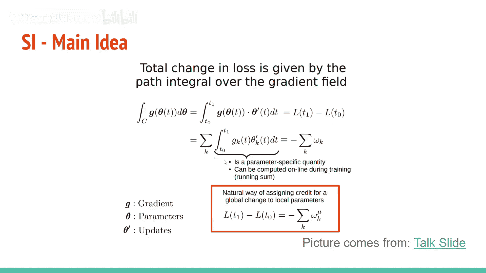

呃再次our work的部分一样，请同学看paper或sample code去了解一下our work这个方法，要请各位了解一下，是不是需要用到label这个资讯，以及这个方法是额。

大概是有哪两种方法集结起来的，那各位可以去看一下our work的class，跟update这个function来了解一下，那这边只会出现在选择题的部分，那下面是这个paper的link。

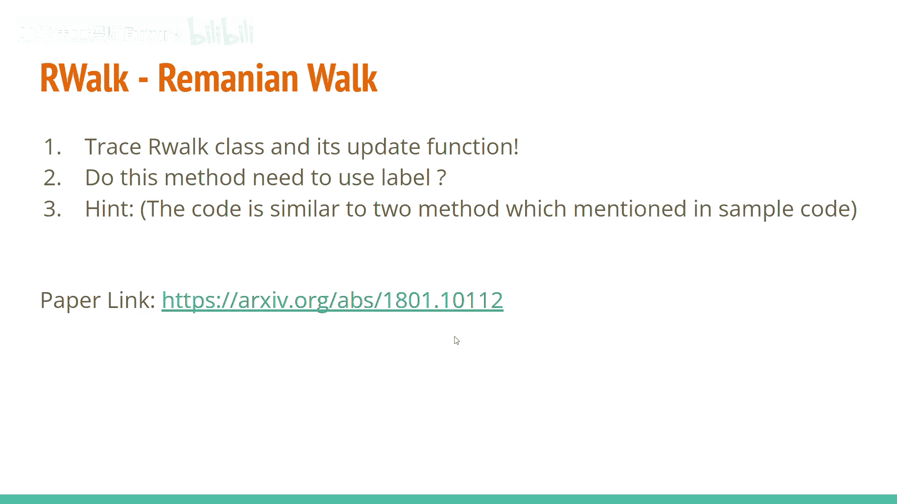

那再是SCP的部分，那这是他的paper link，那我们来简单讲解一下这个方法，那来看一下下面这张图呃，下面这张图呃，表示着这个EWCMS跟CP呃算距离的方法。

那EWC的话大概是使用ko divergence，来限制模型参数的移动，那MS大概是用l two弄，然后来计算那个首位参数，那CP的话还是使用dig builted base的方法呃，比较不一样的是。

他是用当下任务所产生的向量的distribution，然后我们希望再来训练在新的任务的model，在过之前，任务所产生distribution要接近，那你可以有一个大概的想法是说呃。

distribution base的在抓距离的时候是会比较宽松的。

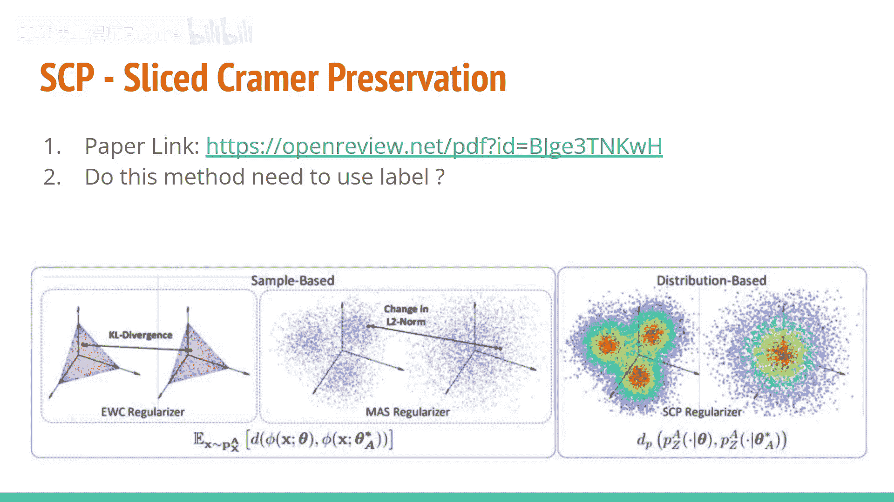

那为什么要这样做呢，就是我们为是为了要防止fast intelligence can overestimate，The importance of parameter，那简单来说就是为了防止过度预测。

参数的重要程度，那INTRICON是什么意思呢，那他是用一个拟人化的方式来说明的，就是固执的意思，那就是model不会想学新的任务，只是想要把旧的任务维护的很好，那新任务可能就学的不好。

然后他发现之前作品可能会有这类的问题，所以这个做法就能让model有过更多的可能，来学习新的任务。

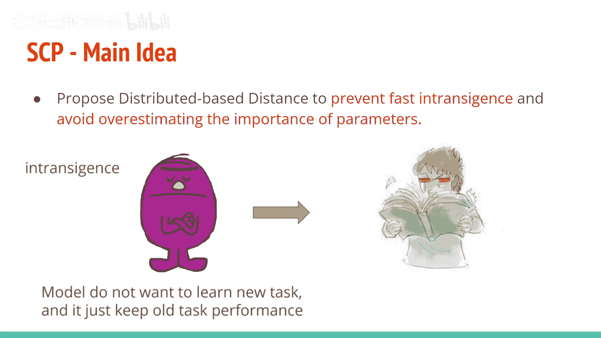

那还有其他方法跟情境，那这只会出现在选择题，那这边就请同学看一下paper来回答选择题的部分，那因为不会问的太深，所以应该不会花太多太久的时间。

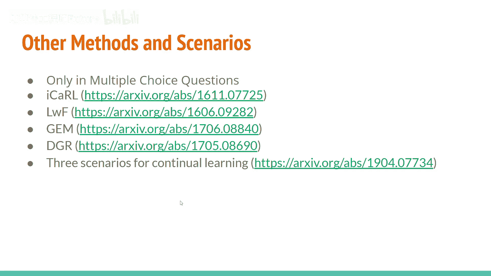

好那再就讲解一下评分的方式，那评分的话就是选择题有20题，然后呢每题0。4分，总共占八分，report的话占两分，那假如是多选题的话，那你那一题必须要全对才会给分。

那这次的作业没有lead the board，那选择题的话详细来看的话，会有三题关于iphone learning的基础问题，2t e w c，2t m s，2t si，2t r work。

然后三题CP，然后六题呃，其他的方法跟scenarios是这样，然后方法跟CIARA就是这个i car l r，L w m g e m d g r。

跟three scenarios就是五五份paper这样。

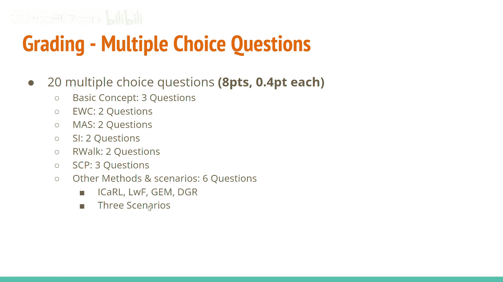

那report的部分的话要请各位跑完所有的code，然后并画出前面所提到的那个special matrix的learning curve，然后这个putting function已经有付给各位。

那同学只要跑完simple simple code就好，就会得到这0。5分，然后另外0。5分就是要呃，描述一下这个special metric到底是什么，那还有剩下的一分就是呃刚刚所提到的。

要是做uh omega and omega matrix，就是image is的首页参数的部分，那再提醒各位一下，就是你只需要动to do的部分就好，然后你也只要贴图do的部分就好。

就是不要贴图do以外其他的code，然后也请修改图do的地方就好，不要修改除了to do以外的部分，然后这边可能同学会有疑问，就是呃假如你没有实做omega matrix的话，那呃第一个0。

5分就是要画出所有的图嘛，那可能会那个图可能会是错的，那请同学不用担心，就是就算你没有实做出这个omega matrix，但是只要你有画出额所有learning curve的话，那这个0。5分就会拿到。

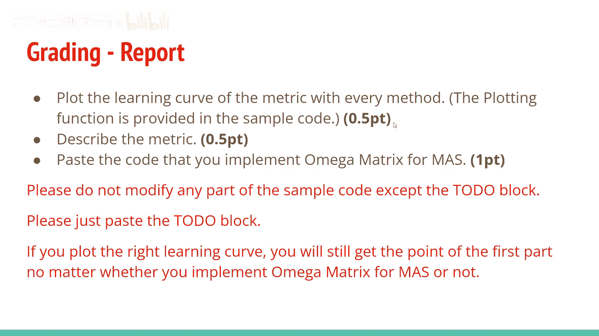

A submission，那就是请各位去grace coe上去回答，那个选择题的部分，然后也把你的report叫到GRASCODE上面，然后扣扣的话需要一点时间，然后请同学有耐心。

然后哦你可以回答无限次数，这样就是那个选择题可以一直回答，一直回答，然后我们只为取你，我们只为取你最后一次回答的成绩，来当做你最终的成绩，然后，就是记得要按储存这样啊。

deadline就是六月24号11。59分。

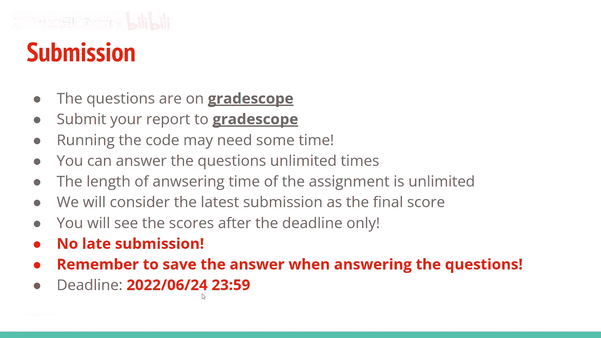

然后不会接受此交，好这里是一些link，然后如果你有任何问题的话，可以去NTU扩的讨论版询问，或是来t hour诶。

