# 【官授搬运】2026年全新优化版李宏毅机器学习系统课程，这才是真正的初学者体系课程！—人工智能／深度学习／神经网络 - P91：【第十五讲】1-元學習 Meta Learning (一) - 元學習跟機器學習一樣也是三個步驟 - AI算法工程师Future - BV1ruqABeEFX

好那这个现在要讲的啊是meta learning，那这是这一门课最后一个主题了，那什么是meta learning呢，meta这个词汇又是什么意思呢，meta这个词汇啊，如果你要翻成中文的话。

通常会翻译成圆，哪个圆呢，就是一元复始那个圆好，那meta learning这个meta到底是什么意思呢，当你说一个东西是meta x的时候，代表说这个东西是X的X。

所以meta learning从它字面的意思来看，就是学习的学习，就我这边说什么叫meta learning，meta learning就是learn to learn，如果翻译成中文的话。

我觉得说meta learning是学习如何学习好，所以这个meta learning呢跟我们之前讲的machine learning，已经是另外一个层次的东西了，拿来作为这堂课的收尾，刚刚好。

就我们要迈向下一个领域，那为什么我们要学习如何学习呢。

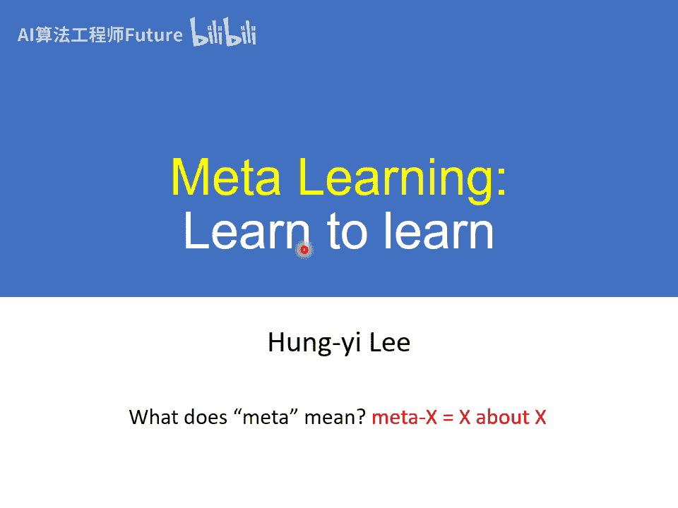

想想看你在这门课的作业都在做什么事情啊，也许你的朋友觉得你在做很潮的东西，这门课有很多很潮的作业，比如说呃动画人物的生成啊，比如说翻译呀，比如说玩阿ATI的游戏啊等等，而你妈觉得你一直坐在电脑前面。

那大众觉得这门课就是学些AI相关的，很潮的东西，然后你的指导教授知道说machine learning背后有很多数学，那你自己呢，这个图的意思就是你觉得自己很强了啊，希望你觉得有有觉得自己很强。

但事实上你在做的事情是什么呢，事实上你就要调参数，对不对，你大部分的时候deep learning就是在调HYPERPARAMETER，我其实不会否认这件事嗯。

deep learning就是就是不能不调hyper parameter，那条hyper parameter真的是一件非常烦的事情，决定什么network的架构啊，决定learning ray啊等等。

真的是一件很烦的事情，那有什么好方法来调learning ray呢，实际上没有什么好方法来调这些hyper parameter，今天业界最长拿来解决调hyper parameter。

方hhyper parameter的方法呢就是买很多张GPU啦，哦对业界来说，他们劝model的时候就像是这个翻车鱼一样，一次训练多个model，那有的train不起来就丢掉。

最后只看那些可以TRA的起来的model，他会得到什么样的performance，所以在业界啊，你做实验的时候，往往就是一次开个1000张GPU啊。

1000张GPU跑1000组不同的hyper parameter，看看哪一组hyper parameter，可以给你最好的结果好，但是在学界呢，在学界哇，你没有1000张GPU。

其实我这边说业界用1000张GPU，这个都是第，这其实都是低估了他们使用的GPU的量啊，然后这个flag那些大公司在才买GPU的时候，他们的单位都是用万来算的，这次要买3万张GPU这种等级啊。

所以这个业界今天在deep learning上的规模呢，真的是跟学界是不太一样哦，所以同学们去业界实习的时候，很高兴一次可以用1000张GPU回来，就突然不知道怎么做实验了啊。

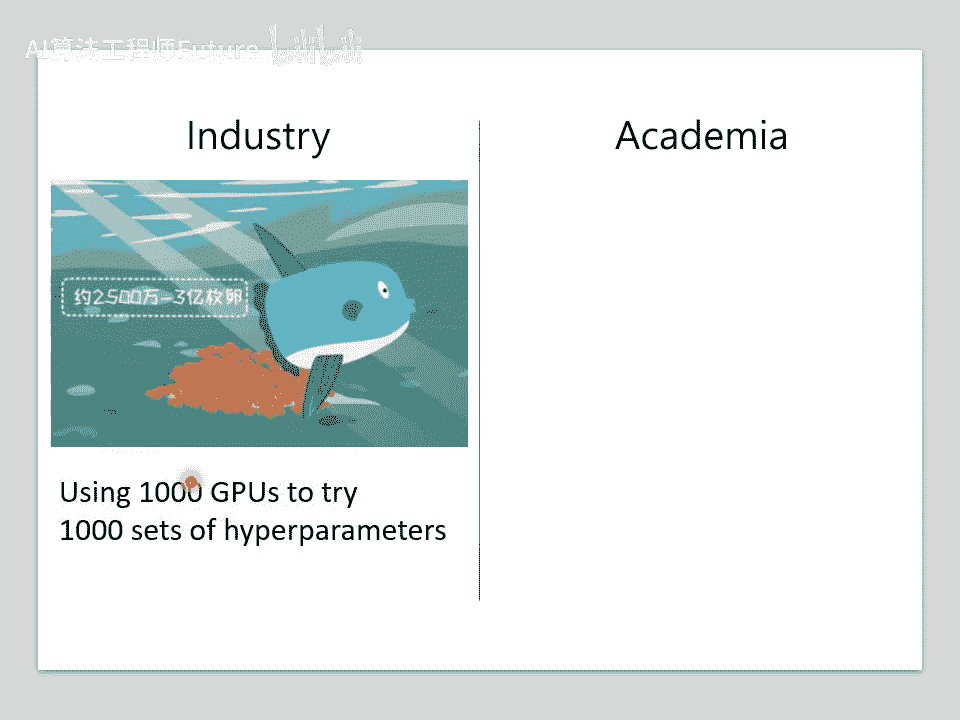

因为在学校每个人只有一张GPU，那就好像说熊猫呢每次只生一胎而已哦，所以那怎么办呢，通常这个时候你只能通灵啊，祈祷说凭着你的经验跟直觉，定义组好的hyper parameter。

祈祷这组hyper parameter可以给你好的结果好，但是有没有更好的方法来决定，这一些hyper parameter呢，今天既然我们说我们在做的是machine learning。

机器可以自动学出一个model，那hyper parameter能不能用学的呢，learning ray啊，network架构啊，这些东西能不能直接用L的，根据data去把他认出来呢。

这就是meta learning其中一个可以帮助我们的事情，好，那在讲meta learning之前呢，我们再回头来复习一下machine learning。

那为什么要再从头复习machine learning呢，你等会发，你等一下会发现，说meta learning最基本的想法跟machine learning最基本的想法，其实并没有非常大的差异。

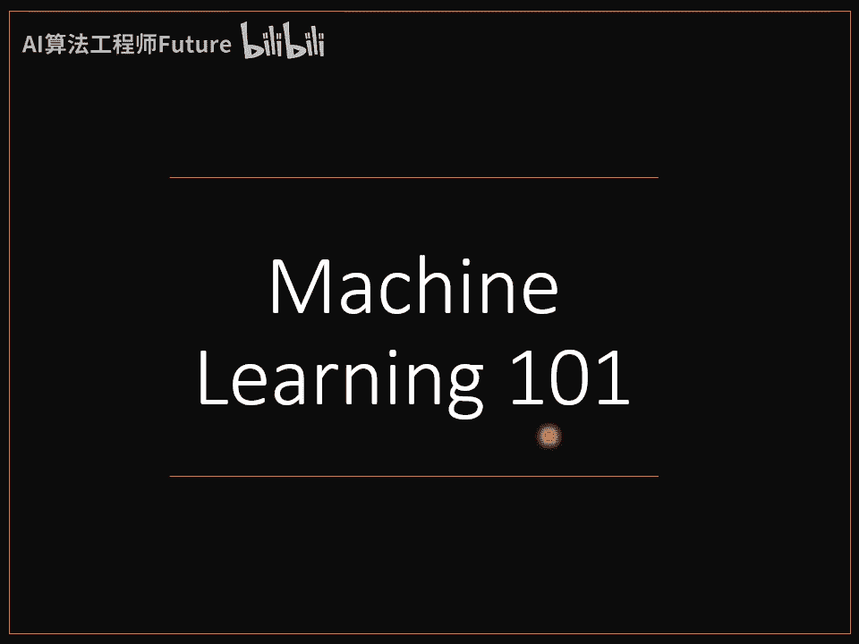

好machine learning到底在做什么呢，我们这边要讲的东西，跟我们第一堂课讲的是一模一样的，所以就首尾呼应，我们用meta learning做结，首尾呼应，回不过来，复习第一堂课的时候。

我们到底讲了些什么，第一堂课的时候，我告诉你说什么是machine learning，machine learning就是找一个function，比如说你要做一个影像辨识的系统，怎么办。

找一个function输入是一张图片输出，是影像辨识的结果，那我们说machine learning就是三个步骤，还记得吗，第一堂课就告诉你，machine learning就是三个步骤。

第一个步骤是什么，第一个步骤是第一个function，这个function里面有一些未知的参数，在deep learning这个领域里面，所谓有未知参数的function其实就是一个network。

而network里面的weight跟bias，neural的weight和bias，就这些未知的参数，他们是准备要被学出来的，那在这门课里面呢，我们通常用SETA来表示，这些准备要被学出来的参数。

那一个network呢，在这堂课里面我们常常把它写成F下标，set up代表说network本身是一个function，这个function里面有一些参数，这些参数我们用set up来表示它。

这是第一步，第二步是什么，第二步是我们要定一个loss function，而这个loss function是一个未知参数，sea的方式，把sea代入loss，我们就知道这个sea是好还是不好。

怎么定这个loss function呢，那你需要有一些训练资料，这些训练资料需要有label，那你把这一些训练资料，假设是要做影像辨识的话，就把这些图片丢到某一个function里面。

由SETA所parameterized的那个function里面，看看他会得到什么样的输出，再跟你的正确答案算一下距离，我们通常如果是分类问题，就算cross entrop。

把每一个example的cross entrop通通都加起来，就是我们的loss，那第三步呢，第三步就是要找一个SETA，这个SETA可以让loss越小越好，所以我们会写一个这样的式子。

我们就是要找一个theta，这个SETA可以让capital l越小越好，这个可以让loss最小的theta，我们用seta star来表示它，那要怎么解决这一个问题呢。

啊在这堂课里面我们用的都是gradient descent，找出set up star以后就结束了啊，你有一个set up st，你就有一个f set us star。

那你就可以拿f k a star来做，你想要他做的事情，你就可以拿f set us star来做影像的分类，这个是机器学习，这个是我们在第一堂课就跟大家讲过的内容。

好接下来我们进入meta learning，怎么学习，如何学习，其实学习这件事它本身也是一个function，一个machine learning的algorithm，你把它简化来看。

其实它就是一个function，这个function我们用大写的F来表示它，这个方程的输入是什么，这个方程的输入不是一张图片，而是一个data set，你把你的训练资料丢到这个function里面。

它输出什么，它输出训练完的结果，假设我们要训练的是一个classifier，那这个function就是吃训练资料作为输入，输出就是classify，我们要拿来分类的那个classify。

有了这个classify以后，你就可以把测试资料丢进去，然后希望他输出来的结果是我们要的好，所以一个learning algorithm，它是一个function，我们这边用大F来表示它。

而它的输入就是训练资料，它的输出是另外一个function，它的输出是一个classify，那这个大F这个方程是怎么来的呢，它是handcrafted的，所谓handcrafted的意思就是它是人定的。

它是人想出来的，我们今天的这些learning algorithm，deep learning啊，然后gradient descent啊等等都是人想出来的，那我们能不能够直接学这个function呢。

我们能不能够用machine learning的概念来学这个function呢，我们能不能够做到学习如何学习这件事，怎么做呢，并没有那么异想天开，想想看。

在machine learning里面我们是怎么找一个function的，透过我们讲的三个步骤，在meta learning里面，其实我们要找的也是一个function。

只是这个function跟machine learning一般要找的function不一样，我们要找的function是一个learning的algorithm。

但是我们也可以透过在machine learning里面学过的，三个步骤来想办法把这个learning的algorithm，找出来，这个就是meta learning要做的事情。

好我们在这边看一下有没有同学要问问题的，好有同学说熊猫一生只生一胎，同熊猫只生一胎是啥哦，我记得熊猫生那个他的后代的时候，他并没有像办法像翻车鱼一样，翻车鱼，就是每次都会生好几亿个卵嘛。

然后只要有其中一只翻车鱼活下来就好了，那据我所知，那个熊猫就是只生一到两胎，对不对，他好像没有办法一次生产很多的后代，哎，就是这样。

好那我们刚才说machine learning透过三个步骤来找function，那meta learning透过三个步骤来找learning algorithm。

第一个步骤是你的learning algorithm，里面要有一些要被学的东西，我就像在machine learning里面，我们说neuron的weight和bias是要被学出来的。

那在learning alism里面有什么东西是要被学出来的呢，那就看你什么东西，你想要让机器自己帮你决定，那那些就是要被学出来的东西，在deep learning里面。

你可能会考虑想要自动学出network的架构，你可能会考虑想要学初始化的参数，那你可能会考虑想要学learning rate，那这些我们之前都是啊让机器自己决定，但是而不是机器说错了。

之前我们都是人自己决定的，这些什么network的架构啊，learning ray啊，那个是你自己设的，你会设不同的参数，看看哪一个参数可以得到最好的结果，现在我们期待他们是可以被学出来的。

我们把这些在learning algorithm里面，我们想要他学的东西呀，统称为F哦，之前我们是用sea来代表一个function里面，我们要学的东西。

那我们现在用file来代表一个learning algorithm里面，我们想要他学的东西哦，所以一个learning awa在接下来的投影片里面，我们都把它写成f fine哦。

F下标翻代表说这个learning algorithm里面，有些是未知的，有翻这个参数它是未知的好，那其实不同的meta learning的方法，他就是想办法去学不同的呃component。

他就会想办法去学一个learning algorithm里面，不同的component，当我们去学不同我们的component的时候，我们就有了不同的meta learning的方法好，那第二步呢。

第二步我们说要定一个loss function，这个loss function会决定说某一组参数它有多好，那现在我们的loss function在meta learning里面。

我们的loss function就是要决定一个learning的algorithm，它有多好，那我们这边用同样用大L来代表这个loss function，大L的fine。

就代表说现在这个l vim用F来作为这个参数的，这个algorithm，它到底有多好，如果L的five哦，它的值很小，LOS很小，就代表他是个好的人，Ning algorithm。

反之他就是一个不好的learning algorithm，但是我们要怎么决定这个大L呢，在一般的machine learning里面，我们说大L来自于训练资料。

在meta learning里面大L是如何决定的呢，我们的训练资料是什么呢，在meta learning里面我们收集的是训练的任务，假设你今天想要训练一个binary的classify。

想要训练一个二元的分类器，那你就要准备很多二元分类的任务，哎我们就要准备很多二元分类的任务啊，举例来说啊，你有一个任务一，这个任务一呢就是要分别苹果跟橘子的差别哦，你有一个任务二。

他就是要分别车跟脚踏车的差别，而每一个任务里面，我们都会有分训练资料跟测试资料哦，所以这个meta learning呢它是有点复杂的，我们有训练的任务，每一个任务里面有训练资料，有测试资料好。

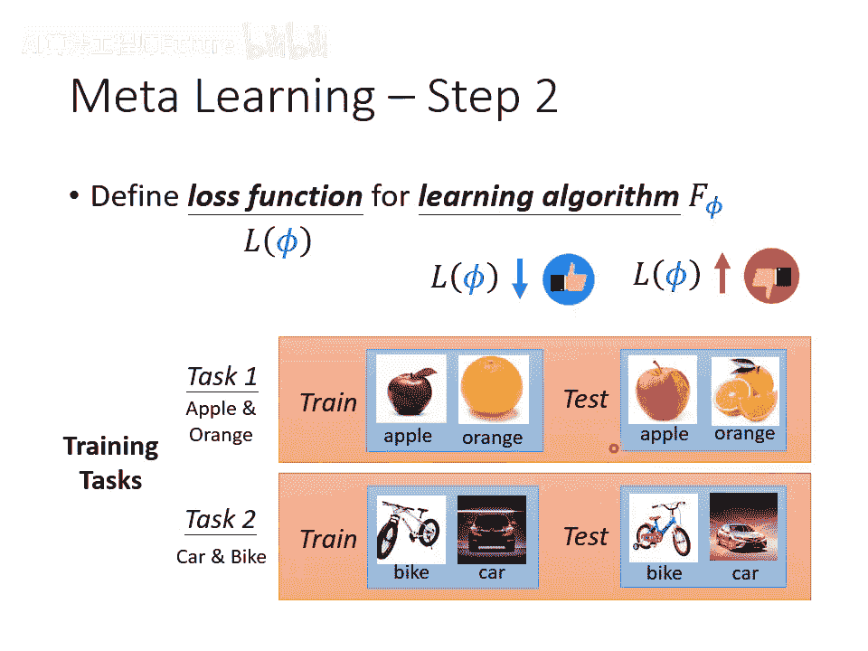

那接下来我们就是要来定，这个大L应该长什么样子好，我们怎么知道一个algorithm好不好呢，那就把某一个任务里面的训练资料拿出来，给这个algorithm学看看好。

所以我们有个任务一任务一是分辨苹果跟橘子，我们就把任务一里面的训练资料拿出来，丢给这个learning algorithm，让他去根据这些训练资料进行学习，那就会学出一个classify。

我们这边用f set打这个上标1star来代表说啊，这个是任务一的classify，他的工作呢是分辨苹果跟橘子，那它是根据这个learning algorithm，他找出来的最好的classify好。

那我们怎么知道这个classify好不好呢，如果这个classify是好的，那就代表我们的algorithm是好的，反之如果这个classify是不好的，就代表说这个algorithm是不好的。

那不好的algorithm，我们就会给他比较大的，这个大写的L的这个loss，那怎么知道这个classify好不好呢，我们就把这个classify套在训练资料上，所以不要忘了每一个任务里面呃，说错了。

我们就把这个classify跑在测试资料上，那不要忘了，这边每一个任务里面，都是有训练资料跟测试资料的，所以我们就用训练资料得到一个classify以后，把测试资料拿出来。

然后用这个classify来分类看看，看看会得到什么样的结果，那你知道我们的这个测试资料啊是有标注的哦，在我们的每一个任务里面，我们的训练资料是有标注的，测试资料也是有标注的。

所以我们可以把测试资料的这些图片丢到f five，学出来的这个classify里面，得到classify predict的结果，然后再跟正确答案做一下比较，然后呢我们就得到一个L上标一。

那这个L上标一就代表说这个classify，用在这些测试资料上的时候，他的表现如何，那如果这个L上哦，这边讲一下，这个L上标一是怎么被计算出来的啊，怎么计算L上标一呢。

其实跟我们在做machine learning的时候是很像的，我们就是把测试的这些资料丢到f sea上，标1star里面好吧，在测试资料丢到f sea上标e star里面，然后他会得到输出。

然后计算输出跟正确答案之间的差异，计算cross entropy，把cross entropy统统加起来，就得到L上标一，如果这个L上标一的值越小，这个loss越小，在测试资料上面的这个loss越小。

就代表我们训练出来的classify越好，那这样就代表我们的learning algorithm月号，它是一个loss小的learning algorithm好，那反之呢，如果这个L越大。

也就是我们认出来的这个classify，用在测试资料上的结果越差，就代表说我们现在的这个learning algorithm，是一个不好的learning algorithm，那到目前为止啊。

我们都只考虑了一个任务，那在meta learning里面，你不会只考虑一个任务，你准备了一大堆的训练的任务，所以你不会只用苹果跟橘子的分类。

来看一个binary classify learning algorithm，它的好坏哦，这是一个可以学binary classify的algorithm，但我们不会只拿苹果跟橘子的分类，来看它好不好。

你还会拿别的二元分类任务来测试它，比如说你就把那个呃，分脚踏车跟汽车的训练资料丢给这个classify，叫他丢给这个learning的algorithm，叫他学一个classify。

虽然这两个learning的algorithm是一样的，但是因为丢进去的训练资料不一样，所以产生的classify也不一样，f set a上标e star代表的是说呢这个呃，呃这这一个classify。

他做的事情是分类苹果跟橘子，那这个set up上标2start是分类脚踏车跟汽车好，那我们一样这个测任务二呢它有一些testing的data。

我们一样把他的testing data呢丢给这个f sea上，标2star，然后看看说得到的正确率怎么样，我们就计算出L2，L2就是这一个learning algorithm，它在第二个任务上的表现。

我们现在知道说这个learning的algorithm f fi，在任务一和任务二上的表现以后，我们就把任务一和任务二上的表现把它加起来，就得到这个algorithm的total loss。

那这边呢我们在做我们在做举例的时候呢，只讲了两个任务，但是实际上你在做meta learning的时候，你不会只准备两个任务，你会准备一大堆的任务哦，所以你今天的大L的fire。

这个fire到底有多好呢，你会看在所有任务上面，loss的平均值，你会准备大N个任务，这个N可以是一个很大的数字，你准备一个大N个binary2元分类的任务。

然后把用fin来当做参数的这个learning algorithm，去这个些大N个任务上都跑过一遍，在这大N个任务上都训练出大N个classify，然后在大N个任务的测试资料上去看看。

说这个classify这大N个classify表现怎么样，然后计算出大N个loss，把所有的loss平均起来，就代表了现在这个learning algorithm，他的表现有多好。

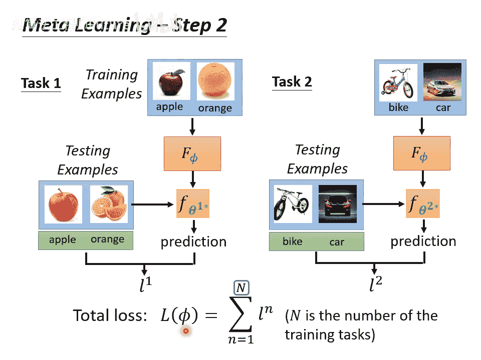

好讲到这边，哪有一件事情你可能会觉得有点怪怪的，这边在每一个任务我们要计算一个loss的时候，对每一个任务要计算loss的时候，我们是用测试资料来进行计算。

而在一般的machine learning里面，一般的machine learning里面，所谓的loss其实是用训练资料来进行计算的，对不对，在一般的machine learning里面。

我们的大L是用训练资料进行计算，但是在meta learning里面，我们的这个小L是用测试资料进行计算，你一听到什么用测试资料，是不是就觉得让你心跳一下。

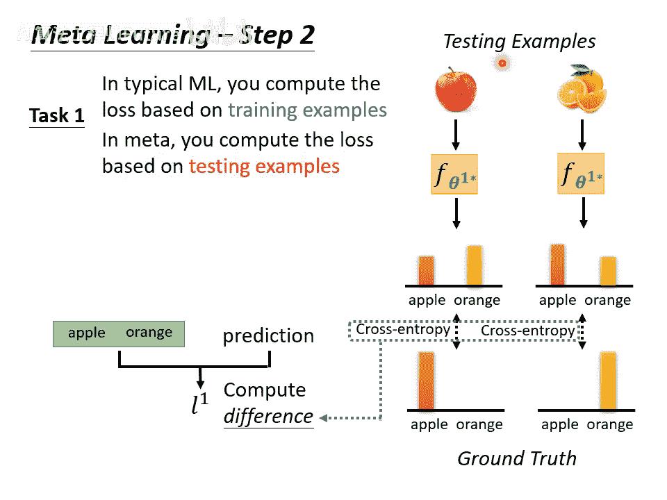

咦这边怎么可以用测试资料呢，我们在第一堂课就有学过，说你是在训练资料上面进行训练，然后把你的classify用在测试资料上啊，在训练资料上训练一个模型，然后用在测试资料上啊。

你怎么会把测试资料拿来做使用呢。

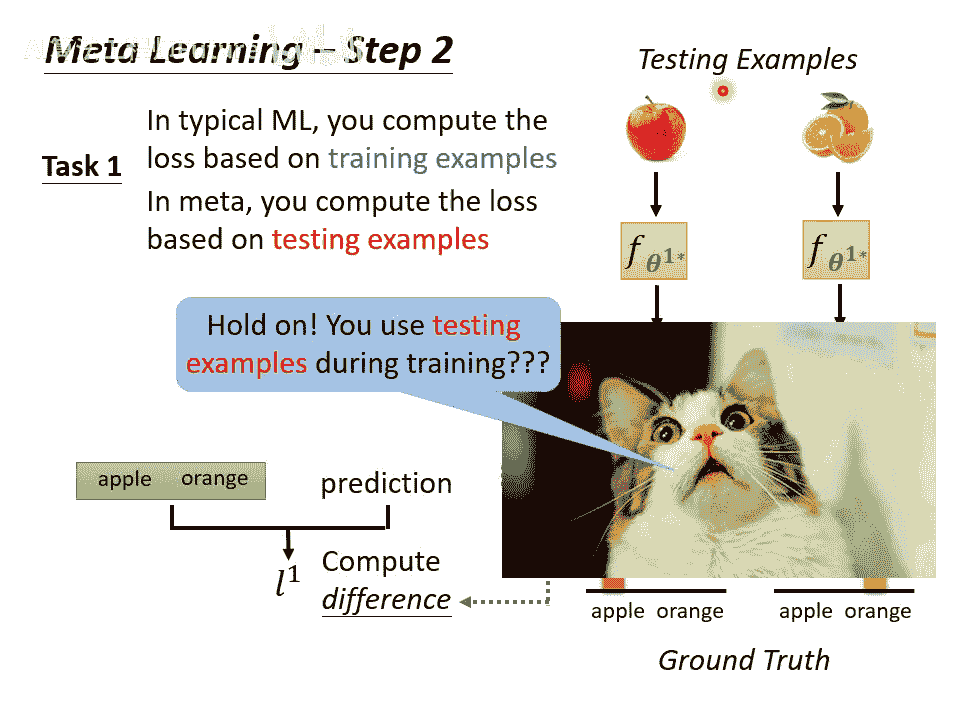

但是这边呢跟一般machine learning不一样的地方是，我们做的是meta learning，我们的训练的单位是task，是任务，所以你可以用训练的任务里面的测试资料哦。

训练的任务里面的测试资料，是可以在meta learning的训练的过程中被使用到的，那我知道听到这边也许你会有一点confuse诶，这个在胡说什么，也有测试资料，听起来乱乱的。

那等一下呢我们把meta learning的演算法介绍完以后，我们会把meta learning跟machine learning再做一次比较，希望那个比较可以让你更清楚。

meta learning跟一般machine learning它们相同的，不相同的地方在哪里好，我们讲完了两个step，我们现在已经知道要train什么，我们也可以定出loss。

第三个任务就是要找一个learning algorithm，找一个F让loss越小越好，这件事怎么做呢，我们已经写出了那个lost function哦。

叫L到fl到F是some mention over大N个任务的LN，那我们现在要找一个F去让L的方它的值最小，那怎么做呢，你就是找一个F让L的F的值最小，那这个可以让L的find的值最小的那个F。

我们叫做fine st，那怎么解这个optimization的问题呢，就看看你要用什么方法解都可以呀，看你知道什么，你可以解optimization问题的方法。

假设今天呢我们知道怎么计算partial fine，Partial l of fine，假设我们会计算这个GRA点，那没有问题，直接用gradient descent就结束了。

但是有时候你会遇到一些问题，就是如果这一项是没有办法计算的呢，因为这个F它可能是一些什么network架构啊之类，很复杂的东西，如果partial fpartial l的fine。

这个five对大L的gradient是无法计算的，那怎么办呢，那你记不记得，我告诉你说，如果你在解一个optimization的problem的时候，如果你没有办法计算gradient。

没有办法计算微分的时候，怎么办呢，用reinforcement learning映衬下去就结束了，所以假设今天L的fine没有办法对翻译做微分，那没关系，也许你可以考虑用RL硬做。

或者是也有人会用一些evolutionary的algorithm硬做，反正就是硬把这个optimization问题解开，你就得到一个learning algorithm，叫做fire star好。

那假设反正呢不管用什么方法，我们现在把这个optimization的问题解开了，得到fire star了，那就结束了，我们就让机器自己找出来的一个，learning的algorithm。

这个learning algorithm是一个被认出来的，Learning algorithm，他是一个被学出来的学习的演算法，我们叫它F下标fast好。

所以整个meta learning的framework是这个样子，你收集了一大堆训练资料，根据这些训练资料，透过我们刚才讲的三个步骤，你就学出来了一个学习的algorithm好。

就这个学习algorithm是学出来的，你有个learn的learning algorithm，听起来有点拗口啊，他是个learn learning algorithm。

我们叫做f five star好，接下来呢你有测试的任务啊，假设训练的时候，训练的任务是教机器分苹果跟橘子，教机器分脚踏车跟汽车，测试的时候是要分猫跟狗，那每一个任务里面都有训练资料，都有测试资料。

那你就把测试任务里面的训练资料，这个点拗口哦，他是测试任务里面的训练资料，你把测试任务里面的训练资料，丢到这个学习的演算法里面，让他进行学习，学出一个classify，然后呢。

再把这个classify用在测试任务里面的，测试资料上，然后你就可以得到你想要的结果好，那测试的任务是我们真正关心，真正要解的，真正希望我们有好结果的任务，这些训练的任务。

他的目标是要来找出学习的演算法，那用这一些训练的任务，找出学习的演算法，以后用在测试的任务上，希望会有好的结果，那像这一种啊学习的演算法，它厉害在哪里呢。

呃不知道大家有没有听过few shot learning，翻成中文，通常是翻成那个小样本学习啦，fusha learning就是期待机器只看几个example，每个类别都只给他三张图片。

他就可以学会做分类，那很多人听到fuu sha learning，往往会跟meta learning搞混在一起，就想说meta learning其实就是fusha learning为。

那其实他们两者是有不太一样的区别的，future learning比较像是我们期待机器达成的目标，就是只用一点点训练资料，就可以训练出我们要的结果，而meta learning是学习如何学习这件事情。

但是为什么大家会觉得fusha learning跟mana learning，非常的像呢，那就是因为今天你想要达到fusha learning，你想要有一个什么学习的演算法。

他只要看到一点点的资料就可以学起来，往往不是人类可以想的出来的学习演算法，所以那些future a learning的algorithm，通常就是用meta learning得到的。

所以大家往往会觉得说哎，future a learning几乎就等同于是meta learning，不过两者还是有微妙的区别的，好我们到这边看一下同学们有没有问题要问的，好我看一下。

好这个建成说等于测试任务是不能碰的，对照一般NL的话没错，对照一般NL的话，这个是你的训练资料，这个是你的测试资料，不过我觉得在meta learning里面，我们就不要我们讲这个训练资料。

这句话的时候要非常的小心呐，我们也在测试任务，训练的任务拿来训练fire star，然后用在测试任务上，每有有个同学说。

每个task的testing data对于meta learning算是training data，对，就是training task里面的training data跟testing data。

就是我们的training data，但是在meta learning里面，我们要避免用training data这个词，那个很多paper在写这个meta learning相关的事情的时候。

他其实就没那么讲究，他就会告诉你说哦我用了一些training data，他就没有讲清楚，说他的training data到底是指training task。

还是说testing task里面的training data，那个这个就非常容易造成误解，所以在这一堂课里面，我们就说，训练的任务里面有训练资料跟测试资料，测试的任务里面有训练资料跟测试资料。

就想成是training task跟testing task就好，对对对，就是要想成training task跟testing task。

testing task的training data在meta learning里面是不能碰的，对testing task的training data是不能碰的，好那个建成说few shot是目标。

meta是手段，对对就是这个意思，那看起来大家都还这观念观念都还蛮正确的好，那接下来呢呃就先跟大家稍微比较一下，machine learning和meta learning的差异。

然后呢我们再休息10分钟好，我们来看一下machine learning跟meta learning的目标，machine learning的目标是要找一个function，我们这边用小F来表示。

那个function可能是一个classify，把张图片丢进去，他就告诉你分类的结果，meta learning一样是找一个function，但他要找的function我们这边用大F来表示。

我们要找一个大F，这个大F是一个可以找小F的大F，不知道大家听不听得懂，我在说什么，总之你有一个learning的ALISM叫做大F，这个大F吃训练资料作为输入，它直接输出训练的结果。

也就是一个classify，希望这个classify可以被拿来使用，希望这个classify可以丢一张图片进去，就输出分类的结果好，那训练资料呢，这比在在machine learning里面。

你是拿某一个任务里面的训练资料来进行训练，在meta learning里面呢，我们是拿训练的任务来进行训练，都有训练资料跟测试资料，不过啊，这个很容易搞混，所以你会发现很多文献为了解套，怎么解套呢。

他们不把任务里面的训练资料跟测试资料，叫做训练资料跟测试资料，在文献上常常有一个解套的方法，是把任务里面的训练资料叫做support set，把测试资料叫做query set。

尤其是在一个叫做learning to compare，那个系列的work里面，更常使用support set跟query set这个词汇哦，所以你看到有个paper说呃。

他用support set做了做了什么，在用query set怎样怎样怎样，这个support set跟query set，指的就是一个任务里面的。

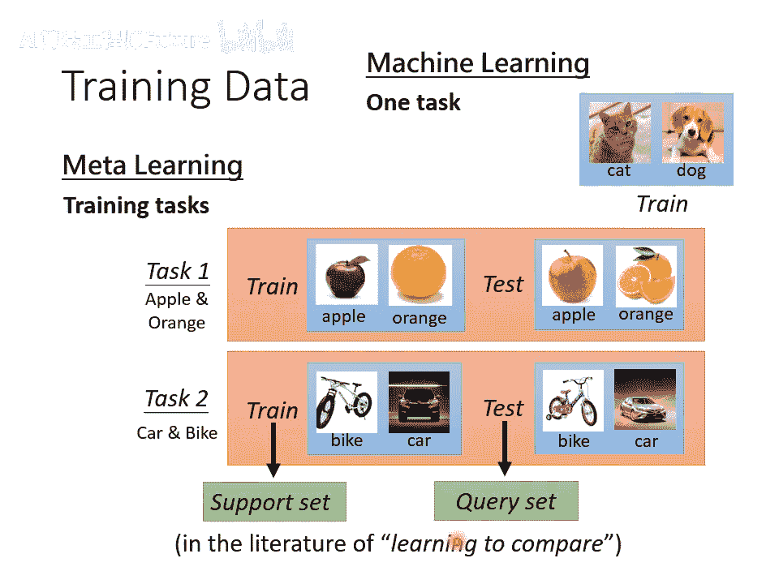

训练资料跟测试资料好，那在machine learning里面呢，我们就是有一个handcrafted的learning algorithm，训练资料丢进去，训练结果也就是一个classify跑出来。

在meta learning里面我们是有一堆训练的任务，我们要用这些训练的任务，找出一个learning的algorithm，那因为meta learning它所谓的训练呐。

是involve1大堆任务的，所以在这堂课里面，我们把meta learning的learning叫做across task learning，Across task training。

它是跨任务的学习，我们把一般的machine learning的学习，叫做within task的training，因为如果我们讲training的时候，你很容易误解，不知道他是这样子的。

Training，认一个learning algorithm的training，还是有了learning algorithm以后，找出某一个classified的training。

这两个training都是不一样，这两个training是不一样的哦，所以这个也是一个training的过程，这也是个training的过程，但为了区别这两种training的过程。

我们把根据一堆任务学出learning alism，这件事叫做across task的training，把只用一个任务里面的训练资料，来学出一个classify。

这件事叫做within task的training。

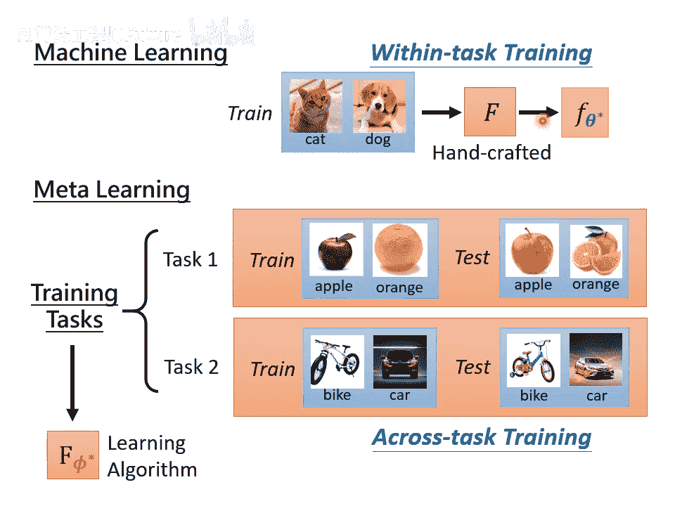

好那所以在machine在machine learning里面呢，完整的framework就是你有训练资料，然后你把这一些训练资料拿去产生一个classify。

然后把testing data丢到这个classify里面，你就得出classify的结果，而在meta learning里面，你是有一堆训练的任务，把这些训练的任务拿来产生一个学出来的。

learning algorithm叫做fada setup fire star，然后接下来列个测试的任务，测试的任务里面有query set跟testing set。

也就是这个support set跟query set啊，你把这个测试任务里面的训练资料丢到learning的，认出来的learning algorithm里面，得到一个classify。

再把测试资料丢进去，然后得到分类的结果，那我们把这个meta learning里面呢的这个测试，叫做across task的testing，因为它不是一般的testing。

一般的machine learning，你的这个testing啊，我们叫做within task的testing，就是你就是把测试资料丢进去就结束了，但在meta learning里面。

我们要测试的不是一个classify表现的好坏，而是一个learning algorithm表现的好坏，所以在meta learning里面，我们的testing还包含了training，大家了解吗。

在meta learning里面，我们的testing还包含了within test的training，所以为了要强调说meta learning的testing不是一般的testing。

我这边叫做ross task的testing，跨任务的测试，在这个跨任务的测试里面，在across task的testing里面。

包含了within task的training跟within task的testing哦，所以今天在across task的testing里面，你有within test的training。

加within test的testing，那有时候呢我们也你在一些文件上会看到说，这整个流程一次within task的training，加一次within task的testing。

这两个这个流程合起来叫做一个episode。

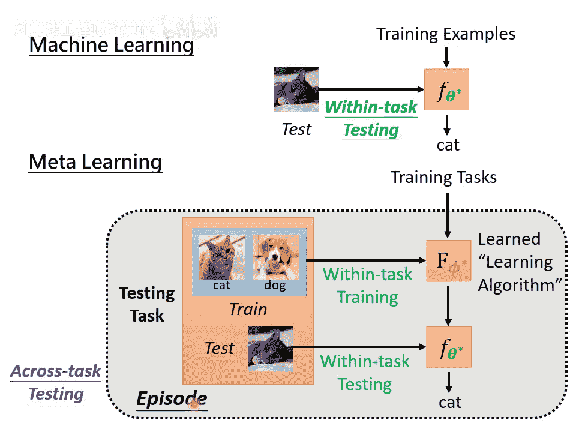

叫做一个episode好，那loss呢，那在machine learning里面我们有一个大写的l of sea，那这个L是some mention over所有的training data。

但这个training data是来自于某一个任务，在meta learning里面呢我们是submention over，呃，在在meta learning里面呢。

这个小写的L它是some mention over，某一个任务里面所有的测试资料，而这个some mention呢是some mention over所有的任务。

所以machine learning你的大L是用一个任务算出来的，Meta learning，你的大L是用一把任务，大N个任务算出来的好，那接下来呢我们来稍微讲一下。

training的时候会发生什么样的状况，在meta learning里面呢，假设你training的时候需要算小L的方小二，不是小L说错了，小L的N，因为因为一般我们在做training的时候。

假设你今天要用gradient descent，那你通常会需要把你的loss呢能够求出来，你当然要能够求出你的loss，那你要能够求出这个大L，我们就要能够算每一个任务的小L。

要算每一个任务的小L其实没有那么容易，要算每一个任务的小L，你需要经过一次within test的training，一次within test testing，也就是一个完整的episode。

你才能够算出一个小L哦，所以这边要算一个小矮娃，这个运算量往往非常大，你光是要算一个任务的小L，然后把它统统加起来变成大L，你就要做一次完整的训练，再做一次测试，你才能够把这个小L把它给算出来好。

那假设啊，我们今天这个optimization的algorithm里面，你要找一个翻译，让L的翻译最小，这件事情的时候，你需要算这个大L很多次的话哇。

那你的across test training里面就要包含做我，within test training跟within test testing好多次。

也就是你的across test training，里面就包含很多个episode，那在文献上啊，尤其是learning to initialize，也就是非常知名的memo那系列的work里面。

往往把across task training叫做outer loop，把within test training叫做inner loop，因为你在across test training里面。

你要跑好几次within test training，所以across test training是outer loop，那with fintest training是in a loop。

不过outer loop，inner loop这个称呼啊，通常只有在learning to initialize，那个系列的work上才会有啦。

如果不是learning to initialize那个系列work，通常也不会这样叫，因为有时候你的那个learning的algorithm呢，他不见得是iterative。

我们在做gradient descent的时候，那个learning algorithm就是要反复跑嘛，要ITERRATED去跑嘛，所以他有很多loop。

所以这边叫outer loop跟inner loop，但有些learning algorithm其实没有loop，那这样叫outer loop跟inner loop就有点怪了。

所以我这边就叫做within test training，跟across test training，但是在learning to initialize那个系列的文章里面。

within test training叫inner loop，across test training叫做outer loop。

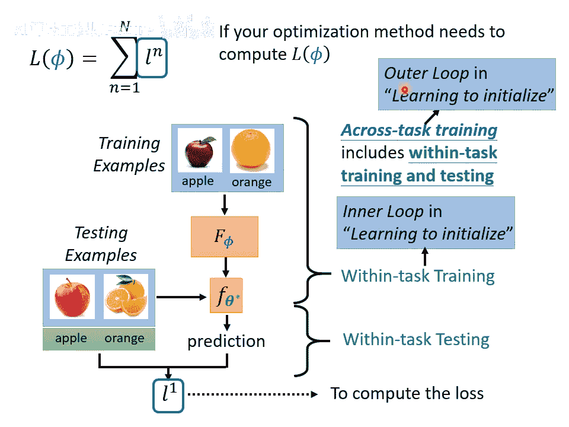

好刚才讲的都是meta learning跟machine learning的差别，那他们有没有什么一样的地方呢，他们其实也有蛮多一样的地方的，事实上。

很多你在machine learning那边学到的知识跟基本概念，都可以直接搬到meta learning来，用，举例来说。

在machine learning上面你会害怕overfeed在你的training data上，对不对，你会害怕，所以在training data上做的很好，但是在testing data上做的不好。

在meta learning里面也有一样的问题，你会害怕说你你马逊找了一个learning algorithm，但这个learning algorithm，只有在training的task上做得好。

来一个新的test in的task反而会做得不好，所以meta learning也有可能有OVERFITTING的问题，如果遇到open feting问题怎么办呢。

在machine learning里面，你是不是最釜底抽薪的方法，就是收集更多的训练资料，在meta learning里面也可以做一样的事，你要meta learning真的做得好。

那你就收集更多的训练的任务啊，就你看有些你你你如果训练的任务越多，就代表你的training example越多，那你训练你在这些training任务上学出来。

learning algorithm就越有机会可以generalize，用到新的任务上面，那我们在machine learning上会做data augmentation，你会用一些方法来增加。

在无在没有增加太多额外负担的情况下，增加你的训练资料，在meta learning里面你也可以做task augmentation，你也可以想一些方法来增加你的训练的任务好，那这边有一个小。

这边有一个meta learning的问题，你知道在做meta learning的时候，我们还是要做optimization，你还是要想办法去找一个fine，可以让L的翻越小越好。

但是假设你今天minimize l的finder方法一样，用的是gradient descent，难道那个gradient descent就不用调参数了吗。

假设你要learn learning rate，但是你learn learning rate的时候，你也要用gradient descent，你不是有另外一组learning rate要调吗。

对你就是有另外一组learning r要调，所以你在自己实做meta learning的时候啊，也是要暴调一波参数的，只是你暴调的不是每一个任务训练的参数。

而是learn learning algorithm的时候的参数，所以你有时候会觉得哇做meta learning好像是呃，为了避免让自己压力更大，反而压力更大，为了避免秃头，然后让自己压力更大。

结果反而秃头这样，所以做beta learning也是需要调参数的，但是meta learning期待做到的目标是，假设我们假设花了很多力气暴调一波参数。

找到一个好的learning algorithm以后，它可以用在任何新的任务上，以后在新的任务上就再也不用调参数了，一劳永逸，我们暴调一次参数，找出一个好的learning algorithm。

这个好的learning algorithm就不必调参数了，可以用在任何新的任务上好，那既然讲到要调参数啊，那就遇到一个问题了，记不记得在做我们训learning的时候。

我们把我们不是只有training set跟testing set，我们是有training set，有development set，有testing set。

你用development set来选择你的模型，对不对，你用development set来决定，比如说你的network架构应该长什么样子，而meta learning我们也有参数要调啊。

那meta learning是不是应该要有development task呢，我认为meta learning应该要有development task。

所以在meta learning里面你应该要有training task，要由development task来决定，训练那个learning alism的时候的一些hyper parameter。

然后才跑在testing的task上面，不过如果你读meta learning的文献，你会发现说很多meta learning的文献诶，它是没有development task的。

它是只有training task跟testings task，但是我认为meta learning应该要由development task好，那我看看大家有没有问题要问的，好我看一下哦。

有同学问说这样会不会无限递回学习，如何学习，如何学习之类的，对就是有可能会有这个问题，这就是一个梗啦，就是现在我meta learning，对不对，以后就会有人去提meta meta learning。

还会有人在提meta meta meta learning，不知道什么时候才会停止，什么状况l of f会没办法对F做微分，取决于你的，有同学问说L的发什么时候没办法对F做微分，取决于你的发音是什么。

对不对，就是假设你的发音是，比如说learning rate，你要能够做微分呐，你的你要那个东西，就是你拿翻去对L的翻做微分的时候，你要能够计算当翻做小小变化的时候，LLY会有什么样的影响。

那假设你的fire它根本就是discrete的东西，它是离散的东西，比如说network架构一层两层三层，那他根本没有办法做小小的变化啊，你根本没有办法说从三层变到3。1层，看看会发生什么事吗。

所以如果你的翻译是一些离散的东西，那你没办法做微分，我下面有同学回答说，翻包含神经元连接的资讯之类的，对，然后，对有一个同学说，像meta learning里面IGA之类的都可以用。

对IGA之类的都可以用，development task是什么，这个，这个就是你想想看你在做meta learning的时候呃，你不是比如说你用gradient descent，来解那个LLOFI吗。

那gradient descent里面不是也要调learning rate吗，那你那个learning rate要怎么怎么决定，你是不是要试不同的learning rate。

那你试不同的learning rate，有得到不同的learning algorithm以后，就我们现在的learning rate是要找learning algorithm的。

那个learning rail，我们是不同的learning rate，得到一把learning algorithm以后，你怎么知道哪一个是最好的呢，那你应该用development set来挑嘛。

然后用DEVEL挑出development set最好的那个learning algorithm，然后才把它用在testing的task上面，对不对，这样你才不会OVERFIT到。

那你才不会等于是拿那个testing的task，来调你的hyper parameter，好希望将有回答到大家的问题，很多人不知道用development task这件事，大家其实也不必太亚裔。

我觉得这个一个新的技术在发展的过程中啊，本来就会有很多的磕磕绊绊啊，那今天不是所有的论文，你会发现很多meta learning的论文，他没有development task。

但是我相信在比如说10年后，大家都会知道应该要用development task，那就好像说哎，我10年前其实修过林轩田老师机器学习啊，其实我没有修过，没签，我其实知道你知道就是济学这种课。

都不是你想要修就可以修的吗，我当时也没签到啦，我是旁听而已啦，那那个时候林轩田老师就说，哎不是每个人都知道要用development的DATASET，你读了很多论文。

有些论文他就没有用development data set，它就是劝在training data上，直接用在testing data上，用testing data来调参数。

那这个那个田林轩田老师就说这个是cheating，那我们要知道不要这么做，但今天大家都知道说machine learning就是要切training set。

development set跟testing set，那未来大家也都会知道说meta learning，你就是要签training task。

development task跟testing task，好希望这样有回答到大家的问题，好，我们在这边休息一下，我们休息一下，我们10分钟后回来。

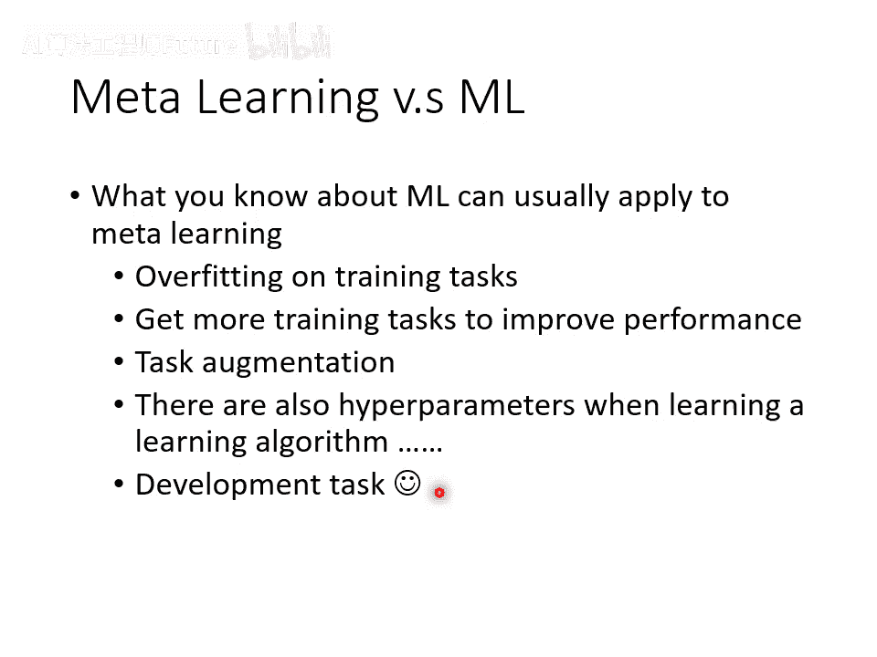