# 【官授搬运】2026年全新优化版李宏毅机器学习系统课程，这才是真正的初学者体系课程！—人工智能／深度学习／神经网络 - P92：2-元學習 Meta Learning (二) - 萬物皆可 Meta - AI算法工程师Future - BV1ruqABeEFX

好那我们已经讲完了meta learning的基本概念，那接下来就是举一些实例，告诉你说在meta learning里面什么东西是可以被学的好，那我们一般最常用的learning algorithm呢。

其实今天就是gradient descent啊，你知道说在gradient descent里面，我们就是要有一个network的架构，然后呢你初始化一下你的参数，我们把这个初始化的参数叫做C大零。

然后呢你要有一些训练资料，那通常是从训练资料里面sample一个batch出来，对不对，我们第一堂课就跟大家讲过，batch sample batch出来计算gradient。

然后用这个gradient呢来update你的参数，所以从theta0变成theta pl，然后再重新计算一次gradient，再update参数，然后就反复这样下去，直到次数够多，你满意为止。

那就把最终训练的结果，最终得到的参数把它输出出来好，那在这整个过程中，哪些东西是可以劝的呢，首先initialize的参数是可以劝的好，所以SA0是可以劝的，怎么说呢，一般我们SA0呢。

你就是random initialized的嘛，从某一个固定的distribution里面sample出来的嘛，但是你也知道说，SETA0对结果往往有一定程度的影响，好的初始化参数。

不好的初始化参数可以天差地远，那我们能不能够透过一些训练的任务，来找出一个对训练就是特别有帮助的，initial的参数呢，可以。

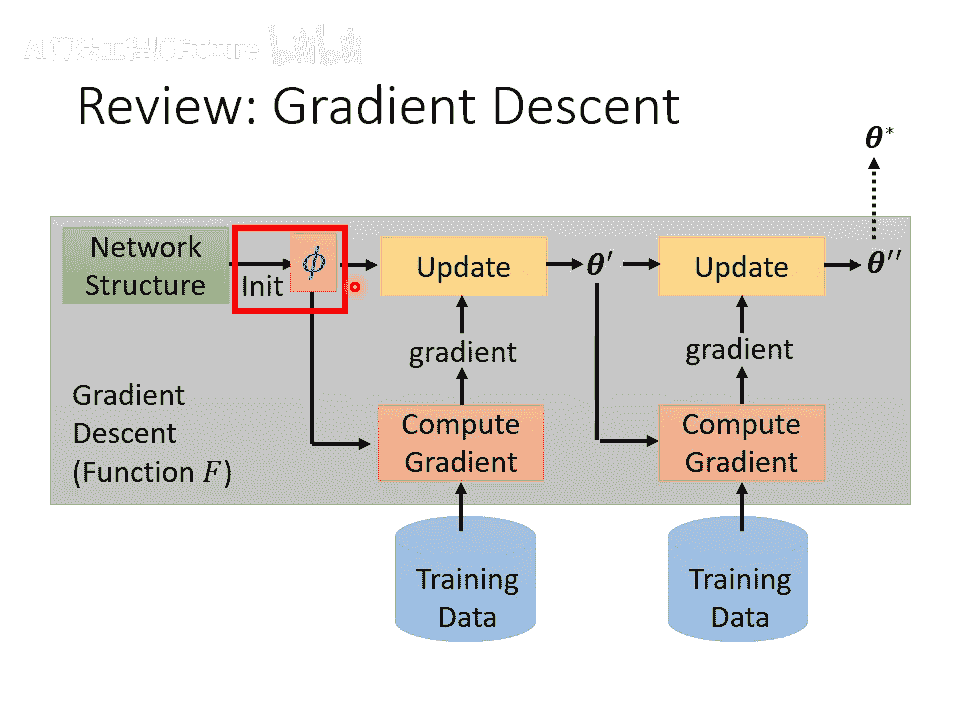

这个方法就是最在，我觉得在meta learning这一系列work里面，可能大家最耳熟能详的model agnostic，Meta learning，它的缩写呢叫memo。

那它的发音那就跟哺乳类动物有点像哦，那有另外一个这个memo的变形呢就叫做reptile，那我觉得不知道是不是故意的哈，把这个名字呢取成reptile，reptile呢就是爬虫类的意思。

那这些方法的细节，那因为时间有限的关系，所以我们今天就都不细讲，我只是把一些reference列在这个投影片上，给大家参考，但是在作业里面就这个我们会问很多跟meta learning。

跟memo有关的问题，所以假设你想知道更多有关memo的细节，你在作业里面可以学到，跟更多跟memo有关的事情好，所以有一系列的方法，它就是learning to initialize。

他去learn这些initialized的参数。

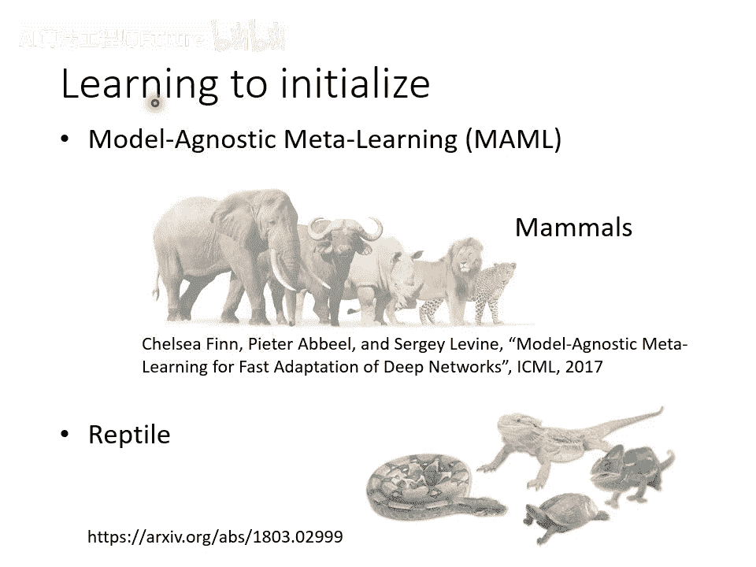

其中最有代表性的就是memo好，但是就像我们刚才讲说，做meta learning的时候，你也有hyper parameter是你需要挑的哦，所以做memo的时候。

虽然你要去learn一个initialized的parameter，但是learn这个initialize parameter的过程中，也是有很多HYPERPARAMETER，你需要自己决定的。

这实际上最原版的memo并没有非常好劝好，有一篇paper呢叫做how to train your memo啊，这也是一个网页梗啦，就有个卡通叫how to。

有一个动画叫how to train your dragon嘛，他就把dragon改成memo，所以这篇paper的title叫how to train your memo。

他就说他试着train了memo3次哎，也用不同的RENDANCY，你知道train initial parameter这件事，他也需要RENDANCY，你也需要做gradient descent。

那如果你对这些有困惑的话，在作业里面，你可以更详细的知道meal training的细节啊，作业那个在在作业里面，有这个memo的范例的城市，那你看那些城市以后。

可能可以让你对memo有更进一步的了解哦，所以劝MAO也是要调参数的，也是需要random seed的，只要适合三个不同的random seed发现就是红色，这三条线有时候圈得起来，有时候圈不起来。

所以在这篇paper里面，他就提出了一个新的方法叫做memo加加啊，期待说啊，memo加加可以做起来，还有关更多memo加加的细节，大家再自己去读，How to train your memo。

这篇文章好。

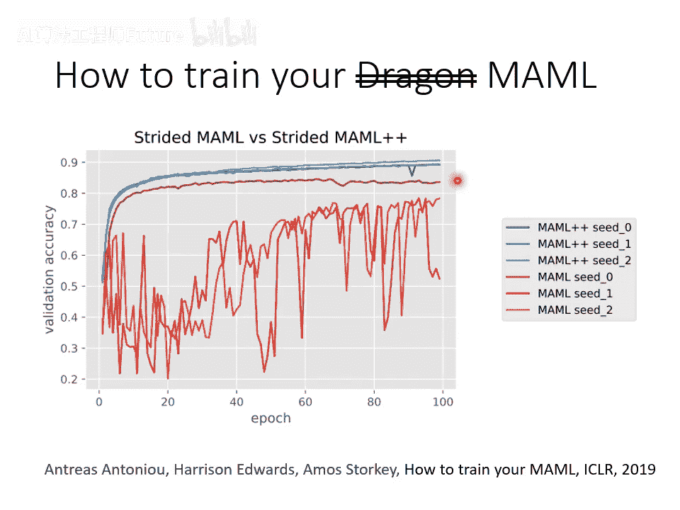

那讲到memo啊，讲到找一个好的initialization，有没有让你想到课程的另外一个主题呢，在课程的另外一个主题讲self supervised learning的时候。

我们是不是也有提到好的initialization，这件事情呢，在memo里面我们有一堆训练的任务，但每个任务里面有训练资料跟测试资料了，我们一堆训练的任务，根据这些训练的任务。

找出一个好的initialization，然后呢用在测试的任务上好，那但是在sale supervised learning里面，我们是怎么做的呢。

在sales supervised learning里面，我们就是有一大堆的没有标记的资料，那这些没有标记的资料，我们可以用一些proceed task去训练它。

比如说在bird里面就是用填空题来训练你的模型，那其实在影像上也可以做self supervised learning，你也可以说把影像的其中一块盖起来，叫机器必须预测被盖起来的一块。

但今天在做影像的self supervised learning的时候，可能这个masking的这种方法，填空的方法不是最常用的，今天比较流行用另外一个系列，我们在课这个课程里面没有介绍的。

contrasted learning的方法，那这个有兴趣大家再自己去研究，那总之讲到好的initialization这件事啊，是不是让你想到self supervised learning呢。

在self supervised learning里面，我们会先拿一大堆的资料去做PRETRAINING。

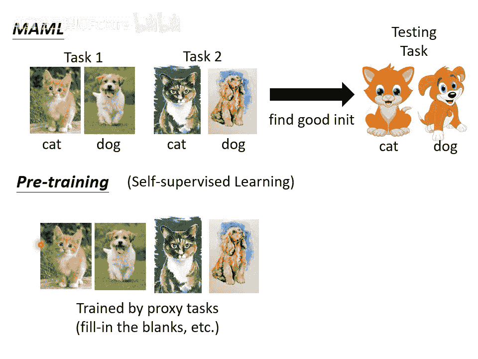

那PRETRAIN的结果我们也说它是好的，Initialization，那把这些好的initialization，一样可以用在测试的任务上，那这两者有什么不同呢，当然如果我们直接比较memo。

跟今日的cell supervised learning的话，那至少最明显的不同是啊，memo呢这些任务是有用到标注资料的，而在self supervised learning里面。

我们是没有用到标注资料的，所以呃PRETRAINING这一招，self supervised learning这一招虽然会好，但是你不知道为什么会好，我们其实今天并没有非常清楚说。

为什么这些PROCE的任务对testing the task会有帮助，而对memo而言，它会好似乎是理所当然的，找出一组好的initialize参数。

也许他就可以transfer到testing的任务上，但是如果你回到几年前，在还没有self supervised learning这个词汇的时候。

你的sales supervised learning呢，他会这个词汇会爆红起来，也是ya cou在2019年4月的时候说的，我记得是好像是4月330号之类的，那其实在我的那个YOUTUBE频道上。

第一次讲memo的时候，其实是4月30号之前的，那个时候我们都还不太清楚，self supervised learning这个词汇，那sell supervide learning这个词汇。

当然在YANA更讲说这个sales supervised learning很厉害，之前，其实也有人用过这个词汇啦，只是之前如果你随便发明这些怪怪的词汇的话，你可能就被别人抨击嘛。

不过大声讲说有一个技术叫sell supervised learning，那就有了self supervised learning，好，总之过去啊。

在sales supervised learning这个系列还不红的时候，那个时候PRETRAINING有另外一种想法，比较常见的做法是，你一样有好几个任务的资料。

你把这些好几个任务的资料通通都倒在一起，把它当做一个任务进行训练。

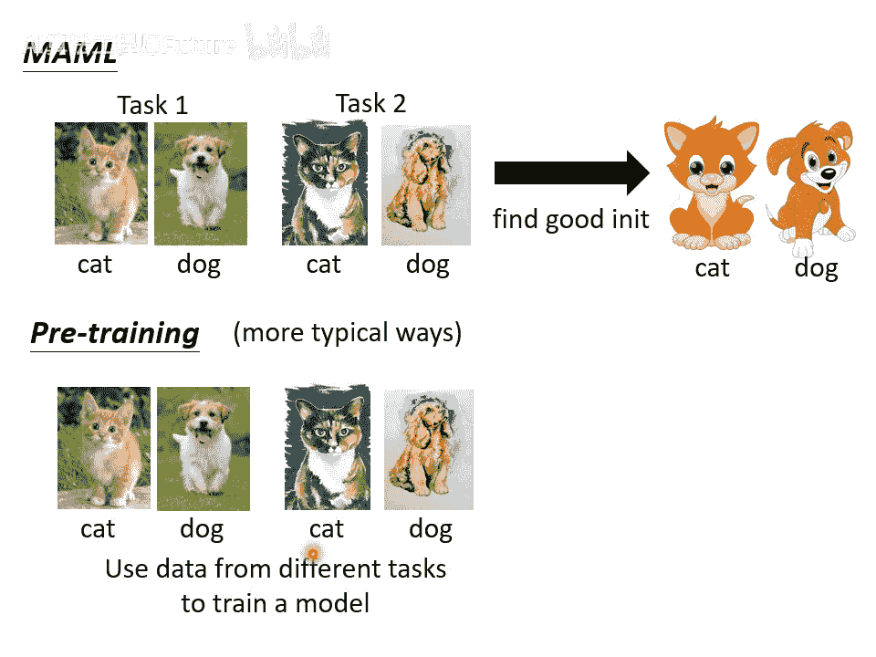

然后接下来呢，你一样可以找一组好的initialization，一样可以把它用在测试的任务上，那像这样子把好多个任务的资料统统倒在一起，当做一个任务来训练的做法。

这个叫做multi task training，那其实一边今天一般你在做memo的研究的时候，那通常会把这种morttask training的方法，来当做meta learning的baseline。

为什么会把这样的mottest learning当做memo的baseline呢，因为仔细想想，你会发现说这两个方法，他们用的资料都是一样的，一边只是我们会把不同的task分开。

另外一边把所有的task的资料倒在一起，那这两种方法有什么样的差别呢，好假设你想要知道更多meta learning，demo跟PRETRAINING的差别的话啊，你可以看一下这个影片。

而在这个影片特我今天特别要强调这个影片，让其这样，请大家务必要看，是因为这个影片里面，他是有防不胜防的叶配的啦，那我现在要特别液配这个影片，这个就是叶配的叶配，就是meta叶配好。

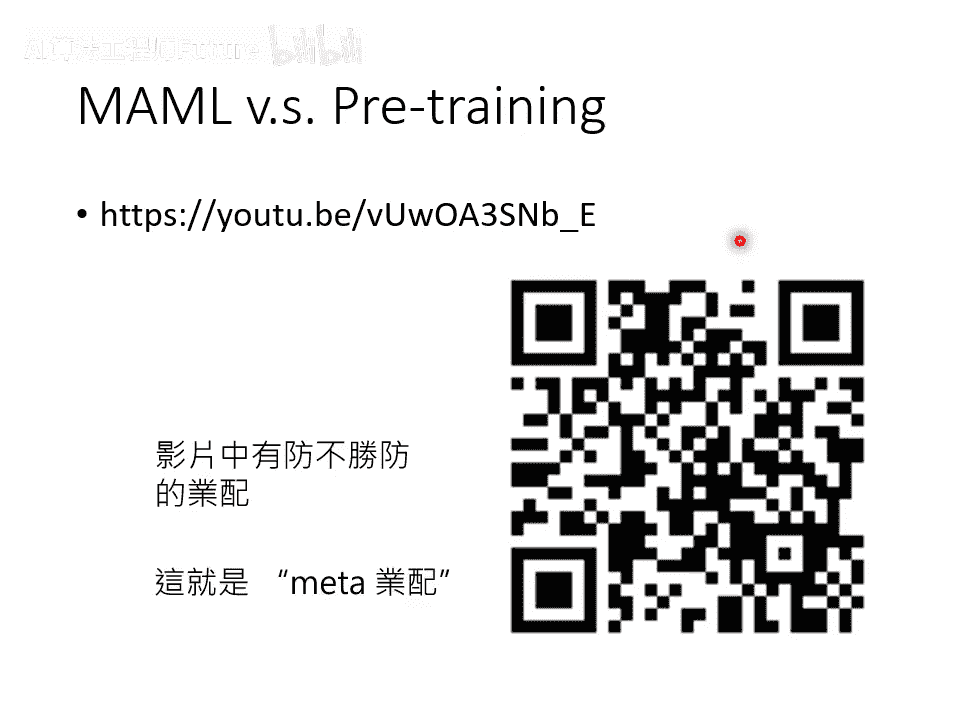

那在这一页投影片，那你会发现说我们这边的训练的任务，跟测试的任务差距并没有很大，在刚才的举例里面，我都说训练的任务是分类啊，呃这个呃苹果跟橘子分裂类车子跟脚踏车，但是在今天这个例子。

在这些投影片的例子上啊，我特别说我特别举了一个例子，是说诶每一个训练的任务都是要分类猫跟狗，只是现在每一个任务里面的图片，它的类型是不一样的，在任务一里面啊，是真实的图片啊。

在任务二里面呢是这个呃油画的图片啊，在任务三里面是卡在测试任务里面，是卡通的图片，那你可能会说这个不就是domain adaptation吗，我们在某些任务上面学到的东西。

在某一些某一些抖面上学到的东西，要被transfer到另外一个动漫，没错它就是你也可以说它就是domain adaptation，所以假设我们今天在做meta learning的时候。

我们的不同的任务其实就只是不同的DMAN而已，那那你也可以说may have learning，就是一种dommain adaptation的方法，那叫那那那当然有人可能。

那其实在machine learning里面呢，这个task呢跟DMAN的定义，他们的分也并没有那么明确，我可以说这个是不同的抖man，但我也可以说他们就是不同的任务，其实都是可以的。

所以假设你今天不同的任务其实就是不同的，抖面上的同样的分类问题的话，你也可以说meta learning是一种解domain adaptation的方法好。

总之呢我觉得在machine learning这个领域里面，哪有千千万万的词汇不断的被新词汇，不断的被发明出来，总觉得大家在研读这些文献的时候，其实也不用太拘泥于这些词汇，你要真正要在意的是。

这些词汇背后所代表的含义是什么，好那memo到底为什么会好呢，有两个不同的假设，有一个假设是may memo，找出来的那个initial的参数，它是一个很厉害的initial的参数。

这个很厉害的initial的参数，它可以让我们的比如说gradient，descent这种learning的algorithm，快速的找到每一个任务上号的参数。

那另外一个假设是说这个initialize的参数，它本来就跟每一个任务上，最终好的结果已经非常接近了，那所以因为它已经跟好的结果非常接近，所以你直接apply gradient descent。

就可以轻易的找到好的结果，到底是哪一个呢，有一篇paper呢，它里面提出来的一个方法叫做这个啊，有一篇paper呢他的title是rapid learning哦，Feature reuse。

左边这个叫做rapid learning，右边这个叫做feature reuse，那到底memo它的好是好，在左边这个理由还是右边这个理由呢，那你可以自己去看一下paper。

会发现说呃在paper里面得到的结论是feature reuse，才是MEMAL好的关键，那在这一篇paper里面呢，同时提出来了另外一种memo的变形叫做anneal，那在我们的作业里面。

也会问大家一些跟ANNEL相关的问题，ANNEL是almost NO inner loop的缩写，almost NO inner loop啊。

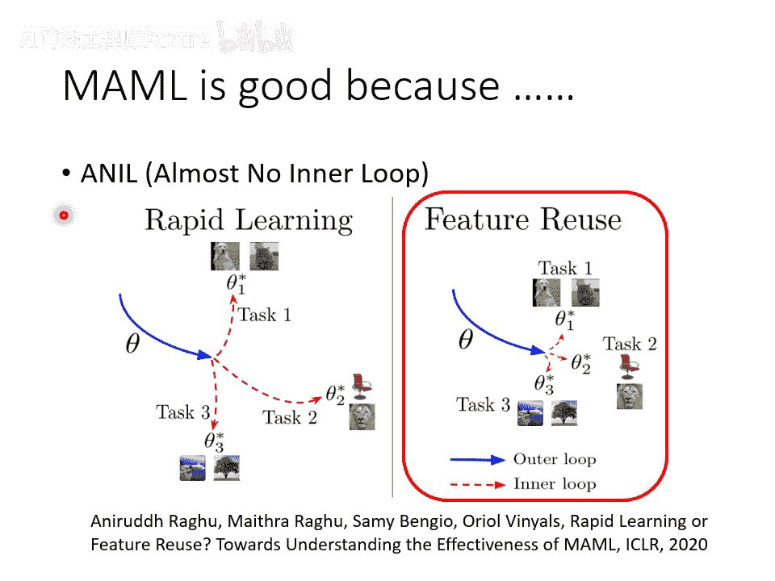

缩写是ANEO，好的meta learning有非常多的变形了，假设你想要知道更多背后的数学的细节的话，你可以参考这支影片，那假那memo有一个可以简大幅简化运算的变形。

叫做first order memo f memo，大家可以看这支影片，那如果你想知道什么是reptile的话，你可以看这支影片，那我们上课就不再讲，我们把这些呃内容留在这个作业的选择题里面。

让大家慢慢来学习。

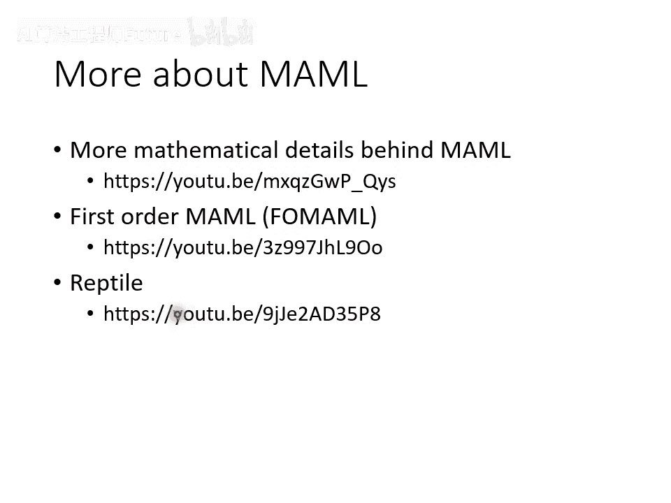

好刚才讲说我们可以学习初始化的参数，那还有什么东西是可以学习的呢，我们可以学optimizer，你知道在update参数的时候啊，我们需要决定比如说learning ray啊。

momentum啊等等参数等等，Hyper parameter，而像learning rate这种hyper parameter，能不能够用学习的方法把它用meta learning学习出来呢。

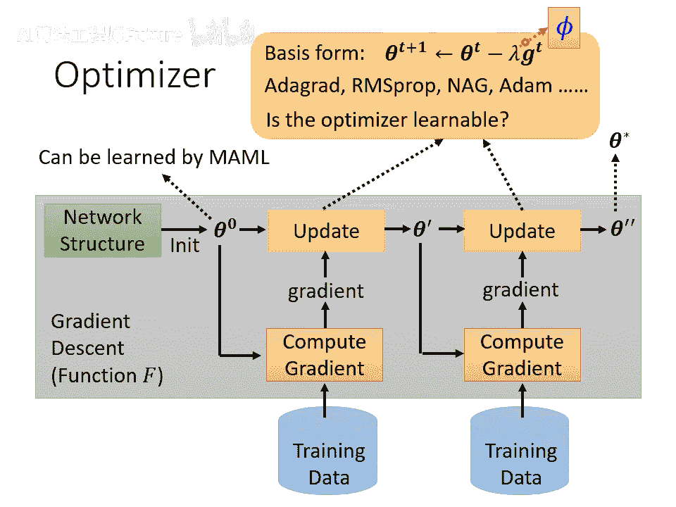

是可以的，那像这样子的想法在很早以前就有了，Nips，2016就有一篇paper，他的title叫learning to learn by gradient descent。

By gradient descent，然后这个不是type啊，它的名字真的就叫做learning to learn by gradient，Descent by gradient descent。

这个大家都是命名大师啊，大家都很会取这个有梗的title，而在这篇paper里面呢，他就直接认了那个optimizer，一般我们的optimizer什么EDEN啊，i n s prop啊，是人想出来的。

它的optimizer，它里面的参数是自动根据训练的任务学出来的，那他那边他把他的方法呢，就直接叫做LSTN了，因为他把训训练那个呃，呃这个optimizer里面的这些参数这件事情。

把它类比到训练一个LSTN上，但我们这堂课里面没有讲过LSTN嘛，所以你不知道LSTN是什么，没关系，反正这个就是认出来的optimizer，那他做的第一组实验呢是训练在an list上。

然后直接测试在enlist上了啊，所以得到的结果呢当然是挺不错的，橙色这一个呢是认出来的，Optimization，其他颜色的这个curve呢是其他的方法好，但是如果我们是训练在ENGLIST上。

测试在list上，而且network架构一样，这根本就是cheating嘛，根本就是一模一样嘛，这样没有什么特别厉害的，但是早在2016年，这篇文章就已经知道说，试试看，40个unit。

然后呢唉结果不错，那测试任务呢测试任务改成两层，看看到底能不能够做得起来，他测试的时候，测试在两层的network上可不可以做得起来可以。

但他发现说呢改一下那个activation function就不work了，训练的时候如果没记错的话，应该是用SIGMO，但是测试的时候network架构里面改成RELU哇。

这个能认出来的optimizer就坏掉了哦，Boy and paper。

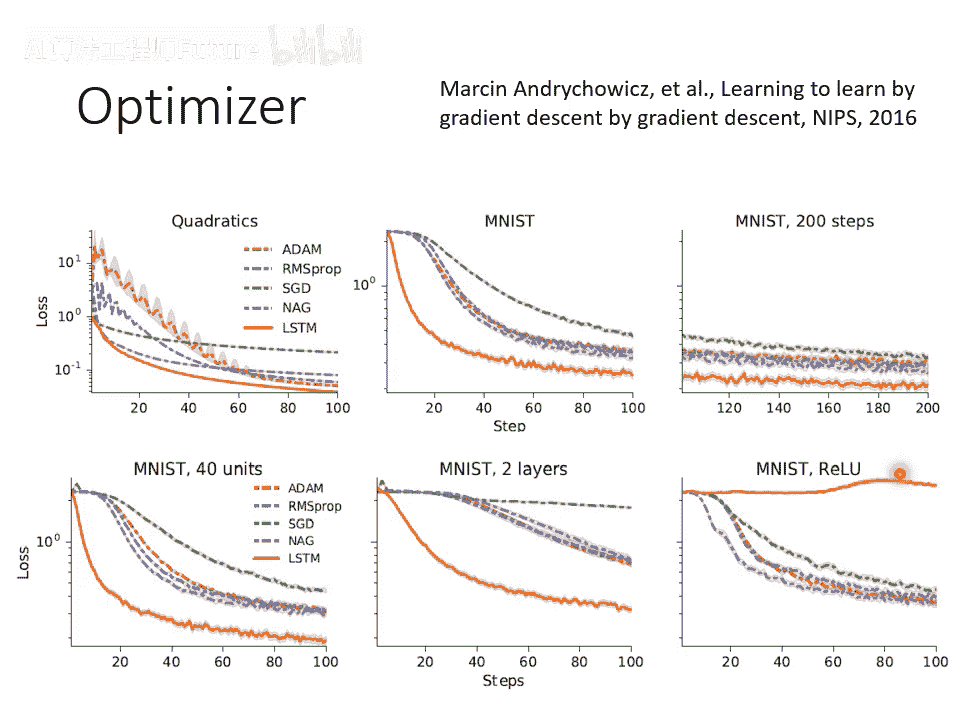

好刚才讲了，我们可以训练初始化的参数，可以训练optimizer，那能不能够训练network架构呢，当然可以训练network架构，那在训练network架构这系列的研究呢，就叫做network。

其实就是鼎鼎大名的network architecture，Search，其实就是n n as，其实我知道很多同学应该都听过network architecture，这个search这个技术。

只是你不太清楚他跟made a learning的关系是什么而已，如果你今天在meta learning里面，你认的就是network的架构翻译，你把network的架构当做翻译的话。

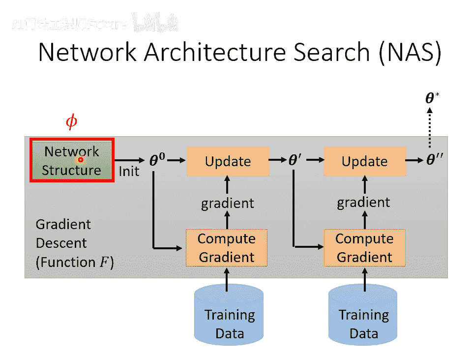

那我们就是在做n a as好，但是在NAS里面呢，我们的F是network架构，我们要找一个F去minimize l的F，但既然faon network架构显然做微分就有问题了。

显然算gradient就有问题了，怎么办，记得我们这门课里面反复强调的，当你遇到optimization的问题，没办法算微分的时候。

reinforcement learning硬做也许是一个solution好，怎么用reinforcement learning硬做呢，你就把fin呢想成是一个agent的参数，然后这个agent呐。

这个reinforcement learning里面的agent呢，它的output是什么，它的output就是network架构相关的HYPERPARAMETER，我举例来说。

它会output就是现在第一层，你的比如说filter它的长是多少，它的宽是多少，它的strike多少，filter的数目是多少等等。

今天你的agent他的output就是network的架构相关的参数，然后接下来呢你就是要训练你的agent，让他去maximize一个reward，那在这边我们的reward是什么呢。

我们的reward直接设成L的，翻译成一个负号，所以我们训练这个agent去maximize l的翻译，乘上负号，就等于是minimize l到F，我们用RL的演算法。

直接去训练这个F去minimize l到F，那我们就是做了network architecture的search好。

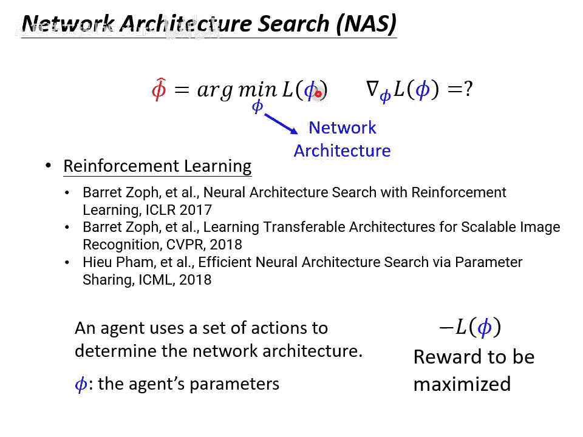

那这边是有一个从文献上截下来的图，希望可以让你更清楚知道，说这个typical的NAS是在做什么的啊，就是我们有一个A卷，那这个是比较早的work了，所以那个时候呢把agent呢想成。

就是一个recurrent network，那这个recurrent network，每次呢会输出一个跟network架构有关的参数，比如说他会先输出filter的高是多少。

然后再输出filter的宽是多少，然后再输出strike的呃，横向的strike是多少，再输出纵向的strike是多少，再输出要多少个filter等等，然后第一层第N层输出完了以后。

接下来再输出N加一层，接下来再输出N加二层，以此类推，好的，有了这些参数以后，就根据这些参数建出一个network，建完network以后就去train这个network，缺一个train。

network的过程呢其实就是within task的training好，然后接下来呢就去做reinforcement learning，你可能会把这一个network。

它在测试资料上面的accuracy当做你的reward，然后呢来训练你的agent，那训练这个agent去maximize reward的过程，其实就是across task权利。

那我知道说在network detector search文献上，其实不常提到什么，within test training跟across test training，这样子的讲法了。

但是其实你想想看nearchitecture search，它可以视为是meta learning的，其中的技术，只是我们现在要LEAR的是集中在。

只是我们现在学习的目标是network architecture，那我知道说比较早的network architecture search那些paper啊，他们往往训练的任务，跟测试的任务就是同一个啊。

比如说你训练的时候，你是要训练一个agent，他可以找一个network，这个network在塞发ten上做得好，那测试的时候你也是直接跑在沙发ten上，感觉有点cheating，不过近年来啊。

有很多network architecture search的文章都已经进步到，都已经有所改变，他们的training的任务跟测试的任务，都已经有人尝试过。

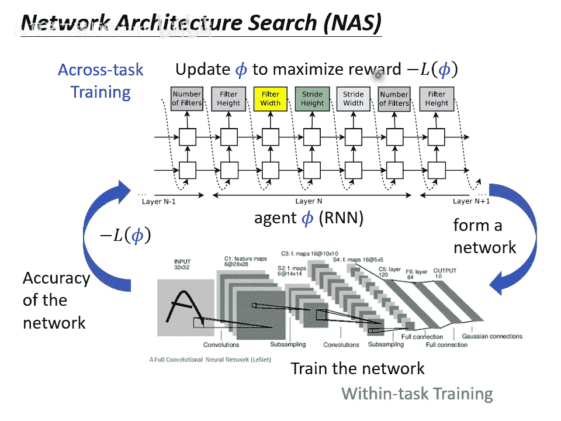

可以是不一样的了，好那除了这个reinforcement learning以外啊，你要用evolutionary的algorithm也是可以的啊。

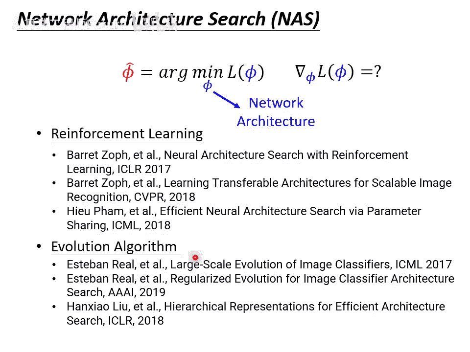

我们这边就直接列一些文献给大家参考，那其实啊你硬要把network architecture改一下，让它变得可以为分也是可以的，有一个经典的做法呢叫做大啊。

还有缩写就是differential architecture，Search，这个呃他是difference ential architecture，search的缩写，这个大词呢。

他就是想办法让这个问题变的是可以为分，你就可以直接用gradient descent，来minimize这个l of fine，那至于大S的细节就留给大家自己慢慢研究好。

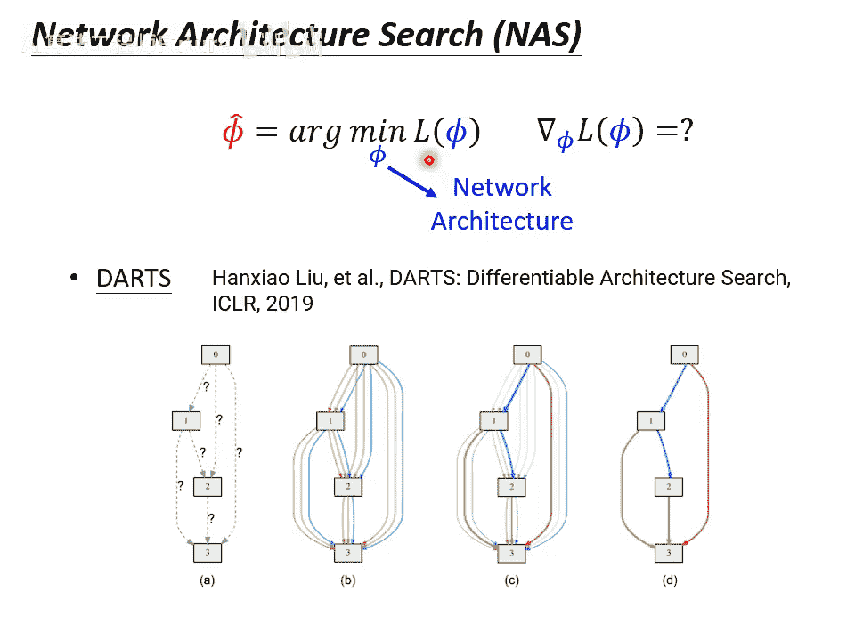

除了network architecture以外，还有什么可以认的呢，data processing也有可能可以认。

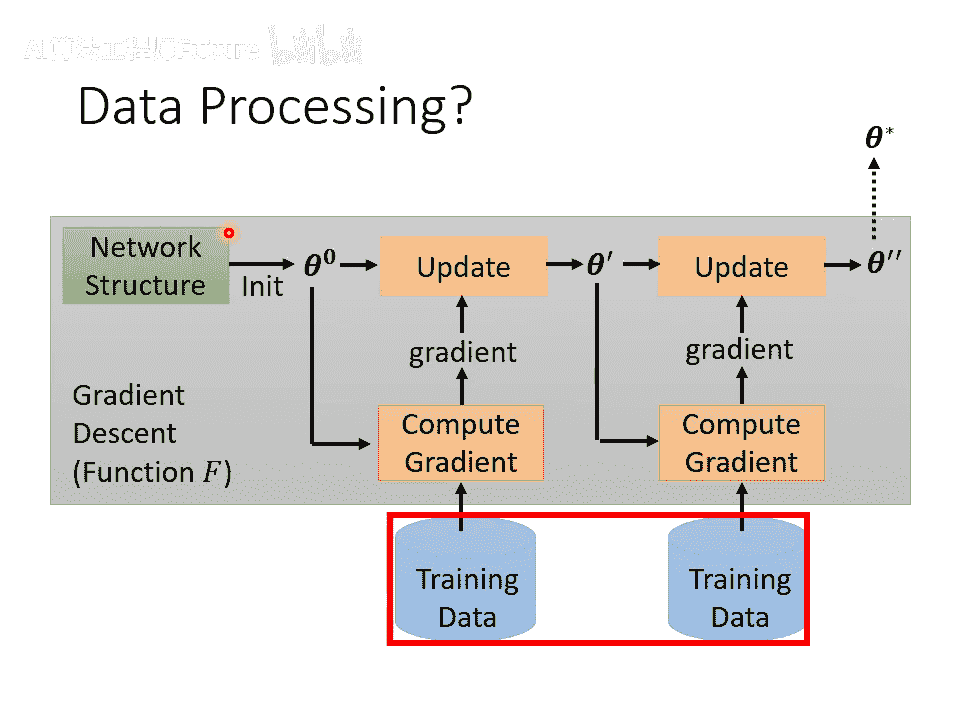

大家知道说哎我们在训练network的时候，你不是都要做data augmentation吗，作业三，还让大家自己尝试各种不同的data augmentation的方法。

那当然data augmentation的方法，现在你是用trial and error去试出来的，那能不能够硬去学data orientation这件事呢。

能不能够训让machine训练出怎么自动找data augmentation呢。

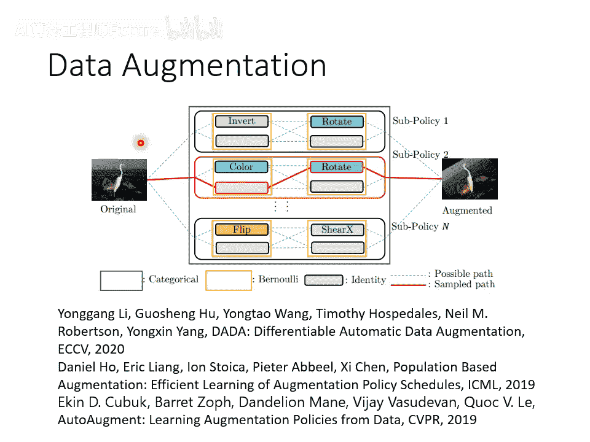

是可以的，那我们就列一些paper在这边给大家参考好，那我们知道说今天在training的时候啊，有时候你会需要给不同的sample，不同的WEI，但是要怎么给每一笔data不同的权重呢。

今天就有不同的策略，那有人的策略是说哎，如果有一些example距离boundary特别近，他是特别难的，example也许就要给他比较大的way，像network比较focus。

在看这些比较难的example学习，希望他可以学的比较好，但是你也会看到文献有相反的结论，说哎这个比较noisy的这些label，应该给他比较小的weight啊。

这些example如果他比较接近boundary，可能代表他比较noisy，代表他比较困难，它的难可能是不合理的，因为代表它label搞不好，根本就标错了，也许你应该给他比较小的weight。

那怎么决定这个simple weight的strategy呢，你可以用LT把simple weight strategy直接认出来，然后让我们逊呢，根据让我们逊可以学到说诶。

根据data的特性自动决定说simple的weight要怎么设计。

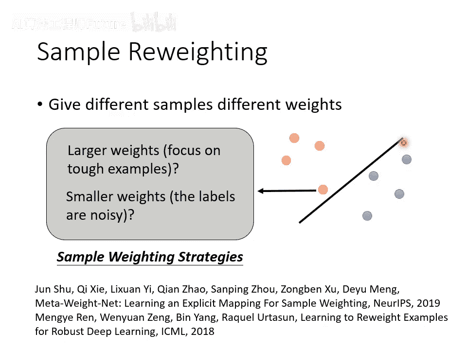

到目前为止啊，我们看到的这些方法都是基于gradient descent，再去做改进哦，我们刚才看到的所有方法都是认了，gradient descent的其中一个component。

但是我们有没有可能完全舍弃掉gradient design呢，我们有没有可能直接扔一个network，这个network的参数就是F这个network直接吃训练资料，作为输入，直接输出训练好的结果。

如果真的有这样一个network，他可以吃训练资料作为输入输出，训练好的network的参数，那我们就可以说，我们甚至让机器发明了新的learning algorithm。

我们已经抛弃了gradient descent，机器发明新的learning algorithm，有没有可能做到这件事呢，也不是完全没有可能的。

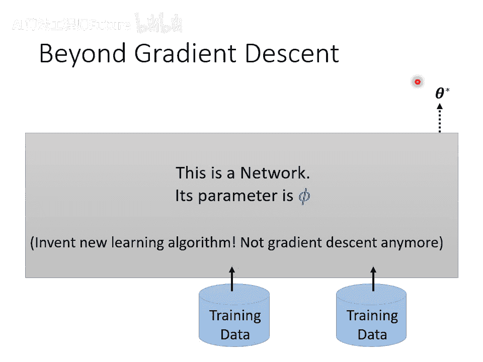

已经有一些论文往这个方向进展，而到目前为止啊，我们还是把训练跟测试分成两个阶段，我们的learning我们有一个learning algorithm，他是拿训练资料进行训练，然后输出训练好的结果。

然后把训练好的结果用在测试资料上，但有没有可能更进一步，直接把整个episode，也就是一次训练加一次测试。

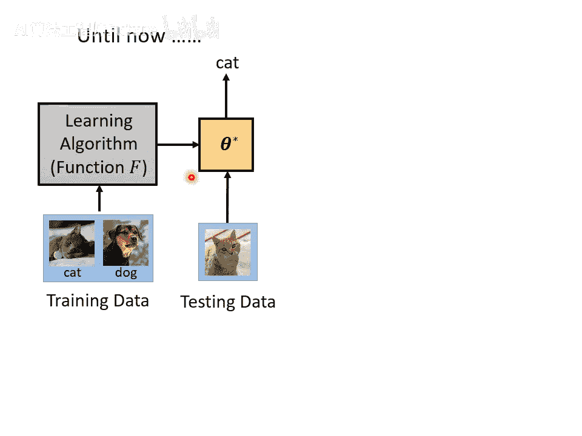

把整个episode包在一个network里面的，这个是有可能的，有一个系列的做法，它就是直接把训练资料跟测试资料当做network，Input network，读完训练资料以后。

你也不知道里面发生了什么事，也许他就是学出了一个learning algorithm，也许他就是找出一组参数，不知道不知道他发生了什么事，他读完训练资料以后再给他测试资料，他直接输出这些测试资料的答案。

也就是我们不再有训练跟测试的分界，一个episode里面不再分训练跟测试，而是直接用一个network，把训练跟测试这件事情一次搞定，有没有可能做这样的事呢，其实这样的方法今日并不罕见。

有一个系列的meta learning的方法，叫做learning to compare，它又叫做metric base的方法，这一系列的做法就可以看作是，训练跟测试没有分界。

一个network直接把训练资料，测试资料都读进去，而直接输出测试资料的结果，那如果你想学更多跟learning to，compare有关的东西的话。

那其实在过去的上课有讲过metric base approach，那这边就把过去上课的录影贴在这边，给大家参考啊。

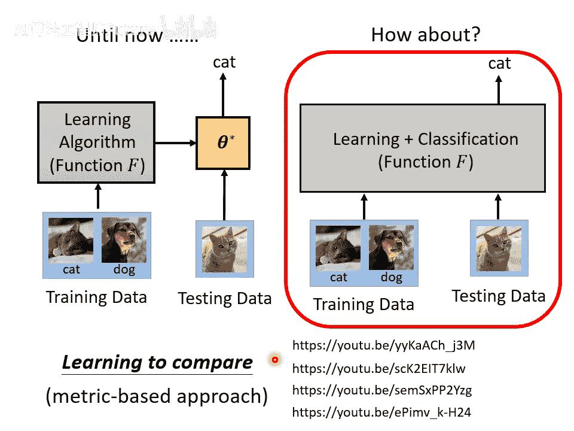

最后啊也许你会很好奇，说meta learning这样的技术真的有应用吗，它真的有被用在任何地方吗，may哈learning learn to learn，直接扔一个ALISM，听起来非常的科幻。

他真的有实际的应用吗，今天你在做meta learning的时候啊，你最常拿来测试meta learning技术的任务，叫做few shot的image classification。

在few shot image classification里面，你每一个任务都只有几张图片哦，你每一个类别每一个class都只有几张图片啊，比如说你现在分类的任务是有三个class进来。

一张image，你要把它分成三个类别，每一个类别你都只有两张图片，每个类别你都只有两张图片，你希望透过这样一点点的资料，就可以训练出一个模型，给他一张新的图片，他可以知道这张图片属于哪一个类别。

那在做这种few shot classification的时候啊，最常见的一种classification的呃，你常常会看到一个名词叫做N位K下的classification。

那N位K下的classification是什么意思呢，N位K下的classification，它的意思就是在每一个任务里面，我们有N个class，而每一个class我们只有K个example，举例来说。

在上面这个例子里面，我们有三个class，每一个class只有两个example，那它就是three way to shut的classification，好那在meta learning里面呢。

如果我们今天要教machine能够做N位K下的classification，那意味着说我们需要准备很多的N位K下的，classification的task，当做训练的任务。

叫培训才能够学到N位K下的learning algorithm，那要怎么去找一堆N位K下的任务呢，要怎么去找一堆N位K下的training的task呢。

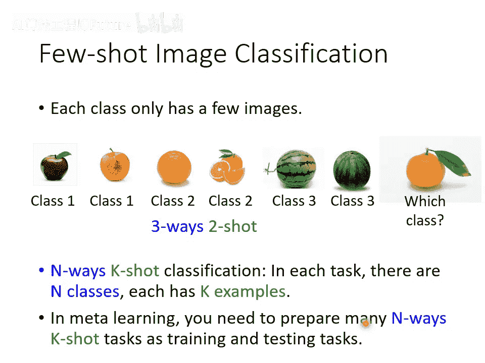

那在文献上啊，最常见的一种做法是使用omega这个COPUS，当做benchmark copus，你知道这个omega是，这就好像说你今天在做生物实验的时候，你都用果蝇来做生物实验嘛。

那在meta learning里面，如果你想要做快速做相关实验的话，最常做的选择就是使用omega，在omega这个COPUS里面呢，有1623个不同的character。

那每一个character呢有20个example，好比如说这是某一个character，它就是勾起来，然后点两点，那像这个character，它就有20个不同的example啊，就是找20个人。

每个人呢都去写一遍这个character，然后把他资料收集起来，然所以每一个character有20个example，总共1623个character，那有这些character以后呢。

你就可以去制造N位K下的classification，举例来说，假设你要制造一个团体位弯下的classification任务的话，那你要怎么做呢。

你就把从那个omega里面呢选出20个character，然后每一个character就只取一个example，那你就得到一个20位one shot的classification的任务。

好像这边这个样子好，这边呢每一个呃图片就代表某一个character，每一个character这边只有一个example，而每一个character在N位K下的任务里面，就代表了一个class哦。

所以20位one shot的classification的任务，他的训练资料也就是support set，就长这个样子，那测试资料呢，测试资料就是你从这20个character里面。

再去omega data set里面找某一个example出来，然后接下来就问你说哎这个testing的example，这一个query set，他是这20个class里面的哪一个好。

那这个东西到底是哪一个class呢，这个看起来有点像是豌豆射手了，其实人呐在做这种fushark classification是非常厉害的。

所以这种future classification可以难倒机器，但往往难不倒人，像这个它是属于哪一个class呢，它是属于哪一个character呢，我相信你一眼就可以看出。

他应该是这个character吧，好那在使用omega的时候呢，你就会把你的那个character啊分成两半，一半呢是拿来制造training task的character。

另外一半是拿来制造testing task的character，然后这些training的character啊，如果你要去制造一个N位K下的任务。

也就是从这些training the character里面，先随机sample n个character，然后这N个character。

每一个character再去sample k个example集合起来，你就得到一个训练的任务，那测试的任务呢，你就从这些测试的character里面，拿出N个character。

然后每一个character sample k个example，那你就得到一个N位K下的测试任务，然后测试在测试任务上好，那你可能会问说这个N位克下的任务，这个有什么用呢，这个就是没有什么用了。

但是meta learning不是只能用在omega上面。

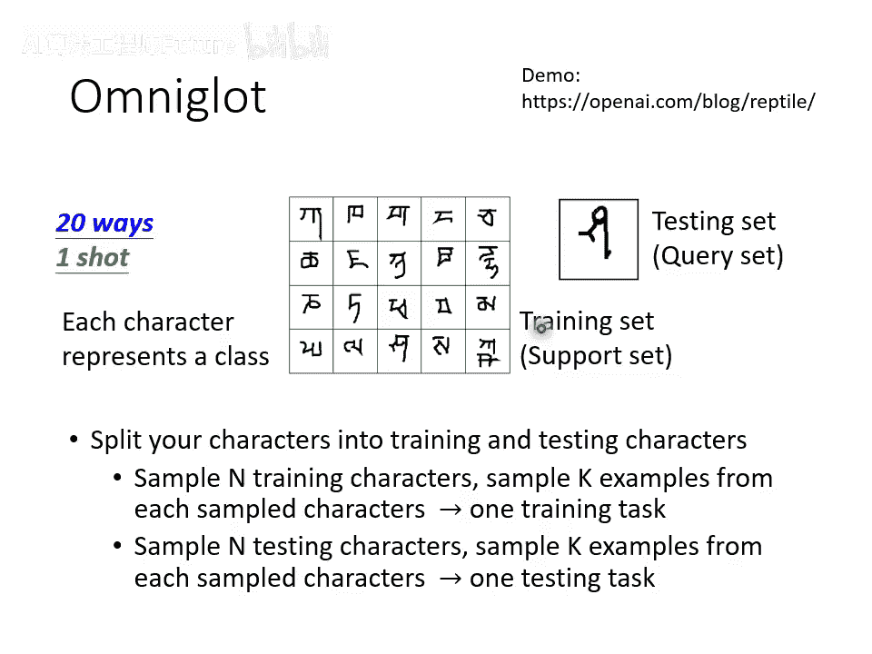

我这边呢这个table上面是列举了meta learning在语音，还有自然语言处理上的应用，那这边的纵轴啊是不同，meta learning的方法，有learning to initialize。

Learning to compare，还有其他类型的meta learning的方法，比如说network architecture，search等等，而横轴啊就是不同的应用。

比如说sun event detection啊，Keywords partner，test classification啊，voice conversion啊。

Sequence labeling machine，Transstation，speech renation等等，像这些语音，还有NLP相关的任务，都已经有人尝试在上面使用meta learning。

所以meta learning不是只能用非常简单的任务，今天在学界已经开始把meta learning推向更复杂的任务，那我们可以拭目以待，看看未来meta learning这个技术。

能不能够真的用在现实的应用上，它可以走得多远好。

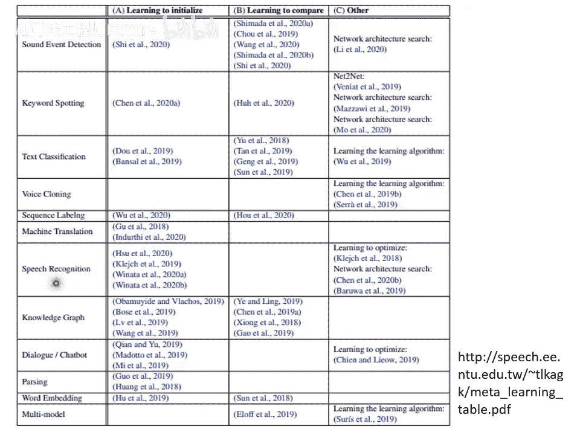