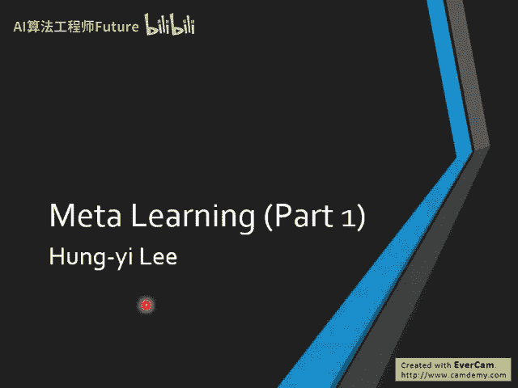
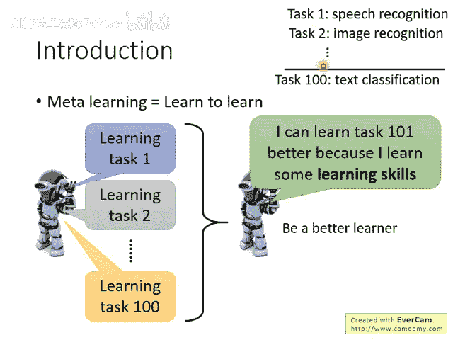
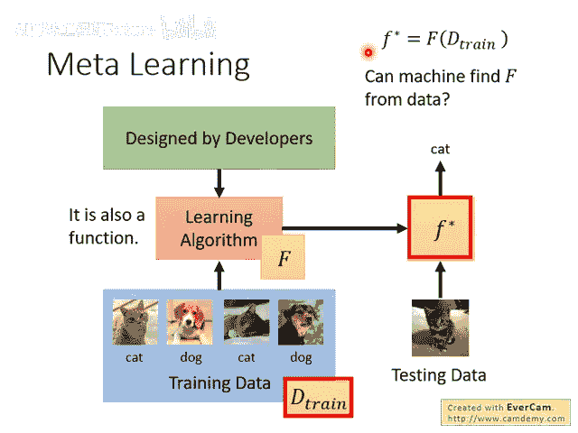
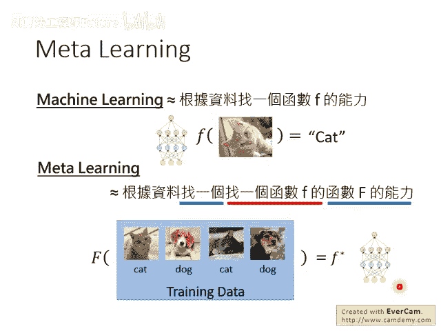
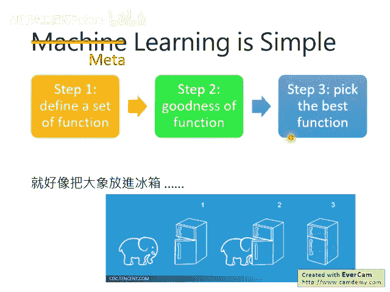

# 【官授搬运】2026年全新优化版李宏毅机器学习系统课程，这才是真正的初学者体系课程！—人工智能／深度学习／神经网络 - P94：4-Meta Learning – MAML (1-9) - AI算法工程师Future - BV1ruqABeEFX

那meal learning对大家来说呢，可能对多数人来说呢都是一个新的概念。

那meta learning要讲的是什么呢，meta learning其实就是learn to learn，而且我们今天可以让机器去做学习，那我们下一步要让机器做的事情，不只是他可以做学习这件事。

而是他可以学习如何去做学习这件事呃，举例来说，我们期待做到的事情是机器，他学过一大堆的任务以后，他根据过在过去的任务上面所汲取的经验，他变成了一个更厉害的学习者，往后如果有一个新的任务。

他可以学习的更快，因为他从过去的任务里面，学习到了新的学习的技巧，举例来说呢，过去他看到的任务可能是啊，你教机器做了语音辨识，你教机器做了影像辨识之后，你再教他做文字分类的时候，他可能会做得更好。

那虽然说做文字分类这件事情，跟影像跟语音可能没有什么太直接的关系，但是机器在过去的任务里面，他学到了怎么学习这件事，他并不是学会了更会做语音的辨识，或者是更会做影像辨识，然后可以因此让文字辨识做得更好。

而是他从这些任务里面，他不只是学到了怎么做某些特定的任务，怎么做语音引向面试，而是学习到了学习这件事情，然后所以过未来有新的任务，他就可以学得更快。

好那讲到这个may哈learning呢，看看这样的setup，有人可能会觉得说，听起来跟我们之前讲过的live phone learning有点像，那确实没有错。

在讲live moon learning的时候，我们也讲说要让机器先看过一大堆新的test，然后希望他在呃gm3的机器，看过一大堆过去看过的task，然后希望在新的task上，他仍然可以做得好。

在live phone learning跟mana learning不一样的地方是，在live one learning里面，我们是不断的用同一个模型在做学习，我们期待的是同一个模型。

可以同时学会很多技能，那meta learning的着眼点是不一样的，在meta learning里面，不同的任务我们仍然有不同的模型，仍然是每一个任务有一个自己的模型，但我们期待的是。

机器可以从过去的学习经验里面学到一些东西，使得他在未来要创一个新的模型的时候，可以训练的更快更好，那这个是meta learning的精神啊，那实际上mea learning要做的事情是什么呢。

我们先来回忆一下machine learning这件事情，好machine learning在做什么呢，那今天大家都已经这个期中考都已经过了，那switch已经过一半了。

那想必你对我们训learning应该已经非常的熟悉，那么训learning你可以想成是啊，我们有一个learning的algorithm，那这个learning的ALISM是人设计的。

而这个learning algorithm，他就把训练资料呢当做输入，假设你现在要做呃一个猫狗的变声器，那就给他一些训练资料，给他一堆图片，然后每张图片都要标注说他还是猫还是狗，丢给这个学习的演算法。

它就吐出一个function，那在我们一般的case里面，假设是训练个CNN的话，它就是吐出CNN的参数，就用green descend这个ALPHON。

用back pagation这个ALISON圈下去啊，它就吐出CNN的参数啊，你有这个参数，你就得到了一个function，你就可以拿来辨识新的影像，这个是我们所学到的machine learning。

那meta learning是要做什么呢，在meta learning里面，你把learning的algorithm想成也是一个框，选这个function。

我们用大写的F来表示这一个learning的elegant，这个LIN的ALISON，他这个方向它吃进去的是训练资料，他吐出来的是另外一个方选，那在这个例子里面，它就是吐出一个方选。

这个方选可以拿来做猫狗的影像辨识，这我听起来很神很神奇，就我们learning的ALISON，其实可以把它想成一个方式输入资料，输出，就是你现在要找的那个，可以拿来做影像辨识的function。

而meta learning要做的事情，就是让机器自动的找出这个learning的album，自动的找出这个词，data a当做input。

可以吐出另外一个function的function好，所以我们说machine learning是什么，如果要用一句话来概括machine learning的话。

machine learning就是让机器具备有根据资料，找出我们要他找的某一个函数F的能力，那我们在第一堂课的时候，就已经告诉过大家这件事，那meta learning是什么呢。

meta learning就是让机器根据资料找一个，找一个函数F的函数大F的能力量啊，你可不知道这句话在讲些什么，所以我们把这句话呢做一下文法的剖析，我们先看一下外面的这个部分。

就是我们现在要机器有能力去找一个函数F，找一个大写的函数F，那这个大写的函数F它是由什么样的能力呢，这个大写的函数F，它的能力是要去找一个小写的函数F。

然后这个小写函数F可以用在machine learning里面，比如说拿来做影像辨识，我们要找一个大写的F，这是机器现在要做的事，他要找一个大写的F，然后这个大写的F，他的能力是他可以找出小写的F。

然后拿来做你想要他做的事情，老师讲的更具体一点，meta learning就是我们要找一个大写的F这个方向，这个方向的输入就是你的训练资料输出，就是训练后的模型，举例来说，他就to一个。

如果你get some neal network来当做你的模型的话，他的输出就是一个neural network，如果是neural network里面的参数，如果想更具体一点的话。

就neural network里面的参数，然后把这个参数拿去做种种你要还要做的事情，那这个就是贝塔能力哦，所以machine lear跟mea learning。

他们都是要的叫机器去找一个function，只是要找的function能的，要是要找到那个方式，要做的事情是不一样的。

呃所以我们说机器学习就是三个步骤，这个也是开学第一周就给大家看过后，影片机器学习就是三个步骤，先定义一个function set，然后定义一个function好坏的批量的指标。

也就loss function，最后呢找一个最好的方式，用gradient descent找出一个最好的方式，那其实may哈learning也就是一样的，它也是找一个方选。

你只要把我们这三个步骤里面的方选，这个词汇通通代换掉，代换成大写的F，所以大写F就是一个learning的element。

你把我们这三个step里面的function都代换成learning the alphant，这个就是meta learning，Ok meta lear，要做的事情。

就是我们先定义一个learning algorithm的set，我们先定义一组learning the algorithm，我们不知道哪些哪一个learning algorithm是比较好。

然后你定义一个learning algorithm的loss function，他告诉你说哪一些ALGM比较好，哪些AWM比较不好，然后最后再学一发，去找出最好的learning的ALISM。

这个就是meta learning好，那讲的更具体一点，以下我们就一步一步。