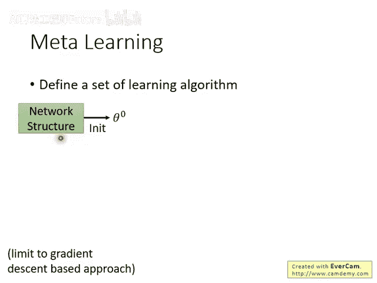
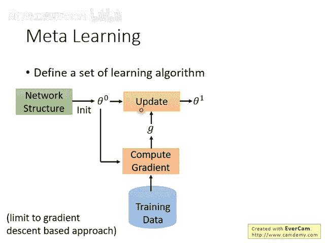
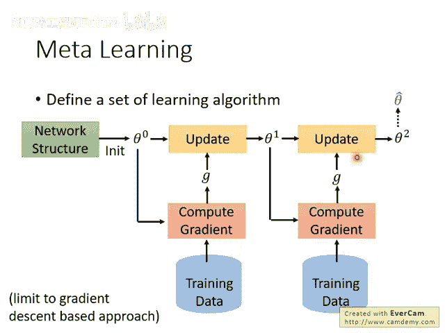
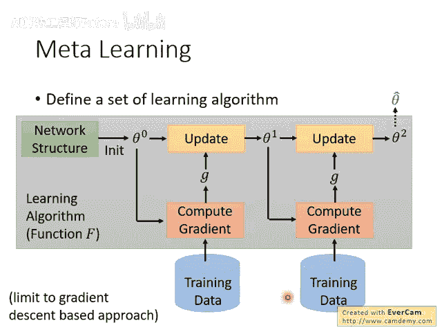
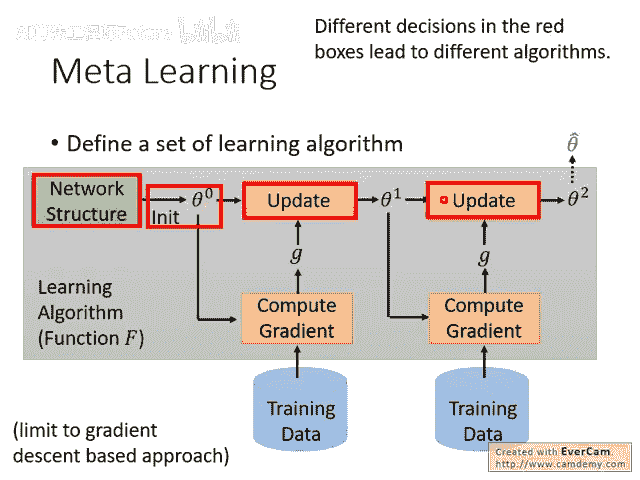
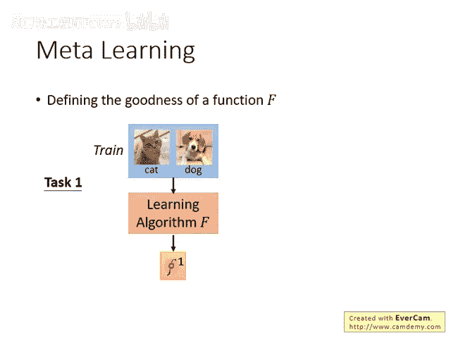
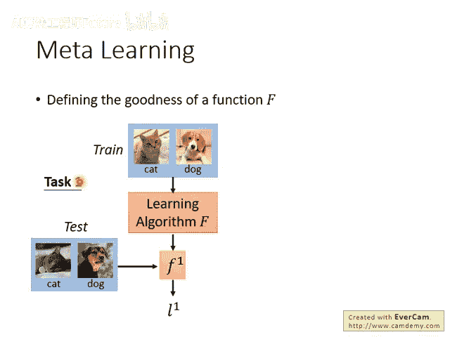
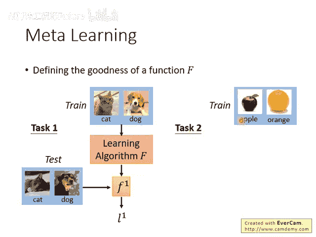
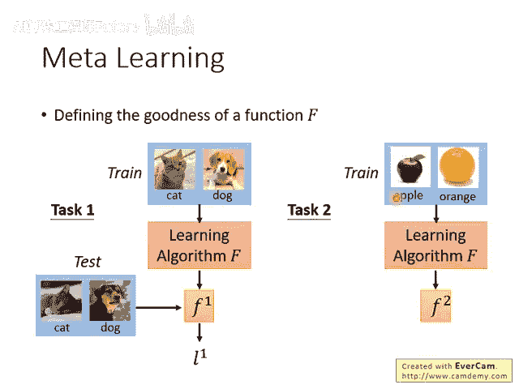
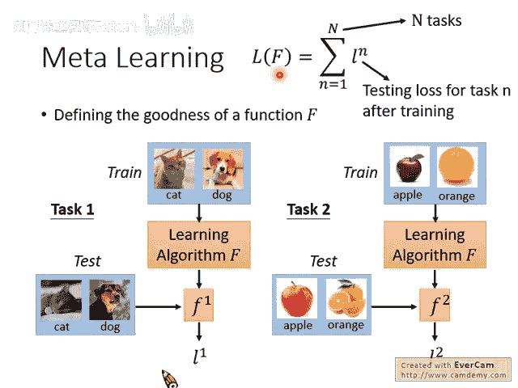

# 【官授搬运】2026年全新优化版李宏毅机器学习系统课程，这才是真正的初学者体系课程！—人工智能／深度学习／神经网络 - P95：5-Meta Learning – MAML (2-9) - AI算法工程师Future - BV1ruqABeEFX

好第一步你要准备一堆learning的alpha，在讲deep learning的时候，我们说啊什么叫做learning的，什么叫做准备一个function set。

我们说network的architecture，network的架构，当你定出network架构的时候，你就有了一个function set，那到底什么叫做一组learning的algorithm呢。

啊什么叫做一组learning的algorithm呢，我们先来看一下我们一般常用的learning，The algorithm，比喻来说，gradient descent是怎么做。

quent design是怎么做的呢，你先定义一个network的架构啊，这个是人定的，然后呢你要想个办法初始化你的参数啊，用从某一个distribution里面sample出数值。

来当做你的初始的参数。

然后接下来呢你要根据这个初始的参数，还有你的训练资料去计算出GRA点，我们这边用G呢来表示GRADI啊，有了规定以后呢，你就可以拿这个GRADI呢去update你的初始参数，那他用update方法呢。

就把这个规定乘上一个小小的learning rate，再把呃GRADI层那小小的learning rate去减掉，你现在初始的参数，你就得到了新的参数。

然后呢根据新的参数再计算一次gradient，然后再计算一次gradient，根据训练资料计算出gradient区，但这两个G是不一样的啦，我这边用同样的符号其实不是很精确哈，因为你现在是不同的参数。

虽然是同样的资料，但不同参数算出来G该是不一样的，好，那算出gradient以后呢，再去update你的参数，然后要反复很多次，然后最后呢就输出最终的训练结果。

我们假设最终训练出来的参数呢叫做SETAH。

那这整个training的process，你可以把它看作是一个版权，这整个training的algorithm，你可以把它看作是一个function输入。

就是训练资料输出，就是最终训练后的结果，而在这个training的过程中，有很多的步骤都是我们人手去设计的，network架构长什么样子，是人手去设计的呃，初始的参数怎么来，这个也是你想办法。

你能想办法去去去设计出来的，它并不是学出来的，它是设计出来的，然后呃这个怎么update你的这个参数，得到这个G以后，怎么update这个set a0，这是人design的。

因为你可以调整你的learning rate，你可以调整你的这个learning rate设定的方式，比如说选择aden i n s pop等等，不同的update。

不同的这个gradient descent的变形，你就有不同的update方式，所以今天在我们常用的gradient descent的这个，learning的ELBOARD里面。

我们这些红色的方块啊是人设计。

而这个红色方块里面，当我们选择不同的设计的时候，其实我们等于就是得到了不同的learning的ELVA，所以我们今天在meta learning里面，我们要做的事情其实就是在这个红色方块里面。

有没有一些部分我们不要人来设计，我们让机器自己来学，我们比如说我们放宽initial这个呃参参数，初始化这件事情的设计，我们可以想成说每次我们用不同的初始化的值，我们就会得到不同的学习的结果嘛。

那所以不同初始化的值，其实就可以想成是不同的learning的ALORITHM哦，所以我们今天能不能够，不要用一个人为定义的方法来找出初始化的值，而是让机器自己去学出。

我们今天要做machine learning的时候，什么样的初始的参数对训练network而言是最好的，那如果可以做到这件事，就算是达成mach，自然是达成meta learning的其中一块。

那我今天可以想成说，不同的initial的参数就等于是不同的learning algor，我们现在不预设我们的这个initial参数，要怎么被找出来，不预设这个initial参数应该长什么样子。

我们其实就是有了一个learning algorithm set，好讲到这边，大家有问题要问吗，好没有的话，我们就继续哦，好我们现在有了一个learning algorithm的set。

里面有一大堆的learning algorithm，那接下来第二步，就是我们需要有办法去评量一个learning的ALISM，他有多好或者是多不好。

没有办法去评量一个learning orgism的好坏，要怎么去衡量一个learning algon的好坏呢，那在原来的machine learning里面。

我们会定义一个loss function来评价一个function的好坏，那在这边我们要评价一个learning algon大F的好坏，我们一样也可以定一个loss function。

怎么定义个loss function呢，我们怎么知道这个learning alison它是好还是不好呢，那你就实际拿这个learning with ison来学一些task看看，让他来解一些问题看看好。

所以我们现在就说啊，我现在先找了一个task one啊，这个test for one是猫跟狗的分类啊，要准备一些训练资料，然后根据我们现在呢要评估的这个learning的alphand apple。

把训练资料带进去，那学学学就学出了一个参数，选出了一个训练的结果，那我们这边用f one呢来表示学习的，来学习出来的结果啊。

那这个学习的结果到底好还是不好呢，你要有testing set去衡量这个学习的结果好坏哦，所以你把task one的这些testing data丢到function one里面，看看你得到什么样的结果。

那得到的结果我们这边用LY呢来表示好，那你只能只是一个testing set，是不只是一个testing的，test是不够的，是一个任务是不够的，也许这个ALBON就只是特别会解任务，一不会解别的任务。

所以你要准备一把任务，来衡量你的这个learning alism的好坏，就像你今天在machine learning里面，你要知道一个方向好不好，你要准备一个training set。

很大的train线去评量一个方向的好坏，那这边你要评量一个learning ava好不好，你要准备一个这个learning的这个任务的集合，你要有个task。

你要一堆task的set，你要一个一大堆的任务，去衡量你的learning alvin的好坏，所以假设我们这个任务二，那任务二大会跟任务一不太一样，任务二可能是分类苹果跟橘子。

然后learning algorithm呢可以找出另外一个function f two。

然后呢任务二也有一些测试资料，我们呢把测试资料带到f two里面，会告诉我们说，现在这个learning elephant找出来的function，在test to上的表现如何来看表现呢。

我们用two呢来表示，所以可以想成这边l one跟l two呢，就是这个function在LY在testing set，One，在第一个任务的testing set上面的loss。

l two呢就是这个function learning alism产生出来的方式，在test2上的testing set上得出来的lo，那我们把我们手上所有的这个task。

就假设我们现在有大N个task，那我们现在有一个learning alison，让他去学这个大N个task，每一个task我们都可以算出一个loss值，这个loss的值呢我们用小写的L来表示。

上标N代表是第几个test，用小写L代表是某一个task，上面这个learning alism得到的任务，那把我们所有的手上有了这个task。

用这个learning alism去得到function以后再去测试，得到出来的loss全部加起来得到大L，用这个大L呢来评估一个光圈的好坏哦，所以我们怎么知道一个learning的ALISM。

它到底好不好呢，你就把这个learning的ALISM丢到这个大写的L里面，然后看这个大写的大写的L的值，这个值呢越小就代表说呢。

现在这个learning的L规则呢越好，所以这是第二步，我们能够有办法去决定，定义出一个learning algorithm。

