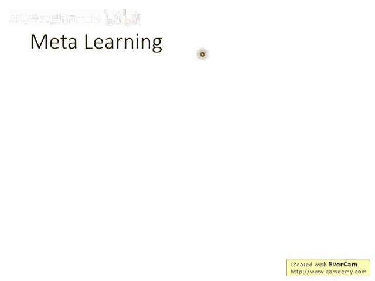
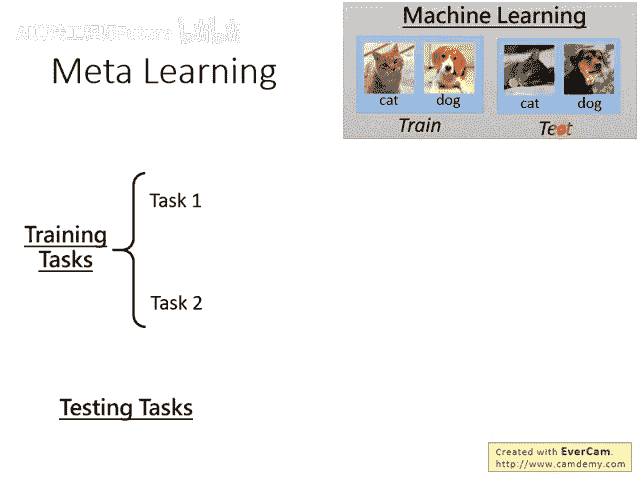
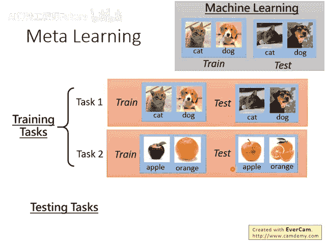
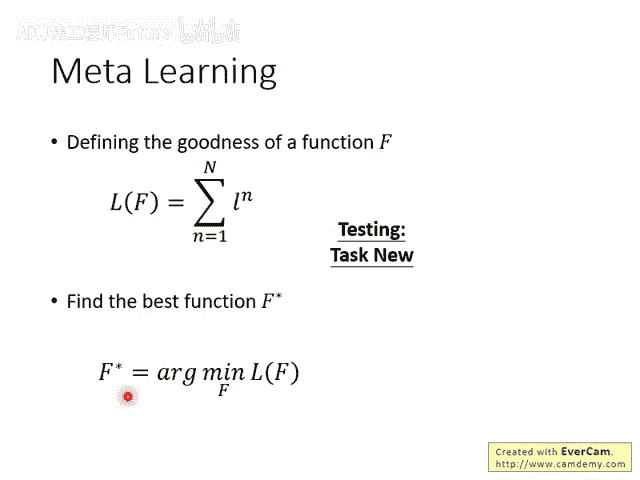
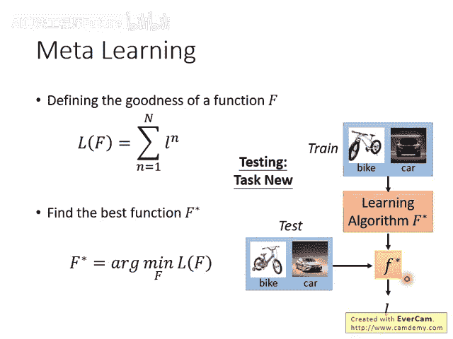

# 【官授搬运】2026年全新优化版李宏毅机器学习系统课程，这才是真正的初学者体系课程！—人工智能／深度学习／神经网络 - P96：6-Meta Learning – MAML (3-9) - AI算法工程师Future - BV1ruqABeEFX

哦所以你会发现说呢meta learning跟machine learning，他们光是在训练资料上面就非常的不同，这个是machine learning的训练资料，假设你要做猫跟狗的分类的话。

你要准备一大堆训练的image，你要准备一大堆testing的image，在meta learning里面，你现在准备的不是训练资料跟测试资料，你要准备的是训练的任务跟测试的任务。

每一个任务里面都有训练资料跟测试资料好。

就你要准备一大堆的训练的任务，这边虽然只放了在任务一和任务二，但你想看只有两笔资料，但是训练不好，你可能要准备个上上百上千个训练的任务，就是一个example，所以你要准备很多的训练的任务。

那每一个任务里面都有训练资料跟测试资料，每一个任务里面都有训练资料跟测试资料，然后你训练你有这个训练的任务以后。

你还要有测试的任务，那测试的任务当然要跟训练的任务不太一样，你那我们有了训练的任务，有了测试的任务，我们其实有时候也会需要validation的任务，或是叫做development的任务。

大家记得在做培训learning的时候，我们为了要避免open bt，你在选参数的时候，也要把你的training set切出一个validation set。

那如果你接你的meta learning里面也有参数要调，那怎么办，你要把你的training的任务里面切一些任务出来，当做validation的任务，而用那些validation的任务。

来决定你的参数要怎么做调整哦，那这个meta learning呢他常常跟few shot learning一起使用，一起讨论，那few shot learning意思是说我们今天在做某个任务。

比如说分类的任务的时候，每一种类别只给你非常非常少量的资料，举例来说，叫你做猫跟狗的变色的时候，只给你一张猫的图，一张狗的图，希望机器可以看一个任务，看一个例子就知道怎么分辨猫跟狗，这个唉请收请收。

是最开始吃各种不一样的花种菜，它也会熬出去相对应的味，这个就要depend on，你使用的meta learning的algorithm，就如果今今天等一下我们会讲的技术啊，叫做MAMAL。

如果是memo的话，他要限制的是所有的任务的model的，这个你的network structure必须要是一样的，但是并不一定，这个并不是一定要这样限制，有一些更general的alpha。

比如说有些alpha他是他可以认怎么update参数，那update参数这件事情，比如说怎么设，learning r这件事情就跟model本身是完全没有关系的。

所以那种可以认update参数的那种test，确实就有人试过说啊，我今天训练的时候统统都是一项分类任务，但我测试的时候，testing task是语音辨识跟翻译，看看做不做得起来。

诶好像还是有一些成果这样，那这depend on，你的meta learning的ALPHANT是长什么样子，有有的ALPHANT，你的训练的任务跟测试任务的模型，必须要是一样的。

MODESTRUCTION必须要是一样，那有一些可以是不一样的，最怕什么是他会一步一步也是相互的训练，就是有种方式，然后想要，接接是A塔，然后还有安德玛STRUCTION，他就直接R或者他的好。

这个也是不一定也是取决于你用什么样的方法，在我们等一下讲的那个memo里面呃，MAO那个方法，它的learning algorithm仍然是一个gradient descent。

base的learning algorithm，所以它的整个流程就是做gradient descent，那memo他做的事情，就是它自动的找出一个，他认为对所有的任务都最好的初始值初始参数。

然后接下来怎么update，那个初始参数用的仍然是gradient descent，跟gradient descent是一模一样，但也有一些疯狂的做法，就是我们直接扔一个network。

就是一个network input，就是训练资料，Output，就是我现在model的参数就结束了，那这个alpha是什么，就不知道他只是一个network structure。

然后吐出吐出吐出内另外一个测试，就吐出另外一个network的参数给你，这要回答到你的问题吗，哎讲这边大家还有问题要问吗，唉请说，投票，上限其实不需要这样限制，其实不其实其实不需要这样限制，但我想来。

就算是刚才我说memo，它所有不同task的network的架构都一样，但是loss function如果是不一样的话，其实还是可以跑的，虽然在文件上没有看过有人设计，没有没有人做过这样的测试。

但是在他的这个ALGUIM，在那个MEMORALGM里面，就算是你不同task的loss function的定义不一样，有的是post entropy，有的是regression，也没有问题。

也是可以跑的，这样子诶诶你还有个铁样子，哎这个depend on，你的训练的目标就是你的那个大L怎么定，就假设假设你的大L定义的是说呃，我我今天就是固定去update参数的次数。

然后看说假设我只能够update参数，比如说三次，然后看看loss可以下降多少，那今天速度就是你可能可以认到的东西，但假设你的你到认的learning algorithm是呃。

你要update参数多少次都没有关系，而是取决于最后update到你参数收敛的时候，你的那个小l lost是多少，那你其实就是另一个algorithm，这个扔一个algorithm。

它可以让你的loss撤完以后，可以让你的loss比较低，他可能是一个比gradient，descent更厉害的ALORITHM，然后他可以啊避开co que local mini嘛等等。

然后因此你最后可以得到比较小的loss的值，好希望这样回答到你的问题，这样好，第二个大家有问题诶，好我知道讲到这边，大家可能觉得呃听起来就是怎么这么神奇这样，然后非常的抽象。

那等一下如果我们讲了一些实际的例子，那个会更清楚说实际上meta learning是怎么运作的，但是方法真的非常非常多，所以今天并不是呃meta learning的。

就mea learning我们并不会只讲一次，一堂课，有我们可能会讲两周以上这样子啊，今天就只是先介绍呃，一个最知名的方法叫做memo，还有另外一个memo的变形叫做rap type。

那其实还有很多很多其他的东西，那我们就是下周再讲，然后ma learning其实常常跟fushare learning一起搭配使用，那为什么他常常跟pusha learning一起搭配使用呢。

因为你想想看，今天你要检查一个LV的好不好的时候，你要跑过一整个训练的流程，才知道你的learning algorithm好不好，那假设你每次跑过的训练也有那一天，大家知道说你假设你DA比较多。

你训练一天也不奇怪嘛，那假设你每次要验证一个方向好不好的时候，你都要一天，那这个test没办法做啊，所以这就是为什么如果说meta learning的时候，往往都假设我们今天是Q下伦理。

也就是说你这些task的训练资料都非常少，所以你可以非常快的就跑出训练的进步啊，所以其实有人可能也许有人发现，说我这个课程网站上呃，今天的内容有时候说是future learning。

有时候说是meta learning，这因为我就犹豫了一下，我到底应该是以Q下learning为主轴来讲，还是以meta learning为主轴来讲，那我决定说以meta learning为主轴来降好。

那在这个呃future在这个future learning里面呢，我们通常不会把一个task，里面的训练资料跟测试资料，就叫训练资料跟测试表，有时候会有其他的名字，在future learning里面。

我们往往会把训练资料叫做support set，把测试资料叫做paris set，那为什么会这样子，为什么会需要取别的名字呢，因为你想想看，这个东西是你的每一个task的training set。

这些task合起来是meta learning的training set，对他们都是training set，所以你到时候写文章，或者是你给讲课的时候就会整个乱掉，所以在文献上很多人就会说。

那我们不要把这些training set叫做training set，我们改个名字叫做support set，testing set叫做piss，那我这边是讲法还是呃。

每一个task里面仍然有training set跟testing set，但我们就不要把这些task叫做training set，或training data，我们就说他们是training的task。

他们是训练的任务跟测试的任务好，定出了这个loss function以后呢，接下来我们就要可以找一个最好的learning，algorithm大f st呃。

这个最好的learning algorithm，大F大就是代入这个loss function，代入这个大L里面算出来的loss，最小的那个learning的ALISM。

那怎么找这个最好的learning avision呢，啊你要解一个optimization的problem，我就去找一个大F，它可以让L的F的值最小。

这个可以让l of f的值最小的大F就是f star好，那有了f star以后，你就训练完毕，接下来就要进行测试，把f st用在你的测试任务上面。

那测试任务里面一样有训练资料哦，你的测试任务里面有训练资料，你把这些训练资料丢进大f star，大f star会找出一个function f st好，接下来呢你把测试任务里面的测试资料用f star。

小f star来进行测试好吧，测试任务里面的测试资料用小f star来进行测试，看看结果怎么样。

