# 【官授搬运】2026年全新优化版李宏毅机器学习系统课程，这才是真正的初学者体系课程！—人工智能／深度学习／神经网络 - P97：7-Meta Learning – MAML (4-9) - AI算法工程师Future - BV1ruqABeEFX

好那我们要做这些东西，我们总是要有benchmark的cooper，那就好像在做影像辨识的时候，很多人呢会拿enlist当做benchmark hopes，那在meta learning里面呢。

很多人会拿一个叫做omega的COPUS，叫做他真的他应该真的叫做omega，我应该是我，我其实我特别去看一下，其他人是怎么念这个cos的，我觉得听起来比较像是就是欧米伽这样子，嘿对好。

那这个COPUS里面有什么呢，这个CPUS里面就是一大堆的奇怪的符号呃，这一大堆的火星文，总共有1623个不同的符号，那每一个符号有20个范例，我叫他们去，每一个符号。

都请20个不同的人来把那个符号写一次，然后记录下来，所以每一个符号有20个不同的范例，然后下面呢就是一大堆的符号啊，一大堆的符号，而右上角这个是某一个符号的，20个人去20个不同人去写的时候啊。

就会有20个不同的样子啊，那这omega这个CUS要怎么用呢，你用的时候是这样用的。

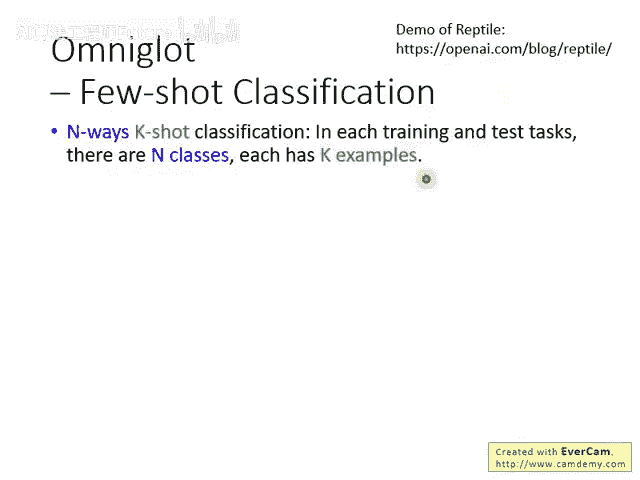

他那种是设计成一个few shot的test，FICATION的test，那也就是说你要先决定说，你今天呢，你的分类任务里面有多少个位跟多少的项。

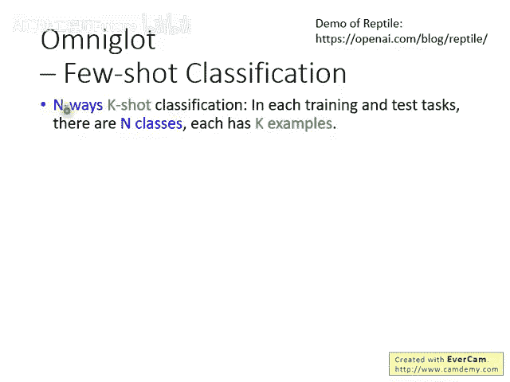

什么叫做way跟shut呢。

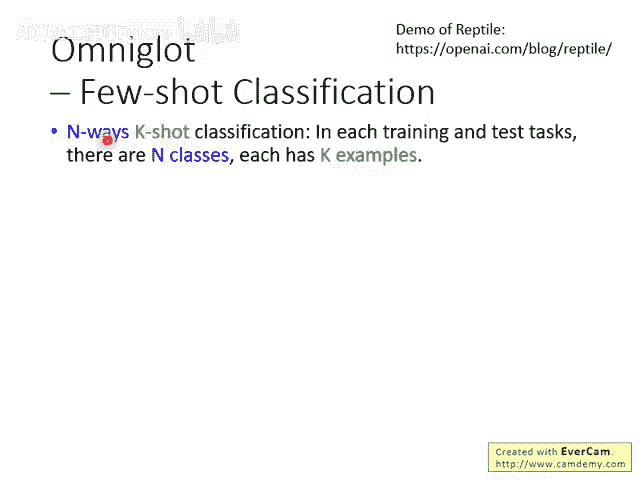

way的意思就是说，你这个分类的任务里面有多少个class，然后shut就是每一个class有多少的example。

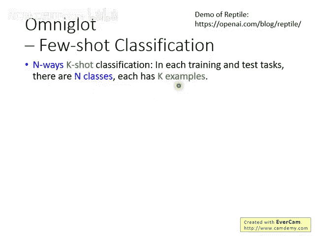

所以N为K下的future，learning的意思是说N位K下的classification。

意思就是说我现在每一个任务里面有N个class，每一个class有K个example，举例来说。

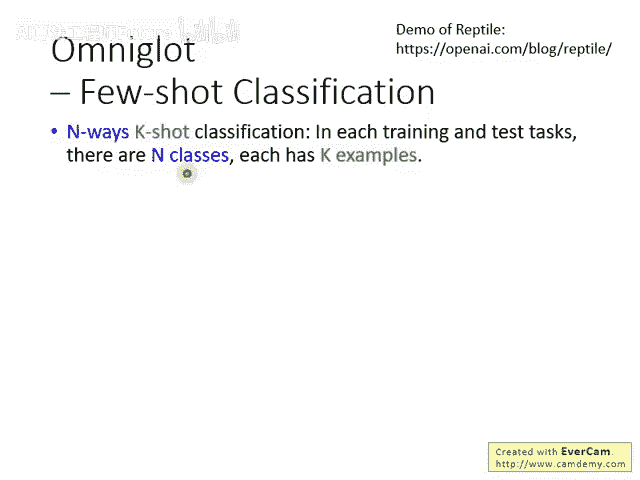

假设我现在有一个任务是twenty ways one shop，那什么意思呢。

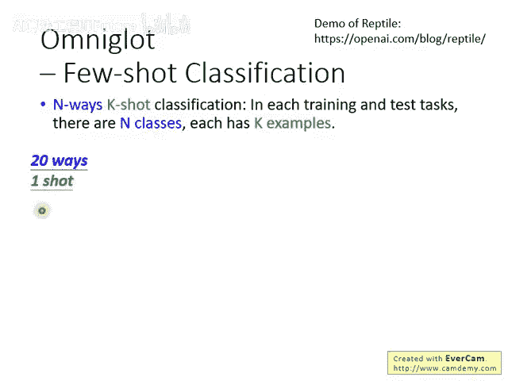

意思是说我现在这个分类的问题，我我总共有20个不同的类别。

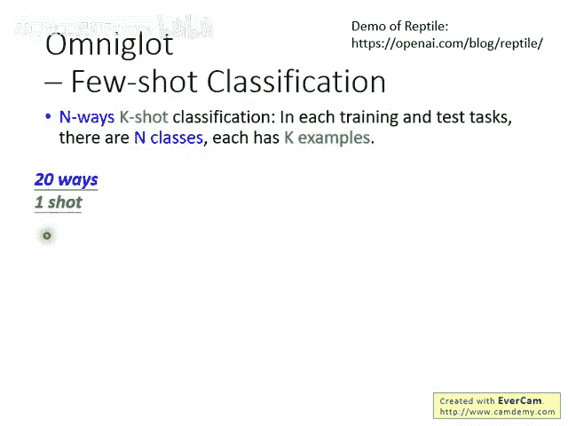

而每一个类别我们只提供一张训练资料。

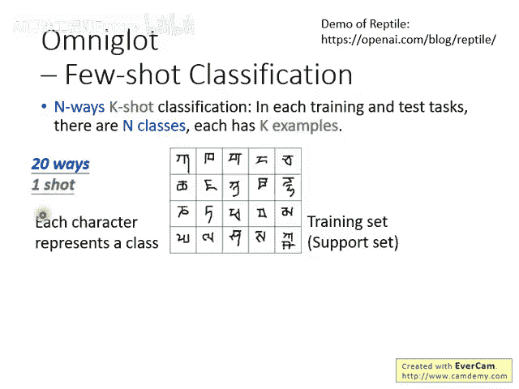

弯下的意思就是说，每一个类别只有一张训练的资料哦。

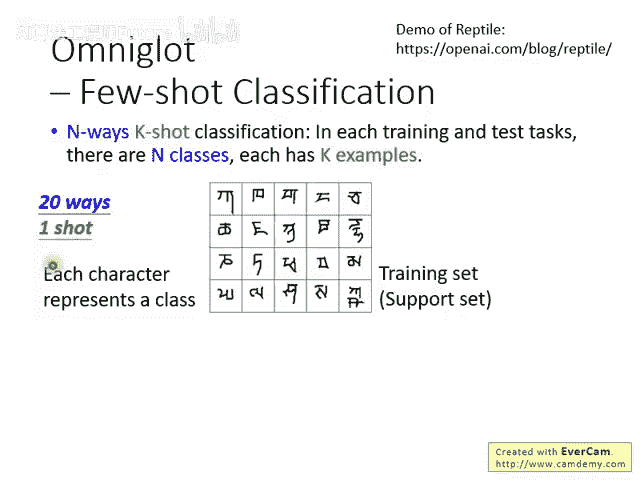

所以你的训练资料可能看起来像是这个样子啊。

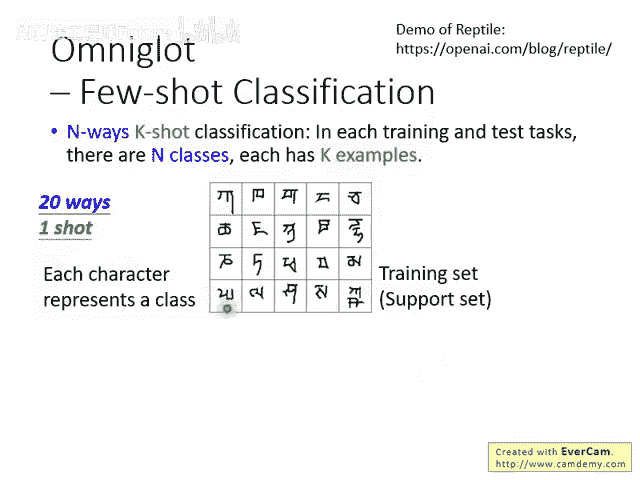

这边呢总共有20个不同的符号。

每一个符号就代表了一个类别，每一个类别只提供给你一个example。

然后希望机器就可以学出一个，20类的分类的系统。

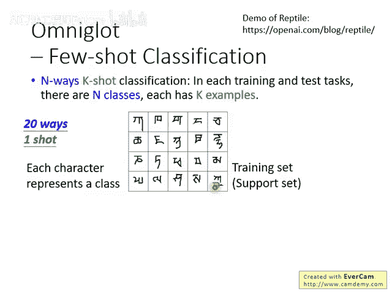

但你如果直接拿这20张图片，用普通的方法去训练，应该是会铲掉了，那你就希望说meta learning，可以帮你学出一个很厉害的演算法，这个很厉害的learning man ela。

能厉害到他们每一个开始只要算看一章，看一个example。

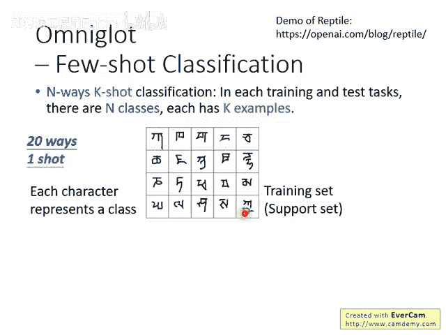

他就可以做的很好好，那这是你的训练资料，那测试的时候就跟一般测试一样，丢一张图片进来。

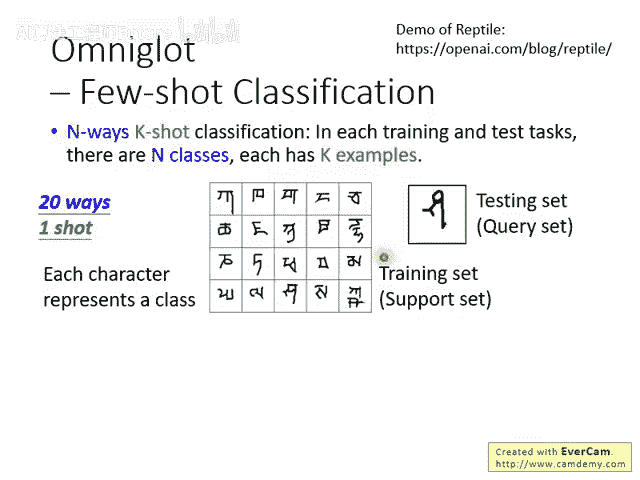

然后问你说这张图片是这20个类别的，哪一个类别。

听说人做future learning真的非常的强，所以你现在来做一下这个one shot learning，你可以看出是哪一个类别吗，给你三秒钟的时间想一下，对这这中间下面嗯我也觉得是中间下面这个哎。

所以我们想法是一样的，这看起来有点像是豌豆射手诶。

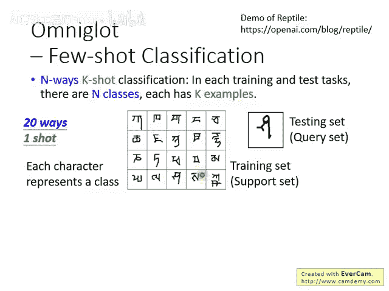

这个看起来也像是豌豆射手啊。

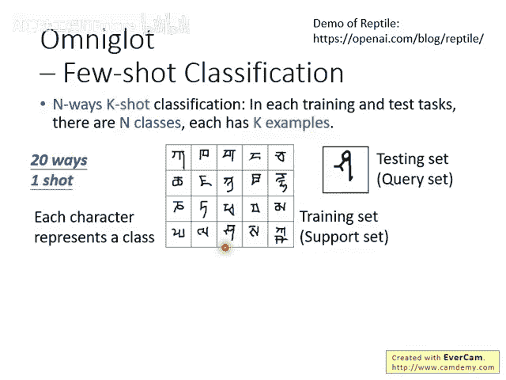

哈你这个范围的符号是吗，藏文的符号有可能这样子，就欧尼欧尼嘎那个cos里面的符号，它有范文的，哦好啊对对，左上好像是站稳这样子啊，这个大家都都很厉害，都认得一大堆的符号。

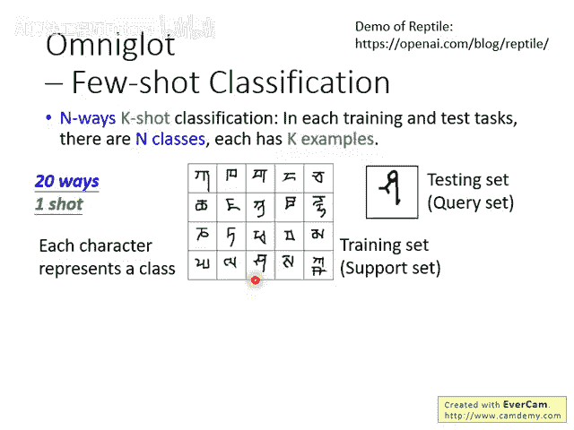

我想太厉害了太厉害了，好我也我跟大家想法是一样，我也觉得这个应该是正确答案对啊，我也觉得应该是这个好。

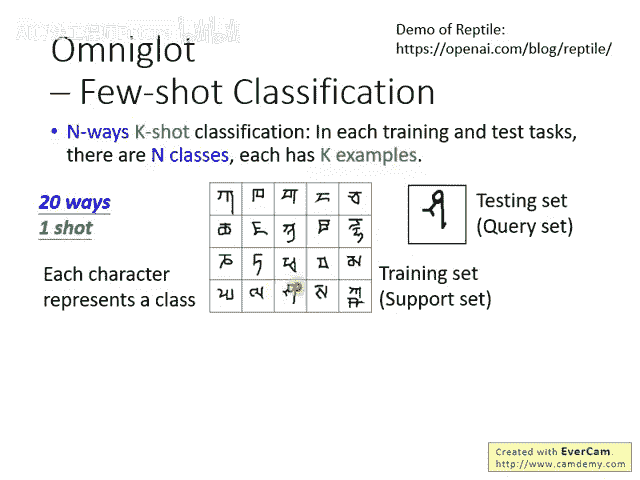

那那在那在实际上训练的时候啊，你就要把那些符号分成两类。

就是分成训练组跟测试组。

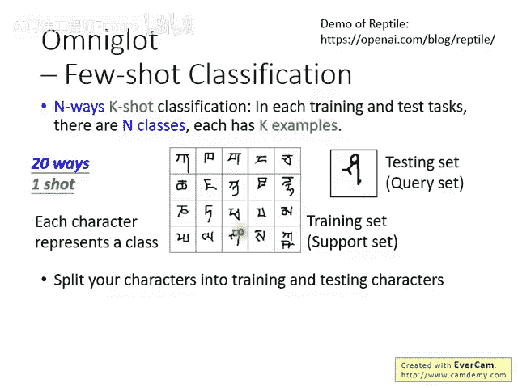

刚才不是有1623个符号吗，那常见的CR就是在1623个里面，你选1200个出来做训练组，然后剩下的当做测试组，当然如果你想的话。

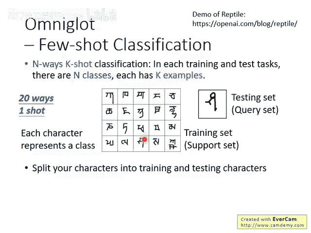

可以从训练组里面再分一些出来，当做validation组好，然后呢，你用这些训练组的这个character，去制造训练的任务，怎么制造训练的任务呢，假设你今天要做一个N位K下的few shot。

Learn the task，那你就从这个训练组里面抽取，随机抽取出N个character，然后呢，每一个chara character呢，都随机抽取出K个example，就制造出一个训练的任务。

那你要制造出很多很多训练的任务，才能够做meta learning，然后测试在测试任务上，唯一不同的地方就是你测试的时候，你那个character那个符号啊，要从测试组里面选，将训练和测试的时候。

你用的符号呢才不会重叠，我为了让大家更有具体的感觉，就是这个test这每一个任务长什么样子，那其实呢网络上有一个这个demo。

