# 【官授搬运】2026年全新优化版李宏毅机器学习系统课程，这才是真正的初学者体系课程！—人工智能／深度学习／神经网络 - P98：8-Meta Learning – MAML (5-9) - AI算法工程师Future - BV1ruqABeEFX

好那唉请收，请那刚那个跟直接学一个弯曲的的方法哦，你说我直接就三个example训练一个classifier，这样啊，那其实通常就是会铲掉这样子，因为你觉得这样就有好，就直接选一个固定的吗。

嗯那我我其实没有非常懂，你只弯下learning的方法是什么，但你会发现说那些弯下learning的方法，其实往往就是meta learning的方法的其中一种样子，举例来说。

有很多玩笑learning做的非常强的model，比如说你有可能听过的match network或是phototype network，那其实你仔细想想。

发现说他们都可以算是放在meta learning那个框架下面，学习的其中一种方法，对就是这样没错对就是这样，好像大家有什么问题要问，大家有问题要问吗，好那我们就继续啊。

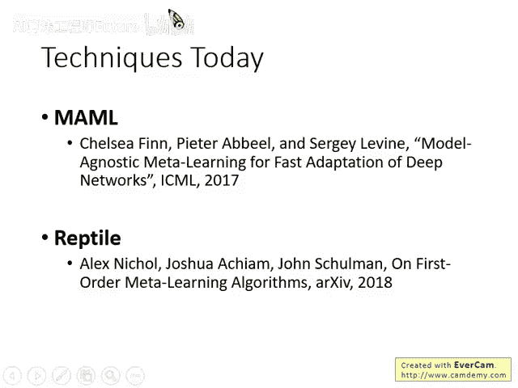

那今天就是介绍两个方法给大家认识啊，那下周再讲更多其他的方法好。

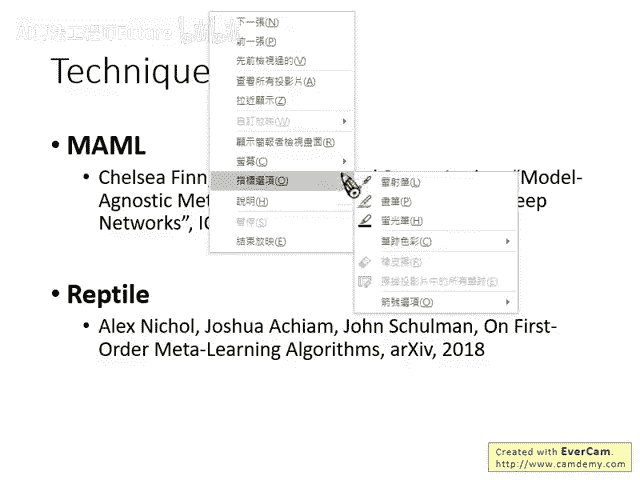

下周再讲，刚才我讲到made match network或是four time network等等，好今天要讲的方法，一个叫做memo啊，它是这个呃ICML2017的paper，那另外叫reptile。

reptile是2018的paper，还不知道他投到哪一个conference去，好，那呃这个memo啊听起来就像是哺乳类动物了。

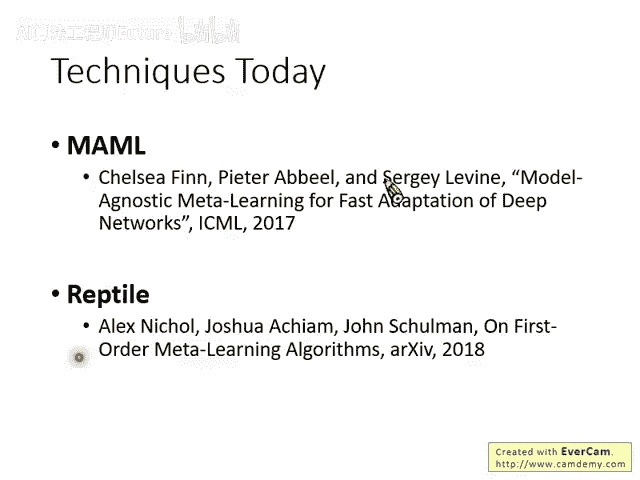

那reptile呢它就是爬虫类啊，这样所以这边放了一个猫，放了一个蜥蜴，那memo为什么叫memo呢，从他的title就可以看出来他是model agnostic meta learning哦。

因为它是model agnostic meta learning，所以叫n a l l model agnostic，意思就是说它是跟model无关的，还可以跨model，它不会受到model限制的。

那reptile呢，我读了这玩意paper以后，还是不知道为什么叫做reptile，这样真的真的你如果知道的话，你告诉我这样真的你这样告诉我，我有点怀疑，说就是为了凑梗。

这样就是memo是哺乳类在硬凑一个爬虫类，这或叫做reptile，我实在我真是看不出来他是什么东西的缩写好。

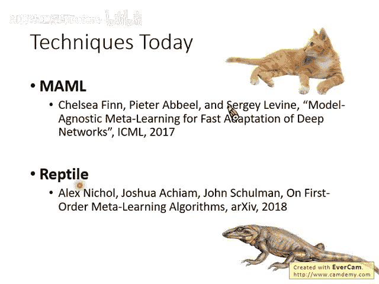

那我就先来讲一下MAO。

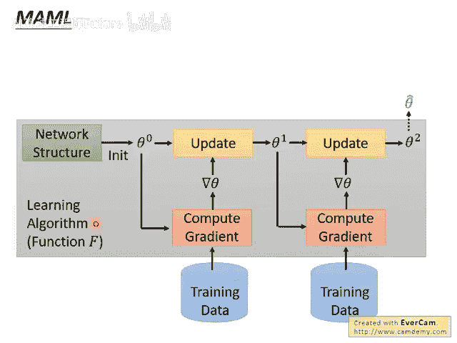

MAO要做的事情是什么，MAO要做的事情，就是我们来学一个initialization的parameter，就过去引力选zation parameter。

你就从某一个distribution里面去sample出来，现在mama要做的事情是，我们来学一个最好的initialization的parameter好。

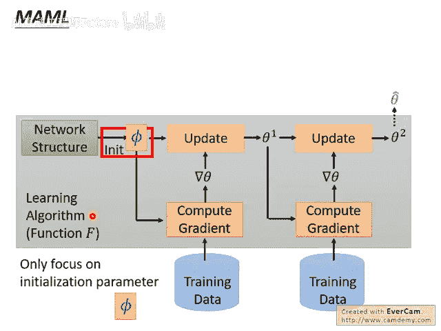

那怎么做呢，呃我们就定义一个loss function啊，这个loss function的input呢就是初始化的参数，然后还告诉我们说，这组初始化的参数是好还是不好。

那怎么知道这个初始化参数好还是不好呢，你就拿这个初始化的参数，去各个不同的task上面做训练啊，虽然初始化参数是一样的，但不同的task上面，你最终学出来的model会是不一样的。

那我们把thea tap上标N代表，在第N个task上面学出来的model，就set a h代表某一个learning的ALISM，最终学出来的model，我们用set a hat来表示，塞拉黑上标。

N代表在第N个任务上面学出来的model，叫做SAH上标N，然后SAH上标N呢，它显然是跟F初始化参数有关系，你给它不同初始化参数，就是就算是你这边归ent descend方法都一样。

你最后学出来的set拉head也会是不一样，那LN括号sea h上标N，就是说我们现在把SAK上标N这组参数，最终拿去task n的txing set上试试看，看看做起来的loss怎么样。

这个就是呃LN括号sea h上标N，那我们现在有大N个task，然后把这大N个task都用spinner做初始化参数，去训练出set a head，然后把他在大N个task上面的loss统统加起来。

就是这个by的loss function，请说，对对所有test都输出一样的initialization think对，所以我刚才就说memo。

它的限制就是他的所有的test model structure，必须要是一样的，对好这样大家还有问题要问吗，好所以memo还是有一些限制啊，就model structure要是一样，确实诶，你可以说。

对没错，就是这样，每一个小任务都是一个训练的过程，每一个小任务你都要拿欢迎再去做训练好，这样大家还有问题吗，好如果没有的话，我们就继续好，那怎么minimize大L的F呢。

就用gradient descent，这就硬做啊，就用gradient descent硬做，怎么用gradient descent呢，只要你有办法用by对大L的F做，算出他的观点就结束了。

就假设你有办法做这件事，你可以知道说这个发音对大L的归点就结束了，然后算出这个规点，把它乘上一个learning ray，那当然这个利润你要调一下和这么一个艾，还有个learning rate。

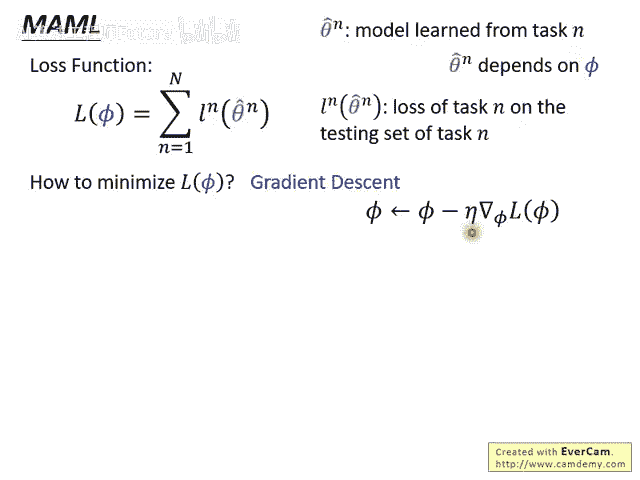

然后就可以update的版就结束了，好那这边要强调一下，memo跟model pretraining是不太一样，那我们知道说在做transfer learning的时候。

你会用model return这样的方法，就是你把呃你现在某一个任务的data很少，但是你另外一个任务的data很多，你就把你的model会券在那个有多样资料的任务上。

然后by two在有少只有少量资料的任务上，这个叫做model的PRETRAINING，那如果是model pretraining，它跟NAN有差别，就是如果是model pretraining的话。

它的loss function呢你会写成这个样子，在NAL里面，你的LN是用哪一个model算出来的呢，是用翻译训练完后的model sea还算出来的，他是训练过后的model。

在model pretraining里面，你是拿你现在手上的那一个model直接去量，说他现在在我呃，要拿来做PRETRAINING的那些task，上面表现怎么样哦，所以他们是不太一样。

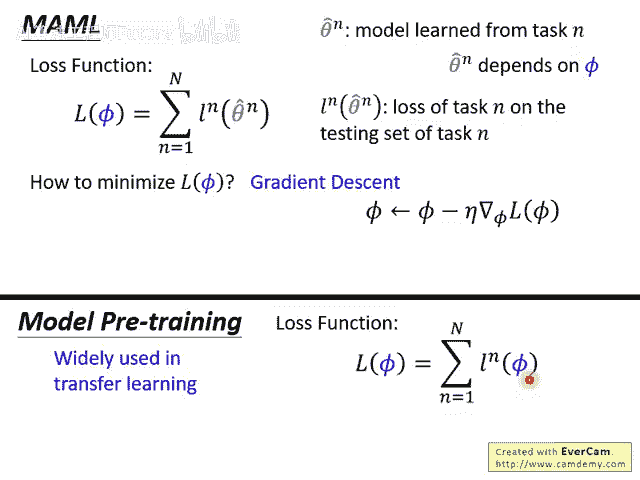

如果你还是觉得有点抽象的话，那下一页我就举一个更具体的例子来跟你讲说，MAO跟model retraining有什么样不一样的地方，好这个横轴是你的model的变化啊，但model其实是高纬的。

现在就假设是一维的好，那这个深绿色的线跟浅绿色的线代表两个不同，the test test one跟test two，它的loss跟model parameter之间的关系，如果今天你用的是MAO的话。

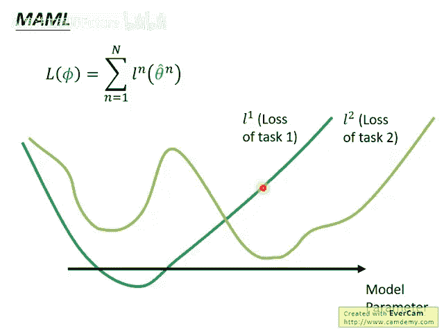

最后你会就是说如果当我用memo的时候，我们并不在意这个初始的参数，F在这些training的task上面表现怎么样。

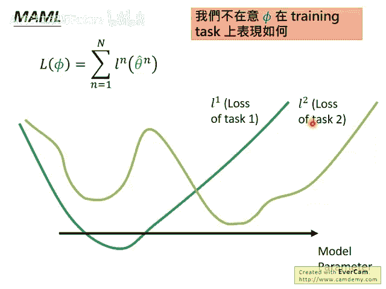

这不是重点，我们真正在意的并不是翻现在的表现，而是拍经过训练以后的表现，也就是说今天假设我们的翻译在这边，翻译在这边，他在test one上表现不是很好，在test to呃。

在task one上表现不是很好，在test two上表现可能也不是很好，但是他可能是一个很不错的翻，为什么他是一个很不错的翻呢，因为假设我们拿这个翻当做初始的参数，在task one上啊。

它可能就顺着这个规点的方向一路滚下去，就可以走到最好的参数，Say a head，这个sa head的这个loss呢就会很小，那如果看set up之后看task to呢，你拿这边当做初始的参数啊。

它就顺着这个task two的规定方向，就往这边走下去，它也可以找到task to最好的参数，这算翻本身拿去做test one和test和Q都没有很强，但是翻译拿去做训练以后。

用test one的data，用test two的data做训练以后可以变得很强，那他就是一个好的FI好。

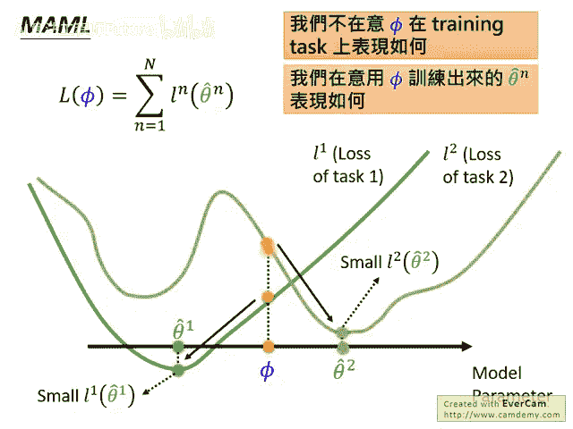

那如果是model pretraining是怎么样呢，model pretraining在意的是，现在我们TRA的这个marvel by，它到底表现的怎么样。

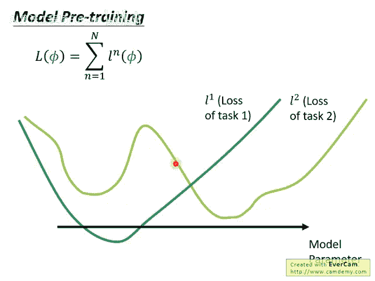

所以在model pretraining的方法来说，一个好的发音可能是在这个地方哦，就这个发音，他在task one上表现的很好，他在task two上呢也表现的不错，那我们真正要找的。

我们在做model pretraining的时候，我们要找的fine，是同时在两个任务上面都可以表现好的翻，但他训练以后好不好呢，就不知道，虽然他现在很好。

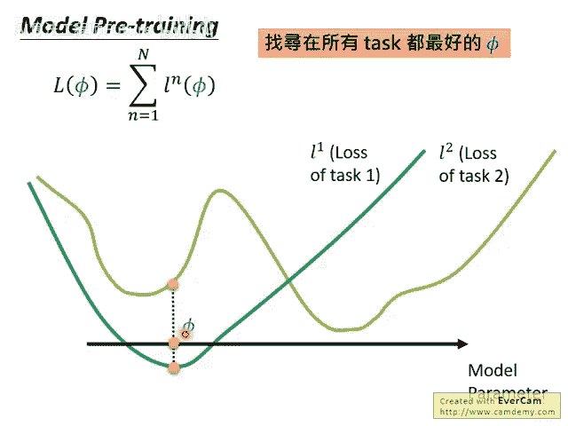

但他可能训练以后并不一定很好，举例来说，在这个例子上面哦，我们把这个当做初始值，然后呢在第二个test当做训练的时候，你最后会卡在一个local mini嘛，那这个loss并没有很小。

因为这边有一个更好的loss，这个loss并没有很小，那这个发音对，因为他认你来说不是一个好的翻译，但是model retraining的时候，没有把训练这件事情考虑进去哦。

所以呢在在做model retraining的时候。

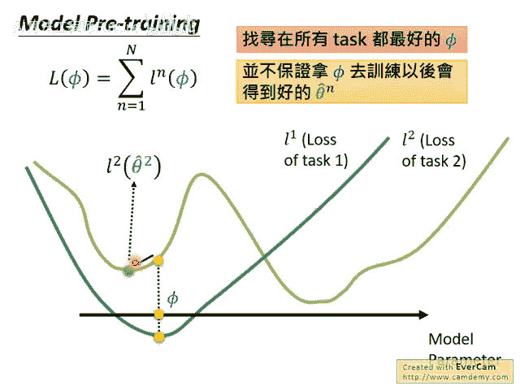

我们想要找一个欢，他可以在那些训练的任务上得到好的结果。

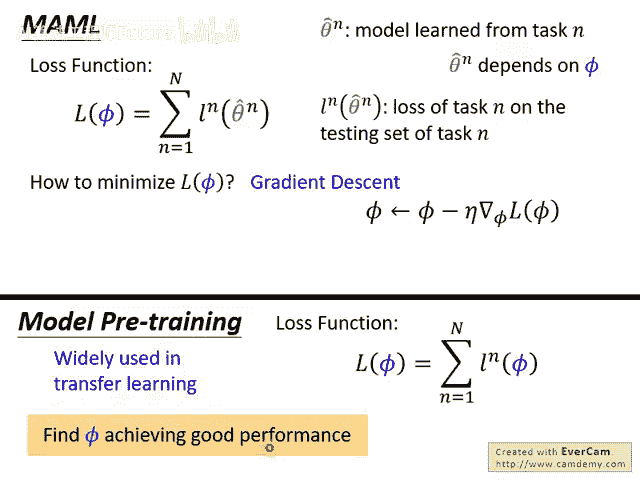

在memo里面我们需要找到一个关，他在这些任务上面经过训练以后，可以得到好的结果哦，所以model pretraining，他看的是现在这个model表现的怎么样。

NNNL他看的是这个model的潜力啊，他经过训练以后表现的怎么样，这就好像是说啊，你毕业以后在想说，我毕业以后到底应该要做什么呢，是要去工作还是去才是浅薄呢，那如果你看工作的话。

你就会觉得说现现在去工作马上就有钱赚，那这个就是model pretending的想法，但如果签薄的话，就是你知道你在念完博班以后，你的人生的道路会更加宽广，这个就是MANL这样诶，那我认识哎。

现在都哎就是没有什么人要这样托班了，所以现在在上课的时候，就是要来叶配念佛班这件事。

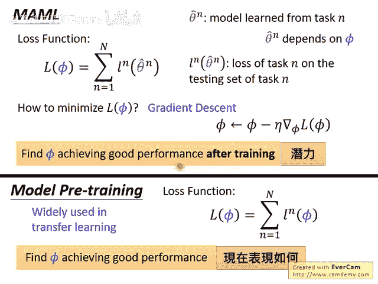

不知道冷不防的开始叶配这样子感，呵呵好，那刚才就是讲了，这个NANL跟model contraining的差别，那NNNL在实做的时候啊。

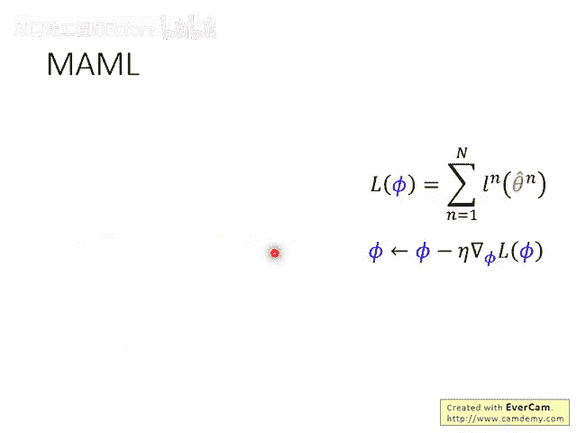

在实做的时候，我们假设我们的training algorithm，只会做一次参数的update，了解啊，就是哦我知道说一般在做creent design的时候，你当然猜错update不止一次。

每周update成千上万次，但是在NANL里面，我们在training的时候，我们假设参数只会被update，也就是说你的参数初始的参数是by，这个是训练出来的，是model自己找出来的。

他计算过一次gradient以后，被update一次以后，得到的sa hand，就当做是最终的去模型训练的结果了，所以five跟SAH中间呢在NANL里面，他们的关系是还蛮直觉的，你把分你把F减掉。

learning rate乘上一个gradient哦，这个gradient呢是by，对现在这个某一个task的loss function，所算出来的规点好，就得到seta head。

我这边把N呢就省略掉，这个L呢代表是某一个task的loss function，那你把final对某一个test loss function去算它的gradient，再减掉Y就得到那一个test。

这样训练出来的结果再打开，那当然你可能会怀疑说呃，为什么只做一次update呢，一般做训练的时候不是应该update个几10万次吗。

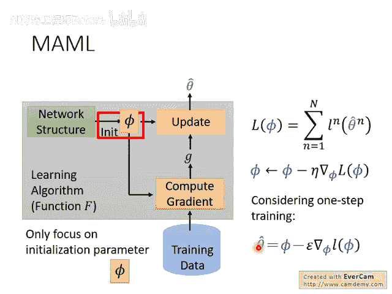

那这边我就给你几个我想到的理由啦，第一个理由就是你想想看这个meta learning的训练，这个computation的需要量往往都非常大，那如果你说啊你要update几千次，那每次训练都要一个小时。

那这个怎么可能支撑得住呢，所以我们就update这样才快，这样才快，那再来就是假设今因为我们今天在训练的时候，就是我们今天ENDLL的训练目标，就是希望在训练以后可以得到好的结果。

那假设今天NANL真的可以训练出一个，超强的initialization，这个initialization它棒到什么地步呢，它放到只要update是参数结果就很好，这样不是很棒吗。

所以按钮就把这个当做目标，他就希望你就是只可以up背一次，然后UPBE次后就要很好看看有没有办法做到，然后呢呃实做的时候啊，你现在在训练你的MMML的时候，你假设只update次参数。

但是在这在测试的时候，你是可以update很多次参数的，就是你早说这个initialization在训练的时候，是期待这个intralization update一次以后结果就很好。

但有可能实际实做的时候呃，只update一次，真的结果不好，那没关系，你就在测试的时候多update几次哎，那你就在你的那个testing the task上，你在解你的testing test时候。

你可以多update，是让你得到比较好的结果，然后再来就是呃，如果今天是pusha learning的task，你的data很少啊，那如果这下很少，你要背很多次，不是会很容易over beating吗。

所以我们把update次数限制在只可以update一次，总之NANL只会通常他在训练的时候。

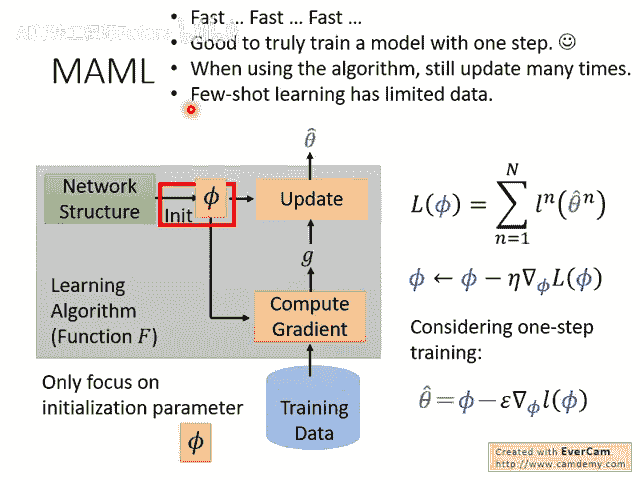