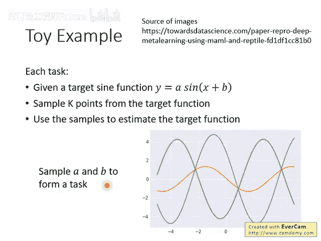
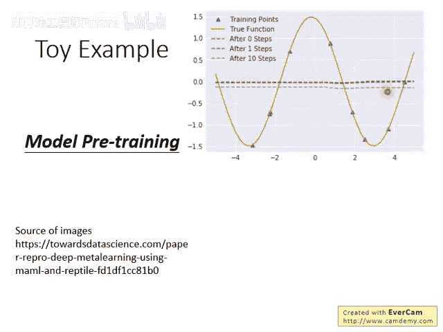

# 【官授搬运】2026年全新优化版李宏毅机器学习系统课程，这才是真正的初学者体系课程！—人工智能／深度学习／神经网络 - P99：9-Meta Learning – MAML (6-9) - AI算法工程师Future - BV1ruqABeEFX

好那这边有一个toy example，就展现一下MML跟transfer learning之间的差异，那这个toy example呢是的，就在原始的NI按钮那边，paper里面他也有做这个e。g。

不过这个图呢是从这个部落格上呃，呃载下来的，我觉得这个图是比原来的NMML的paper，讲的更加清楚一点，好我们现在错example是这样，我们每一个训练跟测试的任务啊，这个任务是什么呢。

这个任务是说我们先假设我们有一个sin function，Y等于a sin x加B那这个A呢就是MPITUDE，这个B呢就是FX，我们从这个SFUNCTION里面呢去随机sample出K的点。

当做我们的训练资料，当做我们的任某一个任务里面的训练资料，然后我们再用这些训练资料去想办法，估测出一个方程，我们希望再根据那些训练资料，根据这个K比训练资料估测出来的方式。

跟原来simple的那个function拿来做，simple function y呢越接近越好，那我们现在的每一个任务，不管是训练的任务还是测试的任务，我们要做的都是一样的事情。

然后接下来你要怎么制造各式各样，不同的任务呢，你只要有sample，不同的A跟B你就可以制造出不同的任务哦，所以你用一组A跟B，你就可以制造出一堆的训练的task。

你用另外一组A跟B制造出一些测试的test，那接下来你就可以跑meta learning好，那接下来我们就来看一下这个NNML。

在这个toy example上面的结果，我们现在看model pretraining的结果，那在这个图上啊，这个呃橙色这一条线是我们的测试的test，我们就假设说我们只有一个测试的test。

他会从这个特色task里面sample出几笔资料，这边应该好像是sample出十笔吧，不过有一些资料是还蛮重叠在一起的，就sample出一些资料，然后拿这些资料想办法去训练出一个function。

那希望用这次要训练出来的方式，跟这个橙色的function越接近，越好，那如果你搜model pretraining的方法，model pretraining的方法。

训练出来的initialization的参数那个by啊，他做出来的方式是一条水平的线，这边绿色的呢是还没有做training的时候，也就是你的初始的参数by它的结果长什么样子。

然后他跟红色的线有点重叠啊，它也是一条水平线，那为什么它会是一个水平线呢，你想想看哦，你今天在做model pretraining的时候，你是希望找出一个初始的参数。

它在所有的training task上表现都好，那所有的training task就是一大堆的sin函数，一大堆的sin函数，那他们的EMPAGE跟face都不一样，你想想看。

你把一大堆不同的sin函数叠起来，它不就只是一个水平线吗，因为同一个位置有的地方是波峰，有的地方是波谷，你simple1大堆sin函数叠起来变成一条水平线。

所以你的transfer learning愣到的就是一条水平线好，那这条水平线可能是一个很不好的初始参数，因为刚才说拿这条水平线再去做five two训练，训练一个step，得到的仍然是一条水平线。

训练十十个step，你只是把这条水平线平移而已，结果仍然很差。

如果你做NNNL的话，结果就不太一样好，现在NANL呢，在还没有做做任何training的时候，它是绿色的这一条线，而它是绿色的这一条线，它当然跟你的目标，也就橙色这一条线是有一段差距的。

但现在如果你让他只训练一个step，你让他update一次参数，就是你从这个橙色的线上sample出几个点，sample出几个点，然后呢用绿色的这一条线作为初始值去update参数。

你得到的就是红色这一条线，那你发说红色这一条线，跟橙色这条线其实是有些接近的，至少他知道说波峰应该在这边，然后这边有点像是波谷的位置，有点像是波谷的位置，然后刚才有讲说NNNL。

虽然你在训练这个model的时候，你说在那些training task上，期待你只update一次参数就可以做好，但实际上在testing the task上，在测试的任务上。

你还是可以update很多次参数啊，所以在测试任务上我们可以update多一点参数，比如说update10次，那这个时候呢你得到这条紫色的线，可能又跟橙色的线更接近一点。

那就用这个这个example呢来显示说，mother pretraining跟NANL它们是有差别的，好真好讲，大家有问题要问吗，没有话，我们就继续好，那额也在那个NNNL的原始paper里面呢。

也把这个技术用在欧米伽跟mini image net上面，那omega这COOPUS我们刚才介绍过了，那我们说呢你要决它，你要决定说你现在的future类的task由几个位，也就几个类别好。

所以你可以说我要做五个类别的Q下classification，也可以做20个类别的Q下classification，那每一个类别有几个example呢，你可以做弯下，也可以做五个项目，可以做弯下。

也可以做五个项，那这边就把NN呢跟其他meta类的方法比一下啦，那当然n a n al performance看起来呢是最好的啊，这个paper理念。

那iimini image net呢其实跟omega的那个setup，其实还蛮像的，他就说我们从image，我们从image name那个POPUS里面挑一些class出来。

当做training的class，再挑一些class出来当做validation的class，再挑一些class出来当做testing the class，然后其他的setup就跟omega一样。

就每个class sample出一些image好，所以这边要做的就是five way的classification，也就是说我们现在的future类的task呢有五个class。

每一个class它有一张图片或者是五张图片，但是这些图片是来自image net，那个CUS的这个task呢叫做mini image net，那NANL呢它的表现呢也是最好的，那这NANL呢有两个变形。

一个是first order approximation，另外一个是没有approximation，那这两个方法你会发现说诶，他们的表现其实都是差不多的。

那这个first order performation是什么意思呢。