# 【官授搬运】2026年全新优化版李宏毅机器学习系统课程，这才是真正的初学者体系课程！—人工智能／深度学习／神经网络 - P9：8-选修-预测神奇宝贝Pokemon - AI算法工程师Future - BV1ruqABeEFX

题好我们今天要讲的是regression，那等一下我会呃举一个例子来讲，regression是怎么做的呢，顺便引出一些machine learning里面的呃常见的的重要观念。

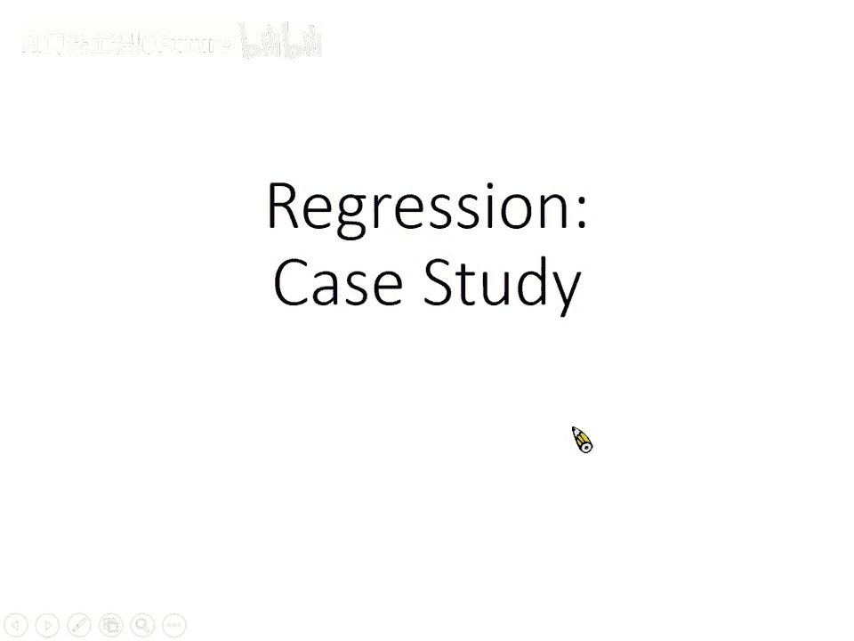

好那呃regression可以做什么。

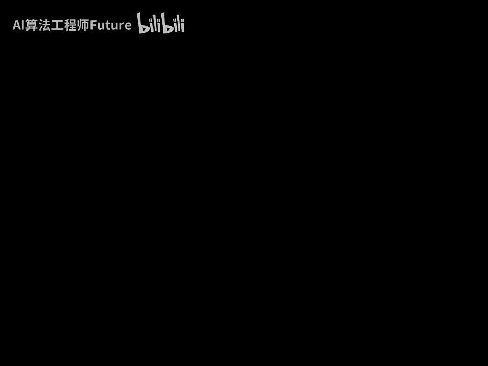

除了我们在作业里面，大家要做的预测pm2。5这个任务以外，还有很多其他非常有用的task，举例来说，如果你有一个好，你可以做一个这个股票预测的系统，如果你要做股票预测系统的话。

你要做的事情就是找一个function，我这个function的input可能是呃前过去10年哦，各种股票的这个起伏的资料，或者是呃某些公司并购A公司，并购B公司，B公司，并购C公司等等的资料。

那你希望这个function在input这些资料以后，他的output呢是明天的道琼工业指数的，呃的点数下啊，如果你可以预测这个的话呢，你就发了，那还有别的task，比如说现在很热门的无人车自动车呃。

这个自动车呢其实也可以想成是一个，regression的problem，那这个regression power面input呢，就是你的无人车呢所看到的各种sensor，和它的红外线感测的sensor。

他的这个影像的视讯的镜头所看到的呃，马路上的东西等等啊，你的input就是这些information output呢，output就是方向盘的角度啊，比如说要左转50度还是呃右转度。

那右转50度你就当做是左转-50度啊，所以output也是一个SCALA，所以无人车驾驶其实就是一个regression，Problem input，一些information output。

就是方向盘的角度，它是一个数字啊，或者是你可以做推荐系统哦，在此我们都知道说这个YOUTUBE要推荐影片，或者是amazon要推荐商品给你，那推荐系统，他要做的事情。

也可以想成是一个regression的问题，也就是凿的function，它的input是某一个使用者A汉某一个商品B，它的output就是使用者A购买商品B的可能性，而如果你可以找到这样一个方选。

它可以精确的预测说使用者A购买商品，B的可能性的话，那你就那amazon呢就会呃呃推荐使用者A，他最有可能购买的商品好，那这个呢是regression的种种应用，那今天我要讲的呢是另外一个。

我觉得更实用的应用，就是预测那个宝可梦的CP值，这个大家知道是什么意思吗，我来说明一下好了，这CP值呢就是一只宝可梦的战斗力，那你抓到一只宝可梦以后，比如说这个是一只妙蛙种子。

而我们该把那个我的滑鼠跳出来啊，比如说这是一只，这是一只妙蛙种子，然后你给它吃一些新橙或者是糖果以后，它就会进化成妙蛙草，而RUA进化成妙蛙草以后呢，它的这个CP值呢就变了，可那你会希望。

为什么我们会希望能够预测这个呃，宝可梦的CP值呢，因为这个如果你可以精确的预测说，一只宝可梦在进化以后的CP值的话，你就可以评估说你是否要进化这只宝可梦，对不对，如果它是一只CP值比较低的宝可梦的话。

你可能就把它拿去做糖果，你就是你就不净化它，这样你就可以节省一些你的糖果的资源，那可就会问说为什么我们要节省糖果的资源，因为你这样可以在比较短时间内呢，就进化比较多强的神奇宝贝啊，比较多的。

你现在不能叫神奇宝贝，那不如我年，你这是宝可呃，进化比较强的宝可梦，OK好，那你就会想说，为什么我们要有比较强的宝可梦呢，因为他可以去打道馆，也就问说为什么我要打道馆呢，其实我也不知道这样好。

那我们今天要做的事情就是找一个方式好，这个function的input呢就是某一只宝可梦，那它的output呢就是这只宝可梦，如果我们把它进化以后，他的CP值的数值是多少哦。

这是一个regression的problem，我们的input就是某一只宝可梦所有相关的information，比如说我们把一只宝可梦呢用X来表示，那它的CP值呢，我们就用X下标CP来表示。

我们用下标来表示某一个呃，完整的东西里面的某一个component，某一个部分，我们用下标来表示，XCP代表某一只宝可梦X它在进化前的CP值，比如说这个呃这个妙蛙种子，它的CP值呢是14哦。

那XS代表说这一只宝可梦，X它的这个呃是属于哪一种物种啊，比如这是妙蛙种子，而XCXHP代表说这一支宝可梦，它的hp值是多少，它的生命值是多少啊，这边呢这个妙蛙种子生命值是十好，XW代表它的重量。

XH呢代表它的高度，那就看看说你抓的神奇宝呃，抓的那个宝可梦呢，是不是特别大只或特别小只的好，那output呢是进化后的CP，这个进化后的CP值呢就是一个数值啊，这是一个SCALA。

我们把它用Y呢来表示好，怎么解决这个问题呢，我们知道说做我们第一堂课就讲过，说重的训learning就是三个步骤，第一个步骤是找一个model，第二个步骤是定义诶。

model就是个function set哦，第二个步骤就是定义function set里面每某一个function，我们拿一个function出来，可以要evaluate它的好坏。

第三步骤呢就是找一个最好的方式，那这个首先我们就从第一步骤开始，我们要找一个function set啊，这个function set呢就是所谓的model，那在这个task里面呃。

我们的function set应该长什么样子呢，一个input，一只宝可梦output，CP值的output，进化后的CP值的function应该长什么样子呢，那我们这边就先胡乱写一个简单的。

比如说我们认为说进化后的CP之外，等于某一个常数项B加上某一个数值W乘上呢，现在输入的这个宝可梦的X它在进化前的CP值，而这个XCP代表进化前的CP值，这个Y呢是进化后的CP值啊，这个W和B呢是参数。

OKW和B呢它可以是任何的数值，我在这个model里面呢，W和B是未知的，你可以把任何的数值填进去前进，不同的数值你就得到不同的function哦，比如说你可以有一个f one，f one是D呢等于十。

W呢等于九啊，你可以有另外一个方向f two，这个f two呢是B等于9。8，W呢等于9。2，你用个F3，这个F3呢它是B等于-0。8，W等于-1。2，那如果今天你的W和B可以带任何值的话。

你其实你这个方ction set里面呢，可以有无穷无尽的方程，有无穷多的方式，那你用这个式子Y等于B加W乘上XCP，代表这些function的所成的集合，当然在这些function里面。

比如说F1f two f3里面，你会发现说有一些function显然是不太可能是正确的，比如说F3不太可能是正确的，因为我们知道说CP值其实是正乘负，1。2就变负的，所以进化以后CP值变负的。

这样显然是说不通的，那这个就是我们等一下要靠training data，来告诉我们说在这个function set里面呢，哪一个方向才是合理的方式好，那这样子的model这个Y等于B加W乘SCP。

这样子的model它是一种linear的model，所谓的linear的model的意思是呃，简单来说，如果我们可以把一个function呢，我们把现在我们要找的function呢写成Y等于B。

加上some mention over w i乘上xi，那它是一个它就是一个linear的function，在这边呢，这个xi指的是你input x的各种attribute呃，你input这个呃。

比如说input的宝可梦的各种不同的属性，比如说身高啊，体重啊等等，那这些东西呢我们叫做feature哦，从input的那个object里面抽出来的各种数值，当做function的input。

这些东西呢叫做feature，那这个WI跟B这个呢这个WI呢叫做weight。

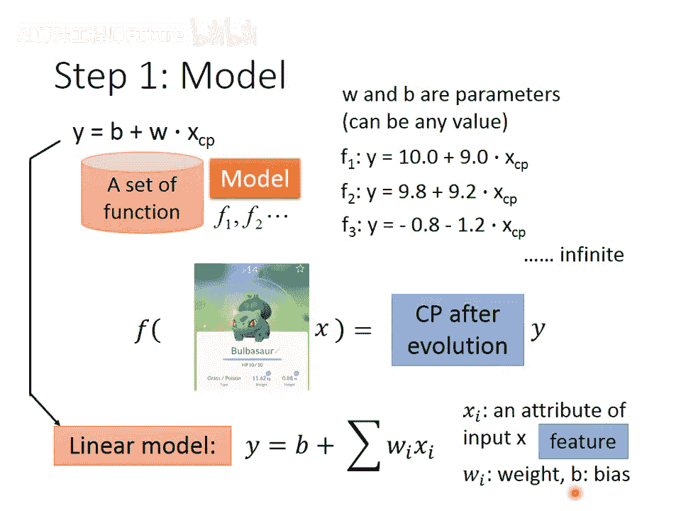

这个B呢叫做bias。

那接下来呢我们要收集training data，才能够找这个function，那这是一个supervised learning的test，所以我们收集的是function的input汉。

function的output，那因为是regression test，所以function的output是一个数值，举例来说呢，你就抓了一只，这个是杰尼龟啊啊它进化以后这个是卡咪龟呀，我没说错吧。

这近哎对，这个是这个是卡咪龟，没主要卡咪龟进化似水见龟，诶好这个function的input呢在这边就是这只杰尼龟，那我们用x1来表示它，我们用呃上标来表示一个完整的object的编号，我们刚才看到说。

我们用下标来表示一个component，一个完整的object component，我们用上标来表示一个完整的object的编号哦，所以这是第一个X啊，这是一只杰尼龟，那它进化以后的CP呢是973哦。

所以我们的function的output应该看到x1就output，数值973啊，那个这个973呢我们用y one hat来代表，我这边用Y呢来代表function的output。

用上标呢来代表一个完整的个体，因为我们今天考虑的output是SCALA哦，所以它其实呢里面没有component，就它就是一个简单的数值。

但是我们未来如果在考虑structure learning的时候，我们output的object可能是有structured的哦，所以我们还是会需要上标下标，来表示一个完整的output object。

还有它里面的呃component，我们用y hone来表示这个数值979，这样好，那只有一只不够呢，要收集很多啊，比如再抓一只伊布啊，那这伊布呢就是x2，那它进化以后呢可以变成雷精灵啊。

雷精灵的CP值是1420，这个1420就是y two hat，我们用heat来代表说这个是一个正确的值，是我们实际观察到方选该有的output啊。

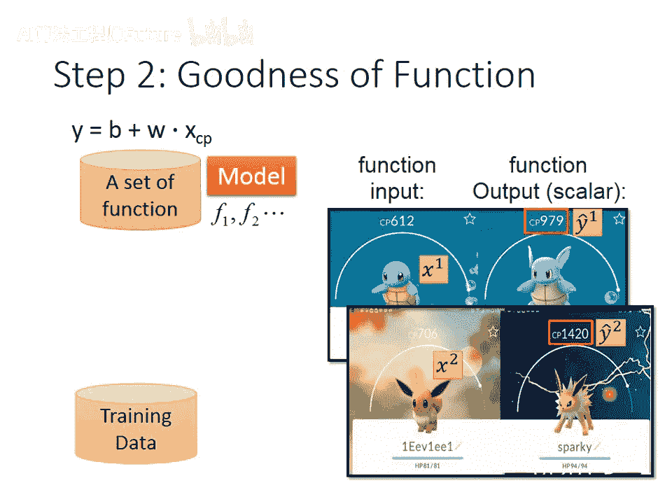

你可能以为说这只是一个例子，这不是一个，这不只是一个例子，我是有真正的DA的，这哈哈哈哈，所以今天其实我是要想要发表，我在神奇宝贝上面的研究成果，这样呃有200多人来听，我真是太高兴了，哈哈哈好。

那我们就收集了十只神十只神奇宝贝啊，这十只神奇宝贝呢，那不是又说错了，又说些十只宝可梦啊，这十只宝可梦就是嗯就从编号一到编号十，OK那每一只宝可梦我们都让它进化以后。

我们就知道它进化后的CP值就是y one hand，到Y10head，这个是真正的data，你可能会问说怎么只抓十只呢，你不要抓这个很麻烦吗，不是要死我啦，好其实老实说这里我不做，我自己抓。

网络上有人分享他抓出来的数据，我拿他的数据来做一下，那其实他也没有抓太多次，因为你知道抓这个其实是很麻烦，一抓来以后并不是抓来就好，你把它进化以后，你才知道说function的offer是多少。

所以收集这个data ta并没有那么容易好，所以就收集了十只神奇宝贝，它进化后的CP值好，那如果我们把这十只神奇宝贝的information画出来的话，这个图上每一个蓝色的点呢，代表一只宝可梦这样子。

然后他的X轴X轴代表的是这一只宝可梦，它的CP值，这个我们一抓来的时候就知道了，对不对，然后它的Y轴代表说，如果你把这一只宝可梦进化以后，进化后的CP值啊，这这个呢用y head来表示好。

所以十只神十只宝可梦，所以这边我们有十个点了，确实有十个点23456，这边其实有三个点量，789十这样，那这个CP值起始就特别高，这只其实是一部好哦，这衣服不是很容易抓诶，好。

那这边每一个点呢就是某第N只宝可梦的CP值，跟它进化以后的y head，那我们用X上标N下标CP来代表第N比data，它的某一个component，也就是他的CP值好。

那接下来呢我们就要有了这些training data以后，我们就可以定义一个function的好坏，我们就可以知道说一个function是躲好或者是躲不好，我们知道说这里面每一个方选。

它是多好还是躲不好，怎么做呢，我们要定义一个另外一个function叫做loss function啊，这边写成大写的L，我们在这边已经有一大堆的方选，我们这边定了一个方圈set，这里面有一大堆的方形。

然后这边我们要在定另外一个function，这个另外一个function呢叫做loss function，然后打开我们写成大写的L这个loss function的input，他是一个很特别的方式。

这个lost的function呢它是function的function，大家了解我的意思吗，它的input就是一个function，它的output就是一个数值。

告诉我们说现在input这个方选它有多不好，我们这边是用多不好来表来表示，OK所以这个loss function它是一个方向的方选，他就是吃一个方程当中input。

他的output就是这个方选的有多不好好，那所以你可以写成这样，这个方这个L呢它的input就是某一个方向F，那你知道一个function呢，它又是由这个function里面的两个参数。

B跟W来决定的哦，这个F是由B跟W来决定的，所以input f就等于是input，这个F里面的B跟W啊，所以你可以说这个loss function，它是在衡量一组参数的好坏，衡量一组B跟W的好坏啊。

那怎么定这一个loss function呢，其实这个loss function你其实可以随自己的序号，定一个你觉得合理的function啊，不过这边我们就用比较常见的做法啊，怎么定呢。

你就把这个input的W跟B呢，你就把这个input w跟B呢，实际的代入这个Y等于B加WXCP，这个方程里面哦，你把W乘上第N支宝可梦的CP值，再加上这个constant b，然后呢你就得到说。

如果我们使用这一组W，这一个W跟B来当做我们的function，来预测宝可梦它进化以后的CP值的话，这个预测的值Y呢的数值是多少，OK好，所以这个里面的括号里面的括号是比较小的，括号。

它输出的数值是我们用现在这个function来预测的话，我们得到的输出是什么，那y hand是真正的数值，我们把真正的数值减掉预测的数值再取平方啊，真正的数值减掉预测数值再取平方，这个就是估测的误差好。

那我们呢再把我们手上的十只宝可梦的，估测误差都合起来，就得到这一个loss function，那这个定义我相信你是不太会有问题的，因为它非常的直觉估测，如果我使用某个function。

它给我们的估测误差越大，那当然这个方程就越不好，所以我们就用估测误差来定义一个loss function，当然你可以选择其他的可能性，好好，那再来第二再来，我们有了这个loss function以后。

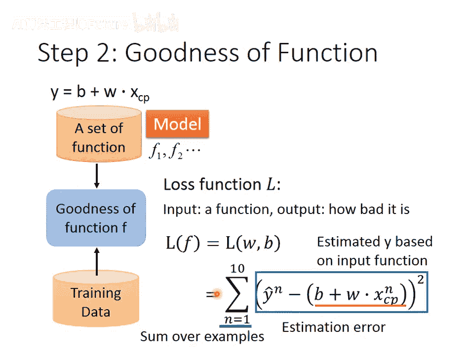

我们有了这个loss function以后，呃，我们这边呢呃如果你还是有一些困惑的话，我们可以把这个loss function的形状画出来，这个loss function l of w b呢。

它input就是两个参数WB哦，所以我们可以把这个l of w b呢，对W跟B呢把它作图好，把它画出来，在这个图上的每一个点就代表了一个组WB，也就是代表了某一个方向，比如说呢红色这个点。

红色这个点就代表了这个B等于负180，W等于二的时候，所得到的方向就是Y等于一，80-2乘以XCP这个方向，这图上每一个点都代表了一个方向，而这个颜色呢颜色代表了现在，如果我们使用这个function。

根据我们定义的loss function，它有多糟糕啊，他有多么不好，那这个颜色呢越偏红色代表数值越大哦，所以在这一群的function它的loss非常大，也就他们是一群不好的方选。

那最好的方选落在哪里呢，越偏蓝色代表哪一个function越好，越偏蓝色代表哪个方向越好，所以最好的方式呢其实落在这个位置哦，如果你选这个方选的话，他是可以让你lost最低的一个方式好。

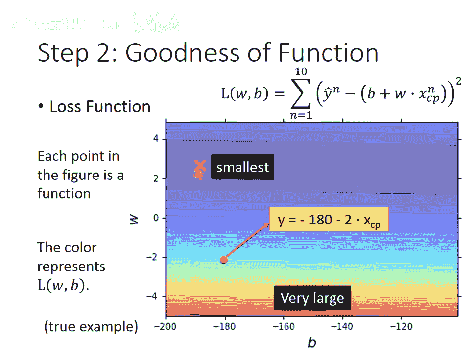

那接下来我们已经定好了，我们的loss function可以衡量这个呃，我们的model里面每一个function的好坏，接下来我们要做的事情就是从这一个function set里面。

从这个set里面挑选一个最好的function好听，那所谓挑选最好的方选这一件事情，如果你想要把它写成formulation的话，如果你想要把它写成equation的话，那写起来是什么样子呢。

它写起来就是呃你要我们定的那个loss function，长这样，LOF那你要找一个F，它可以让l of f最小啊，这个可以让l of最小的方式，我们就写成f stop，或者是呢我们知道F是由两个参数。

W和B来表示，那今天要做的事情就是穷举所有的W和B，看哪一个W和B代入l of w b，可以让这个loss的值最小，那这个W和B呢就是最好的W跟B，那么写成w star跟BESTAR。

或者是我们把L这个方程列出来，L这个方选我们知道它长的就是这个样子，那我们就是把W和B用各种不同的数值，带到这个方程里面，看哪一组W和B可以给我们最好的结果，如果你修过线性代数的话。

其实这个对你来说应该完全不是问题，对不对，这个是有close form solution的，这样我相信你可能不记得他长什么样子了，呃就是说所谓的call phone solution。

意思是说你只要把十只神奇，十只宝可梦的CP值跟他们进化后的YH，你只要把这些数值带到某一个function里面，它output就可以告诉你说最好的W跟B是什么，如果你修过现代的话。

其实你理论上应该是知道要怎么做，那我假设你已经忘记了，我们要教你另外一个做法，这个做法呢叫做gradient descent啊，这边要强调的就是gradient descent，不是指适用于解这个方程。

而解这个方程是比较容易的，你有学过现代，你其实就会了，但是gradient descent它厉害的地方是它可以，只要你这个LR是可微分的哦，不管它是什么。

function gradient descent呢都可以拿来处理，这个方式都可以拿来帮你找，可能是比较好的呃，呃方式或者是参数好，那我们来看一下gradient descent是怎么做的。

我们先假设一个比较简单的test，在这个比较简单的task里面呢，我们的function l of w，我们的loss function l of w，它只有一个参数W，那这个L和W必然是不需要。

是我们之前定下来那个loss方，它可以是任何方选，只要是可微分的就行了，那我们现在解的问题是找一个W，让这个LW最小这件事情怎么做呢，按暴力的方法就是穷举所有W可能的数值。

把所有W可能数值从负无限大到无限大，一个一个值都带到loss function里面去，试一下这个loss function的value，你就会知道说哪一个W的值可以让loss最小，如果你做这件事的话。

你就会发现说，比如说这里这个W值可以让loss最小，但是这样做是没有效率的，怎么做比较有效率呢，这个就是gradient descent，要告诉我们这个做法是这样子的，这个做法。

这样我们首先呢先随机选取一个初始的点哦，我们先随机选取一个初始的点，比如这边选随机选取的呢是W0，可那呃其实你也不一定要随机选取，其实有可能有一些其他的方法，可以让你找的值呢是比较好的，这个滞后代替。

那现在就想成是随机选取一个初始的点W0，接下来呢在这个初始的W0这个位置呢，我们去计算一下W这个参数对嗯。

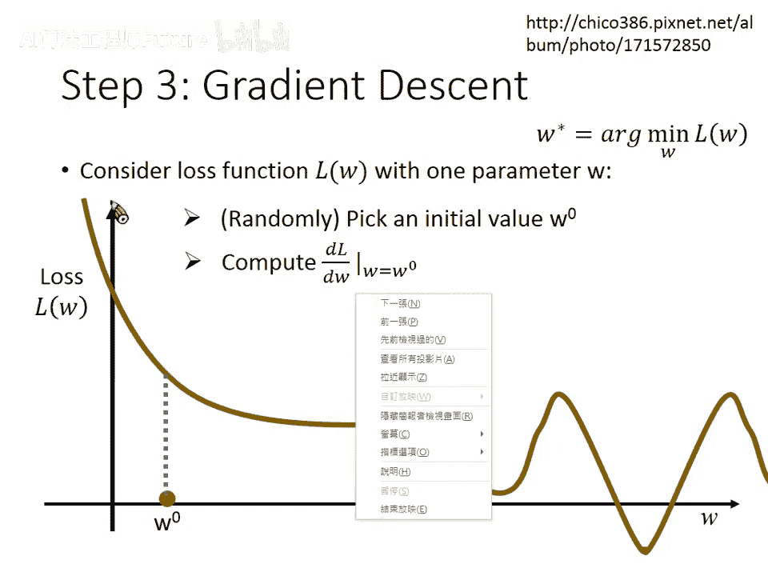

对L的这个哦跳出来了哎又跳回去了。

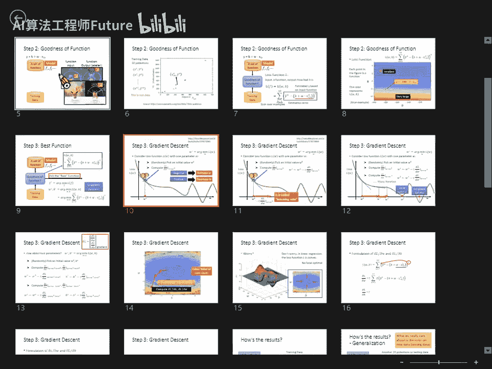

好，我们要计算这个在W等于W0这个位置，参数W对loss function的微分，如果你对微分不熟的话，反正我们这边找的呢就是切线斜率好，如果今天这个切线斜率是负的的话。

那显然呢就是因为从这个图上就很明显看到，如果切线斜率是负的的话，显然左边loss是比较高的，右边loss是比较低的，那我们要找loss比较低的方式，所以你应该增加你的W值，你应该增加W0的值，反之呢。

如果今天是正的，算出来斜率是正的，代表跟这条虚线反向，也就是右边高左边低的话，那我们显然就应该减少W的值，把我们的参数呢往左边移动，把我们的参数呢减小啊，或者是呃假如你对微分也不熟，切线也不熟的话。

那你就想成是有一个人呢站在W0这个点，那他往前后呢各窥窥视一下，来看一下他往左边走一步，会lost会增加，还是往右边左边走一步，loss会减少，还是往右边走一步，loss会减少，如果往右边走一步。

loss会减少的话，那他就会往右边走一步好，总之在这个例子里面呢，我们的参数是会增加的，会往右边移动，那怎么增加呢，应该要增加多少呢，那这边的增加量。

我们写成有关gradient descent的这个theory啊，我们这个留到下次再讲，我们今天就讲一下他的操作是什么样子，而如果我们往右边踏一步的话，应该要踏多少呢。

这个ta步的这个step size啊，取决于两件事，第一件事情是现在的微分值有多大，现在的DW分之DL有多大，如果微分值越大，代表现在在一个越陡峭的地方，那它的移动的距离呢就越大，反之呢就越小。

那还取决于另外一件事情，这个另外这个另外一件事情呢是一个常数项，这个常数项这个艾呢我们把它叫做learning rate哦，这个learning rate决定说我们今天踏一步。

不只是取决于我们现在微分子算出来有多大，还取决于我们一个呃事先就定好的数值，我这个learning r是一个事先定好的数值，如果这个事先定好的数值，你给他定大一点的话，那今天踏出一步的时候。

参数更新的幅度就比较大，反之参数更新的幅度就比较小，那如果参数跟更新幅度比较大的话，你分离位设大一点的话，那学习的效率，学习的速度呢就比较快哦。

所以这个参数艾达呢我们就称之为learning rate好，所以呢现在我们已经算出在W0这个地方，我们应该要把参数更新艾乘上DW分之DL，我们应该把参数更新艾达乘上DW分之DL。

所以你就把原来的参数W0减掉呢，ADA乘以DW分之DL，这边会有一项减的，因为呃如果呃，呃我们这个这个微分算出来是负的的话，如果微分算出来是负的的话，要增加这个呃W的值，如果算出来是正的的话。

要减少W的值，所以这一项微分值跟我们要增加减少是反向的，所以我们前面呢要乘一个负号好，那我们把W0呢更新以后变成w one好，接下来呢就是重复刚才看到的步骤，重新去计算一次。

在W等于w one这个地方所算出来的微分子啊，假设呢这个微分子算出来是这样子，那这个微分子仍然建议我们呢应该往右移动，我们的参数只是现在移动的幅度呢，可能是比较小的，因为这个微分值呢。

相较于前面这一项呢是比较小哦，那你就把w one呢减掉，艾乘上这个微分值，然后变成呢w to，那这个步骤就反复不断的执行下去，反复不断的执行下去，经过这个呃非常非常多的iteration以后。

经过非常多次的参数更新以后呢，就到了呃，假设经过梯次的更新，这个T是一个非常大的数字，最后你会到一个local mini马的地方，所谓local minima的地方，就是这个地方的额微分是零哦。

所以呢你接下来算出来微分都是零了，所以你的参数就你的这个参数就会卡在这边，就没有办法再更新了啊，这件事情你可能会觉得嗯不太高兴，因为这边其实有一个go home mini嘛。

因为你找出来的用vent design找出来的呃，这个solution你找出来的参数五，它其实不是最佳解，你只能找到local mini嘛，你没有办法找到lobal mini嘛，但幸运的是。

这件事情在regression上面呢，不是不是一个问题，因为在regression上面呢，在linear regression上面呢，它是没有local mini嘛，等一下这个事情呢。

我们在呃会再看到好，那今天我们刚才讨论的是只有一个参数的情形，那如果是由两个参数呢，我们今天真正要处理的问题是，由两个参数的问题，也就是W跟B那其实有两个参数，从一个参数这个这个这个推广到两个参数。

其实是是没有任何不同的，首先呢你就随机选取两个初始值，W0跟B0，接下来呢你就计算在W等于W0，B等于B0的时候，W对lost的片尾分，你再计算W等于W0，B等于B0的时候，B对L的偏微分好。

接下来呢你计算出这两个偏微分的以后，你就分别去更新W0和B0这两个参数，你就把W0减掉，艾塔乘上呢W对L的偏微分得到WY，你就把B0减掉A塔乘上B对L的偏微分，你就得到BY好。

那这个步骤呢你就反复的持续下去，你就接下来呢你算出b one和w one以后，你就再计算一次W跟L的偏微分，只是现在是计算W等于w one，B等于b one的时候的偏微分。

所以这项偏微分跟这项偏微分值不是一样的，我们在不同位置算出来的好，接下来你有了w one跟b one以后，你就计算w one和b one，在呃在W等于w one，B等于b one的时候，W对L的偏微分。

还有W等于WYB等于b one的时候，B对L的偏微分，接下来就更新参数，你就把这个呃w one减掉艾乘上呢，这个算出来的微分子你就得到w two，你把b one减掉A塔乘上微分子就得到b two。

你就反复进行这个步骤，最后你就可以找到一个loft，相对比较小的W值跟B的值，那这边要补充说明的是所谓的gradient，descent的gradient指的是什么呢。

那其实gradient呢就是这个倒三角LO这样啊，我知道大家已经很久没有学微积分了，所以我猜你八成不记得倒三角L是什么，这个倒三角L就是呃，你把W对L的偏微分和B对L的偏微分，排成一个vector。

这一项就是GRA一点，因为我们在这个整个process里面呢，我们要计算W对L偏微分和B对L的偏微分，然后这个呢就是gradient，那在这门课里面我就如果没必要的话。

我们就尽量不要把这个大家不熟悉的符号，能弄出来，只是想要让大家知道一下，说归点指的就是这个东西好，那我们来visualize一下刚才做的事情啊。

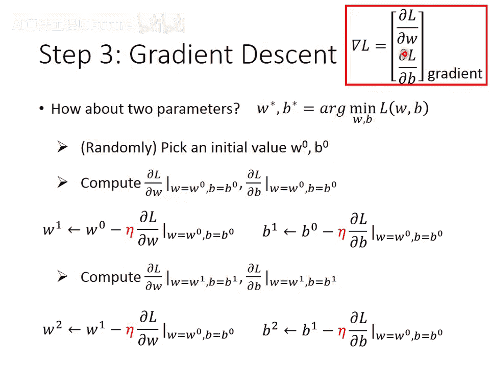

刚才做的事情呢像是这样有两个参数，W和B哦，这两个参数呢决定了一个方式长什么样子，那在这个图上的颜色，这个图上的这个颜色呢代表loss function的数值，那越偏蓝色代表loss越小。

那我们随机选取一个初始值，比如说随机选取初始值，是在左下角红色的点这个地方好，接下来呢你就去计算在红色这个点，B对lost的片尾分，还有W对lost的片尾分，然后呢，你就把参数呢更新。

这个艾塔乘上B对lost的偏微分，还有A塔乘上W对lost的偏微分，那如果你对这个呃呃片尾分比较不熟的话呢，其实这个方向啊这个方向这个规定的方向，就这个方向呢其实就是这个等高线的呃，切线方呃。

呃高线的法线方向啊，好好，那你就把我们就可以更新这个参数，从这个地方呢到这个地方，接下来呢你就再计算一次偏微分，那这个片尾分会告诉你说，现在应该往这个方向更新你的参数。

也就把你的参数呢从这个地方移到这个地方啊，接下来他再告诉你说应该这样走，然后呢，你就把参数从这个地方再更新到这个地方。

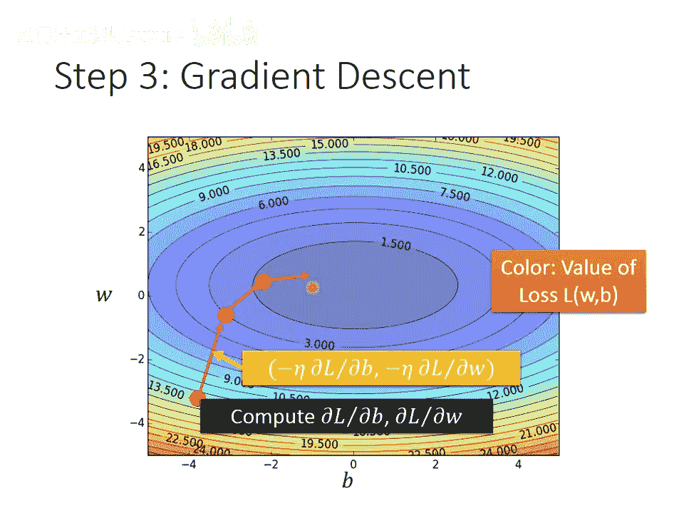

Gradient design，有一个让人担心的地方，就是如果今天你的function，如果你的loss function长的是这个样子，如果今天W和B对这个loss l，它看起来是这个样子。

那你就哇你就麻烦了，你就麻烦了，呃，这个时候如果你的随机取舍的值呢，是在这个地方，那按照gradient建议你的方向呢，按照今天这个偏微分建议你的方向呢，你走走走走走，你就找到这个方向。

如果你随机起始的地方是在这个地方，那根据gradient方向，你走走走就走到这个地方，就变成说这个方法得到的结果是看人品的呃，这个让人非常非常的担心，但是在linear regression里面。

你不用太担心，为什么呢，因为在linear regression里面呢，你的function你的这个loss function l呢，他是convex，如果你定义你的loss的方式。

跟我在前几页图里面讲的是一样的话，那那个loss是COMBX的所谓的，如果你不知道combat是什么的话，换句话说就是它是没有local的optimal的位置，呃，或者是如果我们把图画出来的话。

它长的就是这样，它的等高线呢就是一圈一圈椭圆形的，所以它是没有local optimal的地方，所以你从随便选一个起始点，根据gradient descent所帮你找出来的最佳的参数。

你最后找出来的呢都会是同一组参数好，那在下课休息一下之前呢，我们来看一下它的formulation，那其实这个式子是非常简单的，假如你要实际算一下，W对L的偏微分和B对L的偏微分。

这个式子当的是什么样子呢，这是长什么样子呢，这个LL呢我们刚才已经看到了，它是长这个样子，它是估测误差的平方和，那如果我们把它对W做偏微分，我们得到什么样的式子呢，这个其实非常简单。

我相信有修过微积分的人都可以秒算啊，你就把这个二呢移到左边，对不对啊，你要对那个W做偏微分吗，那就对，先把括号里面这一项先做偏微分，来把二移到左边，你得到这样子的结果，接下来考虑括号里面的部分。

括号里面的部分只有负的W乘上XC，上标和下标CP这一项是跟W有关的哦，所以如果你把括号里面这个equation，对W做偏微分的话，你得到的值就是负的X上标和下标CP哦。

所以partial w partial l w对L的偏微分，它的式子呢就长这个样子是非常简单的，如果你要算B对L的偏微分的话，也非常简单哦，你就把二呢移到前面，把二移到前面变成这个样子。

然后呢你再把这个括号里面的值呢，对B呢做偏微分，括号里面只有负B这一项，跟我们要做偏微分的这个B有关，所以负B对B做偏微分得到的值呢是一，然后呢就结束了哦，所以有了gradient descend。

你又知道说怎么算偏微分，那你就可以找一个最佳的方式好，那我们在这边呢休息10分钟好，谢谢，停电的装置路线，张德网路线，我觉得太，好我忘了分享，好嗨，其实这样我本来想要做一个demo啊。

但是我现在连不到那个呃，哎呀记中IPAD，这就算了，这样也就是说，其实所以这个问题的gradient descent，并没有你想象的那么好解，你可能觉得说gradient descent。

是一个很trivial的问题，尤其是现在function又是convex，应该就秒做吧，呃你可以在作业的时候自己体验看看啊，事实上刚才那个十个example problem，是出了一些狠招才把它解掉。

诶你好，没有声音是吧，哎哟好诶诶好热，像网红线嗯，我先跳出，不好意思不好意思啊，无论如哎哇我可以看到我自己，哦没关系，我把这个收起来就好，对不对，好，那额结果怎么样呢，其实就是这样啦。

我们的model涨价，然后费尽一番功夫以后呢，你找出来的最好的B跟W，根据training data分别是B等于-188。4，W等于2。7好，如果你把这个function y等于B加WXCP。

把它的B跟W值画在图上的话，它长的是这个样子啊，就这一条红色的线啊，就这条红色的线，那你可以计算一下呃，你会发现说这条红色的线没有办法完全正确的，PREDIC所有的宝可梦的进化后的CP值。

如果你想要知道他做的有多不好的话，或者是多好的话，你可以看一下，你可以计算一下你的呃error啊，你的error，就是你计算一下每一个蓝色的点，跟这个红色点之间的距离啊，第一个蓝色的点跟红D。

跟这个红色的线之间的距离是1万，第二个蓝色点跟红色线的距离是e two，以此类推哦，所有1万到一十，那平均的training data的error呢就是SUMMENSION，1万到一十啊。

这边算出来呢是31。9好，但是呃这个并不是我们真正关心的，因为你真正关心的是general generalization的case，也就是说呃假设你今天抓到一只新的宝可梦头。

如果使用你现在的model去预测的话，那做出来你的估测的误差到底有多少，所以真正关心的是那些你没有看过的新的data，那这边我们叫做testing data，它的误差是多少哦。

所以呢这边又抓了另外十只宝可梦，当做testing data哦，这十只宝可梦跟之前拿来做训练的十只，不是同样的十只诶，好，那其实这新抓的十字跟刚才看到实质的分布，其实是还蛮像的啦。

哦他们就是这个图上的十个点好，那你会发现说呢我们刚才在训练资料上呢，找出来这条红色的线，其实呢也可以大致上预测，在我们没有看过的宝可梦上他的呃，进化后的CP值，那如果你想要知道它，你要量化它的错误的话。

那就计算一下它的错误啊，错误算算出来是多少呢，算出来是35。0诶，那这个值呢是比我们刚才呢，在这个training data上面看到的error呢，还要稍微大一点，因为你可以想看。

我们最好的方式是在training data上面找到的，所以在training data上面算出来的error，本来就应该比testing data上面算出来error呢，还要稍微大一点，OK好。

那有没有办法做的更好呢，有没有办法做的更好呢，那如果你想要做的更好的话，接下来你要做的事情就是重新去设计你的model，如果你观察一下data，你会发现说呢呃在CP值呢，在原进化前的CP值特别大的地方。

还有进化前的CP值特别小的地方，呃预测呢是比较不准的啊，在这个地方跟这个地方预测是比较不准，那你可以想想看，说呃嗯这个呃任天堂在做这个游戏的时候呢，他背后一定是有某一支城市。

去根据某一些hidden的factor，比如说根据原来的CP值，还有其他一些数值generate进化以后的数值对，所以呢我们到底它的方选长什么样子，从这个结果看来，那个方选可能不是这样一条直线。

它可能不是这样一条直线，它可能是稍微更复杂一点的。

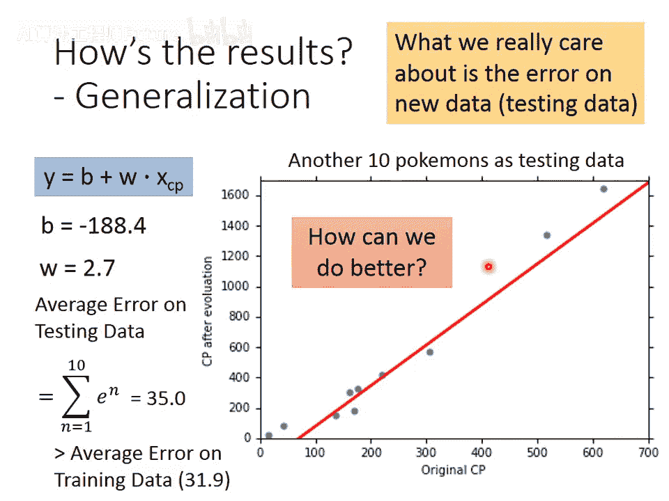

那所以呢我们需要有一个更复杂的model，举例来说。

我们这边可能需要引入二次式哦，我们今天呢可能需要引入呢XCP平方这一项，我们重新设计了一个model，这个model呢它写成Y等于B加WY乘以XCP，加w two呢乘以XCP的平方，我们加了后面这一项。

而如果你我们有了这个新的方式，你可以用我们刚才讲的一模一样的方式，去define一个function的好坏，然后呢用gradient descent。

找出一个在你的function set里面最好的方式，那根据training data，找出来最好的方式是B等于十，w one等于10w two，等于2。7×10的三次方呃。

如果我们把这个最好的方向画在这个图上的话，它长的呢是这个样子哦，所以你就会发现说呢，现在我们有了这一条新的曲线，我们有了这个新的model啊，它的预测呢在training data上面看起来是更准一点。

好在training data上，你得到的average error现在是15。4，但我们真正关心的是testing data，那我们就把同样的model再apply到testing data上。

我们在testing上apply同样这条红色的线，然后去计算一下它的average error，那么现在得到的是18。4，来看，刚才呢如果我们没有考虑SCP的平方的时候。

算出来的average error是30左右啊，现在呢有考虑平方向以后得到的是18。4，那有没有可能做的更好呢，比如说我们可以考虑一个更复杂的model，我们引入不只是XCP的平方。

我们引入XCP的三次方，诶老师我们现在的model长得是这个样子，那就用一模一样的方法，你就可以根据你的training data找到，在这一个function set里面。

在这个model里面最好的一个方式好，那找出来这样B等于6。4，w one等于0。66，w two是4。310的三次方，W3呢是12负六次方啊，所以反W3其实是它的值比较小的，它可能是没有太大的影响啊。

做出来的这个线呢，其实跟刚才看到的二次的那个线呢，是没有太大的差别的，把它做出来看起来像是这个样子好，那这个时候average error算出来是15。3，那如果你看testing data的话。

testing data算出来的average error呢是18。1，跟刚才二次的有考虑CP，二次的那个结果比起来是稍微好一点点呐，刚才前一页是18。3，有考虑三次项以后变成18。1，是稍微好一点点。

那有没有可能是更复杂的model呢，或许在呃宝可梦的那个城市背后，它产生这个进化后的CP值，用的是一个更复杂的方程，或许他不只考虑了三次，或许他不只考虑XCP的三次方，或许他考虑的是四次方，也是五点哦。

那你就用同样的方法呢，再把这些参数b w one w2W三W四都找出来，哎，得到方选的啥，这个样子来发现说他在training data上，它显然可以做得更好。

在input的这个呃呃CP值比较小的这些宝可梦，这些显然是一些这个绿毛虫啊之类的东西，这样子这显然是些绿毛虫，那他在这边呢是predict更准的，所以现在的average error是14。9。

刚才三次的时候是15点多啊，刚才三次的时候在training data上是15点多，现在在training data上，在有四次的时候，training data上是14。9。

但是我们真正关心的是testing，我们真正关心是的是，如果没有看过的宝可梦，我们能够多精确的预测它进化后的CP值，所以呢我们发现说呢，如果我们看没有看过的宝可梦的话。

我们得到的average error是多少呢，我们得到average error，其实28。8，既然我们前一页做出来已经是18。3了，就我们用三次的时候，在testing data上做出来是18。3。

但是我们换了一个更复杂的model以后，做出来的是28。8，结果又烧，结果居然变得更糟了，我们换了一个更复杂的model，在training的data上给我们比较好的结果。

但在testing data上看起来结果是更糟，那如果换再更复杂的model会怎样呢，有没有可能是五四式，有没有可能它背后的那个城市是如此的复杂，他考虑了原来的CP则一次两次三次四次到五次。

那这个时候呢我们把这个最好的方程找出来，那你会发现说他的这个这个这个最好的方式呢，在training set上长得像是这样子，这个是一个合理的结果吗，你会发现说在原来的CP值是500左右。

500左右可能就是伊布之类的东西啊，哎在原来的CP值是500左右，宝可梦根据你现在的model预测出来，他的CP值居然是负的，那是但是在testing data上面。

我们可啊在training data上面啊，在training data上面，我们可以算出来的error呢是12。8，比我们刚才用四次式得到的结果呢，又再更好一些，那在testing结果上是怎样的。

如果我们把这个我们找出来的方式派到新的宝，可梦上面你会发现结果整个烂掉了，至少这个这一支大概是伊布吧，这一支伊布他的预预测出来的，进化后的CP值是非常的不准，照理说应该有1000多啊。

但是呢却你的model却给他一个负的预测值，所以算出来的average error非常大，有200多，所以当我们换了一个更复杂的model，考虑到五次的时候。

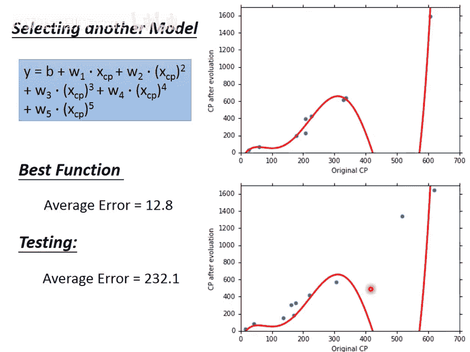

结果呢又更加糟糕了好，所以我们到目前为止呢，我们试了五个不同的马桶，那这五个model，如果你把它们分别的这个在training data上面的，average error都画出来的话。

你会得到这样子的一张图啊，你会得到这样子的一张图，从高呢到底好，也就是说如果你考虑一个最简单的model，这个时候error是比较高的，model稍微复杂一点，error稍微下降，然后model越复杂。

error呢在在在这，在这个training data上的error呢就越来越小，那为什么会这样呢，这件事情倒是非常的直觉，非常容易解释，假设黄色的这个圈圈，我们故意用一样的颜色啊。

黄色这个圈圈代表这一个式子，有考虑三次的式子所形成的function space，那四次的式子所形成的function stay，就是这个绿色的圈圈，它是包含黄色的圈圈的，这个事情很合理。

因为你只要把W4设为044次，这个式子就可以变成三次的式子，所以三次的式子呢，都包含在这个四次的式子里面，好黄色的圈圈都包含在绿色的圈圈里面，那如果我们今天考虑更复杂的五次的式子的话。

它又可以包含所有四次的式子，那所以呢如果今天你有一个呃越复杂的model，连一个越复杂的model，它包含了越多的function的话，那理论上呢你就可以找出一个function。

它可以让你的error raid越来越低，而你你的方式如果越复杂，你candy的越多，你当然可以找到一个方式，让你的error rain越来越低，但这边的前提就是呃你的那个gradient desc。

要能够真正帮你找出fast方选的前提之下，你的方式越复杂呢。

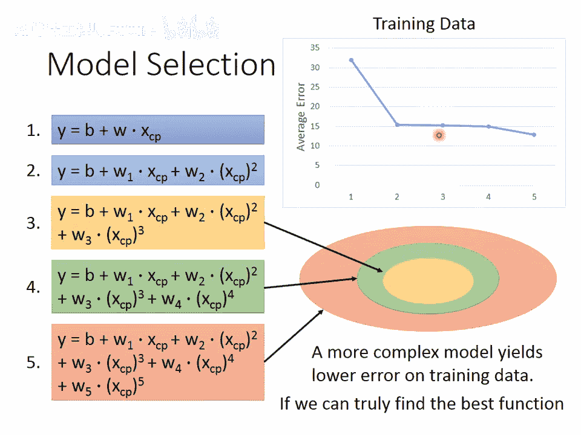

你的可以让你的err ray在training data上越低，但是在testing data上面呢看起来的结果是不一样哦，在testing data上看起来结果是不一样的。

在training data上你会发现说model越来越复杂，你的error越来越低，但是在testing data上，再到第三个式子为止，你的model呢error是有下降。

但是呢到第四个和第五个方形的时候，error就暴增了，然后把他的图呢试着画在左边，这边蓝色的呢是training data上对不同方向的error。

橙色的呢是testing data上对不同方向的error啊，你会发现说今天在五次的时候呢，在天津上是爆炸的，他就突破天际，没办法画在这个图上面好，那所以我们今天呢得到一个观察。

虽然说越复杂的model，可以在training data上面给我们越好的结果，但这件事情也没有什么，因为越复杂的model并不一定能够在testing data上，给我们越好的结果。

这件事情呢就叫做OVERFITTING，就复杂的model在training data上好结果，在testing data上不一定有好的结果，这件事情呢叫做OVERFITTING。

比如说当我们用第四个和第五个式子的时候，我们就发生OVERFITTING的情形，那为什么会有OVERFITTING这个情形呢，为什么更复杂的model，他在training上面得到比较好的结果。

在testing上不一定会得到比较好的结果的，这个我们日后再解释，但可以给大家，但是你其实可以想到很多，很直观的在training data上得到比较好的结果，在训练的时候得到好比较结果。

但在测试的时候不一定有比较好的结果，比如说你有没有这个考过驾照，考驾照不是都要去那个驾训班吗，啊驾训班不是都是在那个场内练习吗，人在场内练习，练习的时候不是都很顺诶，练习了非常非常多次以后。

你就会学到很奇怪的技能，这样你就学到说，比如说当我后照镜里面看到路边小丸子的贴纸，对到正中间的时候，就把方向盘左转半圈，这样子你要学到这种技能啊，所以在你在测试训练的时候，在家训班面可以做的很好。

但在路上的时候你就做不好，像我就不太会开车，虽然我有驾照，就都在等无人驾驶车出来，哈哈哈哈好，所以OVERFITTING是很有可能会发生的，所以model不是越复杂越好，我们必须要选一个呃，刚刚好。

没有太复杂，也没有呃，呃没有非常不复杂，没有很复杂，Mother，你要选你选一个最适合的mode，比如说在这个case里面，当我们选一个三次式的时候，在这个case里面，当我们选一个三次式的时候。

可以给我们最低的error哦，所以如果今天可以选的话，我们就应该选那个三次的式子来作为我们的model，来作为我们的function set啊，你以为这样就结束了吗。

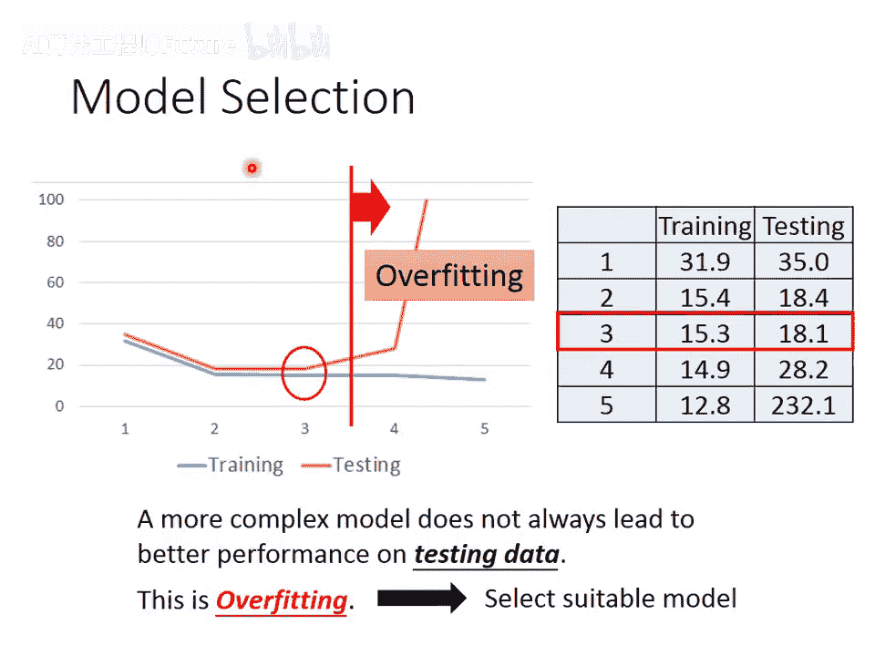

其实还没有，刚才只收集了十只宝可梦，其实太少了。

当我们收集到60只宝可梦的时候，你会发现说刚才都是白忙一场，你仔细想，当我们收集60只宝可梦，你把他的这个CP值，原来的CP值跟进化后的CP值画在这个图上，你会发现说他们中间有一个非常奇妙的关系。

它显然不是什么一次二次三次144，显然都不是，中间有某一个无法解，有另外一个力量，这个力量不是CP值，它在影响着这个进化后的数值啊，到底是什么呢，其实非常的直觉就是宝可梦的物种啊。

这边我们把不同的物种用不同的颜色呢来表示，蓝色是那个我想看蓝色是波波，这样这是波波，对不对，波波进化是比比鸟，比比鸟进化是大比鸟，然后吼大比鸟没错啊，我没我没有说错的呀，如果我有说错的，请指正。

我这样这个黄色的我故意用一样，我会故意跟那个宝可梦用一样的颜色，黄色的点是独角虫，独角虫进化是那个铁壳昆，铁壳昆进化是大针锋，然后绿色的是那个绿毛虫，绿毛虫进化是铁甲蛹，铁甲蛹进化是八大虎。

这好红色的是伊布，伊布可以进化成雷精灵，火精灵或水精灵等等，你可能会说什么都只有这一种，路边就可以见到的，因为抓成龙快理是很麻烦，这就走的鞋而已，好那所以刚才只考虑CP值这件事。

只考虑进化前的CP值显然是不对的，因为这个这个这个进化后的，进化后的这个呃CP值，受到物种的影响其实是很大的，或者是比原来CP值，但这是非常关键性的影响，所以我们在设计model的时候啊。

嗯刚才那个model设计也是不好，就好像刚才那个model就好像是呃你想要海底捞针，从function这里面捞一个最好的model，但其实里面的model通通都不好，就针根本就不在海里哦。

所以你要重新设计一下你的function set好，所以这边呢就重新设计一下function set，我们function set input x跟output y，这个input宝可梦跟output。

进化后CP值有什么关系呢，它关系是这样，如果今天输入的物种X呃，输入的宝可梦X它的物种呢是属于波，这个是波波的话呢，这个XS代表说这个input x的物种好，那他的这个输出Y呢。

就等于b one加上WY乘以XCP，那如果他是这个独角虫的话，Y就等于b two加w two乘CP，如果他是绿毛虫的话，就是B3加W3乘以CP，如果它是一部的话，就用另外一个式子，也就不同的物种。

我们就看它是哪一个物种，我们就带不同的linear function，然后呢得到不同的Y作为最终的输出，你可能会问一个问题，说呃你把衣服放到整个function里面啦。

这样你不就不是一个linear model吗，这个方式里面有if，你搞得定吗，你可以用你可以用微分来做啊，你可以用刚才那个gradient descent来呃，算参数对loss的方程微分吗。

其实是可以的，这个式子你可以把它改写成一个linear function，写起来就是这样，这个呃有一点复杂，但没有关系，我们先来看一下DOTA这个方向，如果你有学过信号的处理。

我想应该知道delta这个方向是什么，这边这个delta这个方向的意思是说呃，delta of xs等于BB鸟的意思就是说，假如我们今天呢输入的这一只宝可梦，是比比鸟的话。

这个delta function它的output就是一反之，如果是其他种类宝可梦的话，它DA方选的opener就是零，OK所以我们呢可以把刚才那个有if的式子呢，写成像这边这个样子。

有宝可梦进化后的CP值，等于b one乘上呢这个呃DOTA比比鸟这样子，然后大加上w one乘上DA比比鸟，乘上这只宝可梦的CP值，加上b two乘上DOTA呃，独角虫。

加上w two乘上delta独角虫，再乘上它的CP值，这样然后接下来考虑那个呃绿毛虫，然后接下来考虑一步，你可能会想说这个跟刚才那个式子哪里一样呢，你想想看，假如我们今天输入的那一只神奇宝贝假后。

假如我们输入他一直说错，而输入的那一只宝可梦是比比鸟的话，假如xx等于比比鸟的话，意味着这两个delta function会是一，对不对，这两个delta function如果input是比比鸟的话。

就是一其他DA方选就是零哦，那乘上零的项就当做没看到，对不对，乘上零的项就当做没看到，所以就变成Y等于BY加WY乘以CD，所以对其他物种，其他种类的宝可梦来说也是一样。

哎所以当我们设计这个function的时候，我们就可以做到，我们刚才在前一页design的那个有意思的方式，那这样这个function它就是一个linear function啊。

这个方向就是一个linear function，怎么说呢，前面这个b one w one到b four，w four就是我们的参数，而后面这一项delta或者是delta乘XCP哦。

不同的delta跟不同的delta乘XCP，就是后面这个SI这一项feature，这个蓝色框框里面这些其实就是feature，所以这个东西它也是linur model好，那有了这些以后。

我们做出来的结果怎么样呢，我们做出来的结果怎么样呢，这个是在training data上面的结果啊，好在training data上面呢，我们知道说现在不同种类的宝可梦，它用的参数就不一样哦。

所以不同种类的宝可梦，它的这个呃那个线那是不一样好，但是他的这个他的这个model的那一条，那一条line呢是不一样哦，这个蓝色这条线呢是比比鸟的线，绿色这条线呢是绿毛虫的线，而黄色那个独角虫的线。

那个绿毛虫的线其实是重叠的，红色这一条线呢是伊布的线，所以可以发现说，当我们分不同种类的宝可梦，来来这个考虑的时候，我们的model在training data上面可以得到更低的error。

你发现说现在这几条线呢是把training data，fit的更好，而是把training data解释的更好啊，如果我们这么做，有考虑到宝可梦种类的时候，我们得到的average error呢是3。

8在training data上，但我们真正在意的是，他能不能够预测新看到的宝可梦，就是testing data上面的结果，那在testing data上面，它的结果呢是这个样子，呃。

一样是这三条线来发现，说呢他也把这个在testing data上面的那些宝可梦呢，fit的很好，那它的average error呢是14。3，是我们比我们刚才可以做好的，18点多呢还要更好的。

那但是如果你在观察这个图的话，感觉应该是还有一些东西是没有做好的，对不对，我仔细想想看呃，我觉得伊布这边应该就没救了，因为我认为一部会有很不一样的CP值，是因为进化成不同种类的精灵啊。

所以如果你没有考虑这个factor的话，应该就没救了，但是我觉得这边有一些嗯还没有feat，很好的地方，就有一些值还是略高或略低于这一条直线，所以这个地方搞不好还是有办法解释的。

但有一个可能是这些略高略低于，我们现在找出来的这个蓝色绿色线的，这个这个model的这个变化，这个这个difference啊，它其实是来自于呃random的数值，可是每次呃那个宝可梦。

那个城市产生进化后的CP值的时候，它其实有加一个random的参数，但也有可能其实不是random的参数，它还有其他的东西在影响着，影响着宝可梦进化后的CP值啊，有什么其他可能的参数呢，比如说呃。

会不会进化后的CP值是跟weight有关系的，会不会进化后的CP值是跟它的高度有关系的，会不会进化后的CP值是跟他的hp有关系的，其实我们不知道，但我不是大木博士，我怎么会知道这些事情。

知道如果你有懂man knowledge的话，你就可能可以知道说，你应该把什么样的东西加到你的model里面去。

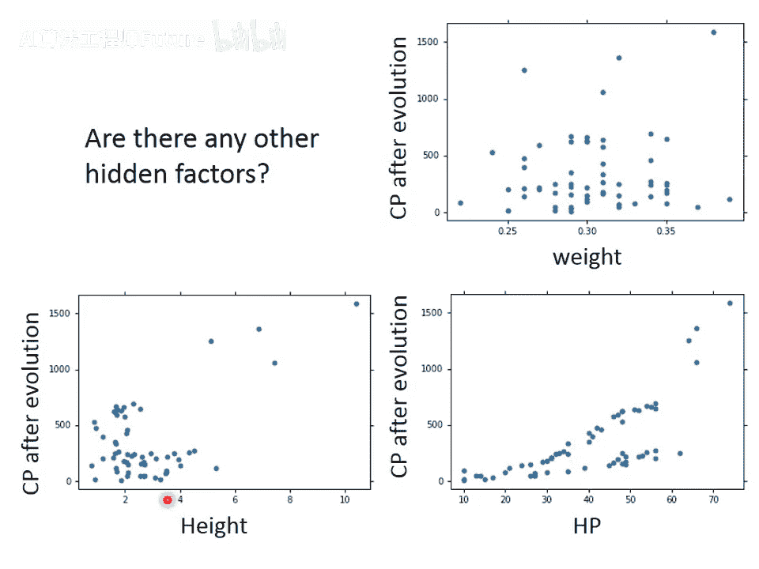

但是我我又没有懂man knowledge，那怎么办呢，没关系，有一招就是把你所想到的东西通通塞进去啊，我们来弄个最复杂的方程，然后看会怎样好，那个这个方选呢，我写成这样呃，如果他是比比鸟的话。

它的这个CP值呢我们就先计算一个Y派，这Y判不是最后这个Y哦，这个Y派还要做别的处理以后才变成Y，OK这Y派要做别的处理才变成Y，我们就说如果是BB，如果是这个是比比鸟的话，这岂不是比这应该是波波啊。

因为比比鸟是进化后的，这期应该是波波好，那YP呢等于b one加w one乘以XCP加W5，乘以XCP的平方，我们就不只是要考虑CP值，要考虑CP值的平方好，那如果是绿毛虫用另外一个式子，如果是独角虫。

另外一个式子，如果是伊布用另外一个式子，最后我们再把YP再做其他的处理，我们把WIFI再加上hp值，它的生命值乘上W9，再加上生命值的平方乘上W9，再加上这个高度的高度乘上WW11。

再加上高度的平方乘上W12，再加上他的WAIGHT乘上W13，再加WA的平方乘上W14，好这些东西合起来才是最后output的Y哦，所以这整个式子里面其实也没有很多个参数，就是14加四四十八。

跟你们作业比起来，几百个参数比起来其实也不是个太复杂的嘛，好我们现在有个这么复杂的方式，在training data上我们得到了error，期望应该就是非常的低，我们果然得到一个非常低的error哦。

这个function你可以把它写成那个线性的式子，就跟刚才一样啊，这边我就就不解释了，好那这么一个复杂的方程，理论上我们可以得到非常低的training l哦，CHINERO算出来是1。9。

那你可以期待你在testing set上也算出，很D的training error吗，倒是不见得这么复杂的model，很有可能会over，很有可能会OVERFITTING的，你很有可能会得到。

在testing data塔上得到很高的数值，我们今天得到的数值早是102。3，结果坏掉了，好怎么办呢，怎么办呃，如果你是大木博士的话，你就可以删掉一些你觉得没有用的呃input。

然后就可以得到一个比较简单的model，就可以避免OVERFITTING的情形。

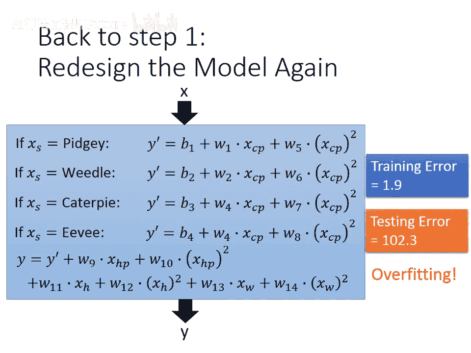

但是我不是大木博士，所以我有病用别的方法来处理这个问题，这招呢叫做REGALIZATION，那REGALIZATION要做的事情是，我们重新定义了step two的时候。

我们对一个function是好还是坏的定义，我们重新redesign我们的loss function，然后呢我们重新redesign，我们loss function，把一些knowledge放进去。

让我们可以找到比较好的方式啊，什么意思呢，假设我们的model in general呢写成这样啊，Y等于B加上mention over w i乘XI。

我们原来的loss function他只考虑了error这件事，原来loss function只考虑了prediction的prediction的结果，减掉正确答案的平方。

只考虑prediction error，那REGALIZATION呢它就是加上一项额外的turn，这一项额外的turn呢是浪打，乘上some mention over w i的平方，浪打是一个常数啊。

这个是等一下我们要手调一下，看要设多少，那submention over w i的平方，就是把这个model里面所有的WI都算一下，平方以后加起来啊，这个合起来才是我们的loss function。

那前面这一项我们刚才解释过，所以你我相信你是可以理解的，error越小就代表呃当然就是越好的方选，但是为什么我们期待一个参数的值越小，参数的值越接近零的function呢，这件事情你可能就比较难想象。

为什么我们期待一个参数值接近零的方向呢，好当我们加上这一项的时候，我们就是预期说我们要找到的function，它的那个参数越小越好好，那当我们加上这一项的时候，你知道参数值比较接近零的function。

它是比较平滑的哦，所谓的比较平滑的意思是，当今天的输入有变化的时候，output对这个输入的变化是比较不敏感，为什么参数小就可以达到这个效果呢，你可以想想看，假设这个是我们的model。

现在呢input有一个变化，比如加上DAWI，我们对某一个xi加上呃，我们对某一个xi加上da xi，这时候在输出会有什么变化呢，这时候输出的变化就是DAXI乘上WI，的输入变化，Da xi。

输出就是丢塔xi变成呃的WI乘以丢塔XI，那你会发现说，如果今天你的WI越小越接近零的话哦，如果你的WI越接近零的话，它的这个呃变化就越小，对不对，如果WI越接近零的话。

输出对输入就越不sensitive，OK所以如果今天WI越接近零，我们的function就是一个越平滑的方式，而现在的问题就是，为什么我们喜欢比较平滑的方式哦，这个可以有不同的解释，哪可以这样想。

如果我们今天有一个比较平滑的方选的话，因为平滑的方向对输入是比较不敏感，所以今天如果我们今天的输入，被一些杂讯所干扰的话，如果今天杂讯干扰了我们的输入，在我们测试的时候，那一个比较平滑的方选。

它会受到比较少的影响，而给我们一个比较好的结果好，那接下来我们就要来看看说，如果我们加入了这个REGALIZATION的项，那对我们的最终的结果会有什么样的影响，这个是实验的结果啊。

我们就把浪打从零一十一直调到10万这样子好，那所以呢浪大值越大，代表说今天我们的我们现在lost里面有两项，一项是考虑error，一项是考虑有多smooth，当浪打值越大。

代表考虑smooth的那个REGALIZATION那一项，它的影响力越大，所以当浪大值越大的时候，我们找到的function就乐评的话，如果我们好看一看在training data上的error的话。

我们看一下training data上error的话，我们会发现说呢如果方向越平滑，我们在training data上得到的error其实是越大，但是这件事情是非常合理的，因为当浪打越大的时候。

我们就越倾向于考虑W本来的值，我们就倾向于考虑W的数值，而减少考虑我们的error哦，所以今天如果浪达越浪达越大的时候，我们考虑error就越少。

所以本来我们在train data上得到error就越大，但是有趣的是，虽然在training data上得到的error越大，但是在testing data上面得到的error，可能是会比较小的哦。

比如说我们看这边的例子，原来浪大等于零，就没有REGALIZATION的时候，error是102，浪大等于一就变要68~10就变二，15~100就变成11。1，但是浪打太大的时候，到1000的时候。

error又变大，又又变大，变12。8，一直到26。8，那这个结果是合理的，我们喜欢比较平滑的function，那比较平滑的方式，它对noise比较不sensitive，所以当我们增加浪大的时候。

的performance是越来越好，但是我们又不喜欢太平滑的方式，我不想太平滑方，因为假因为最平滑方式是什么，最平滑方式就是一条水平线呐，对不对，一条水平线最平滑的方向，但如果你的方向是一条水平线。

那他啥事都干不成啊，所以如果今天function太平滑的话，你反而会在testing set上又得到糟糕的结果，所以现在的问题就是，我们希望我们的model多smooth呢。

我们希望我们今天找出来的function有多平滑呢，这件事情就变成你需要调浪打呢，来解决这个这件事情，你必须要调整浪打来决定你的function的平滑程度，比如说你可能调整一下参数以后。

发现说哦今天呢training都随着浪达增加而增加，testing随着浪达先减少后增加，在这个地方有一个转折点，是可以让我们的这个这个这个testing error最小。

那你就选这个浪大呢等于100来得到你的model，那这边还有一个有趣的事实啊，很多同学可能都知道regularization，OK你有没有发现说这边我没有把B加进去，诶，我刚才突然想到一件事情。

就是我其实在前面那个gradient design，投影片里面有一个地方写错了，然后刚才郑凯文同学有提醒，我觉得以后如果你有发现我投影片有写错的话，你就告诉我就把你的名字呢写在投影片上面。

这样就可以一直流传下去，好这边你发现我我没有加上B，为什么呢，呃你觉得是我写错的同学，如果我忘了加上去的同学举怎么加呃，你觉得是哦，本来就不需要加上P的同学举手一下哦，谢谢谢谢哦，没错。

我这边我觉得我没有写错啊，事实上很多人可能不知道这件事，在做REGNIZATION的时候，其实是不需要考虑bias是这项好，首先如果你自己做实验的话。

你会发现不考虑bias performance比较好，再来为什么不考虑bias呢，因为我们今天预期的是，我们要找一个比较平滑的方选，你调整BIOS的这个B的大小。

跟一个function的平滑的程度是没有关系的，对不对，BIOS的值调整BIOS的值的大小时候，你只是把方向上下移动而已，在function的平滑程度是没有关系的，所以有趣的是。

这很多人都不知道在做REGALIZATION的时候，你不你是不用考虑BIOS的好，那总之搞了半天以后呢，我最后可以做到呃，我们的testing error是11。11样。

那在我们共请助请这个助教公告座位之前，我们就说一下今天的conclusion，就首先感谢大家来参加，我对宝可梦研究的发表会样子，哈哈哈哈好，那我今天得到的结论就是呃。

宝可梦进化后的CP值跟它进化前的CP值，还有它是哪一个物种是非常有关系的，知道这两件事情几乎可以决定进化后的CP值，但是我认为呢可能应该还有其他的fact，我们刚才看到说我们加上其他什么高度啊。

呃体重啊，hp以后是有比较好的，如果我们加入realization的话，不过DA有点少，所以我没有那么那么confidence就是好，那呃我要说什么，然后再来呢。

就是我们今天讲了gradient descent的做法，就告诉大家怎么做，那我们以后会讲它有什么它的原理，还有它的技巧，然后等一下如果我能够连得上我的IPAD粉的话，我就可以可以可以实际看一下。

好那呃我们今天讲了OVERFITTING和REGZATION，介绍一下表象上的现象，未来会讲更多它背后的理论，再来最后我们有一个很重要的问题呃，首先我觉得我这个结果应该还蛮正确的。

因为在网络上有很多的CP的预测器，对不对，那那些CPU预测器你在输入的时候，你只要输入你的宝可梦的物种和他现在的CP值，它就可以告诉你进化以后的CP值，所有认为你要预测进化以后的CP值。

应该是知道原来的CP值跟呃，他的物种就可以知道大部分，不过他们预测，我看那些预测器预测出来的误差，都是给你一个rap，他都没有办法给你更准确的预测，如果考虑更多的factor，更多的input。

比如说hp什么的，或许可以预测的更准，就是但最后的问题就是呃我们在testing data上面，在我们testing10只宝可梦上，我们得到的average error，最后是11。1呃。

如果我把它做成一个系统，放到网络上给大家使用的话，呃你觉得如果我们看过没有看到的data，那我们得到的error会预期高过11。1，还是低于11。1，还是理论上期望值应该是一样的。

我们先不考虑说你知道我的那个training data up，是里面只有那四种，这种连人都没有乘龙卡比之类的，我们就假设使用者只能够输入那四种，他不会输入成龙卡比，在这个情况下呃，你觉得呃。

你觉得如果我今天把这个系统放到线上，给大家使用的话，我们最后得到的CP值会比我今天在testing set上，看到的高还是低还是一样好，你觉得一样的同学去做一下哦，是诶好，你觉得一样保持放下。

你觉得会比现在看到的低，举手一大呃，你觉你觉得会比比较对，如果我真的把系统放在线上，会比我们今天看到这个11。1还要高的同学，举手一样好，谢谢谢啊，大家都对我这么没有信心，对我们之后会解释。

就我们今天其实用了testing set来选model，所以我们今天得到的结果其实是，如果我真的把系统放到线上的话，预期应该会得到，比我今天看到11。1更高的error啊，这个。

所以我们需要用validation的观念呢，来解决这个问题啊，这个我们就下一堂课再讲，我们就请那个助教来公告一下作业一。

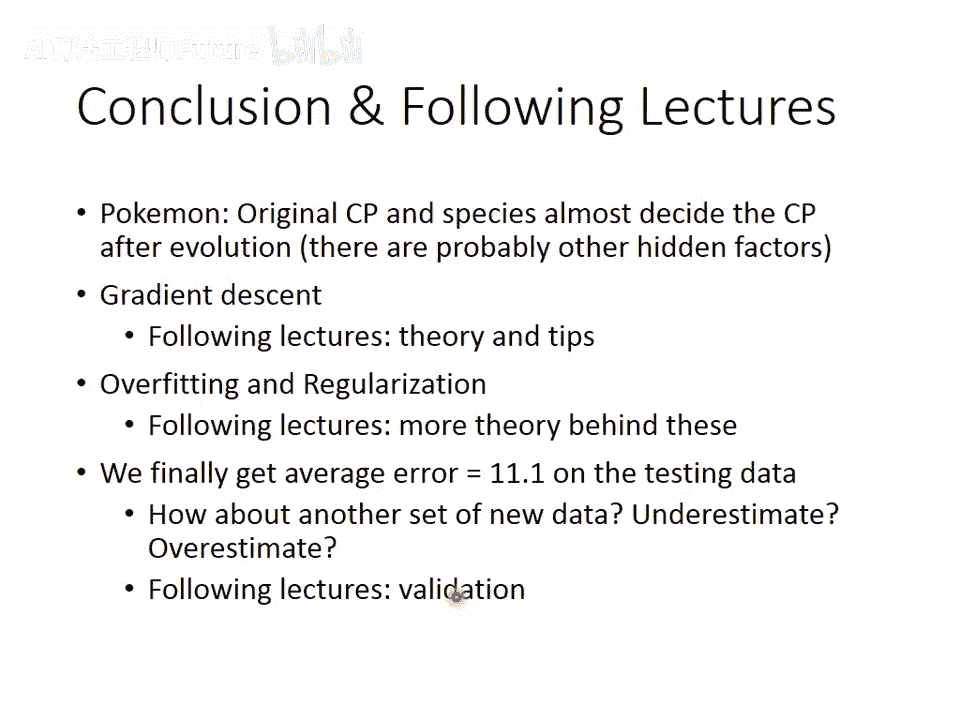

不知道诶哦哦你要用我的电脑。