# 59：作业七说明 📚

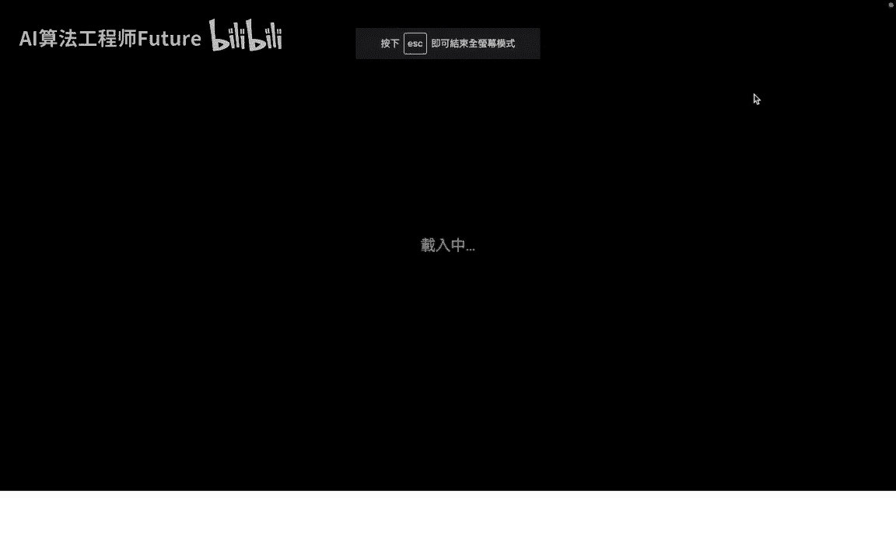

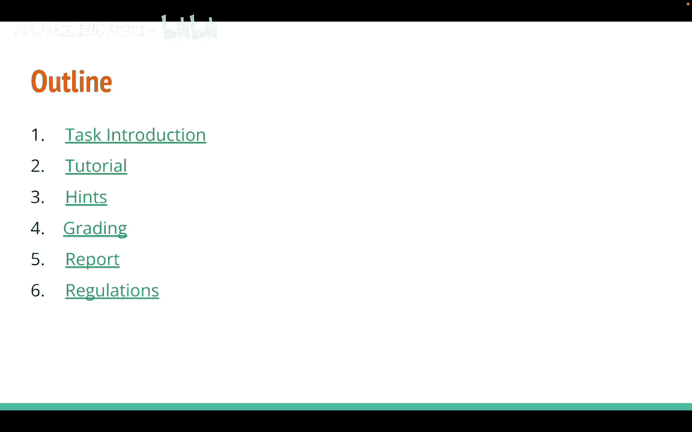

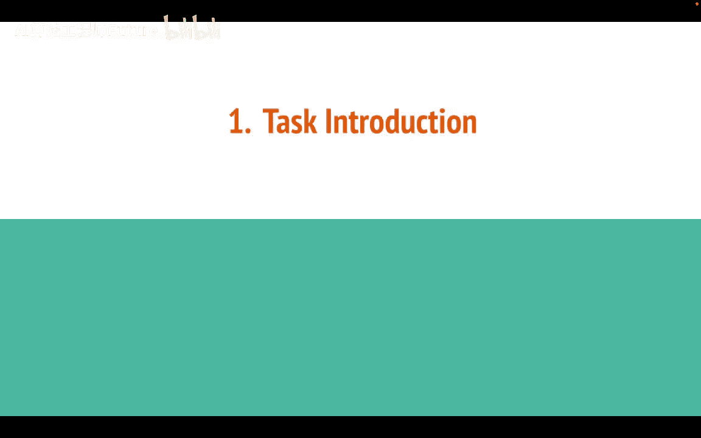

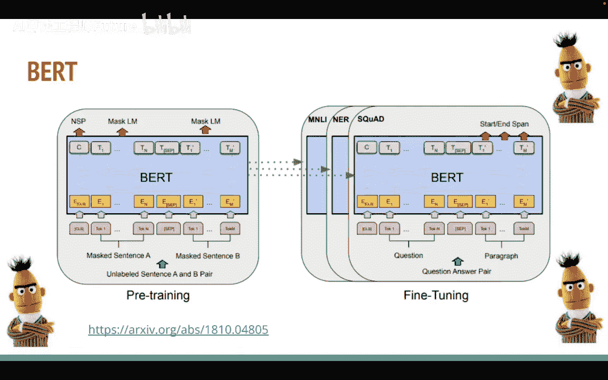

在本节课中，我们将学习如何使用BERT模型来完成抽取式问答任务。我们将详细介绍任务背景、数据处理方法、模型实现细节以及如何通过不同难度的基准线。

---

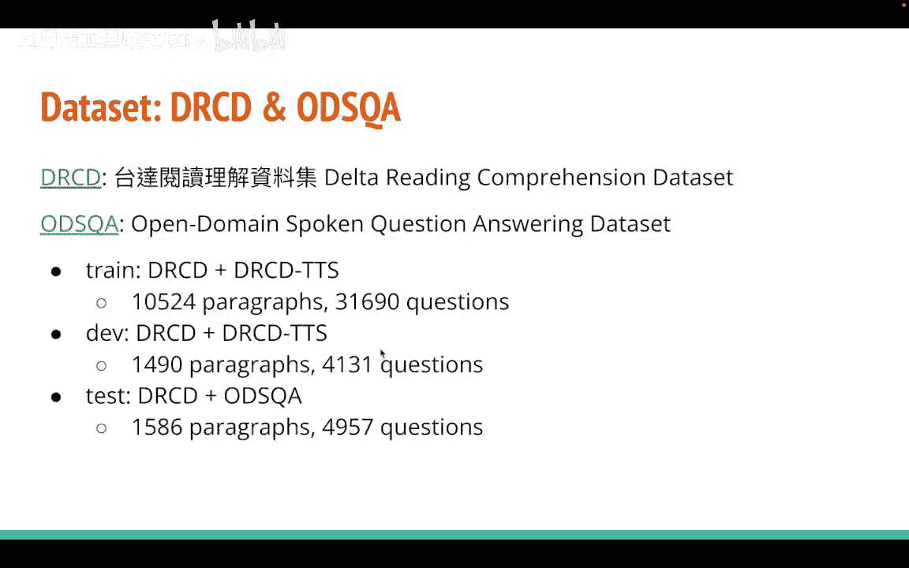

## 任务介绍 🤖

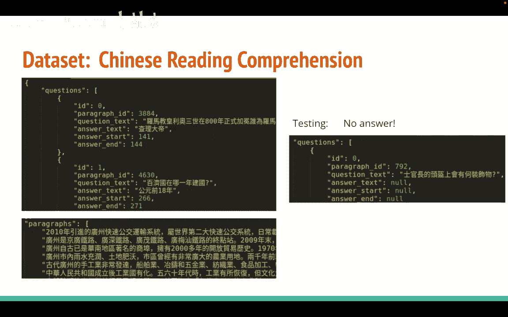

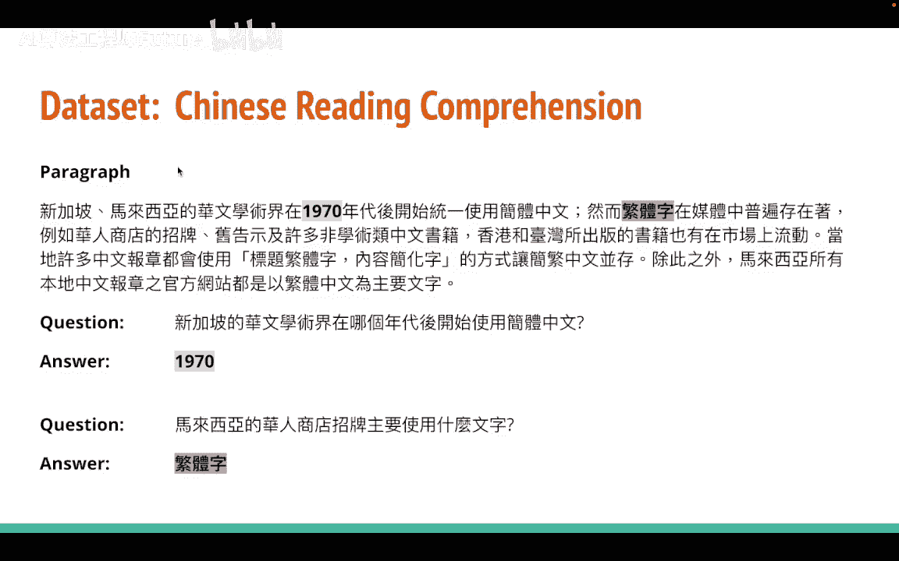

上一节我们介绍了BERT的基本概念，本节中我们来看看本次作业的具体任务。

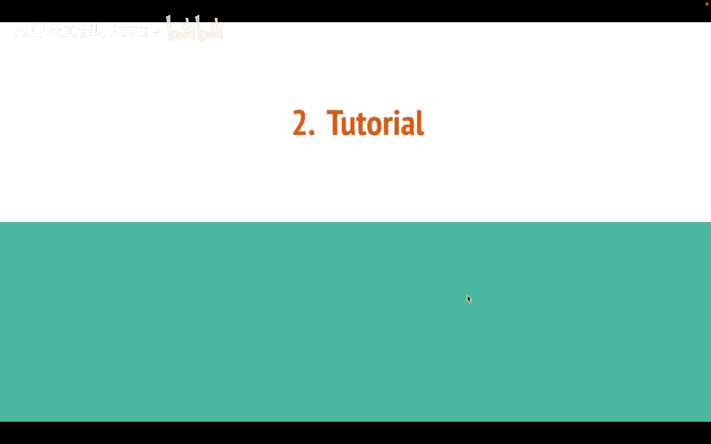

本次作业的目标是使用BERT模型完成一个抽取式问答任务。BERT通过在海量无标注文本上进行预训练，之后可以在不同的下游任务中进行微调。

我们本次要完成的下游任务是抽取式问答。具体流程是，将文章和问题输入到模型中，BERT模型会预测出正确答案在文章中的开始位置和结束位置。由于是抽取式的，所以模型会从文章中截取一段文字作为答案，因此正确答案一定存在于文章中。

以下是本次任务使用的两个数据集：
*   **DRCD**：一个中文阅读理解数据集。
*   **ODSQA**：通过语音合成生成语音资料，再经语音识别转成文字的数据集，其中可能包含语音噪声，但不影响最终答案选择。

训练集包含1万多个段落和3万多个问题，平均每个段落对应三到四个问题。开发集和测试集各包含约1500个段落和4000多个问题。

数据格式主要分为`questions`和`paragraphs`两部分。`questions`包含问题ID、对应的段落ID、问题文本、答案文本以及答案的开始和结束位置。`paragraphs`是排序好的文章列表。测试集的格式与训练集相同，但不包含答案信息。训练集、开发集和测试集之间的段落和问题内容可能相关，但不会重叠。

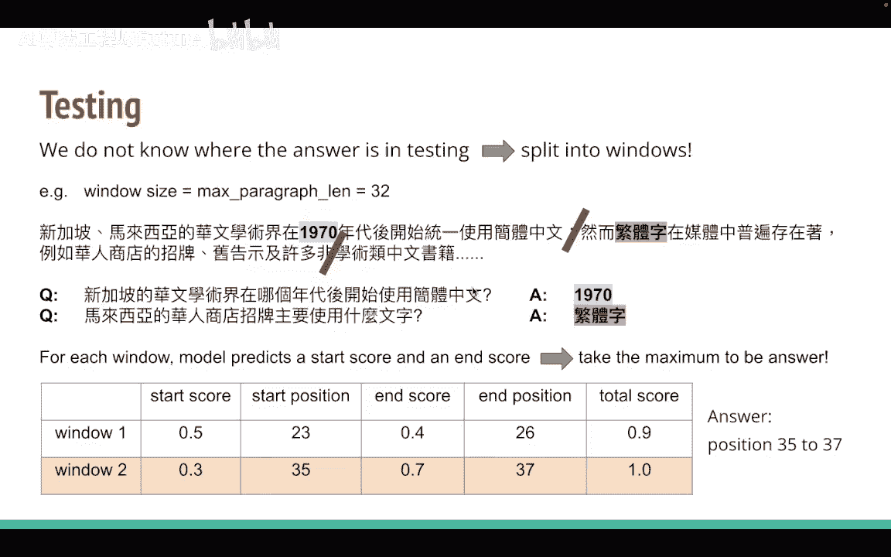

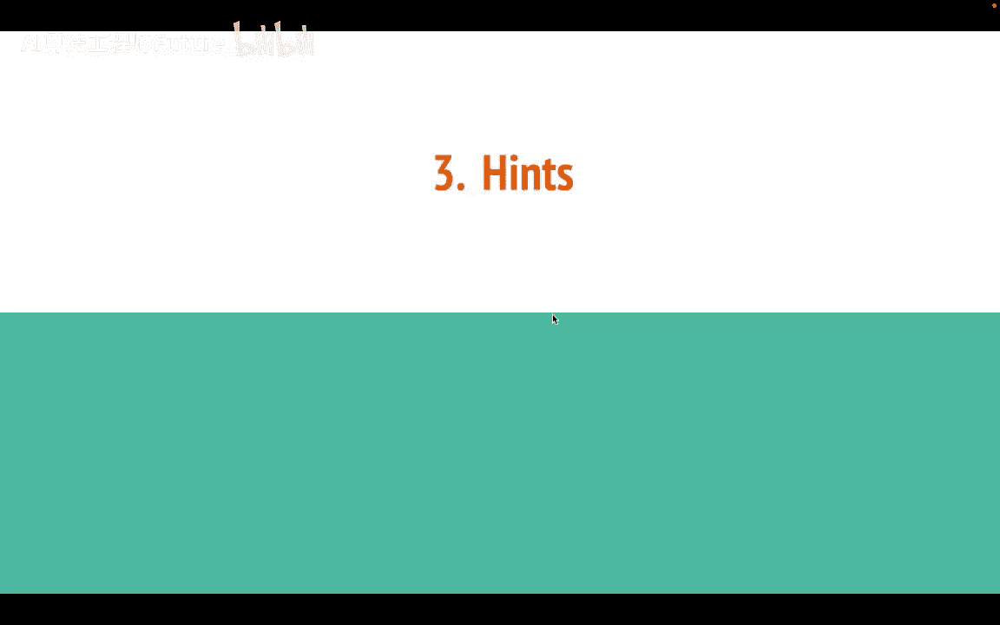

---

## 实现教程 💻

了解了任务背景后，本节我们来看看具体的实现方法。

在将文本传入模型之前，需要进行预处理。首先是对文本进行分词，将一个句子分割成多个词元。分词后，需要进行独热编码，将词元转换为索引向量，才能传入模型进行训练。

除了转换为索引向量，在传入BERT前还需进行额外的预处理，主要包括三个部分：
1.  **input_ids**：代表输入的词元索引。首先需要添加一个特殊的起始词元，然后使用一个分隔词元将问题和文章隔开。由于每个输入序列长度可能不同，需要使用填充词元使所有输入保持相同长度。
2.  **token_type_ids**：用于区分输入中的两段文本。第一段文本（如问题）用0表示，第二段文本（如文章）用1表示，填充部分也用0表示。
3.  **attention_mask**：指示模型应该关注哪些位置。填充部分设为0（不关注），其余部分设为1（关注）。

另一个关键问题是文章长度。大部分文章长度集中在三四百字左右，但有些可能接近1000字。而BERT模型的输入限制为512个词元。因此，对于过长的文章，我们需要解决方法。

以下是针对训练和测试的不同策略：
*   **训练阶段**：由于我们知道正确答案的位置，可以采用以答案为中心，向两侧扩展一个固定长度的窗口的方法。因为回答问题所需的信息很可能就在这个窗口内。
*   **测试阶段**：由于不知道答案位置，我们将长文章切割成多个短的、可能重叠的窗口。模型会为每个窗口预测答案的起始和结束概率。我们通过比较各窗口的综合得分（如起始概率与结束概率之和）来判断答案最可能位于哪个窗口。

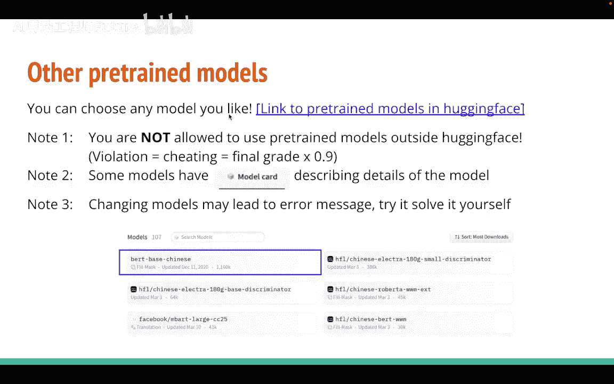

---

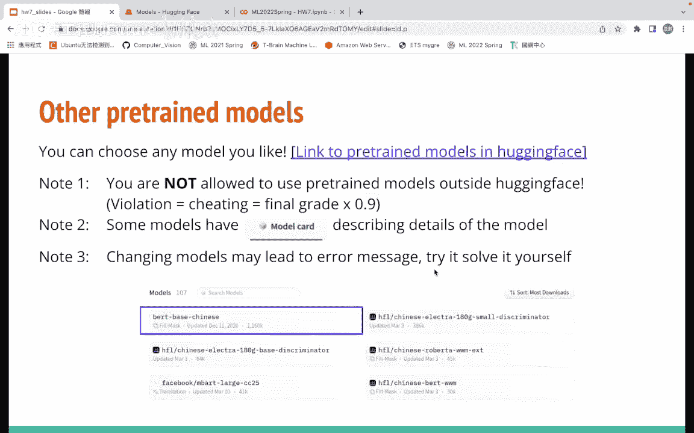

## 通过基准线的提示 🎯

上一节我们介绍了数据处理的核心方法，本节中我们来看看如何通过不同难度的作业基准线。

以下是各个基准线需要实现的内容：
*   **Simple Baseline**：成功运行提供的示例代码即可通过。
*   **Medium Baseline**：需要实现线性学习率衰减，并修改一个名为 `doc_stride` 的参数。
*   **Strong Baseline**：需要修改预处理部分，并尝试使用不同的预训练模型。
*   **Boss Baseline**：需要修改后处理部分，并进一步优化前述提示点或调整超参数。

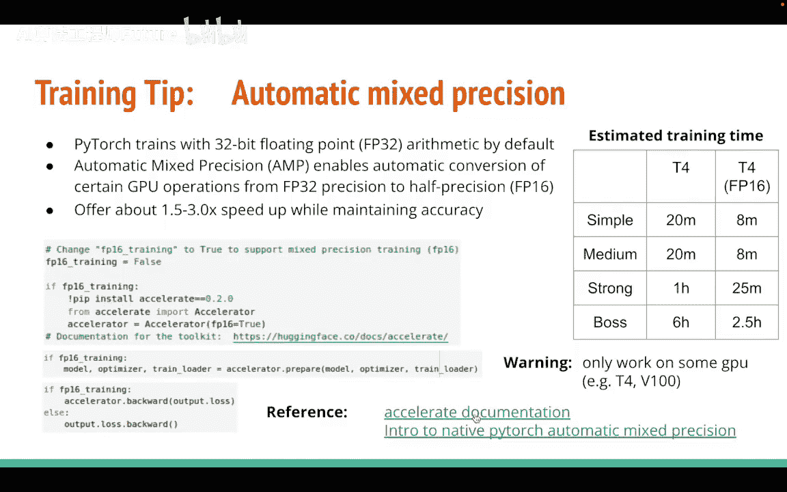

以下是训练相关的实用技巧：
*   **自动混合精度训练**：此功能允许GPU在计算时自动在FP32和FP16精度之间切换，以加快训练速度，通常可提速1.5到3倍。示例代码中已实现，只需将变量 `fp16_training` 设为 `True` 即可启用。注意，并非所有GPU都支持此功能。
*   **梯度累积**：当希望使用更大的批处理规模或更大的模型，但GPU内存不足时，可以使用梯度累积。其原理是累积多个小批次的梯度后再一次性更新模型参数，从而模拟大批次训练的效果。

---

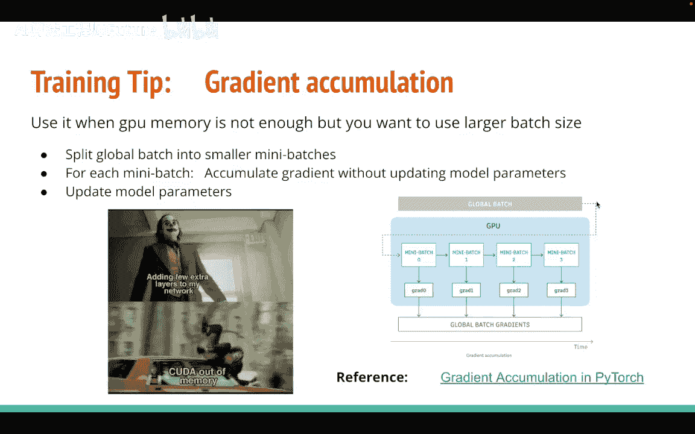

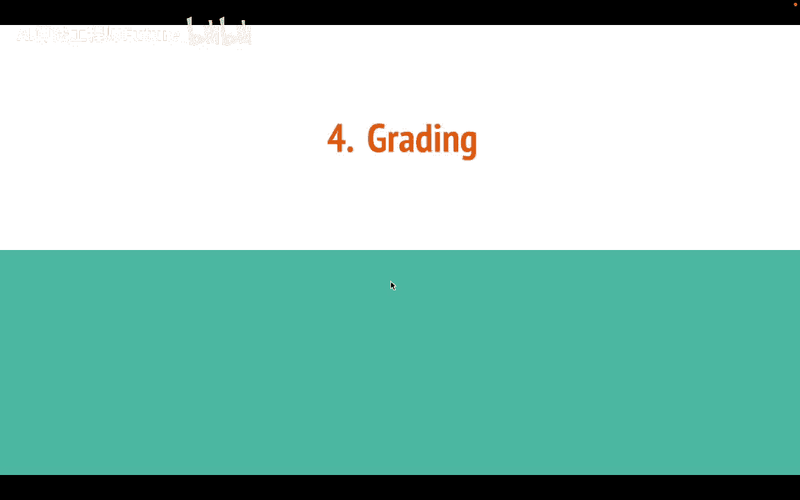

## 评分与报告要求 📝

本节我们将明确本次作业的评分标准和报告要求。

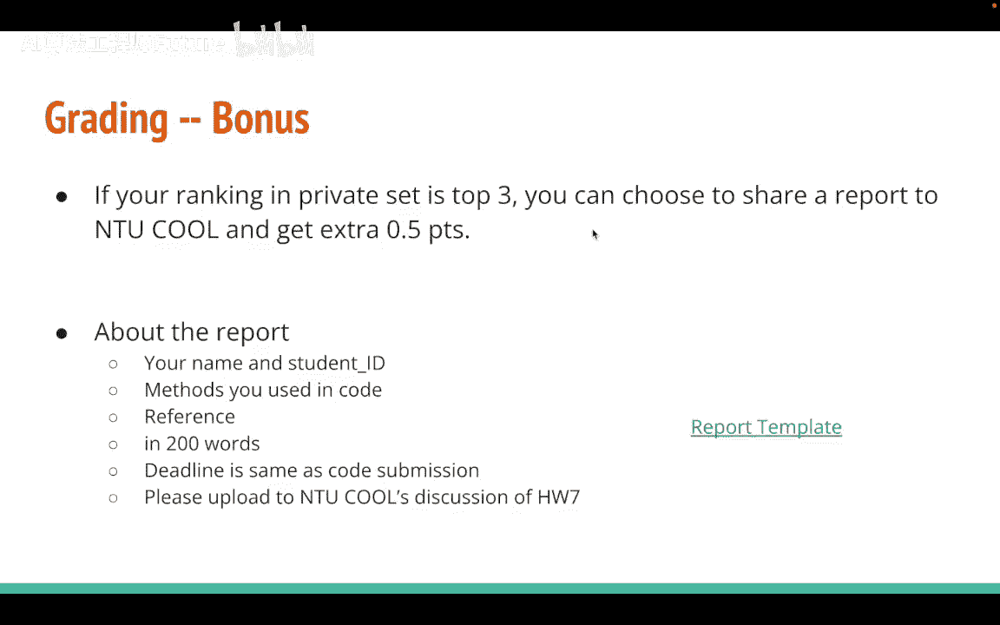

评分标准如下：
*   **报告**：占4分。
*   **代码提交**：占2分。
*   **各基准线**：每通过一个基准线占1分（公开和私有测试集各占0.5分）。

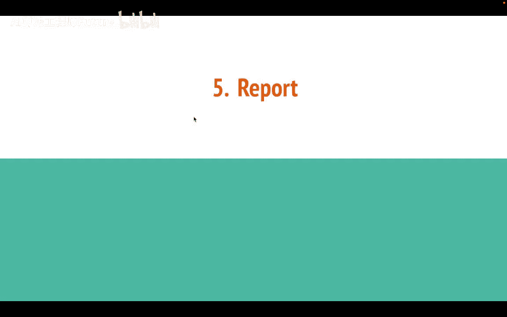

测试集共有4957个问题。评估指标是字符级别的精确匹配准确率，即预测答案的每个字符都必须与标准答案完全一致。

报告需要回答以下两个问题：
1.  当模型预测出答案的开始和结束概率后，你采用了何种决策方式来确定最终答案？不能使用与示例代码相同的方法。
2.  请尝试使用BERT以外的预训练模型（仅限于Hugging Face网站上的模型），并简要描述所选模型、其性能表现以及与BERT的差异（如架构、预训练方法等）。

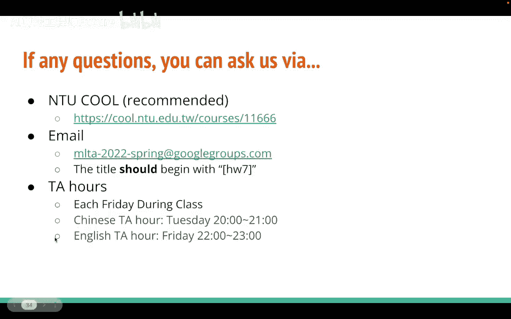

作业规定：禁止使用额外的训练数据，且只能使用Hugging Face网站提供的预训练模型。违反规定将导致本次作业计零分，且总成绩乘以0.9。

---

## 代码结构概述 🖥️

最后，我们来简要浏览一下示例代码的结构。

代码主要包含以下几个部分：
1.  **数据下载与加载**：下载数据集并读取到内存中。
2.  **环境配置**：安装必要的库（如`transformers`），导入模块，并设置随机种子以保证可复现性。
3.  **模型与分词器加载**：从Hugging Face加载预训练的BERT模型和对应的分词器。若要更换模型，只需修改此处的模型名称。
4.  **数据预处理**：对问题和文章进行分词，并构建包含`input_ids`、`token_type_ids`和`attention_mask`的模型输入。此处是实现**Strong Baseline**提示（修改预处理）的关键。
5.  **数据集与数据加载器**：定义数据集类（`Dataset`）和数据加载器（`DataLoader`）。在`__getitem__`方法中完成主要的数据处理逻辑。
6.  **训练循环**：定义训练周期数、优化器（可在此处加入线性学习率衰减以实现**Medium Baseline**）等，并执行模型训练。
7.  **评估与预测**：在测试集上进行预测，并生成符合提交格式的`result.csv`文件。此处是实现**Boss Baseline**提示（修改后处理）的关键。

---

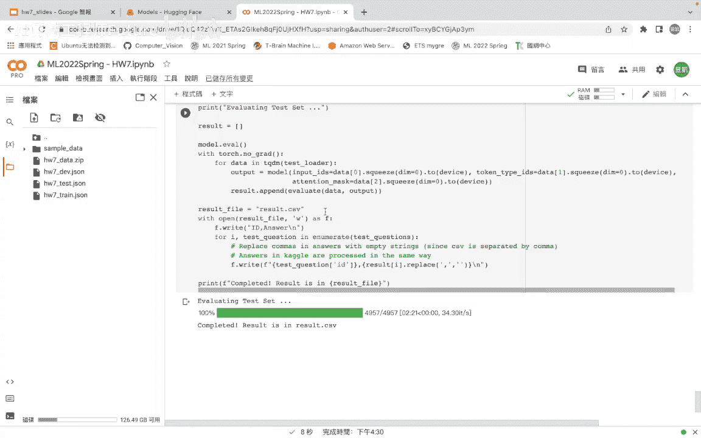

本节课中我们一起学习了如何使用BERT完成抽取式问答任务，涵盖了从任务理解、数据处理、模型实现到优化技巧的完整流程。请仔细阅读说明，并开始你的实践。如有任何问题，请到课程讨论区提问。