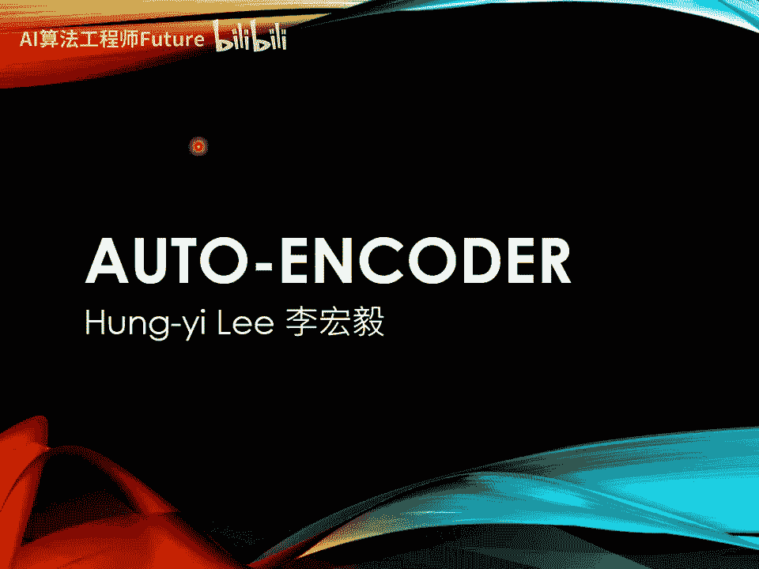
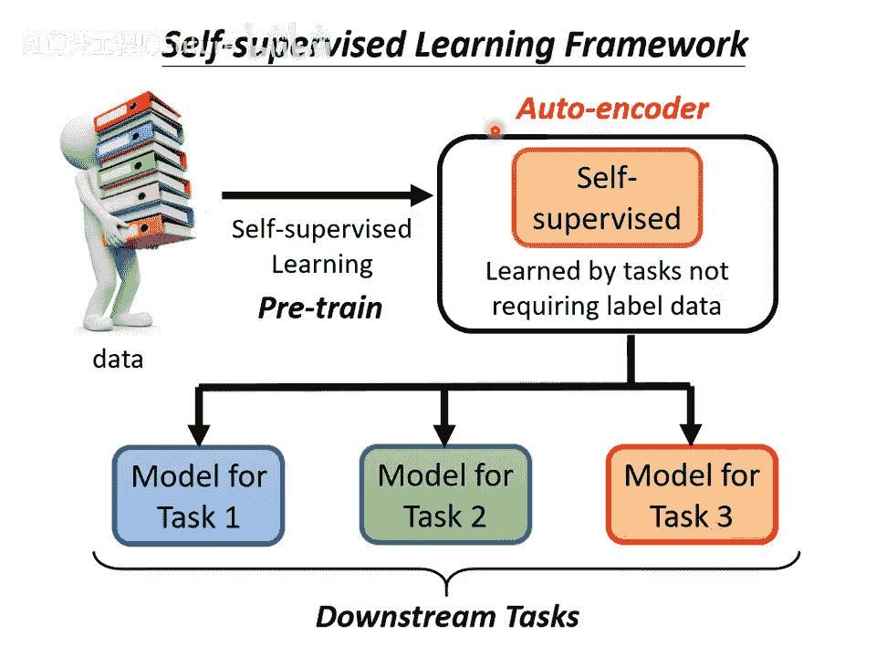
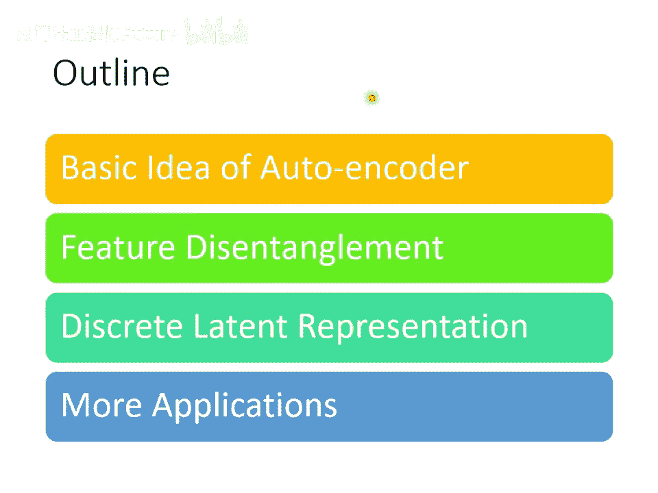
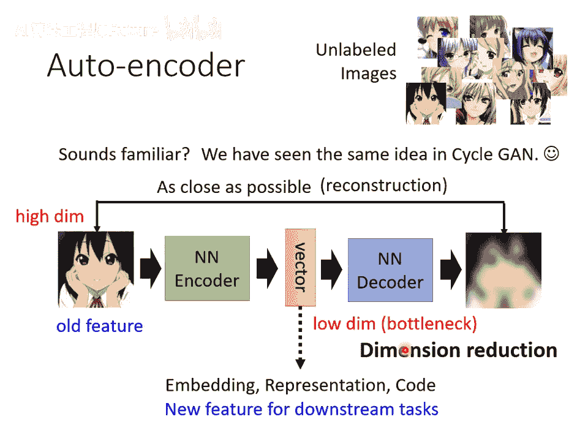
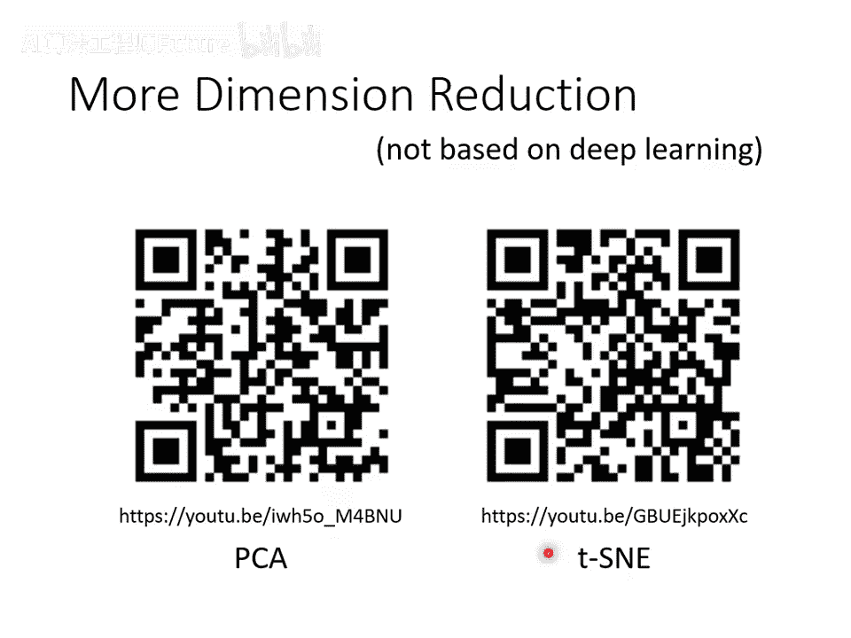
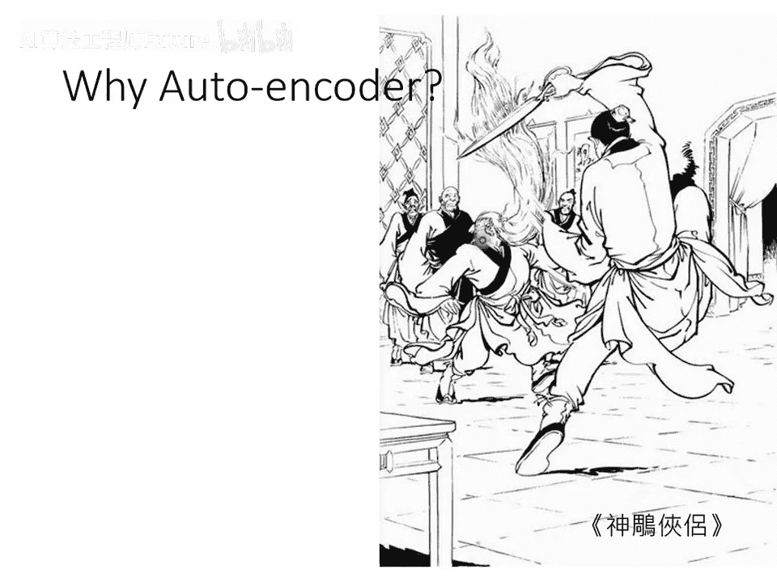
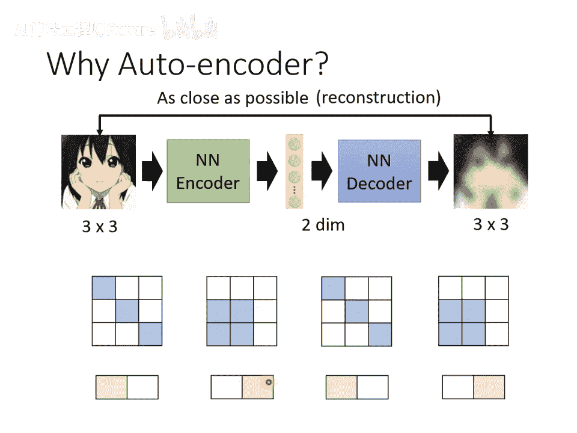
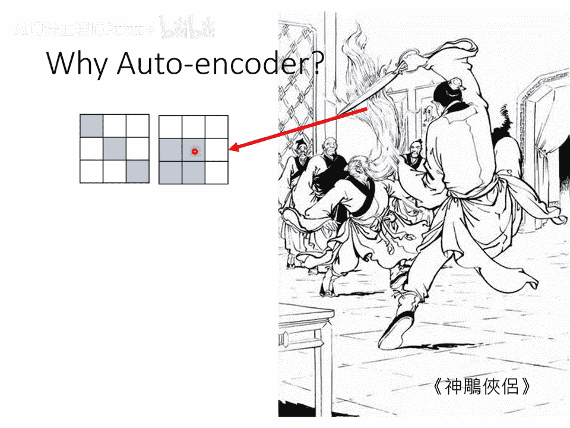
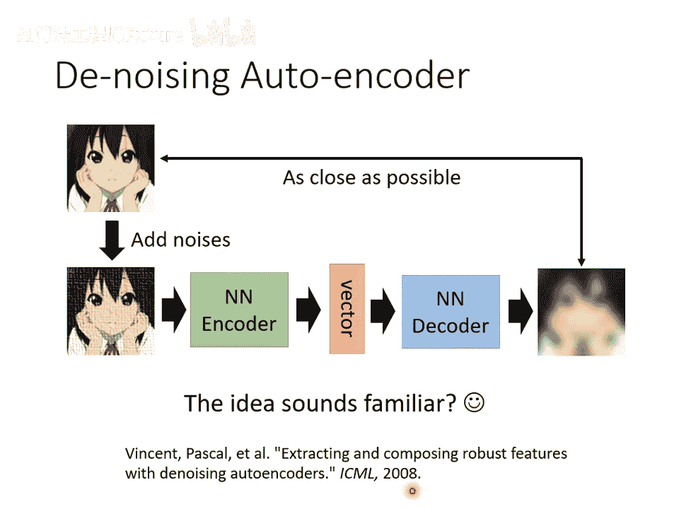
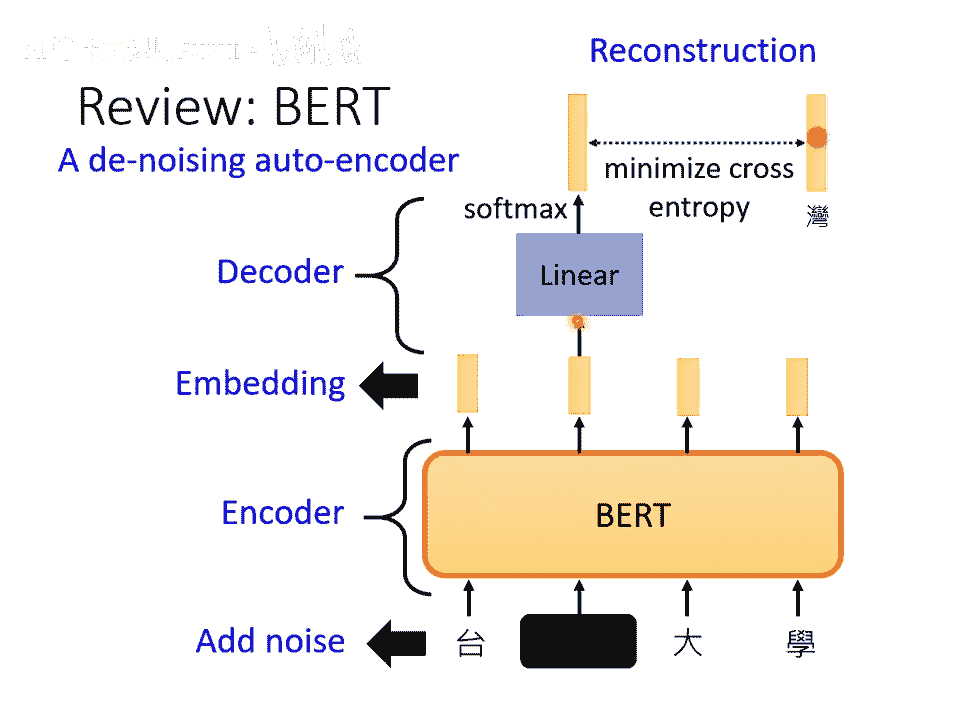

# 60 第8讲（上）自编码器 (Auto-encoder) 基本概念 🧠

## 概述
在本节课中，我们将要学习自编码器的基本概念。自编码器是一种无监督学习方法，它通过让模型学习重建输入数据来提取有用的特征表示。我们将从自编码器的基本结构和工作原理开始，并探讨它与自监督学习的关系。

---

## 自编码器与自监督学习

上一节我们介绍了自编码器是本节课的主题。在深入细节之前，我们先将其置于一个更广泛的框架中来看。

自编码器可以被视为自监督学习的一环。自监督学习是如何运作的呢？

以下是自监督学习的运作框架：
1.  首先，你有大量没有标注的资料。
2.  用这些没有标注的资料，你可以去训练一个模型。你必须发明一些不需要标注资料的任务，例如做填空题或预测下一个词元。
3.  你必须要自己想一些不需要标注资料的任务，给你的模型进行学习。这个不用标注资料的学习叫做自监督学习，也有人称之为预训练。
4.  用这些不用标注资料的任务学完一个模型以后，它本身可能没有直接用处。例如，模型可能只能做填空题。
5.  但是你可以把这个模型用在下游任务里。你可以把自监督学习得到的模型做一点微调，就可以用在下游的任务里面。

在这些自监督学习的任务中，在BERT和GPT出现之前，有一个更古老的不需要标注资料的任务，就叫做自编码器。因此，你也可以把自编码器看作是自监督学习的一种预训练方法。当然，关于名词定义可能存在不同观点，但我们无需纠结于此。从“不需要用标注数据来训练”这一核心观点来看，自编码器可以算是自监督学习的一种方法。

---

## 自编码器的工作原理

上一节我们将自编码器与自监督学习联系起来，本节中我们来看看自编码器具体是如何运作的。

现在，我们以影像数据为例。假设你有非常大量的图片。在自编码器中，你有两个神经网络：一个叫做**编码器**，一个叫做**解码器**。

以下是这两个网络的作用：
*   **编码器**：把一张图片读进来，将这张图片转换成一个向量。编码器可能是一个多层的卷积神经网络。
*   **解码器**：以上述向量作为输入，产生一张图片。解码器的网络架构可能类似于生成对抗网络中的生成器。

训练的目标是希望编码器的输入（原始图片）与解码器的输出（重建的图片）越接近越好。如果我们把图片看作一个很长的向量，就希望输入向量与输出向量之间的距离越小越好。这个过程也称为**重建**。

这个概念似曾相识。没错，我们在讲循环生成对抗网络时已经接触过类似概念。在循环生成对抗网络中，我们希望输入的图片经过两次转换后，要跟原来的图片越接近越好。自编码器的概念与此一模一样。

这个训练过程完全不需要任何标注资料，只需要收集大量图片即可。因此，它是一种无监督学习方法。

编码器的输出有时被称为**嵌入**、**表示**或**编码**。这些术语指的都是同一个东西。

---

## 自编码器的应用与维度压缩

上一节我们了解了自编码器如何工作，本节中我们来看看训练好的自编码器如何应用在下游任务中。

常见的用法是：原始图片可以看作一个很长的向量，但这个向量太长，不好处理。你可以把图片输入编码器，输出一个维度较低的向量（例如只有10维或100维）。然后，你拿这个新的、低维度的向量来进行后续的任务。

因为通常编码器的输入是一个维度非常高的向量，而编码器的输出（即嵌入/表示/编码）是一个非常低维度的向量。输入和输出的维度都很宽，但中间连接的编码器输出部分特别窄，所以这个部分有时又被称为**瓶颈**。

编码器做的事情是把本来很高维度的东西转成低维度的东西，这又叫做**降维**。降维技术在机器学习中应用广泛。你可以把自编码器的编码器当作一个基于深度学习的降维工具。当然，还有其他非基于深度学习的降维技术，例如主成分分析和t-SNE。

---

## 自编码器为何有效：理解“瓶颈”

上一节我们提到了“瓶颈”和降维，你可能会好奇：为什么自编码器能够成功地将高维数据压缩再还原？本节中我们通过一个比喻来理解其核心思想。

自编码器要把一张图片压缩又还原回来。为什么还原能成功？设想一下，假设图片是3x3大小，需要用9个数值来描述。如果编码器输出一个二维向量，我们怎么可能从两个数值去还原出9个数值呢？

能够做到这一点是因为，对于影像来说，并不是所有3x3的矩阵都是合理的图片。图片的变化其实是有限的。你随机采样一个噪声矩阵，它通常不会是你看到的图片。也许图片的实际变化只有少数几种类型。正是因为图片的变化是有限的，所以编码器可以只用两个维度（例如[1,0]和[0,1]）来描述一张图片。

用一个比喻来说：复杂的图片像素就像长长的胡子，表面上变化多端。但编码器做的事情是“化繁为简”，找出其背后有限的变化模式（就像控制胡子的头），并用简单的方法来表示它。如果我们可以用简单的方法表示复杂图片，在下游任务中就可能只需要较少的训练资料。

---

## 自编码器的历史与变体

自编码器并不是一个新想法，它有着悠久的历史。例如，深度学习之父Hinton在2006年发表于《科学》杂志的论文中就提到了自编码器的概念。当然，当时使用的网络架构和训练理念（如逐层预训练的受限玻尔兹曼机）与今天大不相同。

自编码器还有一个常见的变体，叫做**去噪自编码器**。它的运作方式如下：
1.  我们把原来要输入给编码器的图片加上一些杂讯。
2.  图片通过编码器和解码器，试图还原**加入杂讯之前**的原始图片。

因此，编码器和解码器合起来必须学会把杂讯去掉，才能完成训练。去噪自编码器也不算新技术，相关论文在2008年就已出现。

这个概念其实并不陌生。如果你看今天的BERT模型，也可以把它看作一个去噪自编码器：输入句子会被加上[MASK]（可视为噪声），BERT模型（编码器）输出嵌入表示，然后一个线性层（可视为解码器）的任务就是还原被遮盖的原始词元。因此，BERT本质上就是一个去噪自编码器。

---

## 总结
本节课中，我们一起学习了自编码器的基本概念。我们了解到自编码器是一种无监督/自监督学习方法，它通过编码器将输入数据压缩为低维表示（瓶颈），再通过解码器进行重建。其有效性源于数据本身变化的有限性。我们还探讨了自编码器的应用（如下游任务的特征提取）、历史背景以及其重要变体——去噪自编码器，并将其与BERT等现代模型联系起来。理解自编码器是掌握许多现代特征学习和表示学习技术的基础。