# 83：神经网络压缩 (二) 🧠

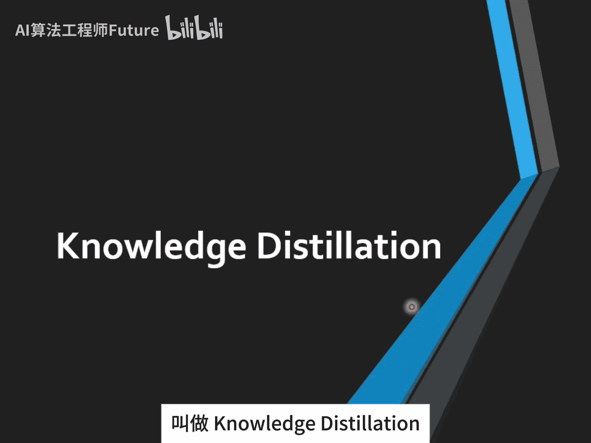

## 概述
在本节课中，我们将继续学习神经网络压缩技术。上一节我们介绍了网络剪枝，本节中我们将看看另一种重要的压缩方法——知识蒸馏，并探讨从参数量化、网络架构设计到动态计算等多个面向来压缩神经网络。

---

## 知识蒸馏 (Knowledge Distillation) 🧪

知识蒸馏的概念与网络剪枝有相似的精神，但其实现方式不同。

它的核心流程是：先训练一个大型网络，这个网络被称为**教师网络 (Teacher Network)**。然后，我们希望得到一个更小的网络，即**学生网络 (Student Network)**。学生网络并非直接对原始数据学习，而是去学习教师网络的输出。

以下是知识蒸馏的具体步骤：
1.  将训练数据输入教师网络，教师网络会为每个输入生成一个概率分布作为输出。例如，在手写数字识别中，对于一张图片，教师可能输出：数字“1”的概率是0.7，“7”是0.29，“9”是0.01。
2.  将同样的图片输入学生网络，但训练目标不是数据的真实标签，而是教师网络输出的这个概率分布。学生网络的目标是让自己的输出分布尽可能逼近教师的输出分布。

你可能会问：为什么不直接训练一个小网络呢？原因与网络剪枝类似：直接训练的小网络性能，往往不如通过向大网络（教师）学习得到的小网络（学生）性能好。

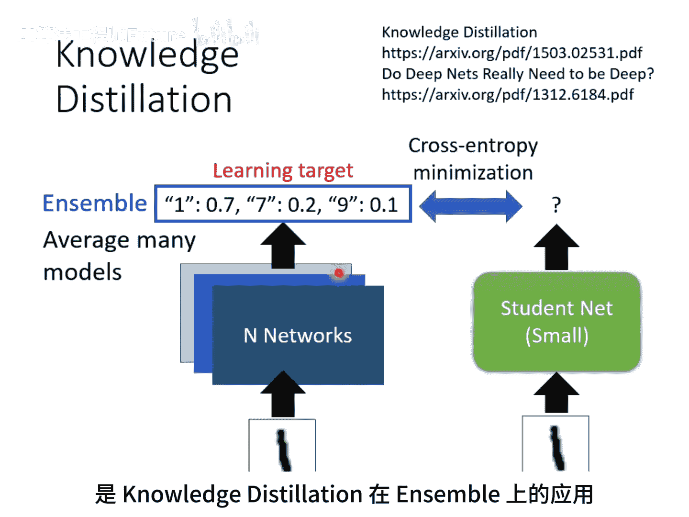

知识蒸馏技术并非全新，Hinton在2015年发表的《Distilling the Knowledge in a Neural Network》使其广为人知。但更早的文献（如2013年的《Do Deep Nets Really Need to be Deep?》）已使用了类似概念。

为什么知识蒸馏有效？一个直观的解释是：教师网络为学生提供了额外的“软标签”信息。直接告诉学生“这是一张‘1’的图片”可能很困难，因为‘1’可能与‘7’、‘9’等数字有相似之处。而教师网络会输出“这是‘1’的概率是0.7，是‘7’的概率是0.2”，这揭示了类别间的相似性，使学生网络更容易学习。

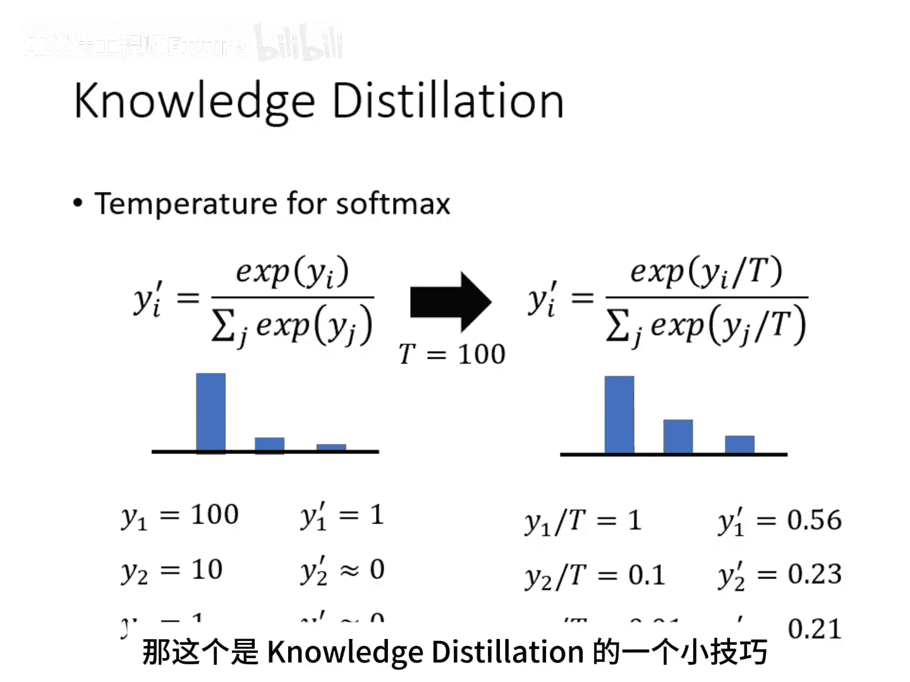

一个神奇的现象是：即使某些类别的训练数据从未给学生网络看过，仅凭教师网络揭示的类别间关系（例如“7”和“1”有点像），学生网络也有可能学会识别该类别。

**教师网络也可以是集成模型 (Ensemble)**。集成是机器学习比赛中常用的技巧，即训练多个模型并将它们的输出进行平均或投票，作为最终结果。虽然集成能提升性能，但计算开销巨大。通过知识蒸馏，我们可以将多个模型集成起来的结果作为教师，让学生网络去学习这个集成输出，从而用一个轻量级的学生网络来逼近集成的性能。

### 知识蒸馏中的技巧：温度 (Temperature)

在知识蒸馏中，常对Softmax函数进行一个小修改，即引入**温度**参数。

首先，回顾标准Softmax公式：
对于一个神经元的输出向量 **z**，其第 *i* 个类别的概率为：
**公式**：`p_i = exp(z_i) / sum(exp(z_j)) for j in all classes`

引入温度 *T* 后的Softmax变为：
**公式**：`p_i = exp(z_i / T) / sum(exp(z_j / T)) for j in all classes`

其中，*T* 是一个需要调节的超参数。当 *T > 1* 时，它会使原本尖锐的概率分布变得平滑。

为什么要这样做？如果教师网络的输出非常集中（例如某个类别概率为1，其余为0），那么让学生去学习这个输出就和直接学习真实标签没有区别，失去了知识蒸馏的意义。通过设置一个较大的 *T*，可以在不改变类别排序的前提下，让概率分布更平滑，从而让学生网络能更好地学习到类别间的关系信息。

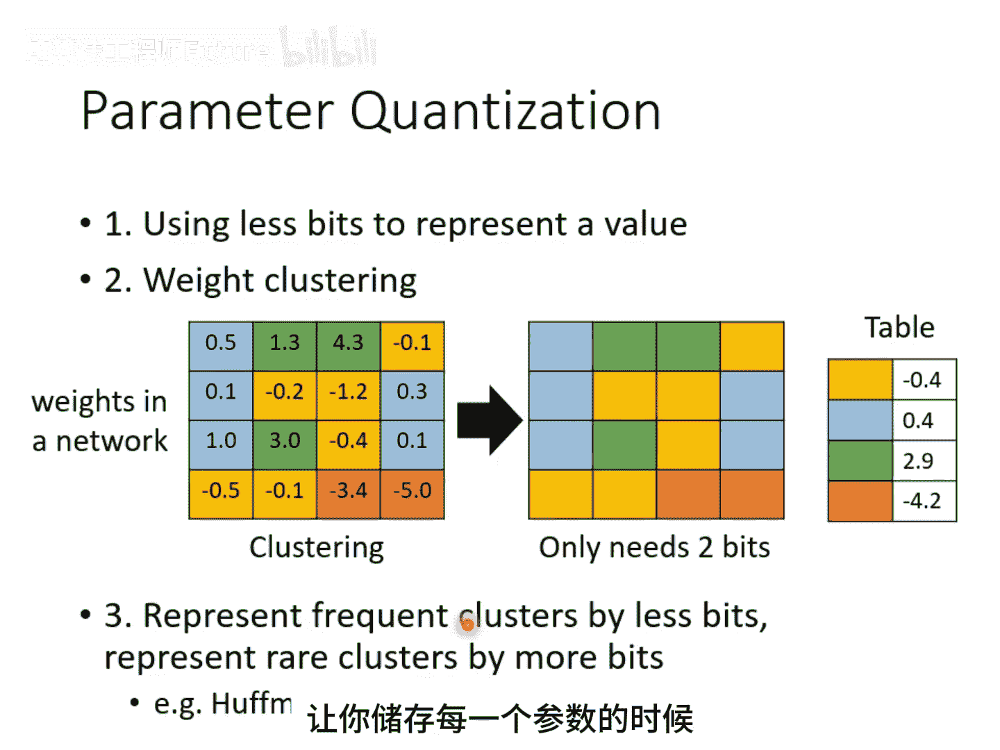

---

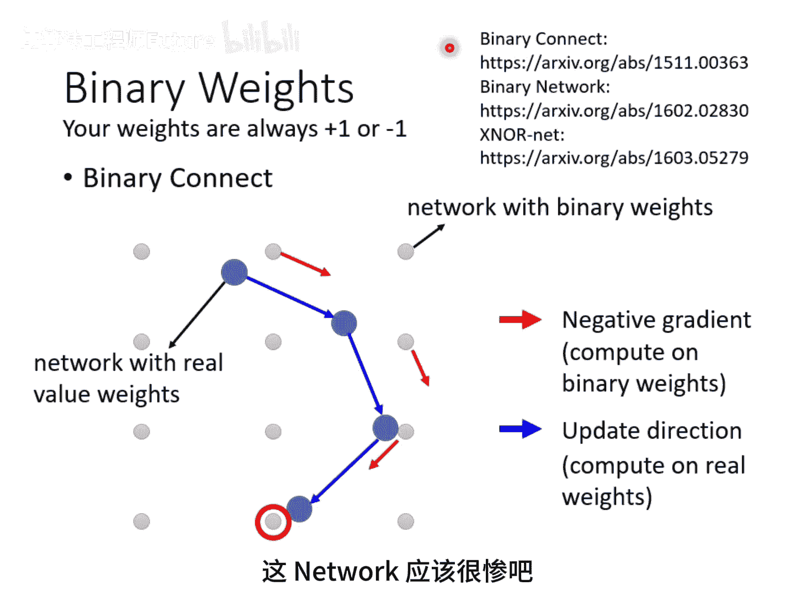

## 参数量化 (Parameter Quantization) 🔢

参数量化的目标是：用更少的存储空间来保存网络参数。请注意，在本课程作业中，由于限制的是参数数量而非存储大小，因此此方法可能不直接适用，但仍值得了解。

最简单的量化方法是**降低数值精度**：例如，将参数从32位浮点数（float32）转换为16位浮点数（float16）甚至8位整数（int8），这样存储空间可直接减半，且性能通常下降很小。

更进一步的方法是**权值聚类 (Weight Clustering)**：
1.  对网络中所有权重数值进行聚类（例如分成4类）。
2.  每一类用一个代表值（如该类权重的均值）来表示。
3.  存储时，只需保存一个“聚类中心值表”和每个权重所属的“聚类索引”。如果只有4类，那么每个权重只需2个比特即可表示其索引，极大地压缩了存储空间。

还可以结合**霍夫曼编码 (Huffman Encoding)** 等无损压缩技术，对常见的聚类索引使用更短的码，进一步减少平均存储长度。

### 二值化权重 (Binary Weights)

参数量化的终极形式之一是**二值化权重**，即每个参数只能是+1或-1。这样每个参数仅需1个比特存储。

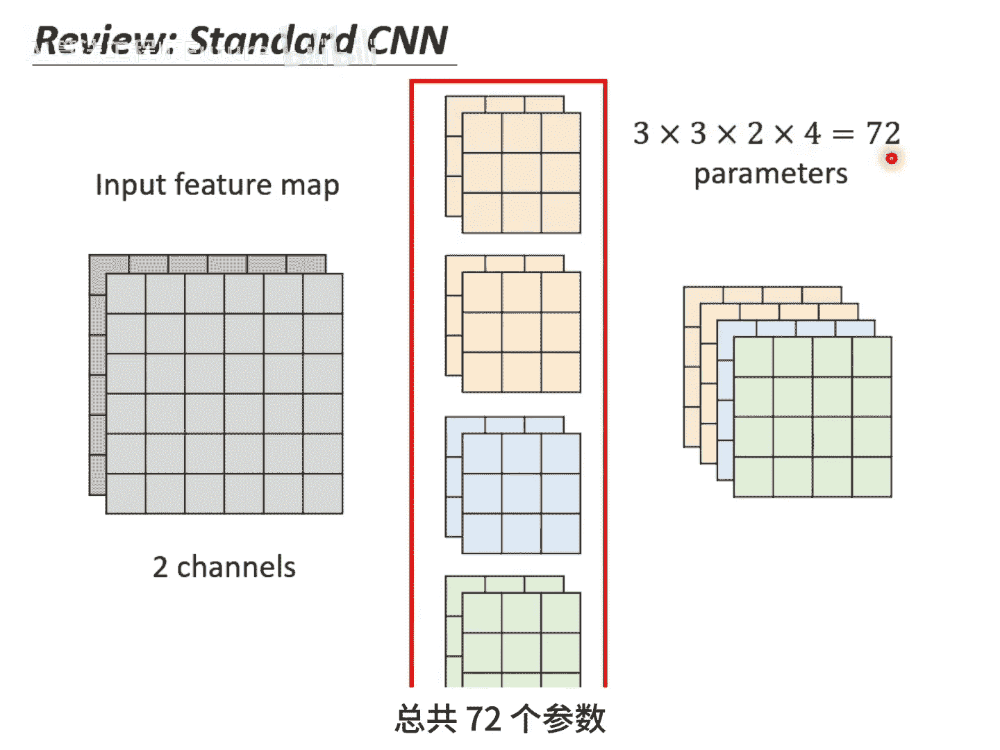

你可能会认为二值化网络的性能会很差，但事实并非如此。例如，在论文《BinaryConnect》中，作者在MNIST和CIFAR-10数据集上实验发现，二值化网络的错误率有时甚至略低于全精度网络。一个可能的原因是，二值化给模型能力施加了更强的限制，反而有助于防止过拟合。

---

## 网络架构设计 (Network Architecture Design) 🏗️

通过设计更高效的网络架构，可以直接减少参数量。本节介绍本次作业的主力方法：**深度可分离卷积 (Depthwise Separable Convolution)**。

在讲解它之前，我们先快速回顾标准卷积 (Standard Convolution)：
*   输入特征图有 *I* 个通道。
*   每个卷积核是一个3D张量，其“深度”必须与输入通道数 *I* 相同（例如3x3x*I*）。
*   如果有 *O* 个卷积核，则输出特征图有 *O* 个通道。
*   总参数量 = 卷积核尺寸 (如 K x K) x 输入通道数 *I* x 输出通道数 *O*。

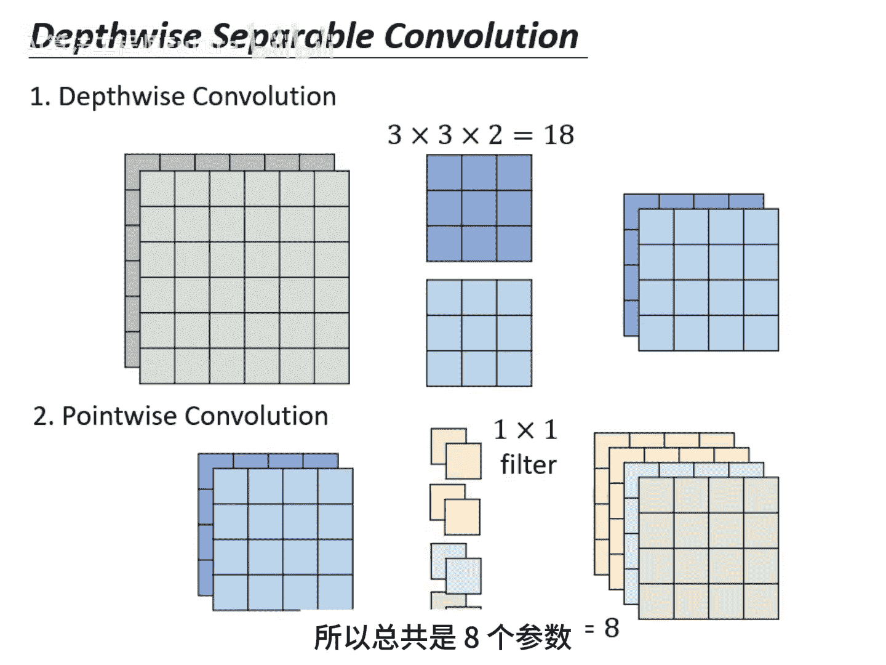

深度可分离卷积将标准卷积分解为两个步骤：

**第一步：深度卷积 (Depthwise Convolution)**
*   输入有 *I* 个通道，就使用 *I* 个卷积核。
*   每个卷积核**只负责一个输入通道**，在单个通道上进行卷积。
*   输出特征图通道数仍为 *I*。这一步负责处理**空间特征**（同一通道内像素间的关系），但**忽略了通道间的关系**。

**第二步：逐点卷积 (Pointwise Convolution)**
*   使用 *O* 个大小为 1x1 的卷积核。
*   这些1x1卷积核的作用是：对深度卷积输出的 *I* 个通道进行线性组合，以生成 *O* 个输出通道。
*   这一步专门负责融合**通道间的关系**。

**参数量对比**：
*   **深度卷积参数量**：K x K x *I* (每个通道一个KxK核)
*   **逐点卷积参数量**：1 x 1 x *I* x *O* (O个1x1xI的核)
*   **总参数量**：K x K x *I* + *I* x *O*

与标准卷积参数量 (K x K x *I* x *O*) 的比值约为：`1/O + 1/(K*K)`。由于 *O* 通常较大，比值主要由 `1/(K*K)` 决定。当K=3时，参数量可减少到约1/9；当K=2时，可减少到约1/4。

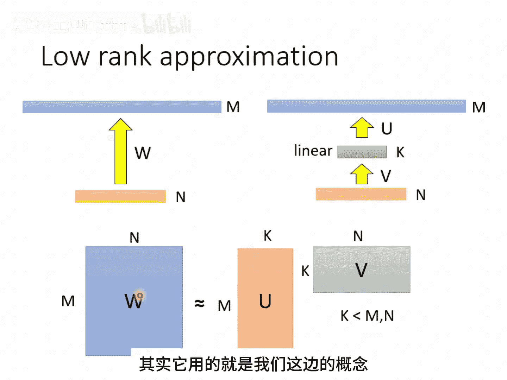

**原理**：深度可分离卷积的本质是一种**低秩近似 (Low-rank Approximation)**。它将一个全连接层（可视为大矩阵）分解为两个更薄矩阵的乘积，从而在保持表达能力的同时显著减少参数。

---

## 动态计算 (Dynamic Computation) ⚡

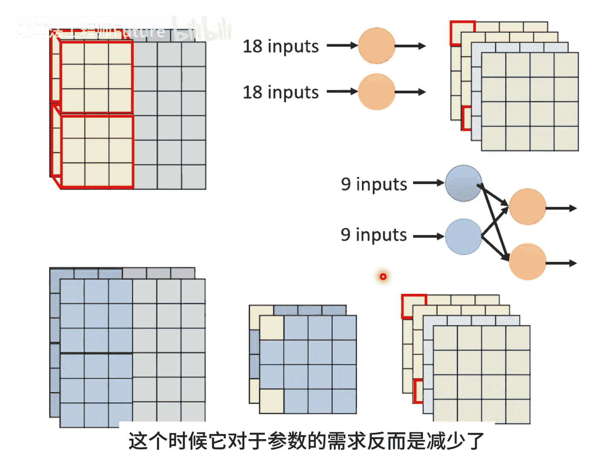

动态计算的目标与前几种方法不同：它并非单纯追求网络变小，而是希望**同一个网络能根据可用计算资源动态调整其计算量**。

**应用场景**：
1.  同一模型需部署在不同算力的设备上。
2.  同一设备在不同状态下（如电量充足 vs 电量不足）对算力的需求不同。

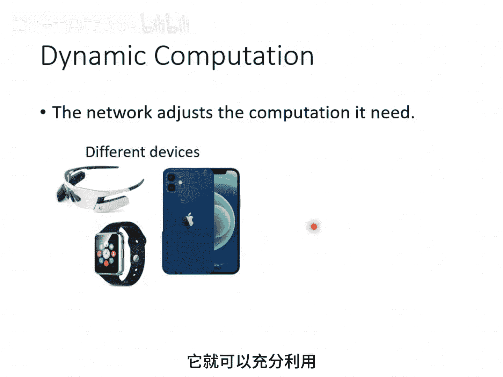

**为什么不直接准备多个不同大小的网络？** 因为存储多个网络模型会占用大量空间。我们期望一个模型就能灵活适配。

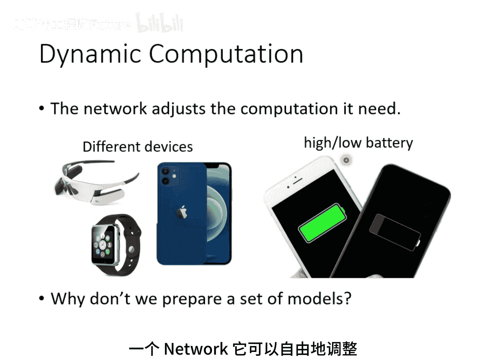

### 实现动态计算的方法

**1. 动态深度 (Dynamic Depth)**
*   训练一个很深的网络，并在中间层插入额外的“提前退出分支”。
*   每个分支都可以输出分类结果。
*   训练时，要求所有分支的输出都尽量接近真实标签。
*   推理时，算力充足则使用最终输出；算力不足则可在浅层分支提前输出结果。

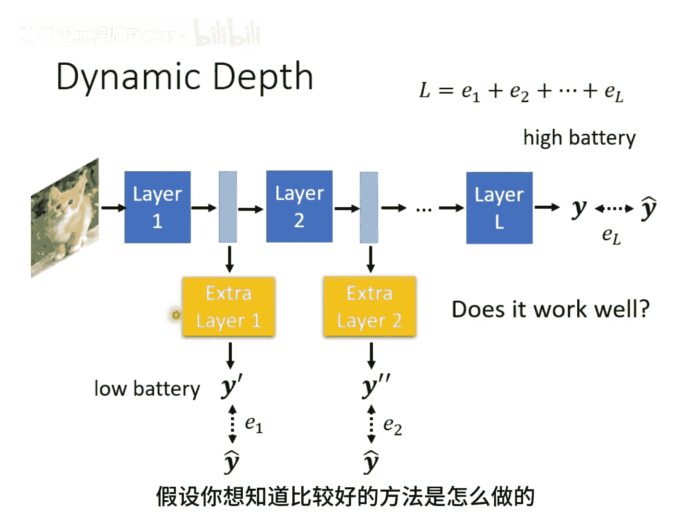

**2. 动态宽度 (Dynamic Width)**
*   训练时，让网络同时以多种“宽度”（即激活不同比例的神经元子集）进行前向传播。
*   要求所有宽度下的输出都接近真实标签。
*   推理时，根据可用算力选择对应的宽度。

**3. 网络自适应决策**
*   让网络根据输入样本的“难度”自行决定需要多少计算量。对于简单样本，早期层就能做出准确判断并提前退出；对于复杂样本，则运行到深层。
*   这可以进一步节省计算资源。

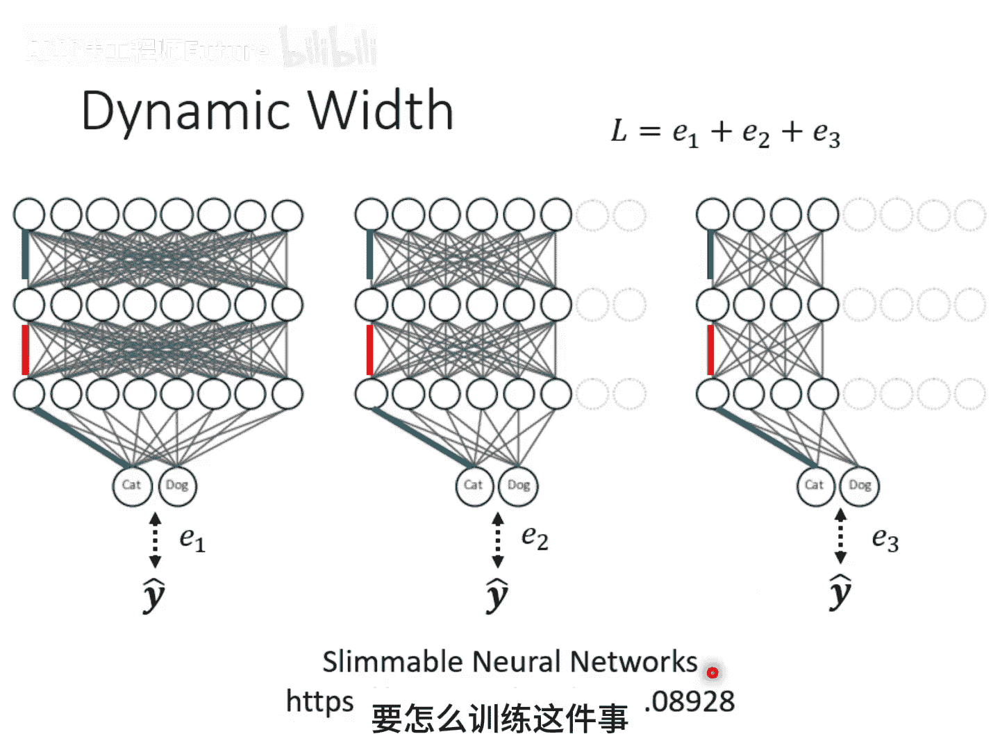

---

## 总结 🎯

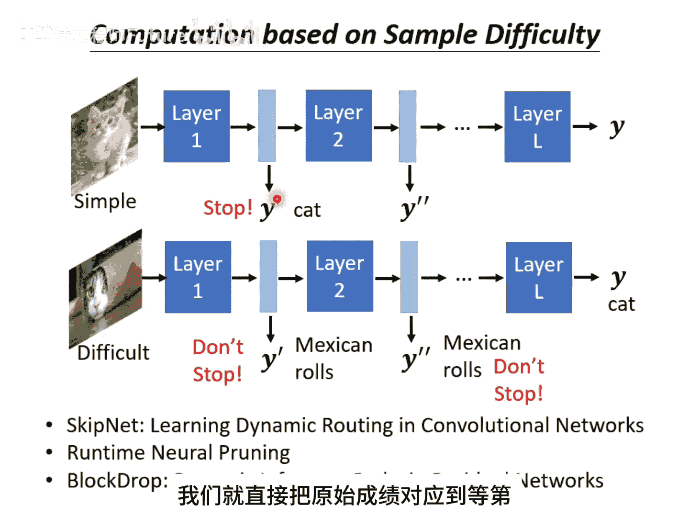

本节课我们一起学习了多种神经网络压缩与加速技术：
1.  **知识蒸馏**：让小型学生网络学习大型教师网络的输出分布，以提升小模型性能。
2.  **参数量化**：通过降低数值精度、权值聚类等方法，减少存储每个参数所需的比特数。
3.  **网络架构设计**：重点介绍了**深度可分离卷积**，通过将标准卷积分解为深度卷积和逐点卷积，大幅减少参数量。
4.  **动态计算**：使网络能够根据可用计算资源或输入难度，动态调整其深度或宽度。

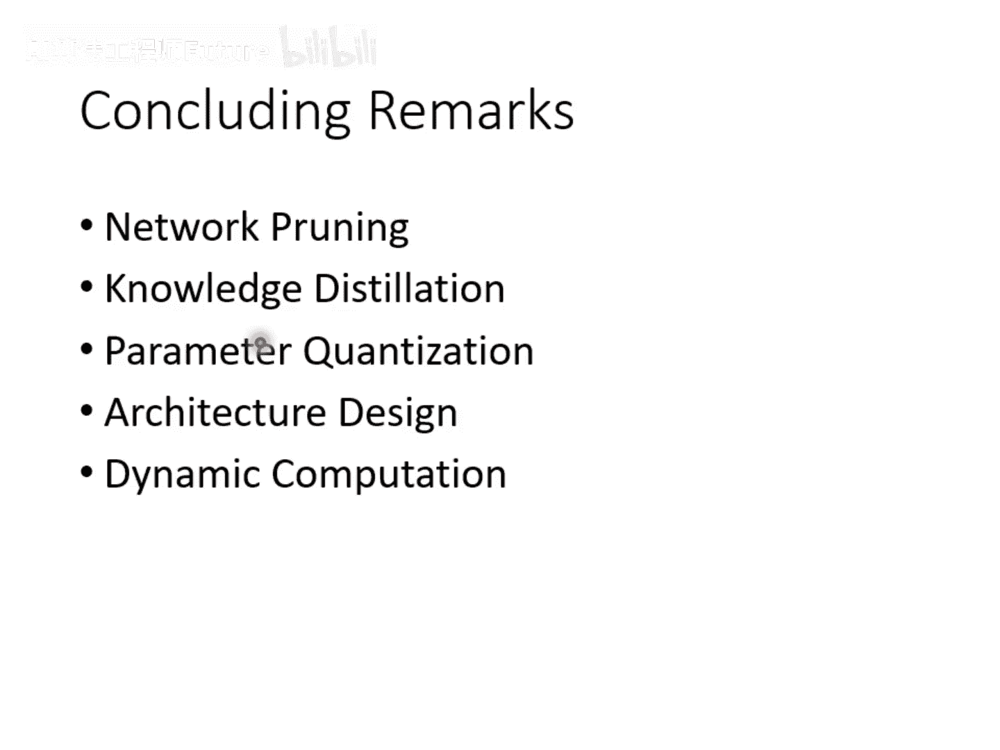

需要注意的是，这些技术**并非互斥**。在实际应用中，为了达到极致的压缩效果，可以组合使用多种技术，例如先进行知识蒸馏，再进行网络剪枝，最后对权重进行量化。