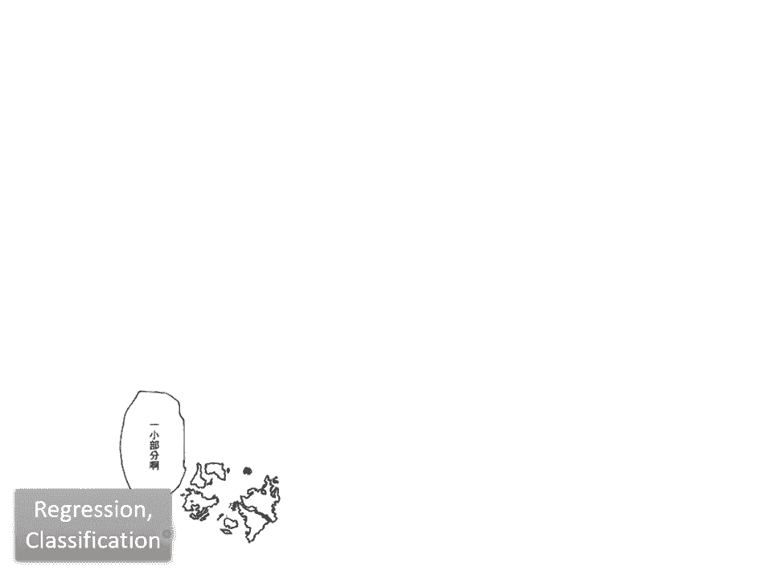
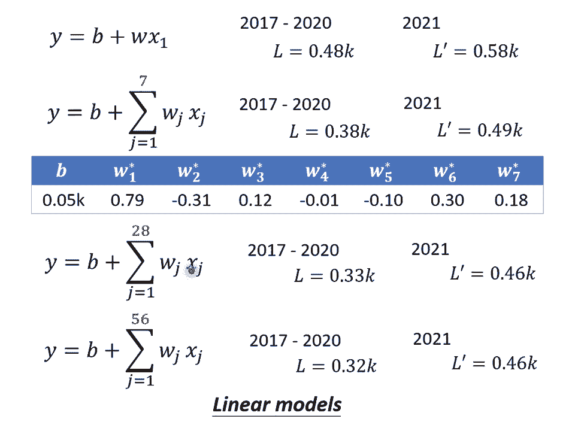

# 1：L1.1- 机器学习基本概念简介 🧠

在本节课中，我们将要学习机器学习和深度学习的基本概念。我们将从一个简单的故事开始，了解什么是机器学习，它如何工作，并通过一个预测YouTube频道观看次数的实际例子，详细拆解机器学习的三个核心步骤。

## 什么是机器学习？

机器学习，顾名思义，是让机器具备学习的能力。抛开那些玄妙的描述，机器学习本质上可以用一句话概括：**机器学习就是让机器具备寻找一个函数的能力**。

这个函数可以完成各种任务。例如：
*   **语音识别**：需要一个函数，输入是声音信号，输出是对应的文字。
*   **图像识别**：需要一个函数，输入是一张图片，输出是图片中的内容描述。
*   **AlphaGo下围棋**：需要一个函数，输入是棋盘上所有棋子的位置，输出是下一步最佳的落子位置。

这些函数通常非常复杂，无法由人类手动编写出来。因此，我们寄希望于机器能自动找到这个函数，这个过程就是机器学习。

## 机器学习的任务类型

根据我们要寻找的函数其输出形式的不同，机器学习任务主要分为几类。

以下是几种常见的机器学习任务：

1.  **回归**
    *   **定义**：函数输出是一个**连续的数值**（scalar）。
    *   **例子**：预测明天中午的PM2.5数值。函数输入可能是今天的PM2.5、温度、臭氧浓度等，输出是一个具体的PM2.5数值。

2.  **分类**
    *   **定义**：函数输出是从预设好的几个**选项**（或称类别/class）中选择一个。
    *   **例子**：
        *   垃圾邮件检测：输入是一封邮件，输出是“是垃圾邮件”或“不是垃圾邮件”两个选项之一。
        *   AlphaGo下棋：输入是棋盘状态，输出是从19x19个落子位置中选择一个最佳位置。这是一个有361个选项的分类问题。

3.  **结构化学习**
    *   **定义**：函数输出是一个有结构的复杂对象，而不仅仅是一个数字或一个标签。
    *   **例子**：让机器创作一首诗、画一幅画或写一篇文章。这可以理解为让机器学会“创造”。

上一节我们介绍了机器学习的定义和几种任务类型，本节中我们来看看机器是如何具体“寻找函数”的。我们将通过一个预测YouTube频道每日观看次数的例子，详细讲解机器学习的三个步骤。

## 机器学习三步曲

我们的目标是：找到一个函数，输入是YouTube后台的历史数据（例如前一天的观看次数），输出是预测隔天的总观看次数。

### 第一步：建立带有未知参数的模型

首先，我们需要猜测一下这个函数可能长什么样子。这通常基于我们对问题的初步理解（领域知识）。

我们做一个最简单的猜测：今天的观看次数（`y`）和昨天的观看次数（`x₁`）呈线性关系。
我们用一个带有未知参数的函数来表示这个猜测：

**`y = b + w * x₁`**

在这个模型中：
*   `y`：我们要预测的值（例如今天的观看次数）。
*   `x₁`：特征（Feature），是我们已知的输入（例如昨天的观看次数）。
*   `b` 和 `w`：未知参数（Parameters）。
    *   `w`：权重（Weight），表示特征 `x₁` 对预测结果 `y` 的影响程度。
    *   `b`：偏置（Bias），是一个基础调整值。

这个带有未知参数的函数 `y = b + w * x₁`，就称为我们的**模型**。它是一个线性模型。

### 第二步：定义损失函数

有了模型，我们需要一个标准来判断一组特定的参数（`w` 和 `b`）是好是坏。这个标准就是**损失函数**。

损失函数 `L` 的输入是模型的参数（`w` 和 `b`），输出值代表了这组参数的好坏程度。输出值越小，说明这组参数越好，模型的预测越准确。

如何计算损失呢？我们需要利用**训练数据**（即过去已知的数据）。假设我们有2017-2020年每天的观看次数数据。

以下是计算损失的步骤：

1.  给定一组参数值（例如 `w=1`, `b=0.5k`），我们的模型变为 `y = 0.5k + 1 * x₁`。
2.  将训练数据中的第一天数据（`x₁ = 4.8k`）输入模型，得到预测值 `y = 5.3k`。
3.  我们知道第一天的真实值（称为**标签**，Label）是 `4.9k`。计算预测值与真实值的误差 `e₁ = |y - ŷ| = 0.4k`。
4.  对训练数据中的每一天都重复步骤2和3，计算出每一天的误差 `e`。
5.  将所有天的误差取平均，就得到了损失 `L`。`L` 越大，说明当前参数越差。

计算误差 `e` 有不同的方法，例如：
*   **平均绝对误差**：`e = |y - ŷ|`
*   **均方误差**：`e = (y - ŷ)²`

通过尝试不同的 `w` 和 `b`，我们可以计算出每一个组合对应的损失 `L`，并绘制出**误差曲面**。我们的目标就是找到误差曲面上最低的那个点。

### 第三步：优化 - 梯度下降

现在问题明确了：我们需要找到一组参数 `w*` 和 `b*`，使得损失函数 `L` 的值最小。这个过程称为**优化**。本课程使用**梯度下降**法来解决这个优化问题。

为了简化，我们先假设只有一个参数 `w`。梯度下降的过程如下：

1.  **随机初始化**：随机选取一个初始值 `w⁰`。
2.  **计算梯度**：计算在 `w⁰` 这一点，损失函数 `L` 对参数 `w` 的**微分**（即斜率）。
    *   如果斜率为负，说明左边高右边低，增加 `w` 可以减少损失。
    *   如果斜率为正，说明左边低右边高，减少 `w` 可以减少损失。
3.  **更新参数**：根据梯度方向更新参数。
    *   更新公式：`w¹ = w⁰ - η * (∂L/∂w)`
    *   其中 `η` 称为**学习率**，是一个需要我们自己设定的**超参数**。它决定了参数更新的步伐大小。
4.  **迭代**：重复步骤2和3，不断更新 `w` 的值（`w⁰ -> w¹ -> w² -> ...`），直到满足停止条件（例如达到预设的更新次数，或梯度值接近零）。

对于有两个参数（`w` 和 `b`）的情况，原理完全相同：
*   随机初始化 `w⁰` 和 `b⁰`。
*   同时计算 `L` 对 `w` 的偏微分和对 `b` 的偏微分。
*   同时更新两个参数：
    *   `w¹ = w⁰ - η * (∂L/∂w)`
    *   `b¹ = b⁰ - η * (∂L/∂b)`

在实际编程中（例如使用PyTorch），计算微分的过程可以由框架自动完成，我们只需调用相应函数即可。

将梯度下降法应用到我们的YouTube预测例子后，我们找到了在训练数据（2017-2020）上使损失最小的一组参数：`w* = 0.97`, `b* = 0.1k`，此时损失 `L` 为 `0.48k`。

## 模型性能评估与改进

然而，在训练数据上表现好（损失小）并不意味着模型真正优秀。我们更关心模型在**没见过的数据**（例如未来的2021年数据）上的预测能力，这称为**泛化能力**。

用我们找到的模型（`y = 0.1k + 0.97 * x₁`）预测2021年1月1日至2月14日的观看次数，平均误差为 `0.58k`，比训练误差 `0.48k` 要大，这是常见现象。

分析预测结果图，我们发现真实数据具有明显的**周期性**：每7天一个循环，周五、周六的观看人数明显较少。我们最初的模型只参考前一天的数据，显然忽略了这一重要模式。

基于这个新的领域知识，我们可以改进模型，让其考虑前7天的数据：
**`y = b + w₁*x₁ + w₂*x₂ + ... + w₇*x₇`**
其中 `xⱼ` 代表 `j` 天前的观看次数。

以下是不同模型的性能对比：

| 模型考虑的天数 | 训练数据损失 | 2021年数据损失 |
| :------------ | :---------- | :------------ |
| 1天           | 0.48k       | 0.58k         |
| 7天           | 0.38k       | 0.49k         |
| 28天          | 0.33k       | 0.46k         |
| 56天          | 0.32k       | 0.46k         |

可以看到，考虑更多天数的信息（尤其是周期性的7天）后，模型在未见过的2021年数据上的预测误差显著降低。这种将特征加权求和的模型，统称为**线性模型**。

## 总结

本节课中我们一起学习了机器学习的基础概念：
1.  **机器学习的核心**是让机器自动寻找一个能够完成特定任务的函数。
2.  **机器学习的主要任务**包括回归（输出数值）、分类（输出类别）和结构化学习（输出复杂结构）。
3.  **机器学习的三个关键步骤**：
    *   **建模**：建立一个带有未知参数的函数（模型）。
    *   **定义损失**：用一个损失函数来评估参数的好坏。
    *   **优化**：通过梯度下降等方法，寻找使损失最小的最优参数。
4.  **模型评估**：好的模型不仅要在训练数据上表现良好，更要在未见过的新数据上有好的泛化能力。
5.  **领域知识**：对问题的理解（如数据中的周期性）能帮助我们设计更好的模型，这是改进模型性能的关键。

在接下来的课程中，我们将探讨如何将简单的线性模型做得更加强大。