# 2：L1.2 - 深度学习基本概念简介 🧠

在本节课中，我们将要学习深度学习的基本概念。我们将从一个简单的线性模型开始，探讨其局限性，并逐步引入更复杂的模型结构，最终理解神经网络（Neural Network）和深度学习（Deep Learning）的核心思想。我们将使用简单的语言和直观的例子，确保初学者能够跟上。

---

## 线性模型的局限性

上一节我们介绍了使用线性模型进行预测的基本思路。本节中我们来看看线性模型存在哪些问题。

线性模型的形式是 `Y = B + W * X`。对于这个模型来说，X 和 Y 的关系被限制为一条直线。无论我们如何调整参数 W（斜率）和 B（截距），它始终是一条直线。这意味着 Y 永远随着 X 的增加而单调增加。

但现实世界的关系往往更复杂。例如，前一天观看人数（X）和隔天观看人数（Y）的关系可能并非简单的正比。可能存在一个“峰值”，当 X 小于某个值时，Y 随 X 增加而增加；但当 X 超过这个峰值后，Y 反而可能减少。这种关系更像一条曲线，而非直线。

线性模型无法表示这种复杂的、非单调的关系。这种由于模型本身形式简单而带来的限制，称为 **模型的偏差（Model Bias）**。注意，这里的“偏差”与参数 B（Bias）含义不同，它指的是模型拟合真实世界复杂模式的能力不足。

## 从分段线性曲线到复杂函数

既然线性模型不够用，我们需要一个更复杂、更有弹性的函数。我们可以观察一条复杂的红色曲线。

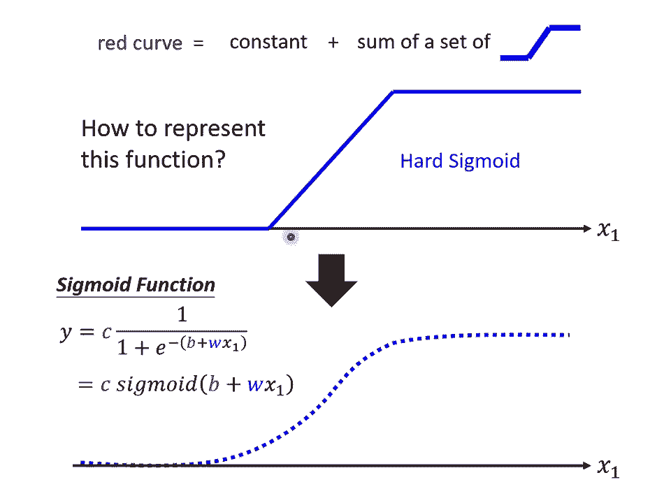

这条红色曲线可以看作是由一个常数项，加上许多个蓝色的“基础函数”组合而成。每个蓝色函数具有这样的特性：当输入 X 小于某个阈值时，输出是一个定值；大于另一个阈值时，输出是另一个定值；中间是一个斜坡。这种函数称为 **Hard Sigmoid** 函数。

通过调整这些蓝色函数的起始点、转折点和斜率，并将它们与一个常数项相加，我们就可以组合出这条红色的分段线性曲线。实际上，**任何分段线性曲线（Piecewise Linear Curve）都可以用常数项加上一系列 Hard Sigmoid 函数来表示**。

如果分段线性曲线的转折点越多，需要的蓝色函数就越多。更进一步，任何连续的曲线都可以用足够多的点来近似，然后用一条转折点足够多的分段线性曲线去逼近它。因此，**只要有足够多的 Hard Sigmoid 函数，我们就可以逼近任何连续曲线**。

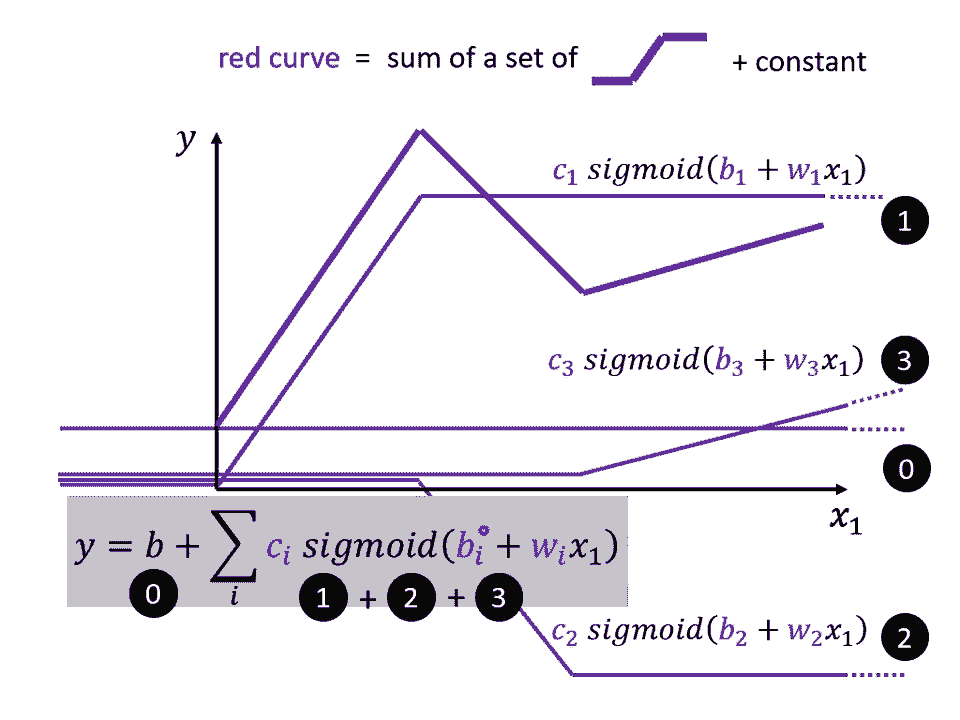

这意味着，无论 X 和 Y 的真实关系多么复杂，我们都可以尝试用一组带有未知参数的函数来表示它，这组函数就是一系列 Hard Sigmoid 函数的和。

## Sigmoid 函数

然而，直接写出 Hard Sigmoid 函数的表达式可能不太方便。我们可以用另一个更平滑、易于计算的函数来近似它，这就是 **Sigmoid 函数**。

Sigmoid 函数的公式如下：

`y = c * sigmoid(b + w * x)`

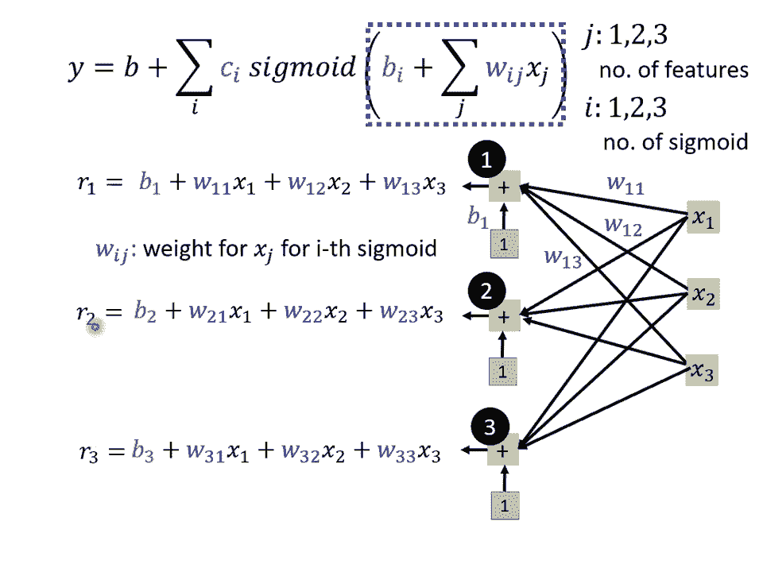

其中，`sigmoid(z) = 1 / (1 + exp(-z))`。因此，完整的表达式是：

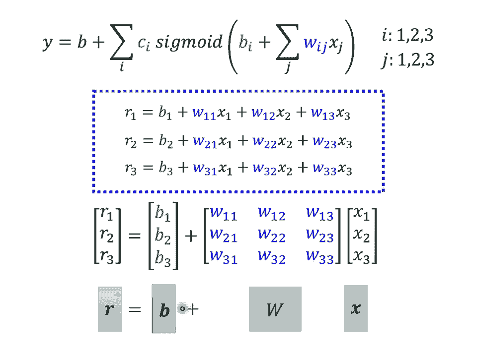

`y = c / (1 + exp(-(b + w * x)))`

这个函数的形状是 S 型。通过调整参数：
*   **w**：改变斜坡的陡峭程度（斜率）。
*   **b**：将函数图像左右移动。
*   **c**：改变函数的最大高度。

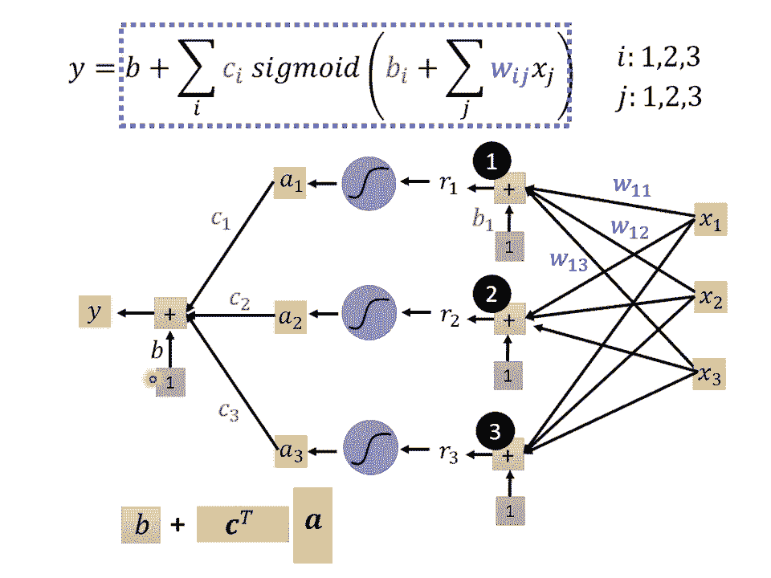

使用不同的 w、b、c 参数，我们可以制造出不同形状的 Sigmoid 函数。用这些不同的 Sigmoid 函数代替之前的 Hard Sigmoid 函数，叠加起来，同样可以逼近各种分段线性曲线，进而逼近各种连续函数。

## 构建新模型

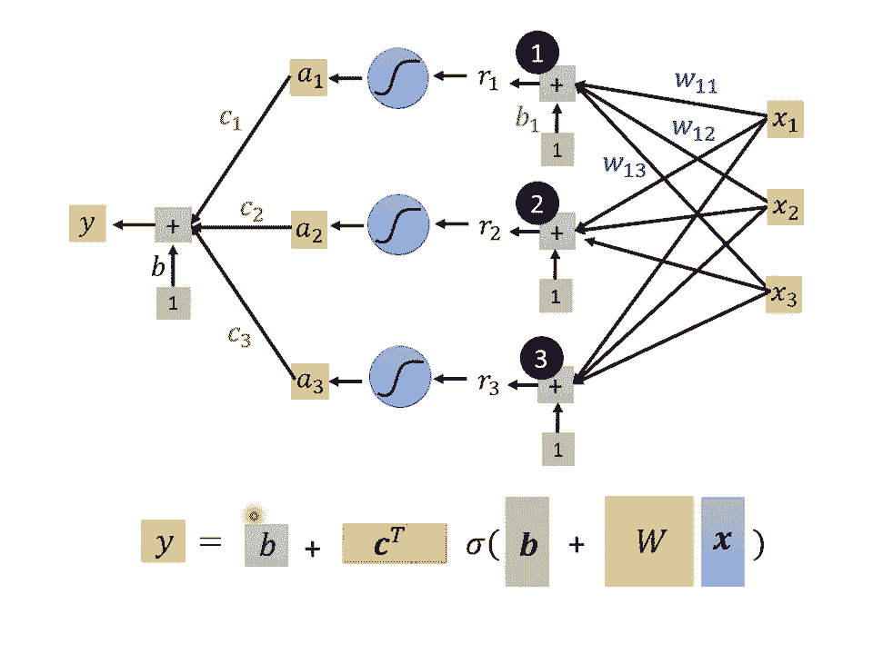

现在，我们可以构建一个新的、更有弹性的模型。假设我们用三个 Sigmoid 函数来组合，模型公式如下：

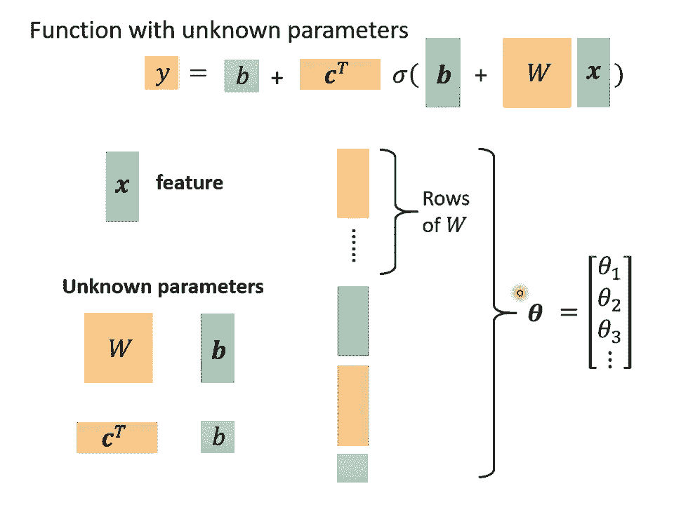

`y = b + c1 * sigmoid(b1 + w1 * x) + c2 * sigmoid(b2 + w2 * x) + c3 * sigmoid(b3 + w3 * x)`

这里，`b`, `c1`, `c2`, `c3`, `b1`, `b2`, `b3`, `w1`, `w2`, `w3` 都是未知参数。通过为这些参数设定不同的值，我们就可以组合出不同的曲线，从而拥有模拟复杂关系的能力。

这个模型克服了线性模型的“模型偏差”，因为它能表示的非线性关系要丰富得多。

## 引入多个特征

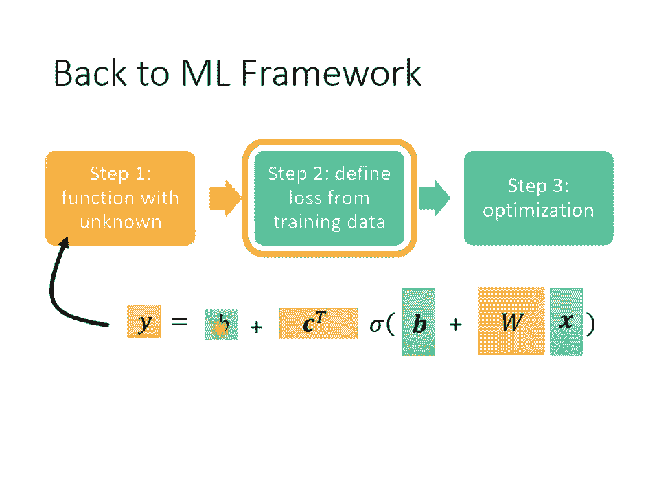

之前我们只使用了一个特征（如前一天的观看人数）。在实际问题中，我们通常会使用多个特征（如前1天、前2天……前N天的数据）。将模型扩展到多个特征也很简单。

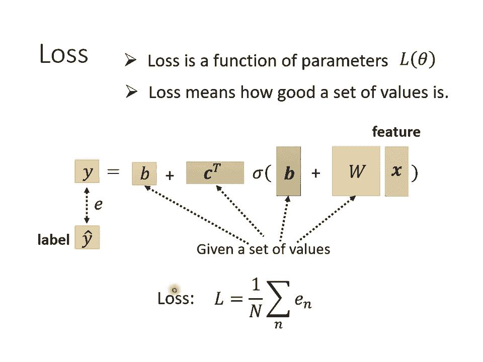

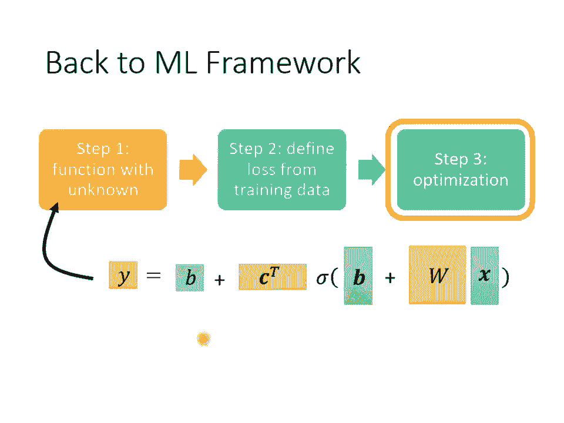

假设我们有 j = 1 到 N 个特征。对于第 i 个 Sigmoid 函数，其输入不再是单一的 `w * x`，而是所有特征与其对应权重的加权和。模型公式扩展为：

`y = b + Σ_i [ ci * sigmoid(bi + Σ_j [ wij * xj ]) ]`

其中：
*   `i` 代表第 i 个 Sigmoid 函数。
*   `j` 代表第 j 个输入特征。
*   `wij` 是第 i 个 Sigmoid 函数中，第 j 个特征对应的权重。
*   `bi` 是第 i 个 Sigmoid 函数的偏置项。
*   `ci` 是第 i 个 Sigmoid 函数输出后的缩放系数。
*   `b` 是整个模型的偏置项。

## 模型的神经网络表示

上面的数学公式可能有些抽象。我们可以用更直观的图（神经网络结构图）来表示这个计算过程。

1.  **输入层**：输入特征 `x1, x2, ..., xj`。
2.  **隐藏层**：每个 Sigmoid 函数对应一个“神经元”。每个神经元做的事情是：
    *   接收所有输入特征。
    *   计算加权和 `ri = bi + Σ_j (wij * xj)`。
    *   将 `ri` 通过 Sigmoid 函数，得到输出 `ai = sigmoid(ri)`。
3.  **输出层**：将所有神经元的输出 `ai` 乘以权重 `ci` 后求和，再加上偏置 `b`，得到最终预测值 `y`。

这个过程可以简洁地用线性代数表示：
*   `r = W * x + b_vec`
*   `a = sigmoid(r)`
*   `y = c^T * a + b`

其中，`W` 是权重矩阵，`b_vec` 是偏置向量，`c` 是输出权重向量。

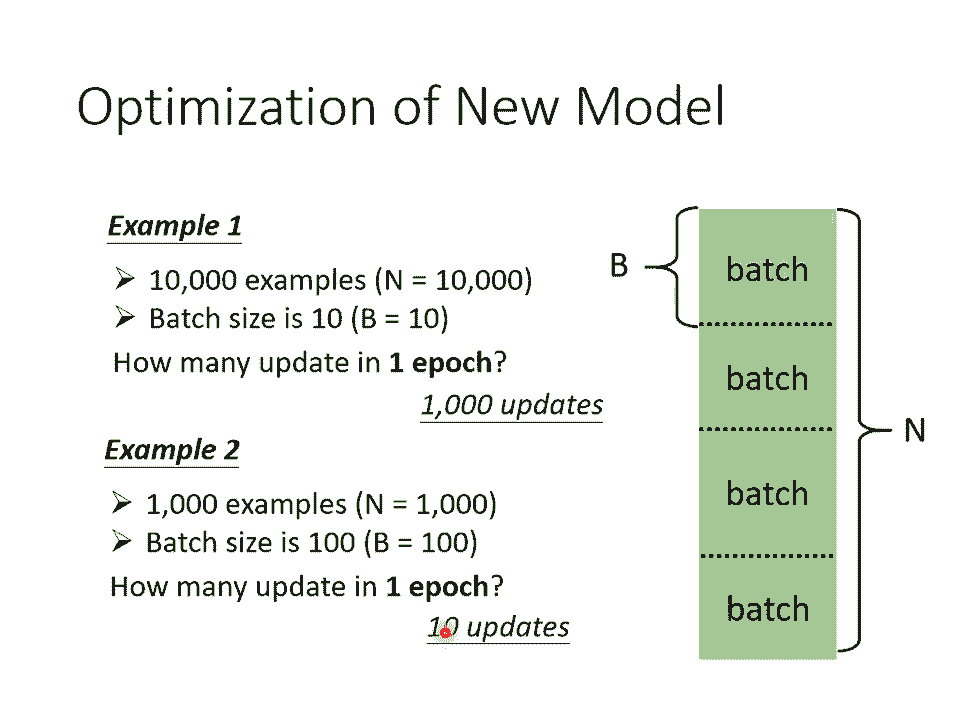

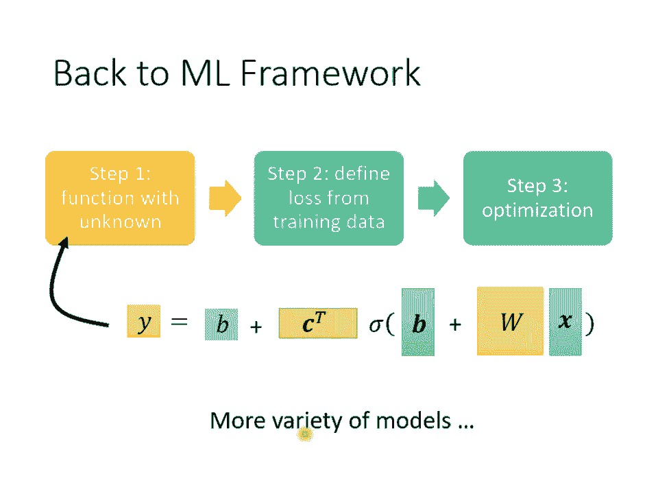

## 重新定义损失函数与优化

我们将所有未知参数（所有权重 W、偏置 b_vec、输出权重 c、最终偏置 b）拼接成一个很长的向量，记作 `θ`（参数向量）。

损失函数 `L(θ)` 的定义方式与线性模型相同：衡量模型在给定参数 `θ` 下的预测值与真实值之间的总体差距。

优化目标仍然是找到一组参数 `θ*`，使得损失 `L(θ)` 最小。优化算法仍然使用**梯度下降（Gradient Descent）**。

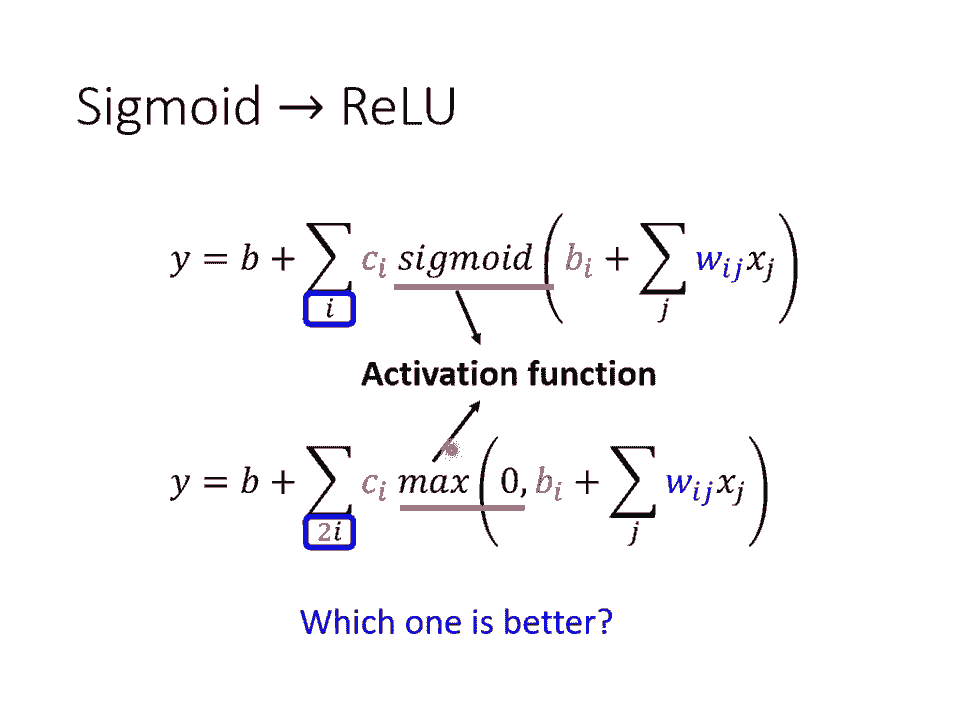

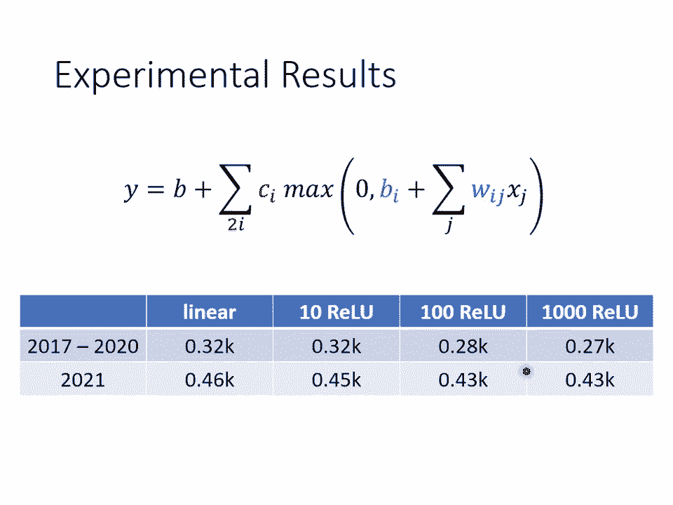

1.  随机初始化参数向量 `θ^0`。
2.  计算损失函数 `L` 对 `θ` 的梯度（偏导数向量），记作 `g = ∇L(θ)`。
3.  更新参数：`θ^1 = θ^0 - η * g`，其中 `η` 是学习率（Learning Rate）。
4.  重复步骤2和3，直到收敛。

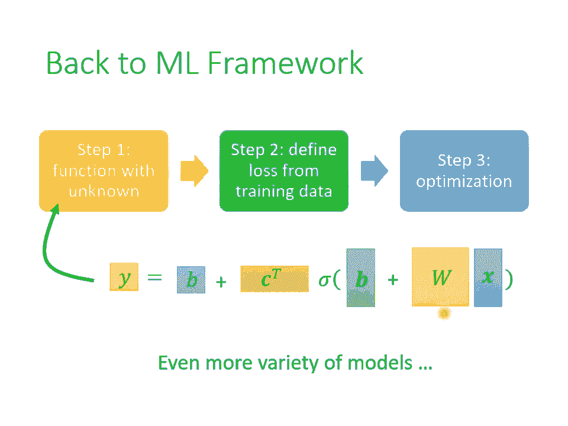

在实际操作中，我们通常不会一次性使用所有数据计算梯度，而是采用**小批量梯度下降（Mini-batch Gradient Descent）**：
*   将所有训练数据随机分成若干小份，每一份称为一个**批次（Batch）**。
*   每次迭代只使用一个批次的数据计算损失和梯度，并更新参数。
*   遍历完所有批次称为一个**周期（Epoch）**。

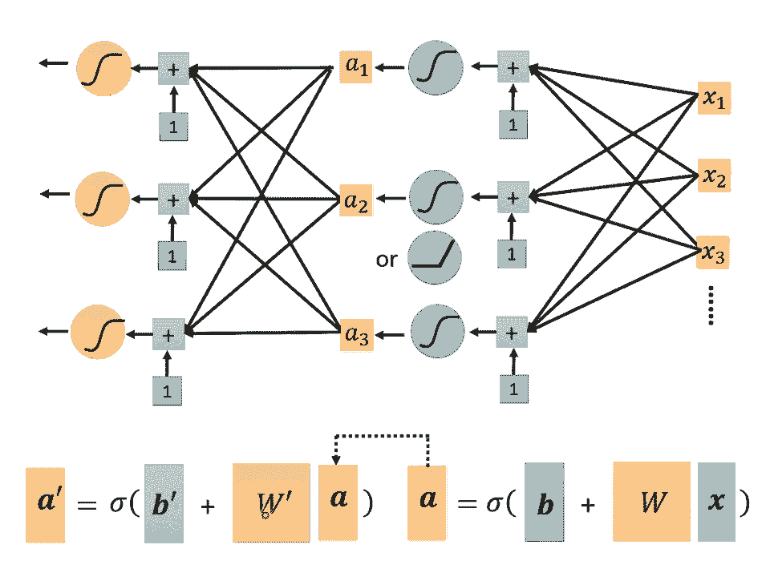

## 激活函数：Sigmoid 与 ReLU

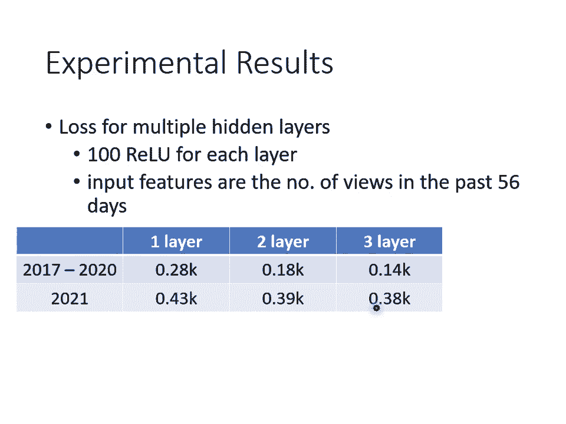

我们之前用 Sigmoid 函数来近似 Hard Sigmoid。实际上，还有其他函数可以作为神经元的“激活函数（Activation Function）”。另一个非常常见的是 **ReLU（Rectified Linear Unit）**。

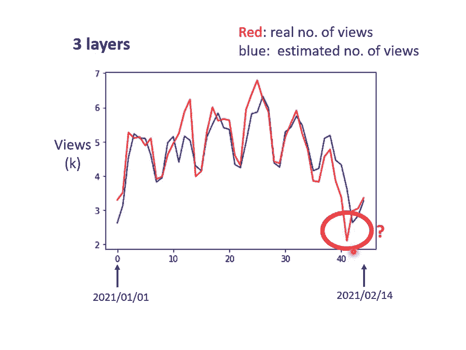

ReLU 函数的公式是：`y = max(0, b + w * x)`。
它的形状是一条折线：当输入小于0时输出为0，当输入大于0时输出为输入值本身。

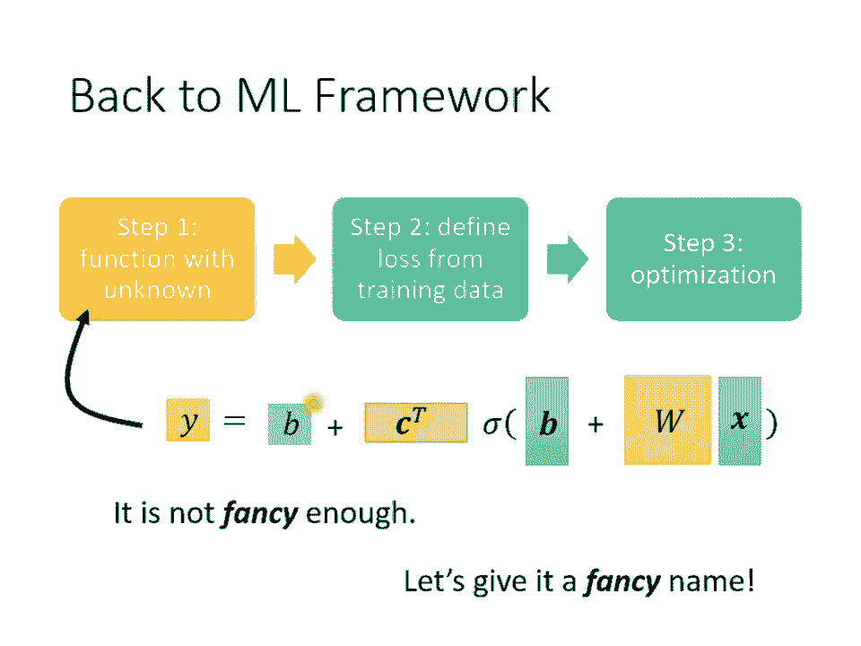

有趣的是，**两个 ReLU 函数可以合成一个 Hard Sigmoid 函数**。因此，在神经网络中，我们完全可以使用 ReLU 代替 Sigmoid。实际上，在深度学习中，ReLU 因其计算简单和训练中的良好性能，变得比 Sigmoid 更常用。

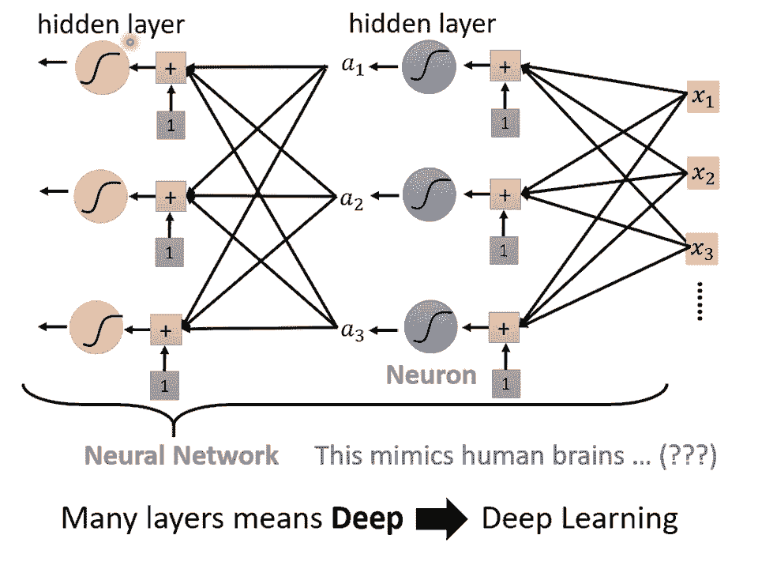

## 深度神经网络

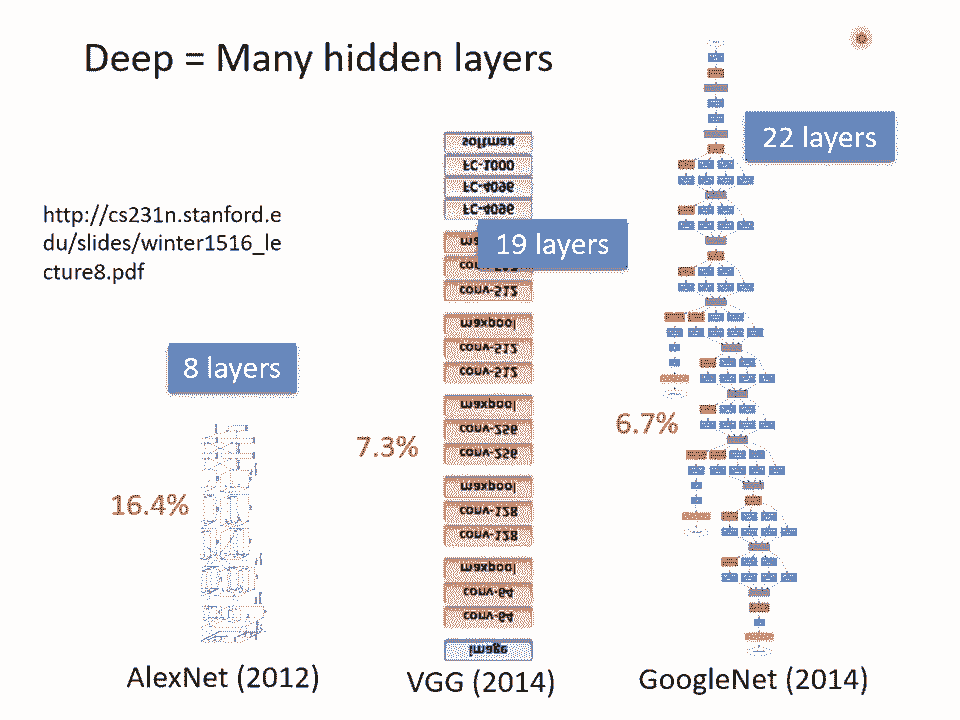

我们可以将上述“输入-隐藏层-输出”的结构反复堆叠。
*   第一层：输入 `x` 产生输出 `a`。
*   第二层：将 `a` 作为输入，通过新的权重和激活函数，产生输出 `a'`。
*   第三层：将 `a'` 作为输入，产生输出 `a''`。
*   ……
*   最后一层：输出最终预测 `y`。

每增加一层，就引入了更多的参数和非线性变换。这种多层的神经网络结构被称为**深度神经网络（Deep Neural Network）**，“深度”指的就是层数多。

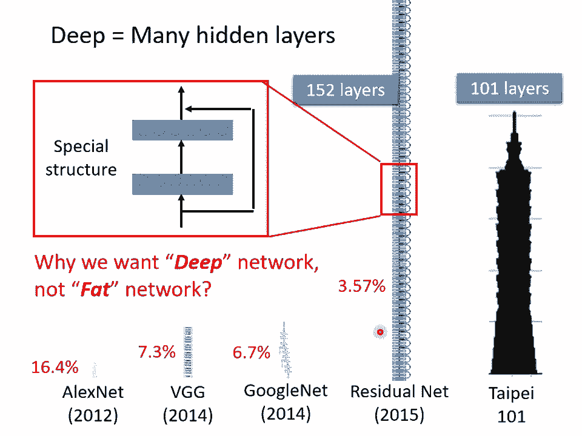

实验表明，在一定范围内，增加网络层数（使用更多参数和更复杂的结构）可以在训练数据上获得更低的损失。但这也可能带来**过拟合（Overfitting）**问题：模型在训练数据上表现很好，但在未见过的新数据上表现变差。

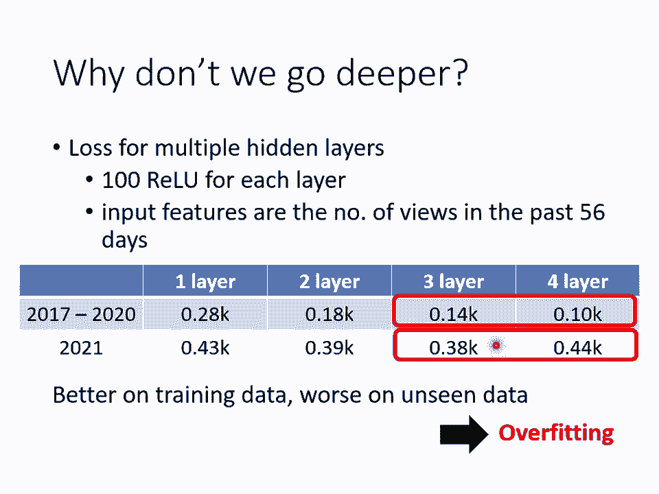

## 总结

本节课中我们一起学习了深度学习的基本概念：

1.  我们首先指出了简单线性模型的局限性（模型偏差），它无法表达复杂的非线性关系。
2.  为了克服这个问题，我们引入了由多个 Sigmoid 函数组合而成的更复杂的模型。这些函数可以逼近分段线性曲线，进而逼近任何连续函数。
3.  我们学习了模型的数学表示和直观的神经网络图示，包括输入层、隐藏层和输出层。
4.  我们介绍了模型的训练过程，核心仍然是定义损失函数和使用梯度下降法优化参数，并了解了实际常用的小批量训练方式。
5.  我们认识了两种重要的激活函数：Sigmoid 和 ReLU。
6.  最后，我们了解了通过堆叠多个隐藏层可以构建深度神经网络，并简要提到了模型复杂度和过拟合之间的关系。

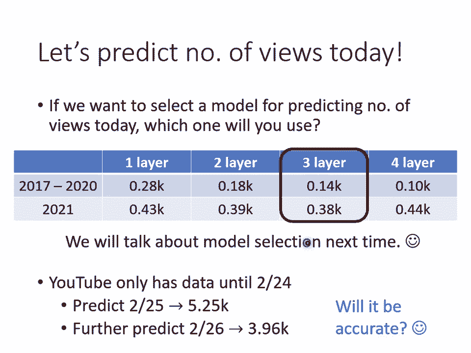

深度学习本质上就是使用包含多个隐藏层的神经网络，通过大量数据和梯度下降算法，学习输入与输出之间复杂的映射关系。在接下来的课程中，我们将深入探讨如何选择模型结构、避免过拟合以及更高效的训练技巧。